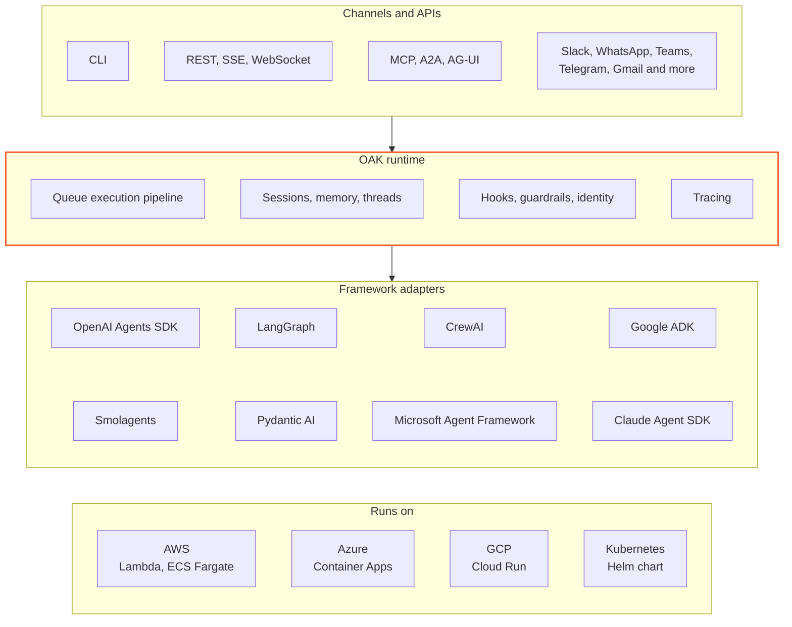

<p align="center">
  <picture>
    <source media="(prefers-color-scheme: dark)" srcset="branding/primary/open-agent-kernel-white-orange.svg">
    <source media="(prefers-color-scheme: light)" srcset="branding/primary/open-agent-kernel-color.svg">
    
  </picture>
</p>

<h3 align="center">The Operating System For Enterprise AI Agents</h3>

<p align="center">
  Open Agent Kernel (OAK) is the open-source runtime for scalable, compliant AI agents. Build agents in the framework you already use, and OAK runs them on AWS, Azure, GCP or Kubernetes, with sessions, guardrails, identity, tracing and messaging channels supplied by the platform.
</p>

<p align="center">
  <a href="https://pypi.org/project/agentkernel/"></a>
  <a href="https://pypi.org/project/agentkernel/"></a>
  <a href="LICENSE"></a>
  <a href="https://github.com/yaalalabs/agent-kernel/actions/workflows/test.yaml"></a>
  <a href="https://discord.gg/snrPzb46uu"></a>
  <a href="https://kernel.yaala.ai/docs"></a>
</p>

<p align="center">
  <a href="https://kernel.yaala.ai/docs">Documentation</a> ·
  <a href="#quick-start">Quick start</a> ·
  <a href="#capabilities">Capabilities</a> ·
  <a href="#architecture">Architecture</a> ·
  <a href="#deployment">Deployment</a> ·
  <a href="#examples">Examples</a> ·
  <a href="#community-and-support">Community</a> ·
  <a href="#contributing">Contributing</a>
</p>

## Why OAK

Agent frameworks are good at defining an agent: its prompt, its tools and its handoffs. Putting that agent in front of users is a separate job. It needs an API, session state, authentication, guardrails, tracing, a deployment topology, and often a Slack or WhatsApp front end. Teams usually end up writing that layer themselves, then rewriting it when the framework or the cloud changes.

OAK is that layer. You keep writing agents in the framework you already use and register them with an OAK module. The runtime supplies the rest.

- **Framework-agnostic.** Agents built with OpenAI Agents SDK, LangGraph, CrewAI, Google ADK, Smolagents, Pydantic AI, Microsoft Agent Framework and Claude Agent SDK run on the same runtime, and agents from different frameworks can run side by side.
- **Cloud-agnostic.** The same agent code runs as a local CLI, a REST container, on AWS Lambda or ECS, Azure Container Apps, GCP Cloud Run, or any Kubernetes cluster.
- **Configured, not coded.** Session stores, guardrails, identity, secrets, tracing and sandboxing are switched on in `config.yaml` or through `AK_` environment variables.
- **Open.** Apache 2.0 licensed, with MCP, A2A, AG-UI and A2UI support built in.

OAK is not a replacement for your agent framework, and it is not another heavy abstraction to learn. It is a thin adapter around the agents you already have.

## Quick start

You need Python 3.12 or 3.13 and [uv](https://docs.astral.sh/uv/getting-started/installation/). This example uses the OpenAI Agents SDK. The [quick start guide](https://kernel.yaala.ai/docs/quick-start) has the same steps for every supported framework.

```bash
uv init --python 3.12 my-agent
cd my-agent
uv add "agentkernel[openai]"
```

If you use pip, `pip install "agentkernel[openai]"` installs the same package.

Create `my_agent.py`:

```python
from agents import Agent as OpenAIAgent
from agentkernel.cli import CLI
from agentkernel.openai import OpenAIModule

# Define agents with the framework's own API
general_agent = OpenAIAgent(
    name="general",
    handoff_description="Agent for general questions",
    instructions="You provide assistance with general queries. Give short and direct answers.",
)

math_agent = OpenAIAgent(
    name="math",
    handoff_description="Specialist agent for math questions",
    instructions="You provide help with math problems. Explain your reasoning.",
)

# Register them with OAK
OpenAIModule([general_agent, math_agent])

if __name__ == "__main__":
    CLI.main()
```

Run it:

```bash
export OPENAI_API_KEY=your-api-key-here
uv run python my_agent.py
```

This opens an interactive CLI. Type a prompt to talk to the selected agent, `!list` to see the registered agents, `!select math` to switch, and `!quit` to exit.

To serve the same agents over HTTP, add the `api` extra with `uv add "agentkernel[api]"`, import `RESTAPI` from `agentkernel.api`, and replace `CLI.main()` with `RESTAPI.run()`. The server listens on port 8000 by default:

```bash
curl -X POST http://localhost:8000/api/v1/chat \
  -H "Content-Type: application/json" \
  -d '{"agent": "general", "prompt": "Hello!"}'
```

## Capabilities

Every agent request passes through six stages, and each one is switched on with a few lines of configuration. The [features page](https://kernel.yaala.ai/features) covers them in depth.

| Stage | What OAK provides | Docs |
|---|---|---|
| **Build** | Adapters for OpenAI Agents SDK, LangGraph, CrewAI, Google ADK, Smolagents, Pydantic AI, Microsoft Agent Framework and Claude Agent SDK, including several in one runtime. Tools written once and bound to any framework, pre and post execution hooks, multi-agent patterns, and image and file input | [Frameworks](https://kernel.yaala.ai/docs/frameworks/overview), [Tools](https://kernel.yaala.ai/docs/core-concepts/tools), [Hooks](https://kernel.yaala.ai/docs/integrations/hooks), [Multi-agent](https://kernel.yaala.ai/docs/advanced/multi-agent), [Multimodal](https://kernel.yaala.ai/docs/advanced/multimodal) |
| **Connect** | An interactive CLI, a REST API with SSE streaming and WebSocket delivery. An agent catalog, A2A cards and MCP tools built from one descriptor per agent. MCP and A2A servers, AG-UI event streaming and A2UI generative UI documents. Slack, WhatsApp, Microsoft Teams, Telegram, Gmail, Messenger and Instagram, plus LiveKit voice for OpenAI Agents SDK and Google ADK agents | [REST API](https://kernel.yaala.ai/docs/api/rest-api), [MCP](https://kernel.yaala.ai/docs/api/mcp-server), [A2A](https://kernel.yaala.ai/docs/api/a2a-server), [AG-UI](https://kernel.yaala.ai/docs/api/agui-server), [A2UI](https://kernel.yaala.ai/docs/advanced/a2ui), [Integrations](https://kernel.yaala.ai/docs/integrations/overview) |
| **Remember** | Pluggable session stores, persistent conversation threads, and request-scoped and session-scoped caches. ChromaDB, Neo4j, Starburst Galaxy and Open Knowledge Format bundles behind one `KnowledgeBase` interface | [Sessions](https://kernel.yaala.ai/docs/core-concepts/session), [Memory backends](https://kernel.yaala.ai/docs/core-concepts/memory-backends), [Threads](https://kernel.yaala.ai/docs/advanced/threads), [Knowledge bases](https://kernel.yaala.ai/docs/advanced/knowledge-bases) |
| **Guard** | Input and output guardrails, one identity provider for every surface, grants that decide which agents each caller may run and see and which of their tools, the caller's token kept for the run so a tool can call another service as them, secret resolution from a managed store, runs that pause for a person's approval or answer, and sandboxed code execution | [Guardrails](https://kernel.yaala.ai/docs/advanced/guardrails), [Identity](https://kernel.yaala.ai/docs/advanced/identity-and-access), [Secrets](https://kernel.yaala.ai/docs/advanced/secrets), [Human in the loop](https://kernel.yaala.ai/docs/advanced/human-in-the-loop), [Sandbox](https://kernel.yaala.ai/docs/advanced/sandbox) |
| **Scale** | A queued pipeline for every chat request: in-process by default, and over SQS, Kafka, NATS JetStream, Google Cloud Pub/Sub or Azure Service Bus in distributed deployments. Serverless and containerized targets on AWS, Azure, GCP and Kubernetes, and deferred and recurring chats | [Queue mode](https://kernel.yaala.ai/docs/advanced/queue-mode-guide), [Deployment](https://kernel.yaala.ai/docs/deployment/overview), [Scheduling](https://kernel.yaala.ai/docs/advanced/scheduling) |
| **Observe** | Tracing of agent runs, with LLM and tool calls where the framework supports it, in Langfuse, OpenLLMetry, Pydantic Logfire or AWS CloudWatch. A pytest-integrated test framework with score, LLM-judge and fallback comparison modes | [Traceability](https://kernel.yaala.ai/docs/advanced/traceability), [Testing](https://kernel.yaala.ai/docs/testing/overview) |

<details>
<summary><strong>Supported backends and providers</strong></summary>

| Layer | Options |
|---|---|
| Session, memory and conversation thread stores | In-memory, Redis, Valkey, DynamoDB (AWS), Cosmos DB (Azure), Firestore (GCP) |
| Knowledge bases | ChromaDB (vector), Neo4j (graph), Starburst Galaxy (SQL analytics on Trino), Open Knowledge Format bundles (markdown from a local directory or S3), or your own `KnowledgeBase` adapter |
| Queue transports | In-process (default), SQS, Kafka, NATS JetStream, Google Cloud Pub/Sub, Azure Service Bus |
| Guardrails | OpenAI Guardrails, AWS Bedrock Guardrails, Walled AI |
| Identity providers | Any OIDC issuer (Auth0, Keycloak, Okta), Amazon Cognito, Microsoft Entra ID, Firebase, a static credential map, or your own class |
| Secret providers | Environment, AWS SSM Parameter Store, mounted Kubernetes Secrets, or your own provider |
| Sandbox providers | `local_subprocess`, `docker`, `kubernetes`, `e2b`, `daytona`, `ec2_ssm`, or your own via a dotted path |
| Scheduling | `local` in-process timers or AWS EventBridge Scheduler, with task records in memory, Redis, Valkey or DynamoDB |
| Test evaluators | DeepEval (default), Opik, JEV, or your own evaluator |

</details>

<details>
<summary><strong>Human in the loop, scheduling and sandboxing</strong></summary>

- **Human in the loop.** A run can stop to ask a person for an approval or an answer, then resume from their decision minutes or hours later, on any replica. OAK returns HTTP 202 with `status: "PAUSED"` and the client answers with a `resume` block. OpenAI Agents SDK, LangGraph, Pydantic AI, Google ADK, Microsoft Agent Framework and Claude Agent SDK agents can pause, over REST, streaming, WebSocket and AG-UI, with Approve and Deny buttons in Slack and Telegram.
- **Deferred and recurring chats.** A `schedule` block in config turns on scheduling with no code change. A chat is deferred by a `schedule` block on the request (acknowledged with HTTP 202), by the agent's own `create_schedule` tool, or by a direct `ScheduleManager` call. Tasks can be listed, amended, paused and cancelled over `/api/v1/schedules`.
- **Sandboxed code execution.** Enabling the sandbox in config gives agents code, command and file tools that run in an isolated environment. Workload profiles set the sandbox lifetime (per call, per session or shared) and a permission policy that is enforced fail-closed: network egress, filesystem, CPU and memory, timeout, languages and package installs. Code can run under the invoking user's identity instead of one shared agent identity.

</details>

## Architecture

OAK sits between your agent logic and the surfaces that expose it. Requests arrive from a channel or an API, pass through the runtime, and reach your agent through a thin adapter for its framework. The same stack runs on a laptop and on every target in the bottom row.



Every adapter exposes the same five abstractions: `Agent`, `Runner`, `Session`, `Module` and `Runtime`. The [architecture overview](https://kernel.yaala.ai/docs/architecture/overview) describes each layer.

## Deployment

The same agent code runs on every target. Terraform modules cover AWS, Azure and GCP, and a Helm chart covers Kubernetes and on-prem clusters.

| Platform | Serverless | Containerized | Guides |
|---|---|---|---|
| **AWS** | [Lambda](ak-deployment/ak-aws/serverless) | [ECS Fargate](ak-deployment/ak-aws/containerized) | [Serverless](https://kernel.yaala.ai/docs/deployment/aws-serverless), [Containerized](https://kernel.yaala.ai/docs/deployment/aws-containerized) |
| **Azure** | Not offered (Functions is retired, see #957) | [Container Apps](ak-deployment/ak-azure/containerized), in one container or split over Service Bus | [Containerized](https://kernel.yaala.ai/docs/deployment/azure-containerized) |
| **GCP** | [Cloud Run, scale to zero](ak-deployment/ak-gcp/serverless) | [Cloud Run, always on](ak-deployment/ak-gcp/containerized) | [Serverless](https://kernel.yaala.ai/docs/deployment/gcp-serverless), [Containerized](https://kernel.yaala.ai/docs/deployment/gcp-containerized) |
| **Kubernetes and on-prem** | Not applicable | [Helm chart](ak-deployment/ak-k8s) for bare metal and EKS, with Kafka or NATS queue mode and KEDA autoscaling | [Kubernetes](https://kernel.yaala.ai/docs/deployment/onprem-kubernetes) |

The Terraform modules are also published on the [Terraform Registry](https://registry.terraform.io/modules/yaalalabs). The [deployment overview](https://kernel.yaala.ai/docs/deployment/overview) compares execution modes and protocol support across targets.

### Kubernetes with Helm

The chart is published as an OCI artifact at [`ghcr.io/yaalalabs/charts/agent-kernel`](https://github.com/yaalalabs/agent-kernel/pkgs/container/charts%2Fagent-kernel). Install it with Helm (the `docker pull` command GitHub shows on the package page does not apply to charts):

```bash
helm pull oci://ghcr.io/yaalalabs/charts/agent-kernel --version 0.10.2 --untar   # unpacks the flavor values files
helm install ak oci://ghcr.io/yaalalabs/charts/agent-kernel --version 0.10.2 \
  -f agent-kernel/values-dev.yaml \
  --set ioHandler.image.repository=<io image> \
  --set agentRunner.image.repository=<runner image> --set image.tag=<tag>
```

Flavors are values files over one set of templates: `values-dev.yaml` for a local cluster, `values-baremetal.yaml` for self-hosted clusters and `values-eks.yaml` for AWS EKS. Valkey and NATS ship as bundled dependencies, and every image the chart references is listed in the `images.txt` attached to each release for air-gapped mirroring.

## Agent skills

OAK ships skills that teach a coding assistant (Claude Code, GitHub Copilot, Cursor, Windsurf, Codex or Aider) how to build on it, so the code it writes follows the real APIs. The `ak` CLI that installs them comes with the `agentkernel` package.

```bash
ak skill install                       # GitHub Copilot by default
ak skill install --assistant claude    # or cursor, windsurf, codex, aider
```

Six skills cover the path from an empty directory to a deployed agent: `ak-init` scaffolds a project, `ak-build` adds tools, agents and handoffs, `ak-add-capabilities` wires in guardrails, tracing, sessions and the other platform features, `ak-add-integration` adds a messaging channel, `ak-cloud-deploy` generates the Terraform or Helm deployment, and `ak-test` sets up tests. The [agent skills guide](https://kernel.yaala.ai/docs/agent-skills) has the details, and [`use-cases/`](use-cases/) holds complete agents built this way, each starting from a `SPEC.md`.

## Documentation

Full documentation lives at [kernel.yaala.ai/docs](https://kernel.yaala.ai/docs). Good starting points are [installation](https://kernel.yaala.ai/docs/installation), [core concepts](https://kernel.yaala.ai/docs/core-concepts/overview), [configuration](https://kernel.yaala.ai/docs/core-concepts/configuration), the [framework guides](https://kernel.yaala.ai/docs/frameworks/overview) and the [deployment guides](https://kernel.yaala.ai/docs/deployment/overview).

The site also has a guided tour for each kind of reader:

| If you are | Start with | What it covers |
|---|---|---|
| A business leader | [The outcome](https://kernel.yaala.ai/business-leader) | Where agents pay off, what OAK is in plain words, and what adopting it commits you to |
| A developer | [The code](https://kernel.yaala.ai/developer) | The route from an empty folder to an agent that is deployed and tested |
| An AI engineer | [The runtime](https://kernel.yaala.ai/ai-engineer) | How OAK compares, where it sits in a request, and the memory, hook and queue machinery |

[Use cases](https://kernel.yaala.ai/use-cases) shows what teams build with OAK, [What's new](https://kernel.yaala.ai/docs/whats-new) lists the latest capabilities, the [changelog](CHANGELOG.md) lists every user-visible change by release, and the [blog](https://kernel.yaala.ai/blog) covers each release in depth.

## Examples

The [`examples/`](examples/) directory holds runnable projects, grouped by how they run. The [examples overview](https://kernel.yaala.ai/docs/examples/overview) describes each one.

- [`cli/`](examples/cli): one project per framework, plus guardrails, knowledge bases, tracing and test evaluators
- [`api/`](examples/api): REST, MCP, A2A, AG-UI, human in the loop, scheduling and each messaging channel
- [`aws-serverless/`](examples/aws-serverless), [`aws-containerized/`](examples/aws-containerized), [`azure-containerized/`](examples/azure-containerized), [`gcp-serverless/`](examples/gcp-serverless), [`gcp-containerized/`](examples/gcp-containerized) and [`k8s/`](examples/k8s): deployable projects for each target
- [`memory/`](examples/memory), [`sandbox/`](examples/sandbox) and [`transport/`](examples/transport): session stores, sandbox providers and queue transports

## Community and support

Join the community on [Discord](https://discord.gg/snrPzb46uu) for questions and discussion, and report bugs or request features through [GitHub Issues](https://github.com/yaalalabs/agent-kernel/issues). If OAK is useful to you, a star on GitHub helps other people find it.

OAK is a member of the [Linux Foundation](https://www.linuxfoundation.org) and the [Agentic AI Foundation](https://aaif.io).

## Contributing

Contributions are welcome. [CONTRIBUTING.md](CONTRIBUTING.md) covers the workflow, commit format and pull request checklist, and [DEVELOPER_GUIDE.md](DEVELOPER_GUIDE.md) covers local setup. If you work with an AI coding agent, point it at [AGENTS.md](AGENTS.md). Everyone taking part is expected to follow the [Code of Conduct](CODE_OF_CONDUCT.md).

## Security

Please do not report security vulnerabilities through public GitHub issues. [SECURITY.md](SECURITY.md) explains how to report them privately and what to expect in response.

## License

Unless otherwise specified, all content in this repository, including source and documentation files, is Copyright (c) 2025-2026 Yaala Labs and licensed under the [Apache License, Version 2.0](LICENSE). See [NOTICE](NOTICE) for attribution.

`SPDX-License-Identifier: Apache-2.0`
