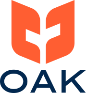

# Open Agent Kernel brand assets

The logo set and colour palette for Open Agent Kernel (OAK). Use these files as they are: do not redraw,
recolour, stretch or add effects to the mark or the lockups.

<p>
  
  &nbsp;&nbsp;&nbsp;&nbsp;
  
  &nbsp;&nbsp;&nbsp;&nbsp;
  
</p>

## Name

- Full name: **Open Agent Kernel**. Short name: **OAK**, always in capitals.
- Use the full name in titles and on first mention, written as "Open Agent Kernel (OAK)". Use "OAK" after that.
- Identifiers keep their current form: the `agentkernel` package, the `ak` CLI, `AKConfig`, `AK_*` environment variables.

## Logos

| Folder | Lockup | Use it for |
|---|---|---|
| `primary/` | Mark with "OPEN AGENT KERNEL" | The website navigation bar, the README header, social cards, covers, anywhere the full name should be read |
| `oak-horizontal/` | Mark with "OAK", side by side | Footers, compact headers and other spaces with limited height |
| `oak-vertical/` | Mark above "OAK" | Square spaces such as avatars and stickers |
| `logo-mark/` | The mark alone | Favicons, app icons, inline icons, diagram nodes |

Each lockup comes in six colourways. The mark comes in four (no `color` or `white-orange`, since it has one colour).

| File suffix | Colours | Background to use it on |
|---|---|---|
| `color` | Orange mark, Prussian Blue type | White and light backgrounds |
| `white-orange` | Orange mark, white type | Black, Prussian Blue and other dark backgrounds |
| `orange` | All Tiger Flame Orange | Prussian Blue |
| `blue` | All Prussian Blue | Pale Sky and other light blues |
| `white` | All white | The orange gradient and the blue gradient |
| `black` | All black | Grey and single-colour print |

Variants of one lockup share an aspect ratio, so they can be swapped at a fixed width or height.

## Colours

| Name | Hex | RGB | Role |
|---|---|---|---|
| Tiger Flame Orange | `#FF5E32` | 255, 94, 50 | Accent: the mark, calls to action, links, highlights |
| Prussian Blue | `#02284F` | 2, 40, 79 | Base: dark surfaces, type on light backgrounds |
| Dusk Blue | `#3F598A` | 63, 89, 138 | Support: borders, secondary surfaces |
| Pale Sky | `#ABCEE1` | 171, 206, 225 | Support: secondary text on dark, light surfaces |
| Baby Blue Ice | `#B1CDFF` | 177, 205, 255 | Support: ambient glows, diagram lines |

Orange is an accent. Keep it to the few things a reader should notice first, and let the blues carry the rest.

Text on an orange fill uses Prussian Blue or darker (4.86:1 or better). White text on orange is 3.04:1 and
is reserved for the logo and large display type.

## Gradients

```css
/* Orange */
background: linear-gradient(135deg, #FF5E32 0%, #F58A5E 100%);

/* Blue */
background: linear-gradient(225deg, #011C37 0%, #02284F 45%, #3F598A 100%);

/* Ice */
background: linear-gradient(135deg, #B1CDFF 0%, #3F598A 100%);

/* Sky */
background: radial-gradient(ellipse at 50% 0%, #ABCEE1 0%, #3F598A 75%);
```

## Source files

The designer's originals (the Illustrator file, the guideline PDF and PNG exports) live in `branding/source/`,
which is ignored by git because of its size. The SVGs here are byte-for-byte copies of the ones in that
folder, renamed.

The website serves its own copies of the files it needs from `docs/static/img/branding/`. When a logo
changes here, update that copy too.
