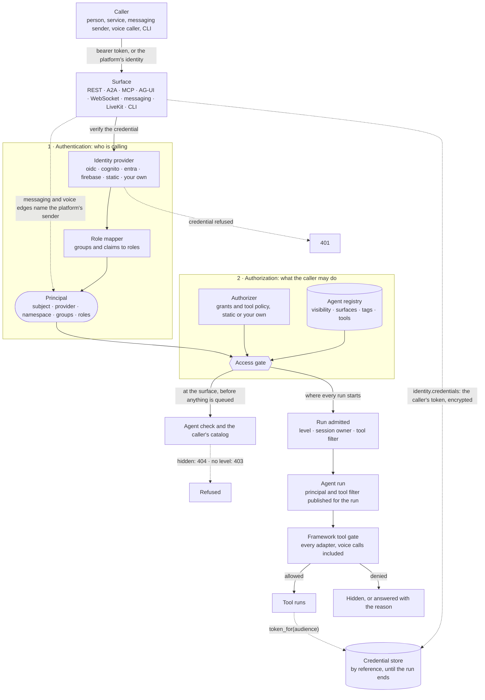

# Identity and Access

Open Agent Kernel (OAK) **authenticates every request through one configured identity provider and establishes a
`Principal` for the run**. The provider is configuration, not code: an `identity` block names it (an
OpenID Connect issuer such as Auth0, Keycloak or Okta, Amazon Cognito, Microsoft Entra ID, Firebase, a
static credential map, or your own class), and every surface the agent is reached through (REST,
WebSocket, AG-UI, MCP, A2A, the CLI, the messaging integrations) resolves the caller through it. Tools
and hooks read the same principal, threads and scheduled tasks belong to it, and a credential value is
never written in a configuration file. An optional `authorization` block then decides what each
principal may do: which agents it may run and see, and which of their tools it is offered
([Authorization](#authorization)).

```yaml
identity:
  provider:
    type: oidc
    issuer: https://login.example.com/
    audience: agent-kernel-api
```

```python
from agentkernel.core import ToolContext

def whoami() -> str:
    principal = ToolContext.get().principal
    return f"{principal.subject} in {principal.namespace} with groups {principal.groups}"
```

## Overview

| Concern | What it means |
| --- | --- |
| **Enablement** | An `identity` block selects the provider. Without one every request runs as the anonymous principal and an `Authorization` header is ignored. |
| **Provider** | One per deployment: `oidc`, `cognito`, `entra`, `firebase`, `static`, or a dotted path to an `IdentityProvider` subclass. |
| **Credential** | A bearer token on HTTP (`Authorization: Bearer <token>`), `?token=<credential>` on the WebSocket handshake, `--token` or `AK_CLI_TOKEN` on the CLI. |
| **Principal** | The subject, its namespace, groups, roles and claims, plus the agent acting on its behalf. Read it with `ToolContext.get().principal` in tools and `Session.get_principal()` in hooks. |
| **Anonymous** | With a provider configured, a request without a credential is anonymous and a credential that does not validate is a `401`. Which routes refuse the anonymous principal is each surface's rule (below). |
| **Roles** | The token providers issue no roles; a `static` entry may list them. An optional `role_mapper` replaces them with roles derived from groups and listed claims. A grant names one as `role:<name>`. |
| **Authorization** | An `authorization` block grants principals a level (`read`, `write`, `admin`) on agents. With it, a caller runs only the agents it is granted and sees only the ones it may see; without it nothing is restricted. See [Authorization](#authorization). |
| **Extra** | `oidc`, `cognito`, `entra` and `firebase` need `agentkernel[auth]` (PyJWT, cryptography, httpx). `static` needs nothing extra. |

## How it fits together

Authentication decides who is calling; authorization decides what that caller may do. OAK does the
first once, where a request enters, and the second twice: at the surface, before anything is queued, and
again where every run starts, down to the tools the agent may call.



1. **A caller presents a credential** to the surface it uses: a bearer token on HTTP, a token on the
   WebSocket handshake or the CLI. A messaging platform or a voice room vouches for its own sender
   instead.
2. **The identity provider verifies it** and returns a [principal](#the-principal): who the caller is,
   which provider and namespace vouched for it, and its groups. The role mapper adds roles. A credential
   that does not verify is a `401`; a request with none runs as the anonymous principal. Messaging and
   voice edges build the principal from the platform's sender (`messaging:<platform>`,
   `realtime:<gateway>`).
3. **The access gate decides** from two things: the agent registry, which says which agents exist and
   how each is described, and the authorizer, which holds the grants and the tool policy of the
   [`authorization` block](#authorization). Without the block nothing is restricted.
4. **At the surface**, before a session is loaded or anything is queued, the gate checks that the
   caller may use the agent it named and narrows what the caller is listed. An agent it may not see is a
   `404`, exactly as if it did not exist; one it sees and holds no level on is a `403`.
5. **Where every run starts**, the gate asks again, whichever surface the request came through: the
   caller's level on the agent, whether the [session](#sessions) is its to continue, and the run's tool
   filter. The principal and the filter are published for the run, where tools and hooks read them.
6. **The framework adapter's tool gate** applies the filter: a denied tool is kept from the model, or a
   call to it is answered with the reason instead of running ([where a denied tool is
   stopped](#where-a-denied-tool-is-stopped)). [Scheduled tasks](#scheduled-tasks) are decided again
   when they fire, and a paused tool call when its approval arrives.
7. **With `identity.credentials`**, the surface also keeps the caller's token, encrypted, under a
   reference the principal carries, and a tool that calls another service asks for a token for it; the
   token is deleted when the run ends ([credentials for downstream
   calls](#credentials-for-downstream-calls)).

## Configuration

```yaml
identity:
  provider:
    type: oidc                       # oidc | cognito | entra | firebase | static | a dotted path
    issuer: https://login.example.com/   # required by oidc; derived by cognito, entra and firebase
    audience: agent-kernel-api       # required by oidc, cognito (the app client id) and entra (the application id)
    jwks_uri: null                   # optional; discovered from the issuer when omitted
    algorithms: [RS256, ES256]       # allowed signing algorithms; symmetric ones are refused
    leeway: 30                       # seconds of clock skew tolerated on exp and nbf
    required_claims: []              # claims a token must carry beyond the standard set
    claims:
      subject: sub                   # claim path of the subject
      groups: groups                 # claim path of the group list, e.g. realm_access.roles
    cognito: {region: eu-west-1, user_pool_id: eu-west-1_abc123, token_use: access}
    entra: {tenant_id: 00000000-0000-0000-0000-000000000000}
    firebase: {project_id: my-project}
    static:
      principals:
        ALICE_TOKEN:                 # a secret key, resolved through the secret capability
          subject: alice
          kind: user                 # user | agent | service
          groups: [ops]
          roles: []                  # roles issued directly; a role_mapper replaces them
          claims: {email: alice@example.com}
  role_mapper:                       # optional; absent leaves only a static entry's own roles
    type: mapping                    # mapping | a dotted path to a RoleMapper subclass
    mapping:
      ops: [admin]                   # group name, or a value of a listed claim -> roles
    claims: []                       # claim paths whose values are looked up too; only groups by default
    pass_through: null               # a claim path whose string or list value becomes roles as it is
```

Every field has an environment form with the usual `AK_` prefix and `__` nesting:
`AK_IDENTITY__PROVIDER__TYPE=oidc`, `AK_IDENTITY__PROVIDER__ISSUER=...`,
`AK_IDENTITY__PROVIDER__AUDIENCE=...`, `AK_IDENTITY__PROVIDER__COGNITO__USER_POOL_ID=...`.

A claim path is a claim name, a namespaced name such as `https://acme.com/roles` (tried as one key
first, the way Auth0 issues custom claims), or dotted segments into a nested claim such as
`realm_access.roles`.

## Providers

| `type` | What it validates | Settings | Notes |
| --- | --- | --- | --- |
| `oidc` | A signed JWT from any OpenID Connect issuer: signature against the issuer's JWK set, `iss`, `aud`, `exp` and `nbf` | `issuer`, `audience`; optional `jwks_uri`, `claims` | Auth0, Keycloak, Okta and any other issuer. `namespace` is the issuer. |
| `cognito` | An Amazon Cognito user pool token | `cognito.region`, `cognito.user_pool_id`, `audience` (the app client id); `cognito.token_use` `access` (default) or `id` | Groups come from `cognito:groups`. |
| `entra` | A Microsoft Entra ID v2.0 token (v1 tokens are refused) | `entra.tenant_id`, `audience` (the application id) | The subject is `oid`; the `tid` claim must match the tenant. `roles` and `wids` stay in `claims`. |
| `firebase` | A Firebase Authentication id token | `firebase.project_id` | Issuer, audience and Google's JWK set are derived from the project. Groups default to the application's `roles` custom claim. |
| `static` | A credential from a configured map | `static.principals` | For development, tests and the CLI. The keys name secrets; see below. |
| a dotted path | Whatever your class accepts | The whole `identity.provider` block | See bring your own provider. |

### Any OpenID Connect issuer (`oidc`)

The provider reads `<issuer>/.well-known/openid-configuration` once to find the JWK set (or uses
`jwks_uri` directly), caches the keys, and refreshes them once when a token names an unknown key,
rate-limited so a flood of bad tokens cannot turn into a flood of fetches. An issuer that cannot be
reached refuses the token with a `401`, never a `500`, and a failed first load is retried only after
a short cooldown. A token must carry `exp`,
`iss` and `aud`; `aud` must contain the configured `audience`. The principal's `subject` is the
`claims.subject` path (`sub` by default), its `namespace` is the issuer, its `groups` the
`claims.groups` path, and every claim but the subject arrives in `claims` for the role mapper and the
tools, the groups claim included, so `role_mapper.pass_through` can lift it as it is. `algorithms` is
checked when the provider is built: an empty list, `none`, an unknown name or a symmetric `HS*`
algorithm is a configuration error at startup.

**Auth0** is served by this provider. Use the tenant's issuer (or the custom domain) with the trailing
slash as Auth0 issues it, the API identifier as the audience, and the namespaced claim an Auth0 Action
sets as the groups path:

```yaml
identity:
  provider:
    type: oidc
    issuer: https://<tenant>.<region>.auth0.com/   # or the custom domain; trailing slash included, as Auth0 issues it
    audience: <the API identifier of your Auth0 API>
    claims:
      groups: https://<your namespace>/roles       # the namespaced claim an Auth0 Action sets; omit if you set none
```

`permissions`, `org_id` and the other Auth0 claims reach the role mapper and the tools through
`claims`; the mapper looks a claim up only when `role_mapper.claims` lists it (`claims: [permissions]`).
A token to test with comes from the tenant's `/oauth/token` endpoint, for example through
the client-credentials flow of a machine-to-machine application authorised for the API.

**Keycloak**: the realm is the issuer, the client id is the audience (give the client an audience
mapper), and realm roles sit in a nested claim:

```yaml
identity:
  provider:
    type: oidc
    issuer: https://<host>/realms/<realm>
    audience: <client id>
    claims:
      groups: realm_access.roles
```

**Okta**: the authorization server is the issuer and its custom audience the audience; a `groups`
claim configured on the server fills the groups:

```yaml
identity:
  provider:
    type: oidc
    issuer: https://<domain>/oauth2/<authorization server id>
    audience: <the audience of the authorization server>
    claims:
      groups: groups
```

### Amazon Cognito (`cognito`)

```yaml
identity:
  provider:
    type: cognito
    audience: <app client id>
    cognito:
      region: eu-west-1
      user_pool_id: eu-west-1_abc123
      token_use: access              # or id
```

The issuer is derived from the region and the pool. A Cognito access token carries no `aud`: its
audience is `client_id`, which is checked against the configured audience; an id token carries `aud`
and is checked as any other. Groups come from `cognito:groups`.

### Microsoft Entra ID (`entra`)

```yaml
identity:
  provider:
    type: entra
    audience: <application id>
    entra:
      tenant_id: <tenant id>
```

The provider accepts **v2.0 tokens only**: the issuer is derived from the tenant as
`https://login.microsoftonline.com/<tenant>/v2.0`, and the token's `tid` must match it. Entra issues
v2.0 access tokens for your API only when its app registration sets `requestedAccessTokenVersion: 2`
(`api.requestedAccessTokenVersion` in the manifest; Terraform `azuread_application`:
`api { requested_access_token_version = 2 }`). Without it the access tokens are v1, carry the issuer
`https://sts.windows.net/<tid>/`, and are refused.

The subject is `oid`, the groups claim is `groups`, and `roles` and `wids` stay in `claims`, where the
role mapper reads them when `role_mapper.claims` lists them. A token carrying the groups-overage marker
for the configured groups claim (more groups than fit in a token) yields no groups, with one warning
per process: resolving them needs a Graph call this provider does not make. App roles read as groups
(`claims.groups: roles`) are not affected by the marker.

### Firebase Authentication (`firebase`)

```yaml
identity:
  provider:
    type: firebase
    firebase:
      project_id: <project id>
```

The issuer, the audience and Google's JWK set are derived from the project. Firebase has no built-in
role claim, so the groups path defaults to the application's `roles` custom claim; every custom claim
stays in `claims`. A boolean flag such as `admin: true` needs a role mapper of your own.

### Static credentials (`static`)

```yaml
identity:
  provider:
    type: static
    static:
      principals:
        ALICE_TOKEN:
          subject: alice
          groups: [ops]
        BOB_TOKEN:
          subject: bob
          kind: service
          claims: {team: finance}
```

Each key names a **secret**, not a value: `ALICE_TOKEN` is resolved through the
[secret capability](./secrets.md) when the provider is built (the process environment first, then the
configured secret provider), so the credential a client sends lives in an environment variable, an SSM
parameter or a mounted Kubernetes Secret, never in the file. A key with no secret is a configuration
error at startup, and so is an empty `principals` map; two keys resolving to the same value are
refused. An entry may list `roles` of its own; a `role_mapper` replaces them. Authentication compares the
presented credential against every resolved value in constant time, and the principal's `namespace`
is `static`. This is the provider the examples and the CLI run on.

### Bring your own provider

Set `identity.provider.type` to a dotted path to an `IdentityProvider` subclass. The class receives
the whole `identity.provider` block and reads settings of its own from `config.model_extra` (the block
keeps fields it does not define), and the configured role mapper wraps it like any built-in:

```python
from agentkernel.identity import AuthenticationError, IdentityProvider, RequestContext
from agentkernel.core.model import Principal


class ApiKeyProvider(IdentityProvider):
    name = "api_key"   # the value of Principal.provider

    def __init__(self, config):          # the identity.provider block
        self._keys = load_keys(config.model_extra["keys_table"])   # a setting of this provider's own

    async def authenticate(self, credential: str, context: RequestContext | None = None) -> Principal:
        key = self._keys.get(credential)
        if key is None:
            raise AuthenticationError("unknown api key")   # logged, never returned to the caller
        return Principal(subject=key.id, kind="service", provider=self.name, namespace="acme", claims={"tier": key.tier})

    def security_scheme(self):
        return ("apiKey", {"in": "header"})
```

```yaml
identity:
  provider:
    type: myapp.identity.ApiKeyProvider
    keys_table: acme-api-keys
```

A provider returns the facts it can vouch for (subject, groups, claims, the namespace the subject is
unique within) and never writes `roles`; `context` carries the request path, method and headers when
the surface knows them. `agentkernel.identity.provider.testing.IdentityProviderContract` and
`RoleMapperContract` are reusable pytest contract suites for provider and mapper implementations.

### Role mapper

Providers assert groups and claims; the `role_mapper` turns them into OAK roles, replacing
any a `static` entry listed. The built-in `mapping` type looks every group name up in `mapping` and
appends the roles found. A claim is looked up only when its path is listed in `claims`, and then its
string value (or each string item of a list) is looked up the same way. Only groups are looked up by
default because a user sets many of their own claims (a display name, a sign-up username, an email
address): matching every claim value would let one of them grant a role, so list only claims your
issuer controls. Last, the `pass_through` claim's string or list value is appended as roles as it is.
Boolean flags and nested claim objects are not mapped; bring a `RoleMapper` subclass by dotted path
for those. A dotted-path mapper receives the whole `identity.role_mapper` block, its own settings in
`config.model_extra`.

```yaml
identity:
  provider:
    type: oidc
    issuer: https://<host>/realms/<realm>
    audience: <client id>
    claims:
      groups: realm_access.roles
  role_mapper:
    type: mapping
    mapping:
      ops: [admin]                     # a realm role, read as a group
      finance: [reader]
      report-viewer: [reader]          # a client role, a value of the listed claim
    claims: [resource_access.<client id>.roles]   # client roles, which the realm assigns
    pass_through: https://acme.com/roles
```

## The principal

`Principal` (`agentkernel.core.model`) is who a run acts as:

| Field | Meaning |
| --- | --- |
| `subject` | The stable identifier the provider resolved: an OIDC `sub`, Entra's `oid`, a static entry's subject, a messaging platform's user id. |
| `kind` | `user` (default), `agent` or `service`. |
| `provider` | The provider's short name (`oidc`, `static`, ...), or `messaging:<platform>` and `realtime:<gateway>` for the integrations. |
| `namespace` | The scope the subject is unique within: the OIDC issuer, `static`, a Slack workspace id. |
| `groups` | The memberships the provider asserted. |
| `roles` | What the role mapper derived; without one, a `static` entry's own roles (the token providers issue none). A grant names one as `role:<name>`. |
| `claims` | Every other fact the provider kept, for the role mapper and the tools. |
| `actor` | The party acting on the subject's behalf: the agent principal (`kind: agent`, `provider: agentkernel`) the runtime attaches while a run executes. |

`Principal.anonymous()` is the principal of a request nobody authenticated; `principal.is_anonymous`
tells the two apart.

The runtime publishes the principal for the duration of a run. Tools read it with
`ToolContext.get().principal`, hooks and any code running inside the session with
`Session.get_principal()`, and `Session.get_owner()` returns a `SessionOwner` (`subject`, `provider`,
`namespace`), which records the first authenticated principal a session was used by. Threads and
scheduled tasks keep their own owner (the thread's `user_id`, the task's `principal`):

```python
from agentkernel.core import AgentReplyText, PreHook, Session

class OpsOnly(PreHook):
    async def on_run(self, session: Session, agent, requests):
        principal = session.get_principal()
        if "ops" not in principal.groups:
            return AgentReplyText(response="This agent serves the ops group only.")  # replies without running the agent
        return requests
```

A `principal` a client puts in a request body is never trusted: the surface that authenticated the
request overwrites it.

## Credentials for downstream calls

A tool that calls another service on the user's behalf needs a token for that service. With an
`identity.credentials` block, Open Agent Kernel (OAK) keeps the credential a request was authenticated with and
hands a tool a token for an audience you configure:

```python
from agentkernel.core.tool import ToolContext
from agentkernel.identity import CredentialError

async def list_invoices(customer_id: str) -> str:
    """List a customer's invoices."""
    try:
        token = await ToolContext.get().credentials.token_for("https://api.billing.example")
    except CredentialError as error:
        return f"Cannot reach billing: {error}"
    ...  # call the billing API with Authorization: Bearer <token>
```

```yaml
identity:
  provider:
    type: oidc
    ...
  credentials:
    encryption_key: AK_CREDENTIAL_KEY  # names a secret: a base64url-encoded 32-byte key; required by every store but in_memory
    inbound_ttl: 300                   # seconds a request's credential is kept, at most
    store:
      type: redis                      # in_memory (default) | redis | valkey | dynamodb | a dotted path
      redis:
        url: redis://cache:6379
    exchangers:
      - audience: https://api.billing.example
        type: passthrough              # forwards the inbound token unchanged: development only
        scopes: [invoices.read]        # asked for when a tool names none
```

How it works:

- **The token never travels.** The credential is kept, encrypted with AES-GCM under the key named by
  `encryption_key`, in the credential store under a random reference. The principal carries the reference
  (`credential_ref`), never the token, so the token is not in the session, a queue message or a log line.
- **It ends with the run.** OAK deletes the credential when the run it was kept for ends, however it ends,
  and in any case when `inbound_ttl` has passed or the token itself expires. No copy of it outlives the run:
  `passthrough` caches nothing.
- **Where it is kept.** The REST, A2A and AG-UI routes keep the credential of each authenticated request that
  can start a run (not of a `GET`, `HEAD` or `OPTIONS` request such as a catalog listing or a poll for a
  reply), and MCP the credential of each tool call (not of the session's other requests); on AWS Lambda the
  request-handler Lambda keeps it from the request's `Authorization` header when it starts a run (the
  authorizer keeps nothing, since API Gateway caches its answer for every request with the same token). A
  WebSocket connection (the `/ws` gateway, the ECS and the Lambda WebSocket APIs) and a CLI session keep
  theirs for the connection and forget it when it ends. It lasts as long as the token's `exp`; a token
  without one is kept for `inbound_ttl` from the latest frame (on the CLI, the latest prompt). A WebSocket
  route you add to a router behind the identity dependency keeps none.
- **Exchange.** A tool asks for an audience, and the exchanger configured for exactly that audience issues
  the token. A token a real exchanger issues is a token of its own, for that audience: it is cached per user,
  agent, audience, scopes and inbound credential until 30 seconds before it expires, so only a run that still
  holds the same inbound credential is served it. Only `passthrough` ships, and it logs a warning at startup:
  it forwards the inbound token as it came, which an MCP server or an API that checks its audience will
  refuse. For a real exchange (RFC 8693, Entra on-behalf-of),
  write a `TokenExchanger` subclass and name it by its dotted path; it receives its entry, with any settings of
  its own in `model_extra`. The names `rfc8693`, `entra_obo` and `id_jag` are reserved for later releases.
- **Errors.** `token_for` raises `CredentialError` when the block is not configured, the run has no credential
  of its own (an anonymous caller, a scheduled task), no exchanger serves the audience, the exchange fails or
  the store cannot be reached. Return it to the model as the tool's result.

The stores: `in_memory` keeps credentials in the process, unencrypted unless you set a key, and refuses to start
on a broker transport, on AWS Lambda (queued routes, WebSocket routes) and on the ECS WebSocket API, where the
process that keeps a credential is not the one that runs the agent. A store of your own is refused in the same
places when its class sets `shared = False`. `redis` and `valkey` keep each credential under `ak:cred:` with
its own expiry; `dynamodb` needs a table keyed by `credential_key` (S) with TTL on `expiry_time`, and reads it
with strongly consistent reads. Generate a key with
`python -c "import base64, os; print(base64.urlsafe_b64encode(os.urandom(32)).decode())"` and store it as the
secret `encryption_key` names.

A queued request that is delivered again after its run started finds its credential gone. An authenticated request
that can start a run but does not (amending or cancelling a schedule, an A2A `tasks/get`) leaves its encrypted entry
to expire within `inbound_ttl`.

## Authorization

Authentication establishes who is calling. An `authorization` block decides what that caller may do:
which agents it may run, which it may see, and which of an agent's tools it is offered. The block is
optional. Without it nothing is restricted, and every caller reaches every agent a surface serves.

```yaml
authorization:
  type: static                         # static, or a dotted path to an Authorizer subclass
  static:
    grants:
      - subjects: [group:support]      # who
        agents: [support-triage]       # on which agents
        level: write                   # read | write | admin
      - subjects: [authenticated]
        agents: [tag:help]             # every agent carrying the tag
        level: read
      - subjects: [provider:messaging:slack]
        agents: [support-triage]
        level: read
    tools:
      - agent: support-triage
        tiers: {refund_order: admin}   # the lowest level that is offered the tool
        deny: [purge_queue]            # never offered, at any level
```

The policy denies by default. Once the block exists, a principal runs an agent only when a grant gives
it a level on that agent, and a block with no grants denies every agent to everyone. The environment
form is `AK_AUTHORIZATION__TYPE` and `AK_AUTHORIZATION__STATIC__GRANTS` (a JSON list).

### Grants

A grant gives every subject it names a level on every agent it names. A principal holds the highest
level its grants give it. `subjects` and `agents` each take one entry or a list.

| Subject | Who it names |
| --- | --- |
| `*` | Everyone, the anonymous principal included. |
| `authenticated` | Every principal that is not anonymous, messaging and realtime senders included. |
| `user:<subject>` | The principal with that subject, as the identity provider authenticated it. It never names a messaging or realtime sender, whose subject is a platform id, nor the anonymous principal. |
| `group:<name>` | A principal whose `groups` include the name. |
| `role:<name>` | A principal whose `roles` include the name. Roles come from the [role mapper](#role-mapper), or from a `static` entry. |
| `provider:<name>` | A principal the named provider established (`oidc`, `static`, `messaging:slack`). A name ending in a colon matches by prefix: `provider:messaging:` is every messaging sender, `provider:realtime:` every realtime caller. |

| Agent entry | Which agents |
| --- | --- |
| an agent id | That agent. |
| `*` | Every agent. |
| `tag:<name>` | Every agent whose descriptor carries the tag (`Module.describe(agent, tags=[...])` or `registry.agents.<id>.tags`). |

The levels are ordered: `read`, then `write`, then `admin`. Any level runs the agent. The level decides
which of the agent's tools the caller is offered ([Tool policy](#tool-policy)).

Every caller needs a grant, not only the ones that send a token. A Slack user arrives as a
`messaging:slack` principal, a LiveKit caller as `realtime:livekit`, and a CLI run without `--token`
as the anonymous principal, so grant them through `provider:messaging:slack`, `provider:realtime:livekit`
or `*` when they should reach an agent.

### Visibility

Each agent's descriptor declares a `visibility`, set with `Module.describe(agent, visibility=...)` or
`registry.agents.<id>.visibility`. It decides who may see an agent they hold no level on:

| `visibility` | Seen by |
| --- | --- |
| `private` (default) | Only the principals a grant names. |
| `internal` | Those, and every authenticated principal. |
| `public` | Everyone. |

Seeing an agent is not using it: visibility never gives a level. The difference shows in the answer.
A caller that names an agent it may not see gets the answer an agent that does not exist gets, so a
response never confirms that a hidden agent is there. A caller that sees an agent and holds no level
on it is told so.

### What a caller gets

| Surface | An agent the caller may not see | An agent it sees, with no level | Listing |
| --- | --- | --- | --- |
| REST chat and the thread chat routes | `404`, `Agent '<name>' not found`, the answer for an unknown agent | `403`, `Principal '<subject>' holds no level on agent '<name>'` | `GET /api/v1/agents` lists the agents the caller may see |
| AG-UI | `404`, as for an unknown agent | `403` | `GET {prefix}/agents` lists the agents the caller may see |
| A2A | `404` on every route of the agent, card included, as for an agent that is not served | `403` on the message and task routes; the card is still served | `/a2a/catalog` lists the cards the caller may see |
| MCP | The tool is not listed, and a call is answered as a call to an unknown tool | The tool is listed; a call is the tool error `Agent not available` | `tools/list` lists the agents the caller may see |
| Messaging integrations | The platform's error message is delivered | The same | n/a |
| LiveKit realtime | No session is opened; the room gets one error, `Realtime session could not start: ...` | The same | n/a |
| Scheduled tasks | Not created (the chat route's `404`); a task whose owner later loses access is [skipped](./scheduling.md#skipped-occurrences) when it fires | Not created (`403`); skipped when it fires | n/a |

On the HTTP routes a refusal comes before anything is done for the request: no session is loaded, no
thread message is written, and on a streaming route the status is sent before the stream opens. A
request that names no agent runs the default agent, and when the caller may not see that agent the
answer is `400`, `No agent available`, which names no agent.

A listing carries only what the caller is offered. In a catalog entry and on an A2A card, `tools` and
the skills that stand for a tool are narrowed to the ones the caller's level reaches; a skill you
declared yourself, which names no tool, stays. Because the catalog and a card now depend on who asks,
those A2A responses carry `Vary: Authorization`.

### Sessions

With the block, a session belongs to the first authenticated principal that ran in it, and only that
principal continues it. Anyone else who sends its `session_id`, an anonymous caller included, gets a
`403`, `Session '<id>' belongs to another principal`. A session nobody authenticated in has no owner
and stays open.

A conversation on a messaging platform or a realtime call is shared by nature: several people post in
one Slack thread. Such a session belongs to the place it started in (the platform and its workspace,
tenant or project) and not to one sender. Anyone from the same place continues it, and a caller from
another workspace, another platform or the REST API does not.

### Scheduled tasks

A task runs as its owner. The owner must hold a level on the task's agent when the task is created,
and is asked about again every time the task fires, since a grant can be taken away in between. An
occurrence the owner may no longer run is not run: it is recorded on the task with the reason and
answered `403`. See [Skipped occurrences](./scheduling.md#skipped-occurrences).

The task keeps its owner as it was when the task was created, groups and roles included, because an
unattended run has no token to read them from again. A group the identity provider later removes is
therefore still on the task. To stop a task, change the grants, which are read each time it fires, or
cancel it.

### Tool policy

A tool policy sets, per agent, which tools each level is offered:

- **`tiers`** names the lowest level that is offered a tool. A tool with no tier is `read`, except
  OAK's own tools that change something outside the conversation, which declare `write`: the sandbox
  tools, the schedule tools, `write_kb` and `update_agui_state`.
- **`allow`**, when set, is the whole list of tools the agent offers, whatever the level.
- **`deny`** lists tools the agent never offers. It wins over `allow`.

The policy is decided once per run and published. Tools and hooks read it:

```python
from agentkernel.core import AccessLevel, ToolContext

def refund_order(order_id: str) -> str:
    level = ToolContext.get().access_level   # None when no authorization block gates the run
    if level is not None and level < AccessLevel.ADMIN:
        return "Refunds need the admin level."
    ...
```

`Session.get_tool_filter()` returns the whole decision in a hook or a tool: `level`, `allows(name)` and
`reason(name)`, the sentence that says why a tool is refused.

#### Where a denied tool is stopped

On every framework the policy narrows what the catalog and A2A cards list and is published for your
own code to read. Whether OAK also keeps the model from a denied tool depends on the framework the
agent is built with:

| Framework | A denied tool |
|---|---|
| OpenAI Agents SDK | Is not offered to the model, and a call that reaches it is answered with the reason. |
| Pydantic AI | Is not offered to the model, and a call that reaches it is answered with the reason. |
| Claude Agent SDK | Is not offered to the model (`disallowed_tools`), and a call that reaches it is denied with the reason. |
| Microsoft Agent Framework | Is not offered to the model, and a call that reaches it is answered with the reason. A call to a hidden tool bound with `approval_mode="always_require"` is still put to a person first, since MAF asks before any middleware runs, and is refused when the approval arrives. |
| Google ADK | Is still shown to the model; the call is answered with the reason and the tool is not run. |
| CrewAI | Is still shown to the model; the call is blocked and the model reads the reason. |
| LangGraph | Is still shown to the model; the call is answered with the reason and the tool is not run. Only tools bound with `LangGraphToolBuilder` can be gated: a bound tool is checked however it is called, while a node that calls an unbound tool or a plain function itself is outside the gate and the startup check. |
| smolagents | Is still shown to the model; the call is answered with the reason and the tool is not run. |

On a realtime call the OpenAI and Google ADK gates act as on a turn, with two differences. OpenAI's
realtime session answers a denied tool `Tool <name> not found` rather than with the reason. And a call
can have several participants (a LiveKit room), all speaking into one conversation, so the policy is
the room's: a tool is offered only when every participant who has spoken may use it, at the lowest
level among them, and a participant holding no level on the agent leaves the room no tool. Who
spoke last does not matter, so no participant can borrow another's level. A tool still reads the
identity of the participant who spoke last as its principal.

The reason is the sentence `Session.get_tool_filter().reason(name)` gives, for example
`Tool 'refund_order' requires level admin; the current principal has write`. The model reads it as the
tool's result and carries on, so a refusal never fails the run.

What the policy covers is the tools an agent declares when it loads, which are the tools its catalog
entry lists:

- **Tools that exist only inside a run are not offered.** The tools of an MCP server, or of a
  toolset handed over for one run, have no name a policy could offer. On Pydantic AI, Microsoft
  Agent Framework and Google ADK they are left out of, or refused in, a run that has an
  `authorization` block. An OpenAI Agents SDK agent with `mcp_servers`, or with a handoff built by
  hand that does not hold its agent, does not load while the block is configured: the error names
  what could not be gated. A Claude Agent SDK agent's other MCP servers are the exception: they stay
  outside the gate, as the hosted and built-in tools below do.
- **Agents a run can reach.** A run keeps the policy of the agent it started with, whichever agent
  ends up calling a tool. So the tools of the agents it can reach are listed under that agent and
  take their tiers from its policy; state them there. That covers the agents an OpenAI agent hands
  off to or uses as tools, the sub-agents, workflow nodes and agent tools under a Google ADK root,
  and the coworkers of a CrewAI agent that may delegate.
- **Moves between agents are not gated.** An OpenAI handoff, an ADK transfer to another agent, the
  tools CrewAI adds for delegation and a call to a smolagents managed agent are how a run moves, not
  tools you declared, so a policy cannot deny them. Nor is smolagents' `final_answer`, which ends a
  run. The tools the run reaches afterwards are gated as above, and a smolagents manager lists the
  tools of its managed agents.
- **Tools OAK cannot gate stop the agent from loading.** With an `authorization` block, a LangGraph
  agent with a tool not bound through `LangGraphToolBuilder` (a `@tool` from LangChain, a
  `StructuredTool` you built), a smolagents code agent that runs its tools in a remote sandbox
  (E2B, Docker, Modal), and an OpenAI Agents SDK agent with a tool the SDK runs in your process
  without a guardrail (a local `ShellTool`, `LocalShellTool`, `ApplyPatchTool`, `ComputerTool` or
  `CustomTool`) fail to load and the error names the tools. A LangGraph tool in a compiled
  subgraph counts too. Rebind the tools with the tool builder or as function tools, or run the code
  agent on the local executor.
- **Hosted and built-in tools are not stopped.** A tool the provider runs (OpenAI's web search, file
  search and code interpreter, Google Search and URL context on ADK), Claude Code's built-in tools
  and the tools of other MCP servers on a Claude agent are outside the gate. The application starts
  and logs a warning naming them; use the framework's own settings for those.
- **A paused call.** A tool that waits for a human's approval is asked about again when the approval
  arrives: if the policy denies it by then, it is not run.


### Startup checks

The policy is checked when the application starts, so a mistake does not wait for the request it
would have affected:

- A key the block does not take, a subject that is not one of the six forms, or a level outside the
  three stops the application with an error that names the entry, for example
  `authorization.static.grants[2]`.
- A tool policy that names a tool its agent does not have stops the application, with the tools the
  agent does have. A misspelt `deny` would otherwise deny nothing.
- An agent with tools OAK cannot gate (a LangGraph tool not bound with `LangGraphToolBuilder`, the
  tools of a smolagents code agent on a remote executor, an OpenAI agent's `mcp_servers`, a handoff
  that does not hold its agent or an SDK tool that runs in the process) stops the application,
  naming the tools.
- A grant that names an agent id or a tag no agent carries, and a `role:` subject with no role mapper
  configured, are logged as warnings: they match nothing today. So are an agent's hosted and
  built-in tools, which the tool policy does not reach.

### Where the block goes

Put the same `authorization` block in the configuration of every process. The process that runs the
agents is where the decision is enforced, for every run and whatever route the request took. The
process that accepts requests answers early from the same policy: it filters the listings, and it
refuses a request before queueing it when its [agent registry](../core-concepts/configuration.md#agent-registry)
knows the agents. Where that process knows no agent at all, or the request arrives another way (a
WebSocket frame, a messaging webhook), the runner's refusal is the one the caller gets.

A handoff from one agent to another inside a framework is not a new request. The level is checked for
the agent a request enters by.

### Bring your own authorizer

`type` also takes a dotted path to an `Authorizer` subclass, for a policy held somewhere else. The
class is handed the whole block, with its own settings in `config.model_extra`, and answers two
questions:

```yaml
authorization:
  type: my_app.authz.TeamAuthorizer
  team_service_url: https://teams.internal
```

```python
from agentkernel.core import AccessLevel
from agentkernel.identity import Authorizer, Decision

class TeamAuthorizer(Authorizer):
    def __init__(self, config):
        self._url = config.model_extra["team_service_url"]

    async def agent_level(self, principal, agent_id) -> AccessLevel | None:
        """The level the principal holds on the agent, or None for no access."""
        ...

    async def check_tool(self, principal, agent_id, tool) -> Decision:
        """Whether the principal may call the tool; a refusal carries the reason."""
        return Decision(allowed=True)
```

Everything else has a default built on those two: `filter_tools` and `visible_agents` ask them once
per item, and a backend that can answer a whole list at once overrides them. `validate` is where a
backend checks its own policy at startup. An authorizer can be awaited from more than one event loop,
so it must not tie a connection to the first one. `agentkernel.identity.authz.testing.AuthorizerContract`
is a reusable pytest suite for an implementation. `casbin`, `openfga`, `cedar` and `authzen` are reserved
type names for engines that are not shipped yet.

## What each surface does

| Surface | Credential | Without a credential | Refused credential |
| --- | --- | --- | --- |
| REST chat (`/api/v1/chat`, `/api/v1/chat-multipart`; SSE with `execution.message_type: delta`) | `Authorization: Bearer` | Runs anonymous | `401` |
| Conversation threads (`/api/v1/threads`, the thread chat routes) | `Authorization: Bearer` | `401 Authentication required`: a thread belongs to its principal and listing is scoped to the caller | `401` |
| Scheduled tasks (`/api/v1/schedules`, a `schedule` block on a chat request) | `Authorization: Bearer` | `401` on the management routes; a chat request with a `schedule` block is `403` (scheduling requires an authenticated principal) | `401` |
| WebSocket gateway (`/ws`: the Kubernetes gateway tier, single-process async mode) | `?token=<credential>` on the handshake | The socket is accepted, then closed with code `1008` and the reason `Authentication token is required` | Closed with `1008` and `Authentication failed` |
| AWS ECS WebSocket and the Lambda `$connect` | `?token=<credential>` on the handshake | The handshake is refused: `401 Authentication token is required` | `401 Authentication failed` |
| AG-UI | `Authorization: Bearer` | `401`: AG-UI runs an agent on a caller's behalf | `401` |
| MCP | `Authorization: Bearer`, enforced by FastMCP | `401` once an `identity` block exists; open and anonymous without one. With an OpenID-family provider the `401` points at the RFC 9728 resource metadata for `mcp.url` ([MCP guide](../api/mcp-server.md)) | `401` |
| A2A | `Authorization: Bearer` | Runs anonymous | `401` |
| CLI | `--token <credential>` or `AK_CLI_TOKEN` | Runs anonymous | Exits with `Authentication failed` |
| Messaging integrations | The platform's own verification; the webhook routes skip the identity dependency, so a platform token in `Authorization` (Teams) reaches it | A `messaging:<platform>` principal: the platform user id as subject, the workspace or tenant as namespace, platform facts in claims. A webhook whose verification secret is unset (`whatsapp.app_secret`, `messenger.app_secret`, `instagram.app_secret`, `telegram.webhook_secret`) logs a warning and runs its deliveries anonymous | n/a |
| LiveKit realtime | The gateway's own verification | A `realtime:<gateway>` principal | n/a |

Two consequences for request bodies: `user_id` is not a request field any more (a body carrying it is a
`400` with `user_id is not a request field; the acting user comes from the credential`), and the thread
and schedule listings take no `user_id` query parameter: they return the caller's own records. Thread
and task objects still report their owner in a `user_id` field. The thread and schedule handlers
(`AgentThreadRequestHandler`, `ThreadRequestHandler`, `ScheduleRESTRequestHandler`) and
`AGUIRequestHandler` take no arguments and refuse to construct without an `identity` block, as do the
WebSocket modes.

On the routes `RESTAPI` serves, a `401` for a refused bearer token, and the `401 Authentication required`
of a route that needs an authenticated caller, carry `WWW-Authenticate: Bearer`. A WebSocket route of
your own on a router `RESTAPI` mounts goes through the same identity dependency: a refused bearer
header closes the socket with `1008` and the public reason instead.

The sandbox's default principal resolver reads the run principal, so a profile with `identity.mode: user`
runs code as the authenticated caller with no custom resolver. A run for a messaging or realtime sender
(a `messaging:` or `realtime:` principal, whose subject is a platform id) resolves to agent mode like an
anonymous one, so a `user`-mode profile refuses it. A profile left on `agent` mode keeps running as the
agent whoever calls; see the [sandbox guide](./sandbox.md).

## Deployments

The identity block belongs in the configuration of the **process that authenticates**, and the
credential of a static provider reaches that process as an environment variable or a mounted Secret.

- **AWS Lambda** ([guide](../deployment/aws-serverless.md)): the API Gateway authorizer Lambda is one
  line, `handler = APIGatewayAuthorizer().handle`; it authenticates the bearer token through the
  provider and returns an Allow policy whose context carries the principal; a refused, expired or
  malformed token raises `Unauthorized` (a 401 from API Gateway), and a request with no token is a
  Deny (403). The
  request-handler Lambda puts that principal on the chat request; a custom route registered with
  `Lambda.register` reads it with `Lambda.principal(event)`. Webhook routes that carry their own
  verification bypass the authorizer with `APIGatewayAuthorizer(bypass=WebhookRouteMatcher.for_integrations("slack"))`.
  For WebSocket APIs the `$connect` Lambda is `handler = WebsocketConnectionHandler.handler`, which
  authenticates `?token=` and stores the principal with the connection; a custom WebSocket route
  registered with `Lambda.register` reads that connection's principal with `Lambda.principal(event)`
  as well. The authorizer module keeps
  its `handler_path` contract and the connections table its `user_id` hash key: the Terraform modules
  are unchanged. With `identity.credentials`, use a shared store (`redis`, `valkey` or `dynamodb`) that
  the request-handler, `$connect` and agent-runner Lambdas can all reach.
- **AWS ECS** ([guide](../deployment/aws-containerized.md)): the REST service authenticates every
  request; in WebSocket mode the service authenticates the handshake's `?token=`, and custom WebSocket
  routes receive `{"message": ..., "principal": ...}`. With `identity.credentials` in WebSocket mode,
  use a shared store, which the service requires: a frame can reach a task other than the one that took
  the handshake, as it does during every rolling deploy.
- **Azure Functions** ([guide](../deployment/azure-serverless.md)): `AzureFunctions.handler`
  authenticates the bearer header before parsing the request and answers a refused credential with
  `401` and `{"error": ..., "session_id": null}`.
- **Kubernetes** ([guide](../deployment/onprem-kubernetes.md)): the io handler and the WebSocket
  gateway build the provider, so a static credential reaches them through the chart's per-tier
  `ioHandler.extraEnv` and `wsGateway.extraEnv` from a Secret, which keeps it off the agent runner;
  the `secretStore` mount reaches only the agent-executing tier. With `identity.credentials`, the
  `encryption_key` secret reaches every tier, since the io handler and the gateway keep tokens and the
  agent runner reads them, and the store is a shared one.
- **GCP** ([guides](../deployment/gcp-serverless.md)): the examples authenticate Google identity
  tokens at the API Gateway, and the application runs as the anonymous principal. The gateway calls
  Cloud Run with its own token in `Authorization` and forwards the caller's header as
  `X-Forwarded-Authorization`, which the built-in providers do not read. A provider of your own can,
  since `context.headers` carries it; the guides say when the forwarded headers can be trusted.

## Migrating from `agentkernel.auth`

The `agentkernel.auth` package (`AuthValidator`, `Authoriser`, the JWT and JWKS validators) and the
handler-level hooks that took them are gone. Authentication is configuration now:

| Before | Now |
| --- | --- |
| `RESTAPI.add_auth_handlers([...])`, `WebSocketGateway.run(auth_validator=...)`, `IOHandler.run(auth_validator=...)` | An `identity` block; `WebSocketGateway.run()`, `IOHandler.run(handlers=[...])` |
| `AgentThreadRequestHandler(authoriser)`, `ThreadRequestHandler(authoriser)`, a schedule handler with an `Authoriser` | `AgentThreadRequestHandler()`, `ThreadRequestHandler()`, `ScheduleRESTRequestHandler()`; ownership is the principal's |
| `AGUIRequestHandler(authoriser)` | `AGUIRequestHandler()` |
| A JWT validator class per deployment | `type: oidc` (or `cognito`, `entra`, `firebase`) |
| A Lambda authorizer that wraps a validator | `handler = APIGatewayAuthorizer().handle` |
| `GCPAuthorizer` | Gone; the API Gateway's own JWT check, or an `oidc` block |
| `user_id` in request bodies and `?user_id=` on listings | The credential; a body carrying `user_id` is a `400` |
| `acting_user_id` on `Runtime.run` | `principal` on `Runtime.run`, `AgentService.run_multi` and `stream_multi` |
| Custom validation logic | A bring-your-own `IdentityProvider` by dotted path, or a `RoleMapper` |

Threads and scheduled tasks recorded before the change carry a user id without a namespace; recreate
or migrate them outside the system.

## Examples

Every example runs on the `static` provider with its credential read from the environment:
`ALICE_TOKEN` and `BOB_TOKEN` for the two-user API demos, `DEMO_TOKEN` for the single-user ones, and
`DEMO_AUTH_TOKEN` for the AWS and Kubernetes deployments (a sensitive `demo_auth_token` Terraform
variable, or the `demo-credentials` Secret on Kubernetes).

- [`examples/aws-serverless/openai-auth`](https://github.com/yaalalabs/agent-kernel/tree/develop/examples/aws-serverless/openai-auth)
  : the authorizer Lambda on the static provider, with the Auth0 `oidc` configuration documented beside it.
- [`examples/api/thread-openai`](https://github.com/yaalalabs/agent-kernel/tree/develop/examples/api/thread-openai)
  and [`examples/api/multimodal/thread-openai`](https://github.com/yaalalabs/agent-kernel/tree/develop/examples/api/multimodal/thread-openai)
  : two users whose threads stay their own.
- [`examples/api/schedule-openai`](https://github.com/yaalalabs/agent-kernel/tree/develop/examples/api/schedule-openai)
  and [`examples/aws-serverless/schedule-openai`](https://github.com/yaalalabs/agent-kernel/tree/develop/examples/aws-serverless/schedule-openai)
  : scheduled tasks owned by the authenticated caller; the serverless one adds an authorizer Lambda and reads the owner with `Lambda.principal`.
- [`examples/api/agui`](https://github.com/yaalalabs/agent-kernel/tree/develop/examples/api/agui),
  [`examples/api/hitl`](https://github.com/yaalalabs/agent-kernel/tree/develop/examples/api/hitl) and
  [`examples/api/a2ui-openai`](https://github.com/yaalalabs/agent-kernel/tree/develop/examples/api/a2ui-openai)
  : single-user API demos, the a2ui frontend sending the bearer token.
- [`examples/aws-containerized/openai-websocket`](https://github.com/yaalalabs/agent-kernel/tree/develop/examples/aws-containerized/openai-websocket),
  [`openai-stream`](https://github.com/yaalalabs/agent-kernel/tree/develop/examples/aws-containerized/openai-stream),
  [`openai-stream-queue-mode`](https://github.com/yaalalabs/agent-kernel/tree/develop/examples/aws-containerized/openai-stream-queue-mode) and
  [`openai-websocket-scalable`](https://github.com/yaalalabs/agent-kernel/tree/develop/examples/aws-containerized/openai-websocket-scalable)
  : ECS WebSocket handshakes authenticated with `?token=`, custom routes reading the principal.
- [`examples/aws-containerized/crewai-auth`](https://github.com/yaalalabs/agent-kernel/tree/develop/examples/aws-containerized/crewai-auth)
  and [`examples/aws-containerized/openai-schedule`](https://github.com/yaalalabs/agent-kernel/tree/develop/examples/aws-containerized/openai-schedule)
  : ECS REST services on the static provider.
- [`examples/aws-serverless/slack-openai`](https://github.com/yaalalabs/agent-kernel/tree/develop/examples/aws-serverless/slack-openai)
  : the authorizer with a webhook bypass for Slack's signed deliveries.
- [`examples/aws-serverless/websocket-openai`](https://github.com/yaalalabs/agent-kernel/tree/develop/examples/aws-serverless/websocket-openai)
  and [`examples/aws-serverless/streaming-openai`](https://github.com/yaalalabs/agent-kernel/tree/develop/examples/aws-serverless/streaming-openai)
  : the `$connect` Lambda on `WebsocketConnectionHandler.handler`.
- [`examples/k8s/openai-queue-mode`](https://github.com/yaalalabs/agent-kernel/tree/develop/examples/k8s/openai-queue-mode)
  : the credential delivered through a Secret and the io and gateway tiers' `extraEnv`, sent by the WebSocket and protocol clients.
- [`examples/sandbox/identity`](https://github.com/yaalalabs/agent-kernel/tree/develop/examples/sandbox/identity)
  : sandboxed code running as the caller, with a custom resolver as the override of the default.
