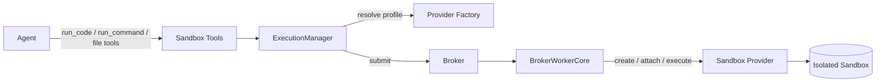

# Sandbox

Agent Kernel's **sandbox capability** gives agents a first-class, permission-bounded way to
**execute code and shell commands, work in a persistent workspace, and read/write files** in
an isolated environment. When enabled, agents automatically gain a set of sandbox tools and
the usage guidance is injected into their system prompt, so your agent code stays free of
sandbox mechanics.

## Overview



For a deeper look at the internals behind this diagram (class contracts, broker and worker
flows, session lifecycle, error hierarchy), see
[Architecture → Sandbox Internals](../architecture/sandbox-internals.md).

Key design points:

- **Self-describing.** With `sandbox.enabled: true`, Agent Kernel attaches the sandbox tools
  to agents and injects their usage into the system prompt. Your agent's own instructions
  never need to mention the sandbox.
- **Config-driven.** Everything — provider, isolation, lifetime, permissions, identity — is
  chosen in `config.yaml` through **workload profiles**. No code changes to switch backends.
- **Pluggable and honest.** Providers are selected by short name or a dotted path to your own
  `SandboxProvider` subclass. Each provider **declares the capabilities it actually supports**
  (isolation tier, shell, files, policy enforcement, user identity); Agent Kernel never
  pretends two backends are interchangeable on security grounds.
- **Fail closed.** A permission or identity requirement a provider cannot honor is **rejected**
  under `strict` mode, never silently downgraded.

:::caution No isolation with `local_subprocess`
The default demo provider, `local_subprocess`, runs code **directly on the host with no
isolation**. It is for development and testing only. Production deployments should use an
isolating provider such as `docker`.
:::

## Enabling the sandbox

Add a `sandbox` block to `config.yaml`. The minimal form uses the **single-backend sugar** —
set a `type` and its config block, and a `default` profile is synthesized for you:

```yaml
sandbox:
  enabled: true
  type: local_subprocess       # provider short name (or a dotted path to your own provider)
  local_subprocess: {}         # the provider's config block
  broker:
    flavor: thread             # local default; see Broker flavors
```

Everything is inert when `sandbox.enabled` is `false` (the default): no tools are attached, no
hooks run, and no provider dependencies are imported.

## Agent tools

When enabled, every in-scope agent gains eight tools, plus a ninth, `install_packages`, when at
least one profile permits package installation (see [Package installation](#package-installation)).
All return JSON strings; the execution and file tools echo a `sandbox_session_id` (the session
tools return session lists/ids and `check_sandbox_task` its status). Machinery failures, and
operations a profile does not permit, come back as `{"error": ...}` rather than raising.

| Tool | Purpose |
|---|---|
| `run_code(code, language, sandbox_session_id, profile)` | Execute code; returns stdout, stderr, exit_code. `language` must be one the profile permits (`policy.languages`) and the provider declares (see [Language runtimes](#language-runtimes)). |
| `run_command(command, sandbox_session_id, profile)` | Execute a shell command. |
| `write_sandbox_file(path, content, sandbox_session_id, profile)` | Write a UTF-8 text file into the workspace. |
| `read_sandbox_file(path, sandbox_session_id, profile)` | Read a UTF-8 text file (truncated to `tool_output_max_chars`). |
| `check_sandbox_task(task_id)` | Poll a long-running execution that returned `status: pending`. |
| `list_sandbox_sessions()` | List the sandbox sessions in the conversation (id, name, profile, status). |
| `new_sandbox_session(name, profile)` | Create a fresh, empty session; returns its `sandbox_session_id`. |
| `destroy_sandbox_session(sandbox_session_id)` | Destroy a session and its sandbox. |
| `install_packages(packages, ecosystem, sandbox_session_id, profile)` | Install registry packages of one ecosystem (default `python`). Registered only when a profile's policy sets `package_install`. |

The injected guidance lists what each profile permits (languages, package installs) and tells
the agent to report a denial to the user rather than work around it with `run_command`. On
`docker` and `kubernetes` the listed languages are the `language_runtimes` keys, narrowed by
`policy.languages` (see [Language runtimes](#language-runtimes)).

`tool_output_max_chars` (default `8000`) bounds how much stdout/stderr or file content is
returned to the model.

### Restricting tools to specific agents

By default the tools attach to **all** agents. To limit them to named agents, set `agents`:

```yaml
sandbox:
  enabled: true
  agents: [coder, data_analyst]   # only these agents get the sandbox tools + prompt
  type: local_subprocess
  local_subprocess: {}
```

Omit `agents` for the current "all agents" behavior; an empty list attaches to none.

## Workload profiles

A **profile** bundles a provider, a lifetime (`scope`), a permission `policy`, and an
`identity` mode. Agents pick a profile per call via the `profile=` argument; the injected
guidance lists the configured profiles. Define them explicitly for multi-profile setups:

```yaml
sandbox:
  enabled: true
  default_profile: workspace
  profiles:
    workspace:                 # persistent, for multi-step work
      type: local_subprocess
      scope: per_session
      idle_timeout: 21600      # 6 hours
      local_subprocess: {}
    scratch:                   # throwaway, one sandbox per execution
      type: local_subprocess
      scope: per_call
      local_subprocess: {}
  broker:
    flavor: thread
```

### Scopes

| Scope | Lifetime | Use for |
|---|---|---|
| `per_session` (default) | One sandbox per AK session; workspace persists across turns. | Multi-step work, notebooks, iterative coding. |
| `per_call` | A fresh sandbox per execution, torn down immediately after. | One-off, stateless computations. |
| `per_runtime` | A single shared sandbox per profile, process-wide. | Shared warm environments (executions serialized; no pooling in v1). |

### Sessions

Each sandbox is addressed by a `sandbox_session_id`. State (files, workspace) persists per id:
the agent reuses the id from a previous result to continue in the same environment, or omits it
for the profile's default session. Session ids are **system-assigned** — the agent creates new
ones with `new_sandbox_session` (optionally naming them) and finds earlier ones with
`list_sandbox_sessions`, rather than inventing ids.

Sessions belonging to one AK session are namespace-isolated: they live in that session's
non-volatile cache, so one conversation can never address another's sandboxes. (`per_runtime`
is the deliberate exception — a single shared entry per profile in process memory.)

### Idle timeout and recreation notices

Every profile has an `idle_timeout` (default `1800` s). When a session is touched after being
idle past that window, its sandbox is reset (workspace discarded) and recreated under the same
id. The same recreation happens if a backend sandbox has vanished (self-heal). Either way the
reset is **surfaced to the agent** as a `notice` field on the result, and the injected guidance
tells the agent to relay it — so a wiped workspace is reported, never silently hidden.

(For `environment: attached` profiles the semantics differ deliberately — see the next
section: expiry only drops the session binding, and a vanished target is never recreated.)

## Managed vs attached environments

Every profile declares its **environment lifecycle** — who owns the thing code runs in:

```yaml
profiles:
  ec2:
    type: ec2_ssm
    environment: attached        # managed (default) | attached
    ec2_ssm:
      attach_to: i-0123456789abcdef0
```

- **`managed`** (default): the provider creates the sandbox and the framework owns its
  lifecycle end to end — creation, idle reset, self-heal recreation, destruction.
- **`attached`**: the framework deliberately **connects to an environment that already
  exists** and never owns it — an EC2 instance over SSM, an existing container, a runtime
  you operate. This is an explicit opt-in: pointing agents at a live system must be a
  deliberate configuration choice, never a side effect.

The mode is validated at startup against the provider's declared lifecycle capabilities
(`provisions` / `attaches_external`), in both directions:

| Profile mode | Provider can only provision (`e2b`, `daytona`, `local_subprocess`) | Provider supports both (`docker`, `kubernetes`) | Provider is attach-only (`ec2_ssm`) |
|---|---|---|---|
| `managed` (default) | OK | OK (`attach_to` must be unset) | **rejected** — attach-only providers require `environment: attached` |
| `attached` | **rejected** — cannot attach to an existing environment | OK (`attach_to` required) | OK (`attach_to` required) |

Setting `attach_to` under a `managed` profile is also rejected, so the deliberate-choice rule
cannot be bypassed.

`attached` changes the runtime rules to match non-ownership:

- **Never destroyed.** `destroy_sandbox_session` (and idle expiry) only drop the session
  binding; the environment itself is untouched.
- **Never recreated.** If the attached target becomes unreachable, the failure is surfaced
  as an error instead of the managed self-heal (which would silently provision a fresh
  sandbox that is not your system).
- **Idle notices say so.** An expired attached session reports that its *binding* was
  reset and the environment is untouched, instead of "workspace state was discarded".

## Policy and permissions

A profile's `policy` block is the permission and resource envelope for an execution:

```yaml
profiles:
  guarded:
    type: docker
    scope: per_session
    policy:
      network_egress: deny        # allow | deny | allowlist
      network_allow: []           # domains/CIDRs when egress is 'allowlist'
      fs_allow_read: []           # filesystem paths readable (empty = provider default)
      fs_allow_write: []          # filesystem paths writable
      cpu: 1.0                    # CPU cores
      memory_mb: 512              # memory limit (MB)
      timeout: 30.0               # per-execution wall-clock seconds (always enforced)
      strict: true                # fail closed on unenforceable dimensions
      languages: [python]         # run_code allowlist; omitted = whatever the provider declares; [] = no run_code
      package_install:            # omitted = installs denied (see Package installation)
        ecosystems: [python]
    docker:
      image: python:3.12-slim
```

**Enforcement is per-provider, and unenforceable is not the same as ignored.** Each provider
declares which policy dimensions it can enforce. When a profile sets a non-default dimension
the provider cannot enforce:

- `strict: true` (default) → the execution is **rejected** with a policy error. Security is
  never silently downgraded.
- `strict: false` → it proceeds, with a one-time warning naming the unenforced dimensions.

`timeout` is always enforceable (framework-side), so it never triggers a strict rejection.

### Permissions: languages and package installs

Two policy fields decide which sandbox operations a profile **permits**:

- **`languages`** narrows `run_code`. Omitted (`null`), every language the provider declares
  is allowed, as before. A list allows only those languages, and `[]` disables `run_code`
  entirely (a command-only profile). It can only narrow: a listed language the provider does not
  support still fails (see [Language runtimes](#language-runtimes)).
- **`package_install`** permits the `install_packages` tool. It is off unless the block is
  present; see [Package installation](#package-installation).

**Not permitted is different from not supported.** A request the profile does not permit fails
with `SandboxPermissionDeniedError` and is written once to the `ak.sandbox.broker` log as a
`WARNING` (operation, profile, agent and session ids, and the reason; never the code or the package
names). There is no audit-only mode. A request the profile permits but the provider cannot do (a
language or ecosystem it does not declare) fails with `SandboxCapabilityError`, and the broker
worker logs a one-time warning per provider and profile pointing at the misconfiguration. The
check runs before anything reaches the sandbox: in the broker worker, which is authoritative,
and again agent-side before the request is submitted.

**Permissions gate Agent Kernel's sandbox operations, not the environment.** `run_command`, or a
`subprocess` call inside `run_code`, can still reach any interpreter or installer the image
contains, and with network egress an agent can provision its own tooling (for example
`pip install playwright` through `run_command`). Hard containment comes from the provider's
isolation tier plus `network_egress`, the filesystem policy and your image choice: a non-root
image with a read-only root filesystem and no installer binaries.

**`network_egress` enforcement differs by provider:**

| Provider | `deny` | `allowlist` |
|---|---|---|
| `docker` | Enforced (`network_mode: none`). | Not enforceable; fails closed under `strict`. |
| `e2b` | Enforced. | Mapped to E2B `allow_out` rules; **not yet verified** as a hard limit for registry domains. |
| `daytona` | Enforced. | Mapped to Daytona's CIDR allow list; **not yet verified** for domain entries such as `pypi.org`. |
| `kubernetes` | Enforced only with `network_policy: true` (operator-asserted CNI support). | CIDR entries only, with `network_policy: true`; domain names fail closed under `strict`. |
| `local_subprocess`, `ec2_ssm` | Not enforced. | Not enforced. |

**Hardening recipe.** For a hard limit on what an agent can fetch or install, use
`network_egress: deny` and bake the packages into the image, or ship an offline repository
(a wheelhouse or npm cache) inside it (the offline installer prefixes are in the
[posture table](#installer-prefixes-per-posture)). `deny` blocks all egress, so a sandbox under it
cannot reach a network mirror; a mirror needs a policy that permits access to it.
Do not rely on `allowlist` on `e2b` or `daytona` as a hard limit until the live egress gate
(`ak-py/tests/test_sandbox_egress_live.py`) has passed against that provider.

### Language runtimes

Which languages `run_code` can use is decided in two places: the **provider** declares what the
image can run, and the profile's `policy.languages` narrows that per profile. On `docker` and
`kubernetes`, the provider block's `language_runtimes` declares the languages:

```yaml
profiles:
  polyglot:
    type: docker
    policy:
      languages: [python, node]      # this profile permits two of the three declared languages
    docker:
      image: my-org/agent-runtime:1  # must provide every interpreter below
      language_runtimes:             # language -> interpreter argv prefix; the code is appended last
        python: [python, -c]         # the default when language_runtimes is omitted
        node: [node, -e]
        bash: [bash, -c]
```

- **The keys are what the provider supports.** `run_code(code, "node")` execs
  `["node", "-e", code]`, with no shell in between. The interpreter is always the first argument
  and the code always the last, so pick a prefix whose final flag takes the code as a string.
- **`python` is required**, because every provider must run Python. Every argv prefix needs at
  least one token, and no token may be empty. Both are checked at config load.
- **`language_runtimes` replaces the default, it is not merged with it.** Adding `node` means
  restating `python` (the same rule as `package_installers`).
- **Command-only profiles.** `policy.languages: []` disables `run_code` for a profile while
  `run_command` keeps working.
- **Only `docker` and `kubernetes`.** `e2b` runs code in the kernel its `template` provides, and
  Daytona's SDK fixes the language per sandbox, so both run `python` only. `local_subprocess`
  runs `python` and `bash`; `ec2_ssm` runs `python`.
- **Permitted but not declared.** A `policy.languages` entry missing from `language_runtimes`
  passes the permission check, then fails with `SandboxCapabilityError`; the broker worker logs a
  one-time warning per provider and profile naming it.
- **The agent sees the result.** The injected guidance lists each profile's usable languages: the
  `language_runtimes` keys, or the `policy.languages` entries the map declares. A profile whose
  permitted languages are all undeclared is shown as having `run_code` unavailable.

As environment variables:
`AK_SANDBOX__PROFILES__<NAME>__DOCKER__LANGUAGE_RUNTIMES='{"python":["python","-c"],"node":["node","-e"]}'`.

## Package installation

Agents can install packages into their sandbox with the `install_packages` tool, on profiles that
permit it. Installation is **off by default**: a profile permits it only when its policy declares a
`package_install` block.

```yaml
profiles:
  builder:
    type: docker
    policy:
      package_install:
        ecosystems: [python, node]   # default [python]; [] is rejected (omit the block to deny)
        timeout: 300                 # an install's own wall clock; omitted = policy.timeout
    docker:
      image: my-org/agent-runtime:1  # must provide the installers below
      package_installers:            # ecosystem -> installer argv prefix the image provides
        python: [pip, install]       # the default when package_installers is omitted
        node: [npm, install]
```

- **Presence enables it.** Declaring the block (even `package_install: {}`) permits `python`
  installs. The same holds for environment variables: any
  `AK_SANDBOX__PROFILES__<NAME>__POLICY__PACKAGE_INSTALL__*` variable materializes the block. A
  profile defined only through environment variables also needs its `__TYPE`, and the profile
  name is lowercased (`<NAME>` = `BUILDER` gives profile `builder`).
- **The ecosystem must be permitted and supported.** `ecosystems` lists what the profile permits.
  The provider's `package_installers` keys are what it supports, on `docker`, `kubernetes`, `e2b`
  and `daytona`. `local_subprocess` and `ec2_ssm` do not install packages.
- **`package_installers` replaces the default, it is not merged with it.** Adding `node` means
  restating `python`; an image with no `pip` may leave `python` out. Every argv prefix needs at least
  one token, and packages are appended as separate arguments (`e2b` and `daytona` receive the same
  argv joined with `shlex.join`).
- **Not on attached environments.** `package_install` on an `environment: attached` profile is
  rejected at config load: an install would change a system the framework does not own.
- **Not on `per_call` profiles.** `package_install` on a `scope: per_call` profile is rejected at
  config load: the sandbox is destroyed after every operation, so installed packages would be gone
  before the next `run_code`. Use `per_session` (or `per_runtime`) for profiles that install.
- **Startup warnings.** The agent process warns once per profile when installs are permitted
  together with `scope: per_runtime` (an install changes a sandbox every session shares),
  `network_egress: deny` (installs then need packages or an offline repository baked into the image), or, on `docker` and
  `kubernetes`, a filesystem policy (the root filesystem is then read-only; see the posture table).

### Package specs

Every request is validated before it is submitted, and again in the worker. A rejected spec
fails with an error naming the entry's position and the rule it broke, never the entry itself.

- **Every ecosystem:** no empty entries, no entries starting with `-` (so no smuggled
  `--index-url`), no whitespace or NUL, no URLs (`://`), and no local paths (a leading `.`, `/` or
  `~`).
- **`python`:** a registry name with optional extras and version specifiers, such as
  `requests==2.31.0` or `requests[socks]>=2,<3`. VCS specs (`git+`), any `/`, archive files (every
  suffix pip installs locally, such as `.whl`, `.tar.gz`, `.zip`), direct references
  (`name @ url`) and markers (`;`) are rejected.
- **`node`:** `name` or `@scope/name`, optionally followed by `@<version-or-range>`. Protocol
  specs (`github:`, `git+`, `file:`, `link:`, `npm:`), tarballs (`.tgz`, `.tar.gz`, `.tar`) and any
  other `/` (such as the `user/repo` shorthand) are rejected.

`package_rules` maps an ecosystem to a dotted path of your own `PackageSpecRule`. For `python` and
`node` it runs **after** the built-in rule, so it can narrow the grammar but never loosen it. For
any other ecosystem key (say `deb`) it is the whole rule, and an ecosystem with neither a
built-in rule nor a `package_rules` entry fails at process startup. A package-name allowlist
looks like this:

```python
import re

from agentkernel.sandbox import PackageSpecRule

class ApprovedPythonPackages(PackageSpecRule):
    """Allow only an approved set of package names (any version)."""

    APPROVED = {"requests", "numpy", "pandas"}
    _NAME = re.compile(r"[A-Za-z0-9._-]+")  # the built-in rule has already checked the grammar

    def validate(self, packages: list[str]) -> None:
        for index, entry in enumerate(packages):
            if self._NAME.match(entry).group(0).lower() not in self.APPROVED:
                raise ValueError(f"package {index}: not on the approved list")  # never echo the entry
```

```yaml
    docker:
      package_rules:
        python: myapp.sandbox.ApprovedPythonPackages
```

The rule class must be importable both in the agent process and in the broker worker. Both
sides resolve every `package_rules` path at startup: the agent when it builds its sandbox tools
(it also validates package specs before submitting an install), and the worker at
`QueueBrokerWorker` startup and when it creates the provider. On the `queue` flavor, ship the rule
module in **both** images: if the agent image lacks it, agent construction fails with
`SandboxConfigError`, even though installs only run on the worker.

### Installer prefixes per posture

Some hardened postures need a different installer prefix:

| Posture | `python` | `node` |
|---|---|---|
| `network_egress: deny` | Offline only: `[pip, install, --no-index, --find-links, /wheels]` over wheels baked into the image. | Offline only: `[npm, install, --offline]` over a cache baked into the image. |
| Read-only root filesystem (`docker` or `kubernetes` with a filesystem policy) | `[pip, install, --target, /workspace/site]`, with `/workspace/site` on `PYTHONPATH`: set it in the image on `docker` (its config has no `env`), or with `kubernetes.env`. On `docker` the writable workdir is a `noexec` tmpfs, so only pure-Python packages work there; packages with compiled extensions fail to import. | `[npm, install, --cache, /workspace/.npm]` (a local install into the writable workdir). |
| Non-root or PSA-restricted image | `[pip, install, --target, <writable dir>]`, or `[pip, install, --user]` with a writable `HOME`. | Local installs work; avoid `-g`. |

### Install timeouts and kills

- An install runs under its **effective timeout**: `package_install.timeout` when set, otherwise
  `policy.timeout`. The provider applies it; the broker worker's own timer fires 10 seconds later
  as a backstop. If the backstop ever has to end an execution, the worker logs one warning per
  sandbox handle class, since that handle ignored the timeout it was passed.
- On the `queue` flavor, `worker_timeout_ceiling` is checked against the install's effective
  timeout, and the transport's redelivery window must exceed that timeout plus the backstop (see
  [The `queue` flavor](#the-queue-flavor)).
- On `docker` and `kubernetes`, a timed-out or cancelled execution (an install, `run_code`, or
  `run_command`) is killed, with its child processes, on any image (no `pkill` needed). The kill
  is best-effort: a process that clears its own environment escapes it, and the kill itself is
  time-bounded. It never runs in an `attach_to` container or pod, which the framework does not own:
  there the timed-out process keeps running.

## Identity

Sandboxed code can run under the **agent's** identity or the **invoking user's** identity. Two
settings drive this:

- `profile.identity.mode` — `agent` (default) or `user`.
- `sandbox.principal_resolver` — a dotted path to a `PrincipalResolver` that maps the current
  session/agent to a `SandboxPrincipal`. Omitted → the built-in `AgentPrincipalResolver` (the
  agent's own identity).

```yaml
sandbox:
  enabled: true
  principal_resolver: myapp.identity.SessionUserPrincipalResolver
  profiles:
    secure:
      type: myapp.providers.MyIdentityProvider   # a provider that declares principal_user=True
      identity:
        mode: user
```

The shipped `local_subprocess` and `docker` providers declare `principal_user=False`, so
`identity.mode: user` on them is rejected. Two shipped providers support user identity:

- **`kubernetes`** maps a user-mode principal onto RBAC impersonation headers:
  `Impersonate-User` from `credentials["user"]` (falling back to the principal's `subject`)
  and at most one `Impersonate-Group` from `credentials["groups"]` (or the principal's
  `groups`); the Python client cannot send repeated group headers, so more than one group is
  rejected fail-closed. The API server then enforces the invoking user's own RBAC on pod
  creation, exec, and per-pod NetworkPolicies; impersonating clients are cached per
  `(user, groups)`. Two operational notes: the worker's own identity must hold the
  cluster-scoped `impersonate` verb (the ak-k8s chart gates this behind
  `sandboxWorker.rbac.impersonate`), and disposal (`destroy`, the idle sweep) runs under the
  worker's own identity because it is a platform action with no user in context.
- **`ec2_ssm`** assumes `credentials["role_arn"]` via `sts:AssumeRole` and runs commands as
  `credentials["run_as"]` when set (see the provider table).

A bring-your-own provider (dotted path) can implement any other mapping.

The resolver runs agent-side (it has the session in context); the resolved principal travels
in the broker request and is enforced provider-side where the credentials live. **Fail-closed
rule:** a `user`-mode profile requires both a provider that supports user identity and a
resolver that actually returned a user-mode principal — otherwise the execution is rejected. A
user-scoped request can never silently fall back to the agent identity.

See the [end-to-end identity example](https://github.com/yaalalabs/agent-kernel/tree/develop/examples/sandbox/identity)
for a REST app that authenticates each request and runs code under the caller's identity.

## Providers

Providers are selected per profile by `type`. Each declares an honest **isolation tier** so you
know the boundary you are getting:

| Tier | Boundary |
|---|---|
| `none` | No isolation boundary (host process). |
| `os_policy` | OS-level confinement (seccomp/Seatbelt/bubblewrap). |
| `container` | Shared-kernel namespaces (containers). |
| `syscall_filter` | User-space kernel (gVisor-style). |
| `micro_vm` | Firecracker / managed micro-VM. |
| `wasm` | In-process WebAssembly runtime. |

Providers available today:

| Provider | Extra | Isolation | Notes |
|---|---|---|---|
| `local_subprocess` | — (stdlib) | `none` | Runs on the host. Dev/test only. Shell + files + `python`/`bash`. |
| `docker` | `sandbox-docker` | `container` | Container per sandbox (`sleep infinity`); code runs through `language_runtimes` (default `python -c`); files via archives; package installs (default installer `pip install`, configurable via `package_installers`). Maps `deny`→`network_mode: none`, cpu/memory→limits, fs→read-only rootfs + writable workdir. Requires a Docker daemon. |
| `e2b` | `e2b` | `micro_vm` | Managed Firecracker micro-VMs on the E2B cloud (native async SDK). Stateful Jupyter-kernel execution (variables persist across calls); shell, files, package installs (default `pip install`, configurable via `package_installers`). Maps `deny`→no internet access, `allowlist`→`allow_out` network rules; the profile's `idle_timeout` becomes E2B's native auto-kill timeout. Needs `E2B_API_KEY` (name configurable via `api_key_env`). |
| `daytona` | `daytona` | `container` | Container sandboxes on the Daytona cloud (sync SDK via `to_thread`). Shell, files, package installs (default `pip install`, configurable via `package_installers`). Maps `deny`→block-all, `allowlist`→CIDR allow list, cpu/memory→`Resources` (image-based sandbox); `idle_timeout` becomes Daytona's native `auto_stop_interval`. Needs `DAYTONA_API_KEY` (name configurable via `api_key_env`). |
| `ec2_ssm` | `aws` | `none` | **Attach-only** (requires `environment: attached`): executes on an existing EC2 instance via SSM Run Command — binds to `attach_to`, never provisions or disposes. Shell + `python` (heredoc); no policy enforcement beyond the execution timeout. Supports **user identity** (`sts:AssumeRole` + optional `run_as` OS user). No persistent shell: each command is its own process, so cwd/env/`sudo su` do not carry across commands (`stateful=False`); chain dependent steps (`cd /app && ./run.sh`). |
| `kubernetes` | `kubernetes` | `container` | Pod per sandbox (`sleep infinity`) via the Kubernetes API; exec over the stream API, code through `language_runtimes` (default `python -c`), files as tar streams, package installs (default `pip install`, configurable via `package_installers`). Hardened container defaults (no privilege escalation, seccomp `RuntimeDefault`, all capabilities dropped) under your `security_context` overlays. Maps cpu/memory→requests=limits, fs→read-only rootfs + emptyDir workdir, and egress→per-pod NetworkPolicies only when `network_policy: true` asserts the cluster CNI enforces them. Supports **user identity** via RBAC impersonation (see Identity). Pods carry `activeDeadlineSeconds = 2 × idle_timeout` as the orphan ceiling; the pod ServiceAccount's RBAC is the security boundary. |

Additional providers (`bedrock_agentcore`) are planned in later iterations.

### `docker` setup

```bash
pip install "agentkernel[sandbox-docker]"
```

```yaml
sandbox:
  enabled: true
  type: docker
  docker:
    image: python:3.12-slim     # any image with the interpreters in language_runtimes (default: python)
  broker:
    flavor: thread
```

### `e2b` setup

```bash
pip install "agentkernel[e2b]"
export E2B_API_KEY=e2b_...
```

```yaml
sandbox:
  enabled: true
  type: e2b
  e2b:
    template: base              # E2B sandbox template
    # api_key_env: E2B_API_KEY  # env variable holding the API key
  broker:
    flavor: thread
```

### `daytona` setup

```bash
pip install "agentkernel[daytona]"
export DAYTONA_API_KEY=dtn_...
```

```yaml
sandbox:
  enabled: true
  type: daytona
  daytona:
    image: python:3.12-slim         # container image for the sandbox...
    # snapshot: my-warm-snapshot    # ...OR a named Daytona snapshot (mutually exclusive)
    env_vars:                       # environment variables set inside the sandbox
      APP_ENV: demo
    # target: us                    # Daytona target/region; omitted = SDK default
    # api_key_env: DAYTONA_API_KEY  # env variable holding the API key
  broker:
    flavor: thread
```

A sandbox launches from one base — an `image` or a `snapshot`, never both (neither = Daytona's
default snapshot). Resource limits (`policy.cpu` / `policy.memory_mb`) only attach to an
**image-based** sandbox, so a resource policy forces the image path (using your `image`, or
`python:3.12-slim` if unset); pinning both a `snapshot` and resource limits is rejected.

### `kubernetes` setup

```yaml
profiles:
  cluster:
    type: kubernetes
    kubernetes:
      namespace: sandboxes            # where sandbox pods run
      image: python:3.12-slim         # substitute your hardened image in production
      service_account: sandbox-pod    # the pods' identity; its RBAC is the security boundary
      kubeconfig: null                # null = in-cluster config, then the default kubeconfig
      network_policy: false           # true only when the cluster CNI enforces NetworkPolicy
```

Install with `pip install "agentkernel[kubernetes]"`.

**RBAC is the boundary, never command parsing.** What sandboxed code may do against the
cluster is decided by the ServiceAccount assigned to sandbox pods and enforced by the API
server: bind it to `view` for read-only kubectl, or to nothing for pure compute. A
"read-only command filter" is not a boundary and Agent Kernel never implements one. The
calling process (the broker worker, or the agent process on in-process flavors) needs
pod-lifecycle verbs plus both `create` and `get` on `pods/exec` (WebSocket exec is a GET);
the ak-k8s chart's `sandboxWorker.rbac` renders exactly this.

`network_policy: true` flips the provider's `policy_network` capability per instance and
maps `deny`/`allowlist` egress onto per-pod NetworkPolicies (CIDR entries only; domain names
fail closed under `strict`). Set it only when the cluster's CNI actually enforces
NetworkPolicy: the provider cannot detect that, so it is an operator assertion.

### `ec2_ssm` setup

```bash
pip install "agentkernel[aws]"
```

```yaml
sandbox:
  enabled: true
  type: ec2_ssm
  environment: attached             # required: ec2_ssm is attach-only (deliberate opt-in)
  ec2_ssm:
    attach_to: i-0123456789abcdef0  # existing instance id (or via AK_SANDBOX__... env override)
    # region: us-east-1             # omitted = boto3 default
  broker:
    flavor: thread
```

The instance must run the SSM agent, and the caller needs `ssm:SendCommand`,
`ssm:GetCommandInvocation`, `ssm:DescribeInstanceInformation`, and `ssm:CancelCommand`.
Isolation is `none`: commands run directly on the instance, so attach only to hosts you
own. In user-identity mode the provider assumes the principal's `role_arn` and, when
`run_as` is set, executes commands as that OS user.

### Bring your own provider

Any dotted path to a `SandboxProvider` subclass works as a `type`, so you can plug in a backend
Agent Kernel doesn't ship. For attach-only backends (an environment you own that the framework
should connect to but never create or dispose), subclass `AttachedEnvironmentProvider` instead:
it fixes the non-ownership lifecycle (`create` binds to the configured `attach_to`, `destroy`
is a no-op) so you implement only `attach`, returning an `AttachedEnvironment` handle (the `Sandbox`
subclass for targets the framework never owns, whose `close()` is likewise fixed as a no-op).
Profiles selecting such a provider must declare `environment: attached`.

```yaml
profiles:
  custom:
    type: mypackage.providers.MyProvider   # your SandboxProvider subclass
    scope: per_session
    params:                                 # validated by your provider's config_model, if any
      endpoint: https://sandboxes.internal
```

Subclass `SandboxProvider` (and `Sandbox`), declare `capabilities`, and implement `create` and
`destroy` (plus `attach` when you declare `capabilities.attach`, and the operations your
capabilities advertise). The reusable `SandboxProviderContract` test suite (in
`agentkernel.sandbox.testing`) asserts the ABC semantics your provider must honor.

To support package installs, declare the ecosystems in `capabilities.package_ecosystems` and
override `install_packages(packages, ecosystem="python", timeout=None)`. Raise
`SandboxCapabilityError` for an ecosystem you do not declare, and honor `timeout`, the install's
effective timeout. The built-in providers delegate validation to `PackageInstaller`; a
bring-your-own provider can reuse it the same way.

:::note Migrating a bring-your-own `Sandbox` subclass
`install_packages` used to take only `packages`. A subclass whose override lacks `ecosystem`
and/or `timeout` keeps working for one more release: the broker worker calls it through a
compatibility shim with only the keywords it accepts, and logs a one-time deprecation warning
naming the missing ones. Without `timeout`, the backstop is the install's only timer; without
`ecosystem`, the override only gets `python` installs, and requests for any other ecosystem fail
with `SandboxCapabilityError`. Update the override to
`install_packages(self, packages, ecosystem="python", timeout=None)`.
:::

## Broker flavors

The **broker** decouples the agent from execution. It is chosen with `sandbox.broker.flavor`:

| Flavor | Where it runs | Use for |
|---|---|---|
| `thread` (default) | A dedicated daemon thread + event loop in the agent process. | CLI and REST deployments. |
| `embedded` | Inline in the caller's event loop (always synchronous). | Simple/co-located execution and tests. |
| `queue` | A separate worker fleet (`QueueBrokerWorker`), decoupled by any queue transport (`in_memory`, `sqs`, `kafka`, `nats`). | Executions longer than the agent runtime allows, cluster-side worker tiers, Lambda/ECS agents with a remote worker. |

`wait_timeout` (default `60` s) bounds how long a synchronous call waits before the execution is
**promoted** to a background task (thread flavor): `run_code`/`run_command` then return
`{"status": "pending", "task_id": ...}`, and the agent polls with `check_sandbox_task`.
`wait_timeout: 0` always promotes. The `embedded` flavor is always synchronous and never
promotes, so `wait_timeout` does not apply to it.

### The `queue` flavor

`flavor: queue` moves execution out of the agent process entirely. The client sends each
request over the `sandbox.broker.queue` block's **input** queue (the same shape and
transports as `execution.queues`; `group_id = sandbox_session_id` keeps one execution in
flight per sandbox session across the whole worker fleet). A `QueueBrokerWorker` executes it
and returns the completion over the block's **output** queue, where the worker's own output
loop persists it to the shared `sandbox.broker.response_store`. The client polls that store
for the bounded wait; on this flavor `wait=None` is bounded by `wait_timeout`, and expiry
promotes to a pending task.

**Recovery is wait-then-check.** There are no completion events and no agent re-invocation:
when a turn ends with a pending task, `check_sandbox_task` on a later turn returns the
finished task's status and its bounded output. `destroy` is fire-and-forget (per-session
FIFO ordering makes that safe).

**At-least-once semantics.** A worker that dies mid-execution has the request redelivered up
to `queue.input.max_receive_count` deliveries, after which a permanent-failure completion is
recorded; side-effectful commands are therefore not exactly-once. Size the transport's
visibility window (NATS `ack_wait`, the SQS visibility timeout) above the sandbox provisioning
time plus your largest effective timeout (`policy.timeout`, or `package_install.timeout` for
installs) plus the worker's 10-second backstop, or a still-running execution is redelivered and
runs twice. On the `in_memory` and `nats` transports, whose window is AK config, the worker warns
at startup for each profile that does not fit (counting `kubernetes.create_timeout` as
provisioning); the SQS visibility timeout lives outside AK config and is not checked. Once a
completion has been queued, a response-store outage only retries the persist, never the
execution. The worker also sweeps managed sandboxes idle past their profile's `idle_timeout`
when the response store supports key scans (all four built-ins do).

The worker is a public entry point, run wherever the sandbox backends live:

```python
from agentkernel.sandbox import QueueBrokerWorker

QueueBrokerWorker.run()
```

Both target topologies ship as examples: `sandbox/broker-kafka` (agents outside the cluster,
e.g. Lambda or ECS, with the worker beside it) and `sandbox/broker-nats` (everything
in-cluster via the ak-k8s chart's `sandboxWorker` tier, including its standalone worker-only
install); see the chart README's sandbox worker section for KEDA scaling and namespace
hardening.

**Custom package rules go in both images.** A `package_rules` module is imported by the agent as
well as the worker, so a missing module fails the agent at startup (see
[Package specs](#package-specs)).

**Upgrade queue workers before agent pods.** The worker enforces the permissions the agent side
sends. An older worker ignores `package_install` (and runs any install as `pip install`), while
an older agent sends no permissions, so a newer worker denies its install requests. Rolling the
workers first keeps every request enforced.

## Configuration reference

The `sandbox` block, with defaults:

```yaml
sandbox:
  enabled: false                 # master switch
  agents: null                   # list of agent names to attach to; null = all agents
  default_profile: default       # profile used when a call omits profile=
  principal_resolver: null       # dotted path to a PrincipalResolver; null = AgentPrincipalResolver
  tool_output_max_chars: 8000    # truncation limit for tool output

  broker:
    flavor: thread               # thread | embedded | queue | dotted path
    wait_timeout: 60.0           # seconds before a sync wait promotes to a task (0 = always promote);
                                 #   on the queue flavor this also bounds wait=None
    wait_poll_interval: 0.5      # queue flavor: seconds between response-store polls
    inline_payload_max_bytes: 131072   # queue flavor: request rejection + result truncation limit
    response_ttl: 86400          # queue flavor: TTL for completion and inventory records
    sweep_interval: 300          # queue flavor: seconds between idle-session sweeps
    worker_timeout_ceiling: null # queue flavor: reject policy timeouts above the worker's runtime limit
    queue: null                  # queue flavor: the sandbox queues (the execution.queues shape;
                                 #   input carries requests, output returns completions)
    response_store: null         # queue flavor: the shared response store (execution shape, required);
                                 #   its ttl fields are overridden by response_ttl

  profiles:                      # named workload profiles
    <name>:
      type: local_subprocess     # provider short name or dotted path (required)
      scope: per_session         # per_call | per_session | per_runtime
      idle_timeout: 1800         # seconds of inactivity before reset-on-touch
      identity:
        mode: agent              # agent | user
      policy:
        network_egress: allow    # allow | deny | allowlist
        network_allow: []
        fs_allow_read: []
        fs_allow_write: []
        cpu: null                # CPU cores
        memory_mb: null          # memory limit (MB)
        timeout: 120.0           # per-execution wall-clock seconds
        strict: true             # fail closed on unenforceable policy
        languages: null          # run_code allowlist; null = provider-declared; [] = no run_code
        package_install: null    # present = installs permitted:
        #   ecosystems: [python] #   permitted ecosystems (non-empty)
        #   timeout: null        #   an install's wall clock; null = policy.timeout
      params: {}                 # passed to a dotted-path (BYO) provider
      # ...one provider config block matching `type`, e.g.:
      local_subprocess:
        workdir: null            # base dir for per-sandbox working dirs; null = system temp
      docker:
        image: python:3.12-slim
        runtime: docker
        attach_to: null          # existing container id to attach to (mode 3)
        language_runtimes:       # language -> interpreter argv prefix, code appended last
          python: [python, -c]   #   (needs a python key; replaces, not merges)
        package_installers:      # ecosystem -> installer argv prefix (replaces, not merges)
          python: [pip, install]
        package_rules: {}        # ecosystem -> dotted path of a PackageSpecRule
      e2b:
        api_key_env: E2B_API_KEY
        template: base
        package_installers: {python: [pip, install]}
        package_rules: {}
      daytona:
        api_key_env: DAYTONA_API_KEY
        target: null
        image: null              # or snapshot (mutually exclusive)
        snapshot: null
        env_vars: {}
        package_installers: {python: [pip, install]}
        package_rules: {}
      kubernetes:
        namespace: default
        image: python:3.12-slim
        service_account: null    # ServiceAccount for sandbox pods (their RBAC boundary)
        kubeconfig: null         # null = in-cluster config, then the default kubeconfig
        attach_to: null          # existing '<namespace>/<pod>' to attach to (mode 3)
        network_policy: false    # per-pod egress NetworkPolicies (CNI must enforce them)
        create_timeout: 120.0    # seconds for a pod to reach Running
        labels: {}               # merged onto sandbox pods
        env: {}                  # container environment variables
        node_selector: {}
        image_pull_secrets: []
        security_context: {}     # pod-level overlay
        container_security_context: {}   # overlays the hardened defaults
        language_runtimes: {python: [python, -c]}
        package_installers: {python: [pip, install]}
        package_rules: {}

  # Single-backend sugar (used only when `profiles` is empty): synthesizes profiles[default_profile]
  type: null                     # provider short name or dotted path
  scope: null                    # scope for the synthesized profile
  local_subprocess: null         # (and the other provider config blocks)
```

All fields are overridable by environment variables with the `AK_` prefix and `__` nesting,
e.g. `AK_SANDBOX__ENABLED=true`, `AK_SANDBOX__BROKER__FLAVOR=embedded`,
`AK_SANDBOX__TOOL_OUTPUT_MAX_CHARS=4000`, or
`AK_SANDBOX__PROFILES__BUILDER__POLICY__PACKAGE_INSTALL__ECOSYSTEMS='["python","node"]'` and
`AK_SANDBOX__PROFILES__BUILDER__DOCKER__PACKAGE_INSTALLERS='{"python":["pip","install"],"node":["npm","install"]}'`
and `AK_SANDBOX__PROFILES__BUILDER__DOCKER__LANGUAGE_RUNTIMES='{"python":["python","-c"],"node":["node","-e"]}'`.

## Examples

- [`sandbox/basic`](https://github.com/yaalalabs/agent-kernel/tree/develop/examples/sandbox/basic) — enable the sandbox, run code, persist a workspace, manage named sessions.
- [`sandbox/profiles`](https://github.com/yaalalabs/agent-kernel/tree/develop/examples/sandbox/profiles) — multiple profiles with different scopes; the agent routes per call.
- [`sandbox/policy`](https://github.com/yaalalabs/agent-kernel/tree/develop/examples/sandbox/policy) — policy/permissions on the docker provider: an enforced envelope, the fail-closed `strict` model for what docker cannot enforce, and a profile that permits package installs.
- [`sandbox/docker`](https://github.com/yaalalabs/agent-kernel/tree/develop/examples/sandbox/docker) — the `docker` provider: container-isolated execution with policy actually enforced (`network_egress: deny` → no network).
- [`sandbox/daytona`](https://github.com/yaalalabs/agent-kernel/tree/develop/examples/sandbox/daytona) — the `daytona` provider: cloud container sandboxes with enforced network and resource policy (needs a Daytona API key).
- [`sandbox/e2b`](https://github.com/yaalalabs/agent-kernel/tree/develop/examples/sandbox/e2b) — the `e2b` provider: Firecracker micro-VM sandboxes with a stateful Jupyter kernel and enforced network policy (needs an E2B API key).
- [`sandbox/identity`](https://github.com/yaalalabs/agent-kernel/tree/develop/examples/sandbox/identity) — a REST app running sandboxed code under the authenticated end user's identity, end-to-end.
- [`sandbox/ec2-ssm`](https://github.com/yaalalabs/agent-kernel/tree/develop/examples/sandbox/ec2-ssm) — the `ec2_ssm` provider attaching to an existing EC2 instance over SSM (manual; needs a real instance).
- [`sandbox/broker-kafka`](https://github.com/yaalalabs/agent-kernel/tree/develop/examples/sandbox/broker-kafka) — the `queue` broker flavor over Kafka: a worker running read-only kubectl pods in kind, RBAC as the boundary, bounded waits and `check_sandbox_task` recovery (needs Docker, kind, kubectl).
- [`sandbox/broker-nats`](https://github.com/yaalalabs/agent-kernel/tree/develop/examples/sandbox/broker-nats) — the `queue` broker fully in-cluster: pipeline plus sandbox worker deployed by the ak-k8s chart over NATS, sandbox pods in a hardened namespace (needs a micro-cluster and Helm).
