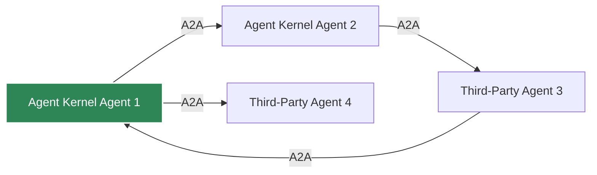

# A2A Server

Enable Agent-to-Agent (A2A) communication for agent collaboration.

## What is A2A?

A2A is a protocol for agents to discover and communicate with each other across different systems.

## Enabling A2A

```bash
export AK_A2A__ENABLED=true
export AK_A2A__URL=https://your-domain.com/a2a
export AK_A2A__AGENTS="*"            # or a comma-separated list of agent names
export AK_A2A__TASK_STORE_TYPE=in_memory  # 'in_memory' or 'redis'
```

or

```yaml
a2a:
  enabled: true
  url: https://your-domain.com/a2a
  agents:
    - "*"          # expose all agents (or list specific agent names)
  task_store_type: in_memory
```

The A2A routes are mounted on the main REST API server under `/a2a`; use `api.port` (or `AK_API__PORT`) to change the port.

## Starting A2A Server

```python
from agentkernel.api import RESTAPI

if __name__ == "__main__":
    RESTAPI.run()
```

### How A2A requests run

A2A always goes through the [queue pipeline](../advanced/queue-mode-guide.md), like a REST chat
request: each message is put on the input queue, the agent runner executes it, and the reply is
read back from the response store. The agent never runs inside the web-server process.

| How the app starts | A2A |
|---|---|
| `RESTAPI.run()` with no `execution.queues` block (the laptop default) | ✅ one process, in-memory queue |
| `IOHandler.run(handlers=[...])`, any transport | ✅ through the queue |
| `RESTAPI.run(handlers=[...])`, `RESTAPI.run()` on SQS/Kafka/NATS, `AWSRestAPI`, `AWSWebsocketAPI`, `ECSIOHandler` | ❌ refuses to start (`AKConfigError`): these start no agent runner |

- **Split deployments** (SQS, Kafka or NATS, with the agent runner in its own process): import the
  same agent modules in the IO process as in the runner, because agent cards are built from the
  IO process's registry. Without them the IO process logs a warning and serves an empty catalog.
  The response store must be shared (`redis`, `valkey` or `dynamodb`) in every execution mode.
- **Latency**: the reply is picked up by polling the response store, so it takes at least one
  `execution.response_store.delay` (1 s without a `response_store` block), and the wait gives up
  after `retry_count` reads (about 59 s without a block).
- **Execution mode**: A2A ignores `execution.mode` and always waits for one whole reply.

## Agent Capabilities

Each exposed agent automatically publishes an A2A **agent card** (via the framework adapter's `get_a2a_card()`), describing its name, description, and endpoint.

- **Protocol:** A2A 1.0 over HTTP+JSON, built on `a2a-sdk` 1.2.3 (pinned exactly). The card has one
  entry in `supportedInterfaces`: `{a2a.url}/{agent}`, protocol version `1.0`.
- **Modes:** `text/plain` in and out. An agent whose replies the [A2UI capability](../advanced/a2ui.md)
  labels also lists `application/a2ui+json` as an output mode, and declares the A2UI extension
  (`https://a2ui.org/a2a-extension/a2ui/v0.9.1`, not required) in `capabilities.extensions`.
- Agents whose framework has no A2A card (Google ADK today) are not served over A2A; a warning
  says so at startup.

## Agent Discovery

List all exposed agent cards:

```http
GET /a2a/catalog
```

Each agent also serves its own well-known card:

```http
GET /a2a/{agent}/.well-known/agent-card.json
```

## Agent Communication

Each agent is mounted under `/a2a/{agent}` with the standard A2A 1.0 REST routes (provided by the A2A SDK). Requests must carry the `A2A-Version: 1.0` header; the SDK's `ClientFactory` sets it for you.

| Route | Purpose |
|-------|---------|
| `POST /a2a/{agent}/message:send` | Send a message to the agent |
| `POST /a2a/{agent}/message:stream` | Refused: Agent Kernel's cards declare `streaming: false`, so use `message:send` |
| `GET /a2a/{agent}/tasks` | List tasks |
| `GET /a2a/{agent}/tasks/{id}` | Get a task |
| `POST /a2a/{agent}/tasks/{id}:cancel` | Cancel a task (unsupported: the reply is always immediate) |
| `GET`/`POST /a2a/{agent}/tasks/{id}:subscribe` | Subscribe to task updates |
| `GET /a2a/{agent}/extendedAgentCard` | Get the authenticated agent card (if supported) |

Incoming A2A messages are executed by the agent runner through the queue pipeline, exactly like a REST chat request: hooks, guardrails, and session persistence all apply. The A2A `context_id` is the Agent Kernel session, so one conversation's messages are processed in order.

**Replies:**

- A text reply is one text part. A structured reply **without** a media type is one text part
  holding its JSON, so a text-only client can always read it.
- A structured reply **with** a media type (an A2UI reply, labelled by the A2UI capability) is one
  **data part**. The label is on the part's `mediaType` and in `metadata.mimeType`, the key A2UI
  clients read. An A2UI object is sent as a one-item list, since the A2UI binding requires a list
  of messages.
- Data parts carry numbers as doubles (protobuf `Value`): an integer `1` reaches a Python client
  as `1.0`, and integers above 2^53 lose precision. Send such values as strings.
- A failure is an A2A `InternalError` (HTTP 500) whose message is generic; the details are in the
  server logs only.

### Migrating from A2A 0.3

Agent Kernel serves A2A 1.0 only. A 0.3 client gets 404 on the old `/a2a/{agent}/v1/...` routes, and
400 on the new ones (a request without `A2A-Version: 1.0` is read as 0.3). To upgrade a caller:

- Use an `a2a-sdk` 1.x client, and build it with `ClientFactory` (pass
  `supported_protocol_bindings=["HTTP+JSON"]`), or set the `A2A-Version: 1.0` header yourself.
- Read the card's endpoint from `supportedInterfaces`; the card no longer has `url` or
  `preferredTransport`, and its JSON is camelCase.
- Code that builds `a2a` types (a custom `get_a2a_card()`, your own client) moves to the 1.x
  protobuf types, e.g. `Part(text=...)`, `Role.ROLE_USER`, `SendMessageRequest(message=...)`.

## Multi-Agent Network


