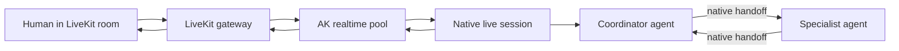

Agent Kernel uses a native live agent session for each call. The OpenAI Agents SDK or Google ADK decides which agent speaks, runs that agent's tools, and handles handoffs. Agent Kernel carries audio and text between that session and the LiveKit room.

## Who owns what

| Component | Responsibility |
| --- | --- |
| LiveKit gateway | Room participants, caller audio and chat, playback, and the active speaker's participant |
| AK realtime pool | One connection per AK session, input conversion, output pacing, queue delivery, interruptions, and cleanup |
| OpenAI `RealtimeSession` or ADK `Runner.run_live()` | Model connection, agent turns, native tools, tool results, handoffs, and native session state |

The gateway never sends an agent participant's own audio or chat back to the model. The SDK conversation stays in one AK session even when the speaking agent changes. For example, a coordinator can invite billing to answer, billing can call its invoice tool, and billing can hand the conversation back. The pool only receives the speaker changes and output.

## Runner contract

`RealtimeRunner` is the shared input and output contract. An adapter accepts caller audio with `append_audio()` and text with `send_text()`. Its callback reports `audio_delta`, `transcript_delta`, `input_transcript`, `agent_changed`, `interrupt`, `speech_started`, `done`, or `error`. The pool paces these events in order, so the next speaker is announced before their first output. An ADK workflow container does not speak; its first speaking node is announced when ADK identifies it.

### The caller's words

`input_transcript` carries one **finished** caller utterance as text (never partial text, never an empty one). The pool emits it as an `InputTranscript` stream event, in spoken order with the agents' output: it rides the same paced queue, so it reaches the edge behind any agent audio the caller has already heard, and a barge-in keeps it (it is the caller's words, not output the caller will no longer hear). It adds no setting of its own; it appears when the SDK's own input transcription is on:

- **Google ADK:** on by default (`RunConfig.input_audio_transcription`). The adapter reports the finished aggregate of an event authored by `user`, and ignores partial pieces and history replayed into a new agent at a transfer.
- **OpenAI:** set `input_audio_transcription` in the session's model settings through `Module.run_options(..., model_config={"initial_model_settings": {...}})`. Without it no `InputTranscript` is produced and nothing fails.

An edge that does not show a transcript ignores the event. A bring-your-own edge receives a new event type in `deliver_chunk`: handle only the types you know, or ignore this one.

The pool does **not** execute tools. A custom runner that emits the old `tool_call` callback fails the connection with a clear error. Native tools are declared on the native agent and executed by its SDK.

The pool's output queue can hold audio before LiveKit plays it. Sending audio to that queue does not prove the caller heard it. OpenAI's native playback estimate is used until the LiveKit edge can report actual playout. Interruption clears queued output that the caller has not heard.

## Native adapters

- **OpenAI:** the entry agent is an `agents.realtime.RealtimeAgent`. One SDK `RealtimeRunner` and `RealtimeSession` serve the call. `RealtimeAgent.handoffs` select the next agent. `Module.run_options(agent, model_config=...)` sets the session model and voice.
- **Google ADK:** one `Runner.run_live()` and one `LiveRequestQueue` serve the call. `Event.author` identifies the speaker. ADK handles transfers and any Gemini connection changes. Speaking agents in a live workflow use `mode='chat'` or `mode='task'`; ADK does not run `ParallelAgent` or `LoopAgent` in live mode. Use `Gemini(speech_config=...)` for a speaking agent's voice, or `RunConfig.speech_config` for a session voice.

Realtime runs native agent tools only. In `execution.mode: realtime`, AK skips automatic system tools (multimodal, sandbox, schedule, knowledge base) and their prompt guidance, even when those capabilities are enabled. Other execution modes still attach them as configured.

AK pre/post hooks and AK guardrails do not automatically run during native live turns. Use the SDK's own live hooks and guardrails where supported. A tool needing human approval or confirmation cannot continue through this LiveKit edge because the room has no decision path; the adapter reports an error rather than approving it.

## Connection lifetime

Each AK session has its own native session and queue. Closing one call closes its resources without closing another call.

An edge that stops, or loses its room, sends an **end-of-session control** on the input queue for its session id: an ordinary run request with no requests, carrying the `realtime_end` message attribute. The pool closes that session's native connection at once, instead of after the idle timeout (300 s), and drops input for that session for 60 s so a late audio frame cannot reopen it. Because it travels through the queue, it works when the gateway and the pool run in different processes, and it arrives after the session's earlier input. If the control cannot be sent, the connection ends by idle eviction as before. The Response Handler acks and drops, instead of retrying, chunks still on their way to an edge unregistered in the last 60 s.

A native session that fails right after it opens (a bad setting, a quota error) is not reopened by every audio frame. The pool backs off per session: after a failure it drops that session's input for 1 s, then 2 s, 4 s and so on up to 30 s for each failure in a row, and opens no connection before that time. A connection that produced output (audio, a transcript or a turn end) before failing restarts the count, and ending the session clears it.

Gateways need not be started at boot. `GatewayRunner.start_background()` runs one gateway on a thread of its own and returns once its edge reports ready (`StatefulEdgeAdapter._mark_ready()`), re-raising a start failure to the caller; `GatewayRunner.stop()` ends that one gateway, which leaves the room, unregisters and sends the end-of-session control. A background gateway never ends the process, so one meeting failing does not end the others. The edge registry removes only its own adapter on unregister, and remembers recently ended session ids (`StatefulEdgeRegistry.recently_ended`). A failed native session produces a terminal error and is removed; a later input starts a new native session. AK does not replay a transcript or restore a call after a process restart.
