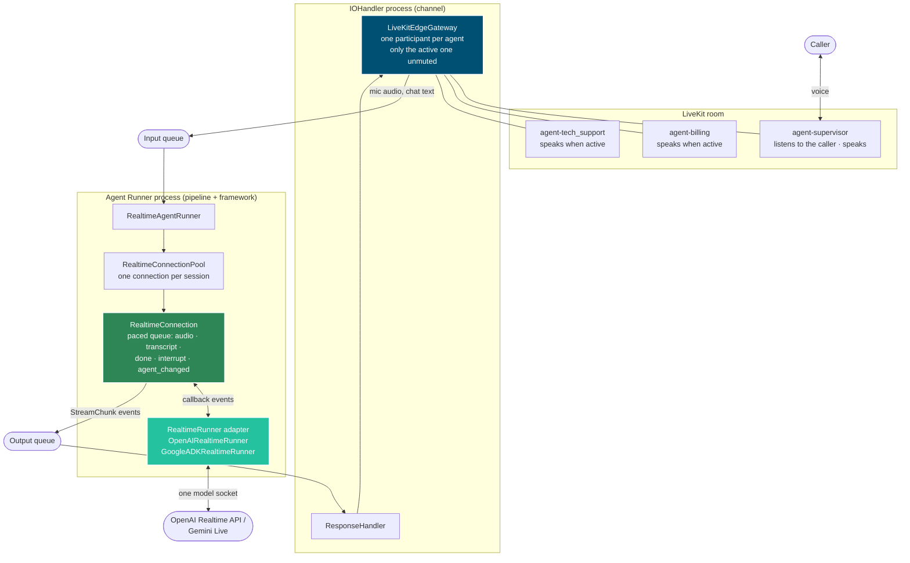
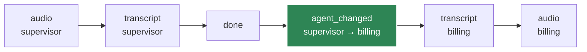
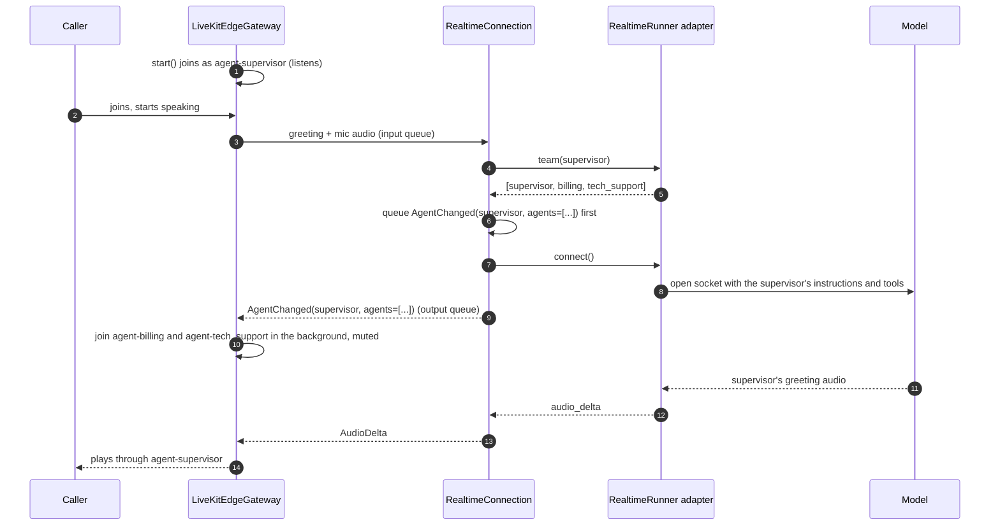
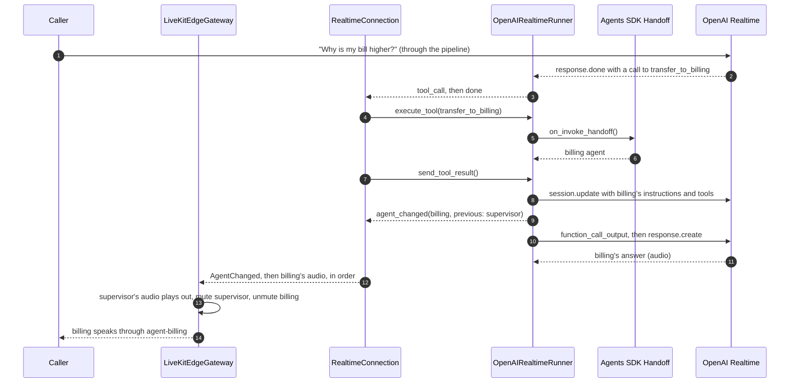
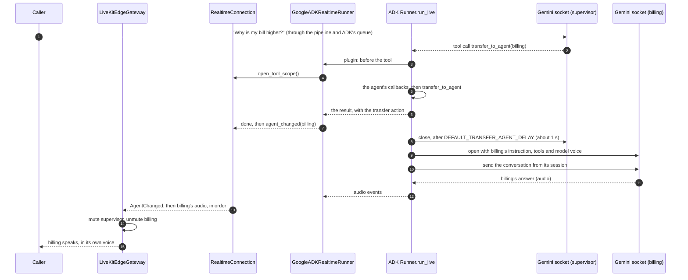

# Realtime Voice Internals

How realtime voice works under the hood: the components, the contract between them, and the runtime flows, including **multi-agent handoffs** (a supervisor handing the call to a specialist and back). This page is for contributors and for anyone writing a custom realtime adapter or a new voice channel. For setting up a voice agent, see the [LiveKit integration](../integrations/livekit.md).

## Component view

Realtime voice is split into three layers with one shared contract between them. The **channel** owns everything the caller sees and hears. The **pipeline** keeps every output in order and paces audio at playback speed. The **framework adapter** talks to the model and runs the framework's own handoffs. The channel never imports a framework SDK, and an adapter never imports pipeline or channel types: they share only the stream events, among them `AgentChanged`.

The queues work the same on every transport. With `in_memory`, both boxes run in one process. With `kafka`, `nats` or `sqs`, they are two processes, and the gateway never sees the agents: everything it learns about them, including the team it shows in the room, arrives through the output queue.

What stays fixed whatever the number of agents:

| Thing | Is |
|---|---|
| One LiveKit room | One AK session |
| One AK session | One `RealtimeConnection` in the pool |
| Model socket | OpenAI: one for the whole call. Gemini: one at a time |
| Registered agents | Only the entry agent. Specialists are reached through the framework's own handoff graph |

## The adapter contract

A `RealtimeRunner` adapter talks to the model and reports what it does through the `callback` the pool gives to `connect()`. The pool owns everything around the socket: pacing, barge-in decisions, tool execution scopes and queue emission.

| Callback event | Meaning | How the pool emits it |
|---|---|---|
| `audio_delta` | A piece of the model's audio | Paced at playback speed |
| `transcript_delta` | A piece of the model's transcript | In order with its audio |
| `tool_call` | The model called a function (a tool, or a handoff). Never from an adapter that `runs_tools` | Runs `execute_tool()`, then `send_tool_result()` |
| `done` | The model's turn ended; with status `reconnecting`, because the adapter lost its socket and is replacing it | In order, after its audio. A `reconnecting` one also marks the connection not ready for posts until `reconnected` or `error` |
| `reconnected` | Optional: the adapter replaced a lost socket and it is answering again, with `agent` still on the call; `seeded` when the new socket was given the conversation to answer (see [Connection recovery](#connection-recovery-google-adk)) | Nothing reaches the edge; the connection is ready again, a `seeded` one owes a reply first, and the realtime observers get `reconnected` |
| `interrupt` / `speech_started` | The caller started speaking: over the model (`interrupt`), or while it is silent (`speech_started`, reported once per caller turn by both adapters) | An `interrupt`, or a `speech_started` while paced audio is still queued, drops unheard audio and text and keeps `done` and `agent_changed`. Either one marks when the caller last spoke (see [Turn state](#turn-state)) |
| `speech_heard` / `speech_stopped` | The caller is still speaking (`speech_heard`: Gemini, on each later transcription of their words), or has stopped (`speech_stopped`: OpenAI's server VAD, from an adapter with `reports_speech_stopped`) | Nothing reaches the edge; both mark when the caller last spoke, and `speech_stopped` ends `is_caller_speaking` |
| `agent_changed` | A handoff moved the call to another agent | In order: after the old agent's output, before the new agent's |
| `caller_transcript` | Optional: the caller's words in a turn, once the model has transcribed the whole turn (Gemini) | Nothing reaches the edge; the [realtime observers](#realtime-observers) get it as `caller_said` |
| `error` | The socket failed | Tells the caller, then replaces the connection |

More members of the contract:

- **`team(agent)`** returns every agent the conversation can hand off to, the starting agent first. The default is the agent alone; the OpenAI and ADK adapters walk their agent graph. It is read before connecting.
- When a connection opens, the pool itself emits the first `AgentChanged`, naming the starting agent and the team. An adapter reports only the changes after that.
- **`runs_tools`**: who runs the model's tool calls. By default (the OpenAI adapter) the pool runs each one from a `tool_call` event, through `execute_tool()` and `send_tool_result()`. An adapter whose framework runs its tools itself (the Google ADK adapter, on ADK's own live engine) sets `runs_tools = True`, reports no `tool_call`, so no tool runs twice, and leaves `execute_tool()` / `send_tool_result()` unimplemented. Before `connect()` the pool hands it `open_tool_scope` (`use_tool_scope()`): awaited from the framework's task running one tool call, it gives that task what a tool the pool runs has (below).

### The tool scope for an adapter that runs its own tools

`RealtimeConnection.open_tool_scope()` opens, for the task that calls it, the same scope `_execute_tool_and_reply` gives a tool: the call's AK session lock, `Session.current()`, `Agent.current()` and a `ToolContext` (`ToolContext.get()` works, and the ADK tool wrapper finds it). A lock and its context token are entered and left in one task, and the task running the tool is the framework's, so the lock is held by a holder task of the connection's own (`_hold_tool_scope`), while the current session, agent and tool context are set in the tool task's own context and end with it. The scope lasts until the tool's task ends, however it ends: the call counts as busy (`_tools_in_flight`) until then, the task is one of the connection's `_tool_tasks`, which `close()` cancels, and a result from a task that was not cancelled marks `last_tool_result_at`. A tool cancelled while it waits for the lock cancels its holder, which then never takes it; a holder ended before it had the lock (at shutdown) fails the tool instead of leaving it waiting.

## Keeping output in order

Every output of one connection goes through one queue, in the order the model produced it. The transcript rides with its audio instead of ahead of it, and `AgentChanged` sits exactly between two agents' output. Without that, the new agent's words could reach the room while the previous agent's audio is still playing, and be shown as the previous agent's.

On a barge-in, the queued audio and transcript are dropped (the caller will not hear them), but a queued `done` and `agent_changed` are kept: a handoff that already happened stays true.

## Turn state

Code that talks into a live call from outside it, such as a hook's nudge or a webhook's update, must wait for a quiet moment. Text sent into a call starts a model response, so sending it while the model or the caller is speaking cuts one of them off; on Gemini Live, text interrupts any response the model is still generating, even one that has produced no audio yet. The Gemini adapter sends text through ADK's own live connection, which sends it as realtime input on Gemini 3.x Live and as a completed client-content turn on earlier models. `RealtimeConnection` keeps that state, internal to the pool (`RealtimeConnection` is not exported) and safe to read from any thread:

| Property | Is |
|---|---|
| `is_responding` | True from the model's first audio or transcript of a response until the adapter reports its `done` (or the caller barges in), so a pause mid-answer is not its end; while model output is still queued for the edge; or while a tool call is running: until its result is sent, or, on an adapter that runs its own tools, until the tool's task ends. A response whose `done` never arrives stops counting after 15 s with no new output |
| `last_model_output_at` | When the model's audio or transcript last left for the edge. Only output counts: not control events (an `interrupt` is the caller's doing), and not a finished tool call |
| `last_model_generated_at` | When the adapter last reported model audio or transcript: the model's own time, ahead of the paced output above. With `last_agent_change_at` it tells whether the agent now answering has said anything yet, at the moment it calls a tool such as a handoff, while its words may still be queued |
| `last_agent_change_at` | When the adapter last reported a handoff to another agent (`agent_changed`), in the model's own time: what is generated after it is the new agent's |
| `last_tool_result_at` | When a tool call's result was last sent to the model (on an adapter that runs its own tools, when the tool's task ended with a result). The model owes a reply to it |
| `is_caller_speaking` | True from the caller starting to speak until the adapter reports they stopped, on an adapter that reports it (`reports_speech_stopped`: OpenAI). Always false on Gemini Live, which does not signal the end of speech |
| `last_caller_speech_at` | When the caller was last heard speaking: their start (`speech_started` or `interrupt`), each later transcription of their words (`speech_heard`, Gemini), and their stop (`speech_stopped`, OpenAI). On Gemini it keeps moving through a long answer only as far as the model sends transcriptions while the caller speaks |
| `last_edge_text_at` | When text from the edge last reached the model: text the caller typed, or a prompt the edge sends for them (such as the LiveKit gateway's greeting). Not text the application sends itself |
| `last_post_at` | When application text was last sent into this connection (`send_if_quiet`). The model owes a reply to it |
| `last_reconnect_at` | When the adapter last reported a lost socket replaced, the new one given the conversation (`reconnected` with `seeded`). The model owes a reply to it, as to a tool result |
| `is_ready` | The model socket has connected, the connection is not closed, and the adapter is not recovering a lost socket |

`last_activity_at` cannot serve here: every caller audio frame moves it, silence included.

The rows above are what the connection observed. Two rules on top of them are inferred, and named so:

- **A reply owed** (`awaiting_reply(now)`). The pool cannot see the model generating before its first output, after the caller speaks or types, a tool result is sent, a seeded reconnect or application text. So the model is taken to owe a reply while it has generated nothing since the latest of those, each for at most `_REPLY_WAIT_SECONDS` (15 s): an input the model never answers must not hold the call forever. When that wait ends the pool stops waiting; it does not take the reply for given. A reply is judged by when the model generated it, not when it was played: words generated before a handoff or a tool result can still be playing after it, and are no answer to it.
- **A response still under way.** A response whose `done` never arrives stops counting toward `is_responding` once the model has generated nothing for `_UNFINISHED_RESPONSE_SECONDS` (15 s); it is not taken for finished.

`quiet_since(now)` is when the call last stopped being quiet: `None` while it is not ready, `is_responding`, `is_caller_speaking` or a reply is owed, else the latest of its activity times (connecting, output, the caller, edge text, a tool result, a reconnect, a handover, application text). That value names the quiet stretch: anything happening starts a new one, a handover included.

Applications do not read these properties themselves: `RealtimeCall` (see [Talking into a live call](../integrations/livekit.md#talking-into-a-live-call)) is the public face. `RealtimeCall.send_if_quiet(text, quiet_since=None)` runs `RealtimeConnection.send_if_quiet` on the pool's loop, from whichever loop awaits it (`asyncio.run_coroutine_threadsafe` from another loop): it sends only if the call has been quiet for `_QUIET_SECONDS` (1.5 s; Gemini signals no end of the caller's speech, so a short pause may be one) and, given `quiet_since`, is still in that stretch, then marks `last_post_at`, which the model now owes a reply. The check and the send are one step on that loop. Agent Kernel keeps no queue of application text: declined text stays with the application, which decides when to try again, what to replace or expire, and what a moved-on call makes obsolete. `RealtimeCall.quiet_since()`, `quiet_for()` and `agent_has_spoken` read the same state, and `last_caller_input_at`, `last_agent_change_at` and `last_tool_result_at` read the connection's times (from an open connection, recovering included).

## Realtime observers

`RealtimeCall.observe` adds an observer to the pool's process-wide list (`RealtimeConnectionPool._observers`, a class attribute so observers can be registered before the pool starts); `get_or_create` hands each new connection the list as it is then. A connection with observers queues `RealtimeEvent`s for them, and one task gives each event to the observers in order, off the audio path:

| Event | Raised by |
|---|---|
| `connected` | `connect()`, once the adapter is connected, before any other event of the call |
| `agent_changed` | The pacing loop, as it emits each `AgentChanged` (the starting agent included) |
| `agent_said` | The pacing loop: the transcript it emitted since the turn began, at the turn's `done`, an `interrupt` (`interrupted=True`: only what was played) or an `agent_changed` |
| `caller_said` | The adapter's optional `caller_transcript` event; the Gemini adapter reports the caller's words when a turn ends (the model finishes, calls a tool, or text is sent in) |
| `edge_text` | `send_text(..., from_edge=True)`, from the consumer thread, handed to the pool's loop |
| `disconnected` | `close()` or a socket failure, once |

On `close()` the observers get up to `_OBSERVER_DRAIN_SECONDS` to take the events still queued. A connection without observers gets no queue and no task. There is no quiet-call event: an application that acts on a quiet call reads `RealtimeCall.quiet_for()` itself.

## Tool calls that wait

The pool runs each tool call as a task of its connection (`RealtimeConnection._tool_tasks`), inside the call's AK session and `Agent._activate()`, so the tool holds the session lock until it returns. A tool may await long work, such as another agent's run through `AgentService.run_multi` in a session of its own; the await yields the pool's loop, so other calls' audio keeps its pace. While the task runs it counts toward `is_responding`, so the call is not quiet: `send_if_quiet` declines and `quiet_for()` is `None`. On Google ADK the tool is ADK's task, in the [tool scope](#the-tool-scope-for-an-adapter-that-runs-its-own-tools), and the adapter's stall wait is suspended until it ends. ADK reads nothing from the socket while its tools run, so the caller's words and interruptions during the wait reach the pool after it, and a socket lost meanwhile is noticed once the tool returns.

`RealtimeConnection.close()` (called by `RealtimeCall.close()`, an idle or failed-socket eviction, and pool shutdown) marks the connection closed, cancels its tool tasks and waits for them up to `_TOOL_CANCEL_SECONDS` (2 s) before disconnecting the adapter. A cancelled tool sends no result, and `_execute_tool_and_reply` sends none for a tool that finishes once the connection is closed or its socket failed (`closed`), even one that ignored its cancellation, so a late result never reaches a dead socket or the session's next connection, which has an adapter of its own. A socket the adapter recovers itself (Google ADK) keeps the connection open: see [Connection recovery](#connection-recovery-google-adk).

## Starting a call: announcing the team

The gateway starts as **one** participant, the one that listens to the caller. When the first model connection opens, the pool announces the starting agent with the adapter's team, and the gateway joins every other agent in the background, muted.

A reconnect announces the team again, and only the agents not in the room yet join. An agent that cannot join speaks through the first participant, with a warning.

## Handoff flow: OpenAI (same socket)

The OpenAI Realtime API can change a session's instructions and tools while the socket is open, with `session.update`. A handoff therefore keeps the socket, and the conversation, which lives in the OpenAI session, stays where it is. This is how the OpenAI Agents SDK's own realtime session runs a handoff. Each handoff is offered to the model as a function (`transfer_to_billing`) and runs through the same path as a tool.

- A tool called in the same response as a handoff still runs as the agent that called it.
- Only the first handoff of a response is performed; any other is answered as not performed.
- The socket's model and voice cannot change, so every agent speaks with the entry agent's model and voice.

## Handoff flow: Google ADK (new socket)

The Google ADK adapter runs each call on ADK's own live engine: `Runner.run_live`, with a `LiveRequestQueue` and an ADK session of the connection's own. ADK runs the tools and their callbacks, performs transfers and keeps the conversation; the adapter feeds the caller's audio and text to the queue, opens the [tool scope](#the-tool-scope-for-an-adapter-that-runs-its-own-tools) for each tool, and reports ADK's events through the pool's callback.

A Gemini Live session's instructions, tools and voice are fixed when the socket opens, so ADK's transfer opens a new socket for the agent taking the call. The model calls ADK's own `transfer_to_agent`; any tool that sets `tool_context.actions.transfer_to_agent` transfers too, as ADK allows. ADK runs every tool call, `transfer_to_agent` included, between its plugins' and the calling agent's `before_tool_callback`, `on_tool_error_callback` and `after_tool_callback`, so a before-callback that returns a result answers in the tool's place and refuses the transfer. The adapter's own plugin runs first, to open the tool scope, so the agent's callbacks and the application's plugins (the starting agent's `plugins` run option) run inside it.

ADK's session records what each new socket is given: the caller's words and each agent's words (Gemini's transcriptions), text sent into the call, and every tool call and its result. ADK gives an agent its own earlier turns as its own, and its teammates' turns on the caller's side as context naming their author (`[architect] said: ...`, `[pm] called tool ...`), fenced as data the model must never take instructions from. So a transfer's result is no place for instructions to the agent taking the call: put who has the call and why in that agent's instruction (an `InstructionProvider` is built again each time the agent takes the call).

Limits of ADK's transfer, as measured against the earlier AK-run transfer:

- **The caller's words in the gap.** ADK keeps the old socket for `DEFAULT_TRANSFER_AGENT_DELAY` (about 1 s) after the transfer: what the caller says then goes to the agent handing over and is not heard by the new one. After it, ADK's queue holds the caller's input for the new socket.
- **Words said with the transfer.** ADK records an agent's words when Gemini marks their transcription finished, or at the end of the turn. A turn that ends in a transfer never ends on the old socket (Gemini 3.x completes a turn only once its tool call is answered), so words with no transcription end mark are not given to the agent taking the call.
- **Each handoff nests.** ADK runs the agent taking the call inside the run of the one handing over, so the run deepens with each handoff of a call.

## Connection recovery (Google ADK)

A Gemini socket can be lost in the middle of a call: the network drops, the Live API closes a connection at its time limit (about 10 minutes), or the socket stops answering. Two layers handle it, each owning its own case:

1. **ADK resumes the socket itself** when it holds a session resumption handle: Gemini 3.x Live sends one every second or two whether or not the call's `RunConfig` asks for `session_resumption`. ADK reconnects with it (up to 5 attempts), the server keeps the conversation, nothing is replayed, and the adapter reports nothing: the call carries on.
2. **The adapter starts ADK's live run again** when the run ends or fails anyway (no handle yet, a terminal error, ADK's attempts spent), or stops answering: no progress from the model for `STALL_SECONDS` (25 s; Gemini can take 15 s or more to answer a tool's result) after it was given something to answer (the caller's turn, text, a tool's result), never while a tool runs. Only the model's progress moves this wait, so text sent while it runs (an application's posts) does not restart it.
   - **Close the turn.** The turn under way is ended with `done` (status `reconnecting`): the edge closes it, and `send_if_quiet` declines until the run is back.
   - **Restart.** After `RESTART_DELAYS_SECONDS` (1, 2, 4) the run starts again on the same ADK session. ADK resumes the agent that last had the call and gives the new socket the conversation from its session (as a new invocation, earlier tool calls appear as quoted context). The adapter queues a note for the agent first: if the caller had said something the model neither answered nor acted on with a tool call, or spoke while the line was down, the agent is asked to say it lost them and ask them to repeat; otherwise to carry on. Unlike the conversation before it, the note is kept in ADK's session. Setting `RECONNECTED_NOTE` / `RECONNECTED_QUIET_NOTE` to `""` sends none.
   - **Resume.** The adapter reports `reconnected` only once the new run sends its first event: ADK reports nothing when it opens a socket, so that event is the first sign the run is up. A restart that fails before it is not reported, and is restarted in turn. What the caller says and text sent meanwhile wait in ADK's queue for the new socket.
   - **Tools.** ADK notices a lost socket only once its tools have returned, so a tool's result is in the session the new run is given, and the agent does not run the tool again.
   - **Give up.** When restarted runs keep being lost within `QUICK_DROP_SECONDS` (20 s), three times in a row (a service that accepts a connection and then closes it, such as one out of quota), the adapter reports `error`: the edge is told, and the next input starts a new call at the entry agent. The pool releases a failed connection on its next sweep, whether or not more input comes; the sweep removes exactly the connection it found failed, never a replacement a consumer registered meanwhile.

## OpenAI and Google ADK side by side

| | OpenAI | Google ADK |
|---|---|---|
| Handoff offered as | One function per handoff (`transfer_to_billing`) | ADK's `transfer_to_agent` |
| Who can hand off to whom | Each agent's `handoffs` list | Sub-agents, parent and peers (ADK's rules) |
| Model socket on a handoff | Kept; `session.update` | Replaced by ADK; new socket + the conversation |
| Conversation memory | In the OpenAI session | In the call's ADK session; ADK gives it to each new socket |
| Gap on a handoff | None | About 1 to 2 seconds |
| Voice | One voice for every agent | Each agent's own voice |
| Checked at connect | Handoffs that filter or nest the history are rejected | Nothing by Agent Kernel: ADK's live run decides when an agent's socket opens |
| Who runs the tools | The pool (`tool_call`, `execute_tool()`) | ADK, in the pool's tool scope (`runs_tools`) |
| Refusing a handoff | An `on_handoff` that raises; the agent stays and the model gets the error | A `before_tool_callback` that answers for `transfer_to_agent` |
| Lost model socket | The call fails; the next input starts at the entry agent | Resumed by ADK, or the run started again with the same agent and the conversation (see [Connection recovery](#connection-recovery-google-adk)) |

## Where each piece lives

| Piece | Module | Owns |
|---|---|---|
| `AgentChanged` | `agentkernel.core.event` | The speaker-change event, with the team on the first one |
| `RealtimeRunner` | `agentkernel.core.realtime.runner` | The adapter contract, `team()`, shared cleanup |
| `RealtimeConnectionPool`, `RealtimeConnection` | `agentkernel.pipeline.realtime_pool` | Connections per session, ordering, pacing, tool calls, the tool scope and their cancellation |
| `RealtimeCall` | `agentkernel.pipeline` (`realtime_pool`) | What the call is doing, and sending into it at a quiet moment, for application code |
| `RealtimeObserver`, `RealtimeEvent` | `agentkernel.core.realtime.observer` | Observing calls (`RealtimeCall.observe`): connection, transcripts, speaker changes |
| `GatewayRunner` | `agentkernel.integration.adapter` | Hosting one gateway until shutdown or `stop()`; an application with a room per meeting keeps one runner per room |
| `OpenAIRealtimeRunner` | `agentkernel.framework.openai` | OpenAI socket, handoffs by `session.update` |
| `GoogleADKRealtimeRunner` | `agentkernel.framework.adk` | One ADK `Runner.run_live` per call: ADK's events reported to the pool, the tool scope plugin, restarting a failed run |
| `LiveKitEdgeGateway` | `agentkernel.integration.livekit` | Room, one participant per agent, who is heard and unmuted |
| `StatefulEdgeAdapter` | `agentkernel.integration.adapter` | The interface a new voice channel (for example WhatsApp calling or SIP) implements; it can ignore `AgentChanged` |
