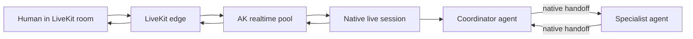

Agent Kernel uses a native live agent session for each call. The OpenAI Agents SDK or Google ADK decides which agent speaks, runs that agent's tools, and handles handoffs. Agent Kernel carries audio and text between that session and the LiveKit room.

## Who owns what

| Component | Responsibility |
| --- | --- |
| LiveKit edge | Room participants, caller audio and chat, playback, and the active speaker's participant |
| AK realtime pool | One connection per AK session, input conversion, output pacing, queue delivery, interruptions, and cleanup |
| OpenAI `RealtimeSession` or ADK `Runner.run_live()` | Model connection, agent turns, native tools, tool results, handoffs, and native session state |

The edge never sends an agent participant's own audio or chat back to the model. The SDK conversation stays in one AK session even when the speaking agent changes. For example, a coordinator can invite billing to answer, billing can call its invoice tool, and billing can hand the conversation back. The pool only receives the speaker changes and output.

## Runner contract

`RealtimeRunner` is the shared input and output contract. An adapter accepts caller audio with `append_audio()` and text with `send_text()`. Its callback reports `audio_delta`, `transcript_delta`, `input_transcript`, `agent_changed`, `interrupt`, `speech_started`, `done`, or `error`. The pool paces these events in order, so the next speaker is announced before their first output. The pool announces the root agent as the first speaker (`initial_speaker`); an adapter whose root does not speak, such as an ADK `Workflow`, returns `None` and reports the first speaking node itself in its `agent_changed` event, with the roster.

### The caller's words

`input_transcript` carries one **finished** caller utterance as text (never partial text, never an empty one). The pool emits it as an `InputTranscript` stream event when the framework reports it: it rides the same paced queue, so it may reach the edge after agent audio the caller has already heard (a provider can finish transcribing after the response that follows the utterance), and a barge-in keeps it (it is the caller's words, not output the caller will no longer hear). It adds no setting of its own; it appears when the SDK's own input transcription is on:

- **Google ADK:** on by default (`RunConfig.input_audio_transcription`). The adapter reports the finished aggregate of an event authored by `user`, and ignores partial pieces and history replayed into a new agent at a transfer.
- **OpenAI:** set `input_audio_transcription` in the session's model settings through `Module.run_options(..., model_config={"initial_model_settings": {...}})`. Without it no `InputTranscript` is produced and nothing fails.

An edge that does not show a transcript ignores the event. A bring-your-own edge receives a new event type in `deliver_chunk`: handle only the types you know, or ignore this one.

The pool does **not** execute tools. A custom runner that emits the old `tool_call` callback fails the connection with a clear error. Native tools are declared on the native agent and executed by its SDK.

The pool's output queue can hold audio before LiveKit plays it. Sending audio to that queue does not prove the caller heard it. OpenAI's native playback estimate is used until the LiveKit edge can report actual playout. Interruption clears queued output that the caller has not heard.

## Native adapters

- **OpenAI:** the entry agent is an `agents.realtime.RealtimeAgent`. One SDK `RealtimeRunner` and `RealtimeSession` serve the call. `RealtimeAgent.handoffs` select the next agent. `Module.run_options(agent, model_config=...)` sets the session model and voice.
- **Google ADK:** one `Runner.run_live()` and one `LiveRequestQueue` serve the call. `Event.author` identifies the speaker. ADK handles transfers and any Gemini connection changes. Speaking agents in a live workflow must set `mode='chat'` or `mode='task'`; ADK raises nothing for a node without one, and the caller hears nothing from it; ADK does not run `ParallelAgent` or `LoopAgent` in live mode; they fail inside ADK. Use `Gemini(speech_config=...)` for a speaking agent's voice, or `RunConfig.speech_config` for a session voice.

The SDK runs the tools; the pool does not. Before the native session starts, the pool sets `ToolContext`, `Session.current()` and `Agent.current()` once for the call, and the SDK's own tasks inherit them, so a tool sees them as it does on the unary path. The session lock is not held, since a call is one long-lived session. AK system tools (multimodal, sandbox, schedule, knowledge base) and their prompt guidance are attached as in every other execution mode; an ADK `Workflow` root holds no tools, so they attach to its speaking agents, looked up by their own names for the `agents` allow-lists.

A realtime session neither injects nor stores the AK session's `framework_context`, and the AK session is not saved when a call ends.

AK hooks run on a call as they do in a delta mode: typed text through `PreHook.on_run`, each caller audio chunk through the optional `PreHook.on_stream_input`, and every output event through `PostHook.on_stream_event`, followed by a `MessageEnd` before each `done`. See [Realtime calls](../integrations/hooks.md#realtime-hooks). The input guardrail checks typed text only, and the output guardrail does not run on a streamed reply; use the SDK's own live guardrails where supported. A tool needing human approval or confirmation cannot continue through this LiveKit edge because the room has no decision path; both adapters fail the connection when one is requested (an OpenAI tool with `needs_approval`, an ADK `FunctionTool` with `require_confirmation`) rather than approving it.

## Connection lifetime

Each AK session has its own native session and queue. Closing one call closes its resources without closing another call.

An edge that stops, or loses its room, or sees its last caller leave, sends an **end-of-session control** on the input queue for its session id: an ordinary run request with no requests, carrying the `realtime_end` message attribute. The pool closes that session's native connection at once, instead of after the idle timeout (300 s). The LiveKit edge stops staging input before it sends the control, so no late frame of its own reopens the session. Because it travels through the queue, it works when the edge and the pool run in different processes, and it arrives after the session's earlier input. If the control cannot be sent, the connection ends by idle eviction as before.

If a call ends while its native connection is still opening, the pool stops the opening and closes the connection once, so no connection is left open.

A native session that fails right after it opens (a bad setting, a quota error) is not reopened by every audio frame. The pool backs off per session: after a failure it drops that session's input for 1 s, then 2 s, 4 s and so on up to 30 s for each failure in a row, and opens no connection before that time. A connection that produced output (audio, a transcript or a turn end) before failing restarts the count, and ending the session clears it. A connect that fails sends the edge one terminal error chunk naming the failure: the back-off drops the redelivered input, so that input never reaches its permanent-failure path, and without the chunk the room would hear nothing.

`EdgeLifecycleRESTRequestHandler` hosts an `EdgeLifecycleAdapter` such as `LiveKitLifecycleAdapter`: it starts one edge per LiveKit room from LiveKit's signed `room_started` webhook (and from `participant_joined` when the room has no edge, so a caller who rejoins after it ended gets a new one), on a thread of the IOHandler process, and stops it on `room_finished` by stopping its runner. The edge also ends its own session when the last caller leaves, since with several IOHandler replicas `room_finished` may reach a process that never hosted the room. An edge stopped before it starts never joins. At process shutdown the handler starts no new edge, and each live one sees the shutdown itself and stops; the process does not wait for them, so a session whose end control was not sent closes by idle eviction. The edge registry removes only its own adapter on unregister, so a stopped edge cannot remove a newer one for the same session id. A failed native session produces a terminal error and is removed; a later input starts a new native session. AK does not replay a transcript or restore a call after a process restart.
