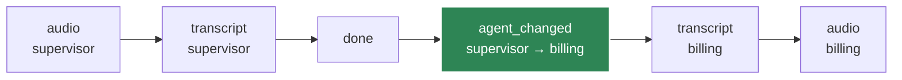
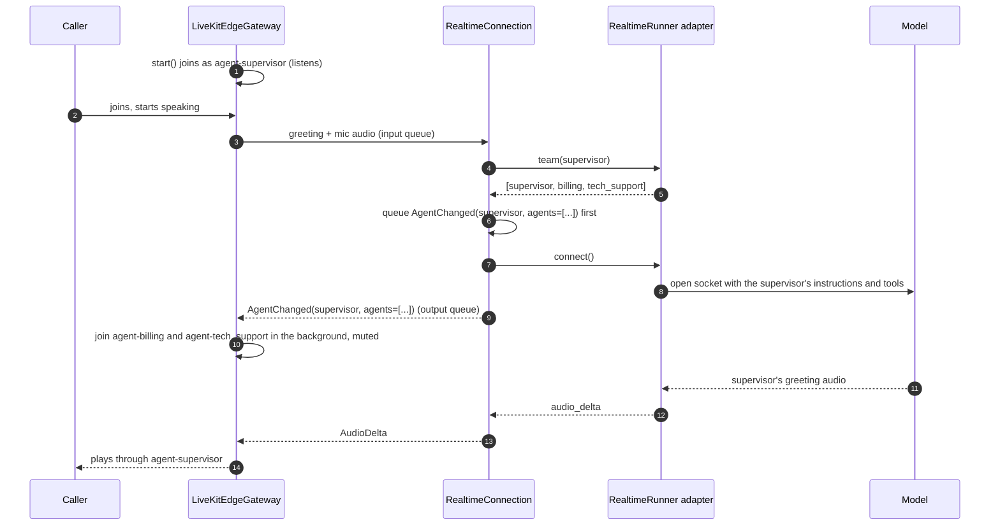
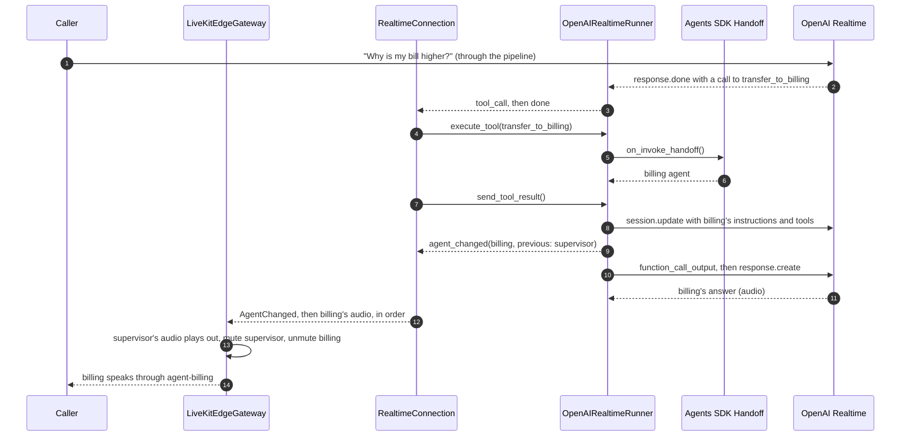
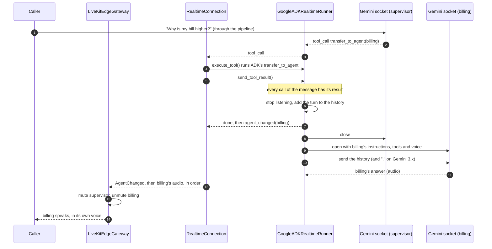

# Realtime Voice Internals

How realtime voice works under the hood: the components, the contract between them, and the runtime flows, including **multi-agent handoffs** (a supervisor handing the call to a specialist and back). This page is for contributors and for anyone writing a custom realtime adapter or a new voice channel. For setting up a voice agent, see the [LiveKit integration](../integrations/livekit.md).

## Component view

Realtime voice is split into three layers with one shared contract between them. The **channel** owns everything the caller sees and hears. The **pipeline** keeps every output in order and paces audio at playback speed. The **framework adapter** talks to the model and runs the framework's own handoffs. The channel never imports a framework SDK, and an adapter never imports pipeline or channel types: they share only the stream events, among them `AgentChanged`.

The queues work the same on every transport. With `in_memory`, both boxes run in one process. With `kafka`, `nats` or `sqs`, they are two processes, and the gateway never sees the agents: everything it learns about them, including the team it shows in the room, arrives through the output queue.

What stays fixed whatever the number of agents:

| Thing | Is |
|---|---|
| One LiveKit room | One AK session |
| One AK session | One `RealtimeConnection` in the pool |
| Model socket | OpenAI: one for the whole call. Gemini: one at a time |
| Registered agents | Only the entry agent. Specialists are reached through the framework's own handoff graph |

## The adapter contract

A `RealtimeRunner` adapter talks to the model and reports what it does through the `callback` the pool gives to `connect()`. The pool owns everything around the socket: pacing, barge-in decisions, tool execution scopes and queue emission.

| Callback event | Meaning | How the pool emits it |
|---|---|---|
| `audio_delta` | A piece of the model's audio | Paced at playback speed |
| `transcript_delta` | A piece of the model's transcript | In order with its audio |
| `tool_call` | The model called a function (a tool, or a handoff) | Runs `execute_tool()`, then `send_tool_result()` |
| `done` | The model's turn ended; with status `reconnecting`, because the adapter lost its socket and is replacing it | In order, after its audio. A `reconnecting` one also marks the connection not ready for posts until `reconnected` or `error` |
| `reconnected` | Optional: the adapter replaced a lost socket, and `agent` still has the call; `seeded` when the new socket was given the conversation to answer (see [Connection recovery](#connection-recovery-google-adk)) | Nothing reaches the edge; the connection is ready again, a `seeded` one owes a reply first, and the realtime hooks get `reconnected` |
| `interrupt` / `speech_started` | The caller started speaking: over the model (`interrupt`), or while it is silent (`speech_started`, reported once per caller turn by both adapters) | An `interrupt`, or a `speech_started` while paced audio is still queued, drops unheard audio and text and keeps `done` and `agent_changed`. Either one marks when the caller last spoke (see [Turn state](#turn-state)) |
| `speech_heard` / `speech_stopped` | The caller is still speaking (`speech_heard`: Gemini, on each later transcription of their words), or has stopped (`speech_stopped`: OpenAI's server VAD, from an adapter with `reports_speech_stopped`) | Nothing reaches the edge; both mark when the caller last spoke, and `speech_stopped` ends `is_caller_speaking` |
| `agent_changed` | A handoff moved the call to another agent | In order: after the old agent's output, before the new agent's |
| `caller_transcript` | Optional: the caller's words in a turn, once the model has transcribed the whole turn (Gemini) | Nothing reaches the edge; the agent's [realtime hooks](#realtime-hooks) get it as `caller_said` |
| `error` | The socket failed | Tells the caller, then replaces the connection |

Two more members of the contract:

- **`team(agent)`** returns every agent the conversation can hand off to, the starting agent first. The default is the agent alone; the OpenAI and ADK adapters walk their agent graph. It is read before connecting.
- When a connection opens, the pool itself emits the first `AgentChanged`, naming the starting agent and the team. An adapter reports only the changes after that.

## Keeping output in order

Every output of one connection goes through one queue, in the order the model produced it. The transcript rides with its audio instead of ahead of it, and `AgentChanged` sits exactly between two agents' output. Without that, the new agent's words could reach the room while the previous agent's audio is still playing, and be shown as the previous agent's.

On a barge-in, the queued audio and transcript are dropped (the caller will not hear them), but a queued `done` and `agent_changed` are kept: a handoff that already happened stays true.

## Turn state

Code that talks into a live call from outside it, such as a background job reporting its result, must wait for a quiet moment. Text sent into a call starts a model response, so sending it while the model or the caller is speaking cuts one of them off; on Gemini Live, text sent as a completed turn interrupts any response the model is still generating, even one that has produced no audio yet. `RealtimeConnection` keeps that state, internal to the pool (`RealtimeConnection` is not exported) and safe to read from any thread:

| Property | Is |
|---|---|
| `is_responding` | True from the model's first audio or transcript of a response until the adapter reports its `done` (or the caller barges in), so a pause mid-answer is not its end; while model output is still queued for the edge; or while a tool call is running until its result is sent (for an ADK handoff, that includes opening the next agent's socket). A response whose `done` never arrives stops counting after 15 s with no new output |
| `last_model_output_at` | When the model's audio or transcript last left for the edge. Only output counts: not control events (an `interrupt` is the caller's doing), and not a finished tool call |
| `last_model_generated_at` | When the adapter last reported model audio or transcript: the model's own time, ahead of the paced output above. With `last_agent_change_at` it tells whether the agent now answering has said anything yet, at the moment it calls a tool such as a handoff, while its words may still be queued |
| `last_agent_change_at` | When the adapter last reported a handoff to another agent (`agent_changed`), in the model's own time: what is generated after it is the new agent's |
| `last_tool_result_at` | When a tool call's result was last sent to the model. The model owes a reply to it; for an ADK handoff the result seeds the next agent's socket, so this marks the new agent's turn to speak |
| `is_caller_speaking` | True from the caller starting to speak until the adapter reports they stopped, on an adapter that reports it (`reports_speech_stopped`: OpenAI). Always false on Gemini Live, which does not signal the end of speech |
| `last_caller_speech_at` | When the caller was last heard speaking: their start (`speech_started` or `interrupt`), each later transcription of their words (`speech_heard`, Gemini), and their stop (`speech_stopped`, OpenAI). On Gemini it keeps moving through a long answer only as far as the model sends transcriptions while the caller speaks |
| `last_edge_text_at` | When text from the edge last reached the model: text the caller typed, or a prompt the edge sends for them (such as the LiveKit gateway's greeting). Not text the application sends itself with `send_text` |
| `last_reconnect_at` | When the adapter last replaced a lost socket by replaying the conversation into a new one (`reconnected` with `seeded`). The model owes a reply to that seed, as to a tool result |
| `is_ready` | The model socket has connected, the connection is not closed, and the adapter is not recovering a lost socket |

`last_activity_at` cannot serve here: every caller audio frame moves it, silence included.

The pool cannot see the model generating before its first output, after the caller speaks or types or a tool result is sent. So deciding the call is quiet also checks that the model owes no reply: the model generated output after the caller's last speech, the edge's last text, the last tool result, the last replayed reconnect, and the last post (each waited for at most `RealtimeOutbox.REPLY_TIMEOUT_SECONDS`, since an input the model never answers must not hold the call forever). It also waits while `is_responding` or `is_caller_speaking`, and until nothing has happened for `RealtimeOutbox.QUIET_SECONDS`. A reply is judged by when the model generated it, not when it was played: words generated before a handoff or a tool result can still be playing after it, and are no answer to it.

Applications do not read these properties themselves: `RealtimeCall` (see [Talking into a live call](../integrations/livekit.md#talking-into-a-live-call)) is the public face of this rule. Its `post_when_idle` queues text in the session's `RealtimeOutbox`, which the pool keeps per session rather than per connection, so posts survive a reconnect. Every `_POST_POLL_SECONDS` the pool's loop says each session's next post if `RealtimeOutbox.quiet_for` finds the call quiet long enough, with `RealtimeConnection.send_text`. `RealtimeCall.quiet_for()` and `agent_has_spoken` read the same state.

## Realtime hooks

A connection whose agent has `realtime_hooks` (`Module.realtime_hook`) queues `RealtimeEvent`s for them, and one task gives each event to the hooks in order, off the audio path:

| Event | Raised by |
|---|---|
| `connected` | `connect()`, once the adapter is connected, before any other event of the call |
| `agent_changed` | The pacing loop, as it emits each `AgentChanged` (the starting agent included) |
| `agent_said` | The pacing loop: the transcript it emitted since the turn began, at the turn's `done`, an `interrupt` (`interrupted=True`: only what was played) or an `agent_changed` |
| `caller_said` | The adapter's optional `caller_transcript` event; the Gemini adapter reports the caller's words when a turn ends (the model finishes, calls a tool, or text is sent in) |
| `edge_text` | `send_text(..., from_edge=True)`, from the consumer thread, handed to the pool's loop |
| `disconnected` | `close()` or a socket failure, once |

On `close()` the hooks get up to `_HOOK_DRAIN_SECONDS` to take the events still queued. An agent without hooks gets no queue and no task.

## Starting a call: announcing the team

The gateway starts as **one** participant, the one that listens to the caller. When the first model connection opens, the pool announces the starting agent with the adapter's team, and the gateway joins every other agent in the background, muted.

A reconnect announces the team again, and only the agents not in the room yet join. An agent that cannot join speaks through the first participant, with a warning.

## Handoff flow: OpenAI (same socket)

The OpenAI Realtime API can change a session's instructions and tools while the socket is open, with `session.update`. A handoff therefore keeps the socket, and the conversation, which lives in the OpenAI session, stays where it is. This is how the OpenAI Agents SDK's own realtime session runs a handoff. Each handoff is offered to the model as a function (`transfer_to_billing`) and runs through the same path as a tool.

- A tool called in the same response as a handoff still runs as the agent that called it.
- Only the first handoff of a response is performed; any other is answered as not performed.
- The socket's model and voice cannot change, so every agent speaks with the entry agent's model and voice.

## Handoff flow: Google ADK (new socket)

A Gemini Live session's instructions, tools and voice are fixed when the socket opens. A transfer therefore opens a new socket configured for the new agent and seeds it with the conversation so far, which is what ADK's own live runner does. The model calls ADK's own `transfer_to_agent` tool; any tool that sets `tool_context.actions.transfer_to_agent` transfers too, as ADK allows.

Every tool call, `transfer_to_agent` included, runs between the calling agent's `before_tool_callback`, `on_tool_error_callback` and `after_tool_callback`, in the order and with the short-circuits of ADK's own flow. A before-callback that returns a result answers in the tool's place, so a callback can refuse a transfer (for example, to stop agents handing a call back and forth without the caller). ADK plugins do not run: a Live socket has no ADK `Runner` to hold them.

The history the adapter keeps and replays is what ADK's session records, minus the audio:

| In the history | From |
|---|---|
| What the caller said | Gemini's transcription of the caller |
| What the agent said | Gemini's transcript of its own audio |
| Text AK sent (for example the greeting) | `send_text()` |
| Every tool call and its result | Each answered tool-call message |

Each entry remembers who it came from: the caller, or the agent that said it or made the call. A new socket is seeded the way ADK seeds a Live socket after a transfer: the caller's words go as they are, and every agent's turn, the new agent's own included, goes on the caller's side as context naming its author (`[architect] said: ...`, `[pm] called tool ...`), fenced as data by ADK's own presenter. So an agent can tell a teammate's words from its own, and answer a question a teammate put to it before handing the call over.

The caller hears a short gap (about 1 to 2 seconds) while the new socket opens; what the caller says during it is held, its latest 5 seconds, and sent to the new agent's socket.

## Connection recovery (Google ADK)

A Gemini socket can be lost in the middle of a call: the network drops, the Live API closes a connection at its time limit (about 10 minutes), or the socket stops answering. The adapter replaces it without leaving the agent that had the call, much as a transfer replaces a socket with another agent's:

1. **Detect.** A socket error or close ends the listener. A stall is no progress from the model (audio, its transcript, a tool call, the end of its turn, an interruption) for `STALL_SECONDS` (15 s) after it was given something to answer (a tool result, text, a seeded turn), or in the middle of a response. Only the model's progress moves this wait: more text sent while it runs (an application's nudges) does not restart it. A turn the caller speaks and the model never answers is not detected: Gemini Live does not signal the end of the caller's speech. A dead socket is also caught by the websocket keepalive, after about 40 seconds.
2. **Close the turn.** The turn under way is ended with `done` (status `reconnecting`), so the edge closes it, and the pool posts nothing into the call until the new socket is up. Tool calls the lost socket was still owed results for are set aside before anything else, so a handoff whose tool finishes while the old socket closes is not performed.
3. **Reconnect.** Up to `RECONNECT_ATTEMPTS` (3), waiting `RECONNECT_DELAYS_SECONDS` (1, 2, 4) before each; an attempt that fails, even one whose socket then fails to close, leaves the next to run. The new socket is configured for the same agent and seeded with the conversation, plus a note for that socket only: if the caller was speaking, or spoke while the line was down, the agent is asked to say it lost them and ask them to repeat; otherwise to carry on without asking. The note is never kept in the history, so later sockets do not see it. Setting `RECONNECTED_NOTE` / `RECONNECTED_QUIET_NOTE` to `""` sends none.
4. **Resume.** The adapter reports `reconnected`, and sends the new socket what the caller said meanwhile (its latest `HOLD_AUDIO_SECONDS`, 5 s) and any text sent. What the caller goes on saying waits behind the held audio, so the socket hears it all in order; the same holds after a transfer. A tool still running for the lost socket is waited for, up to `LOST_TOOL_WAIT_SECONDS` (2 s), before the new socket is seeded, so the seed has its call and result and the agent does not make the call again. A result that comes later still is kept in the history, so a later socket sees it; the new socket is not sent it, and the agent may then call the tool again, so a tool that takes longer than that should be safe to repeat.
5. **Give up.** When every attempt fails, or reconnected sockets keep being lost within `QUICK_DROP_SECONDS` (20 s) of reconnecting three times in a row (a service that accepts a connection and then closes it, such as one out of quota), the adapter reports `error`: the edge is told, and the next input starts a new call at the entry agent. The pool releases a failed connection on its next sweep, whether or not more input comes; the sweep removes exactly the connection it found failed, never a replacement a consumer registered meanwhile.

The replay is the same as a transfer's: text, not the original audio. Gemini's own session resumption, which keeps the server-side session across connections, is not used.

## OpenAI and Google ADK side by side

| | OpenAI | Google ADK |
|---|---|---|
| Handoff offered as | One function per handoff (`transfer_to_billing`) | ADK's `transfer_to_agent` |
| Who can hand off to whom | Each agent's `handoffs` list | Sub-agents, parent and peers (ADK's rules) |
| Model socket on a handoff | Kept; `session.update` | Replaced; new socket + history |
| Conversation memory | In the OpenAI session | Replayed by AK from its history |
| Gap on a handoff | None | About 1 to 2 seconds |
| Voice | One voice for every agent | Each agent's own voice |
| Checked at connect | Handoffs that filter or nest the history are rejected | Every reachable agent must be an `LlmAgent` with a Live model and a string instruction |
| Refusing a handoff | An `on_handoff` that raises; the agent stays and the model gets the error | A `before_tool_callback` that answers for `transfer_to_agent` |
| Lost model socket | The call fails; the next input starts at the entry agent | Reconnected with the same agent and the conversation (see [Connection recovery](#connection-recovery-google-adk)) |

## Where each piece lives

| Piece | Module | Owns |
|---|---|---|
| `AgentChanged` | `agentkernel.core.event` | The speaker-change event, with the team on the first one |
| `RealtimeRunner` | `agentkernel.core.realtime.runner` | The adapter contract, `team()`, shared cleanup |
| `RealtimeConnectionPool`, `RealtimeConnection` | `agentkernel.pipeline.realtime_pool` | Connections per session, ordering, pacing, tool scopes |
| `RealtimeCall`, `RealtimeOutbox` | `agentkernel.pipeline` (`realtime_pool`) | Talking into a call at a quiet moment, and what the call is doing, for application code |
| `RealtimeHook`, `RealtimeEvent` | `agentkernel.core.hooks` | Observing a call: connection, transcripts, speaker changes |
| `OpenAIRealtimeRunner` | `agentkernel.framework.openai` | OpenAI socket, handoffs by `session.update` |
| `GoogleADKRealtimeRunner` | `agentkernel.framework.adk` | Gemini socket, transfers by reconnect + history |
| `LiveKitEdgeGateway` | `agentkernel.integration.livekit` | Room, one participant per agent, who is heard and unmuted |
| `StatefulEdgeAdapter` | `agentkernel.integration.adapter` | The interface a new voice channel (for example WhatsApp calling or SIP) implements; it can ignore `AgentChanged` |
