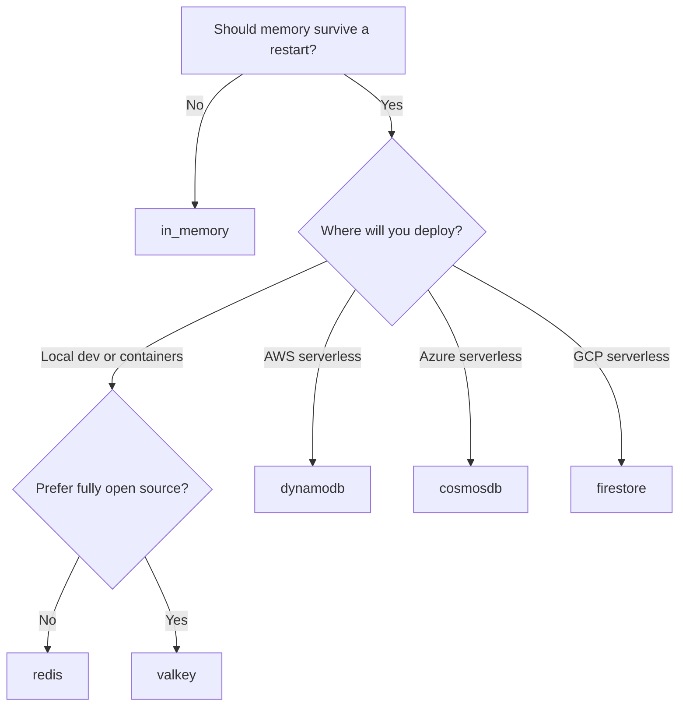

# Choosing a Memory Backend

Agent Kernel has **two different kinds of memory**, and they solve different problems:

| You need to remember... | Use | Lifetime |
|---|---|---|
| The current conversation (history, agent state) | **Session store** | Until the session expires or is cleared |
| Temporary data during one request | **Volatile cache** | One request |
| Data across turns without sending it to the LLM | **Non-volatile cache** | One session |
| Durable knowledge shared by many sessions and agents | **Knowledge base** | Until you delete it |

This page helps you choose a session store and cache, then explains when a knowledge base is the right tool instead. For full details, see [Session](./session.md), [Memory Management](../architecture/memory-management.md) and [Knowledge Bases](../advanced/knowledge-bases.md).

:::tip Start simple
Use `in_memory` for your very first run. Move to Redis when you want the conversation to survive a restart.
:::

## Session store comparison

A **session store** holds conversation history and framework state. Agent Kernel selects one from `session.type`; you never construct it yourself.

| Backend | `session.type` | Where it runs | Survives restart | Shared by processes | Extra to install | Best for |
|---|---|---|---|---|---|---|
| In-memory | `in_memory` | Your process | ❌ | ❌ | none | First run, tests, single process |
| Redis | `redis` | Self-hosted or any cloud | ✅ | ✅ | `agentkernel[redis]` | Local dev that survives restarts, containerized production |
| Valkey | `valkey` | Self-hosted or AWS ElastiCache | ✅ | ✅ | `agentkernel[valkey]` | Same as Redis with an open-source license |
| DynamoDB | `dynamodb` | AWS | ✅ | ✅ | `agentkernel[aws]` | AWS serverless (Lambda) |
| Cosmos DB | `cosmosdb` | Azure | ✅ | ✅ | `agentkernel[azure]` | Azure Functions and Container Apps |
| Firestore | `firestore` | Google Cloud | ✅ | ✅ | `agentkernel[gcp]` | GCP Cloud Run |

**Rules of thumb:**

- **Just trying Agent Kernel?** Leave `in_memory` (the default). There is nothing to install or run.
- **Local development that should survive a restart?** Use **Redis**. One Docker command is all the setup you need.
- **Deploying to a cloud?** Use that cloud's managed store: DynamoDB on AWS, Cosmos DB on Azure, Firestore on GCP. They need no server for you to operate.
- **Need to choose between Redis and Valkey?** They are wire-compatible. Pick Valkey if you want the open-source project or ElastiCache's Valkey engine; otherwise Redis.

### Quick chooser



## Beginner setup: in-memory (nothing to configure)

This is the default. Nothing is persisted when the process stops:

```yaml
# config.yaml
session:
  type: in_memory
```

That is enough for a first local run. Move on when you need persistence.

## Recommended local setup: Redis

Redis gives you persistent, restart-safe memory with a single local container.

**1. Start Redis:**

```bash
docker run --rm -p 6379:6379 redis:7
```

**2. Install the extra:**

```bash
pip install "agentkernel[redis]"
```

**3. Create `config.yaml`:**

```yaml
session:
  type: redis
  redis:
    url: redis://localhost:6379
    ttl: 604800          # sessions expire after 7 days
    prefix: "ak:sessions:"
```

If your Redis requires a password, put it in the URL:

```yaml
session:
  redis:
    url: redis://:your-password@localhost:6379
```

**4. Run your app.** The framework adapters store and load the session automatically; there is no extra code to write.

:::note Session caching is optional
Add a process-local LRU cache only when the same session always reaches the same process (sticky sessions):

```yaml
session:
  cache:
    size: 256
```

Leave it out for stateless, multi-instance deployments.
:::

## Cloud-managed equivalents

Swap only the `session` block; the rest of your application is unchanged.

### AWS: DynamoDB

```bash
pip install "agentkernel[aws]"
```

```yaml
session:
  type: dynamodb
  dynamodb:
    table_name: agent-kernel-sessions
    ttl: 604800          # 0 disables expiry
```

The table needs a partition key named `session_id` and a sort key named `key`. Agent Kernel's Terraform modules create it for you.

### Azure: Cosmos DB

```bash
pip install "agentkernel[azure]"
```

```yaml
session:
  type: cosmosdb
  cosmosdb:
    connection_string: "DefaultEndpointsProtocol=https;AccountName=your-account;AccountKey=your-key;TableEndpoint=https://your-account.table.cosmos.azure.com:443/;"
    table_name: sessions
    ttl: 604800          # 0 disables expiry
```

The Cosmos DB Table API table uses `session_id` as the partition key and `key` as the row key.

### GCP: Firestore

```bash
pip install "agentkernel[gcp]"
```

```yaml
session:
  type: firestore
  firestore:
    collection_name: ak_sessions   # default
    project_id: my-project         # optional; inferred from credentials
    ttl: 604800                    # 0 disables expiry
```

Enable a Firestore TTL policy on the collection for the `expiry_time` field so expired sessions are removed automatically.

### AWS: Valkey

```bash
pip install "agentkernel[valkey]"
```

```yaml
session:
  type: valkey
  valkey:
    url: valkey://localhost:6379   # use valkeys:// for TLS
    ttl: 604800
    prefix: "ak:sessions:"
```

## Small working example

This example proves the backend is wired up without calling an LLM. It writes one value and then reads it back in a **separate process** — so it only works with a persistent backend such as Redis.

**`config.yaml`**

```yaml
session:
  type: redis
  redis:
    url: redis://localhost:6379
    prefix: "ak:sessions:"
```

**`memory_demo.py`**

```python
from agentkernel.core.builder import SessionStoreBuilder

store = SessionStoreBuilder.build()
session = store.load("demo-session")

if session.get("greeting") is None:
    session.set("greeting", "hello from the first process")
    store.store(session)
    print("wrote:", session.get("greeting"))
else:
    print("read:", session.get("greeting"))
```

Run it twice:

```bash
python memory_demo.py   # wrote: hello from the first process
python memory_demo.py   # read: hello from the first process
```

The second run reads the value from Redis. With `session.type: in_memory` it would print `wrote:` both times, because each process starts with an empty store.

In a real application you do not write this code: configuring `session.type` is enough, because `Runtime` and the framework adapters create and use the store for you. The script exists only so you can verify your configuration.

A complete runnable version, including a REST agent and a network-free test, lives at
[`examples/memory/local-session`](https://github.com/yaalalabs/agent-kernel/tree/develop/examples/memory/local-session).

## Session memory vs. knowledge bases

Session memory is **per conversation**. A knowledge base is **durable, shared, and retrieved on demand**.

| Question | Answer |
|---|---|
| Should the last few turns influence this answer? | Session memory |
| Should this data disappear when the conversation ends? | Session memory or a cache |
| Must a different user or session see the same information tomorrow? | Knowledge base |
| Is the data a large document, manual, or dataset? | Knowledge base |
| Do you need search by meaning, graph traversal, or SQL? | Knowledge base with the matching backend |

A useful pattern combines both: retrieve from a knowledge base in a pre-hook, store the result in the session's **volatile cache** for the rest of the request, and keep the LLM prompt small.

## Knowledge base comparison

A knowledge base is not a replacement for sessions. Pick it when the knowledge must outlive the conversation.

| Backend | Kind | Retrieval | Write | Extra | Best for |
|---|---|---|---|---|---|
| ChromaDB | Vector | Semantic search | ✅ | `agentkernel[chromadb]` | FAQs, manuals, natural-language facts |
| Neo4j | Graph | Cypher queries | ✅ | `agentkernel[neo4j]` | Entities, relationships, connected data |
| Starburst | SQL | SQL (Trino) | ❌ read-only | `agentkernel[trino]` | Existing warehouses, MongoDB, Sheets |
| OKF bundle | Documents | Lexical search, fetch, browse | ✅ if the store is writable | none (S3 needs `agentkernel[aws]`) | Markdown docs in Git or S3, no database to run |

**Rules of thumb:**

- **Start with ChromaDB** if you want "search my documents by meaning".
- **Use Neo4j** when the question is about how things are connected.
- **Use Starburst** when the data already lives in a queryable system.
- **Use an OKF bundle** when your knowledge is already Markdown and you do not want to operate a database.

The full capability model and tool set are documented in [Knowledge Bases](../advanced/knowledge-bases.md).

### Minimal ChromaDB example

```bash
pip install "agentkernel[openai,chromadb]"
```

```python
from agents import Agent
from agentkernel.cli import CLI
from agentkernel.knowledgebase.chroma import ChromaManager
from agentkernel.knowledgebase.knowledgebuilder import KnowledgeBuilder
from agentkernel.openai import OpenAIModule, OpenAIToolBuilder

docs = ChromaManager(persist_path="./chroma", name="Docs").add_schema(
    {"description": "Product documentation, retrieved by meaning."}
)
docs.write([{"text": "Our product offers a 30-day free trial with no credit card required."}])

agent = Agent(
    name="docs_assistant",
    model="gpt-4.1-mini",
    instructions="Use the read_kb tool with backend 'Docs' to answer from the product documentation.",
    tools=OpenAIToolBuilder.bind(KnowledgeBuilder([docs]).build()),
)

OpenAIModule([agent])
CLI.main()
```

### Minimal OKF example (no database)

```yaml
# config.yaml — a folder of Markdown files under ./bundle
okf:
  databases:
    handbook:
      type: local
      uri: ./bundle
      consumer: [Support_Agent]
```

For a complete walkthrough, see the [Knowledge Bases guide](../advanced/knowledge-bases.md) and the runnable examples under `examples/cli/knowledgebase/openai/`.

## Troubleshooting

| Symptom | Likely cause | Fix |
|---|---|---|
| `unknown session store type 'X'` | Typo or unsupported name | Use one of `in_memory`, `redis`, `valkey`, `dynamodb`, `cosmosdb`, `firestore` |
| `session.type: redis requires the 'redis' extra` | Optional SDK not installed | `pip install "agentkernel[redis]"` (or the matching extra) |
| Connection refused / timeout | Server not running or wrong URL | Start the server and check the URL; put a password in the URL |
| Sessions disappear between runs | `in_memory`, or a new process/instance | Use a persistent backend |
| Works locally, not across pods | Process-local cache or `in_memory` | Remove `session.cache` and use a shared backend |
| DynamoDB `ResourceNotFoundException` or key error | Table missing or wrong keys | Partition key `session_id`, sort key `key` |
| Cosmos DB authentication or endpoint error | Connection string missing or wrong field | Set `session.cosmosdb.connection_string` and `table_name` |
| Firestore documents never expire | No TTL policy | Add a TTL policy on `expiry_time` |
| Configuration seems ignored | Wrong working directory | Run where `config.yaml` lives, or set `AK_CONFIG_PATH_OVERRIDE` |
| `Session ... not found, creating new session` | First load of that session | Expected; the session is created on first use |

Agent Kernel logs `Building '<type>' session store` when it builds the store, which is the quickest
way to confirm which backend is active.

## Next steps

- [Session](./session.md) — the full session API and backend reference
- [Memory Management](../architecture/memory-management.md) — volatile and non-volatile caches
- [Configuration](./configuration.md) — every `session` field and environment variable
- [Knowledge Bases](../advanced/knowledge-bases.md) — capability model, tools, and custom backends
