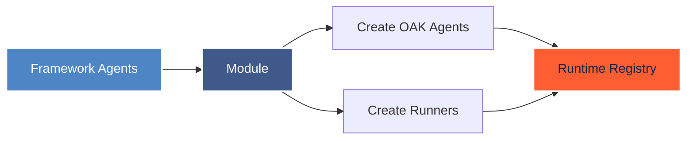
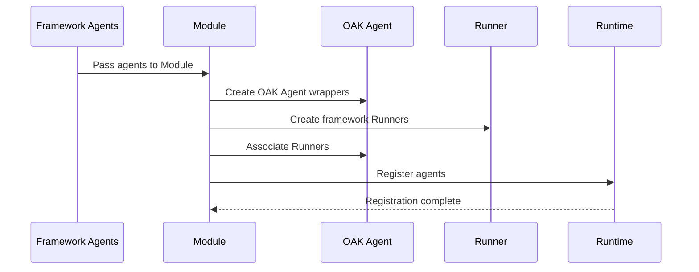

# Module

The **Module** is a container that wraps framework-specific agents and registers them with the Runtime.

## Overview



## What is a Module?

A Module:
- **Wraps** framework-specific agents
- **Creates** Open Agent Kernel Agent instances
- **Creates** appropriate Runners
- **Registers** agents with the Runtime

## Framework Modules

### OpenAIModule

```python
from agentkernel.openai import OpenAIModule
from agents import Agent as OpenAIAgent

agent = OpenAIAgent(name="assistant", instructions="...")
OpenAIModule([agent])
```

### CrewAIModule

```python
from agentkernel.crewai import CrewAIModule
from crewai import Agent as CrewAgent

agent = CrewAgent(role="assistant", goal="...", backstory="...")
CrewAIModule([agent])
```

### LangGraphModule

```python
from agentkernel.langgraph import LangGraphModule
from langgraph.graph import StateGraph

graph = StateGraph(...).compile()
graph.name = "assistant"
LangGraphModule([graph])
```

### GoogleADKModule

```python
from agentkernel.adk import GoogleADKModule
from adk import Agent as ADKAgent

agent = ADKAgent(name="assistant", model="gemini-2.0-flash-exp", ...)
GoogleADKModule([agent])
```

## Module Lifecycle



## Creating Modules

### Single Agent

```python
from agentkernel.crewai import CrewAIModule
from crewai import Agent

agent = Agent(role="assistant", ...)
CrewAIModule([agent])
```

### Multiple Agents

```python
from agentkernel.crewai import CrewAIModule
from crewai import Agent

agent1 = Agent(role="researcher", ...)
agent2 = Agent(role="writer", ...)
agent3 = Agent(role="reviewer", ...)

CrewAIModule([agent1, agent2, agent3])
```

## Module Configuration

Some modules accept configuration:

```python
from agentkernel.openai import OpenAIModule

OpenAIModule(
    agents=[agent1, agent2],
    model_override="gpt-4",  # Override default model
)
```

### Native run options

`run_options(agent, [factory], **options)` declares the framework's own per-run options for one
agent, in the framework's own types, and is chained like `pre_hook` / `post_hook`:

```python
from agents import Agent, RunConfig

agent = Agent(name="assistant", instructions="...")

OpenAIModule([agent]).run_options(
    agent,
    max_turns=25,
    hooks=ProgressHooks(),
    run_config=RunConfig(call_model_input_filter=trim_history),
).pre_hook(agent, [RAGHook()])
```

Every keyword is a keyword argument of that framework's native run call (LangGraph's `config`, ADK's
`plugins` and `run_config`, Pydantic AI's `usage_limits`, Microsoft Agent Framework's `options`, CrewAI's `step_callback`, smolagents'
`max_steps`). Repeated calls merge, the later call winning per key. A key the adapter populates
itself (`session`, `context`, `input`, ...) raises `ValueError` at declaration. See
[Runner → Per-agent native run options](./runner.md#native-run-options) for the merge rule and the
per-framework table.

A callable given positionally before the keywords computes options per run. It is called as
`factory(agent, session, requests)` on every run, sync or async, and its mapping is merged over the
static keywords, a factory key winning. One factory per agent, a later call replacing it; a
non-callable raises `TypeError` at declaration. The factory is accepted only positionally (the agent
keeps its keyword form, as with `pre_hook` / `post_hook`), so a native option named `factory` is still
declared as a keyword.

```python
def options_for(agent, session, requests):
    return {"max_turns": 10} if session.id.startswith("guest") else {}

OpenAIModule([agent]).run_options(agent, options_for, max_turns=25, hooks=ProgressHooks())
```

### Describing an agent

Every loaded agent has a **descriptor**: the record the agent registry keeps for it and the agent catalog,
A2A cards, MCP agent tools and the AG-UI listing are built from. The framework adapter fills in what it can
see (the agent's name, its tools, its runner). `describe(agent, **fields)` declares what only your
application knows, and is chained like `pre_hook` / `post_hook` / `run_options`:

```python
OpenAIModule([triage, math]).describe(
    triage,
    description="Routes a question to the right specialist",
    version="1.2.0",
    tags=["support"],
).describe(math, description="Solves math problems", surfaces=["rest"])
```

| Field | Meaning |
|---|---|
| `description` | Catalog text for people and other agents. An A2A card and an MCP tool publish it. Defaults to the description your framework keeps for the agent, where it has one apart from the instructions (see below); the agent's instructions are never published |
| `version` | The agent's version (default `0.0.0`) |
| `owner`, `tags` | Free-form metadata; the catalog route filters by tag |
| `visibility` | `private` (default), `internal` or `public`. Recorded and published in the catalog, not enforced yet: until authorization ships every listed agent is listed to every caller, and `surfaces` is what keeps an agent off a listing |
| `surfaces` | Where the agent is served: `rest`, `a2a`, `mcp`, `agui`. Unset means every surface, `[]` none |
| `skills` | The skills an A2A card lists; by default one per tool |
| `identity` | How the agent identifies itself when it acts as a principal |

**Where the description comes from.** When you declare none, OAK uses the description the native
agent carries, if its framework keeps one separately from the instructions:

| Framework | Field used as the default description |
|---|---|
| OpenAI Agents SDK | `handoff_description` |
| Google ADK | `description` |
| Pydantic AI | `description` |
| Microsoft Agent Framework | `description` |
| Claude Agent SDK | `ClaudeAgentSpec.description` |
| Smolagents | `description` |
| CrewAI, LangGraph | none: declare one |

Instructions, system prompts, goals and backstories are never used. A description you declare with `describe`
or in configuration replaces the native one, and declaring an empty one (`description=""`) keeps the native
text off every surface.

Repeated calls merge, the later call winning per field. A field the descriptor does not have, a value it
does not accept, or the agent's `id` raises `ValueError` at declaration. So do `tools`, `runner`,
`supports_streaming` and `updated_at`, which the agent's adapter, its runner and the registry report: a
surface decides from them whether the agent can be served, and the tool list is what an authorization
policy names tools by. Configuration sets `description`, `version`, `owner`, `tags`, `visibility`, `surfaces`
and `identity` per agent id under `registry.agents.<id>`, which wins over what the code declares (`skills` is
declared in code only); see [Configuration → Agent Registry](./configuration.md#agent-registry).

## Best Practices

### One Module Per Application

Typically, create one module per application. In a use case of having agents of multiple agentic frameworks, you can instentiate multiple modules. However, please note that hands offs are only possible within the assigned module. If you need to talk to agents defined in other modules they should be exposed via A2A.


```python
# my_agent.py
from agentkernel.crewai import CrewAIModule
from crewai import Agent

agents = [agent1, agent2, agent3]
CrewAIModule(agents)

if __name__ == "__main__":
    from agentkernel.cli import CLI
    CLI.main()
```

## Summary

- Modules wrap framework agents
- Create OAK Agents and Runners
- Automatically register with Runtime
- Each framework has its own Module class

## Next Steps

- [Runtime](./runtime)
- [Framework Integration](../frameworks/overview)
