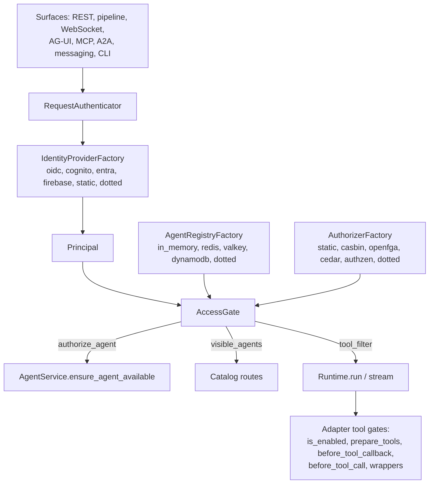

# #603: Identity layer, RBAC and agent registry

Agent Kernel gains three pluggable layers under one new package, `agentkernel/identity/`: identity
providers that turn an inbound credential into a `Principal`, an authorizer that decides which
agents a principal may use (at a capability level) and which tools an agent may offer and invoke
for that principal, and an agent registry that gives every agent a first-class descriptor and a
catalog. The design idea is that the acting principal is established once from the validated
credential at every surface and published for the whole run, and that every access decision is
made by one `AccessGate` over the registry and the authorizer, before any state is committed.
It ships as a breaking change: the client-supplied `user_id`, the `agentkernel.auth` seams and
the per-surface agent lists are removed outright, with no compatibility window (decided
2026-11-04, revisiting Q2, Q3 and Q6; section 10).

Evidence is cited against `feature/603-identity-rbac-registry` at `287ec7485` (develop merged on
2026-11-04; the original pass was `5c257514`, 2026-10-01); the research behind this design,
including the ten settled review decisions, is in `research/` (start with `research/README.md`
and `research/design-options.md` section 4).

## Motivation

- There is an authentication seam but no identity layer: `agentkernel.auth` exports two ABCs and
  one adapter (`auth/__init__.py:14-15`); no built-in JWT/OIDC, Cognito, API-key or static provider
  exists in the package, and the only crypto helper validates against a static RS256 public key
  (`auth/handler.py:50-71`). Every example validator decodes with `verify_signature: False`
  (`examples/aws-containerized/crewai-auth/app.py:46-62`).
- The REST surface validates a token and discards who it belongs to: the dependency installed by
  `RESTAPI.add_auth_handlers` returns a `ValidationResult` that no route reads (`api/http.py:223-232`);
  the acting user on `/api/v1/chat` is the client-supplied body `user_id` (`api/handler.py:105, 121`).
- WebSocket surfaces authenticate one identity and act as another: the validated `userId` claim keys
  the connection and routes the reply (`pipeline/ws/handler.py:185, 233`), while the queued body is
  dumped as the client sent it (`pipeline/ws/handler.py:232`) and `BaseRequest.from_payload` declares
  the envelope `user_id` "authoritative" (`core/model.py:515-516`).
- MCP and A2A requests now travel the queue pipeline (#829) with a body of `{prompt, agent,
  session_id}` and no user at all (`api/mcp/akmcp.py:85-87`, `api/a2a/a2a.py:76-78`,
  `pipeline/producer.py:44-49`), so the runner's acting user is `None` (`core/chat_service.py:485`).
  MCP is still mounted outside the REST auth dependencies (`api/http.py:200`) and `FastMCP(...)` is
  built with no auth (`api/mcp/akmcp.py:136`). The A2A card builder emits the a2a-sdk 1.x shape
  since #842 (`core/builder.py:63-74`, `a2a-sdk==1.2.3` at `ak-py/pyproject.toml:190`) but still no
  `security_schemes` or `security_requirements`, the executor never reads `ServerCallContext.user`
  (`api/a2a/a2a.py:71-76`), and ADK's card is still a `TODO` (`framework/adk/adk.py:1519-1524`).
- No surface authorizes agent selection per caller: `AgentService.ensure_agent_available` and
  `select` check only that a name is registered (`core/service.py:49-70, 72-101`); MCP, A2A and AG-UI
  filter by static allow-lists that ignore the caller (one executor per listed agent,
  `api/mcp/akmcp.py:144`, `api/a2a/a2a.py:141-153`; `integration/agui/handler.py:60-68`).
- The agent registry is a name-keyed dict on `Runtime` (`core/runtime.py:144, 213`) and an `Agent`
  carries `name`, `runner`, a realtime runner class, hooks and run options only
  (`core/base.py:519-532`): no id, version, owner, tags or catalog description. `get_description()`
  returns the system prompt on OpenAI (`framework/openai/openai.py:1058-1062`), which is why AG-UI
  lists names only (`integration/agui/handler.py:140-152`) and why the OpenAI A2A card description
  is the prompt (`framework/openai/openai.py:1091`).
- In the two-process queue topology every process must load every agent's code just to list it:
  the k8s io-handler example now instantiates the full `OpenAIModule` only so that A2A cards and
  MCP tools can be built from the IO process's registry (`examples/k8s/openai-queue-mode/app_io_handler.py:5-8, 17-19`),
  `IOHandler` warns when no agents are registered (`pipeline/io_handler.py:270-288`), and
  `GET /api/v1/agents` (`api/handler.py:102-103`) and the thread precheck
  (`integration/thread/thread_chat.py:209-218`) only ever see the local dict. Nothing shares
  descriptors across processes.
- Tool sets are fixed per agent at load time (`core/base.py:698-708`, `core/tool.py:166-176`) with
  no per-run or per-user filtering, and AK installs no native tool hook in any of its seven
  adapters (a grep across `framework/` and `core/` for `before_tool_callback`, `before_tool_call`,
  `RunHooks`, `tool_input_guardrail` and `middleware=` finds no installation); the only call-time
  checks live inside individual tools (`knowledgebase/okf/tools.py:150`, `schedule/tools.py:72-81`).
  The one AK-owned tool invocation point is realtime mode (`core/realtime/runner.py:124`), reached
  from a `ToolContext` built with no acting user (`pipeline/realtime_pool.py:239`).
- Human-in-the-loop (#765) pauses and resumes runs with no notion of who may resume:
  `Runtime._validate_resume` (`core/runtime.py:273-332`) checks the record, agent and runner but
  never the acting user, `PausedRun` (`core/paused_run.py:66-71`) has no user field, and the HITL
  design named approver identity a non-goal (`docs/specs/606-human-in-the-loop/design.md:946`).
  The pause records live in the non-volatile cache under `ak.paused_runs`
  (`core/paused_run.py:43, 128`), and the `ak.` prefix is documented as a convention with an
  "accepted risk" of overwrite (`core/paused_run.py:24-26`).
- The LiveKit realtime gateway (#761) accepts any participant in the room as input
  (`integration/livekit/adapter.py:235-268`), enqueues with no `user_id`
  (`integration/adapter/base.py:300-314`) and bypasses `Runtime.run`, so no acting user exists on
  the realtime path; the AG-UI queue handler (#755) carries the token subject in the body only
  (`integration/agui/queue_handler.py:141-147`).
- Two identity precedents already exist: the run-scoped `ACTING_USER_CACHE_KEY`
  (`core/runtime.py:40, 396-397`) with exactly one reader (`schedule/tools.py:72-81`), and the
  sandbox `SandboxPrincipal` / `PrincipalResolver` (`sandbox/model.py:142-148`,
  `sandbox/principal.py:17-39`) to which AK never hands a user (`sandbox/manager.py:409-411`).
- The only role model, OKF's `consumer` / `producer` / `curator`, is per agent and deliberately
  local to `knowledgebase/okf/` (`knowledgebase/okf/roles.py:1-10, 22-27`;
  `docs/specs/553-okf-knowledge-bases/design.md:645-648`).
- Three per-agent scoping vocabularies coexist in config: `None`-means-all lists
  (`core/config.py:283, 417, 1093, 1103, 1211, 1221, 1228`, the A2UI one added by #719), `["*"]`
  sentinels (`core/config.py:142, 150`), and OKF's per-database roles (`core/config.py:446-451`). All
  are agent-to-capability grants; none is a user-to-agent grant, and no end-user auth setting
  exists anywhere in `AKConfig` (`core/config.py:1235-1279`).

## Requirements

### 1. Core models (`core/model.py`, `core/runtime.py`, `core/tool.py`)

- `Principal` (Pydantic, picklable) beside `BaseChatRequest` in `core/model.py`, so core never
  imports the capability (the `ScheduleSpec` precedent):
  - `subject: str`; `kind: Literal["user", "agent", "service"] = "user"`; `provider: str` (the
    provider short name that produced it, or `anonymous`); `namespace: Optional[str]` (the scope
    the subject is unique in: the validated issuer for the OIDC family, `static` for the static
    provider, the platform scope for messaging and realtime principals, `None` for anonymous;
    with `provider` and `subject` it is the identity key the omnichannel work (#243) links on, so
    it is set by the identity layer, never derived downstream); `groups: list[str] = []`;
    `roles: list[str] = []`; `claims: dict[str, Any] = {}`; `actor: Optional[Principal] = None`
    (the RFC 8693 `act` chain: who is acting for this subject); `credential_ref: Optional[str]`
    (an opaque, run-scoped handle to the inbound credential, section 3.1; never the credential).
  - `Principal.anonymous()` returns `subject="anonymous"`, `provider="anonymous"`;
    `is_anonymous` property.
  - Frozen (`model_config = ConfigDict(frozen=True)`): a principal read from the session cannot be
    mutated by a hook or tool; a changed identity is a new object only `Runtime` can publish.
  - `groups` and `claims` are identity facts carried verbatim from the provider. `roles` is the
    deployment's policy vocabulary and has exactly one producer: a configured `RoleMapper`
    (section 3). With no mapper it stays empty. Agent Kernel maintains no roles of its own.
- `AccessLevel` (`StrEnum`, ordered, comparable): `read < write < admin`. It is the **capability
  tier a principal may drive through an agent**; any level implies the principal may chat with the
  agent. Record management is not a level (settled, Q4).
- `AgentDescriptor` (Pydantic): `id` (defaults to `name`), `name`, `version` (semver string,
  default `"0.0.0"`), `description` (catalog text; never `get_description()`), `owner:
  Optional[str]`, `tags: list[str]`, `visibility: Literal["private", "internal", "public"] =
  "private"`, `surfaces: Optional[list[Literal["rest", "a2a", "mcp", "agui"]]]` (`None` = every
  mounted surface), `skills: list[AgentSkillDescriptor]` (`id`, `name`, `description`, `tags`),
  `tools: list[str]`, `runner: str`, `supports_streaming: bool`, `identity: AgentIdentitySpec`
  (`subject: Optional[str]`, defaults to `id`; the only agent-identity field in round 1, settled Q7).
- `SystemTool` gains `tier: AccessLevel = AccessLevel.READ` (`core/model.py:357-360`). Declared
  tiers: sandbox execution tools and all five schedule tools `write`; `analyze_attachments`, the
  OKF read tools, `get_agui_state`, `get_forwarded_props`, `get_agui_context` `read`; `write_kb`
  and `update_agui_state` `write`.
- `Agent` (`core/base.py`) gains:
  - `descriptor` property: built once by the adapter from the native agent (name, tools, skills,
    runner name, `supports_streaming`) and overlaid by `Module.describe` and config (section 4).
  - `get_tool_names() -> list[str]`: implemented per adapter from the same source the A2A skills
    are built from today (`framework/openai/openai.py:1082-1091` and siblings); ADK implements it
    too, although its `get_a2a_card` is still a `TODO` (`framework/adk/adk.py:1519-1524`).
- `Runtime` (`core/runtime.py`):
  - `run(...)` and `stream(...)` take `principal: Optional[Principal] = None` in place of
    `acting_user_id` (`core/runtime.py:378, 433`), which is removed together with the
    `acting_user_id` parameters of `AgentService.run_multi` / `stream_multi`
    (`core/service.py:162, 180`) and the `AgentHandler` wrappers (`core/chat_service.py:277-314`);
    `None` means `Principal.anonymous()`. The HITL dispatch into `runner.resume` /
    `resume_stream` (`core/runtime.py:414-418, 476-480`) sits inside the same span, so a resumed
    run is published and gated exactly like a fresh one. The realtime path, which bypasses
    `Runtime.run` (`pipeline/realtime_pool.py:228-252`), publishes the principal around
    `execute_tool` through the same private setters.
  - Publishes the principal in the volatile cache under `PRINCIPAL_CACHE_KEY = "ak.principal"`,
    cleared in the run's `finally`. `ACTING_USER_CACHE_KEY` (`core/runtime.py:40`, exported from
    `core/__init__.py:48`) is removed; its one reader, the schedule tools' `acting_user()`
    (`schedule/tools.py:72-81`), reads `Session.get_principal()` and returns the subject of a
    non-anonymous principal. The volatile cache is never
    persisted (every store writes `session.get_all(volatile=False)`, `core/session/redis.py:100`,
    `valkey.py:100`, `dynamodb.py:105`, `cosmosdb.py:108`), so a run identity cannot be read back
    by a later run.
  - Publication is **read-only to everything but `Runtime`**: `KeyValueCache`
    (`core/util/key_value_cache.py:32-64`, which today rejects only an empty key) refuses `set` and
    `delete` on keys with the reserved `ak.` prefix (`ValueError` naming the key), and core writes
    them through private `_set_reserved` / `_delete_reserved` methods. This protects
    `ak.principal` and the HITL `ak.paused_runs` records (`core/paused_run.py:43, 128`), whose
    "accepted risk" note (`core/paused_run.py:24-26`) is retired by it.
    Storage stays session-attached rather than a `ContextVar` alone because ADK re-activates the
    tool context from state per call (`framework/adk/adk.py:1643-1661`), where a context variable
    would be lost.
  - Sets `principal.actor = Principal(kind="agent", subject=agent.descriptor.identity.subject,
    provider="agentkernel")` on a copy of the run principal before publishing it.
- `Session.get_principal() -> Optional[Principal]` (`core/base.py`) fronts the reserved key the way
  `get_framework_context()` fronts `FRAMEWORK_CONTEXT` (`core/base.py:192-198`); nothing outside
  `Session` and `Runtime` spells the key. `ToolContext.principal` (`core/tool.py`) delegates to it
  and is `None` outside a run. Hooks and tools read the user id, groups, roles and claims from
  this object; they cannot write any of it.
- `ToolContext.access_level -> Optional[AccessLevel]` (`core/tool.py`): the level the gate
  resolved for this principal on this agent, read from the published `ToolFilter` (section 6);
  `None` when authorization is not configured or outside a run, and read-only like `principal`.
  A tool that cannot be split into read and write forms declares the tier of its
  least-privileged mode and gates its own write path on it (section 5.1).
- Session ownership (the durable side): `Session.Keys.OWNER = "owner"` is a new reserved durable
  key holding `SessionOwner(subject, provider, namespace)`; `Session.get_owner() ->
  Optional[SessionOwner]` is its only public reader. `Runtime` sets it once, on the first run
  with a non-anonymous principal when the key is absent, and never overwrites it; it persists
  with the session and survives `clear_framework_context()`. Enforcement is in section 6 and
  compares namespace and subject. The owner is the enforcement side only: answering "every
  session this identity used" is an index the omnichannel work (#243) keeps in its own mapping
  store. The owner replaces the hand-rolled `nv_cache["user_identity"]` pattern
  (`examples/sandbox/identity/identity.py:28`).
- Identity reaches tools and hooks, never the model: `ChatService._attach_additional_context`
  keeps excluding `group_id` and rejects `user_id` (`core/chat_service.py:148-170`, where `resume`
  and `agui` joined the known fields; section 2); the `Principal` is
  never written into `framework_context`, a prompt, an `AgentRequestAny`, or a framework's native
  state (ADK `state`, LangGraph channels); adapter gates read it from the session.

### 2. Establishing the acting principal on every surface

- One rule everywhere: the acting principal comes from the validated credential, never from the
  request. `user_id` is removed from `BaseChatRequest` and from the WebSocket envelope
  (`core/model.py:427, 497-518`); the known-field set in `ChatService._attach_additional_context`
  keeps the name reserved, so a body that still carries it is rejected with 400
  (`detail="user_id is not a request field; the acting user comes from the credential"`) rather
  than reaching the agent as an `AgentRequestAny` extra. A request with no credential, where the
  surface allows it, acts as the anonymous principal. Q3 is revisited (2026-11-04): with no body
  field there is no mismatch rule.
- Default posture (Q2 revisited, 2026-11-04): with no `identity` block every request is the
  anonymous principal. The chat, catalog, MCP and A2A routes stay open as they are today. The
  surfaces that need a non-anonymous principal, which today demand an `AuthValidator` or
  `Authoriser` in code, demand an `identity` block instead: the WebSocket surfaces (the
  connection is keyed by the subject), AG-UI, and the `AuthorisedRESTRequestHandler` family
  (threads, schedules). Each raises `AKConfigError` at startup when mounted without one. The
  capabilities that required a body `user_id` (threads, `core/model.py:411-413`; schedule
  registration, `core/model.py:415-417`) require a non-anonymous principal and answer 401
  otherwise.
- `RequestAuthenticator` (class, `identity/provider/request.py`): the shared bearer-header and
  WebSocket-token extraction over the configured `IdentityProvider`, replacing the three copies of
  header parsing (`api/http.py:223-226`, `api/handler.py:63-68`, `pipeline/ws/handler.py:177-187`).
  - A present but invalid credential is a 401 (HTTP) or a policy-violation close (WebSocket), with
    a generic detail; the provider's reason is logged, never returned.
  - No credential: the chat and catalog routes get `Principal.anonymous()`; the
    `AuthorisedRESTRequestHandler` family (threads, schedules, AG-UI) keeps requiring one (401), as
    it does today with an `Authoriser` (`api/handler.py:71-72`), now resolved through the
    configured provider rather than a constructor argument.
  - It replaces `agentkernel.auth` outright: `AuthValidator`, `ValidationResult`, `Authoriser`,
    `AuthValidatorAuthoriser`, `RESTAPI.add_auth_handlers`, `APIGatewayAuthorizer(validator=)` and
    every `auth_validator=` / `authoriser=` constructor argument are removed; the RS256 helper
    (`auth/handler.py:50-71`) is subsumed by the `oidc` provider's JWKS validation. A deployment
    with custom token logic writes an `IdentityProvider` and names it by dotted path.
- REST (`RESTAPI`, `AgentRESTRequestHandler`, pipeline `RequestHandler`): `RESTAPI` installs the
  identity dependency itself when `identity` is configured (replacing `add_auth_handlers`,
  `api/http.py:223-232`); it stores the `Principal` on `request.state`, and `run`, `run_multipart`
  and `run_chat` read it and pass it to `ChatService`. `ChatService.execute*` pass `principal`
  through `AgentHandler` to `AgentService.run_multi` / `stream_multi`, which forward it to
  `Runtime` (the `acting_user_id` parameters go, section 1). `APIGatewayAuthorizer` runs the
  configured provider on the serverless target.
- WebSocket (`PipelineWebSocketHandler`, `ECSWebSocketSystemRequestHandler`, `LambdaWSHandler`):
  the connection's principal is the acting principal for every frame and is serialized into the
  queued body as `principal` (section 3.1). The envelope loses `user_id`, and the "envelope is
  authoritative" propagation in `BaseRequest.from_payload` (`core/model.py:513-516`) goes with
  it; a frame that still carries `user_id` is answered with the existing `FAILED` system frame
  (`pipeline/ws/handler.py:269-270`) and not enqueued. The connection store is keyed by
  `principal.subject`; the `userId` claim contract (`pipeline/ws/handler.py:185`,
  `deployment/aws/containerized/core/api/websocket_api.py:146`,
  `deployment/aws/serverless/core/router/ws_lambda.py:206`) is removed, and custom route
  handlers receive `ctx["principal"]` where they received `ctx["user_id"]`.
- Messaging: `InboundRequest.user_id` (the platform sender id, `integration/adapter/base.py:65`)
  becomes `Principal(subject=<sender>, provider="messaging:<platform>", namespace=<scope>)` at
  `AgentRunner`, where the scope is the platform's own: the Slack team id, the Teams tenant id
  (`integration/teams/adapter.py:109`), the Gmail inbox address, the WhatsApp phone number id
  (`integration/whatsapp/adapter.py:29`), the Messenger or Instagram page id, the Telegram bot
  id. `InboundRequest` gains `namespace` and `claims` for that purpose, and an adapter may put
  platform-asserted facts in `claims`: the Gmail adapter already fetches messages with
  `format="full"` (`integration/gmail/adapter.py:237`), so it records the
  `Authentication-Results` header there for a downstream DMARC check. The `messaging:` prefix is
  what the ownership gate keys on (settled, Q17); no mapping to a canonical subject in this
  change (#243 links identities on `provider`, `namespace`, `subject`).
- AG-UI: token-derived user and no anonymous mode, as today; `_resolve_user` becomes the
  `RequestAuthenticator` over the configured provider (the `authoriser=` argument goes) and the
  run receives the `Principal` (`integration/agui/handler.py:280` passes it where it passed
  `acting_user_id`).
- MCP and A2A: section 8.
- LiveKit realtime: the participant identity LiveKit asserts (`participant.identity`,
  `integration/livekit/adapter.py:249`) becomes `Principal(subject=identity,
  provider="realtime:livekit", namespace=<the configured LiveKit API key id>)`;
  `RealtimeConnectionPool.dispatch` runs the agent check before `prepare_agent_handler`
  (`pipeline/realtime_pool.py:550`) and publishes the principal around every `execute_tool`.
  Rooms are shared, so the `realtime:` prefix is exempt from ownership like `messaging:` (settled,
  Q17).
- Resume: a HITL resume is authorized like any run (the agent check and the tool filter apply),
  and `PausedRun` gains `subject` and `provider` recorded at pause time; `Runtime._validate_resume`
  rejects a resume whose non-anonymous subject differs with `PermissionError` (403), closing the
  approver-identity gap the HITL design left open.
- CLI: `ak` CLI and `agentkernel.cli` accept `--token` (or `AK_CLI_TOKEN`) authenticated through the
  configured provider; without one the CLI runs as the anonymous principal.

### 3. Identity providers (`identity/provider/`)

- `IdentityProvider` ABC: `name: ClassVar[str]`; `async authenticate(credential: str, context:
  Optional[RequestContext] = None) -> Principal`, raising `AuthenticationError(reason)`
  (`identity/errors.py`). `RequestContext` (`identity/provider/context.py`: `path`,
  `http_method`, `headers`) is today's `ValidationContext` (`auth/handler.py:7-10`) moved with
  the package, since `agentkernel.auth` is removed.
- `IdentityProviderFactory` (`identity/provider/factory.py`, the `core/util/factory.py` shape):
  `create(identity_config) -> IdentityProvider`; `get()` returns the process-wide provider built
  from `AKConfig.identity`, or `None` when the block is absent (the enabled-check);
  `reset()` for tests. Branches: `oidc`, `cognito`, `entra`, `firebase` (each under
  `require_extra("auth", "identity.provider.type: <name>")`, reusing the existing `auth` extra,
  `ak-py/pyproject.toml:24-26`), `static`, else a dotted path to an `IdentityProvider` subclass,
  else `AKConfigError`.
- `OIDCIdentityProvider` (`oidc`):
  - Issuer discovery at `<issuer>/.well-known/openid-configuration` unless `jwks_uri` is given;
    JWKS cached, refreshed once on an unknown `kid`, refresh cooldown 30 s; network fetches never
    block the event loop.
  - Validates signature (algorithms allow-list, default `["RS256", "ES256"]`; symmetric algorithms
    refused), `iss` equals the configured issuer, `aud` contains the configured audience
    (required), `exp` and `nbf` with `leeway` (default 30 s), and every `required_claims` entry.
  - Claim paths (dotted, configurable): `subject` default `sub`, `groups` default `groups`; a
    missing groups claim yields an empty list, a missing subject claim is an `AuthenticationError`.
    Every other validated claim lands in `claims` for the mapper and for tools; providers never
    write `roles`. `namespace` is the validated `iss`, so the three direct surfaces yield one
    identity per issuer and subject.
- Provider subclasses that change only defaults and one check each:
  - `CognitoIdentityProvider` (`cognito`): issuer
    `https://cognito-idp.<region>.amazonaws.com/<user_pool_id>`; groups from `cognito:groups`;
    `token_use` must equal the configured value (default `access`); for access tokens the audience
    check reads `client_id` instead of `aud`.
  - `EntraIdentityProvider` (`entra`): issuer `https://login.microsoftonline.com/<tenant_id>/v2.0`;
    subject from `oid`; groups from `groups` (`roles` and `wids` stay in `claims` for the mapper);
    `tid` must equal `tenant_id`; a groups-overage marker (`_claim_names` present) yields empty
    groups and one warning per process.
  - `FirebaseIdentityProvider` (`firebase`): issuer `https://securetoken.google.com/<project_id>`,
    audience `project_id`, keys from Google's `securetoken@system.gserviceaccount.com` JWK set;
    the groups claim path defaults to `roles` (settled, Q14: Firebase has no built-in role
    claim, so the convention is the application's custom-claim list of that name) and every
    custom claim stays in `claims` for the mapper. Boolean flag claims such as `admin: true`
    need a dotted-path `RoleMapper`; the built-in `mapping` maps list and string values only.
- `StaticIdentityProvider` (`static`): a map of credential key to principal fields; credential
  values are resolved by key through the existing secret capability (`SecretManager.get`,
  `secret/manager.py:60`), never written in YAML; comparison via `hmac.compare_digest`; `namespace`
  is the literal `static`. Documented as the dev, test and CLI provider, not for production.
- `RoleMapper` ABC (`identity/provider/roles.py`): `map(principal) -> list[str]`, applied by the
  factory wrapper after `authenticate`, so every provider's output is mapped the same way and
  `Principal.roles` has exactly one producer. Selected by `identity.role_mapper.type` through
  `RoleMapperFactory`: the built-in `mapping` (the `mapping` dictionary from provider group or
  claim value to AK roles, plus an optional `pass_through` claim path whose values become roles
  as-is, for IdPs that already issue roles), else a dotted path to a `RoleMapper` subclass that
  derives roles from anything on the principal or from an external lookup. No `role_mapper` block
  means no roles; `AccessGate.validate_configuration` warns when a grant uses a `role:` subject
  and no mapper is configured. A contract test covers both built-in behaviours.
- `IdentityProviderContract` (`identity/provider/testing.py`): valid credential yields the
  expected principal; expired, wrong audience, wrong issuer, unknown `kid`, tampered signature and
  missing subject each raise `AuthenticationError`; the groups claim path maps and `roles` is
  empty before mapping; every built-in subclasses it.

### 3.1 Keeping and reading tokens for outbound calls (`identity/credential/`)

- Scope: a tool, or a framework's MCP client, must call a remote server that needs a token for
  *its* audience. The inbound user token is never passed through (the MCP specification forbids
  it), never stored in the session (persisted, shared, readable by every tool and hook), never
  placed in a queue body and never logged.
  This change builds the retention side only: the inbound credential is kept by reference in a
  `CredentialStore` and read through one `CredentialBroker` seam, so an exchange flow can be added
  when a deployment requires one without touching the surfaces, the queue or the runners
  (settled, Q19). No exchange flow is implemented in this change; `passthrough` is the only
  built-in exchanger and exists so the seam is exercised end to end.
- `Principal.credential_ref` is minted by `RequestAuthenticator` when identity is configured: an
  opaque random id under which the surface stores the inbound credential in the `CredentialStore`
  with TTL `min(token exp, identity.credentials.inbound_ttl)`. `Runtime` deletes the entry in the
  run's `finally`. In the two-process topology the io-handler stores it and the agent-runner
  reads it by ref: **the token never rides the queue, the ref does**.
- `CredentialStore` ABC: `put(key, value, expires_at)`, `get(key)`, `delete(key)`. Built-ins via
  `CredentialStoreFactory` (`identity.credentials.store.type`): `in_memory` (default,
  single-process), `redis`, `valkey`, `dynamodb` over the shared drivers reusing
  `_CredentialRedisConfig(_RedisConfig)` and siblings (prefix `ak:cred:`), dotted path. Values are
  encrypted at the application level (AES-GCM) with the key named by
  `identity.credentials.encryption_key`, resolved through the `secret` capability; a shared store
  without a key fails at startup with `AKConfigError`.
- When an exchanger is configured, the tokens it issues are cached in the same store under
  `(subject, provider, agent id, audience, scopes)` with TTL equal to the token's `exp` minus
  leeway, so every session of the same user reuses them.
- `TokenExchanger` ABC: `exchange(inbound, audience, scopes, actor) -> IssuedToken(access_token,
  expires_at, token_type)`, selected per audience by `identity.credentials.exchangers[]` through
  `TokenExchangerFactory`. Only `passthrough` is implemented in this change (dev only: returns
  the inbound token for an explicit audience list, one startup warning). `rfc8693` (OAuth 2.0
  token exchange at the provider's token endpoint, `subject_token` = inbound, optional
  `actor_token` = the agent's client credential), `entra_obo` (jwt-bearer with
  `requested_token_use=on_behalf_of`) and `id_jag` (the MCP Enterprise-Managed Authorization
  flow: ID-JAG at the IdP, then jwt-bearer at the MCP server's authorization server discovered
  through its RFC 9728 metadata) are named branches built when required, each subclassing
  `TokenExchangerContract` when it lands, the rule the authorizer engines follow; a dotted path
  to a `TokenExchanger` subclass works from the start. When an exchange flow lands, the agent's
  own client credential comes from the `secret` capability by the key named in the descriptor's
  `identity` block (`client_id`, `client_secret_key`); the agent is the OAuth client, the user is
  the subject, the agent principal is the `actor`.
- `CredentialBroker` (class): `token_for(audience, scopes=None) -> str`, bound to the run
  principal: cache lookup, else exchange through the exchanger matching the audience, store,
  return. Raises `CredentialError` (no inbound credential, no exchanger for the audience,
  exchange refused), which a tool turns into a tool error result. Exposed as
  `ToolContext.credentials`; with no `identity.credentials` block every call raises.
- Adapter MCP clients are the intended consumer of the broker: where a framework's MCP client
  accepts a per-request header provider it is wired to `token_for`; where it accepts only static
  headers the adapter builds the MCP server object per run. That wiring lands with the first
  exchange flow, not in this change (non-goals); until then a tool calls
  `ToolContext.credentials.token_for(...)` itself. The broker is the single token source either way.
- Queue topologies carry the principal, not the credential: the surface serializes the frozen
  `Principal` into the request body under `principal` (a `RequestBuilder` known field, so it never
  reaches the agent as context), the runner rebuilds it and passes it to `Runtime`; the body
  carries no `user_id`, and `AgentRunner` (`pipeline/agent_runner.py:126, 283-284`) reads the
  principal where it read `body.user_id`. The queue being the IAM-restricted
  choke point is the same argument the sandbox broker already makes.
- Not in this change: the exchange flows and the adapter MCP wiring above (settled, Q19); refresh
  tokens and long-lived third-party consent (the identity vault, keyed by user, agent and
  connection), and asynchronous user approval (CIBA), both round 2.

### 4. Agent entity and registry (`identity/registry/`)

- `AgentRegistry` ABC: `register(descriptor, agent)` (raises `AgentRegistrationError` on a
  duplicate `id`, replacing the bare `Exception` at `core/runtime.py:213`), `deregister(id)`,
  `get(id) -> Agent | None` (process-local object), `descriptor(id) -> AgentDescriptor | None`,
  `agents() -> dict[str, Agent]` (the current `Runtime.agents()` contract), `list(cursor, limit,
  tags=None) -> AgentDescriptorPage` using `core/util/pagination.py`.
- `AgentRegistryFactory` with its own `registry.type` selector (settled, Q9; the `ThreadStoreBuilder`
  shape): `in_memory` (today's dict; the default when no `registry` block exists), `redis`,
  `valkey`, `dynamodb` (under `require_extra("redis" | "valkey" | "aws", ...)`), else a dotted path
  to an `AgentRegistry` subclass, else `AKConfigError`.
- Store-backed registries persist descriptors only; `Agent` objects stay process-local.
  Redis-like layout `{prefix}agent:{id}` document plus `{prefix}index:all` set over
  `_RedisLikeDriver`; DynamoDB one item per agent, partition key `agent_id`, over `DynamoDBDriver`
  (the schedule store shapes, `schedule/store/redis_like.py:3-6`, `schedule/store/dynamodb.py:3-18`).
  `register` upserts the record with `updated_at`; `deregister` deletes it; records do not expire
  (`ttl` default 0), and a crashed process leaving a record behind is a documented boundary.
- `Runtime.register` / `deregister` / `agents()` delegate to the configured registry; `Runtime`
  gains a `registry` property. The registry is per `Runtime` instance as today
  (`tests/test_module.py:164-179`).
- Descriptor sources, later wins per field: adapter defaults from the native agent, then
  `Module.describe(agent, **fields) -> Self` (fluent, beside `pre_hook` and `run_options`, same
  `_wrapped` resolution, `ValueError` for an unloaded agent and for unknown fields), then the
  `registry.agents.<id>` config overlay. `description` is never defaulted from `get_description()`.
- Availability now means "a descriptor exists in the registry": `AgentService.ensure_agent_available`
  (`core/service.py:49-70`) consults `registry.descriptor(name)`, so on a store-backed registry the
  io-handler process can list and precheck agents it does not host; `select` still needs the local
  `Agent` and raises `ValueError` when the process does not host it.
- Catalog: `GET /api/v1/agents` returns `{"agents": [<descriptor>...]}` filtered by the caller
  (section 6), paginated with the shared cursor helpers; the `tools` field of each entry lists only
  the tools at or below the caller's level. The same filtered list feeds AG-UI's `/agents`, the MCP
  tool list and `/a2a/catalog`, each narrowed by the descriptor's `surfaces`.
- `A2ACardBuilder.build` takes the descriptor and emits the a2a-sdk 1.x card: `name`,
  `description`, `version` (the descriptor's, not `library_version`), `supported_interfaces`,
  `skills` (one per skill descriptor), `security_schemes` and `security_requirements` derived from
  the configured identity provider (`bearer` for `static`, `openIdConnect` with the
  issuer's discovery URL otherwise; none when identity is not configured), mirrored per skill.

### 5. Authorization (`identity/authz/`)

- `Authorizer` ABC: `async agent_level(principal, agent_id) -> Optional[AccessLevel]`; `async
  check_tool(principal, agent_id, tool) -> Decision` (`allowed: bool`, `reason: str`); `async
  filter_tools(principal, agent_id, tools) -> list[str]` (default: per-tool `check_tool`); `async
  visible_agents(principal, candidates) -> list[str]` (default: candidates with a level, the
  registry being the candidate set); `capabilities: ClassVar[AuthorizerCapabilities]`
  (`lists_resources: bool`) so a ReBAC backend can replace the candidate walk natively.
- Role management is optional. The contract a deployment must satisfy is a few functions:
  `IdentityProvider.authenticate` (credential to principal) and the four `Authorizer` questions.
  Agent Kernel stores no roles and no user-to-role assignments; `RoleMapper` and the `static`
  backend's `grants` are the built-in, zero-dependency role management for deployments that want
  one, and a deployment that brings its own authorizer (dotted path or engine) may ignore `roles`
  entirely and decide from `subject`, `groups` and `claims`.
- `AuthorizerFactory`: `create(authorization_config)`; `get()` returns the configured authorizer or
  `None` when the `authorization` block is absent (the enabled-check); `reset()` for tests. Branches:
  `static` (ships first), `casbin` (`casbin` extra), `openfga` (`openfga` extra), `cedar` (`cedar`
  extra), `authzen` (HTTP, no extra), else a dotted path to an `Authorizer` subclass, else
  `AKConfigError`. Only `static` is implemented in the first iteration; `casbin` is the first
  engine after it (settled, Q11: in-process, runs in CI with no service) and the others are named
  branches whose adapters subclass the contract suite when they land.
- `StaticAuthorizer` (`static`) evaluates the `authorization.grants` and `authorization.tools`
  blocks (its policy source; engine backends ignore these blocks and own their policy):
  - A grant is `subjects`, `agents`, `level`. `subjects` and `agents` are lists; a bare string is
    coerced to a one-element list, so `agents: support-triage` and `agents: [a, b]` are both
    valid. A grant applies to every (subject, agent) pair it names.
  - Subject grammar: `*` (everyone, anonymous included), `authenticated` (any non-anonymous
    principal, which includes messaging senders the platform did not verify, such as a Gmail
    From address), `provider:<name>` (the principal's provider by exact name, or by prefix when
    the name ends in a colon, so `provider:messaging:` is every messaging sender and
    `provider:oidc` is token-verified callers only), `user:<subject>` (matches the subject of a
    principal of any kind, so a client-credentials service principal is granted the same way),
    `group:<name>`, `role:<name>`; an agent entry is an agent id, `*`, or `tag:<name>`, resolved through the
    registry against `AgentDescriptor.tags` (settled, Q18), so `StaticAuthorizer` is constructed
    with the registry; a tag no descriptor carries matches nothing.
  - `agent_level` is the highest level over every matching (subject, agent) pair across all
    grants; `None` when none matches. There are no negative grants at the agent level; `deny`
    exists only for tools.
  - Tool tier: the `tiers` entry for `(agent, tool)` if present, else the system tool's declared
    `tier`, else `read`.
  - `check_tool` allows when the tool is not in `deny`, is in `allow` when `allow` is set, and its
    tier is at or below `agent_level`; `agent_level` of `None` denies everything.
  - With the block present and no grants at all, every agent is denied for every principal except
    through `visibility`; one warning at startup names the empty block.
- `AccessGate` (class, `identity/authz/gate.py`): the one consumer of registry plus authorizer.
  `get()` returns `None` when authorization is not configured. Methods: `authorize_agent(principal,
  agent_id) -> AccessLevel` (raises `PermissionError` when `None`; raises `KeyError` when the
  registry has no descriptor), `visible(principal, descriptor) -> bool` (`agent_level is not None`,
  or `visibility` admits: `public` everyone, `internal` non-anonymous, `private` nobody; settled Q5:
  visibility never confers a level), `visible_agents(principal) -> list[AgentDescriptor]`,
  `tool_filter(principal, agent) -> ToolFilter` (the per-run allow set over
  `agent.get_tool_names()`, with `reason` per denied tool and the resolved `level`, which
  `ToolContext.access_level` exposes).
- Startup validation (`AccessGate.validate_configuration()`, called from `Module.load` for the
  agents it loads and from the handlers' `get_router()`): an `allow`, `deny` or `tiers` entry naming
  a tool the loaded agent does not have raises `AKConfigError`; a grant naming an unknown agent id
  or a `tag:` no loaded descriptor carries only warns, since the agent may be hosted by another
  process. With `authorization` configured, an agent on LangGraph or smolagents whose native tool
  set includes tools AK did not bind raises `AKConfigError` here (settled, Q12), because those
  adapters cannot gate them (section 7).
- `AuthorizerContract` (`identity/authz/testing.py`): level resolution across all six subject
  forms, highest-level-wins, `*` and `tag:` agent grants, tier gating, `allow` / `deny` precedence, anonymous
  handling, and `visible_agents` equivalence with the candidate walk; every backend subclasses it.

### 5.1 Worked example: how users, agents and tools combine

- Subjects come from two places: IdP groups verbatim (`group:`) and AK roles produced by the
  configured `RoleMapper` (`role:`); with no mapper, grants use `group:`, `user:` and `provider:`
  only. Roles never carry across an omnichannel link: a Slack sender holds whatever its own
  principal matches, and a deployment that wants linked identities to share roles resolves the
  profile in a dotted-path `RoleMapper`. A role is
  not bound to one agent; a grant binds subjects to agents (or `*`) at a level. A tool's tier is
  per agent, so the same tool name can be `write` on one agent and `admin` on another.
- Who holds a role is decided in the IdP, not in AK: membership is managed there and arrives in
  the token under the claim paths the provider block names; the mapper only renames provider
  values into the deployment's vocabulary (a `pass_through` path exposes IdP-issued roles as
  `role:` subjects unchanged). AK stores no user-to-role assignments; a direct per-user grant uses
  `user:<subject>`, and the `static` provider lists groups and roles per credential for dev.

```yaml
identity:
  role_mapper: {type: mapping, mapping: {sre-oncall: [operator], platform-admins: [admin]}}
authorization:
  type: static
  grants:
    - {subjects: role:admin,     agents: "*",                     level: admin}
    - {subjects: role:operator,  agents: k8s-troubleshooter,      level: write}
    - {subjects: group:support,  agents: [support-triage, faq],   level: write}
    - {subjects: authenticated,  agents: support-triage,          level: read}
    - {subjects: "*",            agents: faq,                     level: read}
  tools:
    - agent: k8s-troubleshooter
      tiers: {kubectl_get: read, kubectl_describe: read, kubectl_apply: write, kubectl_delete_namespace: admin}
    - agent: support-triage
      tiers: {lookup_ticket: read, create_ticket: write, refund: admin}
      deny: [delete_ticket]
registry:
  agents:
    faq: {visibility: public}
    support-triage: {visibility: internal}
    k8s-troubleshooter: {visibility: private}
```

| Principal (from the IdP) | `faq` | `support-triage` | `k8s-troubleshooter` |
|---|---|---|---|
| anonymous | `read`: listed, chats, `read`-tier tools | 404 (not visible, no level) | 404 |
| Dave, authenticated, no groups | `read` | `read`: listed (`internal`); `lookup_ticket` only; `create_ticket` hidden, and invoking it by name returns the reason string | 404 |
| Bob, groups `[support]` | `write` (the list grant) | `write` (highest of `authenticated` read and `group:support` write): `lookup_ticket`, `create_ticket`; `refund` hidden (`admin` tier); `delete_ticket` denied by `deny` whatever the level | 404 |
| Alice, groups `[sre-oncall]`, mapped role `operator` | `read` | `read` | `write`: `kubectl_get`, `kubectl_describe`, `kubectl_apply`; `kubectl_delete_namespace` hidden; sandbox tools (declared `write`) available |
| Carol, groups `[platform-admins]`, mapped role `admin` | `admin` | `admin`: every tool except `delete_ticket` (`deny` beats level) | `admin`: every tool |

- On Alice's run the published principal is `subject=alice, groups=[sre-oncall],
  roles=[operator], actor=Principal(kind=agent, subject=k8s-troubleshooter)`, so a tool calling a
  downstream API can bind or log both the user and the agent acting for her.
- Removing `support-triage`'s `authenticated` grant makes it listed-but-unusable for Dave (403 on
  chat, still visible); changing its visibility to `private` makes it 404 for him instead.
- Levels are ordered and cumulative: a tool is offered when its tier is at or below the
  principal's level, so `read` reaches `read`-tier tools, `write` reaches `read` and `write`,
  and `admin` reaches every tier. In the table above Bob (`write`) gets `lookup_ticket` and
  `create_ticket` but not `refund`, and Carol (`admin`) gets all three. `deny` and `allow` apply
  in addition to the tier check: a denied tool is refused at any level, and a set `allow` list
  limits the offer to the tools it names.
- A higher level widens which tools are offered; it never changes what a tool does. A
  `read`-tier tool behaves the same for Carol as for Dave. The tier is a static property of the
  tool on that agent (`authorization.tools`); the level is the per-principal value resolved from
  `grants`. A capability whose read and write forms should reach different principals is
  modelled as two tools with two tiers (`lookup_ticket` at `read`, `create_ticket` at `write`),
  the recommended pattern. A tool that cannot be split declares the tier of its least-privileged
  mode, so every principal who may use the agent sees it, and gates its own write path on
  `ToolContext.access_level`; `None` means no authorization is configured and nothing is
  restricted:

```yaml
tools:
  - agent: support-triage
    tiers: {manage_ticket: read}   # least-privileged mode; the tool refuses writes itself
```

```python
async def manage_ticket(ctx: ToolContext, action: str, ticket_id: str, **fields) -> str:
    level = ctx.access_level
    if action != "get" and level is not None and level < AccessLevel.WRITE:
        return f"manage_ticket: action '{action}' requires level write; the current principal has {level}"
    ...
```

### 6. Enforcement points

| Decision | Fires | Mechanism | Rule |
|---|---|---|---|
| May the principal use agent A | Before selection, on every surface | `AgentService.ensure_agent_available(name, principal)` calls `AccessGate.authorize_agent` after the registration check, through a lazy import inside the enabled-check (the `ChatService._maybe_schedule` pattern) | `PermissionError` maps to 403; a descriptor the principal cannot see maps to 404, so an unauthorized caller cannot distinguish "hidden" from "absent" (the A2A 1.0 rule). Fires before the session loads, before a thread is written (`integration/thread/thread_chat.py:209-217`) and before the pipeline `RequestHandler.run_chat` enqueues (`pipeline/request_handler.py:371-384`, which gains the precheck) |
| Same decision, at the choke point | `Runtime.run` / `stream`, before pre-hooks | `AccessGate.authorize_agent` again when the gate exists, so programmatic and CLI callers are covered | `run` raises `PermissionError`; `stream` yields one `StreamChunk(error=..., done=True)` and stores nothing. Two authorizer calls per request are accepted; the second also yields the level the tool filter needs |
| Which agents the principal may see | Catalog routes | `AccessGate.visible_agents`, narrowed by `surfaces` | Feeds REST, AG-UI, MCP `tools/list`, `/a2a/catalog` |
| Which tools agent A offers this run | Per run, at tool-list time | `Runtime` resolves `AccessGate.tool_filter(principal, agent)` once, after `resolve_run_options` and before the framework-context load, and publishes it under `TOOL_FILTER_CACHE_KEY`; adapters apply it natively (section 7) | Visibility only; hidden tools are not a boundary |
| May agent A invoke tool T now, for this principal | Call time | The same filter re-checked at the call through each adapter's native gate or wrapper (section 7) | A denied call returns a tool result string naming the reason (`"Tool 'apply_manifest' requires level write; the current principal has read"`), never an exception into the framework (the OKF `write_kb` behaviour, `knowledgebase/okf/tools.py:150-152`); a failure inside the gate itself denies |
| May the principal continue session S | `Runtime.run` / `stream`, after the agent check; the thread path at `ConversationThreadManager.get_or_create_thread` | `AccessGate.authorize_session(principal, session)`: allowed when the gate is absent, the session has no owner, the principal is anonymous (the agent check already decided), the owner's namespace and subject equal the principal's, or either side's `provider` carries the `messaging:` or `realtime:` prefix (settled, Q17); otherwise `PermissionError`. The thread path compares the existing `Thread.user_id` with the principal before any write (`integration/thread/manager.py:109-115` checks nothing today) | Closes session continuation by anyone who knows a `session_id`; 403 at the choke point, and before a thread message is written on the thread path |
| May the principal resume paused run R | `Runtime._validate_resume` (`core/runtime.py:273-332`) | Compares the recorded `PausedRun.subject` with the principal; a differing non-anonymous subject is `PermissionError` | Today no check exists; the HITL design deferred approver identity |
| Threads, schedules, sandbox principal | Existing checks | Unchanged ownership rules; any level creates a thread or a schedule, and a schedule is re-checked at fire time (settled, Q13); `AgentPrincipalResolver` reads `ToolContext.principal` so `sandbox.identity.mode: user` works with the run principal and no custom resolver | Absorbing ownership checks into the authorizer is round 2 |

- HTTP mapping: `PermissionError` to 403 is added beside the `ValueError` to 400 branches in the
  `ChatService` presentation wrappers (`core/chat_service.py:690-695, 708-713`) and in every
  `AuthorisedRESTRequestHandler` route; the schedule handler's `_as_http_error`
  (`schedule/handler.py:160-172`) already has it.
- Scheduled occurrences carry the owner's frozen `Principal` in the trigger body where
  `docs/specs/629-scheduled-tasks` put `user_id` (the task record's owner stays the subject), so
  the runner re-checks the level at fire time; a task whose owner has since lost access is
  skipped with one warning and recorded as a trigger with an error, never run.

### 7. Framework adapter tool gates

- Shape is consistent across adapters, behaviour is not (no feature-forcing): each adapter applies
  the run's `ToolFilter` at list time where its framework has a hook and at call time through a
  hook or wrapper; what it cannot cover is declared: warned once per runner where the gap is a
  framework's hosted or built-in tools, refused at startup where it is application-bound tools
  (settled, Q12).

| Adapter | List time | Call time | Not covered |
|---|---|---|---|
| Microsoft Agent Framework (agent-framework-core 1.20.0, `framework/maf/`) | none (the tool list is static on the agent) | a per-run `FunctionMiddleware` passed through `Agent.run(middleware=...)` that sets a denial result instead of calling next | hosted and provider-executed tools |
| Realtime runners (`core/realtime/runner.py:124`) | none (the session's tool list is declared at connect) | the AK-owned `execute_tool` entry point, before the adapter runs the tool | none: this is the one place AK already owns the call |
| OpenAI Agents SDK (0.20.0) | `FunctionTool.is_enabled` composed with any user-set callable (AND) | `tool_input_guardrails` entry returning `reject_content(reason)` | Hosted tools (web search, file search, computer use) |
| Pydantic AI (2.13.0) | agent-wide `prepare_tools` composed with the user's | wrapper on AK-bound `Tool`s; natively declared tools covered by `prepare_tools` returning `None` for denied tools | none beyond MCP toolsets the app attaches itself |
| Google ADK | none (the tool list is static on `LlmAgent`) | `before_tool_callback` composed AK-first with the user's; returns `{"error": reason}` | ADK built-in tools |
| CrewAI (1.15.18 in the lock) | none | one process-wide `before_tool_call` hook (available since 1.9.1) returning `False`; CrewAI's own "blocked by hook" message reaches the agent | tools not routed through the executor |
| LangGraph | none (compiled graph) | wrapper around the `StructuredTool` callables produced by `LangGraphToolBuilder.bind` | tools bound natively by the application: with `authorization` configured, an agent on this runner that has them fails `AccessGate.validate_configuration` with `AKConfigError` (settled, Q12) |
| smolagents | none | wrapper on `Tool.forward` of AK-bound tools | natively constructed tools: refused at startup with `authorization` configured, as for LangGraph (settled, Q12) |

- Every adapter resolves nothing itself: it reads `TOOL_FILTER_CACHE_KEY` from the session's
  volatile cache (set by `Runtime`), so with no `authorization` block the filter is absent and the
  native calls are keyword-for-keyword what they are today (the #754 invariant).
- The HITL approval flags stay the frameworks' own (`needs_approval`, `requires_approval`,
  `require_confirmation`, LangGraph `interrupt()`, MAF `approval_mode`, forwarded by
  `ToolBuilder.bind(funcs, **options)` since #765). The gate composes with them: a tool the filter
  excludes is never offered, and an allowed `write` tool may still pause for approval. Nothing in
  this design turns a denial into a pause.
- System-prompt text about system tools is composed per agent at load time
  (`core/tool.py:257-276`) and is not filtered per run; a principal below a tool's tier may read
  about it and receives the reason string on invocation. Documented limitation.

### 8. Protocol surfaces

- REST and pipeline: section 2; `GET /api/v1/agents` per section 4.
- MCP (`api/mcp/`): since #829 the MCP executor only enqueues (`api/mcp/akmcp.py:85-87`), so the
  io-handler is the surface. When identity is configured, the FastMCP app is built with a
  `TokenVerifier` adapter over the `IdentityProvider` (`fastmcp.server.auth.TokenVerifier.verify_token`,
  FastMCP 3.4.7) and publishes RFC 9728 protected-resource metadata through `RemoteAuthProvider`
  for the OIDC-family providers; the executor serializes the verified principal into the enqueued
  body (section 3.1) and the runner passes it to `Runtime`; `tools/list` returns only agents
  visible to the caller and exposed on `mcp`; a call to another agent is an MCP tool error. With
  no identity block MCP stays open as today.
- A2A (`api/a2a/`): the A2A routers already sit behind the global REST dependency
  (`api/http.py:193-194`), so the principal is on `request.state`; the executor (which also only
  enqueues since #829, `api/a2a/a2a.py:76-78`) serializes it into the body the same way. It does
  not rely on the a2a-sdk `ServerCallContext.user`, which the SDK (1.2.3) leaves unauthenticated
  without a Starlette `AuthenticationMiddleware`. `/a2a/catalog` and the well-known card route
  return cards for agents visible to the caller and exposed on `a2a`; cards per section 4, built on
  the 1.x shape the builder already emits (`core/builder.py:63-74`).
- AG-UI: the `/agents` listing becomes `visible_agents` narrowed by `surfaces` and
  `supports_streaming`; `_resolve_agent` keeps its 404 rule and adds 403 for a visible agent the
  principal holds no level on.
- Messaging, LiveKit, resume and CLI: section 2.

### 9. Configuration (`core/config.py`)

- Three new optional top-level blocks. Presence is the enablement: `identity` (identity
  resolution), `authorization` (enforcement), `registry` (backend selection; absent = `in_memory`).
  No `enabled` flag anywhere. The env-var materialization caveat threads and schedules have
  applies: any `AK_IDENTITY__*` variable materializes the block, and a materialized `identity`
  block with an `oidc` provider and no `issuer` fails at startup with `AKConfigError`, which is the
  intended fail-fast.

```yaml
identity:
  provider:
    type: oidc                      # oidc | cognito | entra | firebase | static | dotted path
    issuer: https://login.example.com/realms/ak
    audience: agent-kernel
    jwks_uri: null                  # optional override of discovery
    algorithms: [RS256, ES256]
    leeway: 30
    required_claims: []
    claims: {subject: sub, groups: groups, roles: roles}
    cognito: {region: eu-west-1, user_pool_id: eu-west-1_abc, token_use: access}
    entra: {tenant_id: ...}
    firebase: {project_id: ...}
    static:
      principals:                   # credential key -> principal; values resolved via `secret`
        CLI_TOKEN: {subject: alice, groups: [support], roles: [admin]}
  role_mapper:                      # optional; absent = Principal.roles stays empty
    type: mapping                   # mapping | dotted path to a RoleMapper
    pass_through: null              # claim path whose values become roles as-is, e.g. roles
    mapping: {ak-admins: [admin]}   # provider group or claim value -> AK roles
  credentials:                      # optional; absent = ToolContext.credentials raises CredentialError
    store: {type: in_memory}        # in_memory | redis | valkey | dynamodb | dotted path
    encryption_key: AK_CREDENTIAL_KEY   # secret key name, resolved via the secret capability
    inbound_ttl: 300
    exchangers:                     # per audience; only passthrough ships now (settled, Q19)
      - {audience: "https://mcp.example.com", type: passthrough}   # dev only, warns at startup
      # when required: {audience: "api://billing", type: entra_obo, scopes: [Invoices.Read]}
authorization:
  type: static                      # static | casbin | openfga | cedar | authzen | dotted path
  grants:
    - {subjects: role:admin, agents: "*", level: admin}
    - {subjects: [group:support, role:cx-lead], agents: [support-triage, faq], level: write}
    - {subjects: authenticated, agents: faq, level: read}
  tools:
    - agent: support-triage
      tiers: {create_ticket: write, lookup_ticket: read}
      allow: null                   # optional allow-list over the agent's bound tools
      deny: [delete_ticket]
registry:
  type: in_memory                   # in_memory | redis | valkey | dynamodb | dotted path
  redis: {url: redis://localhost:6379, prefix: "ak:registry:", ttl: 0}
  dynamodb: {table_name: ak-agent-registry}
  agents:
    support-triage:
      version: 1.2.0
      description: Triage support tickets
      owner: cx-platform
      tags: [support]
      visibility: internal
      surfaces: [rest, agui]
```

- Reuse: `_RegistryRedisConfig(_RedisConfig)`,
  `_RegistryValkeyConfig(_ValkeyConfig)`, `_RegistryDynamoDBConfig(_DynamoDBConfig)` change
  defaults only (`prefix: "ak:registry:"`, `table_name: "ak-agent-registry"`, `ttl: 0`); the
  `auth` extra is reused for PyJWT; the `secret` block resolves static credentials; the shared
  pagination helpers back the catalog.
- New fields and their readers, each with a one-line reason it cannot be derived:

| Field | Reader | Why it cannot be derived |
|---|---|---|
| `identity.provider.type` and the per-provider blocks | `IdentityProviderFactory` | nothing in `AKConfig` names an IdP |
| `identity.provider.claims`, `algorithms`, `leeway`, `required_claims`, `jwks_uri` | `OIDCIdentityProvider` | provider claim conventions differ (`research/identity-and-delegation.md` A.2) |
| `identity.role_mapper` (`type`, `mapping`, `pass_through`) | `RoleMapperFactory`, the `mapping` mapper | IdP groups are identity facts, AK roles are policy; optional by design |
| `identity.credentials.store`, `encryption_key`, `inbound_ttl`, `exchangers` | `CredentialStoreFactory`, `CredentialBroker`, `TokenExchangerFactory` | where tokens live and how they are exchanged cannot be derived from the provider block (section 3.1); only `passthrough` ships in this change |
| `authorization.type` | `AuthorizerFactory` | backend selection |
| `authorization.grants`, `authorization.tools` | `StaticAuthorizer` | the policy itself |
| `registry.type` and backend blocks | `AgentRegistryFactory` | settled Q9 |
| `registry.agents.<id>.*` | `Runtime.register` overlay | deployment-owned metadata not known to code |
| `AgentDescriptor.surfaces` | catalog routes and the four protocol surfaces | replaces three lists (section 10) |

- Every new field carries a `description`; defaults keep existing YAML and `AK_*` variables valid.

### 10. Breaking changes

- No compatibility shims and no migration window (decided 2026-11-04, revisiting Q2, Q3 and Q6):
  every removal below is outright, in one release, and the examples, docs and skills move in the
  same change (section 12).
- Removed from the request surface: `BaseChatRequest.user_id` and the WebSocket envelope
  `user_id` (`core/model.py:427, 497-518`); a request carrying either is rejected (section 2).
  `group_id` and `thread_name` stay.
- Removed from the programmatic surface: the `acting_user_id` parameters of `Runtime.run` /
  `stream`, `AgentService.run_multi` / `stream_multi` and the `AgentHandler` wrappers, replaced
  by `principal`; `ACTING_USER_CACHE_KEY`, replaced by `Session.get_principal()` (section 1).
- Removed: the `agentkernel.auth` package (`AuthValidator`, `ValidationContext`,
  `ValidationResult`, `Authoriser`, `AuthValidatorAuthoriser`), `RESTAPI.add_auth_handlers`,
  `AWSWebsocketAPI.set_auth_handler`, `APIGatewayAuthorizer(validator=)`, and every
  `auth_validator=` / `authoriser=` constructor argument on the handlers, gateways and
  io-handlers; `identity.provider` is the only way to authenticate, with a dotted path for custom
  logic (section 2). The WebSocket `userId` claim contract goes with them.
- Removed from config: `mcp.agents`, `a2a.agents`, `agui.agents` (`core/config.py:142, 150,
  1228`); the descriptor's `surfaces` is the only source (section 4), and a config that still
  names them fails at startup with `AKConfigError` naming the replacement. `mcp.expose_agents`
  keeps its meaning. `agui.default_agent` validation becomes "exposed on `agui`".
- `Runtime.register` raises `AgentRegistrationError` (an `Exception` subclass) instead of a bare
  `Exception`; `Runtime.agents()` keeps returning the live dict.
- `api.enabled_routes.agents` (`core/config.py:111-112`) stays declared and unread; not in scope.
- `a2ui.agents` (`core/config.py:1093`) scopes the A2UI labelling post-hook, not access, and stays
  with the capability scopes of Q8.
- Stored data: session, thread and schedule records keep their layout; sessions gain the `owner`
  key on first authenticated use, scheduled-task trigger bodies gain `principal`, and the registry
  store is new. Scheduled tasks created before the change have no `principal` snapshot and are
  not migrated; they fire as the anonymous principal.

### 11. Testing

- New: `tests/test_identity_provider_*.py` per built-in subclassing `IdentityProviderContract`
  (RSA and EC test keys, a local JWKS server fixture); `tests/test_authorizer_static.py` subclassing
  `AuthorizerContract`; `tests/test_agent_registry_*.py` per backend over fakes of the shared
  drivers; `tests/test_access_gate.py` (visibility rules, 403 versus 404, tool filter, `tag:`
  resolution, the native-tool refusal for LangGraph and smolagents);
  `tests/test_tool_gates_<adapter>.py` for the seven adapters and the realtime entry point (denied tool hidden where supported,
  denied call returns the reason string, no-authorization path keyword-for-keyword unchanged);
  `tests/test_session_identity.py` (`ak.` keys refused from application code, `get_principal`,
  `get_owner` and `ToolContext.access_level` read-only, `access_level` `None` without
  authorization, owner set once and persisted with its namespace, principal never persisted,
  ownership 403 on a subject or namespace mismatch, messaging and realtime exemption); `tests/test_identity_credentials.py` (store TTL and encryption, the inbound
  entry deleted at run end, no token in the queue body or logs, `TokenExchangerContract` run
  against `passthrough` and a fake exchanger, `passthrough` warning, broker cache keyed per
  audience, `CredentialError` when no exchanger matches the audience).
- Changed: `tests/test_api_http.py:185-289` (the dependency stores the principal; a body
  `user_id` is 400), `tests/test_pipeline_ws.py:350` (envelope `user_id` answered with `FAILED`;
  connection keyed by the subject), `tests/test_module.py:146` (`AgentRegistrationError`),
  `tests/test_agui_handler.py` (403 branch; provider instead of `authoriser=`),
  `tests/test_api_mcp.py` (token-verified tool listing), A2A card tests (1.x fields), the
  schedule tool tests (`acting_user()` over the principal).
- Deleted with the seams they pin: `tests/test_authoriser_shared.py` and the `AuthValidator`
  cases in the handler, gateway and serverless router tests; their surviving assertions move to
  the provider and authenticator suites.
- Riskiest consumer: `pipeline/request_handler.py` (precheck before enqueue) gets dedicated cases
  for the io-handler process with a store-backed registry and no local agents.
- Run: `cd ak-py && uv run pytest`.

### 12. Documentation and skills

- New page `docs/docs/advanced/identity-and-access.md`; updates to `api/rest-api.md` (subject
  propagation; `user_id` removed from the request), `api/mcp-server.md`, `api/a2a-server.md`, `api/agui-server.md`,
  `advanced/threads.md`, `advanced/scheduling.md`, `advanced/sandbox.md` (default resolver reads the
  run principal), `advanced/queue-mode-guide.md` (store-backed registry in multi-process), and the
  deployment pages that describe validators, which now describe `identity.provider`.
- Examples move in the same change: every `AuthValidator` / `Authoriser` demo (the five WebSocket
  examples under `examples/aws-containerized` and `examples/aws-serverless`, `crewai-auth`, the
  thread, AG-UI, HITL and A2UI examples, the serverless auth lambdas) becomes an
  `identity.provider` block, `static` for demos; the three configs naming `mcp.agents` /
  `a2a.agents` (`examples/aws-containerized/mcp/multi`, `examples/k8s/openai-queue-mode`) move to
  `registry.agents.<id>.surfaces`; request bodies and READMEs drop `user_id`. The
  `ak-cloud-deploy` user skill's `userId` contract is rewritten to the provider.
- `ak-dev-architecture` gains an Identity and Access section; new `ak-dev-new-identity-provider`
  and `ak-dev-new-authorizer` dev skills in the `ak-dev-new-*` family; `ak-dev-write-spec` and
  `ak-dev-review-pr` need no change.

## Component diagram



## Non-goals

- A token vault for refresh tokens and third-party consent, and asynchronous approval (CIBA):
  round 2. The exchange flows themselves (`rfc8693`, `entra_obo`, `id_jag`) and the adapter MCP
  client header wiring: built when a deployment requires them, on the retention architecture
  section 3.1 ships (settled, Q19). The descriptor's `identity` block gains only the
  client-credential key names, which narrows the Q7 decision.
- Migrating OKF roles and the capability `agents:` scopes (`sandbox.agents`, `schedule.agents`,
  `multimodal.agents`, `agui.state.agents`, `agui.client_context.agents`) onto tool grants: a
  separate round (settled, Q8). They keep attaching tools exactly as today; the tier gate applies
  on top.
- Management routes for descriptors and grants, ownership enforcement and a `registry_admin` role:
  round 2. `owner` is catalog metadata in this change.
- An `impersonate` grant letting a service caller act as another user (settled, Q3).
- Canonical identity resolution for messaging sender ids (#243) and session or thread lookup by
  user; the recorded session owner is the hook for both.
- Absorbing thread and schedule ownership checks, or sandbox policy, into the authorizer.
- Authenticated extended A2A cards and A2A card signing.
- Engine adapters beyond `static` are named branches of this design but ship in later iterations
  of its plan; no remote registry discovery (A2A well-known crawling, curated registries).
- Per-run filtering of the system-prompt text about tools.

## Open questions

- Q11 (settled 2026-11-05). `casbin` is the first engine after `static` (in-process, runs in CI
  with no service); `openfga`, `cedar` and `authzen` follow as named branches.
- Q12 (settled 2026-11-05). Refuse to start: with `authorization` configured, an agent on
  LangGraph or smolagents that has natively bound tools fails configuration validation with
  `AKConfigError`. Once-per-runner warnings remain only for a framework's hosted or built-in
  tools, which no deployment can rebind.
- Q13 (settled 2026-11-05). Any level creates a thread or a schedule; a schedule is re-checked at
  fire time and skipped when its owner has lost access.
- Q14 (settled 2026-11-05). The Firebase groups claim path defaults to `roles`, a custom-claim
  list set by the application; boolean flag claims need a dotted-path mapper (section 3).
- Q15 (settled 2026-11-05). Catalog entries hide tools above the caller's level (section 4).
- Q16 (settled 2026-11-05). Static provider credentials come only through the `secret`
  capability, never as literals in YAML; the `env` default serves the dev loop.
- Q17 (settled 2026-11-05). Messaging principals carry `provider="messaging:<platform>"` and
  realtime principals `provider="realtime:<gateway>"`; the ownership gate skips enforcement when
  either the owner or the current principal carries one of those prefixes, so no platform list
  leaks into the gate.
- Q18 (settled 2026-11-05). An `agents` entry accepts `tag:<name>`, resolved through the registry
  against `AgentDescriptor.tags`; a tag no descriptor carries matches nothing and warns once at
  validation.
- Q19 (settled 2026-11-04). Token exchange is built when a deployment requires it, not in this
  change; what this change delivers is the architecture that allows it: the inbound credential
  retained by `credential_ref` in a shared, encrypted `CredentialStore` and read through the
  `CredentialBroker` seam, so no token rides the queue and a later exchanger plugs in at the
  runner, lazily, without touching the surfaces, the queue or the runners. Eager exchange at the
  edge for declared audiences stays possible on the same store if ever needed.
- Q20 (settled 2026-11-05). Alignment with the omnichannel requirements (#243, "Omnichannel:
  Functional Requirements", 2026-10-26): the identity key omnichannel links on is `provider`,
  `namespace` and `subject`, so `namespace` is a Principal field set by every provider and
  adapter and is carried on `SessionOwner`; the owner key is enforcement, not the
  identity-to-sessions index, which omnichannel keeps in its own mapping store; roles never carry
  across a link; `provider:<name>` joins the subject grammar because `authenticated` includes
  unverified messaging senders. The channel a turn arrived on derives from `provider`
  (`messaging:<platform>` and `realtime:<gateway>` name it, everything else is the shared direct
  channel) and needs no further plumbing in this change.
