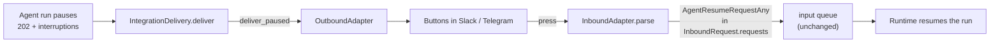

# #609: Approve and reject a paused run from Slack and Telegram

A paused run currently reaches a messaging platform as the string form of its pause — there is
nothing to press, and no way back. This change gives the outbound half of the adapter seam a way to
render a pause as the platform's own interactive UI, and routes the press back through the inbound
half as an ordinary request carrying a decision. Scoped to Slack and Telegram; the seam is shared,
so the rest are per-adapter work afterwards (see
[`research/platform-interactive-ui-survey.md`](research/platform-interactive-ui-survey.md)).

## Motivation

- **A pause is flattened before any adapter sees it.** `pipeline/integration_delivery.py:103`
  delivers `AgentReplyText(response=str(body.get("result", "")))` for every reply, and
  `OutboundAdapter.deliver`'s docstring states that contract (`integration/adapter/base.py:194`).
- **The information is already on the wire.** `ResponseBuilder.build_response` promotes `status`,
  `run_id`, `agent` and `interruptions` to top-level body keys precisely so a client can branch
  without parsing `result` (`core/chat_service.py:374-380`), and a paused run is a 202
  (`core/chat_service.py:648-649`), below the `>= 400` error branch — so the body reaches
  `deliver` today and is discarded there.
- **The inbound half needs no new seam.** `InboundRequest.requests` is a
  `List[AgentRequestUnion]` (`integration/adapter/base.py:62`) and `AgentResumeRequestAny` is a
  member of that union (`core/model.py:206-216`). `Runtime` extracts the decision from the
  **request list**, not from `req.resume` (`core/runtime.py:265-271`), and `ChatService._validate`
  accepts a prebuilt non-empty list with no prompt (`core/chat_service.py:786-790`). An adapter that
  puts an `AgentResumeRequestAny` in the list resumes the run with no plumbing change.
- **Half of the per-platform work already exists.** Telegram's inbound already parses a
  `callback_query` and clears the button spinner (`integration/telegram/adapter.py:143`, `:174`,
  `:63`); Slack's outbound already posts Block Kit `blocks`
  (`integration/slack/adapter.py:265`). Neither does the other half.
- **One fix covers every host.** `IntegrationDelivery` is the single definition shared by the
  pipeline `ResponseHandler` and the serverless consumers (`pipeline/integration_delivery.py:13-22`),
  and `StreamAgentRunner` delegates integration traffic to the non-streaming path
  (`pipeline/agent_runner.py:217`), so there is exactly one body shape to handle.

## Requirements

### Delivery seam

- `IntegrationDelivery.deliver` must branch on the body's `status == "PAUSED"` before the ordinary
  text path, and reconstruct an `AgentPausedReplyAny` from the body's `run_id`, `agent`,
  `interruptions` and `session_id` keys.
  - Reconstructing the model (rather than passing the raw dict) is what keeps the content a
    validator produced, so every host delivers the same pause.
  - The `>= 400` error branch stays first and unchanged: a failed run is never a pause.
  - Issue #607 adds an equivalent reconstruction on `AgentRunner` for thread recording; when both
    have landed the two must be one helper, not two copies.
- A body that claims `PAUSED` but is missing a key must fall through to the ordinary text delivery
  with a logged warning, never raise — raising here costs the platform user their reply entirely.

### `OutboundAdapter` contract

- Add `deliver_paused(reply: AgentPausedReplyAny, reply_context) -> None` to `OutboundAdapter`.
  - **Concrete, not abstract**, with a default that calls `self.deliver(AgentReplyText(...), ...)`
    on the same string used today. Every existing adapter and every bring-your-own adapter keeps
    working byte-for-byte without being touched — the `deliver_chunk` precedent.
  - Overriding it is how an adapter declares it can render a pause. No capability flag, no config.
- Pluggability needs no new ABC or factory: `<platform>.outbound_adapter` already takes a dotted
  path to a replacement (`core/config.py:164-167`, `:217-220`), so a bring-your-own adapter can
  render pauses its own way.
- Rendering is scoped to the **approval** interruption kinds, `tool_call` and `confirmation`. An
  `input_required` pause has nothing a button can express and must fall through to the default text
  rendering (see Non-goals).
- Once a decision is accepted, the pause message is rewritten to drop its buttons and state what
  was decided — **what, not who**. Naming the presser is a disclosure a deployment adds by
  subclassing, not one this change assumes.
- Collecting a reason on a denial is **per-adapter**: an adapter declares it can, or does not offer
  it. A platform that cannot must neither hold the capability back from one that can nor fake it
  with a worse mechanism — the standing no-feature-forcing rule.

### A press is an ordinary inbound request

- An inbound adapter translating a press builds `InboundRequest.requests` as a single-element list
  holding `AgentResumeRequestAny(run_id=None, decisions=[ResumeDecision(id=..., status=...)])`, and
  leaves `prompt` empty.
  - `run_id` is omitted deliberately: it is `Optional` (`core/model.py:170`) and the runtime resolves
    the run from the interruption ids, which halves what a button payload has to carry.
  - `status` is one of `approved` / `denied` / `cancelled`, limited to the verbs the adapter's
    `DECISIONS` names. `ResumeDecision.payload` stays unset for a button;
    `ResumeDecision.message` carries the refusal's reason when the platform collected one.
- The button payload carries the interruption id and the verb, and nothing else.
- `request_id` must be synthesised so that a double-press deduplicates: the platform's own press
  identifier where one exists, otherwise `<platform>:<conversation>:<message id>:<verb>`.
- `session_id` for a press must resolve to the same conversation key the original turn used, or the
  decision reaches a session holding no pause.
- A press answering an already-resolved pause produces the runtime's `ValueError` → 400 → the
  adapter's generic `ERROR_MESSAGE`. This is accepted, not special-cased.

### Slack

- Outbound: render a pause as the existing section blocks plus one `actions` block per interruption,
  with one button per verb in `DECISIONS`, each carrying the interruption id and its verb in the
  button `value`.
- Inbound: register a Bolt action listener for `block_actions` alongside the existing
  `@app.event("message")` listener (`integration/slack/adapter.py:58`), collected through the same
  contextvar mechanism `parse` already drives.
  - **No second route.** Bolt serves events, shortcuts and interactivity on one endpoint, so the
    app's Interactivity Request URL is the same URL as its Event Subscriptions one, and
    `BUILTIN_WEBHOOK_ROUTES["slack"]` is unchanged.
  - An action listener must acknowledge within Slack's 3-second window; the press downloads
    nothing, so the existing `process_before_response=True` wiring stays within it.
- The existing `x-slack-retry-reason: http_timeout` drop (`integration/slack/adapter.py:74`) must
  continue to apply to interactive deliveries.
- Slack declares `DENY_COLLECTS_REASON = True`: a denial opens a modal (`views.open` on the press's
  `trigger_id`) and the decision is built from the modal submission, not the press.
  - The interruption id rides the modal's `private_metadata`, which round-trips arbitrary data, so
    nothing has to be correlated by hand.
  - A modal the user dismisses records no decision: the pause stays open and its buttons stay live.
- Once a decision is accepted, the pause message is edited to drop its `actions` block and state
  what was decided, so the outcome is visible and a second press is not invited.

### Telegram

- Outbound: attach an `InlineKeyboardMarkup` to the pause message; `send_message`
  (`integration/telegram/adapter.py:46`) gains an optional `reply_markup`, and nothing else changes
  for an ordinary reply.
- Inbound: `_from_callback_query` (`:174`) must produce a decision rather than text when the callback
  data is one of ours, and keep today's text behaviour for any other callback data.
- **`callback_data` is 1–64 bytes** (research), and the interruption id is the framework's own
  (`call_id`, `tool_call_id`, LangGraph's interrupt id), so its length is not Agent Kernel's to
  bound. An id that fits the budget with the prefix and verb gets buttons; one that does not falls
  back to text for that interruption, with a logged warning — no truncation, no raise, no silently
  broken button.
- `answer_callback_query` (`:63`) keeps clearing the spinner. Once the decision is accepted the
  keyboard is removed and the message edited to state what was decided, via
  `editMessageReplyMarkup` / `editMessageText` on the `message_id` the press carried.
- Telegram leaves `DENY_COLLECTS_REASON` at `False` and denies with no reason: it has no modal, and
  a `force_reply` answer arrives as an ordinary message the adapter would have to correlate back to
  an interruption using state it does not hold — the problem `input_required` is scoped out for.

### Configuration

- **No new configuration, and no `enabled` flag.** Neither knob selects a backend nor carries a
  credential, which is what every messaging block in `AKConfig` holds.
- Both are **class attributes on the outbound adapter**, the shape `OutboundAdapter` already uses
  for a user-facing tunable changed by subclassing — `MESSAGE_LIMIT`, `TRUNCATION_NOTICE`,
  `ERROR_MESSAGE` (`integration/adapter/base.py:185-188`).
  - `DECISIONS: tuple[str, ...] = ("approved", "denied")` — which verbs get a button. A deployment
    wanting `cancelled` surfaced, so "nobody decided" does not read as a refusal
    (`Runner.CANCELLED_DECISION_MESSAGE`), adds it in a two-line subclass.
    - Only LangGraph carries a three-valued decision natively; the others map a cancel onto their
      framework's reject. `DECISIONS` is fixed at class definition and the serving framework is
      chosen per request, so this is **documented, not enforced**.
  - `DENY_COLLECTS_REASON: bool = False` — whether a denial collects a reason into
    `ResumeDecision.message`. A statement of what the platform can do: Slack overrides it to `True`.
- An application changes either by subclassing and pointing `slack.outbound_adapter` /
  `telegram.outbound_adapter` at the subclass.
- **The inbound half reads neither.** A plain deny button and a deny-with-reason button carry
  different action identifiers, so the press handler reacts to the button that arrived.

### Testing

- `IntegrationAdapterContract` (`integration/adapter/testing.py`) gains a case asserting that an
  adapter which does not override `deliver_paused` delivers the same text it delivers today.
- A delivery-seam test asserting a `PAUSED` body reaches `deliver_paused` with the interruptions
  intact, and a malformed `PAUSED` body falls through to text.
- Per platform: a pause renders the expected buttons; a press parses to an `AgentResumeRequestAny`
  carrying the right id and status; a press deduplicates; Telegram's over-budget id degrades to text.
- A round trip through the `in_memory` topology — pause out, press in, resume — extending
  `tests/test_integration_roundtrip.py`.

### Documentation and examples

- `docs/docs/advanced/human-in-the-loop.md` gains a section on approving from a messaging platform,
  naming what Slack and Telegram support and what the other platforms do instead, and stating the
  `cancelled` caveat: adding that button is only fully meaningful on LangGraph.
- `docs/docs/integrations/slack.md` and `telegram.md` each gain the pause rendering and its limits.
- One example demonstrating the round trip, extending an existing integration example rather than
  adding a new one.

## Non-goals

- **Teams, WhatsApp, Messenger, Instagram, Gmail, LiveKit.** No adapter outside Slack and Telegram
  is changed; all of them keep today's text delivery through the default `deliver_paused`.
- **`input_required` pauses.** A free-text answer has no button form, and correlating a later plain
  message back to an interruption is a problem this change does not solve; such a pause renders as
  text. Slack's denial modal is not an exception — its `private_metadata` carries the interruption
  id, so nothing is correlated.
- **Cross-session approval.** A decision still comes from the session that paused; #610 owns the
  case where another user approves.
- **Conversation initiation.** Reaching out to a second approver is #608.
- **Streaming.** Integration traffic already takes the non-streaming path
  (`pipeline/agent_runner.py:217`); nothing in the streaming runner changes.
- **Threads.** Messaging integrations do not record conversation threads, so #607's work is not a
  dependency.

## Open questions

None outstanding. Settled in review: Slack needs no second route; a denial reason ships on Slack
and not on Telegram; neither knob is configuration; the pause message says what was decided, not
who.
