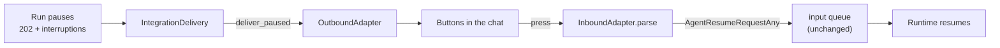

# #609: Approve and reject a paused run from Slack and Telegram

A paused run reaches a messaging platform as the string form of its pause — nothing to press, no way
back. This adds one method to the outbound adapter so a pause can be drawn with the platform's own
controls, and routes the press back through the inbound half as an ordinary request carrying a
decision. Slack and Telegram only; the seam is shared, so the rest is per-adapter work afterwards
(see [`research/platform-interactive-ui-survey.md`](research/platform-interactive-ui-survey.md)).

## Motivation

- **The pause is flattened before any adapter sees it.** `pipeline/integration_delivery.py:103`
  sends `AgentReplyText(response=str(body.get("result", "")))` for every reply.
- **The data is already on the wire.** `ResponseBuilder.build_response` promotes the pause keys to
  the top level (`core/chat_service.py:374-380`) and a pause is a 202
  (`core/chat_service.py:648-649`) — below the `>= 400` error branch, so the body arrives at that
  line and is discarded there.
- **The return path needs no new plumbing.** `InboundRequest.requests` is a
  `List[AgentRequestUnion]` (`integration/adapter/base.py:62`), `AgentResumeRequestAny` is in that
  union (`core/model.py:206-216`), `Runtime` reads the decision from the **request list** rather
  than `req.resume` (`core/runtime.py:265-271`), and `ChatService._validate` accepts a prebuilt list
  with no prompt (`core/chat_service.py:786-790`).
- **Half the per-platform work exists.** Telegram already parses a `callback_query`
  (`integration/telegram/adapter.py:143`); Slack already posts Block Kit blocks
  (`integration/slack/adapter.py:265`). Neither does the other half.
- **One fix covers every host.** `IntegrationDelivery` is shared by the pipeline and the serverless
  consumers, and `StreamAgentRunner` delegates integration traffic to the non-streaming path
  (`pipeline/agent_runner.py:217`) — one body shape to handle.



## Requirements

### What arrives, and what the adapter gets

The output body for a paused run, with the keys this change reads:

```jsonc
{
  "status": "PAUSED",          // the branch; checked before the ordinary text path
  "run_id": "01JD7K2MX4",      // NOT sent to the platform — see the button payload below
  "agent": "support",
  "session_id": "94771234567",
  "interruptions": [{
    "id": "call_9f2b41d7c8e0", // the only id a decision needs; goes in the button
    "kind": "tool_call",       // tool_call | confirmation -> buttons; input_required -> text only
    "tool_name": "refund_order",
    "arguments": "{\"order_id\":\"A-10294\"}",
    "message": null            // what to show a human, when the framework supplies it
  }],
  "result": "..."              // str(reply); no longer what the adapter delivers
}
```

- `IntegrationDelivery.deliver` branches on `status == "PAUSED"` and rebuilds an
  `AgentPausedReplyAny` from those keys, so the content comes from the model's own validator and
  every host delivers the same pause. The `>= 400` branch stays first: a failed run is never a pause.
- **Any** reconstruction failure — missing key, value outside its type, malformed interruption —
  falls through to ordinary text delivery with a warning, never a raise. Raising costs the platform
  user their reply entirely.
- #607 adds an equivalent reconstruction on `AgentRunner`; when both land they must be one helper.

### The new method

```python
class OutboundAdapter(ABC):
    DECISIONS: tuple[str, ...] = ("approved", "denied")   # which verbs get a button
    DENY_COLLECTS_REASON: bool = False                    # can this platform ask "why?"

    def format_pause(self, reply: AgentPausedReplyAny) -> str:
        """A pause as readable text. Shared helper, same shape as split_reply."""

    async def deliver_paused(self, reply: AgentPausedReplyAny, reply_context: Dict[str, str]) -> None:
        """Override to render interactively. Default: text."""
        await self.deliver(AgentReplyText(response=self.format_pause(reply)), reply_context)
```

- **Concrete, not abstract.** Overriding it is how an adapter declares it can render a pause — no
  capability flag, no config. The `deliver_chunk` precedent.
- `format_pause` names the tool, its arguments and the interruption's `message`, and **writes its
  closing line per `kind`**: `tool_call`/`confirmation` say approval is needed, `input_required`
  says an answer is. The default catches every pause, so "waiting for approval" would describe the
  wrong thing for the kind that asks for a value.
- It gives **no reply instruction**. "Reply APPROVE" would work only if a typed word resolved a
  pause; nothing maps text to a decision, the inbound adapter would build an ordinary
  `AgentRequestText`, and on Pydantic AI a fresh turn during an unanswered pause raises.
- **One deliberate behavioural change**, the only one here: the five adapters that do not override
  `deliver_paused` — WhatsApp, Messenger, Instagram, Teams, Gmail — stop delivering `str(reply)`
  (`json.dumps` of the derived content, nulls and all) and start delivering readable text.
- Pluggability needs no new ABC: `<platform>.outbound_adapter` already takes a dotted path
  (`core/config.py:164-167`, `:217-220`).
- Collecting a denial reason is per-adapter. A platform that cannot must neither hold the capability
  back from one that can, nor fake it with a worse mechanism — the no-feature-forcing rule.

### What a press sends back

```jsonc
// InboundRequest built by the inbound adapter — no new seam, this is an ordinary request
{
  "session_id": "94771234567",   // must equal the original conversation key, or the decision
                                 // reaches a session holding no pause
  "request_id": "telegram:94771234567:812:call_9f2b41d7c8e0:approved",
                                 // the composite logical key; see below
  "prompt": "",                  // a decision stands alone; _validate allows it
  "requests": [{
    "type": "resume",            // AgentResumeRequestAny — already in AgentRequestUnion
    "run_id": null,              // omitted: Runtime resolves the run from the interruption ids,
                                 // which halves what a 64-byte button payload must carry
    "decisions": [{
      "id": "call_9f2b41d7c8e0", // the interruption answered
      "status": "approved",      // limited to the verbs in DECISIONS
      "message": null            // the refusal's reason, when the platform collected one
    }]
  }],
  "reply_context": {
    "chat_id": "94771234567"     // delivery coordinates only; the pause message is not edited
  }
}
```

**`request_id` is always that composite key, never the platform's press identifier.** The general
seam rule prefers the platform's id because it is normally the *message* id, which dedupes a webhook
retry. A press id is not that — Slack's `action_ts` and Telegram's `CallbackQuery.id` are minted per
click — so preferring one would give two clicks two different keys, send both to the runtime, and
show the second a generic error. Each segment earns its place:

| Segment | Prevents |
|---|---|
| `<interruption id>` | Approving two interruptions on one message colliding on one `dedup_id`, so the transport discards the second and that interruption is never answered. |
| `<verb>` | Approve-then-Deny being swallowed as a duplicate. They are two keys: the first resumes, the second answers a pause that no longer exists and takes the 400 path. A decision already applied must not be revisable by a late press. |
| the whole key | A second click of the *same* button ever reaching the runtime. It shares the key and the transport drops it. |

- A press answering an already-resolved pause yields the runtime's `ValueError` → 400 → the
  adapter's generic `ERROR_MESSAGE`. Accepted, not special-cased.
- **Two presses on different interruptions race, narrowly.** Per-session FIFO normally keeps one in
  flight, but a lease expiry or a Kafka ownership change can redeliver mid-processing, and a BYO
  transport promises nothing. Nothing downstream closes it: `Session._lock` is an `asyncio.Lock`
  (`core/base.py:76`), `SessionStore.store` writes the whole session with no compare-and-set
  (`core/session/base.py:95`), and `ConsumerLoop` acks only after processing
  (`pipeline/consumer.py:148`) while `Runtime` stores before that. This is a pipeline property true
  of any two concurrent requests on one session; the fix — a per-session lease or a compare-and-set
  write — is a **follow-up issue**, named here so it is inherited deliberately. #609 narrows it:
  the exposure needs a multi-interruption pause *and* a redelivery, not just an impatient human.

### Who may approve

**Agent Kernel ships no approver policy: anyone who can see the message can press the button.**
That is the honest default for a channel, and it is stated rather than implied because it is a
security-relevant one.

What the design guarantees instead is that **an application can impose its own policy**, because
the presser's platform identity reaches the run:

- The inbound adapter sets `InboundRequest.user_id` from the press — Telegram already does
  (`integration/telegram/adapter.py:182`, `:208`), and Slack's action listener must do the same from
  the payload's `user.id`.
- `IntegrationProducer` carries it in the **body**, not as a message attribute
  (`integration/adapter/producer.py:74-82`), and `ChatService` threads it through as
  `acting_user_id`, which `Runtime` publishes under `ACTING_USER_CACHE_KEY` in the volatile cache
  before the pre-hook span (`core/runtime.py:397`).

So an application has two unblocked places to decide who may answer:

| Where | Fits when |
|---|---|
| A `PreHook` that sees an `AgentResumeRequestAny` in `requests`, reads the acting user, and halts by returning an `AgentReply` | The policy should hold on every surface, not just messaging — this is the recommended one. |
| A bring-your-own inbound adapter (the application constructs the inbound half itself, so this needs no factory) | The check is platform-specific, or should reject the press before anything is enqueued. |

Neither needs a change in this issue; both are named here so the omission is read as a deliberate
boundary rather than an oversight. A built-in allow-list is not added: who may approve is
application policy, and `AKConfig` holds no vocabulary for it. #610 owns the different question of a
decision arriving from *another* session.

### After a decision: no edit

**The pause message is not rewritten, and the controls stay.** The resumed reply is delivered as an
ordinary message in the conversation.

- **Why not:** a pre-hook that halts a resume returns a 200 with a text reply — identical, at the
  delivery layer, to a run that resumed successfully. `Runtime` knows the difference and logs it,
  but only to the server log (`_warn_resume_halted`, `core/runtime.py:362-376`: *"the client
  receives a reply that reads like completion"*). An adapter editing on that guess would strip the
  buttons off a pause that is still open and claim a decision that never applied.
- Delivering the reply plainly is correct either way: if the decision applied, the next thing in
  the chat is the agent's answer; if it was refused, it is the refusal.
- **Live controls are harmless.** A second press of the same button produces a byte-identical
  `request_id`, so the transport drops it — no runner, no session load, no reply. Outside the
  transport's dedup window (300s on `in_memory`, `transport/in_memory.py:15`; 5 minutes on SQS
  FIFO) it gets through, runs the pre-hooks, fails `_validate_resume` and costs one generic error
  message. The agent never runs and no second decision is ever applied.
- **A deployment that wants the edit can add it**, and nothing here blocks that: the application
  constructs the inbound adapter, so a subclass can put the message's channel and id into
  `reply_context`, and `<platform>.outbound_adapter` swaps the outbound half, so a subclass can
  override `deliver` and update the message. It inherits the ambiguity above knowingly — which is
  the deployment's call, since it may know its own pre-hooks never halt a resume.

### Slack

```jsonc
// outbound: one actions block per interruption, one button per verb in DECISIONS
{"type": "actions", "elements": [
  {"type": "button", "text": {"type": "plain_text", "text": "Approve"}, "style": "primary",
   "value": "call_9f2b41d7c8e0:approved"},   // interruption + verb, nothing else
  {"type": "button", "text": {"type": "plain_text", "text": "Deny"}, "style": "danger",
   "value": "call_9f2b41d7c8e0:denied"}
]}

// DENY_COLLECTS_REASON = True -> the deny button opens a modal, which carries:
"private_metadata": "{\"interruption\":\"call_9f2b41d7c8e0\",\"channel\":\"C07\",\"ts\":\"1713.45\"}"
// a view_submission has NO channel or message of its own. Without all three the denial
// cannot resolve session_id, cannot build the dedup key, and cannot find the message to edit.
```

- Inbound: a Bolt `block_actions` action listener beside the existing `@app.event("message")` one
  (`integration/slack/adapter.py:58`). **No second route** — Bolt serves events and interactivity on
  one endpoint, so the Interactivity Request URL is the events URL and `BUILTIN_WEBHOOK_ROUTES` is
  unchanged.
- **The whole listener must finish inside Slack's 3 seconds.** `process_before_response=True` holds
  the HTTP response until the listener returns, so `ack()` ordering buys nothing — the budget covers
  everything the listener does, `views.open` included. The mitigation is to keep a press listener to
  at most one Slack API call and no agent work; Bolt's lazy listeners are the documented escape
  hatch if that ever stops being enough, but they are beta and Python-only, so this does not rely
  on them.
- A failed `views.open` is logged and leaves the pause live; nothing was decided, so nothing is
  queued. A dismissed modal records no decision. The existing `x-slack-retry-reason: http_timeout`
  drop (`:74`) still applies.
- `private_metadata` still carries channel and `ts` even though nothing is edited: the channel
  resolves `session_id` and the `ts` is the `<message id>` segment of the dedup key.

### Telegram

```jsonc
// outbound: send_message (integration/telegram/adapter.py:46) gains an optional reply_markup
"reply_markup": {"inline_keyboard": [[
  {"text": "✓ Approve", "callback_data": "akhitl:a:call_9f2b41d7c8e0"},  // 26 of 64 bytes
  {"text": "✗ Deny",    "callback_data": "akhitl:d:call_9f2b41d7c8e0"}
]]}
// the prefix is "akhitl:", not "ak:": an Agent Kernel app may already ship its own inline
// keyboards, and a short prefix would hijack its presses into decisions.
```

- **`callback_data` is 1–64 bytes**, and the interruption id is the framework's own (`call_id`,
  `tool_call_id`, LangGraph's interrupt id) — not Agent Kernel's to bound. An id that fits with the
  prefix and verb gets buttons; one that does not falls back to text **for that interruption only**,
  with a warning, and the message names it as unanswerable here. Naming it is not decoration: the
  pause text shows an interruption's id only when the framework named nothing else, so two gated
  calls to the same tool read alike and a reader could not tell which one lost its buttons. No
  truncation, no raise, no silently broken button, and no server-side token store (which would need
  expiry, restart and worker-routing semantics).
- Inbound: `_from_callback_query` (`:174`) produces a decision when the callback data is ours and
  keeps today's text behaviour otherwise. `answer_callback_query` (`:63`) keeps clearing the spinner.
- The keyboard stays after a decision, as everywhere else — see *After a decision*.
- `DENY_COLLECTS_REASON` stays `False`: no modal, and a `force_reply` answer would have to be
  correlated back to an interruption using state the adapter does not hold.

### Configuration

**None.** Neither knob selects a backend nor carries a credential, which is what every messaging
block in `AKConfig` holds. Both are class attributes, the shape `OutboundAdapter` already uses for
`MESSAGE_LIMIT`, `TRUNCATION_NOTICE` and `ERROR_MESSAGE` (`integration/adapter/base.py:185-188`),
changed by subclassing and mounting via `<platform>.outbound_adapter`.

- Adding `cancelled` to `DECISIONS` is a two-line subclass, so "nobody decided" need not read as a
  refusal (`Runner.CANCELLED_DECISION_MESSAGE`). Only LangGraph carries a third verb natively and
  the serving framework is chosen per request, so that caveat is **documented, not enforced**.
- **The inbound half reads neither.** A plain deny button and a deny-with-reason button carry
  different action identifiers, so the press handler reacts to the button that arrived.

### Testing

- `IntegrationAdapterContract`: a non-overriding adapter delivers `format_pause`'s text — readable,
  carrying tool name and arguments — not a serialised object.
- Delivery seam: a `PAUSED` body reaches `deliver_paused` with interruptions intact; a malformed one
  falls through to text.
- Per platform: buttons render; a press parses to an `AgentResumeRequestAny` with the right id and
  status; a second press dedupes; Telegram's over-budget id degrades to text.
- A two-interruption pause: separate controls, no cross-dedup, and the remainder arrives as a
  second pause message.
- A second press of the same button inside the dedup window reaches neither the runner nor the
  agent; past it, it fails validation and delivers the generic error.
- Two decisions on one session delivered in order both land. Deliberately **not** a multi-worker
  concurrency test — that asserts the pipeline's guarantee, which this issue does not change.
- A round trip through `in_memory` — pause out, press in, resume — extending
  `tests/test_integration_roundtrip.py`.

### Documentation

- `docs/docs/advanced/human-in-the-loop.md`: approving from a messaging platform, what Slack and
  Telegram support, what the others do instead, and the `cancelled` caveat.
- `docs/docs/integrations/slack.md` and `telegram.md`: the pause rendering and its limits, **plus
  the platform-side setup this needs** — for Slack, enabling Interactivity & Shortcuts and pointing
  its Request URL at the same URL as Event Subscriptions (no new scope: the adapter only posts and
  opens a modal, both of which its existing token already allows); for Telegram, nothing new, since
  inline keyboards need no extra registration.
- Both pages state the default plainly: anyone who can see the message can press it, and a
  deployment that needs an approver policy adds a pre-hook.
- One example extending an existing integration example rather than adding a new one.

## Non-goals

- **Teams, WhatsApp, Messenger, Instagram, Gmail, LiveKit.** Unchanged; all keep text delivery
  through the default `deliver_paused`.
- **`input_required` pauses.** No button form, and correlating a later plain message back to an
  interruption is not solved here. Slack's denial modal is not an exception — it is opened by a
  press and carries its context in `private_metadata`. What is out of scope is a plain typed message
  answering a pause, on any platform.
- **Answering a pause by typing.** Needs the session's pending pauses at the moment the text
  arrives, so it belongs in a core pre-hook affecting every surface. Follow-up issue.
- **Editing the pause message after a decision.** Not because Telegram forbids it — its 48-hour
  limit covers business messages *not* sent by the bot and without an inline keyboard, the inverse
  of this case — but because nothing in the response distinguishes a refused resume from a
  successful one. A deployment can add it (see *After a decision*); AK will once the signal below
  exists.
- **A "decision was applied" marker in the response body.** The gap that blocks the edit, and a
  defect in #606's contract rather than this one: `_warn_resume_halted` (`core/runtime.py:362-376`)
  documents that a halted resume "reads like completion" to the client, and
  `examples/api/hitl/frontend/src/App.tsx:53-64` already retires its approval card on that false
  signal. It needs design rather than a key — `Runtime.run` returns only an `AgentReply`, replies
  are built by the framework adapters, and the volatile cache is cleared before the caller reads
  it. **Follow-up issue**, and the only one this change needs.
- **A per-session resume lease.** The concurrency gap above belongs to the pipeline. Follow-up issue.
- **Cross-session approval** (#610) and **conversation initiation** (#608).
- **Streaming.** Integration traffic already takes the non-streaming path
  (`pipeline/agent_runner.py:217`).
- **Threads.** Messaging integrations record no threads, so #607 is not a dependency.

## Open questions

None outstanding. Settled in review: Slack needs no second route; a denial reason ships on Slack and
not on Telegram; neither knob is configuration; the message says what was decided, not who.
