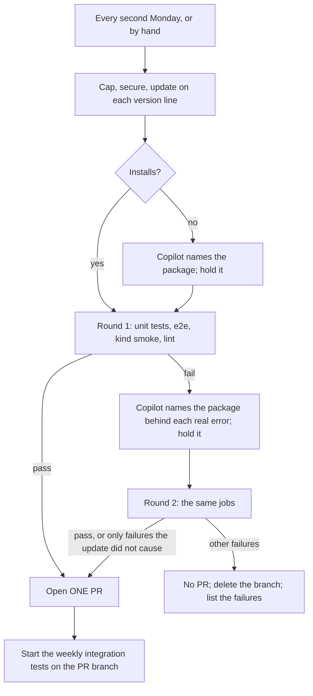

# #659 and #824: Automated dependency updates and security fixes

One workflow covers both issues: `.github/workflows/dependency-update-copilot.yml` with
`.github/scripts/dependency_caps.py`. Every two weeks it limits, updates and secures every dependency, runs the
PR's CI, and opens one PR.

- **#659:** fix Dependabot alerts automatically, safely, in one PR.
- **#824:** keep every dependency up to date within safe limits.

## Motivation

- Most direct dependencies had no upper limit, so an update could jump a major. In PR #900, `openai` 2 → 3
  (pulled in by `openai-agents` 0.20 → 0.24) broke 11 test jobs with `Event loop is closed`.
- Thousands of Dependabot alerts were open across the repo's manifests (PR #901 fixed 3,800).
- An install check cannot see a broken update: unit tests mock the model and the examples need API keys. So the
  PR's own CI jobs must pass before the PR opens.

## Big picture

## Requirements

### Scope and schedule

- Every `pyproject.toml` with a `uv.lock` (131 manifests: ak-py, examples, use-cases, e2e, `agent/`), the same
  rules for each. No package lists in the code.
- Every second Monday; also by hand (`paths` limits the manifests, `dry_run` skips the push, tests and PR).
- One update PR at a time: an open PR with the `ak-dep-update` marker stops the run.
- If the alerts cannot be read, the run still caps and updates, and the PR says so at the top.

### Version rules

- A **version line** is the major for `1.x` and up, and the minor for `0.x`. No package leaves its line, direct or
  indirect, except to reach a security fix. Each held-back upgrade is listed ("needs its own PR").
- When uv moves a held package anyway (an upgraded package needs its new line), the package that pulls it is held
  too. Example: `openai-agents` 0.24 needs `openai` 3, so both stay.

| Package version | Upper limit added | Example |
|---|---|---|
| `1.x` and up | next major | `>=2.32.0,<3.0.0` |
| `0.x` | next minor | `>=0.27.0,<0.29.0` |
| date version | none | `certifi` stays open |

- Not capped, and listed in the PR: packages built in this repo (e.g. `agentkernel`), local sources, git/URL
  dependencies, date versions. A line that already has a limit keeps it.

| Security fix, declared as | Patched version | Becomes |
|---|---|---|
| `PyJWT>=2.13.0,<3.0.0` | 2.15.1 | `PyJWT>=2.15.1,<3.0.0` |
| `black==26.5.1` (a pin) | 26.10.1 | `black==26.10.1` |
| `litellm~=1.89.2` | 1.95.0 | `litellm>=1.95.0,<1.96` (keeps its width) |
| `daytona>=0.198.0,<0.199` | 0.200.0 | `daytona>=0.200.0,<0.201.0` (security wins) |

- npm: `npm audit fix` where npm alerts exist (never `--force`); no npm version updates.

### Checks and holds

- **Install check:** `uv lock` and `uv sync` for every manifest.
- **Test gate:** the repo's own reusable workflows on the pushed branch: `test-reusable.yaml` (unit tests and
  e2e), `chart-test.yaml` (kind smoke), `code-quality.yml` (lint). Two rounds at most.
- **On a failure** Copilot names the package that changed and brings the problem; the script holds it back.
- **A held security package:** kept at its security minimum when Copilot checked that the minimum works
  (`keep_minimum`), its declarations narrowed to that minor. Otherwise the fix is blocked, the original line comes
  back, and the alert stays open with the reason.
- A manifest that still fails is put back as it was. The other manifests still ship.

### Copilot

- Copilot only appends lines to `holds.jsonl` and `not_dependency.jsonl`; it never edits a file, commits or pushes.
- **Real error** (traceback, import error, resolver error, lint failure, an error as the agent's answer): name
  the package. Example: `litellm` 1.108.0 imports `mcp.types.CacheableResult` → hold `litellm`, not `mcp`.
- **Same break elsewhere:** the gate does not test every manifest (the cloud examples deploy later). After a CI
  finding, Copilot checks other manifests that lock the same broken version and use the same part of the
  package, and holds it there too when it breaks the same way.
- **No dependency cause** (an answer only worded differently, an infra problem): no hold, a reason line instead.
- **Unsure:** nothing, so the failure blocks the PR.
- Narrow tools (shell, read, write, PyPI only), because it reads untrusted logs.

### The PR

- Opens when a round passes, or when every failed job of the last round passed in round 1 or has a Copilot
  "no dependency cause" reason. Anything unexplained keeps the PR closed and deletes the branch.
- Lists every change: version changes, security fixes by package, holds with reasons, blocked fixes, manifests put
  back, breaking upgrades held back, what is not covered, alerts still open, and accepted failures.
- After the PR opens, the weekly integration tests (`integration-test-weekly.yaml`) start on its branch. A reviewer
  reads the result; nothing waits for it.

### Safety

- Only `pyproject.toml`, `uv.lock`, `package.json` and `package-lock.json` change. No pre-releases. Never merges,
  never force-pushes.
- The `agent-kernel-ci[bot]` app pushes and opens the PR, so the PR's CI runs.

## Non-goals

- Code fixes (e.g. AK on `openai` 3): the package is held; the fix is a separate PR.
- Fixing flaky tests: they are listed in the PR, not fixed.
- Acting on the weekly integration tests automatically.

## Open questions

- Held-back majors: open one issue per held-back major so they are not forgotten?
