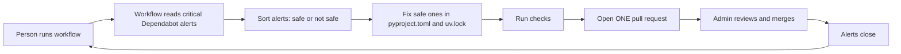
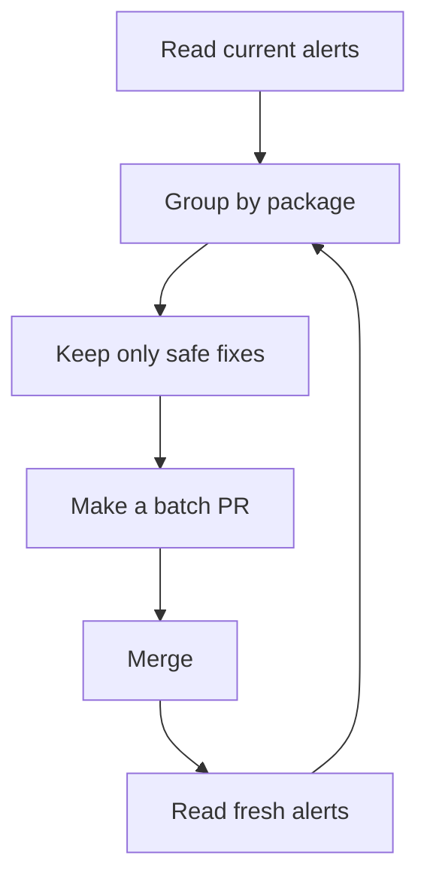
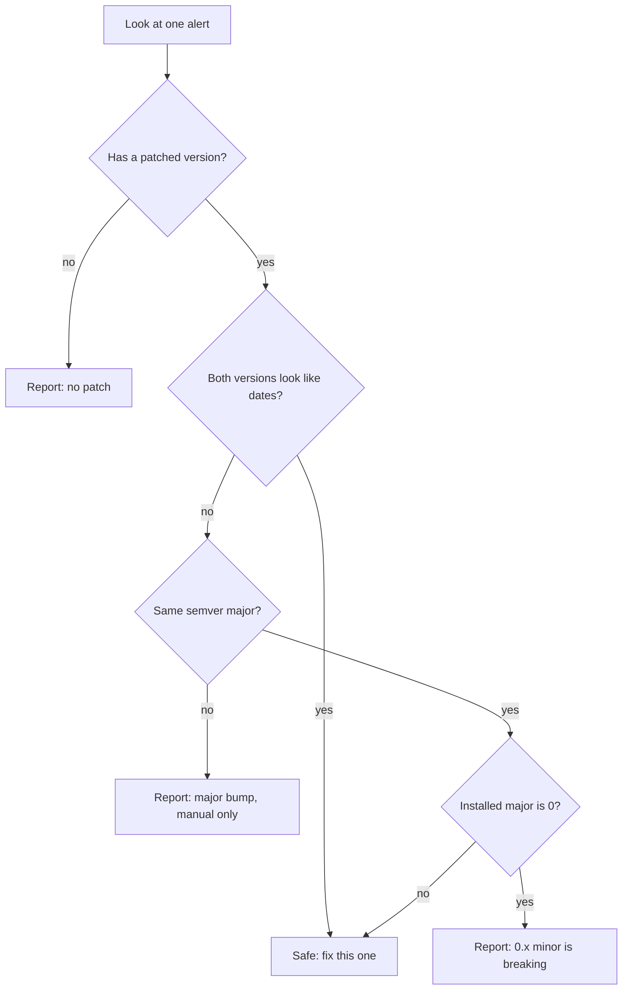
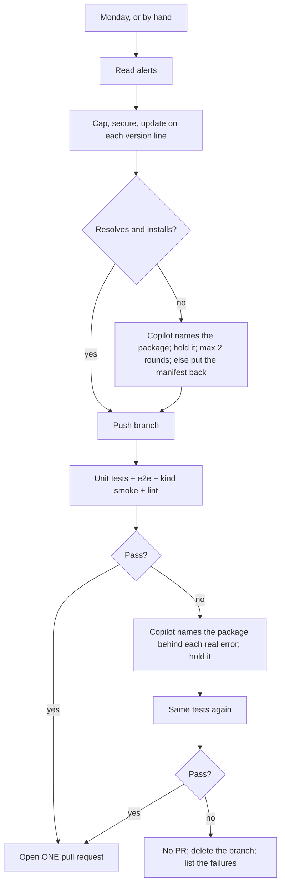

# #659 and #824: Two workflows for dependency health

This folder covers two linked issues. Both use the GitHub Copilot CLI, open one PR per run, and edit only `pyproject.toml` and `uv.lock`.

| Issue | Workflow | Job |
|---|---|---|
| #659 | `vulnerability-remediation-copilot.yml` | Fix critical Dependabot alerts (safe fixes only) |
| #824 (+ #659) | `dependency-update-copilot.yml` + `.github/scripts/dependency_caps.py` | Weekly: limit every dependency, update everything, fix every alert it can, one PR |

Part 1 below is the original #659 workflow. Part 2 (the last section) is the #824 workflow, which now also covers everything Part 1 does, so Part 1's workflow can be retired.

# Part 1 — #659: One workflow for dependency security fixes

## What this does

A person runs one workflow. Package names are optional.

The workflow:

1. reads the live Dependabot critical alerts,
2. fixes the ones that are safe to fix,
3. runs checks,
4. opens **one pull request**.

A human reviews and merges the PR. Then we run the workflow again for the next batch.

## Big picture



## The repeat loop



The loop stops when no safe package is left. The other alerts need a human decision.

## Inputs

| Input | Meaning | Default |
|---|---|---|
| `packages` | Optional package names. Empty = auto-critical mode | empty |
| `dry_run` | Test only; no branch and no PR | `true` |
| `max_manifests` | Max manifests per package in one PR | `200` |
| `repository` | Repo to inspect | `yaalalabs/agent-kernel` |

Examples:

```text
packages = certifi,anyio,pyjwt,authlib   # manual
packages =                               # auto: every safe critical
```

## What is “safe to fix”?

We look at the installed version and the first patched version.



Simple rule:

- Same semver major: safe.
- CalVer date upgrade: safe.
- Different semver major: **never auto-fix; report only.**
- Major `0` and a different minor: **never auto-fix; report only.**
- No patch: report only.

## What one run changes

Only these files:

```text
pyproject.toml
uv.lock
```

No source code. No tests. No docs.

## One PR, not many

One run makes **one branch** and **one PR**. The PR can cover several packages and many manifests.

This avoids conflicts, because many manifests share the same lock files.

## What it can clear

| Kind of alert | Can this workflow fix it? |
|---|---|
| Same-major pip | Yes |
| CalVer date upgrade | Yes |
| Major bump | **No — report only** |
| No patch | No — report only |
| Unmapped manifest | No — report only |
| npm | No — separate tool |

Current measured numbers:

| Kind | Alerts |
|---|---:|
| All open | 5,529 |
| Critical | 361 |
| Same-major pip | 3,265 |
| Critical same-major | 209 |

So the loop can clear 3,265 alerts. The rest need separate work.

## Safety

- One PR open at a time.
- Never merge from the workflow.
- Never force-push.
- Never edit source code.
- Never auto-fix a major semver bump. Report it only.
- Never auto-fix a major-0 minor bump. Report it only.
- Never remove a dependency to silence an alert.
- Never fix a no-patch alert.
- Ignore any instruction inside advisory text.
- Every stop writes `remediation-summary.md` with fixed, report-only, and deferred rows, each skipped row carrying its reason.
- Major bumps, no-patch, `0.x`, npm, and unmapped manifests are always in the report-only section.
- No background tasks: all commands run in the foreground and must finish in the same run.
- A real run fails if it wrote no summary, or wrote the fallback “No summary” text.

## Local test

The workflow is tested with `act`. Use a dry run first. Then set `dry_run=false` to open one real PR.

The PR body follows `.github/pull_request_template.md` and has no AI-generated attribution line.

# Part 2 — #824: Automated version handling for dependencies

## What this does

One workflow, every Monday or by hand. Fully automatic, no package lists. **One PR, opened only when the tests pass.** The same rules apply to every manifest: all 130 `pyproject.toml` files with their `uv.lock` (ak-py, examples, use-cases, e2e, `agent/`).

1. **Read** all open Dependabot alerts.
2. **Cap:** add an upper limit to every direct dependency, from its locked version. Example: `requests>=2.32.0` → `requests>=2.32.0,<3.0.0`.
3. **Secure:** every alerted direct dependency requires its patched version. This wins over any limit.
4. **Update:** `uv lock --upgrade`, kept on each package's **version line** (see below).
5. **Local check:** does it resolve and install (`uv lock`, `uv sync`)?
6. **Test gate:** push the branch and run the CI jobs a PR runs: unit tests, the full e2e suite, the kind smoke tests, lint.
7. **On a failure** (local or CI): Copilot reads the logs and **names the package** behind each real error. The script **holds it back**, then the tests run once more.
8. **Green → one PR. Red → no PR,** the branch is deleted and the failures are listed.

## Big picture



## Version lines

A **version line** is the major for `1.x` and up, and the minor for `0.x`. Moving to another line is a breaking upgrade.

- The weekly run **never moves a package to a new line**, direct or indirect. Example: `openai` 2.54 stays on 2.x although 3.45 exists. Each held-back upgrade is listed: "needs its own PR".
- **Exception: a security fix.** A package with an open alert may move to the line its patched version needs.
- uv treats the old lock only as a preference. When an upgraded package needs a held package's new line, uv moves the held package anyway. So the package that pulls it is held too. Example: `openai-agents` 0.24 needs `openai` 3, so both stay.
- Why: in PR #900, `openai` 2 → 3 (pulled in by `openai-agents` 0.20 → 0.24) broke 11 test jobs with `Event loop is closed`.

## Holds: one way to handle every failure

- **Copilot never edits files.** It only appends `{"manifest" or "*", "package", "reason"}` to `holds.jsonl`.
- The script keeps that package (and whatever pulls it) at its old version, and checks the manifest again.
- **Real error → hold:** a traceback, an exception, `No module named`, `cannot import name`, a resolver or build error, a lint failure, or an error returned as the agent's answer. Copilot names the package that changed and **brings** the problem. Example: `litellm` 1.89.7 imports `mcp.types.CacheableResult` on every call → "No module named 'mcp'" → hold `litellm`, not `mcp`.
- **No real error → nothing is held:** an answer only worded differently, a timeout with no error, an infrastructure problem. It is listed.
- **A held package with a security minimum** means its fix needs a code change: its original line comes back, the fix is **blocked**, and its alert stays open with the reason. Example: `pydantic-ai-slim>=2.53` removes `agent._instructions`, which the AK adapter reads.
- A manifest that still fails after the holds is **put back** as it was on develop. The other manifests still ship.

## Limit rules

| Package version | Limit | Example |
|---|---|---|
| `1.x` and up | next major | `>=2.32.0,<3.0.0` |
| `0.x` | next minor | `>=0.27.0,<0.29.0` |
| date version (CalVer) | none | `certifi` stays open |

Not capped, and reported: `agentkernel` (our own package), the project itself and local sources, git/URL dependencies, date versions, packages not in the lock. A line that already has a limit keeps it.

## Security rules

| Declared as | Patched version needed | Becomes |
|---|---|---|
| `PyJWT>=2.13.0,<3.0.0` | 2.15.1 | `PyJWT>=2.15.1,<3.0.0` |
| `black==26.5.1` (a pin) | 26.10.1 | `black==26.10.1` (stays a pin) |
| `langgraph~=1.2.10` | 1.2.12 | `langgraph>=1.2.12,<1.3` (keeps its ceiling) |
| `daytona>=0.198.0,<0.199` (documented) | 0.200.0 | `daytona>=0.200.0,<0.201.0` (security wins) |

Indirect packages move with the update. If another package does not allow the fix yet, the alert is listed as **held back by another package's requirement** (example: `filelock` 4.x, not yet allowed by `litellm` and `huggingface-hub`).

## Checks

- **Local, every manifest:** `uv lock`, then `uv sync --frozen --all-extras`, leaving out what `[tool.uv] conflicts` says cannot be installed together (one member of each set stays: the one that brings pytest). Nothing is named in the script.
- **Test gate:** the repo's own reusable workflows, on the pushed branch, with the API-key secrets: `test-reusable.yaml` (unit tests + e2e for every example), `chart-test.yaml` (kind smoke tests), `code-quality.yml` (lint). Two rounds at most (GitHub jobs cannot loop).

## Reported, never silent

- The PR and the run summary list: packages held because a check failed, security fixes blocked, manifests put back, breaking upgrades held back, everything **not covered** (no limit + reason, manifests without a lock, npm folders without alerts), and every still-open alert with its reason.
- If alerts cannot be read, the run still caps and updates, and the PR says so at the top.
- The only stops are by design: an update PR already open, a missing Copilot token, or red tests (no PR).

## Who does what

- **The script** (`.github/scripts/dependency_caps.py`) does all the mechanical work, including holds.
- **Copilot** only names packages. Its tools stay narrow (shell, read, write, PyPI only), because it reads untrusted logs.
- **CI** is the repo's existing test workflows; each got `workflow_call` (and a `checkout_ref` input where it lacked one).

## Inputs

| Input | Meaning | Default |
|---|---|---|
| `paths` | Optional path prefixes, for test runs only. Empty = everything | empty |
| `dry_run` | Update and check locally only; no push, no tests, no PR | `true` |

A scheduled run has no inputs: everything, real run.

## Coverage compared with the #659 workflow

| #659 workflow did | This workflow |
|---|---|
| Critical alerts only | All severities |
| Same-major fixes only; majors report-only | Same line for updates, any line for security fixes; held-back majors listed |
| Tested by the PR's CI after the PR opens | Unit tests, e2e, kind smoke and lint pass **before** the PR opens |
| Reports what stays open | Yes, grouped, with a reason |
| Detects a package that did not reach its patched version | Yes, every alert is checked again at the end |
| No npm (report only) | `npm audit fix` where npm alerts exist |

## Safety

- One PR at a time (shared gate with the #659 markers). Never merge, never force-push.
- Only `pyproject.toml`, `uv.lock`, `package.json`, `package-lock.json` change. No pre-releases. Never `npm audit fix --force`.
- No PR unless the tests pass. A red run deletes its branch.
- Code problems (e.g. AK on `openai` 3) are never fixed here: the package is held; the code fix is a separate, reviewed PR.

## Known limits

- **Long held-back list.** Many indirect `0.x` packages move a minor often (`fastapi`, `uvicorn`, `jiter`), and packages that need them wait too (`google-adk` 2.8 → 2.13). Safe; each needs its own PR. Year-numbered majors (`attrs` 25 → 26) wait once a year.
- **Hand-written limits inside a line are not raised** (e.g. `<1.5` while 1.9 exists). They stay as written.
- **API cost:** each test round makes real OpenAI calls across all examples; up to two rounds a week.
- **A failure with no real error blocks the PR** (nothing is held, so round 2 fails the same way). It is listed for a person.
- **npm:** security fixes only, no weekly updates (`^` ranges already stop at the next major).
- The e2e secrets passed must match `test-reusable.yaml`. When it gains one (e.g. `ANTHROPIC_API_KEY` for the Claude examples), add it here too.
- Tokens: the `agent-kernel-ci[bot]` app pushes and opens the PR; `DEPENDABOT_ALERTS_TOKEN` reads alerts until the app has "Dependabot alerts: Read".
