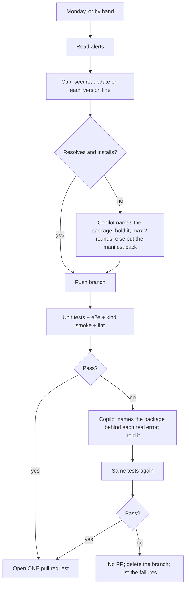

# #659 and #824: Automated dependency updates and security fixes

One workflow covers both issues: `dependency-update-copilot.yml` with `.github/scripts/dependency_caps.py`.
Every two weeks it limits every dependency, updates everything on its version line, fixes every Dependabot alert
it can, runs the PR's CI, and opens one PR. It uses the GitHub Copilot CLI and edits only `pyproject.toml`,
`uv.lock` and, for npm alerts, `package.json` / `package-lock.json`.

- **#659:** fix Dependabot alerts automatically, safely, in one PR.
- **#824:** keep every dependency up to date within safe limits.

## What this does

One workflow, every second Monday or by hand. Fully automatic, no package lists. **One PR, opened only when the tests pass.** The same rules apply to every manifest: all 130 `pyproject.toml` files with their `uv.lock` (ak-py, examples, use-cases, e2e, `agent/`).

1. **Read** all open Dependabot alerts.
2. **Cap:** add an upper limit to every direct dependency, from its locked version. Example: `requests>=2.32.0` → `requests>=2.32.0,<3.0.0`.
3. **Secure:** every alerted direct dependency requires its patched version. This wins over any limit.
4. **Update:** `uv lock --upgrade`, kept on each package's **version line** (see below).
5. **Local check:** does it resolve and install (`uv lock`, `uv sync`)?
6. **Test gate:** push the branch and run the CI jobs a PR runs: unit tests, the full e2e suite, the kind smoke tests, lint.
7. **On a failure** (local or CI): Copilot reads the logs and **names the package** behind each real error. The script **holds it back**, then the tests run once more.
8. **Green → one PR. Red → no PR,** the branch is deleted and the failures are listed.

## Big picture

## Version lines

A **version line** is the major for `1.x` and up, and the minor for `0.x`. Moving to another line is a breaking upgrade.

- The run **never moves a package to a new line**, direct or indirect. Example: `openai` 2.54 stays on 2.x although 3.45 exists. Each held-back upgrade is listed: "needs its own PR".
- **Exception: a security fix.** A package with an open alert may move to the line its patched version needs.
- uv treats the old lock only as a preference. When an upgraded package needs a held package's new line, uv moves the held package anyway. So the package that pulls it is held too. Example: `openai-agents` 0.24 needs `openai` 3, so both stay.
- Why: in PR #900, `openai` 2 → 3 (pulled in by `openai-agents` 0.20 → 0.24) broke 11 test jobs with `Event loop is closed`.

## Holds: one way to handle every failure

- **Copilot never edits files.** It only appends `{"manifest" or "*", "package", "reason", optional "keep_minimum"}` to `holds.jsonl`.
- The script keeps that package (and whatever pulls it) at its old version, and checks the manifest again.
- **Real error → hold:** a traceback, an exception, `No module named`, `cannot import name`, a resolver or build error, a lint failure, or an error returned as the agent's answer. Copilot names the package that changed and **brings** the problem. Example: `litellm` 1.108.0 imports `mcp.types.CacheableResult` on every call → "No module named 'mcp'" → hold `litellm`, not `mcp`.
- **No real error → nothing is held:** an answer only worded differently, a timeout with no error, an infrastructure problem. It is listed.
- **A held package with a security minimum:** the newest version may break while the minimum works. Copilot repeats the failing import with the minimum in a clean environment.
  - **The minimum works** (`keep_minimum`): the package is **kept at its minimum**, its declarations narrowed to that minor (`litellm>=1.95.0,<1.96`), so the fix stays. Example: `litellm` 1.108.0 breaks, 1.95.0 does not.
  - **The minimum breaks too, or could not be checked** (reason starts "not verified:"): its original line comes back, the fix is **blocked**, and its alert stays open with the reason. Example: `pydantic-ai-slim>=2.53` removes `agent._instructions`, which the AK adapter reads.
- A manifest that still fails after the holds is **put back** as it was on develop. The other manifests still ship.

## Limit rules

| Package version | Limit | Example |
|---|---|---|
| `1.x` and up | next major | `>=2.32.0,<3.0.0` |
| `0.x` | next minor | `>=0.27.0,<0.29.0` |
| date version (CalVer) | none | `certifi` stays open |

Not capped, and reported: packages built in this repo (read from every `pyproject.toml`, e.g. `agentkernel`), the project itself and local sources, git/URL dependencies, date versions, packages not in the lock. A line that already has a limit keeps it.

## Security rules

| Declared as | Patched version needed | Becomes |
|---|---|---|
| `PyJWT>=2.13.0,<3.0.0` | 2.15.1 | `PyJWT>=2.15.1,<3.0.0` |
| `black==26.5.1` (a pin) | 26.10.1 | `black==26.10.1` (stays a pin) |
| `langgraph~=1.2.10` | 1.2.12 | `langgraph>=1.2.12,<1.3` (keeps its ceiling) |
| `daytona>=0.198.0,<0.199` (documented) | 0.200.0 | `daytona>=0.200.0,<0.201.0` (security wins) |

Indirect packages move with the update. If another package does not allow the fix yet, the alert is listed as **held back by another package's requirement** (example: `filelock` 4.x, not yet allowed by `litellm` and `huggingface-hub`).

## Checks

- **Local, every manifest:** `uv lock`, then `uv sync --frozen --all-extras`, leaving out what `[tool.uv] conflicts` says cannot be installed together (one member of each set stays: the one that brings pytest). Nothing is named in the script.
- **Test gate:** the repo's own reusable workflows, on the pushed branch, with the API-key secrets: `test-reusable.yaml` (unit tests + e2e for every example), `chart-test.yaml` (kind smoke tests), `code-quality.yml` (lint). Two rounds at most (GitHub jobs cannot loop).

## Reported, never silent

- The PR and the run summary list: packages held because a check failed, security fixes blocked, manifests put back, breaking upgrades held back, everything **not covered** (no limit + reason, manifests without a lock, npm folders without alerts), and every still-open alert with its reason.
- If alerts cannot be read, the run still caps and updates, and the PR says so at the top.
- The only stops are by design: an update PR already open, a missing Copilot token, or red tests (no PR).

## Who does what

- **The script** (`.github/scripts/dependency_caps.py`) does all the mechanical work, including holds.
- **Copilot** only names packages. Its tools stay narrow (shell, read, write, PyPI only), because it reads untrusted logs.
- **CI** is the repo's existing test workflows; each got `workflow_call` (and a `checkout_ref` input where it lacked one).

## Inputs

| Input | Meaning | Default |
|---|---|---|
| `paths` | Optional path prefixes, for test runs only. Empty = everything | empty |
| `dry_run` | Update and check locally only; no push, no tests, no PR | `true` |

A scheduled run has no inputs: everything, real run.

## How this covers #659

| #659 asks for | How this workflow does it |
|---|---|
| Fix Dependabot alerts | All severities, not only critical |
| Safe fixes, no surprise breaking upgrades | Updates stay on their version line; security fixes may cross one; held-back majors listed |
| Tested before merge | Unit tests, e2e, kind smoke and lint pass **before** the PR opens |
| Report what stays open | Grouped by package, each with a reason |
| Notice a package that did not reach its patched version | Every alert is checked again at the end |
| npm alerts | `npm audit fix` where npm alerts exist (never `--force`) |

## Safety

- One update PR at a time (an open PR with the `ak-dep-update` marker stops the run). Never merge, never force-push.
- Only `pyproject.toml`, `uv.lock`, `package.json`, `package-lock.json` change. No pre-releases. Never `npm audit fix --force`.
- No PR unless the tests pass. A red run deletes its branch.
- Code problems (e.g. AK on `openai` 3) are never fixed here: the package is held; the code fix is a separate, reviewed PR.

## Known limits

- **Long held-back list.** Many indirect `0.x` packages move a minor often (`fastapi`, `uvicorn`, `jiter`), and packages that need them wait too (`google-adk` 2.8 → 2.13). Safe; each needs its own PR. Year-numbered majors (`attrs` 25 → 26) wait once a year.
- **Hand-written limits inside a line are not raised** (e.g. `<1.5` while 1.9 exists). They stay as written.
- **API cost:** each test round makes real OpenAI calls across all examples; up to two rounds per run (every two weeks).
- **A failure with no real error blocks the PR** (nothing is held, so round 2 fails the same way). It is listed for a person.
- **npm:** security fixes only, no version updates (`^` ranges already stop at the next major).
- The e2e secrets passed must match `test-reusable.yaml`. When it gains one (e.g. `ANTHROPIC_API_KEY` for the Claude examples), add it here too.
- Tokens: the `agent-kernel-ci[bot]` app pushes and opens the PR; `DEPENDABOT_ALERTS_TOKEN` reads alerts until the app has "Dependabot alerts: Read".
