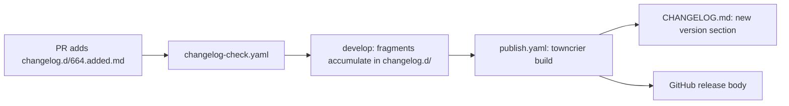

# #664: Changelog built from per-PR fragments

Add a root `CHANGELOG.md` that lists user-visible changes per release. Each PR adds a small
fragment file under `changelog.d/` instead of editing `CHANGELOG.md`, so PRs never conflict on it.
The publish workflow compiles the fragments with towncrier into a new version section and uses
that section as the GitHub release body. Dev skills, the PR template and the review skill make the
fragment part of every piece of user-visible work.

## Motivation

- No changelog exists; #664 tracks creating one (it absorbed #517, migrated from AK-145)
- Release notes are only GitHub's generated list of PR titles
  - `gh release create ... --generate-notes` at `.github/workflows/publish.yaml:220-224`
  - v0.10.0 lists 49 PRs; 10 are by `agent-kernel-ci[bot]`, 8 of them `docs:` follow-ups that
    repeat a feature PR's title (#811, #816, #878, ...)
  - titles describe the work, not the user impact: `feat: trace eval design` (#807),
    `fix: weekly integration failures 2026 10 18` (#826)
- Breaking changes have no marked place
  - v0.10.2, a patch release, removed Azure Functions support as
    `chore: remove Azure Functions support and related configurations` (#984)
  - v0.10.0 split `execution.mode` into invocation mode and `message_type` (#854), shown as an
    ordinary `feat:` line
- `docs/docs/whats-new.md` is a curated, unversioned highlights list; line 10 sends readers to
  GitHub releases for history
- Some specs hand-write release notes for the GitHub release:
  `docs/specs/{606,612,629,692}-*/release-notes.md`
- `ak-py/pyproject.toml` has no `[project.urls]`, so PyPI shows no Changelog, Documentation or
  Repository link
- One shared file breaks under concurrent PRs (verified, `research/fragment-tooling.md`)
  - two PRs adding a line under the same `## [Unreleased]` heading conflict on the second merge
  - a PR opened before a release and merged after it can merge cleanly and put its entry under the
    version that already shipped
  - one file per entry merges cleanly in both cases

## Requirements

### Changelog file

- `CHANGELOG.md` at the repo root
  - Preamble
    - scope: the `agentkernel` package, the Helm chart, the Terraform modules and the bundled
      skills, which all release under one `vX.Y.Z` tag
    - versioning note: "Before 1.0, any release may contain breaking changes; they are always
      listed under Breaking changes."
    - how to add an entry: link to the CONTRIBUTING section
    - versions older than the backfill: link to GitHub releases
  - towncrier start marker `<!-- towncrier release notes start -->` below the preamble
  - versions newest first
  - heading: `## [X.Y.Z](https://github.com/yaalalabs/agent-kernel/releases/tag/vX.Y.Z) - YYYY-MM-DD`
  - sections in this order, each only when non-empty: Breaking changes, Added, Changed,
    Deprecated, Removed, Fixed, Security
  - each entry ends with its issue link, `([#N](https://github.com/yaalalabs/agent-kernel/issues/N))`;
    orphan entries have none; backfilled entries use the PR number in the same form (GitHub
    redirects `/issues/N` to the PR)
- Version sections are written only by the publish workflow
  - people edit `CHANGELOG.md` only to correct an already-released entry or the preamble
- Backfill v0.9.0 to v0.10.2 (9 releases) by hand in the implementation PR
  - sources: the GitHub release lists and `whats-new.md`; same format and section rules
- PRs merged after v0.10.2 and before this lands get their fragments by hand in the implementation
  PR, so the next release has no gap

### Fragments

- One file per user-visible change, in `changelog.d/`, added in the PR that makes the change
  - name: `<issue>.<type>.md`, where `<issue>` is the GitHub issue the PR fixes (known when the
    branch is created; matches spec and branch naming)
  - a second entry for the same issue and type adds a numeric counter: `<issue>.<type>.1.md`
    (text suffixes fail, see research)
  - a PR with no issue uses an orphan name, `+<short-slug>.<type>.md`, rendered without a link
  - `<type>`: `breaking`, `added`, `changed`, `deprecated`, `removed`, `fixed`, `security`
- Content: one to three sentences of Markdown, written for someone using OAK, not for its developers
  - says what changed in the user's terms (config key, API field, CLI flag, deployment target),
    not how it was built
  - links the docs page when one exists
  - `breaking` entries say what to change, starting "To migrate, ..."
  - names the surface when it is not the Python package: "Helm chart: ...", "Terraform: ..."
  - follows the repo writing rules (no em dashes)
- Needs a fragment: anything a user of the package, chart, Terraform modules, bundled skills or
  deployment templates would notice
  - added or removed capability, framework, provider, deployment target
  - added, renamed or removed config key, API field or CLI flag; changed default
  - behaviour change; bug fix a user could have hit; security fix
  - dependency bound change that affects installs
- Needs none: tests, CI, internal refactors with no behaviour change, docs-only changes, blog
  posts, auto-sync follow-up PRs
  - an optional fragment is allowed on any PR
- Stacked PRs for one issue: each PR that ships user-visible behaviour adds its own fragment, with
  its own counter
- `changelog.d/README.md` (listed in towncrier's `ignore`) gives the naming, the types and two
  examples, for people who open the folder first

### Tooling

- towncrier, configured in a root `towncrier.toml`
  - chosen over scriv, changie, a single file with `merge=union`, PR-title generators, and the
    auto doc sync as the writer; comparison in `research/fragment-tooling.md`
  - run in CI as `uvx towncrier@26.9.0` (pinned); not added to any `pyproject.toml` dependency group
- Writing a fragment needs no tool: it is a plain file
  - optional local preview: `uvx towncrier build --draft --version next`
- No runtime code and no `AKConfig` change, so the pluggability and configuration house patterns do
  not apply
  - any new helper under `scripts/` is a class, with a test beside the existing `scripts/test_*.py`

### PR check

- New workflow `.github/workflows/changelog-check.yaml`
  - triggers: `pull_request` into `develop` on `opened`, `edited`, `synchronize`, `reopened`,
    `ready_for_review`, `labeled`, `unlabeled` (stacked PRs into feature branches are checked when
    the final PR targets `develop`)
  - read-only, no secrets, so it runs on fork PRs
- Fails when the PR neither adds a valid fragment nor updates a pending one and its title type is
  `feat`, `fix`, `perf`, `refactor`, `build` or `chore`
  - `chore` is included because #984 shows a `chore:` PR can be breaking
  - updating counts because a fix to an unreleased change corrects that change's pending entry
    instead of adding a `fixed` one
  - the PR's fragments are the diff of its merge commit against the first parent, not against
    `pull_request.base.sha`, which lags `develop` on runs after the PR's last push
- Fails when the title has `!` and the PR adds no `breaking` fragment
- Passes without a fragment for
  - title types `docs`, `test`, `ci`, `style`
  - PRs opened by bots (`agent-kernel-ci[bot]` and other `[bot]` authors)
  - PRs with the `no-changelog` label (maintainers apply it)
- Always fails on an invalid fragment name or unknown type, whatever the title type
  - towncrier 24.8.0's build dropped unknown types silently; 26.9.0 rejects them but still accepts
    non-numeric issues and any extension (verified), so `scripts/changelog_fragments.py` validates
    names itself
- Job summary names the rule that applied and shows how to add a fragment
- Required status check on the `develop` ruleset as soon as the workflow is merged (a ruleset
  setting a maintainer applies; not a file change)

### Release integration (`publish.yaml`)

- Validate before anything ships
  - before `Publish to PyPI` (`publish.yaml:124`), render `towncrier build --draft --version <new_version>`
  - fail if any file in `changelog.d/` other than the ignored ones would not be rendered
  - while `changelog.d/` holds a `breaking` fragment, fail a version that does not raise the minor
    version (major from 1.0) over the newest release in `CHANGELOG.md`; the job summary says to
    rerun with `minor`
    - checks the bumped version, not the `version_bump` input: `bump_version.py` ignores the input
      when the current version is a pre-release
  - runs for both `test` and `production`
- Stable production release
  - `towncrier build --yes --version <new_version> --date <UTC date>` writes the section and deletes
    the consumed fragments
  - `CHANGELOG.md` and `changelog.d/` go into the existing `chore: bump version to X` commit
    (`publish.yaml:132-138`), so tag `vX.Y.Z` contains the section for X.Y.Z
  - a release with no fragments still gets a heading with `No significant changes.`
  - the commit is pushed by the CI bot, which `auto-sync-skills-docs.yaml:41-43` already skips
- Pre-release (`alpha`, `beta`): draft only; fragments stay for the stable release; the GitHub
  pre-release body still carries the drafted section
- `test` environment: draft only, nothing committed (matches the existing production-only commits)
- Release body (`publish.yaml:198-224`)
  - order: existing header (version, PyPI link, install command), compiled section, then GitHub's
    generated notes (kept for the PR list, New Contributors and the compare link)
- `.github/release.yml` excludes `agent-kernel-ci[bot]` PRs from the generated notes, so the
  auto-sync `docs:` duplicates stop appearing

### Links

- `ak-py/pyproject.toml` gains `[project.urls]`: Homepage, Documentation, Repository, Changelog, Issues
  - safe for the release script: `scripts/bump_version.py:178-193` rewrites only the first
    `^version = ` line
- `docs/docs/whats-new.md:10` points to `CHANGELOG.md` for the full history
- `README.md:238` mentions the changelog next to "What's new"

### Contributor docs

- `CONTRIBUTING.md`: new "Changelog entries" subsection under "Before Submitting" (`:35`)
  - canonical text: when a fragment is needed, naming, types, writing rules, the `no-changelog` label
- `.github/pull_request_template.md` Checklist (`:42`) gains: "I added a changelog fragment under
  `changelog.d/`, or this PR needs none (docs, tests, CI, internal only)"
- `AGENTS.md` Conventions (`:210`) gains one bullet pointing to CONTRIBUTING and the new dev skill

### Dev skills

- New `ak-dev-sync-changelog-from-branch`, sibling of the docs and skills sync skills
  - input: the branch delta against the merge base with `origin/develop`, the linked issue, the
    PR title
  - steps: list the user-visible changes; decide fragment or none (rules above); pick the type;
    write in user terms with a docs link, and a migration line for `breaking`; run
    `scripts/changelog_fragments.py validate` and `check-pr`, as CI does (`towncrier check`
    accepts names the release refuses); preview with `build --draft`
  - never edits version sections in `CHANGELOG.md`
  - listed in the dev skills table in `docs/docs/agent-skills.md` (next to `:153-154`)
- `ak-dev-code-quality`
  - PR Guidelines (`SKILL.md:165`): "Add a changelog fragment" bullet, short rules, pointer to the
    new skill
  - Version Management (`SKILL.md:187`): publish compiles `changelog.d/` into `CHANGELOG.md`
- `ak-dev-sync-docs-from-branch` and `ak-dev-sync-skills-from-branch`: their validation checklists
  name the changelog skill as part of the same end-of-branch pass
- `ak-dev-review-pr`, dimension 5 "Docs & examples" (`SKILL.md:170`): findings for
  - user-visible work with no fragment
  - wrong type, or a breaking change not filed as `breaking`
  - developer-facing wording
- `ak-dev-write-spec`
  - the plan template's "Iteration N: Sync docs and skills" (`SKILL.md:280`) also names the
    fragment files and their types
  - each user-visible item in spec.md's "Behavioural changes" needs a `breaking` or `changed`
    fragment, or `fixed` when it corrects a bug users could hit (several items can share one);
    internal items need none
- The 11 `ak-dev-new-*` skills: each checklist (Step 6 in `ak-dev-new-queue-transport`) gains
  "changelog fragment `changelog.d/<issue>.added.md`"
- `ak-dev-sync-skills-and-docs-from-commit`, Step 7 Authoring Rules (`SKILL.md:230`): never create
  or edit fragments or `CHANGELOG.md`; the source PR owns its entry
- Bundled user skills under `ak-py/src/agentkernel/skills/`: no change

## Non-goals

- Writing entries from the auto doc sync (considered; see research)
- Rendering the changelog on the docs site: a page under `docs/docs/` is copied into
  `docs/versioned_docs/` on each docs release
- Replacing `whats-new.md`: it stays the curated highlights list
- Generating entries from commits or PR titles
- Rewriting the existing spec `release-notes.md` drafts: long-form migration detail lives in the
  docs page a fragment links to
- Backfilling releases older than v0.9.0
- Separate changelogs for the chart or the Terraform modules

## Open questions

None. Resolved on 2026-11-25 and folded into the requirements above:

- Title types that must carry a fragment: `feat`, `fix`, `perf`, `refactor`, `build`, `chore`
  - accepted cost: contributors cannot apply labels (`CONTRIBUTING.md:118`), so every
    `no-changelog` skip needs a maintainer
- Fragment names use the issue number, not the PR number
- `changelog-check` is a required status check from the start
- Backfill covers v0.9.0 to v0.10.2
- Preamble states the pre-1.0 breaking-change policy, and `publish.yaml` refuses a version that
  does not raise the minor version while a `breaking` fragment is pending
