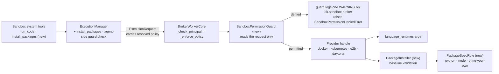

# #692: Sandbox extended permissions — config-gated languages and package installation

> Status: **Draft**

The sandbox (#494/#503) gains two capabilities, each usable only when the sandbox profile's configuration permits it:
- running code in additional languages and runtimes;
- installing packages and dependencies at runtime.

One permission guard checks each such action against the profile's policy. It blocks and audit-logs anything the
profile does not permit. The guard is authoritative in the broker worker, before any provider call, and the same
check also runs agent-side before a request is submitted.

## Motivation

- **Code execution is effectively Python-only, and nothing in config restricts languages.**
  - Every built-in provider except `local_subprocess` (`python`, `bash`) declares `languages=["python"]`, e.g.
    `ak-py/src/agentkernel/sandbox/providers/docker.py:129` and `kubernetes.py:180`.
  - `docker` and `kubernetes` hard-code the interpreter (`["python", "-c", code]`, `docker.py:56`, `kubernetes.py:77`).
    Yet the configured image is what decides which runtimes exist.
  - Handles check the *class* capability, so an instance cannot declare what its image contains (`docker.py:54`,
    `kubernetes.py:75`, `e2b.py:44`, `daytona.py:55`, `ec2_ssm.py:87`).
- **Package installation is plumbed through, but agents cannot reach it and it is not gated.**
  - What exists:
    - `Sandbox.install_packages` (`sandbox/base.py:63`);
    - `capabilities.package_install` (`sandbox/model.py:41`);
    - the `install_packages` broker operation (`sandbox/broker/base.py:17`);
    - worker dispatch (`sandbox/broker/worker.py:219-220`), which runs any such request with no permission check.
  - What is missing:
    - an `ExecutionManager` method: it has only `execute`, `upload` and `download` (`sandbox/manager.py:74-107`);
    - an agent tool: `sandbox/tools.py:350-357` registers eight tools, none of which installs.
  - Installers are pip only: `docker.py:64` and `kubernetes.py:85` use argv, `e2b.py:66` and `daytona.py:67` use a
    shell string (their SDKs accept only a command string).
  - `docker` and `kubernetes` run the installer with no timeout (`_exec(..., None)`). When the worker's outer
    `asyncio.wait_for` expires (`worker.py:230`), the installer keeps running in the sandbox and the per-session lock
    is released under it.
  - `execute_code` has the same gap today. The worker passes the same timeout to its outer `asyncio.wait_for` and to
    the handle. The outer timer starts first, so it expires first and cancels the handle. The handle then sees
    `CancelledError`, not `TimeoutError`, so `_best_effort_kill` (`docker.py:76`) never runs.
- **No configuration decides *what* an agent may do, only how it is contained.**
  - `_SandboxPolicyConfig` (`ak-py/src/agentkernel/core/config.py:724-736`) and its wire mirror `SandboxPolicy`
    (`sandbox/model.py:123`) cover network, filesystem, resources, timeout and strictness.
  - The worker already fails closed before any provider call (`_check_principal`, `_enforce_policy`, `worker.py:79-80`).
    That is the natural place for one more check.

## Requirements

### Permission semantics (both capabilities)

- **Package installation is off by default.** It is usable only when the profile's policy declares it.
  - Languages stay provider-declared, as today. Declaring a runtime in the provider config is what makes a language
    usable, and `policy.languages` can only narrow that set.
  - Defaults keep every existing YAML file and `AK_*` env var behaving as today, except for the behaviour changes
    listed below.
- **Checked before every action.** The policy is checked on every operation, not once per session.
  - In the worker, the check runs before the sandbox is created or attached and before any provider call.
- **A non-permitted action is always blocked and logged.**
  - **Blocked:** the guard raises `SandboxPermissionDeniedError`, a new subclass of `SandboxPolicyError`. Agent tools
    return their existing `{"error": ...}` JSON.
    - It lives in `sandbox/errors.py`, so the queue flavor re-raises it by name (`broker/queue.py:162`).
  - **Logged:** the guard itself writes exactly one `WARNING` per denial on `ak.sandbox.broker`, wherever it runs
    (worker or agent side). Callers never log the denial again.
    - It names the operation, profile, agent, AK session id, sandbox session id and reason.
    - It never logs code bodies or package lists.
    - The broker's generic failure warnings skip `SandboxPermissionDeniedError` only, since the guard has already
      logged it. There are two: `BrokerWorkerCore.process()` (`worker.py:114`) and the thread flavor's `_handle`
      (`broker/thread.py:139`).
    - Other `SandboxPolicyError`s, from `_check_principal` and `_enforce_policy`, keep the generic warning, which is
      their only log line today.
    - The tools' own failure warning on `ak.sandbox.tools` (`tools.py:87`) is unchanged. "One per denial" is per
      logger.
  - There is no audit-only (log-and-allow) mode.
- **Permission and capability stay separate.**
  - "Not permitted" comes from the profile policy. It raises `SandboxPermissionDeniedError` and is logged.
  - "Permitted but the provider cannot do it" comes from provider capabilities. It raises `SandboxCapabilityError`
    under the existing honesty contract and is not audit-logged.
  - `BrokerWorkerCore` warns once per (provider, profile) when the policy permits something the provider instance
    does not declare. Examples are `package_install` on `local_subprocess` or `ec2_ssm`, or a `languages` entry the
    provider does not declare. Such a request would only ever fail with `SandboxCapabilityError`.
    - It runs after provider resolution, because only the worker holds the provider instance (`worker.py:62`).
      `ExecutionManager` holds only config, broker and principal resolver (`manager.py:38-43`), and a queue agent pod
      never loads provider extras.
    - It reuses the worker's existing per-(provider, profile) warning memo (`_policy_warned`, `worker.py:43`).
- **Permissions gate AK sandbox operations, not the environment.**
  - `run_command`, or `subprocess` inside `run_code`, can still reach any interpreter or installer present in the
    image. The docs say so explicitly.
  - With network egress, an agent can also provision new tooling itself. For example, it can `pip install
    playwright`, download Chromium and drive a headless browser, either through `install_packages` or
    `run_command`. Browser automation is not an AK capability (see Non-goals), so no AK permission limits it.
  - Hard containment remains the provider isolation tier plus `network_egress`, filesystem policy and image choice:
    a non-root image with a read-only root filesystem and no installer binaries.
    - A read-only root filesystem also stops permitted installs from writing to system paths (see Capability 2).
    - Provider enforcement of `network_egress` differs:
      - `docker` enforces only `deny`; `allowlist` is unenforceable there and fails closed under `strict`
        (`docker.py:136`);
      - `e2b` and `daytona` enforce `deny`. Their `allowlist` mapping is unverified for the domain entries an install
        needs (`pypi.org`, `registry.npmjs.org`): `e2b` is sent `allow_out` with no `deny_out`, and `daytona` receives
        domains in its CIDR-only `network_allow_list` (`research/agent-web-access.md` §7a);
      - `kubernetes` enforces it only with an operator-asserted network policy (`kubernetes.py:206`).
    - The docs give `deny` plus a mirror or pre-baked image as the hardening recipe for admins who want hard limits.
      `allowlist` on `e2b` and `daytona` joins the recipe only once the live test in Testing passes.
  - The docs state, per posture (`deny` egress, read-only root filesystem, non-root or PSA-restricted image), which
    ecosystems can install and which installer argv prefix to configure. #692 asks for this.
- **Trust model.** The worker enforces the policy the agent side resolved, as `_enforce_policy` does today.
  - These permissions constrain what the agent's LLM can do. They are not a boundary against a compromised agent pod;
    that boundary is provider isolation. Re-resolving the policy from the worker's own `AKConfig` would therefore add
    no protection this design claims, and would make the guard differ from `_enforce_policy`.
- **Agents see only what is permitted.**
  - The `install_packages` tool is registered only when at least one profile permits package installation.
  - The tool guidance lists what each profile permits, and tells the agent not to work around a denial with `run_command`.

### Permission guard

- New class `SandboxPermissionGuard`. Its single responsibility is to decide whether one `ExecutionRequest` is
  permitted by its profile's policy.
  - It reads only the request (`policy`, `operation`, `payload`), never `AKConfig` or provider capabilities.
    - A queue-flavor worker therefore enforces exactly what the agent side resolved.
    - Capability checks stay in the provider handles, which keeps the permission and capability checks separate.
  - It does not gate `execute_command`, `upload_file`, `download_file` or `destroy`.
- **Worker (authoritative):** `BrokerWorkerCore` invokes it after `_enforce_policy` and before the sandbox is acquired.
  It therefore covers every broker flavor (embedded, thread, queue) and bring-your-own `ExecutionManager` callers.
- **Agent side (defence in depth):** `ExecutionManager` runs the same guard before submitting a request.
  - This also protects against a new agent talking to an old worker during a rolling upgrade (see Wire compatibility).

### Configuration

- **Reuse the existing policy envelope.** Extend `_SandboxPolicyConfig` and `SandboxPolicy`.
  - There is no parallel `permissions` block and there are no `enabled` flags.
  - Package installation is a presence-enabled block: a declared block permits it, and an absent one (`None`)
    denies it.
- **New per-profile policy fields** (the *may* side). The guard and tool registration read each one:
  - `languages: Optional[list[str]] = None`: the allowlist for `run_code`.
    - `None` means whatever the provider declares, which keeps today's behaviour.
    - `[]` is valid and denies every `run_code` call, for a command-only profile. The tool guidance says so.
  - `package_install: Optional[PackageInstallPolicy] = None`, with `ecosystems: list[str] = ["python"]`.
    - `ecosystems: []` is rejected at config load. Omitting the block is the one way to deny installs, so a declared
      block always permits something and tool registration can test for presence.
  - `PackageInstallPolicy` is the wire model, and `_SandboxPackageInstallConfig` is its config mirror.
  - `ExecutionManager._policy_from` (`manager.py:331`) copies the new fields onto the wire policy.
- **New provider-side fields** (the *can* side: what the image contains).
  - The provider class cannot know these, because the operator's image decides them.
  - They live in two mixins that the provider config blocks subclass rather than copy.
  - `ProviderRuntimeConfig`, used by `docker` and `kubernetes`:
    - `language_runtimes: dict[str, list[str]] = {"python": ["python", "-c"]}` maps a language to an interpreter
      argv prefix.
    - Its keys become the instance's declared `languages`.
    - A validator requires a `python` key, because Python execution is mandatory under the provider contract
      (`sandbox/testing.py:162`).
    - A validator requires every argv prefix to hold at least one token and no empty token, so the interpreter is
      always the first argv element, never the submitted code.
  - `ProviderPackageConfig`, used by `docker`, `kubernetes`, `e2b` and `daytona`:
    - `package_installers: dict[str, list[str]] = {"python": ["pip", "install"]}` maps an ecosystem to an installer
      argv prefix. Its keys become the instance's declared package ecosystems.
    - `package_rules: dict[str, str] = {}` maps an ecosystem to the dotted path of a bring-your-own `PackageSpecRule`
      (see Capability 2).
    - A validator requires every `package_installers` key to resolve to a rule, built-in or from `package_rules`,
      so no installer runs unvalidated specs.
    - A validator requires every argv prefix to hold at least one token and no empty token, so the installer is
      always the first argv element, never a package name.
  - SDK-native providers do not use `ProviderRuntimeConfig`, and keep declaring `["python"]`:
    - `e2b` runs code in a kernel chosen by the configured `template`. Other languages need the operator to say what
      the template contains, which is out of scope here;
    - `daytona`'s SDK fixes the code language per sandbox, not per call.
- **New capability field.** `SandboxCapabilities` gains `package_ecosystems: list[str] = []`, which becomes the
  source of truth for package installation. A model validator keeps the existing `package_install` flag derived from it:
  - a non-empty `package_ecosystems` sets `package_install=True`;
  - `package_install=True` with no ecosystems, as a bring-your-own provider written before #692 declares it, sets
    `package_ecosystems=["python"]`, today's pip-only meaning.
  - An explicit `package_install=False` with a non-empty `package_ecosystems` is rejected with `ValueError`.
  - Existing providers keep working unchanged, and neither inconsistent state can be represented.
- **Wire compatibility.** The codec code and `BrokerOperation` do not change. The schema does: `SandboxPolicy` gains
  fields, and the `install_packages` payload gains an `ecosystem` key.
  - **Old agent to new worker:** the new fields decode as absent, so package installation is denied.
  - **New agent to old worker:** the old worker silently drops the new policy fields, because the models use
    Pydantic's default `extra="ignore"`.
    - The agent-side guard keeps installs from running unchecked.
    - The old worker passes only `payload["packages"]` (`worker.py:220`) and ignores `ecosystem`, so a permitted
      non-`python` install would run as `pip install`.
  - **New worker to old agent:** a `SandboxPermissionDeniedError` completion degrades to `ExecutionBrokerError` on the
    old agent (`queue.py:162-165`). The request is still denied.
  - **Rollout rule:** upgrade queue workers before agent pods. The docs say so.

### Capability 1: code execution in additional languages

- `docker` and `kubernetes` run code through the configured `language_runtimes` argv instead of hard-coded `python -c`.
- All handles check the *instance* capabilities, not the class attribute.
  - This follows the existing per-instance override pattern (`kubernetes.py:206`).
- **Guard rule:** if `policy.languages` is set and does not contain the requested language, the action is denied.
  - The guard is the only place `policy.languages` is checked. The handle's capability check still raises
    `SandboxCapabilityError` for an undeclared language.
- **Agent surface:** the existing `run_code(code, language)` tool. No new tool.

### Capability 2: package installation

- `Sandbox.install_packages(packages, ecosystem="python", timeout=None)`.
  - An ecosystem the instance has not declared raises `SandboxCapabilityError`.
  - An installer failure is a `SandboxResult` with a non-zero `exit_code`, not an exception.
  - **The handle owns the timeout.** The worker passes the effective timeout, and the handle applies it to the
    installer process and kills it (`_best_effort_kill`) on expiry.
    - The worker's outer `asyncio.wait_for` becomes a backstop: effective timeout plus a fixed grace period. It cannot
      fire before the handle's own timer, so the kill finishes before the session lock is released.
    - `execute_code` moves to the same rule, which fixes its existing gap (see Motivation).
    - If the backstop does fire, the handle kills on cancellation too, not only on `TimeoutError`.
- New class `PackageInstaller`, shared by the four implementing providers. Its single responsibility is turning a
  package request into a safe installer invocation.
  - **What an ecosystem key names.** The key names a package registry and its spec grammar (`python` for PyPI specs,
    `node` for npm-registry specs), not the installer tool.
    - Validation is per grammar, and the installer is the operator's argv prefix, so `pip install` and
      `uv pip install` are both `python`, and `npm install` and `yarn add` are both `node`.
    - This is why the key is `node` where #692 says `npm`. OS ecosystems are named by package format the same way
      (e.g. `deb`, `apk`).
  - **Validation is per ecosystem, and pluggable.** A new ABC `PackageSpecRule` has one method,
    `validate(packages)`, which raises `ValueError`.
    - `python` and `node` ship as built-ins, resolved by short name.
    - Any other ecosystem names a bring-your-own rule in `package_rules`, resolved with `resolve_dotted` and checked
      against the `PackageSpecRule` base, as `SandboxProviderFactory` resolves a bring-your-own provider
      (`sandbox/factory.py:161`). An operator can therefore add `deb` or `apk` without a change to Agent Kernel.
    - The rule class must be importable both agent-side (`ExecutionManager` validates before submitting) and in the
      worker, as `principal_resolver` already must be. Config load resolves every rule on each side, so an
      unresolvable rule fails at startup, not on a request.
    - Agent-side validation uses the agent's own copy of the profile's provider block. The handle's validation in the
      worker is authoritative, so if the two configs differ, the worker's rules decide.
    - `PackageInstaller` runs a baseline before any rule. It rejects an empty list, empty entries, entries starting with
      `-` (so no smuggled `--index-url`), whitespace, NUL, URLs (`://`) and local paths (a leading `.`, `/` or `~`).
      A bring-your-own rule can narrow the baseline, never loosen it.
    - `python` accepts registry package names, including version specifiers and extras. It also
      rejects VCS specs (`git+`), any `/`, and archive filenames (`.whl`, `.tar.gz`, `.zip`), so a relative path
      such as `dist/x.whl` or `sub/pkg` cannot install local code.
    - `node` accepts registry names, `@scope/name`, and either with an `@version` or range. It rejects any other `/`
      (so no `user/repo` GitHub shorthand), protocol prefixes (`github:`, `git+`, `file:`, `link:`, `npm:` aliases)
      and tarballs (`.tgz`, `.tar.gz`).
      - It is not in the `package_installers` default. The operator declares it, e.g. `node: [npm, install]`,
        because only the image decides whether `npm` exists.
      - It applies to `docker`, `kubernetes`, `e2b` and `daytona` alike, through the same `PackageInstaller` path.
    - A rejected spec raises `ValueError`, which reaches the agent as error JSON. It is input validation, not a
      permission denial, so it is not audit-logged.
    - `ExecutionManager.install_packages` calls the validation before submitting, so a bad spec fails before any
      sandbox is acquired. The handle calls it again for bring-your-own callers.
  - **Invocation.** It builds the installer argv from `package_installers`, appending packages as separate arguments.
    - `docker` and `kubernetes` execute that argv directly.
    - `e2b` and `daytona` join it with `shlex.join`, replacing today's hand-built `shlex.quote` strings, because their
      SDKs accept only a command string.
- `local_subprocess` and `ec2_ssm` keep `package_install=False`.
- **Guard rules.** Each of these is denied:
  - the profile declares no `package_install` block;
  - the ecosystem is not in `package_install.ecosystems`.
- **Agent surface:**
  - `ExecutionManager.install_packages(...)`;
  - a new system tool `install_packages(packages, ecosystem, sandbox_session_id, profile)`. It has the same contract as
    the other sandbox tools (async, returns a JSON string, can be promoted to a pending task).
- `ExecutionManager` warns once per profile when it combines a `package_install` block with `network_egress: deny`.
  - It warns rather than errors, because an offline mirror in the image makes the combination legitimate.
- `ExecutionManager` also warns once per profile when a `docker` or `kubernetes` profile combines a `package_install`
  block with a filesystem policy (`fs_allow_read` or `fs_allow_write`).
  - That policy makes the root filesystem read-only, with only the workdir writable (`docker.py:176-178`,
    `kubernetes.py:308-311`). A bare `pip install` or `npm install -g` then writes to system paths and exits non-zero.
  - It warns rather than errors, because the operator can point the installer prefix at the writable workdir, e.g.
    `python: [pip, install, --target, <workdir>/site]` with that path on the image's `PYTHONPATH`.
  - The default `python` prefix stays `pip install` on these providers. The provider cannot know a writable target
    that the image's interpreter imports from, so the warning names the fix instead of guessing one.

### Behaviour changes

- A raw `install_packages` request, which today runs unchecked (`worker.py:219-220`), is denied unless the profile
  declares `package_install`.
- `Sandbox.install_packages` gains two parameters, `ecosystem: str = "python"` and `timeout: float | None = None`,
  which the worker passes by keyword.
  - **Compatibility for bring-your-own `Sandbox` subclasses.** A subclass that overrides the current one-argument
    signature keeps working for one minor release.
    - The worker checks the override's signature. If it does not accept the new keywords, the worker calls it with
      `packages` only and logs a once-per-class deprecation warning.
    - On such an override, an `ecosystem` other than `python` raises `SandboxCapabilityError`, and the install runs
      under the worker's outer timeout only, as today.
    - The release notes and `docs/docs/advanced/sandbox.md` give the new signature as the migration step. The shim is
      removed in the following minor release, which is then a documented breaking change.
- A timed-out install on `docker` and `kubernetes` is now killed in the sandbox instead of running on after the
  worker gives up. The same holds for a timed-out `execute_code`.
- The worker's outer timeout gains a grace period on top of the effective timeout, so a hung handle is reported a
  little later than today.
- `e2b` and `daytona` build install commands with `PackageInstaller` (`shlex.join`) instead of their own `shlex.quote`
  strings. The quoting is equivalent, but URL, VCS, path and archive specs are now rejected.
- On the async flavors and the thread flavor, guard denials (`SandboxPermissionDeniedError`) log the guard's warning
  instead of the generic task-failure warning. Other failures, including other `SandboxPolicyError`s, keep the
  generic warning.

### Testing and contract

- `SandboxProviderContract` already asserts that an undeclared language raises `SandboxCapabilityError`
  (`sandbox/testing.py:173`). It gains one check: an undeclared ecosystem raises `SandboxCapabilityError`.
- `SandboxCapabilities` tests: the validator derives `package_install` from `package_ecosystems`, maps a legacy
  `package_install=True` with no ecosystems to `["python"]`, and rejects `package_install=False` with ecosystems.
- Guard tests:
  - one for every deny rule above, each asserting the single audit log line;
  - allowed-path tests for each capability;
  - an agent-side denial before submit;
  - one warning per denial on the `process()` path and on the thread flavor, while `_enforce_policy` and
    `_check_principal` denials still log the generic warning.
- `PackageInstaller` tests cover the baseline, every accept and reject rule of the `python` and `node` rules, and the
  config-load rejection of an ecosystem without a rule or with an empty argv prefix.
- `PackageSpecRule` tests: a bring-your-own rule resolves from `package_rules`; a class that is not a
  `PackageSpecRule` or a bad dotted path raises `SandboxConfigError`; the baseline still rejects a spec that a
  permissive bring-your-own rule accepts.
- Config tests: an empty `language_runtimes` argv prefix and `package_install.ecosystems: []` are rejected at load;
  `languages: []` loads and the guard denies every `run_code` on that profile.
- Handle tests: a timed-out install and a timed-out `execute_code` on `docker` and `kubernetes` kill the process, and
  so does a cancellation by the worker's backstop.
- Worker tests: the permission/capability mismatch warning fires once per (provider, profile); a legacy one-argument
  `install_packages` override still runs `python` installs and logs one deprecation warning.
- `ExecutionManager` tests: the `package_install` + `deny` warning and the `package_install` + filesystem-policy
  warning each fire once per profile.
- Live provider test (research §7f item 1), a prerequisite for documenting `allowlist` as a hard limit on `e2b` and
  `daytona`: with `network_egress: allowlist`, a sandbox reaches a listed registry host and cannot reach an unlisted
  host.

### Delivery

- One design, shipped as phased PRs against it:
  1. the guard (worker and agent side), the policy fields and package installation with the `PackageSpecRule`
     extension point and the built-in `python` and `node` rules on `docker`, `kubernetes`, `e2b` and `daytona`. This
     closes #692;
  2. language runtimes.
- Each policy and provider field is added in the phase that first reads it. The `python`-key validator ships with
  `language_runtimes` in phase 2.

## Component diagram

Worker pipeline, guard deny rules, the class model and per-capability sequence diagrams:
[`research/diagrams.md`](research/diagrams.md).

## Non-goals

- An audit-only (log-and-allow) mode.
- Parsing `run_command` or code contents to detect installers or interpreters. Permissions gate typed operations only.
- Package-name allowlists and denylists in AK config. Granularity is per ecosystem; an operator who needs one can
  write a bring-your-own `PackageSpecRule`.
- Installing from URLs, VCS repositories, local paths or archive files.
- Turning `install_packages` into a general shell runner (#692 non-goal).
- Browser automation. It remains a #494 non-goal (`docs/specs/494-sandbox-capability/design.md:381`). An agent that
  installs a browser itself is contained only by `network_egress` and the image (see Permission semantics).
- Computer-use or desktop sandboxes.
- Protecting against a compromised agent pod (see Trust model).

## Open questions

- When a `package_install` block is declared without `ecosystems`, should it default to everything the provider
  declares rather than `["python"]`? This draft picks `["python"]`, so each ecosystem is an explicit opt-in.
- How should package installation interact with sandboxes the AK session does not own alone?
  - `environment: attached` (e.g. docker `attach_to`): an install changes an environment the framework explicitly
    does not own. Draft: reject a `package_install` block on such a profile at config load.
  - `scope: per_runtime`: an install changes a sandbox every AK session shares. Draft: allow it, with a once-per-profile
    warning.
- `install_packages` runs under `policy.timeout` (default 120s), which real installs can exceed. Should it get its own
  timeout, e.g. `package_install.timeout`?
- Is the delivery order right (packages first, which closes #692), or should languages land first?
- How long should the worker's backstop grace period be, and should it be configurable?
