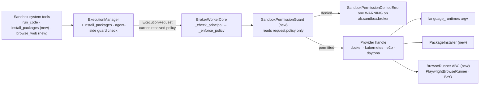

# #692: Sandbox extended permissions — config-gated languages, package installation, and browser automation

> Status: **Draft**

The sandbox (#494/#503) gains three capabilities, each usable only when the sandbox profile's configuration permits it:
- running code in additional languages and runtimes;
- installing packages and dependencies at runtime;
- driving a headless browser (navigate, click, fill forms, extract data).

One permission guard checks each such action against the profile's policy. It blocks and audit-logs anything the
profile does not permit. The guard is authoritative in the broker worker, before any provider call, and the same
check also runs agent-side before a request is submitted.

## Motivation

- **Code execution is effectively Python-only, and nothing in config restricts languages.**
  - Every built-in provider except `local_subprocess` (`python`, `bash`) declares `languages=["python"]`, e.g.
    `ak-py/src/agentkernel/sandbox/providers/docker.py:129` and `kubernetes.py:180`.
  - `docker` and `kubernetes` hard-code the interpreter (`["python", "-c", code]`, `docker.py:56`, `kubernetes.py:77`).
    Yet the configured image is what decides which runtimes exist.
  - Handles check the *class* capability, so an instance cannot declare what its image contains (`docker.py:54`,
    `kubernetes.py:75`, `e2b.py:44`, `daytona.py:55`, `ec2_ssm.py:87`).
- **Package installation is plumbed through, but agents cannot reach it and it is not gated.**
  - What exists:
    - `Sandbox.install_packages` (`sandbox/base.py:63`);
    - `capabilities.package_install` (`sandbox/model.py:41`);
    - the `install_packages` broker operation (`sandbox/broker/base.py:17`);
    - worker dispatch (`sandbox/broker/worker.py:219-220`), which runs any such request with no permission check.
  - What is missing:
    - an `ExecutionManager` method: it has only `execute`, `upload` and `download` (`sandbox/manager.py:74-107`);
    - an agent tool: `sandbox/tools.py:350-357` registers eight tools, none of which installs.
  - Installers are pip only: `docker.py:64` and `kubernetes.py:85` use argv, `e2b.py:66` and `daytona.py:67` use a
    shell string (their SDKs accept only a command string).
- **No configuration decides *what* an agent may do, only how it is contained.**
  - `_SandboxPolicyConfig` (`ak-py/src/agentkernel/core/config.py:724-736`) and its wire mirror `SandboxPolicy`
    (`sandbox/model.py:123`) cover network, filesystem, resources, timeout and strictness.
  - The worker already fails closed before any provider call (`_check_principal`, `_enforce_policy`, `worker.py:79-80`).
    That is the natural place for one more check.
- **Browser automation is unsupported:** it is an explicit #494 non-goal
  (`docs/specs/494-sandbox-capability/design.md:381`). This design supersedes that point.

## Requirements

### Permission semantics (all three capabilities)

- **Package installation and browsing are off by default.** Each is usable only when the profile's policy declares it.
  - Languages stay provider-declared, as today. Declaring a runtime in the provider config is what makes a language
    usable, and `policy.languages` can only narrow that set.
  - Defaults keep every existing YAML file and `AK_*` env var behaving as today, except for the behaviour changes
    listed below.
- **Checked before every action.** The policy is checked on every operation, not once per session.
  - In the worker, the check runs before the sandbox is created or attached and before any provider call.
- **A non-permitted action is always blocked and logged.**
  - **Blocked:** the guard raises `SandboxPermissionDeniedError`, a new subclass of `SandboxPolicyError`. Agent tools
    return their existing `{"error": ...}` JSON.
    - It lives in `sandbox/errors.py`, so the queue flavor re-raises it by name (`broker/queue.py:162`).
  - **Logged:** exactly one `WARNING` per denial on `ak.sandbox.broker`.
    - It names the operation, profile, agent, AK session id, sandbox session id and reason.
    - It never logs code bodies, package lists or page content.
    - `BrokerWorkerCore.process()` skips its generic failure warning (`worker.py:114`) for
      `SandboxPermissionDeniedError` only, since the guard has already logged it.
    - Other `SandboxPolicyError`s, from `_check_principal` and `_enforce_policy`, keep the generic warning, which is
      their only log line today.
  - There is no audit-only (log-and-allow) mode.
- **Permission and capability stay separate.**
  - "Not permitted" comes from the profile policy. It raises `SandboxPermissionDeniedError` and is logged.
  - "Permitted but the provider cannot do it" comes from provider capabilities. It raises `SandboxCapabilityError`
    under the existing honesty contract and is not audit-logged.
- **Permissions gate AK sandbox operations, not the environment.**
  - `run_command`, or `subprocess` inside `run_code`, can still reach any interpreter, installer or browser present
    in the image. The docs say so explicitly.
  - Hard containment remains the provider isolation tier plus `network_egress`, filesystem policy and image choice.
    Admins who want hard limits use a hardened image.
- **Trust model.** The worker enforces the policy the agent side resolved, as `_enforce_policy` does today.
  - These permissions constrain what the agent's LLM can do. They are not a boundary against a compromised agent pod;
    that boundary is provider isolation.
- **Agents see only what is permitted.**
  - A capability's agent tool is registered only when at least one profile permits it.
  - The tool guidance lists what each profile permits, and tells the agent not to work around a denial with `run_command`.

### Permission guard

- New class `SandboxPermissionGuard`. Its single responsibility is to decide whether one `ExecutionRequest` is
  permitted by its profile's policy.
  - It reads only `request.policy`, never `AKConfig` or provider capabilities.
    - A queue-flavor worker therefore enforces exactly what the agent side resolved.
    - Capability checks stay in the provider handles, which keeps the permission and capability checks separate.
  - It does not gate `execute_command`, `upload_file`, `download_file` or `destroy`.
- **Worker (authoritative):** `BrokerWorkerCore` invokes it after `_enforce_policy` and before the sandbox is acquired.
  It therefore covers every broker flavor (embedded, thread, queue) and bring-your-own `ExecutionManager` callers.
- **Agent side (defence in depth):** `ExecutionManager` runs the same guard before submitting a request.
  - This also protects against a new agent talking to an old worker during a rolling upgrade (see Wire compatibility).

### Configuration

- **Reuse the existing policy envelope.** Extend `_SandboxPolicyConfig` and `SandboxPolicy`.
  - There is no parallel `permissions` block and there are no `enabled` flags.
  - Package installation and browsing are presence-enabled blocks: a declared block permits the capability, and an
    absent one (`None`) denies it.
- **New per-profile policy fields** (the *may* side). The guard and tool registration read each one:
  - `languages: Optional[list[str]] = None`: the allowlist for `run_code`.
    - `None` means whatever the provider declares, which keeps today's behaviour.
  - `package_install: Optional[PackageInstallPolicy] = None`, with `ecosystems: list[str] = ["python"]`.
  - `browser: Optional[BrowserPolicy] = None`, with `allowed_domains: list[str] = []`.
    - An empty `allowed_domains` means any domain, still subject to `network_egress`.
  - `PackageInstallPolicy` and `BrowserPolicy` are the wire models. `_SandboxPackageInstallConfig` and
    `_SandboxBrowserConfig` are their config mirrors.
  - `ExecutionManager._policy_from` (`manager.py:331`) copies the new fields onto the wire policy.
- **New provider-side fields** (the *can* side: what the image contains).
  - The provider class cannot know these, because the operator's image decides them.
  - They live in two mixins that the provider config blocks subclass rather than copy.
  - `ProviderRuntimeConfig`, used by `docker` and `kubernetes`:
    - `language_runtimes: dict[str, list[str]] = {"python": ["python", "-c"]}` maps a language to an interpreter
      argv prefix.
    - Its keys become the instance's declared `languages`.
    - A validator requires a `python` key, because Python execution is mandatory under the provider contract
      (`sandbox/testing.py:162`).
  - `ProviderExtensionsConfig`, used by `docker`, `kubernetes`, `e2b` and `daytona`:
    - `package_installers: dict[str, list[str]] = {"python": ["pip", "install"]}` maps an ecosystem to an installer
      argv prefix. Its keys become the instance's declared package ecosystems.
    - `browser: bool = False` is the operator's assertion that the image has a headless Chromium and Playwright.
    - `browse_runner: str = "playwright"` selects the `BrowseRunner`, as a built-in short name or a dotted path.
  - SDK-native providers do not use `ProviderRuntimeConfig`, and keep declaring `["python"]`:
    - `e2b` runs code in a kernel chosen by the configured `template`. Other languages need the operator to say what
      the template contains, which is out of scope here;
    - `daytona`'s SDK fixes the code language per sandbox, not per call.
- **New capability fields.** `SandboxCapabilities` gains `package_ecosystems: list[str] = []` and
  `browser: bool = False`.
- **Wire compatibility.** The codec code does not change, but the schema does: `BrokerOperation` gains `"browse"` and
  `SandboxPolicy` gains fields.
  - **Old agent to new worker:** the new fields decode as absent, so package installation and browsing are denied.
  - **New agent to old worker:** the old worker silently drops the new policy fields, because the models use
    Pydantic's default `extra="ignore"`, and it rejects `browse`.
    - The agent-side guard keeps installs from running unchecked.
  - **Rollout rule:** upgrade queue workers before agent pods. The docs say so.

### Capability 1: code execution in additional languages

- `docker` and `kubernetes` run code through the configured `language_runtimes` argv instead of hard-coded `python -c`.
- All handles check the *instance* capabilities, not the class attribute.
  - This follows the existing per-instance override pattern (`kubernetes.py:206`).
- **Guard rule:** if `policy.languages` is set and does not contain the requested language, the action is denied.
  - The guard is the only place `policy.languages` is checked. The handle's capability check still raises
    `SandboxCapabilityError` for an undeclared language.
- **Agent surface:** the existing `run_code(code, language)` tool. No new tool.

### Capability 2: package installation

- `Sandbox.install_packages(packages, ecosystem="python")`.
  - An ecosystem the instance has not declared raises `SandboxCapabilityError`.
  - An installer failure is a `SandboxResult` with a non-zero `exit_code`, not an exception.
- New class `PackageInstaller`, shared by the four implementing providers. Its single responsibility is turning a
  package request into a safe installer invocation.
  - **Validation.** It accepts registry package names, including version specifiers and extras.
    - It rejects an empty list, empty entries, entries starting with `-` (so no smuggled `--index-url`), whitespace,
      NUL, URLs (`://`), VCS specs (`git+`), and local paths (a leading `.`, `/` or `~`).
    - A rejected spec raises `ValueError`, which reaches the agent as error JSON. It is input validation, not a
      permission denial, so it is not audit-logged.
    - `ExecutionManager.install_packages` calls the validation before submitting, so a bad spec fails before any
      sandbox is acquired. The handle calls it again for bring-your-own callers.
  - **Invocation.** It builds the installer argv from `package_installers`, appending packages as separate arguments.
    - `docker` and `kubernetes` execute that argv directly.
    - `e2b` and `daytona` join it with `shlex.join`, replacing today's hand-built `shlex.quote` strings, because their
      SDKs accept only a command string.
- `local_subprocess` and `ec2_ssm` keep `package_install=False`.
- **Guard rules.** Each of these is denied:
  - the profile declares no `package_install` block;
  - the ecosystem is not in `package_install.ecosystems`.
- **Agent surface:**
  - `ExecutionManager.install_packages(...)`;
  - a new system tool `install_packages(packages, ecosystem, sandbox_session_id, profile)`. It has the same contract as
    the other sandbox tools (async, returns a JSON string, can be promoted to a pending task).
- `ExecutionManager` warns once per profile when it combines a `package_install` block with `network_egress: deny`.
  - It warns rather than errors, because an offline mirror in the image makes the combination legitimate.

### Capability 3: browser automation (stateless step-list)

- A `BrowserStep` model:
  - `action` is one of `navigate`, `click`, `fill`, `wait_for`, `extract_text`, `extract_html`, `screenshot`;
  - the other fields are `url`, `selector` and `value`.
- New `SandboxCapabilities.browser`, an optional `Sandbox.browse(steps, timeout)`, and a new `browse` broker operation.
  - The default `browse` raises `SandboxCapabilityError`.
- **One call runs one headless-Chromium process inside the sandbox.** No browser state survives between calls.
- **Pluggable runner.**
  - A `BrowseRunner` ABC with `run(sandbox, steps, timeout) -> SandboxResult`.
  - A `BrowseRunnerFactory` selects it from `browse_runner`, which accepts:
    - the built-in short name `playwright`;
    - a dotted path to a bring-your-own runner, via `resolve_dotted` (`core/util/factory.py:26`).
  - `PlaywrightBrowseRunner` ships first, and a `BrowseRunnerContract` test suite is what runners subclass.
- **`PlaywrightBrowseRunner`:**
  - It uploads a fixed Python driver script and the steps (as a JSON file) with `upload_file`. Steps are never
    interpolated into code.
  - It runs the driver with `execute_command`, e.g. `python <driver> <steps.json>`, as its own process.
    - `execute_code` is unsuitable: e2b runs code inside a Jupyter kernel whose event loop is already running, where
      Playwright cannot start.
    - All four implementing providers declare `shell`.
  - It therefore requires the `files` and `shell` capabilities alongside `browser`.
  - Extracted data is returned as output, and screenshots as `SandboxResult.output_files`.
- **Domain enforcement has two layers.**
  - **Pre-flight (guard):** each `navigate` URL is checked before the sandbox is acquired. Denials are audit-logged.
  - **In-driver:** when `allowed_domains` is non-empty, the driver installs a `context.route` handler. It aborts
    navigation requests (`request.is_navigation_request()`) to a host outside the list.
    - Being on the browser context, it also covers popups and new tabs. It covers clicks, form submits, redirects and
      JavaScript navigation of any frame.
    - The context is created with `service_workers="block"`, so a service worker cannot bypass routing.
    - Aborted hosts are reported in the result.
  - **Not covered at the AK level:** sub-resource requests (scripts, images, `fetch`/XHR) and WebSockets, so pages
    can still load assets from CDNs. These, and all network-level enforcement, remain `network_egress: allowlist`
    where the provider enforces it. The docs say so.
- **Host matching:**
  - hosts are lowercased and compared in IDNA (punycode) form;
  - the port is ignored;
  - an entry matches the host itself and its subdomains (`example.com` matches `docs.example.com`);
  - there are no wildcards.
- **Guard rules.** Each of these is denied:
  - the profile declares no `browser` block;
  - a `navigate` URL's scheme is not `http` or `https`;
  - a `navigate` URL contains userinfo (`user@host`);
  - a `navigate` URL's host does not match a non-empty `allowed_domains`.
- **Agent surface:** a new system tool `browse_web(steps, sandbox_session_id, profile)`.

### Behaviour changes

- A raw `install_packages` request, which today runs unchecked (`worker.py:219-220`), is denied unless the profile
  declares `package_install`.
- `Sandbox.install_packages` gains a parameter, `ecosystem: str = "python"`, which the worker passes by keyword.
  - Bring-your-own `Sandbox` subclasses that override the current one-argument signature must add it.
- `e2b` and `daytona` build install commands with `PackageInstaller` (`shlex.join`) instead of their own `shlex.quote`
  strings. The quoting is equivalent, but URL, VCS and path specs are now rejected.
- On the async flavors, guard denials (`SandboxPermissionDeniedError`) log the guard's warning instead of the generic
  task-failure warning. Other failures, including other `SandboxPolicyError`s, keep the generic warning.

### Testing and contract

- `SandboxProviderContract` already asserts that an undeclared language raises `SandboxCapabilityError`
  (`sandbox/testing.py:173`). It gains these checks:
  - an undeclared ecosystem, or `browse` without the `browser` capability, raises `SandboxCapabilityError`;
  - declared `package_install` implies a non-empty `package_ecosystems`;
  - declared `browser` implies `files` and `shell`.
- `BrowseRunnerContract` covers the runner ABC.
- Guard tests:
  - one for every deny rule above, each asserting the single audit log line;
  - host-matching cases (subdomain, port, userinfo, punycode, uppercase);
  - allowed-path tests for each capability;
  - an agent-side denial before submit;
  - one warning per denial on the `process()` path, while `_enforce_policy` and `_check_principal` denials still log
    the generic warning.
- `PackageInstaller` tests cover every accept and reject rule.

### Delivery

- One design, shipped as phased PRs against it:
  1. the guard (worker and agent side), the policy fields and package installation;
  2. language runtimes;
  3. browser automation.
- Each policy and provider field is added in the phase that first reads it. The `python`-key validator ships with
  `language_runtimes` in phase 2.

## Component diagram

Worker pipeline, guard deny rules, the class model and per-capability sequence diagrams:
[`research/diagrams.md`](research/diagrams.md).

## Non-goals

- An audit-only (log-and-allow) mode.
- Parsing `run_command` or code contents to detect installers or interpreters. Permissions gate typed operations only.
- Package-name allowlists and denylists. Granularity is per ecosystem.
- Installing from URLs, VCS repositories or local paths.
- Turning `install_packages` into a general shell runner (#692 non-goal).
- Persistent or interactive browser sessions, and computer-use or desktop sandboxes.
- Protecting against a compromised agent pod (see Trust model).

## Open questions

- When a `package_install` block is declared without `ecosystems`, should it default to everything the provider
  declares rather than `["python"]`? This draft picks `["python"]`, so each ecosystem is an explicit opt-in.
- Should `browse_web` reuse the profile's resolved sandbox session like every other operation, or always use a fresh
  `per_call` sandbox? This draft reuses the session. The in-driver route blocking limits what a page can reach, but
  not what it leaves in the workspace.
- `install_packages` runs under `policy.timeout` (default 120s), which real installs can exceed. Should it get its own
  timeout, e.g. `package_install.timeout`?
- Is the delivery order right (packages first, which closes #692), or should languages land first?
