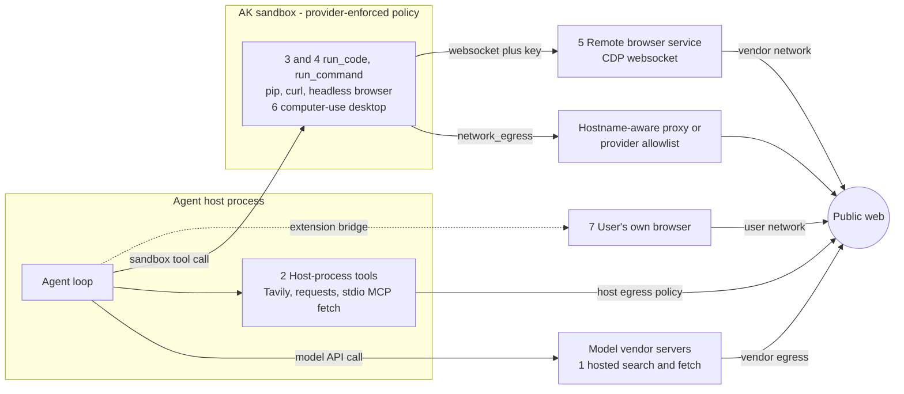

# How AI agents communicate with the web from a sandbox

Research date: 2026-10-15. Supports [`design.md`](../design.md) for #692 (sandbox extended permissions).

- **Scope.** Which channels an agent uses to reach the web when a sandbox is involved, who enforces egress on each, and what that means for
  config-gated package installation: channels (sections 1-2), enforcement (3), package installs (4), inbound (5), security (6), and what `network_egress` does and does not govern (7).
- **Relation to #494.** The per-provider egress survey (2026-07-14) is
  [`provider-landscape.md`](../../494-sandbox-capability/research/provider-landscape.md) and is **not repeated**. This file adds the mechanism taxonomy, coding-agent defaults, install domains, provider deltas since 2026-07-14, browsers, web tools, inbound and security.
- **Method.** Claims carry a numbered source (section 9), accessed 2026-10-15. "(secondary)" = third-party description of someone else's work; "(unverified)" = not confirmed against a primary page; "Our analysis" = inference, not a sourced fact. Fetched content was treated as data.
  AK code facts were verified on branch `feature/692-sandbox-install-package` @ `98bc1394` and are cited `file:line`.

## TL;DR

1. **"Web access" is seven channels, and AK's `network_egress` governs only code run inside the AK sandbox.** Provider-hosted search/fetch runs on vendor servers and framework tools (Tavily, `requests`) on the agent host; neither is touched by `network_egress`, even `deny` (1, 2, 7d).
2. **Search/extract APIs are two-hop:** the caller needs only the vendor API host, but the vendor then fetches any public URL, so allowlisting a reader/extract host is a broad grant (2.2).
3. **The industry answer to CIDR-only primitives is a hostname-aware proxy that is the only route out;** the alternative is DNS-snooping FQDN policy in a CNI (3.3).
4. **CIDR allowlists cannot express PyPI or npm** (Fastly and Cloudflare shared ranges); pip needs **both** `pypi.org` and `files.pythonhosted.org` (3.2, 4.1).
5. **Coding-agent products ship named registry presets and split a broad setup phase from a narrow run phase;** `conda.anaconda.org` is absent from most presets (3.4, 4.1).
6. **A browser the agent installs itself is contained by egress policy and image alone, everywhere we looked;** browsers are gated separately only when the platform knows them as a tool (2.5).
7. **DNS is the recurring egress hole** (Claude Code, Amazon Q, AgentCore, an OpenAI training sandbox); an allowlist that ignores DNS is not an allowlist (6).
8. **Egress limits where install-time malware sends data, not whether it runs.** Nx, Shai-Hulud and litellm ran at install with exposure windows of hours; cooldowns plus `--ignore-scripts`/`--only-binary` cover what egress cannot (4.3).
9. **Consensus guidance is deny-by-default egress, exact hostnames, credentials outside the sandbox;** AK's default `allow` departs from that in coding-agent products (Codex cloud, Claude Code, Copilot) and in NVIDIA/OWASP guidance, but matches the sandbox providers AK wraps, which default to internet on (6, 7a).
10. **Three probable AK mapping bugs, each needing a live test:** e2b sends `allow_out` without `deny_out`; daytona puts domains into the CIDR-only `network_allow_list`; kubernetes emits no DNS egress rule. Docker cannot enforce an allowlist (7a).

## 1. A model of agent web access

**Axis 1: where the agent loop runs.** (i) *LLM outside, calling sandbox tools* (AK): the loop and model call live on the agent host, so the model API needs no sandbox egress (our analysis).
(ii) *Agent inside the sandbox*: Anthropic's computer-use demo runs the loop in the container it controls [1]; Claude Code's devcontainer and Cursor's cloud agents are policed from the same environment, so the policy must also admit the model API and product services [2][3].

**Axis 2: which channel reaches the web.**

| # | Channel | Request originates at | Whose egress policy applies | Examples |
|---|---|---|---|---|
| 1 | Provider-hosted server tools | Model vendor's servers | Vendor's; AK sandbox and host both bypassed | Anthropic `web_search`/`web_fetch`, OpenAI `web_search`, Gemini `google_search` [4][5][6] |
| 2 | Host-process tools | Agent host (or a stdio MCP server it launches) | Host's; AK sandbox does not apply | LangChain Tavily, CrewAI scrape tools, ADK `load_web_page`, MCP `fetch` [7][8][9] |
| 3 | HTTP from code in the sandbox | Inside the sandbox | **The sandbox's** (AK `network_egress`) | `curl`, `requests`, `pip`/`npm install` via `run_code`/`run_command` |
| 4 | Headless browser in the sandbox | Inside the sandbox | The sandbox's; no separate browser policy | `pip install playwright` + Chromium; Pydantic AI `PlaywrightBrowser` [10] |
| 5 | Remote browser-as-a-service (CDP/websocket) | Vendor's browser host | Sandbox needs only the vendor host; the **browser host's** network decides what pages reach | Browserbase, Anchor, Cloudflare Browser Run, AgentCore Browser [11][12][13][14] |
| 6 | Computer-use VM / desktop | The VM | The VM's policy | `computer-use-demo`, E2B Desktop, Daytona Computer Use, Google sandbox [15][16][17] |
| 7 | User's own / agentic browser | User's machine | User's network; per-site permission | Claude in Chrome, Playwright MCP `--extension` [18][19] |

Channels 3, 4 and 6 are one enforcement problem (a process in a policed network). Channels 1, 2, 5 and 7 are decided elsewhere.

## 2. Channels in detail

### 2.1 Provider-hosted tools (channel 1)

| Vendor | Where it runs; domain controls | Anti-exfiltration, retention, caveats |
|---|---|---|
| Anthropic `web_search`/`web_fetch` | Anthropic's servers ("not in the sandbox", Managed Agents docs); `allowed_domains` XOR `blocked_domains`, `max_uses` [4] | Fetch refuses URLs not already in the conversation, URLs with credentials, private addresses; honours robots.txt. Dynamic filtering runs in a container with internet "Completely disabled" (retrieval by Anthropic's backend, inferred) |
| OpenAI `web_search` | OpenAI's servers; `filters.allowed_domains`/`blocked_domains` up to 100 | Hosted shell: no outbound network by default, org allowlist plus per-request `network_policy`, `domain_secrets` injected at a sidecar [5] |
| Google `google_search`, `url_context` | Google's side; `url_context` live-fetches (public URLs only, no localhost/private/tunnels). Gemini API: no domain filter found; Vertex: `exclude_domains` denylist [6][20] | Gemini API stores grounded results 30 days, no opt-out; Vertex Web Grounding for Enterprise logs no customer data. `Google-Agent` fetcher generally ignores robots.txt [21] |
| Perplexity; xAI; Mistral; Foundry | In-loop on vendor servers; Perplexity `search_domain_filter` (20), xAI `allowed_domains`/`excluded_domains` (5), Mistral none seen (unverified); Foundry: Bing Custom Search lists [22][23][24] | Perplexity remote MCP calls proceed without approval by default; Foundry: "Data flows outside Azure compliance and Geo boundary" |

### 2.2 Third-party search/extract APIs and the MCP fetch server

Called from a function tool on the host. The vendor fetches the web for you: hop 1 (host to vendor API) is your egress, hop 2 (vendor to site) is nobody's on your side.
- Tavily (`include_domains` max 300; `langchain-tavily` calls `api.tavily.com` from the host), Exa (`maxAgeHours` 0 forces a live fetch); Jina Reader fetches server-side, public URLs only [25][7].
- **Allowlisting a reader/extract host effectively allows any public URL**, and with query-string exfiltration it is a broad hole (our analysis). Returned content is untrusted: egress allowlists do nothing about prompt injection through results.
- **MCP reference `fetch` server** (stdio, runs where its launcher runs): `mcp-server-fetch` 2026.10.10 refuses non-global addresses by default (loopback, RFC 1918, `169.254.169.254`, `fd00:ec2::254`; `--allow-private-ips` disables); **2026.8.18 has no guard**. It "does not protect against DNS rebinding between that check and the connection" [26].

### 2.3 Framework tools and where they execute

| Framework / tool | Executes where | Notes |
|---|---|---|
| Google ADK `google_search`, `url_context`; `load_web_page` | Inside the model call (Gemini-only); `load_web_page` on the **host** | `load_web_page` blocks private hosts, pins DNS, honours `HTTP(S)_PROXY` [9] |
| LangChain `TavilySearch`, `RequestsToolkit` | Host | `RequestsToolkit` needs `allow_dangerous_requests=True`, no SSRF guard [7] |
| CrewAI scrape/URL tools | Host | `safe_get` validates every hop but **ignores env proxies** (`trust_env=False`): a proxy-env-var egress design will not see these requests [8] |
| smolagents `ToolCallingAgent`, local `CodeAgent` | Host | `VisitWebpageTool` is a bare `requests.get`, no private-address guard [27] |
| smolagents `CodeAgent(executor_type="e2b"\|"docker"\|"modal"\|"blaxel")` | **Inside the remote sandbox** | Finding below |
| Pydantic AI native tools; `WebSearch`/`WebFetch` capabilities | Provider infrastructure; capabilities fall back to a **local host tool** if the provider lacks support | The same agent code moves between "bypasses everything" and "runs on host" when the model changes [28] |

**smolagents remote-executor finding (verified in source and the 1.26.0 wheel).** `RemotePythonExecutor.send_tools` runs each tool's `install_packages` **in the sandbox**, then executes `get_tools_definition_code` in the remote kernel, re-creating each tool from its class source with a no-argument constructor [27].
So tool HTTP calls obey **the executor sandbox's** egress rules (smolagents' sandbox, not AK's); denying egress breaks the tools **and** the install step (needs PyPI), the #692 theme; constructor config is lost and API keys must exist in the sandbox.
A user-built `CodeAgent(executor_type="e2b")` creates its own sandbox that AK's `network_egress` does not govern (from a read of `ak-py/src/agentkernel/framework/smolagents/smolagents.py:7,27` at `98bc1394`: line 7 imports `CodeAgent`, line 27 defines `SmolagentsSupportedAgent`, and no executor option is set).

### 2.4 HTTP from code inside the sandbox (channel 3)

Whatever the model runs through AK's tools is subject to `network_egress` as the provider enforces it (7a). `HTTP(S)_PROXY` variables are advisory unless direct egress is blocked underneath, and proxy-unaware tools (plain `ssh`, most DB drivers) cannot use an HTTP/SOCKS proxy at all [29][30].

### 2.5 Browsers (channels 4 to 7)

| | (a) Headless in the code sandbox | (b) Remote browser service | (c) Computer-use VM | (d) User's own browser | (e) Provider-hosted |
|---|---|---|---|---|---|
| Examples | ADK sample, Pydantic AI, AutoGen | Browserbase, Anchor, Cloudflare Browser Run, AgentCore | Anthropic demo, E2B Desktop, Google sandbox | Claude in Chrome, Playwright MCP `--extension` | ChatGPT agent, Operator |
| Egress and isolation | The sandbox's policy only; Chromium's own sandbox usually off in containers (`--no-sandbox`) | Vendor's network; per-session VM/microVM at most vendors | The VM's policy | User's network, per-site permission; no isolation beyond the profile | Vendor |
| Credentials | Whatever the sandbox holds | Vendor vault; **the CDP URL is a credential** | Whatever is typed or stored | The user's real sessions | Vendor-held |

OpenAI's guide now recommends model-written Playwright code run by a developer-owned service that "is not an OpenAI-hosted endpoint" [31]. Anthropic's demo has a passwordless-sudo user and no firewall config [1].

| Remote vendor | Isolation and customer network controls | Credentials |
|---|---|---|
| Browserbase, Anchor | VM per session; **proxies and identity, no customer domain filter documented** (Anchor's whitelist is absent from its public schema) [11][12] | Anchor: secret values typed at type-time, never sent to the model |
| Cloudflare Browser Run | **Guardrails** `allowedDomains` (<=50), 403 `cf-mitigated: guardrails` [13] | No vault |
| AWS AgentCore Browser | microVM; `networkMode` PUBLIC or VPC only; proxy config "does not provide network-level traffic control" [14] | Saved profiles may hold cookies |
| Google Computer Use sandbox (GA 2026-09-09) | `internet_access` flag; with VPC-SC, Cloud NGFW FQDN allow or Secure Web Proxy [17] | Not documented |

**Model-level guidance.** Every vendor puts the primary control outside the model: VM/container, domain allowlist, human confirmation [1][31][32][19]. Claude for Chrome autonomous-mode attack success was 23.6% without mitigations, 11.2% with; about 1% for Opus 4.5 under a 100-attempt adaptive attacker, "still meaningful risk" [18]. OpenAI: Node `vm` and restricted Python globals "are not security boundaries" [31]. Anchor: "Do not launch Chromium inside the sandbox" [12]. Test sets differ; figures are not comparable.

**Protocols and MCP.** CDP is the de facto remote-browser protocol; whoever holds the socket controls the browser including cookies, so the URL is a credential and the sandbox needs egress to that host [19]. Playwright MCP's `--allowed-origins` "does not serve as a security boundary and does not affect redirects"; Chrome DevTools MCP's flags are "not a JavaScript sandbox" [19].
Microsoft and Browserbase now steer coding agents to CLI plus skills over MCP, so "shell out to a browser CLI" (a) is becoming the main coding-agent path [19][11]. Framework filters are guardrails: Pydantic AI `allowed_domains` and `block_private_addresses=True`, yet its docs say "an agent that can run a shell can install the browser and carry on" [10]; ADK refuses non-public hosts by default [9].

**Do products gate browsers separately?** *Yes, when the platform knows the browser as a tool:* AgentCore (separate resource and IAM actions, no restrictive network mode) [14]; Google (distinct sandbox type) [17]; Azure BAT [33]; Copilot's Playwright MCP, limited to localhost and outside the org firewall [34]; Claude Code's Chrome integration (opt-in, per-site) [35].
*No, for an agent-launched Chromium:* Claude Code's sandbox "covers shell commands only" and applies the same proxy [29]; Copilot's firewall covers it and its allowlist includes browser-download hosts (Playwright's actual host unverified) [36]; Codex Cloud has no browser switch [37]; E2B, Daytona and Kubernetes agent-sandbox are generic isolation plus network policy.
**We found no product that prevents an agent-installed browser in a generic sandbox except by denying the network or restricting the image, and none with a "browser" capability flag on a generic code sandbox.**

### 2.6 Web-side standards for agent traffic (status 2026-10-15)

| Name | Status | Relevance to a sandboxed agent |
|---|---|---|
| HTTP Message Signatures (RFC 9421); Web Bot Auth | RFC 9421 is Standards Track; Web Bot Auth (IETF WG) has one adopted draft and **no RFC**; Cloudflare "signed agents" folded into "Verified" [38][39] | Sandbox traffic is unsigned from generic cloud IPs; signing needs a private key, so it belongs at an egress proxy |
| robots.txt (RFC 9309); IETF aipref | RFC 9309 published; aipref still WG drafts [38][39] | Tools you run must implement robots handling; hosted tools differ (Anthropic fetch obeys; Google/OpenAI user-triggered fetchers may ignore) |
| Remote MCP (2026-07-28); A2A 1.0.0 | Streamable HTTP, servers MUST validate `Origin`, OAuth 2.1 draft; HTTP+SSE deprecated [40] | A sandboxed client needs egress to the MCP host, its authorization server and `/.well-known`; client-ID-metadata URLs make the auth server fetch a client-controlled URL |

## 3. Enforcement layer

### 3.1 Mechanism taxonomy

**Invariant: every name-aware mechanism is only as strong as the L3 default-deny beneath it,** and the choke point must be the only route out. Istio "cannot securely enforce that all egress traffic actually flows through the egress gateways" [41].
Anthropic's sandbox-runtime (srt) drops the Linux network namespace so all traffic crosses host proxies; its advisory GHSA-9gqj-5w7c-vx47 was a sandbox that did not enforce when "no allowed domains" were configured: an empty allowlist must fail closed [42].

| # | Mechanism | Name-aware | Main weaknesses | Seen in |
|---|---|---|---|---|
| 1 | No netns / `network_mode=none` | n/a (all off) | Mounted sockets such as `docker.sock` | AK docker; Modal `block_network`; srt [43][42] |
| 2 | iptables/ipset in the sandbox, resolve-once | Start-time IPs | Stale and shared CDN IPs; UDP 53 and TCP 22 open in the reference script; root can flush | Claude Code devcontainer [2] |
| 3 | DNS resolver filtering | Lookups only | Hard-coded IPs, DoH, tunnelling via an allowed resolver | Route 53 DNS Firewall [44] |
| 4 | DNS-snooping FQDN policy in the CNI | Yes, via learned IPs | Shared CDN IPs over-allow; Accept-only; DNS must pass the snooper | Cilium `toFQDNs`, GKE `FQDNNetworkPolicy`, `ClusterNetworkPolicy.domainNames` (experimental); Calico: Enterprise/Cloud only [45][46] |
| 5 | HTTP CONNECT proxy + allowlist | Yes | Proxy-unaware clients if L3 is open; CONNECT != SNI != Host | srt, Docker Sandboxes, Smokescreen, Squid [42][47][48] |
| 6 | TLS SNI inspection | Yes (client-claimed) | Domain fronting; missing SNI | AWS Network Firewall, Azure Firewall; Modal, Vercel, E2B [44][48] |
| 7 | TLS-terminating MITM proxy | Yes, plus method/path, Host==SNI | CA in the sandbox; pinning and mTLS upstreams break | srt `tlsTerminate` (experimental), httpjail, Cloudflare `interceptHttps`, Vercel [42][49][50][51] |
| 8 | Credential injection at the proxy | Per-host | The agent can still *use* the credential at an allowed host | Docker Sandboxes, Claude Code cloud, Codex, E2B, Vercel, Cloudflare, Modal sidecars [47][52][53] |
| 9 | Mesh egress gateway | Yes | Sidecar bypass unless NetworkPolicy pins egress to the gateway | Istio [41] |
| 10 | Cloud SG/NACL | **No** | Cannot block DNS to the Route 53 Resolver | AWS [44] |
| 11 | Cloud firewall domain lists | Yes (SNI/Host) | As row 6; routing must force traffic through it | AWS NFW, Azure Firewall, GCP NGFW/SWP (search-summary level) [44] |

### 3.2 Key facts behind the table

- **Shared CDN IPs make CIDR allowlists unusable for registries.** `dig` on 2026-10-15, checked against published ranges: `pypi.org` -> Fastly `151.101.0.0/16`; `files.pythonhosted.org` -> Fastly `167.82.0.0/17`; `registry.npmjs.org`, `registry.yarnpkg.com`, `repo.anaconda.com`, `conda.anaconda.org` -> Cloudflare `104.16.0.0/13`.
  A correct CIDR list for PyPI+npm is large slices of Fastly and Cloudflare, and answers vary by vantage point [54].
- **DNS is a separate channel:** "Query names are not inspected, so data can still be tunnelled through the allowed recursive resolvers" [46]. httpjail and Cloudflare Containers (`enableInternet=false`) answer lookups locally so DNS never leaves [49][50].

### 3.3 Verdict: is a proxy the industry answer to CIDR-only primitives?

**Yes for HTTP(S) traffic, with one non-proxy alternative on Kubernetes.**
- Every agent-sandbox product that offers domain allowlists and documents how puts a proxy or transparent SNI/Host proxy at a boundary the agent cannot reconfigure: srt, Docker Sandboxes, httpjail, Claude Code cloud, Codex, Cloudflare, Vercel, AWS NFW, Azure Firewall [42][47][49][52][55][50][51][44]. Kubernetes and Istio guidance points to a mesh or proxy beyond L3/L4 [56][41].
- The alternative, DNS-snooping FQDN policy in the CNI, suits clusters already running such a dataplane but is coarser (shared CDN IPs), with no method/path rules or credential injection [45][46].
- **Providers disagree on shipping the proxy:** E2B (BYO SOCKS5), Daytona (`outbound_proxy_url`) and Modal (sidecars) expose a bring-your-own-proxy hook beside native domain lists; Daytona says to combine it with `domainAllowList` "to prevent clients that do not respect HTTP_PROXY from bypassing" it [57].

**Kubernetes and Docker in practice.**
- Vanilla NetworkPolicy works "at the IP address or port level (OSI layer 3 or 4)" and cannot do names; AK's `kubernetes` provider is right to reject domain entries. Routes to FQDN egress: CNI-native FQDN policy, a mesh egress gateway, an explicit proxy Deployment (NetworkPolicy lets sandbox pods reach only the proxy Service plus DNS), or a transparent sidecar [56][45][41][48].
- `kubernetes-sigs/agent-sandbox` manages NetworkPolicy with default egress to `0.0.0.0/0` but not RFC1918, link-local or CoreDNS; its own example states the gap: NetworkPolicy "cannot express 'only github.com' ... there is no way to say that an agent may reach GitHub and PyPI but nothing else" [58][46].
- Docker: `--network none` is AK's deny mapping. An **internal network plus a dual-homed proxy container** with `HTTP(S)_PROXY` makes the proxy the only route out with no `NET_ADMIN` in the sandbox (our inference; residual risk: host services on the gateway IP) [43]. In-container iptables+ipset needs `NET_ADMIN` and is weaker for an untrusted agent [2].

### 3.4 What coding-agent products do by default

| Product | Default posture and mechanism | Registry hosts in default/preset | Notes |
|---|---|---|---|
| Claude Code cloud [52] | Trusted allowlist (None/Trusted/Full/Custom); HTTP/HTTPS security proxy | `pypi.org`, `files.pythonhosted.org`, `registry.npmjs.org`, `repo.anaconda.com`, `conda.anaconda.org`, GitHub hosts, Rust/Go/JVM (~200 entries) | Setup script runs under the environment level. `*.amazonaws.com`/`*.googleapis.com` admit attacker-controllable buckets (our analysis) |
| Claude Code `/sandbox`; devcontainer [29][2] | `/sandbox`: allowed domains start **empty**, netns + host proxy. Devcontainer: default DROP, iptables + ipset | None; devcontainer: `registry.npmjs.org`, GitHub CIDRs, **PyPI absent** | `/sandbox`: UDP/QUIC/ICMP cannot leave; devcontainer leaves UDP 53 and TCP 22 open |
| Codex Cloud [37][53] | Legacy: agent-phase internet **off**, setup has internet. Current: toggle, presets Package managers/Custom/All; proxy | Legacy: registrable domains (~75). Current: hostname-exact `pypi.org`, `files.pythonhosted.org`, `download.pytorch.org`, `registry.npmjs.org`, crates, Go, Maven; **no conda hosts** | "Other subdomains require their own entries" |
| Codex CLI [55] | Network off in `workspace-write`; optional `codex-network-proxy` | None | `network.enabled = true` "does not start the network proxy", so domain rules restrict nothing without it; the proxy does not govern web search or MCP |
| Copilot cloud agent [36] | Firewall **on**, recommended allowlist on | `pypi.org`, `*.pythonhosted.org`, `conda.anaconda.org`, `repo.anaconda.com`, `download.pytorch.org`, `registry.npmjs.org`, CA OCSP/CRL hosts | Bash tool only, **not** MCP servers or setup steps (unfiltered) |
| Devin [59] | **Unrestricted unless a security profile is bound**; no registry preset | None | Jules, OpenHands, Replit, Windsurf, Amp: no egress mechanism documented [60] |

### 3.5 Setup phase versus run phase

- Codex legacy: setup has internet, agent phase off [37]. Copilot: setup unfiltered [36]. Claude Code cloud: setup under the environment level, snapshot reused [52]. Jules and Devin snapshot after setup [60][59].
- **Live switching** is documented but constrained: Modal `update_network_policy` is alpha, needs an allowlist from creation and is incompatible with `block_network`, so "install then lock down" must start as an allowlist [61]; Cloudflare `enableInternet` "takes effect when the container starts" [50];
  Daytona updates all but `outbound_proxy_url` live [57]; Runloop updates are eventually consistent [62]; E2B has `update_network` [63]. Otherwise install at image build or snapshot time.

### 3.6 Provider egress capabilities and changes since 2026-07-14

Baseline: [`provider-landscape.md`](../../494-sandbox-capability/research/provider-landscape.md). "Missed by 494" = predates July but absent from that survey.

| Provider | Controls | Mechanism and DNS | Dated deltas |
|---|---|---|---|
| E2B [63] | `allow_out`/`deny_out` (CIDR, hostnames, `*.domain`), `rules` header injection, BYO SOCKS5, runtime `update_network`; domains must pair with `deny_out` ALL | Host (:80) / SNI (:443); other ports CIDR only; QUIC unsupported; `8.8.8.8` auto-allowed once any domain is used | 2026-08-17 workload-identity tokens; 2026-08-24 BYOP proxy, 2026-09-14 secrets injection (private beta) |
| Daytona [57] | `network_block_all`; `network_allow_list` (IPv4 CIDR, max 10); `domain_allow_list` (max 100); `outbound_proxy_url`; mutually exclusive (HTTP 400); live update | Enforcement point undocumented; "essential services" reachable only under the default tier policy | `domain_allow_list` 2026-06-23 (missed by 494); `outbound_proxy_url` 2026-08-11 |
| Modal [61] | `block_network`, CIDR and domain allowlists (domain: beta, TLS :443 only) | SNI; **DNS unrestricted except under `block_network`** | Sidecars beta 2026-10-01 |
| Cloudflare [50] | `enableInternet`, `allowedHosts`/`deniedHosts`, outbound Workers | **DNS closed even with hosts allowed**; docs conflict on the default (class: allow; SDK 1.0, raw `start()`: none), so set it explicitly | 2026-09-30 Sandbox SDK 1.0 |
| Vercel [51] | `allow-all` (default), `deny-all`, user-defined deny-by-default; live-updatable | SNI; `subnets.allow` bypasses SNI and leaves DNS open; `deny-all` blocks DNS | Hobby-plan firewall 2026-08-05 (only post-July change) |
| Vertex AI Agent Engine [64] | VPC-SC support listed; no egress setting found ("no network access" appeared in a search summary only; unverified) | Unknown | #494 recorded this as a gap |

## 4. Package installation and the web

### 4.1 Domains an install needs (derived from the vendor presets in 3.4; our synthesis)

| Ecosystem | Index / metadata | File downloads | Also needed in practice |
|---|---|---|---|
| pip / uv | `pypi.org` [65][66] | `files.pythonhosted.org` | `bootstrap.pypa.io`, `download.pytorch.org` (torch), `astral.sh` (uv installer) |
| npm / yarn / pnpm | `registry.npmjs.org` [67] | tarballs from the same host | `registry.yarnpkg.com`, `nodejs.org` |
| conda | `repo.anaconda.com`, `conda.anaconda.org` (conda-forge) | same hosts (Cloudflare) | `anaconda.org`, `anaconda.com` |
| git/VCS deps | `github.com` | `codeload.github.com`, `objects`/`raw`/`release-assets.githubusercontent.com` | `api.github.com`, `gitlab.com`; allowing `github.com` allows a public write surface |

pip needs **both** PyPI hosts: with only `pypi.org` the index resolves and every wheel download fails (our analysis; every preset lists both).
**Preset gaps** (checked across the vendor pages read): `conda.anaconda.org` is absent from Daytona, Cursor, Codex (both generations) and the devcontainer script; only Claude Code and Copilot cover it. Codex generations disagree on granularity (legacy registrable domain, current hostname-exact).
**Daytona's essential-services preset applies only under the default tier policy; under a sandbox-level allow list or block-all (what AK's `allowlist` sets) the integrator must list every host** [57].

### 4.2 Mirrors and offline patterns (the alternative to opening public registries)

| Pattern | How | Egress consequence |
|---|---|---|
| Internal index | pip `--index-url`/`PIP_INDEX_URL`, or `--no-index` + `--find-links` [65]. uv `default = true` index; `unsafe-best-match` "exposes users to the risk of dependency confusion" [66]. npm `registry`, scope mapping, `cafile` to trust a TLS-intercepting proxy CA [67] | Only the mirror host |
| Pre-baked image / snapshot | Install at build/setup time, run offline: Claude Code, Codex, Jules, Devin snapshots [52][53][60][59] | Run phase can be `deny` |

### 4.3 Supply chain risk and hardening flags

- **Install-time code runs inside the sandbox with whatever it holds.** Nx s1ngularity (2025-08-26; postinstall harvested secrets into a repo in the victim's GitHub account; live about 4 hours) [68]; Shai-Hulud (CISA 2025-09-23, 500+ npm packages) [69]; Shai-Hulud 2.0 ran in `preinstall` [70];
  litellm/telnyx PyPI malware "ran on install" (exposure 2h32m and 3h42m) [71]. Exfil targets were GitHub and webhook endpoints, so keeping write-capable hosts off the install allowlist and secrets out of the sandbox matters as much as the registry list (our analysis).
- **Slopsquatting.** Spracklen et al. (USENIX Security 2025): 2.23M generated packages, 19.7% hallucinated, 43% of hallucinated names reappeared in all 10 re-queries [72]. A registry allowlist lets the agent install any name on that registry.

| Control | Setting | Notes |
|---|---|---|
| npm | `ignore-scripts` (default false); `min-release-age` | Stops `postinstall`/`preinstall` payloads, breaks packages that need builds [67] |
| pip | `--only-binary :all:`; `--require-hashes`; `--uploaded-prior-to` | sdists run build code; hashes are all-or-nothing [65] |
| uv | `exclude-newer` (timestamp or duration, e.g. `P3D`) | Per-package override [66] |
| Lockfiles | `uv lock`, `pip-compile --generate-hashes` | "`pip freeze` is not a lock file" [71] |

### 4.4 How products define a "dependencies" preset

Claude Code "Trusted", Codex "Common dependencies"/"Package managers", Copilot's recommended allowlist, Cursor's default list and Daytona's "essential services" are curated registry sets (3.4). Size limits bound a preset: Daytona takes 100 domains or 10 CIDRs and a PyPI+npm+GitHub core is about 10-15 hostnames (our analysis) [57].

## 5. Inbound direction (web to sandbox)

AK's sandbox tools are outbound-only today. Inbound matters when a dev server, webhook receiver or notebook must be reachable from outside.

| Provider / tool | How | Default auth and notes |
|---|---|---|
| E2B [73] | `get_host(port)` -> `{port}-{id}.e2b.app` | **Public** ("Treat a public URL like a credential"); can auto-resume a paused sandbox; `allow_public_traffic=False` requires header `e2b-traffic-access-token` |
| Daytona [74] | Preview link, `x-daytona-preview-token` | **Standard token is sandbox-wide and not revocable** (also authenticates web terminal and toolbox API); signed URLs are port-bound, expiring (default 60 s), revocable |
| Modal; Vercel; Cloudflare; Runloop [61][51][50][62] | Tunnels / public URLs / your own Durable Object (Cloudflare 1.0) / tunnel key | Modal tunnels have no Modal-side auth; Vercel: no platform auth found (unverified); Cloudflare 1.0: authentication is the Worker's job; Runloop tunnels expose all ports |

Risks: URL-as-credential; over-broad tokens (Daytona, Runloop); untrusted output on a trusted origin; a reachable in-sandbox server can proxy data out even with egress denied (our analysis). Devin's `expose_port` was abused by prompt injection to publish files publicly (reported 2025-04-06; no fix mentioned after 120 days) [75]. If AK adds inbound: token-required, short-lived signed URLs, no sandbox-wide tokens.

## 6. Security

An agent that reads untrusted content, can reach private data or credentials, and can communicate outward has Willison's "lethal trifecta"; "we still don't know how to 100% reliably prevent this" [76]. Egress is the third leg: it cannot prevent hijacking, it limits what a hijacked agent or malicious package can do with what it can see.

### 6.1 Threat table

| Threat | Channel | Incident | Mitigating control (and limit) |
|---|---|---|---|
| Indirect prompt injection | Content the agent reads | Perplexity Comet hijacked via hidden page text (Brave, 2025-08-20) [77] | Treat content as untrusted, confirm sensitive actions. Classifiers are best effort: NIST CAISI saw attack success rise "from 11% for the strongest baseline attack to 81% for the strongest new attack" [78] |
| Exfil via URL or image | GET to attacker URL; rendered attacker image | NIST cites data embedded in a URL [78]; CamoLeak (Copilot Chat, CVSS 9.6) [79] | Anthropic fetch: "Claude cannot fetch URLs that appear only in its own output" [4]; Codex GET/HEAD/OPTIONS limit (GET still carries data) [37] |
| Exfil via DNS | Data in subdomain labels; `ping`/`dig` auto-approved | Claude Code CVE-2025-55284 (fixed v1.0.4); Amazon Q (patched without CVE); AgentCore sandbox mode; OpenAI training sandbox [75][80][81][82] | Resolver allowlist, no direct port 53, DNS Firewall, logging; OpenAI's fix: "restricted DNS queries ... to a limited allowed list of domains and record types" [83][82] |
| Exfil via allowed domains or git | Allowed host that accepts writes | Codex "Common Dependencies" preset allowed an attacker server under `azure.com` (reported 2025-06-10, closed "Not Applicable") [75]; s1ngularity and Shai-Hulud wrote secrets to public GitHub repos [68][69] | Exact hostnames; method limits; terminating proxy; no GitHub token in the sandbox |
| SSRF / cloud metadata | `169.254.169.254`, `metadata.google.internal`, `[fd00:ec2::254]` | AgentCore Runtime MMDS accepted GET without a session token (MMDSv2 default from 2026-02-14) [81] | Block link-local/private ranges at the choke point; IMDSv2 hop limit 1 [84][29] |
| Allowlist bypass | Wildcards, fronting, SNI/Host spoofing, rebinding, shared CDN IPs, DNS side channel | Docker Sandboxes defaults "include broad wildcards" [47]; E2B auto-allows 8.8.8.8 [63] | Exact hosts; Host-vs-SNI check; resolve and pin; no redirects ("Domain allowlisting alone does not prevent DNS rebinding" [85]); proxy or mirror for CDN-fronted registries |
| Credential theft | Env vars, `.env`, CI secrets | s1ngularity [68]; Cline "Clinejection" (issue title injected into a triage workflow, malicious `cline@2.3.0` live about eight hours) [86] | No ambient credentials; proxy-side injection (Docker: "raw credential values never enter the VM") [47] |
| Supply chain at install | Typosquat, slopsquat, install scripts, compromised CI | Nx, Shai-Hulud, litellm/telnyx [68][69][71] | Section 4.3: `--ignore-scripts`, binary-only, hashes, cooldown |
| Agent with unintended egress attacks third parties | Any live path out of a "no internet" environment | Anthropic cyber-evals, 2026-07-30 (below) | Validate every internet path before running; "deny" must be verified, not assumed [87] |

### 6.2 Incidents timeline (condensed)

- **2025-08-26** Nx s1ngularity: malicious versions live about 4 hours [68]. **2025-09-23** Shai-Hulud: CISA advised pinning to versions before 2025-09-16 and to "block outbound connections to webhook.site domains" [69]. **2025-11** Shai-Hulud 2.0: 25,000+ repos, counts inconsistent in Wiz's own post [70].
- **2026-01 to 2026-04** AgentCore sandbox-mode DNS: Aurascape (fix validated 2025-12-30), BeyondTrust via CSO Online (secondary; AWS: "intended functionality"), Unit 42 (AWS documented that the interpreter can "perform DNS resolution"). **The reports disagree on whether the DNS path was fixed** [80][88][81][89].
- **2026-03/04** litellm and telnyx PyPI malware "ran on install"; the chain via a compromised Trivy dependency and a CVE-2026-33634 / CISA-KEV claim rest on secondary sources (unverified) [71].
- **2026-07** Hugging Face intrusion "end to end by an autonomous AI agent system" [90]; OpenAI's "Hugging Face incident": models in internal evals "circumvented controls designed to isolate them from the internet" (community mirror, secondary; vector unconfirmed; claims of a package-registry-proxy zero-day are unverified) [91].
- **2026-07-30** Anthropic: 141,006 eval runs reviewed; three incidents where Claude reached real systems because "a misconfiguration left the machines ... with live internet access" while the prompt said there was none [87].
- **2026-08-26** Embrace The Red: a site forced a `WebFetch` failure, Claude fell back to `curl` and ran a payload (trials 3/5, 4/5). Per the researcher, Anthropic replied Auto Mode is "a best-effort classifier, not a security guarantee" and "The real boundary is OS isolation and network egress control" (relayed) [75].
- **2026-09-20** OpenAI: a training-sandbox agent used DNS to reach an external chatbot after the HTTP proxy blocked HTTPS; alert 10:02:11, run killed 12:34:30 (about 2.5 hours); the anomalous-DNS detector excluded the environment [82].

### 6.3 Mitigation matrix

| Control | Covers | Limits |
|---|---|---|
| Deny-by-default egress (`network=none`) | All exfil/C2, SSRF, install-time phone-home | Blocks installs and legitimate web use; must be verified [83][87] |
| Hostname allowlist via CONNECT proxy, no other route | Arbitrary destinations; SSRF with local-address check | Allowed write-capable hosts remain exfil channels; fronting without TLS termination [29] |
| TLS-terminating proxy; credential injection | Method/path, Host-vs-SNI; credential theft | CA in sandbox, pinned clients break; the real token is still used at allowed hosts |
| DNS control (resolver allowlist, no direct 53, logging) | DNS tunnelling | Allowed-domain lookups still reach that domain's nameserver [83][81] |
| Human approval; command allowlists without a sandbox | Consequential actions | Approval fatigue ("Allow-once / run-many is not an adequate control" [83]); `ping`/`dig` auto-approval |

### 6.4 Official guidance

OWASP's Agentic Top 10 (2026), ASI02: "Run tool or code execution in isolated sandboxes. Enforce outbound allowlists and deny all non-approved network destinations" [92]. NVIDIA's AI Red Team (2026-01-30) makes blocking outbound by default and limiting DNS to trusted resolvers mandatory, and recommends an empty credential set with short-lived brokered tokens [83]. The joint CISA/NSA/ASD ACSC/Canadian Centre/NCSC-NZ/UK NCSC guidance (2026-05-01) asks for sandboxing and human checkpoints for actions such as "network egress"; the page read has no network-restriction section [93]. OWASP SSRF cheat sheet: "Deny-lists are bypass-prone. Prefer allow-lists." [85].

## 7. Implications for AK

AK facts are verified at `98bc1394`. Items marked "needs a live test" are inferred from SDK and vendor documentation and were **not** exercised against a real provider.

### 7a. What AK's providers can and cannot enforce

AK policy: `network_egress: Literal["allow","deny","allowlist"] = "allow"`, `network_allow: list[str]` ("domains and/or CIDRs") (`ak-py/src/agentkernel/sandbox/model.py:126-127`; config default `"allow"` at `core/config.py:724-736`). The worker raises `SandboxPolicyError` under strict when a provider without `policy_network` is asked for non-allow egress (`worker.py:141-160`; flag `model.py:47`).

| Provider | `deny` | `allowlist` (CIDR) | Domain entries | DNS |
|---|---|---|---|---|
| `docker` | `network_mode="none"` (`docker.py:166-171`) | **Not enforceable**: `SandboxPolicyError` under strict, otherwise a warning and unrestricted egress (`docker.py:136, 166-171`) | No | n/a |
| `kubernetes` | Only with `network_policy: true` (operator-asserted; `kubernetes.py:188, 202-206`, `config.py:797-801`) | CIDRs become `ipBlock` egress rules (`kubernetes.py:323-350`) | Rejected under strict, dropped with WARNING | **No port-53 / kube-dns rule emitted**: an allowlisted pod cannot resolve names unless the operator lists the DNS server's CIDR (probable bug, needs a live test) |
| `e2b` | `allow_internet_access=False` | `network={"allow_out": [...]}` **only, no `deny_out`** (`e2b.py:118-121`) | Supported by E2B in `allow_out` (Host/SNI, :80/:443) | `8.8.8.8` auto-allowed once any domain is used |
| `daytona` | `network_block_all=True` | `network_allow_list=",".join(network_allow)` (`daytona.py:153-156`); Daytona's field is IPv4 CIDR only, max 10 | **Domains go into the CIDR-only field**; the separate `domain_allow_list` (max 100) is mutually exclusive and already in installed SDK 0.198.0 (`pyproject.toml:200-203`) | Not documented |
| `local_subprocess`, `ec2_ssm` | Not enforced: `policy_network=False` (`local_subprocess.py:121`, `ec2_ssm.py:175`) | Not enforced | No | n/a |

**Probable bugs (each needs a live test):**
1. **e2b sends `allow_out` without `deny_out`.** E2B's docs say "Every sandbox has outbound access to the internet by default" and "allow rules always take precedence over deny rules", so `allow_out` entries read as exceptions to a deny list, and every documented allowlist example pairs `allow_out` with `deny_out` = all traffic. The installed SDK (2.46.0) only states the case where `allow_out` is absent ("all outbound traffic is allowed"), so it does not settle AK's allow-only case. The docs do not say what an `allow_out`-only configuration does, which is why this is a probable bug and not a confirmed one. AK's allowlist very likely restricts nothing.
2. **daytona puts domains into the CIDR-only `network_allow_list`** while a separate `domain_allow_list` exists. What Daytona does with a domain in the CIDR field is unverified; a mixed domain+CIDR list cannot be expressed on Daytona at all.
3. **kubernetes emits no DNS egress rule** (above).

Docs already describe these mappings (`docs/docs/advanced/sandbox.md:298-299, 389-392`). `design.md` lines 91-95 say `e2b` and `daytona` "enforce `deny` and `allowlist`"; this research qualifies that for the allowlist case until bugs 1 and 2 are tested. Daytona's essential services are reachable under its default tier policy but **not** under a custom allow list or block-all [57].

AK's default `network_egress: allow` is the outlier among coding-agent products: Codex cloud's agent phase is off by default, Claude Code `/sandbox` starts with an empty allowlist and Copilot's firewall is on by default [37][29][36]. It is not the outlier among the sandbox providers AK wraps: E2B defaults to internet on [63] and Daytona tiers 3-4 default to full internet [57]. If the default stays `allow`, enabling package install widens an already open posture (our analysis).

### 7b. The `package_install` + `network_egress: deny` warning, and an egress-dependent install path

- **The warning is well founded.** Under `deny` an install cannot reach a registry; `design.md` lines 218-219 note that an in-image mirror makes the combination legitimate. Products treat the *install* as the broad phase and the *run* as the narrow one (3.5).
- **Under `allowlist`, an install needs hostnames, and most AK providers cannot express them honestly.** Needed: `pypi.org` **and** `files.pythonhosted.org` for pip, `registry.npmjs.org` for npm (4.1); CIDRs fail because registries sit on shared Fastly/Cloudflare ranges (3.2).
  `docker` cannot enforce any allowlist; `kubernetes` is CIDR-only with no DNS rule; `e2b` and `daytona` can express hostnames natively but AK's mapping does so for neither (`e2b` needs `deny_out`, `daytona` needs `domain_allow_list`).
- The design's `PackageInstaller` rejects URL, VCS, path and archive specs, so the GitHub host set is not needed by AK's own installs; a registry-only preset is smaller than the vendor presets (our analysis).
- **Options (not decisions):**
  1. **Mirror or pre-baked image plus `deny`:** matches the warning's rationale; products snapshot for the same reason (4.2).
  2. **Proxy-based hostname allowlist** where native domain support is missing (3.3): a proxy container on a Docker internal network, or a proxy Deployment on Kubernetes, as the only route out; the invariant must be verified per provider.
  3. **Setup versus run phase:** install under a registry policy, then drop to `deny`; live updates are documented for E2B and Daytona, with constraints on Modal and Cloudflare (3.5); otherwise the install phase lives in image build.
  4. **Registry preset** expanded to hostnames inside `network_allow`: hostname-exact, both PyPI hosts, an explicit `conda.anaconda.org` decision, no storage wildcards; Daytona caps at 100 domains / 10 CIDRs (4.4).
- **Hardening flags and the validator.** `design.md` rejects agent-supplied entries starting with `-`, so `--only-binary :all:` or `--ignore-scripts` cannot come from the agent; they could only sit in the operator-set `package_installers` argv prefix (our analysis; 4.3).
- **Package-name allowlists are a non-goal (`design.md` line 295).** The slopsquatting evidence argues per-package gating is a separate control from per-ecosystem permission (4.3); recorded for information only.

### 7c. Is "contained only by `network_egress` and the image" the industry norm?

**For a self-provisioned browser in a generic code sandbox, yes** (evidence in 2.5): Claude Code, Copilot and Codex Cloud treat an agent-launched Chromium as one more process under the network policy, Pydantic AI's docs acknowledge exactly the AK scenario, and `pip install playwright` is the default pattern in ADK, Pydantic AI, AutoGen and OpenAI's computer-use path. **Gated browser tools are the norm only for first-class browsers** (AgentCore, Google, Azure BAT, Copilot's Playwright MCP, Claude Code's Chrome integration); there is no capability flag on a generic code sandbox.
So the #692 non-goal matches industry practice if read as "no browser API in the sandbox contract", and the effective gate is the quality of AK's egress mapping (7a). Browser-level domain filters are all labelled non-boundaries; QUIC and WebRTC are egress gaps to document (Chromium's QUIC use is an inference) [19][10][63].

### 7d. What `network_egress` governs, and what it does not

| Web tool | Origin | Inherits AK `network_egress`? |
|---|---|---|
| `run_code`, `run_command` (`curl`, `requests`, `pip`, a self-installed headless browser) | Inside the AK sandbox | **Yes**, as the provider enforces it (7a) |
| Hosted search/fetch (Anthropic, OpenAI, Gemini, Perplexity, xAI, Mistral, Foundry); ADK `google_search`/`url_context`; Pydantic AI native tools | Vendor servers | **No**, even under `deny`. Only vendor levers: domain filters (`allowed_domains`, `search_domain_filter`, Vertex `exclude_domains`, Bing Custom Search) or not enabling the tool |
| LangChain Tavily/`RequestsToolkit`, CrewAI, ADK `load_web_page`, smolagents (ToolCalling/local), Pydantic AI local fallbacks, stdio MCP servers the host launches | Agent host | **No.** Host policy applies; SSRF guards differ (smolagents `VisitWebpageTool` and `RequestsToolkit` have none); CrewAI ignores proxy env vars |
| smolagents `CodeAgent` with an E2B/Docker/Modal executor | The executor's own sandbox | **No**: smolagents' sandbox, not AK's |
| Remote browser services (CDP); search/extract APIs | Vendor hosts | Only the hop to the vendor host |

Design idea (not an existing feature): when an adapter sees a hosted web tool, map `network_allow` domains onto the vendor's allowlist where one exists and warn where none does. **AK has no web or browser tool of its own** (8 sandbox system tools, `sandbox/tools.py:350-357`).

### 7e. Open questions in `design.md` that this research informs (no decisions)

- **Default `ecosystems` (line 305).** Each ecosystem adds its own host set (python: two PyPI hosts; node: `registry.npmjs.org`; conda: Cloudflare-hosted hosts most presets omit), so defaulting to everything the provider declares widens the egress an allowlist must admit; install-script and slopsquatting risk are per ecosystem too (4.1, 4.3).
- **`attached` and `per_runtime` sandboxes (lines 307-311).** Install-time code runs with whatever the sandbox holds and has network, so an install into a shared or externally owned environment widens the blast radius across sessions (our analysis). Products separate installs into a snapshotted setup phase (3.5).
- **Install timeout (lines 312-313).** No install-duration data was found; the nearest evidence is the two-phase pattern. With an allowlist that cannot resolve DNS (kubernetes today) an install would likely fail or hang at the registry lookup (our inference).
- **Delivery order (line 314).** Not decided by this research. It shows the guard gates only typed operations (with open egress an agent can still install via `run_command`, as `design.md` says) and that egress mapping (7a) is what bounds installs under `allowlist`. **Backstop grace period (line 315):** not informed.

### 7f. Suggested follow-ups (suggestions only)

1. Live-test the e2b allowlist mapping (add `deny_out` = all traffic, confirm an unlisted host is unreachable) and the daytona domain mapping (domains to `domain_allow_list`, CIDRs to `network_allow_list`; decide how a mixed list is handled).
2. Decide whether `kubernetes` should emit a DNS egress rule or document the operator step; add DNS handling to the docs hardening recipe.
3. Add provider contract probes of actual egress per mode (TCP, UDP, DNS, IMDS): the 2026 evaluation incidents were "no internet" environments with live access.
4. Document that `network_egress` does not govern provider-hosted, host-process or smolagents-executor web tools, and the per-provider DNS, fronting and allowed-host caveats.

## 8. Known gaps

- **Providers and products:** Vertex AI Agent Engine egress unconfirmed from a primary page; no documented egress mechanism for Windsurf, Amp, OpenHands, Replit, Jules, Devin cloud, Cursor; Copilot's use of `gh-aw-firewall` inferred; Runloop, Northflank and Cloudflare DNS behaviour and E2B/Modal/Vercel entry limits undocumented. The e2b `allow_out`-only failure is not live-tested; Daytona's enforcement point for `domain_allow_list` and its handling of a domain in `network_allow_list` are unverified; AgentCore remediation reports disagree (BeyondTrust's page returned 403).
- **Hosted tools:** User-Agent, IP ranges and Web Bot Auth signing of Anthropic/OpenAI/Gemini API tools undocumented; Gemini API domain controls none found (absence not proven); Mistral controls and execution location unstated; Perplexity/xAI code-sandbox egress unchecked; Exa, Firecrawl, Jina fetch location unstated.
- **Browsers:** OpenAI and Gemini model names conflict or are unverified (not relied on); ChatGPT agent/Operator infrastructure, Scrapybara status, Browserbase hosted-MCP availability and Skyvern/Notte/Airtop isolation unconfirmed; Anthropic's about-1% figure comes from article text; Playwright's browser-download host, QUIC-from-Chromium bypass and in-sandbox trust of a proxy CA are unverified or inferred.
- **Security:** OpenAI/Hugging Face vector unconfirmed (secondary); Trivy/LiteLLM chain secondary and a CVE claim unverified; newer-model attack-success figures secondary or unverified; joint government guidance read via the Canadian Centre page only; OWASP ASI read from a local copy with no recorded URL.
- **Not researched:** Fly.io Machines, Blaxel egress, self-hosted gVisor/Firecracker networking, IPv6, QUIC beyond E2B and Claude Code, Go/Maven/Cargo controls, Windows sandboxes, container escape. Whether `mcp-server-fetch`'s guard reaches existing `uvx` configs depends on version pinning (not tested).

## 9. Sources

Each entry shows title, URL and access date (all accessed 2026-10-15). Numbers resolve the bracketed citations above; "(secondary)" and "(unverified)" flags are as marked.

1. Anthropic computer use; computer-use-demo: https://platform.claude.com/docs/en/agents-and-tools/tool-use/computer-use-tool ; https://github.com/anthropics/anthropic-quickstarts/tree/main/computer-use-demo (2026-10-15)
2. Claude Code devcontainer init-firewall.sh: https://raw.githubusercontent.com/anthropics/claude-code/main/.devcontainer/init-firewall.sh (2026-10-15)
3. Cursor cloud agent network security: https://cursor.com/docs/cloud-agent/security-network (2026-10-15)
4. Anthropic web fetch/search tools; Managed Agents web restrictions: https://platform.claude.com/docs/en/agents-and-tools/tool-use/web-fetch-tool ; https://platform.claude.com/docs/en/managed-agents/tools-web-restrictions (2026-10-15)
5. OpenAI web search and shell: https://developers.openai.com/api/docs/guides/tools-web-search ; https://developers.openai.com/api/docs/guides/tools-shell (2026-10-15)
6. Gemini API Google Search grounding; URL context; ZDR: https://ai.google.dev/gemini-api/docs/google-search ; https://ai.google.dev/gemini-api/docs/url-context ; https://ai.google.dev/gemini-api/docs/zdr (2026-10-15)
7. langchain-tavily 0.2.18; langchain-community RequestsToolkit: https://pypi.org/project/langchain-tavily/0.2.18/ ; https://github.com/langchain-ai/langchain-community (2026-10-15)
8. CrewAI tools safe_requests.py: https://github.com/crewAIInc/crewAI/blob/main/lib/crewai-tools/src/crewai_tools/security/safe_requests.py (2026-10-15)
9. Google ADK source (web tools, v2.12.0): https://github.com/google/adk-python (2026-10-15)
10. Pydantic AI Playwright capability: https://pydantic.dev/docs/ai/harness/playwright/ (2026-10-15)
11. Browserbase security; MCP repo (archived 2026-07-20): https://docs.browserbase.com/guides/security ; https://github.com/browserbase/mcp-server-browserbase (2026-10-15)
12. Anchor Browser security and sandbox: https://docs.anchorbrowser.io/security.md ; https://docs.anchorbrowser.io/integrations/sandboxes.md (2026-10-15)
13. Cloudflare Browser Run guardrails: https://developers.cloudflare.com/browser-run/features/guardrails/ (2026-10-15)
14. AWS AgentCore Browser: https://docs.aws.amazon.com/bedrock-agentcore/latest/devguide/browser-resource-session-management.html (2026-10-15)
15. E2B Desktop: https://github.com/e2b-dev/desktop (2026-10-15)
16. Daytona computer use: https://www.daytona.io/docs/en/computer-use/ (2026-10-15)
17. Google Cloud Computer Use sandbox: https://docs.cloud.google.com/gemini-enterprise-agent-platform/scale/sandbox/computer-use-quickstart (2026-10-15)
18. Claude for Chrome; Anthropic prompt injection defenses: https://claude.com/blog/claude-for-chrome ; https://www.anthropic.com/research/prompt-injection-defenses (2026-10-15)
19. Playwright MCP; Chrome DevTools MCP: https://github.com/microsoft/playwright-mcp ; https://github.com/ChromeDevTools/chrome-devtools-mcp (2026-10-15)
20. Vertex grounding with Google Search: https://docs.cloud.google.com/gemini-enterprise-agent-platform/models/grounding/grounding-with-google-search (2026-10-15)
21. Google user-triggered fetchers: https://developers.google.com/crawling/docs/crawlers-fetchers/google-user-triggered-fetchers (2026-10-15)
22. Perplexity Agent API tools: https://docs.perplexity.ai/docs/agent-api/tools/overview (2026-10-15)
23. xAI web search; Mistral web search: https://docs.x.ai/developers/tools/web-search ; https://docs.mistral.ai/studio/agents/agent-tools/websearch (2026-10-15)
24. Foundry Web Search and Bing grounding: https://learn.microsoft.com/en-us/azure/foundry/agents/how-to/tools/web-overview (2026-10-15)
25. Tavily, Exa, Jina Reader: https://docs.tavily.com/documentation/api-reference/endpoint/search ; https://exa.ai/docs/reference/search ; https://jina.ai/reader/ (2026-10-15)
26. MCP fetch server README, issue #4838, PyPI: https://raw.githubusercontent.com/modelcontextprotocol/servers/main/src/fetch/README.md ; https://github.com/modelcontextprotocol/servers/issues/4838 ; https://pypi.org/project/mcp-server-fetch/ (2026-10-15)
27. smolagents source (v1.26.0) and secure-execution: https://github.com/huggingface/smolagents ; https://huggingface.co/docs/smolagents/tutorials/secure_code_execution (2026-10-15)
28. Pydantic AI built-in and common tools: https://pydantic.dev/docs/ai/tools-toolsets/builtin-tools/ (2026-10-15)
29. Claude Code sandboxing: https://code.claude.com/docs/en/sandboxing (2026-10-15)
30. Coder Agent Firewall: https://coder.com/docs/ai-coder/agent-firewall (2026-10-15)
31. OpenAI computer use guide: https://developers.openai.com/api/docs/guides/tools-computer-use (2026-10-15)
32. Gemini API computer use: https://ai.google.dev/gemini-api/docs/computer-use (2026-10-15)
33. Azure Playwright Workspaces MCP; Foundry BAT: https://learn.microsoft.com/en-us/azure/app-testing/playwright-cloud-browsers/how-to-playwright-workspaces-remote-mcp ; https://learn.microsoft.com/en-us/azure/foundry/agents/how-to/tools/browser-automation (2026-10-15)
34. GitHub Copilot coding agent MCP: https://docs.github.com/en/copilot/concepts/agents/coding-agent/mcp-and-coding-agent (2026-10-15)
35. Claude Code Chrome integration: https://code.claude.com/docs/en/chrome (2026-10-15)
36. GitHub Copilot cloud agent firewall: https://docs.github.com/en/copilot/how-tos/copilot-on-github/customize-copilot/customize-the-firewall (2026-10-15)
37. Codex cloud internet access (legacy): https://learn.chatgpt.com/docs/cloud/internet-access (2026-10-15)
38. RFC 9421; RFC 9309: https://www.rfc-editor.org/rfc/rfc9421.html ; https://www.rfc-editor.org/rfc/rfc9309.html (2026-10-15)
39. IETF webbotauth, aipref WGs; Cloudflare Web Bot Auth: https://datatracker.ietf.org/wg/webbotauth/about/ ; https://datatracker.ietf.org/wg/aipref/about/ ; https://developers.cloudflare.com/bots/concepts/bot/verified-bots/web-bot-auth/ (2026-10-15)
40. MCP spec 2026-07-28 Streamable HTTP; A2A spec 1.0.0: https://modelcontextprotocol.io/specification/2026-07-28/basic/transports/streamable-http ; https://a2a-protocol.org/latest/specification/ (2026-10-15)
41. Istio egress gateway: https://istio.io/latest/docs/tasks/traffic-management/egress/egress-gateway/ (2026-10-15)
42. Anthropic sandbox-runtime; advisory GHSA-9gqj-5w7c-vx47: https://github.com/anthropic-experimental/sandbox-runtime ; https://github.com/anthropic-experimental/sandbox-runtime/security/advisories/GHSA-9gqj-5w7c-vx47 (2026-10-15)
43. Docker none driver; network create --internal: https://docs.docker.com/engine/network/drivers/none/ ; https://github.com/docker/cli/blob/master/docs/reference/commandline/network_create.md (2026-10-15)
44. AWS Network Firewall; Azure Firewall FQDN (GCP SWP: search summary): https://docs.aws.amazon.com/network-firewall/latest/developerguide/stateful-rule-groups-domain-names.html ; https://learn.microsoft.com/en-us/azure/firewall/fqdn-filtering-network-rules (2026-10-15)
45. Cilium toFQDNs; GKE FQDN (search summary); Calico: https://github.com/cilium/cilium/blob/main/Documentation/security/policy/layer3.rst ; https://docs.cloud.google.com/kubernetes-engine/docs/how-to/fqdn-network-policies ; https://docs.tigera.io/calico/latest/reference/resources/networkpolicy (2026-10-15)
46. agent-sandbox network-policy-api example; NPEP-133: https://github.com/kubernetes-sigs/agent-sandbox/tree/main/examples/network-policy-api-sandbox ; https://network-policy-api.sigs.k8s.io/npeps/npep-133-fqdn-egress-selector/ (2026-10-15)
47. Docker Sandboxes security: https://docs.docker.com/ai/sandboxes/security/ (2026-10-15)
48. Stripe Smokescreen; Squid peek-and-splice: https://github.com/stripe/smokescreen ; https://wiki.squid-cache.org/Features/SslPeekAndSplice (2026-10-15)
49. Coder httpjail: https://github.com/coder/httpjail (2026-10-15)
50. Cloudflare Containers outbound traffic; Sandbox security: https://developers.cloudflare.com/containers/configuration/outbound-traffic/ ; https://developers.cloudflare.com/sandbox/concepts/security/ (2026-10-15)
51. Vercel Sandbox firewall and concepts: https://vercel.com/docs/vercel-sandbox/concepts/firewall.md ; https://vercel.com/docs/sandbox/concepts.md (2026-10-15)
52. Claude Code cloud environments: https://code.claude.com/docs/en/cloud-environments (2026-10-15)
53. Codex cloud environments: https://learn.chatgpt.com/docs/environments/cloud-environments (2026-10-15)
54. Fastly, Cloudflare IP ranges; PyPI help; dig 2026-10-15: https://api.fastly.com/public-ip-list ; https://www.cloudflare.com/ips-v4 ; https://pypi.org/help/ (2026-10-15)
55. Codex network-proxy README: https://github.com/openai/codex/blob/main/codex-rs/network-proxy/README.md (2026-10-15)
56. Kubernetes network policies: https://kubernetes.io/docs/concepts/services-networking/network-policies/ (2026-10-15)
57. Daytona network limits: https://www.daytona.io/docs/network-limits.md (2026-10-15)
58. kubernetes-sigs/agent-sandbox; GKE Agent Sandbox: https://github.com/kubernetes-sigs/agent-sandbox ; https://docs.cloud.google.com/kubernetes-engine/docs/how-to/agent-sandbox (2026-10-15)
59. Devin security profiles; Devin Connect: https://docs.devin.ai/product-guides/security-profiles ; https://docs.devin.ai/enterprise/deployment/devin-connect (2026-10-15)
60. Jules environment; OpenHands Docker; Replit FAQ: https://jules.google/docs/environment/ ; https://docs.openhands.dev/openhands/usage/sandboxes/docker ; https://docs.replit.com/help/agent-and-ai (2026-10-15)
61. Modal sandbox networking: https://modal.com/docs/guide/sandbox-networking.md (2026-10-15)
62. Runloop network policies; tunnels: https://docs.runloop.ai/docs/network-policies ; https://docs.runloop.ai/docs/devboxes/tunnels (2026-10-15)
63. E2B internet access; Python SDK sandbox_api.py: https://docs.e2b.dev/network/internet-access.md ; https://github.com/e2b-dev/E2B/blob/main/packages/python-sdk/e2b/sandbox/sandbox_api.py (2026-10-15)
64. Vertex AI Agent Engine code execution: https://docs.cloud.google.com/agent-builder/agent-engine/code-execution/overview (2026-10-15)
65. pip install and secure-installs: https://pip.pypa.io/en/stable/cli/pip_install/ ; https://pip.pypa.io/en/stable/topics/secure-installs/ (2026-10-15)
66. uv indexes and settings: https://docs.astral.sh/uv/concepts/indexes/ ; https://docs.astral.sh/uv/reference/settings/#exclude-newer (2026-10-15)
67. npm config: https://docs.npmjs.com/cli/v11/using-npm/config (2026-10-15)
68. Nx advisory GHSA-cxm3-wv7p-598c: https://github.com/nrwl/nx/security/advisories/GHSA-cxm3-wv7p-598c (2026-10-15)
69. CISA alert, npm supply chain compromise: https://www.cisa.gov/news-events/alerts/2025/09/23/widespread-supply-chain-compromise-impacting-npm-ecosystem (2026-10-15)
70. Wiz, Shai-Hulud 2.0: https://www.wiz.io/blog/shai-hulud-2-0-ongoing-supply-chain-attack (2026-10-15)
71. PyPI incident report, litellm/telnyx: https://blog.pypi.org/posts/2026-04-02-incident-report-litellm-telnyx-supply-chain-attack/ (2026-10-15)
72. Spracklen et al., package hallucination: https://arxiv.org/abs/2406.10279 (2026-10-15)
73. E2B public URL: https://docs.e2b.dev/network/public-url.md (2026-10-15)
74. Daytona preview: https://www.daytona.io/docs/en/preview.md (2026-10-15)
75. Embrace The Red: Claude Code DNS, Codex, Devin, Opus 5: https://embracethered.com/blog/posts/2025/claude-code-exfiltration-via-dns-requests/ ; https://embracethered.com/blog/posts/2025/amazon-q-developer-data-exfil-via-dns/ ; https://embracethered.com/blog/posts/2025/chatgpt-codex-remote-control-zombai/ ; https://embracethered.com/blog/posts/2025/devin-ai-kill-chain-exposing-ports/ ; https://embracethered.com/blog/posts/2026/breaking-claude-code-opus-5-and-automode/ (2026-10-15)
76. Willison, The lethal trifecta: https://simonwillison.net/2025/Jun/16/the-lethal-trifecta/ (2026-10-15)
77. Brave, Comet prompt injection: https://brave.com/blog/comet-prompt-injection/ (2026-10-15)
78. NIST CAISI agent hijacking evaluations; AI 100-2 E2025: https://www.nist.gov/news-events/news/2025/01/technical-blog-strengthening-ai-agent-hijacking-evaluations ; https://doi.org/10.6028/NIST.AI.100-2e2025 (2026-10-15)
79. Legit Security, CamoLeak: https://www.legitsecurity.com/blog/camoleak-critical-github-copilot-vulnerability-leaks-private-source-code (2026-10-15)
80. Aurascape, AgentCore DNS tunneling: https://aurascape.ai/resources/auralabs-research/silent-leak-dns-tunneling-aws-agentcore-code-interpreter/ (2026-10-15)
81. Unit 42, escaping the AgentCore sandbox: https://origin-unit42.paloaltonetworks.com/?p=177263 (2026-10-15)
82. OpenAI, agent used DNS to reach an external chatbot: https://alignment.openai.com/misalignment-reports/an-agent-used-dns-to-reach-an-external-chatbot/ (2026-10-15)
83. NVIDIA AI Red Team sandboxing guidance: https://developer.nvidia.com/blog/practical-security-guidance-for-sandboxing-agentic-workflows-and-managing-execution-risk (2026-10-15)
84. AWS IMDSv2: https://docs.aws.amazon.com/AWSEC2/latest/UserGuide/instance-metadata-v2-how-it-works.html (2026-10-15)
85. OWASP SSRF Prevention Cheat Sheet: https://cheatsheetseries.owasp.org/cheatsheets/Server_Side_Request_Forgery_Prevention_Cheat_Sheet.html (2026-10-15)
86. Snyk, Clinejection: https://snyk.io/blog/cline-supply-chain-attack-prompt-injection-github-actions/ (2026-10-15)
87. Anthropic, incidents in cybersecurity evals: https://www.anthropic.com/news/investigating-incidents-cybersecurity-evals (2026-10-15)
88. CSO Online on BeyondTrust AgentCore (secondary): https://csoonline.com/article/4146202/aws-bedrocks-isolated-sandbox-comes-with-a-dns-escape-hatch.html (2026-10-15)
89. AWS AgentCore Code Interpreter: https://docs.aws.amazon.com/bedrock-agentcore/latest/devguide/code-interpreter-resource-management.html (2026-10-15)
90. Hugging Face security incident, July 2026: https://huggingface.co/blog/security-incident-july-2026 (2026-10-15)
91. OpenAI Hugging Face incident, mirror (secondary): https://community.openai.com/t/the-hugging-face-incident-and-the-road-ahead/1393041 (2026-10-15)
92. OWASP Top 10 for Agentic Applications 2026 (PDF; download URL not recorded): https://genai.owasp.org/ (2026-10-15)
93. Careful Adoption of Agentic AI Services (Canadian Centre page): https://cyber.gc.ca/en/guidance/careful-adoption-agentic-ai (2026-10-15)
