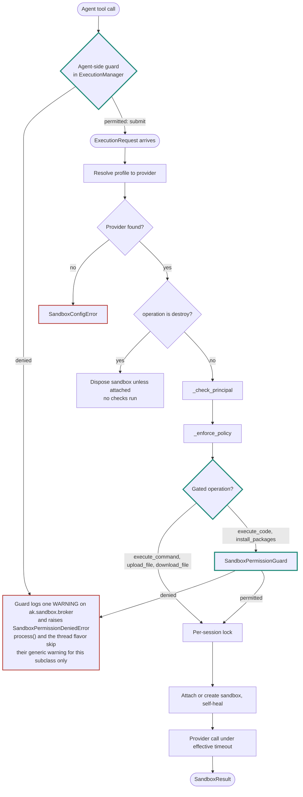
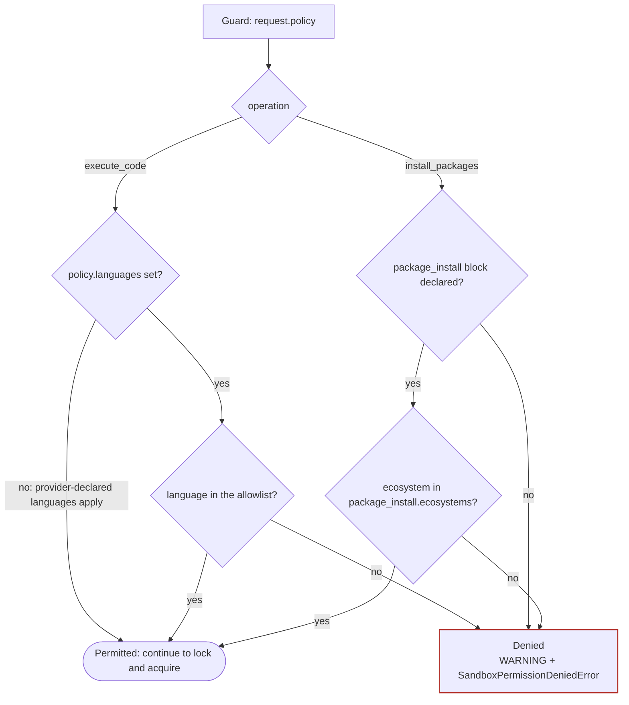
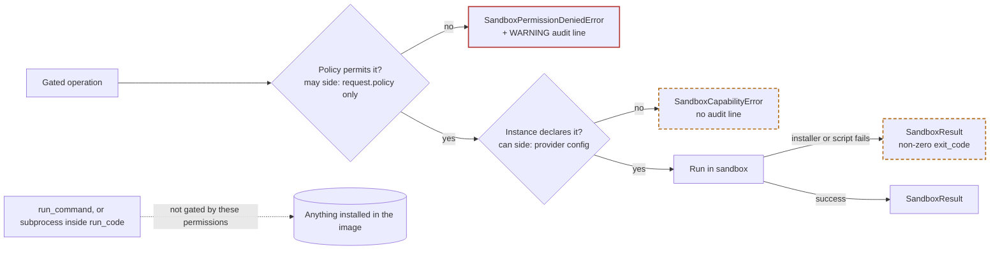
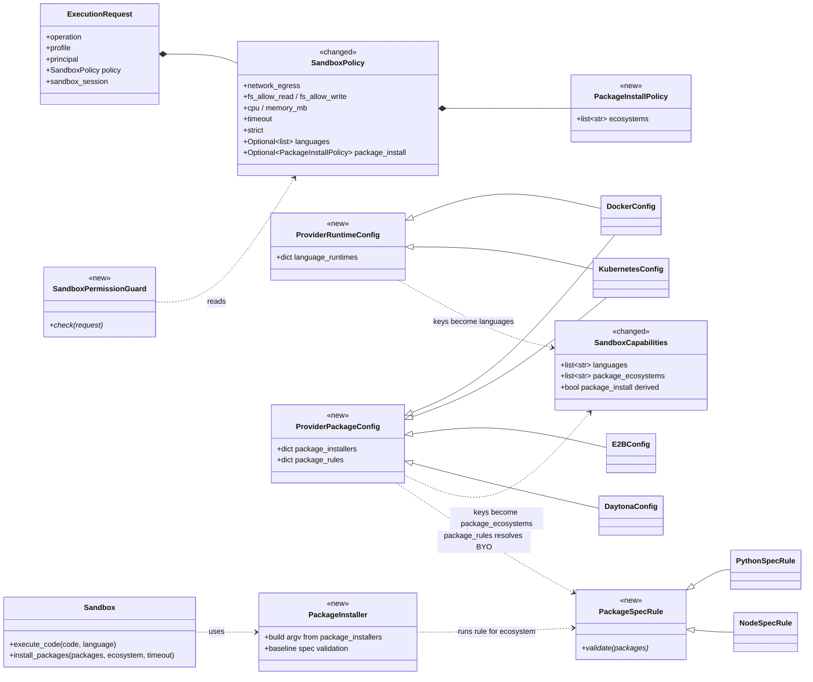
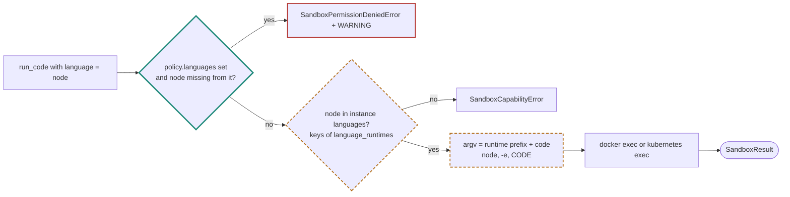
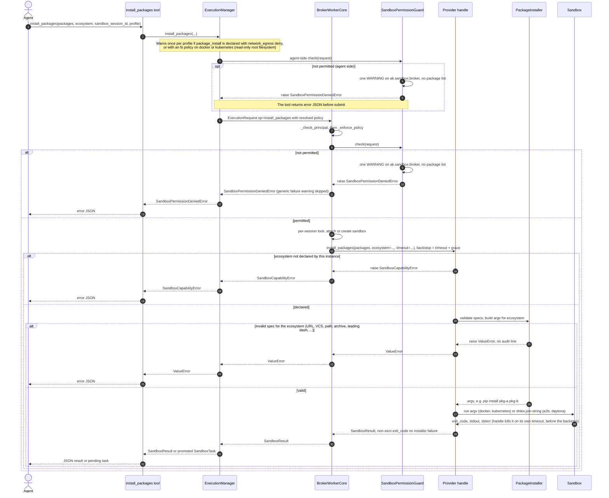
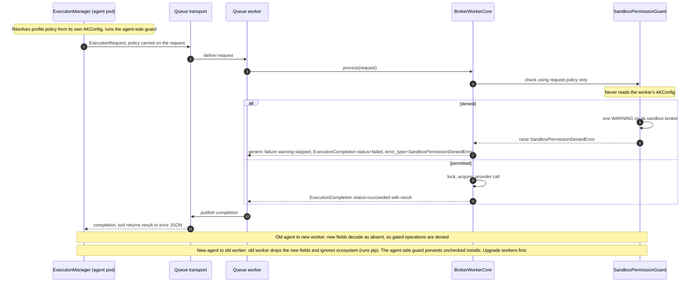

# #692 design diagrams

> Supporting material for [design.md](../design.md). These diagrams illustrate the design; they add no requirements.
> Where the design does not name a class or field, the name used here is illustrative and marked with `*`.

Legend for the flowcharts: a thick teal outline is new in #692, a dashed amber outline is changed by #692, a red
outline is a denied path, and anything else is existing and unchanged.

## 1. Worker pipeline in `BrokerWorkerCore.run`

`ExecutionManager` runs the guard once before submitting (defence in depth). The worker runs it again, authoritatively,
after `_enforce_policy` and before the per-session lock and sandbox acquisition
(`ak-py/src/agentkernel/sandbox/broker/worker.py`). A denied request never reaches a provider.



- The guard reads only the request (`policy`, `operation`, `payload`). It never reads `AKConfig` or provider
  capabilities. The existing
  `_check_principal` still reads `AKConfig`.
- Because the authoritative check sits in the worker core, it covers the embedded, thread and queue flavors and
  bring-your-own `ExecutionManager` callers.

## 2. Guard deny rules

Every deny exit makes the guard itself log exactly one `WARNING` on `ak.sandbox.broker` and raises `SandboxPermissionDeniedError`. The log line names
the operation, profile, agent, AK session id, sandbox session id and reason. It never includes code bodies or package
lists.

Package-spec validation is not a guard rule. `PackageInstaller` does it, with a shared baseline and then the
ecosystem's `PackageSpecRule` (built-in or bring-your-own), and raises `ValueError` without an audit line.



## 3. Permission vs capability

Policy (what the profile *may* do) is checked first, by the guard. Capability (what the image *can* do) is the existing
honesty contract, raised by the handle. Only the policy denial is audit-logged.



## 4. Configuration and model

The policy envelope is extended in place. `_SandboxPolicyConfig` is the config-side mirror of `SandboxPolicy` and gains
the same fields. `package_install` is presence-enabled: a declared block permits installing, and `None` denies it.



`PythonSpecRule`\* and `NodeSpecRule`\* are illustrative names for the built-in `python` and `node` rules.

| Field | Side | Default | Meaning |
|---|---|---|---|
| `languages` | policy (may) | `None` | Allowlist for `run_code`. `None` means whatever the provider declares, which is today's behaviour. `[]` denies every `run_code` call. |
| `package_install` | policy (may) | `None` | Presence permits installing. Absent means denied. |
| `package_install.ecosystems` | policy (may) | `["python"]` | `[]` is rejected at load. Open question: default to everything the provider declares instead? |
| `language_runtimes` | provider (can), `docker`/`kubernetes` | `{python: [python, -c]}` | Language to interpreter argv prefix. Keys become the instance's `languages`. A `python` key is required; every prefix must be non-empty with no empty token. |
| `package_installers` | provider (can) | `{python: [pip, install]}` | Ecosystem to installer argv prefix. Keys become `package_ecosystems`. Each key must resolve to a `PackageSpecRule` (`python` and `node` ship, others come from `package_rules`); every prefix must be non-empty with no empty token. |
| `package_rules` | provider (can) | `{}` | Ecosystem to the dotted path of a bring-your-own `PackageSpecRule`, e.g. `apk: my_org.rules.ApkRule`. |

Example profile using both capabilities (illustrative):

```yaml
sandbox:
  enabled: true
  profiles:
    default:
      type: docker
      docker:
        image: my-org/sandbox-node:1.4
        language_runtimes:              # can: what the image contains
          python: [python, -c]
          node: [node, -e]
        package_installers:
          python: [pip, install]
          node: [npm, install]        # operator-declared: only the image knows npm exists
      policy:                          # may: what agents are allowed to do
        # docker cannot enforce an allowlist (it fails closed under strict). For hard egress
        # limits use network_egress: deny with a mirror or pre-baked image instead.
        network_egress: allow
        languages: [python, node]
        package_install:               # present = permitted
          ecosystems: [python]          # node can install, but this profile may not
```

## 5. Provider matrix after #692

What each built-in provider can declare (the *can* side). The profile policy still has to permit each one.

| Provider | Languages | Package install | Config mixins |
|---|---|---|---|
| `docker` | Keys of `language_runtimes`, run as argv (replaces hard-coded `python -c`) | Yes: `PackageInstaller` argv, run directly | Runtime + Package |
| `kubernetes` | Keys of `language_runtimes`, run as argv (replaces hard-coded `python -c`) | Yes: `PackageInstaller` argv, run directly | Runtime + Package |
| `e2b` | `python` (unchanged; the template decides its kernel) | Yes: `PackageInstaller` argv joined with `shlex.join` (the SDK takes a string) | Package |
| `daytona` | `python` only (the SDK fixes the language per sandbox) | Yes: `PackageInstaller` argv joined with `shlex.join` (the SDK takes a string) | Package |
| `local_subprocess` | `python`, `bash` (unchanged) | No | None |
| `ec2_ssm` | `python` (unchanged) | No | None |

## 6. Capability 1: code in additional languages



## 7. Capability 2: `install_packages`, in-process flavor

In the embedded and thread flavors, `run()` raises the real exception type up to the tool.



## 8. Queue flavor: the policy travels with the request

The agent side resolves the profile policy and the worker enforces exactly that, so a worker with a different
`AKConfig` cannot widen it. The codec code and `BrokerOperation` do not change, but the schema gains the new policy
fields and the `ecosystem` payload key.


