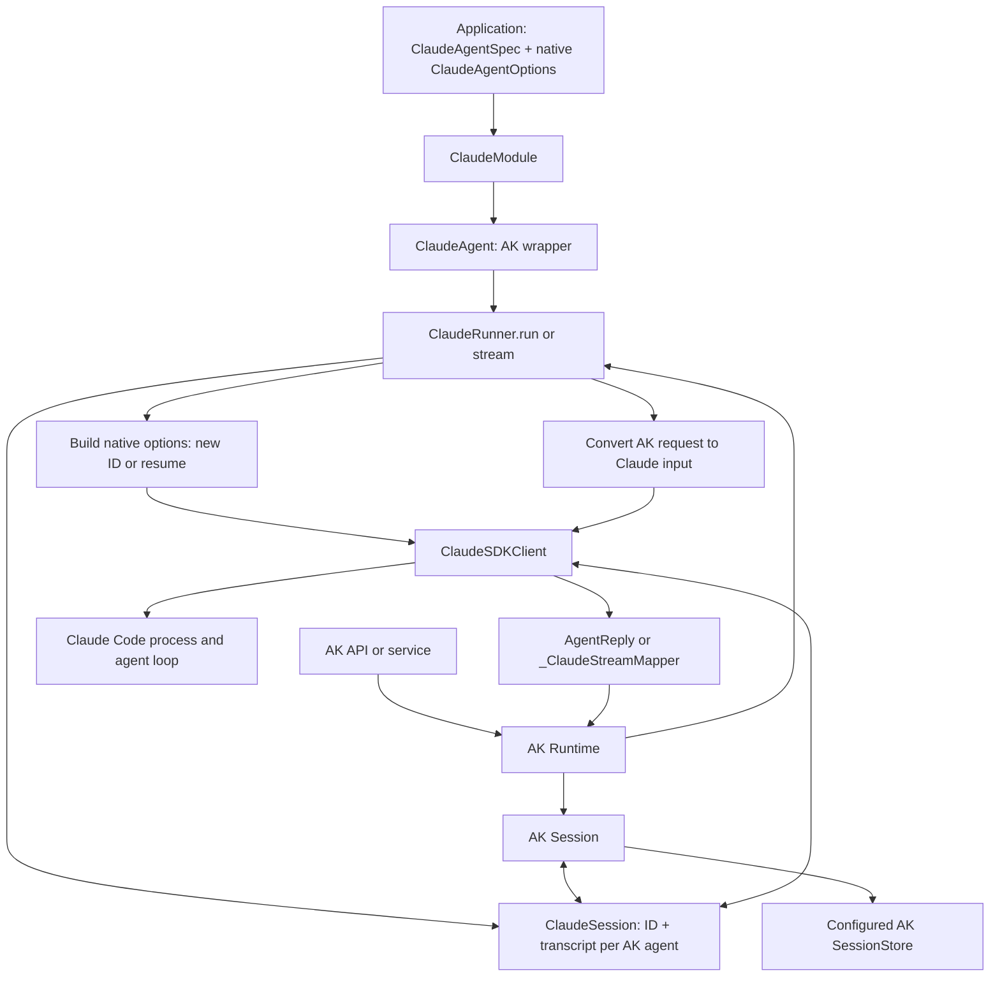

# #721: Claude Agent SDK adapter

Add the Claude Agent SDK to Agent Kernel (AK) as a framework adapter. Keep Claude's own agent loop, options, tools, and subagent definitions. AK names and registers agents, runs them through its common API, and stores enough Claude conversation data to resume a request on another worker.

This design also simplifies the adapter already written on `feature/721-claude-agent-sdk`: use the SDK's `AgentDefinition` for subagents instead of translating an AK `ClaudeAgentSpec` into a smaller definition. This document is the design for review; `spec.md` and `plan.md` follow after it is settled.

## Motivation

- AK's framework adapters wrap native execution APIs behind `Agent`, `Runner`, and `Module` (`ak-py/src/agentkernel/core/base.py`, `ak-py/src/agentkernel/core/module.py`). The OpenAI adapter wraps a native `Agent` and calls the native `Runner` (`ak-py/src/agentkernel/framework/openai/openai.py:222`, `:1023`, `:1094`).
- The Claude Agent SDK provides the Claude Code agent loop, tool execution, permissions, hooks, and sessions. This is useful for applications that need that harness. A Claude model used through another framework remains a valid choice for simpler agents. [Agent SDK overview](https://code.claude.com/docs/en/agent-sdk/overview).
- The SDK has a different main-agent shape:
  - A main run is configured with `ClaudeAgentOptions` and started with `query()` or `ClaudeSDKClient`; the options do not have an AK registry name or description. [Main agent configuration](https://code.claude.com/docs/en/agent-sdk/configuration), [Python SDK reference](https://code.claude.com/docs/en/agent-sdk/python).
  - The SDK **does** have `AgentDefinition`, but it is the native definition for a programmatic **subagent** in `ClaudeAgentOptions(agents={...})`. The dictionary key is its name. [Subagent guide](https://code.claude.com/docs/en/agent-sdk/subagents), [Python SDK reference](https://code.claude.com/docs/en/agent-sdk/python).
- All adapters need conversation state. The OpenAI adapter keeps message items in `OpenAISession` (`ak-py/src/agentkernel/framework/openai/openai.py:62`). Claude resumes by session ID against a native transcript. The SDK writes transcripts to local disk and offers a `SessionStore` interface to mirror and restore them on another host. [Claude sessions](https://code.claude.com/docs/en/agent-sdk/sessions), [external session storage](https://code.claude.com/docs/en/agent-sdk/session-storage).
- The Claude adapter has `ClaudeAgentSpec`, `ClaudeSession`, `ClaudeRunner`, and `_ClaudeStreamMapper` (`ak-py/src/agentkernel/framework/claude/claude.py`). An earlier `ClaudeAgentSpec.subagents` path mapped only some native subagent fields; the adapter now uses native `options.agents` directly.

## Native Claude example

- This is the SDK's shape for a main agent with one subagent. `AgentDefinition` is native Claude SDK code; `ClaudeAgentSpec` is an AK adapter type. [Configuration](https://code.claude.com/docs/en/agent-sdk/configuration), [subagents](https://code.claude.com/docs/en/agent-sdk/subagents).

```python
from claude_agent_sdk import AgentDefinition, ClaudeAgentOptions, query

options = ClaudeAgentOptions(
    system_prompt="You are a helpful assistant.",
    agents={
        "researcher": AgentDefinition(
            description="Researches a question",
            prompt="Find and summarize the relevant facts.",
        )
    },
)

async for message in query(prompt="Research this topic", options=options):
    print(message)
```

- The main agent runs from `options`. Claude may call the `Agent` tool to delegate to `researcher`; defining a subagent does not force delegation. The SDK's [subagent guide](https://code.claude.com/docs/en/agent-sdk/subagents) explains both parts.

## AK agent declaration (target design)

- An AK application imports the registration wrapper from `agentkernel.claude` and native configuration types from `claude_agent_sdk`. It does not call SDK `query()` itself. The code below uses native `options.agents`; the runner enables the `Agent` tool when definitions are present.

```python
from agentkernel.claude import ClaudeAgentSpec, ClaudeModule
from claude_agent_sdk import AgentDefinition, ClaudeAgentOptions

triage = ClaudeAgentSpec(
    name="triage",
    description="Answers questions and delegates research",
    options=ClaudeAgentOptions(
        system_prompt="Delegate research questions to the researcher.",
        tools=["Agent"],
        allowed_tools=["Agent"],
        permission_mode="dontAsk",
        setting_sources=[],
        agents={
            "researcher": AgentDefinition(
                description="Researches a question",
                prompt="Find and summarize the relevant facts.",
            )
        },
    ),
)

ClaudeModule([triage])
```

- `triage` is registered with AK. `researcher` is a native Claude subagent inside that agent's SDK run; it is not a separate AK registry entry. Register another `ClaudeAgentSpec` only if callers must address that agent directly through AK.

## Full request flow

| Step | OpenAI adapter today | Claude adapter target |
| --- | --- | --- |
| 1. Declare | Create the SDK's `Agent(name, instructions, tools, ...)`. | Create `ClaudeAgentSpec(name, description, options, tools)` for AK registration. Keep SDK settings in `ClaudeAgentOptions`; put native subagents in `options.agents`. |
| 2. Register | `OpenAIModule` wraps the SDK agent as `OpenAIAgent`. | `ClaudeModule` wraps the spec as `ClaudeAgent`. Both modules register agents with AK `Runtime`. |
| 3. Receive | AK selects an agent and loads an AK `Session`. | Same AK path; the API session ID identifies the AK `Session`, not the Claude session ID. |
| 4. Prepare input | `OpenAIRunner` converts `AgentRequest` values into OpenAI input. | `ClaudeRunner` converts them into Claude text or content blocks. Unsupported input must fail clearly. |
| 5. Load conversation | AK `Session` holds `OpenAISession` message items, which are passed to the SDK as `session=`. | AK `Session` holds `ClaudeSession`: a Claude session ID and transcript entries for each AK agent name. The runner supplies `session_id` for a first turn or `resume` for a later turn. |
| 6. Execute | Call the OpenAI SDK's `Runner.run(...)`. | Open a `ClaudeSDKClient`, call `query(...)`, and read SDK messages. The SDK starts and manages its Claude Code process. |
| 7. Finish | Map `final_output` to `AgentReply`; the OpenAI SDK updates the supplied session. | Map the Claude result to `AgentReply`; the SDK transcript is already stored in `ClaudeSession`, which is the SDK's session store. AK then persists its `Session` through its configured session backend. |
| 8. Stream | Map native OpenAI stream events to AK events. | Map native Claude stream events to AK events with a mapper local to that run. Close the client if the consumer stops early. |

- AK's `Session` also holds application data. `ClaudeSession` is only the Claude **conversation** part; it is not a replacement for AK caches or other application state (`ak-py/src/agentkernel/core/base.py:28`).
- A single long-lived `ClaudeSDKClient` can continue its own conversation without manual ID handling. AK creates a client per run, so it must select the correct conversation each time. On the same host, a saved ID can resume a local transcript. On another host, the transcript must also be available. [Claude sessions](https://code.claude.com/docs/en/agent-sdk/sessions).

## Inside `claude.py`



- `ClaudeModule`, `ClaudeAgent`, `ClaudeRunner`, `ClaudeSession`, and `_ClaudeStreamMapper` are AK adapter parts. `ClaudeAgentOptions`, `AgentDefinition`, and `ClaudeSDKClient` come from the Claude SDK. The SDK, not AK, starts the Claude Code process.
- The diagram shows the target boundary; the current runner also has a `_subagent()` conversion that this design removes.

## Why the Claude adapter has extra parts

| Part | Why AK needs it | Assessment |
| --- | --- | --- |
| `ClaudeAgentSpec` | Gives the main SDK configuration an AK registry name and description. | A small wrapper is justified. A second AK subagent definition duplicates the SDK's `AgentDefinition` and loses native fields, so the target removes it. |
| `ClaudeSession` | Connect AK's saved session to Claude's session ID and native transcript, as the SDK's session store. | Needed for AK requests that may land on different workers. A single long-lived SDK client does not need this. Transcript growth remains a backend limit to measure. |
| `ClaudeRunner` | Opens a client for each AK request, selects a new or resumed Claude session, and maps the result. | Required by AK's runner contract. SDK process startup and transport stay with the SDK. |
| `_ClaudeStreamMapper` | Translates native text, reasoning, and tool events to AK stream events. | Normal adapter work; OpenAI also maps stream events. It is kept separate because Claude's event format and per-run state differ. |

## Requirements

### Agent and module

- Keep the existing `ClaudeModule` and `ClaudeAgent` classes and the `Agent`/`Runner`/`Module` boundary. AK core must not import the Claude SDK.
- Keep `ClaudeAgentSpec` as a small wrapper for the **main AK agent**: `name`, `description`, native `ClaudeAgentOptions`, and bound AK tools. The SDK options remain the source of truth for Claude behavior.
- Use native `AgentDefinition` values in `ClaudeAgentOptions.agents` for subagents. Remove the parallel `ClaudeAgentSpec.subagents` declaration and its partial conversion. Update branch examples and documentation that use it. Do not present this as a new SDK requirement; it is a simplification of the AK adapter.
- When native `options.agents` is nonempty, make the SDK's `Agent` tool available and approve it according to the adapter's declared-tool policy, so the model can actually delegate. Keep the native `AgentDefinition` fields intact.
- Keep native SDK options visible, including model, prompt, tools, hooks, permissions, MCP servers, and subagents. The runner may override only options it must own for AK session continuity and stream mode; reject conflicting caller options with a clear error.
- When an agent has AK bound tools, serve them through the SDK's in-process MCP server. Native subagents may refer to those tool names through their native `tools` list; document the names and approval behavior. Keep user-supplied MCP servers available.

### Session and state

- Reuse AK's existing `Session` and configured `SessionStore`. Store Claude conversation data under the `claude` framework key, alongside other AK session data. Add no new AK configuration field for this.
- `ClaudeSession` holds a Claude session ID and ordered, opaque transcript entries for each AK agent name. It must not store a live SDK client or SDK-only object.
- `ClaudeSession` implements the native SDK `SessionStore` methods needed to append and load the main transcript and discover subagent transcripts. Restore the same ordered entries when a conversation resumes on another worker. [SDK session-store contract](https://code.claude.com/docs/en/agent-sdk/session-storage).
- The first turn starts a new Claude session. A later turn with the same AK session and agent resumes its saved Claude session. Two AK agent names must not share a Claude conversation by accident.
- Store transcript lines as the SDK mirrors them, so an interrupted turn keeps what was mirrored and the next turn resumes from it, as the OpenAI SDK does with its session. An SDK error result may still have a complete transcript and must be handled explicitly.
- `framework_context` is injected through `ToolContext.framework_context`, a field of the core `ToolContext` that only the Claude runner fills, since the SDK has no native per-run caller-state slot of its own: the runner sets it to a per-run copy before the SDK client connects, a tool bound through `ClaudeToolBuilder` reads and mutates it with `ToolContext.get().framework_context`, and the runner writes the touched keys back to the session after a successful run. This reaches only AK-bound tools, never a Claude built-in tool or an external MCP server.

### Runner and results

- Create a `ClaudeSDKClient` for each `run()` or `stream()` call. Set and reset AK `ToolContext` around the call; the SDK owns process startup, transport, and cleanup.
- Convert supported AK text, image, and file requests into native Claude input. Reject unsupported media and remote references clearly; do not silently change their meaning.
- Map native plain-text and structured results into AK `AgentReply`. Keep native error details in the user-facing error path used by existing runners.
- Stream real Claude text, reasoning, and tool events as AK `StreamEvent` values. Keep per-run mapper state off the shared runner. Do not invent token deltas or reuse a tool-call ID for a different call.
- Disconnect on early stream close. Commit conversation data only after a completed response.

### Configuration, tests, and documentation

- Keep the adapter in `ak-py/src/agentkernel/framework/claude/` and its public `agentkernel.claude` import path. Keep `ClaudeToolBuilder` as the thin conversion from AK Python functions to native SDK MCP tools.
- Reuse existing AK session and tracing configuration. Keep `claude` an optional package extra; do not add a Claude-specific session backend selector. Use the native SDK defaults unless the user explicitly chooses other behavior.
- Keep tracing behind AK's existing trace interface. If a tracing backend cannot see model work inside the Claude process, describe exactly which spans it records rather than claiming complete tracing.
- Test first-turn and resumed turns, per-agent isolation, AK session serialization, native subagent definitions, bound tools, structured replies, errors, streaming, early close, and transcript restore on a fresh worker/session object.
- Validate one live CLI run with a follow-up turn and a subagent before claiming production-ready resume behavior. A fake SDK test alone cannot prove the subprocess and transcript path.
- Document the native agent/subagent split, SDK process lifecycle, session storage, transcript size considerations, and explicit server tool permissions. Update CLI and REST examples to use native `options.agents`.

## Non-goals

- An Anthropic Messages API adapter or Claude Managed Agents integration; these are different products. [SDK comparison](https://code.claude.com/docs/en/agent-sdk/overview).
- A new framework-neutral agent definition in AK core.
- Long-lived Claude process pools or sticky request routing.
- Persisting the working directory or file changes as part of a conversation transcript. [Claude session scope](https://code.claude.com/docs/en/agent-sdk/sessions).

Durable human approval (`supports_pause`) uses the SDK's `defer` permission decision — see the Human in the loop section of the framework page and `docs/docs/advanced/human-in-the-loop.md`. The SDK honors `defer` only for a single tool call in a turn. An AK-bound gated tool also checks a one-use approval in its handler, so a call cannot execute when `defer` is ignored. The exact resume prompt/call shape still needs a credentialed live model run; `ak-py/tests/test_claude_hitl_live.py` provides an opt-in smoke test.

## Open questions

- How should AK handle a transcript larger than the configured AK session backend allows? Existing backends have different limits; this needs a measured policy before production use.
- Should AK expose a separate native SDK `SessionStore` override for applications that want transcript storage outside the AK session? The current design uses the already pluggable AK session backend and reserves `session_store` for the `ClaudeSession`.
- What deployment and credentialed test environment will verify resume across workers with the real Claude Code process?

## References

- [Claude Agent SDK overview](https://code.claude.com/docs/en/agent-sdk/overview) — agent loop, process, and SDK scope.
- [Configure your agent](https://code.claude.com/docs/en/agent-sdk/configuration) — main agent options.
- [Subagents in the SDK](https://code.claude.com/docs/en/agent-sdk/subagents) — native `AgentDefinition` and `agents=`.
- [Python SDK reference](https://code.claude.com/docs/en/agent-sdk/python) — option and type definitions.
- [Work with sessions](https://code.claude.com/docs/en/agent-sdk/sessions) — local transcripts and resume by ID.
- [Persist sessions to external storage](https://code.claude.com/docs/en/agent-sdk/session-storage) — SDK `SessionStore` contract.
