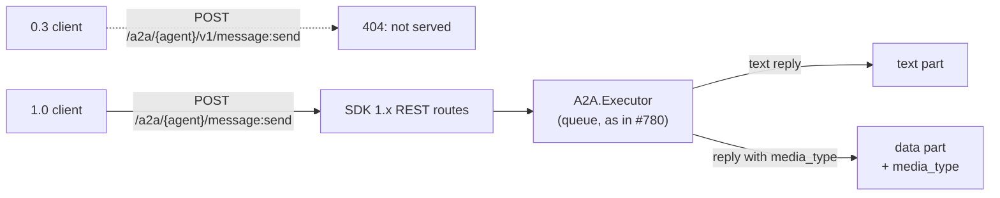

# #762: Port the A2A surface to a2a-sdk 1.x, and send structured replies as data parts

> **In one line:** a fresh `pip install agentkernel[a2a]` gets a2a-sdk 1.x, and Agent Kernel's A2A
> code only works on 0.3. This change moves the A2A code to 1.x, serves A2A 1.0 only, and sends
> labelled replies (A2UI) as real data parts.

| | |
|---|---|
| **Status** | Draft for review; all open questions resolved 2026-10-24 (D6–D8 added after the A2UI v0.9.1 binding was found). |
| **Base** | `feature/780-a2a-and-mcp-from-queue-pipeline` (A2A already runs through the queue). |
| **Read time** | About 5 minutes. Code evidence is folded away under ▸ **Evidence**. |
| **Breaking?** | Yes: A2A 0.3 clients are no longer served, and apps that import `a2a` 0.3 types must port. See [Breaking changes](#breaking-changes). |
| **Decisions** | All 8 resolved (D2 superseded by D7): [Decisions](#decisions) |

---

## The 30-second version

- 🔴 **Problem.** On `develop` the pin `a2a-sdk[http-server]>=0.3.6` has no upper bound, so new
  installs get 1.x, and `agentkernel.api.a2a.a2a` fails to import. This branch caps it at `<1`, which
  stops the crash but leaves us on an old SDK line.
- 🟢 **Fix.** Port the three A2A files to the 1.x object model (protobuf types, new route
  factory, new card shape). Pin exactly `==1.2.3`.
- 🟡 **1.0 only.** 0.3 clients are not served: the old `/v1/...` routes and the card's 0.3 keys
  go away, and callers upgrade to a 1.x client. The SDK's 0.3 compatibility layer stays off
  ([D1](#decisions)).
- 🟢 **Bonus (the deferred #706 work).** A reply that carries a `media_type` (A2UI) goes out as a
  data part with that media type, and the card declares the A2UI extension.

---

## Words used here

| Word | Meaning |
|---|---|
| **A2A** | Agent-to-Agent protocol. Agent Kernel serves each agent at `/a2a/{agent}`. |
| **a2a-sdk** | Google's Python library for A2A. Line 0.3 uses pydantic models; line 1.x uses protobuf messages. |
| **Agent card** | The JSON document that describes an agent: name, skills, URL, capabilities. Clients read it first. |
| **Part** | One piece of an A2A message: text, file, or **data** (a JSON object). |
| **Data part** | A part holding a JSON object. On 1.x it has a first-class `media_type` field. |
| **Labelled reply** | An `AgentReplyAny` whose `media_type` is set, today only by the A2UI post-hook. |

---

## The picture

---

## Motivation

- **The import is broken on 1.x.** Three symbols the A2A code imports are gone or moved.
  - `a2a.utils.new_agent_text_message` → removed; 1.x has `a2a.helpers.new_text_message`.
  - `a2a.utils.errors.ServerError` → removed; 1.x executors raise the `A2AError` subclasses
    (`InternalError`, `UnsupportedOperationError`) directly.
  - `a2a.server.apps.rest.rest_adapter.RESTAdapter` → removed; 1.x has
    `a2a.server.routes.create_rest_routes`, returning Starlette routes.
- **The card no longer builds on 1.x.** `AgentCard` lost `url` and `preferred_transport`; they
  moved into `supported_interfaces` (a list of `AgentInterface`: `url`, `protocol_binding`,
  `protocol_version`, `tenant`).
- **The `<1` cap is a stopgap.** It keeps us off every 1.x fix and makes `agentkernel[a2a]`
  conflict with any app that wants 1.x.
- **Structured replies go out as escaped text.** A labelled A2UI reply reaches an A2A client as a
  text part holding a JSON string, so a UI-rendering client has nothing to render. #706 deferred
  this to the port because the label's place changes between 0.3 and 1.x
  (`research/a2a-datapart.md` §6 of #706).
- **The card claims an output it never sends.** `default_output_modes=["json"]` while the executor
  only ever sends text. After this change the card lists exactly what goes out (D4).

▸ Evidence

- Pin: `develop:ak-py/pyproject.toml:185` is `a2a-sdk[http-server]>=0.3.6`; this branch
  `ak-py/pyproject.toml:185` is `>=0.3.6,<1` (added in `397ddaca`). `ak-py/uv.lock:19` resolves 0.3.26.
- Broken imports: `ak-py/src/agentkernel/api/a2a/a2a.py:9` (`new_agent_text_message`), `:10`
  (`ServerError`); `ak-py/src/agentkernel/api/a2a/handler.py:4` (`RESTAdapter`).
- Card: `ak-py/src/agentkernel/core/builder.py:41` (`url=`), `:45` (`preferred_transport=`), `:44`
  (`default_output_modes=["json"]`).
- Text-only replies: `ak-py/src/agentkernel/api/a2a/a2a.py:92` and `:100-103` (`_as_text` dumps a
  structured result to JSON text).
- 1.x surface, verified on a2a-sdk **1.2.3** in a scratch venv: `AgentCard` fields
  `name, description, supported_interfaces, provider, version, documentation_url, capabilities,
  security_schemes, security_requirements, default_input_modes, default_output_modes, skills,
  signatures, icon_url`; `Part` fields `text, raw, url, data, metadata, filename, media_type`;
  `a2a.types.InternalError is a2a.utils.errors.InternalError` (an `A2AError`, an `Exception`).
- Spike (scratch, not committed): 1.x `DefaultRequestHandler` + `create_rest_routes(handler)` +
  `create_agent_card_routes(card)` mounted on a FastAPI `APIRouter` at `/a2a/triage`. A 1.0
  request to `/message:send` got a text part; a data reply came back as
  `{"data": {...}, "mediaType": "application/a2ui+json"}`. A card with only a `1.0` interface is
  served without the legacy `url` / `preferredTransport` keys.
- Versions: on **1.0.0**, `import a2a.server.routes` fails with
  `ModuleNotFoundError: No module named 'grpc'` under the `http-server` extra; **1.1.2** imports
  cleanly; **1.2.3** (latest, the pinned version) ran the full spike.

---

## Requirements

### 1. Dependency

- `ak-py/pyproject.toml` `a2a` extra pins `a2a-sdk[http-server]==1.2.3` (D5).
  - An exact pin, not a range: an unbounded range is what caused this bug.
  - `ak-py/uv.lock` is re-locked; the six framework adapters need no new extra.
- Examples that pin the SDK move to the same version and re-lock:
  `examples/k8s/openai-queue-mode/pyproject.toml:9`, `examples/api/a2a/multi/uv.lock` (pins 0.3.6).

### 2. Agent card (`A2ACardBuilder`, `core/builder.py`)

- Builds a 1.x `AgentCard` with the same values as today, moved to their new fields.
  - `supported_interfaces` has one entry: `{a2a.url}/{name}`, binding `HTTP+JSON`, protocol
    version `1.0`.
  - No `0.3` entry, so the served card carries no legacy `url` / `preferredTransport` keys (D1).
- `name`, `description`, `version`, `skills`, and `capabilities.streaming=False` keep today's
  values.
- Modes use media types (D4): `default_input_modes=["text/plain"]`,
  `default_output_modes=["text/plain"]`, plus `application/a2ui+json` for agents in A2UI scope
  (today `["text"]` / `["json"]`, `core/builder.py:43-44`).
- A non-string `description` becomes `""` with a warning, instead of failing the whole A2A mount.
  - OpenAI's `instructions` may be a callable (`framework/openai/openai.py:1091`); 1.x raises
    `TypeError` on it.
- A skill with empty `tags` gets `[<agent name>]`, so 1.x stops logging "not spec-compliant" on
  every card build. Adapters keep passing `tags=[]`.
- Framework adapters are unchanged: `AgentSkill(id, name, description, tags)` builds on 1.x as is.

### 3. Routes (`A2ARESTRequestHandler`, `api/a2a/handler.py`)

- Per agent, mounts the routes from `create_rest_routes(handler)` under `/a2a/{agent}` on a
  FastAPI `APIRouter`, over a 1.x `DefaultRequestHandler` built with the agent's executor, task
  store and card.
  - 1.0 routes: `/a2a/{agent}/message:send`, `/tasks/...`, `/extendedAgentCard`.
  - `enable_v0_3_compat` stays `False`: the old `/a2a/{agent}/v1/...` routes are gone and return
    404 (D1).
  - The SDK's `/{tenant}` mount is not mounted (no multi-tenant A2A).
- `GET /a2a/{agent}/.well-known/agent-card.json` and `GET /a2a/catalog` serve the card through the
  SDK's `agent_card_to_dict`, so both carry the 1.0 shape.
  - An unknown agent on the well-known route returns 404, not 500 (today `None.model_dump()`,
    `handler.py:72-73`).
- An agent whose `get_a2a_card()` returns `None` is skipped with a warning, not mounted.
  - Google ADK returns `None` today (`framework/adk/adk.py:1519-1524`), and 1.x's request handler
    requires a card.

### 4. Executor (`A2A.Executor`, `api/a2a/a2a.py`)

- The queue path from #780 is unchanged: same body, same `protocol="a2a"`, same session =
  `context_id`.
- **Reply mapping:**
  - Text result → one text part (`new_text_message`), as today.
  - Result with a `media_type` (`QueuedReply.media_type`) whose `result` is a dict or list → one
    data part with that `media_type` (`new_data_message`), the label also in
    `metadata["mimeType"]` (D7); an A2UI object goes as a one-item list (D8).
  - Structured result without a `media_type` → JSON text, as today (D3).
  - The executor stays generic: it maps any `media_type`, and never names A2UI.
- **Failures:** raise `InternalError(message=ERROR_MESSAGE)` (timeout: `TIMEOUT_MESSAGE`).
  - The generic text stays the only thing a caller sees; details stay in the log, as today.
  - `_send_error` is removed: on 1.x a message enqueued before the raise is never delivered
    (verified), so the error's own message is what the caller reads.
- `cancel` raises `UnsupportedOperationError()`.

### 5. A2UI extension on the card

- When `a2ui.enabled` and the agent is in scope for the A2UI post-hook, the agent's card declares
  `AgentExtension(uri="https://a2ui.org/a2a-extension/a2ui/v0.9.1", required=False)` in
  `capabilities.extensions` (D6).
  - Scope reuses the hook's own rule (`A2UIPostHook._applies_to`, `a2ui/hook.py:58`), so the card
    and the labelling can never disagree.
  - `required=False`: a data part is core A2A, so a client that ignores the extension still gets a
    valid message. The binding calls the declaration optional but encouraged.
  - No `params`: `supportedCatalogIds` names the application's component catalog, which Agent
    Kernel never sees (the same reason `a2ui/` never reads message names).
- The URI string lives in `a2ui/` beside `A2UIPostHook.MEDIA_TYPE` (`a2ui/hook.py:34`), keeping
  `a2ui/` the only package that names A2UI. The A2A surface reads it from there.
- The URI is an identifier, not a page: it does not resolve (404), by design. It is defined by the
  binding spec at `https://a2ui.org/specification/v0.9.1-a2ui-extension-specification/`
  ("Extension URI" section). The URI moves when the app-facing A2UI version moves (v1.0 is a
  candidate today).

### 6. Configuration

- **No new configuration.**
  - No switch for 0.3 clients: they are not served (D1).
  - Card URLs reuse `a2a.url`; agent scope reuses `a2a.agents`; the extension reuses `a2ui.enabled`
    and `a2ui.agents`.
  - `a2a.task_store_type` is untouched.

### 7. Tests

- `tests/test_api_a2a.py` and `tests/test_protocol_pipeline_roundtrip.py` move to 1.x types.
- New: an A2A round trip with a 1.x client on `/message:send`, through the queue; a request to
  the old `/v1/message:send` returns 404.
- New: a labelled reply arrives as a data part with its `media_type`; an unlabelled structured
  reply arrives as JSON text.
- New: the card carries one `1.0` interface, no 0.3 keys, and the A2UI extension only for in-scope
  agents.
- New: importing `agentkernel.api.a2a.a2a` and `.handler` succeeds (the regression the issue says
  CI never caught).

### 8. Examples and docs

- `examples/api/a2a/multi/client.py` and `examples/k8s/openai-queue-mode/protocol_client.py` move
  to the 1.x client API.
- `docs/docs/api/a2a-server.md:85-95` lists the 1.0 routes, says a labelled reply is a data part,
  and carries a short migration note for 0.3 callers (new routes, 1.x client).

---

## Breaking changes

- **Apps that import `a2a` 0.3 types** (a custom `get_a2a_card`, a bring-your-own adapter, their
  own A2A client in the same environment) must port to 1.x. `Agent.get_a2a_card()` is typed `Any`
  (`core/base.py:686`), so nothing in Agent Kernel catches this for them.
- **Apps that need any a2a-sdk other than 1.2.3** next to `agentkernel[a2a]` no longer resolve
  (D5).
- **A2A 0.3 clients break** (D1). Their routes (`/a2a/{agent}/v1/...`) return 404, and the card
  no longer has the `url` / `preferredTransport` keys a 0.3 client needs. Callers upgrade to a
  1.x client.
- **Card JSON changes shape.** Today it is pydantic `model_dump()` (snake_case). After: protobuf
  JSON (camelCase), 1.0 fields only. Hand-written readers of `/a2a/catalog` must update.

---

## Non-goals

- Serving A2A 0.3 clients (D1).
- Streaming (`message:stream`): cards keep `streaming: false`.
- The JSON-RPC and gRPC bindings: REST (`HTTP+JSON`) only, as today.
- Multi-tenant routes (`/{tenant}/...`).
- A real Redis task store: `RedisTaskStore` (`api/a2a/a2a.py:160`) stays a stub of the in-memory one.
- A2A card support for Google ADK agents (still skipped, now with a warning).
- Changing A2UI's own media type string (`application/a2ui+json`, #706).

---

## Decisions

- **D1. A2A 1.0 only; 0.3 clients are not served** (2026-10-24, requester).
  - The SDK's v0.3 compatibility layer (`create_rest_routes(enable_v0_3_compat=True)`) stays off.
  - Recorded for context: it was verified to work with the real 0.3.26 client; it was declined,
    not found unworkable.
- **D2. The label goes in `media_type` only; no `metadata.mimeType` copy** (2026-10-24, follows D1).
  **Superseded 2026-10-24 by D7.**
  - The copy existed only for 0.3 clients, which the compat layer would have served without
    `media_type`. With no 0.3 clients there is no reader for it.
  - That reasoning missed the A2UI binding itself: v0.9.1 requires the label in
    `metadata["mimeType"]` (D7).
- **D3. An unlabelled structured reply stays JSON text** (2026-10-24, requester).
  - Only a reply with a `media_type` becomes a data part; the issue scopes data parts to labelled
    replies, and a text-only client keeps reading every reply.
- **D4. Card modes are media types, and list only what is actually sent** (2026-10-24, requester).
  - Input `["text/plain"]`. Output `["text/plain"]`, plus `application/a2ui+json` for agents in
    A2UI scope.
  - Not `application/json`: after D3 no reply goes out with that type.
  - The A2A spec defines modes as media types; 1.x does not validate them by default
    (`validate_input_modes=False`).
- **D5. a2a-sdk is pinned to one exact version, `==1.2.3`** (2026-10-24, requester).
  - 1.2.3 is the latest release and the one the spike ran end to end.
  - Moving to another version is a deliberate change: bump the pin, re-lock, re-run the A2A tests.
  - Accepted cost: an app that needs a different a2a-sdk version cannot install `agentkernel[a2a]`
    beside it.

- **D6. The card declares the A2UI v0.9.1 extension, not v0.8** (2026-10-24, requester).
  - v0.9.1 is A2UI's current version; v0.8 is marked legacy, and v1.0 is a candidate.
  - v0.9.1 matches what Agent Kernel labels: `createSurface`-style messages under
    `application/a2ui+json`. The v0.8 binding uses `beginRendering` and `application/json+a2ui`,
    so declaring it would promise a format that is never sent.
  - Corrects an earlier check: the v0.9.1 and v1.0 binding pages exist at
    `.../specification/v0.9.1-a2ui-extension-specification/` and
    `.../specification/v1.0-a2ui-extension-specification/`; the `-a2a-extension` slugs checked
    before (`research/a2a-datapart.md` §3 of #706) were the wrong addresses.

- **D7. The label goes in both `media_type` and `metadata["mimeType"]`** (2026-10-24, requester;
  supersedes D2).
  - The v0.9.1 binding ("Data encoding", a MUST): a data part is A2UI when it has
    `metadata["mimeType"] = "application/a2ui+json"`. A client that follows it reads only that key.
  - `media_type` is A2A 1.x's own field; `metadata.mimeType` is what A2UI clients read. Cost: the
    label is written twice on each labelled data part.
  - Generic: every labelled data part carries both, whatever its media type, so the executor
    still never names A2UI.
- **D8. A labelled A2UI object reply goes out as a one-item list over A2A** (2026-10-24, requester).
  - The v0.9.1 binding (a MUST): the data part's `data` is an array of messages. The A2UI hook
    labels a JSON object or array (`a2ui/hook.py:53`), so an object reply would break that rule.
  - A2A surface only: REST, WebSocket, MCP and the rest keep today's shape.
  - The rule lives in `a2ui/` (`a2ui/` stays the only package that names A2UI); other media types
    are sent as they are.

## Open questions

- None. Q1 and Q2 (raised by the v0.9.1 binding) are resolved as D7 and D8.
