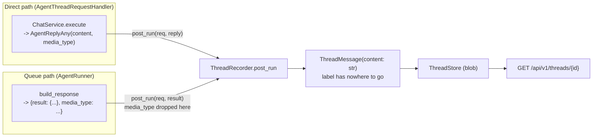

# #763: a labelled structured reply survives a thread reload

A reply that says what format it is in (`media_type`, added by [#706](../706-a2ui-support/design.md))
reaches a live client as an object. Recorded into a conversation thread it becomes a plain string and
loses the label, so an A2UI form that rendered on the first turn comes back as a text bubble on
reload. This change carries the label and the object into `ThreadMessage` and back out of the read
route, using the same switch #706 established: **the label is present, so the object travels as an
object; no label, and nothing changes.**

Depends on #706 (`AgentReplyAny.media_type`). Code facts verified against
`feature/706-a2ui-transport-agnostic` at `3ae17e25`; paths relative to `ak-py/src/agentkernel/`.

---

## Motivation

- `ThreadMessage.content` is typed `str` (`integration/thread/model.py:33`), so no reply can be
  stored as anything but text, and there is no field for the label at all.
- `ThreadRecorder._as_thread_content` (`integration/thread/recorder.py:70-95`) renders every reply to
  a string — `AgentReplyAny.__str__` for the direct path, `json.dumps` for the queue path's dict. It
  was written by #706 to make the two paths agree byte for byte; it agrees on *text*, which is the
  part that is now wrong.
- `ThreadRecorder.post_run` (`recorder.py:60-67`) takes only `result`, so even where the label exists
  it has no way to travel.
- The queue path drops the label at the call site: `AgentRunner.process`
  (`pipeline/agent_runner.py:55`) passes `agent_response.get("result")` while `media_type` sits
  beside it in the same dict, put there by `ResponseBuilder.build_response`
  (`core/chat_service.py:367-368`).
- The live surface and the replay surface therefore disagree for the same reply:
  - live: `{"result": {...}, "media_type": "application/a2ui+json"}` (`chat_service.py:368`)
  - replay: `{"content": "{\"version\": \"v1.0\", ...}"}` (`thread_chat.py:380`)
- **The store backends are not the obstacle.** Every one of them serialises the whole `ThreadMessage`
  as an opaque blob and parses it back the same way — `redis_like.py:124,152`, `dynamodb.py:155,203`,
  `cosmosdb.py:145,177`, `firestore.py:126,152` — and `InMemoryThreadStore` holds the model object
  itself (`store/in_memory.py:63`). None of the six reads `content`. Widening the field costs them
  nothing.
- The read route is equally transparent: `thread_chat.py:380` dumps whatever the model holds
  (`message.model_dump(mode="json")`), so a new field reaches clients without route changes.

## Requirements

### `ThreadMessage` (`integration/thread/model.py`)

- `content` widens to `str | JSONPayload` — the object form exactly as `result` carries it on the
  live surface, so a client parses thread history with the code it already uses for a live reply.
  - `JSONPayload` is the existing annotation from `core/util/payload.py`, so a dict or list is
    normalised to plain JSON types on construction, by the same validator `AgentReplyAny.content`
    runs. The recorder needs no explicit `PayloadCodec` call.
  - A `str` stays a `str` under pydantic's smart union; this must be asserted by a test, not assumed.
- `media_type: Optional[str] = None` is added.
  - Defaulted, so every row written before this change still validates
    (`ThreadMessage.model_validate_json` on the four blob backends).
  - Agent Kernel never interprets the value, exactly as on `AgentReplyAny.media_type`
    (`core/model.py:239`).
- **The two fields move together.** `content` is an object if and only if `media_type` is set; a
  structured reply with no label is still stored as JSON text. Enforce it with a model validator so a
  caller cannot write a half state.
- Only assistant messages can carry either. The user message is always `req.prompt`, a `str`
  (`recorder.py:57`).

### `ThreadRecorder` (`integration/thread/recorder.py`)

- `post_run(req, result, media_type=None)` gains the third parameter — the only way the queue path
  can hand over a label it holds beside the result rather than on it.
- `_as_thread_content` is replaced by a method returning `(content, media_type)`, applying one rule
  to the three caller types #706 documented:
  - an `AgentReplyAny` with `media_type` set → `(reply.content, reply.media_type)` — the object.
  - a dict or list with a `media_type` argument → `(result, media_type)` — the object. This is the
    queue path.
  - everything else → today's string and `None`, byte for byte: `str` through unchanged,
    `json.dumps(result, default=str)` for an unlabelled dict, `str(result)` otherwise.
- The `default=str` fallback and the reason for it (matching `AgentReplyAny.__str__` rather than
  `PayloadCodec.encode`) survive unchanged on the string branch.
- An `AgentPausedReplyAny` records as it does today: it never sets `media_type`, so it takes the
  string branch.

### `ConversationThreadManager` (`integration/thread/manager.py`)

- `append_message(session_id, role, content, attachments=None, media_type=None)` gains the parameter
  and passes it to the `ThreadMessage` constructor (`manager.py:125-142`).
- `content`'s annotation widens to match the model. No other method changes.

### Queue path (`pipeline/agent_runner.py`)

- `AgentRunner.process` passes the sibling key: `agent_response.get("media_type")` alongside
  `agent_response.get("result")` (`agent_runner.py:55`).
- `_record_thread_reply` (`agent_runner.py:117-157`) gains the parameter and forwards it to
  `post_run`. Its existing contract is untouched — still after `_send_to_output`, still never
  raising.
- `StreamAgentRunner` (`agent_runner.py:242`) is unchanged: it records accumulated text, and
  structured output is non-streaming only.

### Read route (`integration/thread/thread_chat.py`)

- `GET /api/v1/threads/{session_id}` returns both fields. `message.model_dump(mode="json")` already
  does this once the model carries them (`thread_chat.py:380`).
- The dump gains `exclude_none=True` so an unlabelled message omits `media_type` entirely rather than
  returning `null` — matching the live surface, where `build_response` adds the key only when the
  label is set (`chat_service.py:367-368`). No other message field is ever `None`.
- `GET /api/v1/threads` is unchanged: listings exclude messages.

### Configuration

- **No configuration changes.** Nothing here is selectable, optional, or deployment-dependent: the
  behaviour is a consequence of a reply already carrying a label. No new block, no `enabled` flag.

### Pluggability

- No new pluggable component. `ThreadStore` / `ThreadStoreBuilder` already exist and all six built-in
  backends are untouched (see Motivation).
- The **BYO `ThreadStore` contract widens**: a dotted-path store that persists `message.content` into
  a typed text column, rather than blobbing the model, will now be handed a dict. Call this out in
  the thread docs as a breaking note for custom stores.

## Non-goals

- Producing the payload or the label — #706 owns that, including the A2UI post-hook.
- Encoding on the queue path itself (#706), the WebSocket/SSE surfaces, and AG-UI.
- Replaying thread history back into an agent as context. Nothing reads `ThreadMessage.content` for
  that today (agent memory is the session store), and this change does not add it.
- Streaming replies: structured output is non-streaming, so the accumulated-text recording stays.
- Interpreting, validating or versioning the media type.

## Decisions (resolved in review)

- **BYO thread stores get no compatibility shim.** A custom `ThreadStore` that persists
  `message.content` into a typed text column must be updated to take an object when it adopts this
  version. Documented as a breaking note in the thread docs; the `ThreadStore` ABC gains no opt-out
  hook.
- **The payload rejection stays, and moves earlier.** A value that bypassed `AgentReplyAny`'s
  validation (`model_copy` over `content`, in-place mutation — `core/util/payload.py` module
  docstring) now raises inside `ThreadMessage` construction rather than inside `build_response`,
  because `post_run` runs first (`thread_chat.py:136-137`). The recorder does **not** catch it and
  fall back to the string branch.
  - Direct path: the handler's own `except Exception` turns it into the same 500 it returns today
    (`thread_chat.py:143-145`), and nothing is recorded — where today the malformed reply is recorded
    as text and *then* the response fails.
  - Queue path: unchanged. `_record_thread_reply` already swallows and logs every recording failure
    (`agent_runner.py:156-157`), because the reply has already been delivered.
  - Both paths therefore still agree: on a bypassed payload, neither records a row.
- **No compatibility shim for clients reading thread history either** — and the break is narrower
  than it looks. `content` is an object *only* when `media_type` is set, and only the A2UI post-hook
  sets one (`a2ui/hook.py:55`, reached via `A2UIPostHookFactory` when the `a2ui` block is present).
  An application that has not opted into A2UI reads byte-identical rows after this change, which is
  the #706 contract holding on the thread surface.
