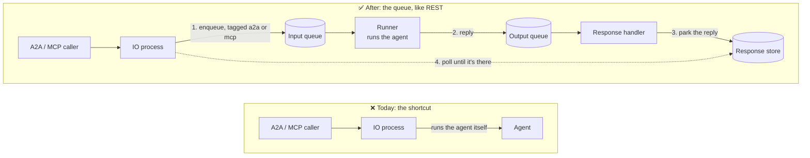

# #780: A2A and MCP go through the queue, and only the queue

> **In one line:** A2A and MCP calls skip the queue and run the agent on the wrong process. This
> change makes them use the queue the way the REST chat route does, and deletes the old shortcut.

| | |
|---|---|
| **Status** | Approved, including the five amendments made on 2026-10-21 while writing `spec.md` (see its [Design amendments](spec.md#design-amendments)). |
| **Read time** | About 5 minutes. Code evidence is folded away under ▸ **Evidence**. |
| **Breaking?** | Yes, for apps that serve A2A or MCP without the queue. See [Where A2A and MCP can run](#5-startup-checks-where-a2a-and-mcp-can-run). |
| **Decisions** | All 5 resolved: [Decisions](#decisions-all-resolved) |

---

## The 30-second version

- 🔴 **Problem.** When Agent Kernel runs with its queue, A2A and MCP calls ignore it and run the
  agent inside the web-server process. They lose the runner's retries, ordering and scaling, and
  the web server ends up needing everything the agent needs.
- 🟢 **Fix.** A2A and MCP put the request on the queue and wait for the reply, exactly like REST.
  The "run it here" shortcut is deleted.
- 🟡 **Cost.** Replies get slower: at least about 1 second, because the reply is collected by
  polling. Apps that serve A2A or MCP without the queue now get a clear error when they start.
- ⚠️ **Different from the issue.** The issue kept the shortcut for setups with no queue. The
  requester decided against that: it is **queue only**.

---

## Words used here

| Word | Meaning |
|---|---|
| **IO process** | The web server. It receives HTTP requests (REST, A2A, MCP) and sends answers back. |
| **Runner** | The process that actually runs the agent. In production it is a separate pod. |
| **Queue** | How the IO process hands work to the runner (input queue) and gets replies back (output queue). |
| **`in_memory` transport** | A queue that lives inside one process. This is the laptop default: IO and runner run as threads of one app. |
| **Broker transport** | SQS, Kafka or NATS. The queue lives outside the process, so the IO process and the runner can be different machines. |
| **Response handler** | Reads the output queue and decides where each reply goes. |
| **Response store** | The place where a finished reply waits until the IO process picks it up. |
| **Direct path** | Running the agent inside the IO process. A2A and MCP do this today. |
| **`execution.mode`** | App setting for how replies are delivered: `rest_sync`, `rest_async`, `async`, `stream` or `realtime`. |

---

## The picture

---

## Why change it

**1. A2A and MCP skip the queue.**
Both call the agent directly from the IO process, even when a runner is waiting on the queue.

▸ Evidence

- A2A: `A2A.Executor._execute_agent` calls `AgentService().select(...).run(...)` (`api/a2a/a2a.py:60-63`).
- MCP: `MCP.Executor.execute` calls `AgentService().run_multi(...)` (`api/mcp/akmcp.py:62-65`).
- Both are mounted by `RESTAPI.build_app` (`api/http.py:151-161`), the same app `IOHandler` serves (`pipeline/io_handler.py:120`).

**2. REST already does this correctly, but its code is locked inside one class.**
"Enqueue, then wait for the reply" lives in `RestHandler`, and it reports every failure as an HTTP error.

▸ Evidence

- The pieces are `_enqueue_request`, `_response_retry_config` and `_await_response_record` (`pipeline/request_handler.py:60-97`).
- `enqueue_and_wait` raises `HTTPException` for every failure (`:125-175`).

**3. In the WebSocket, streaming and realtime modes, the reply side has nowhere to send an A2A or MCP reply.**
Replies are routed by `execution.mode`, and only the REST modes park a reply in the response store.

▸ Evidence

- Response handler: `stream` with no user goes to the chunk store, `async` goes to a WebSocket push, and only the REST modes write a record (`pipeline/response_handler.py:71-84`).
- `StreamAgentRunner` streams chunks (`pipeline/agent_runner.py:216-218`), and `RealtimeAgentRunner` sends everything to the realtime pool (`:270-274`).
- Precedent: integration traffic (Slack and the like) gets its own tag, checked *before* the mode (`response_handler.py:61-69`).

### Two traps found while reading the code

**🪤 Trap 1: a separate IO process has no agents, so it shows no A2A cards and no MCP tools.**
Cards and tools are built from the agents registered *in that process*. The k8s example's IO process registers none.

▸ Evidence

- A2A cards come from `Runtime.current().agents()` (`api/a2a/a2a.py:71-78`).
- MCP tools come from the same registry (`api/mcp/akmcp.py:96-107`).
- The k8s example says "no modules are registered here" (`examples/k8s/openai-queue-mode/app_io_handler.py:3-6`).

**🪤 Trap 2: the A2A server doesn't even import right now.**
The locked a2a-sdk is version 1.x, and 1.x removed a module A2A imports. This is tracked as #762.

▸ Evidence

- `api/a2a/handler.py:4` imports `a2a.server.apps`.
- The pin has no upper bound (`ak-py/pyproject.toml:185`), and `ak-py/uv.lock:18-19` resolves it to 1.1.2.
- Verified: the import raises `ModuleNotFoundError`.
- `tests/test_cross_surface_parity.py:11` already leaves A2A out for this reason.

---

## What we're building

Five pieces, each small:

| # | Piece | What it does | Where |
|---|---|---|---|
| 1 | **`QueueRequestClient`** | One reusable "enqueue, then wait for the reply" | new `pipeline/request_client.py` |
| 2 | **`protocol` tag** | Marks a message as "a caller is waiting for one whole reply" | `pipeline/envelope.py`, runners, response handler |
| 3 | **A2A executor** | Uses the client instead of running the agent | `api/a2a/a2a.py` |
| 4 | **MCP executor** | Same as the A2A executor | `api/mcp/akmcp.py` |
| 5 | **Startup checks** | Refuses to start A2A or MCP where there is no queue | `api/http.py`, `pipeline/io_handler.py` |

### 1. `QueueRequestClient`

**What:** one small class that puts a chat request on the input queue and waits for its reply.
A2A, MCP and REST all use it.

**Rules**
- It uses whatever queue and response store are configured, built-in or custom. It talks only to the
  existing `QueueTransport` and `ResponseStore` interfaces, so no new plugin point is needed.
- Each request gets a fresh request id. The **group id is the session id**, which keeps one
  conversation's messages in order. The **dedup id is the request id**.
- It waits with the **existing budget**: up to `execution.response_store.retry_count` reads,
  `delay` seconds apart. The first read happens right after the enqueue.
  - At the block defaults (5 reads, 5 s apart) it gives up after about 20 s.
  - With no `response_store` block it does 60 reads, 1 s apart, and gives up after about 59 s.
- It returns a **`QueuedReply`** with the status and body, plus `is_error` (status ≥ 400),
  `result`, `media_type` and `error`. A missing status counts as 200.
- When the wait runs out it raises **`ReplyTimeoutError`**, which carries the request id and the
  budget.
- **REST does not change.** It borrows the wait loop and keeps its override points
  (`get_transport`, `get_response_store`, `_response_retry_config`, `_await_response_record`,
  `_enqueue_request`) and its HTTP errors (504 on timeout).

▸ Evidence

- The envelope comes from `RequestProducer` (`pipeline/producer.py:44-49`).
- The budget is in `core/config.py:514-515`, and the 60 × 1 s default in `pipeline/request_handler.py:22`. That default moves into the client; it is not copied.
- The missing-status rule is at `request_handler.py:117`.

### 2. The `protocol` tag

**What:** a label on the queue message, `protocol=a2a` or `protocol=mcp`. It means: *someone is
waiting for one whole reply in the response store, so ignore `execution.mode`.*

**Rules**
- The runner copies the tag onto its reply message.
- The streaming and realtime runners run a tagged message as a normal single reply. They already do
  this for Slack and other integrations. A tagged message's permanent failure is handled the same way.
- The response handler checks the tag **before** it looks at the mode, and always stores a full
  record. A tagged message that fails for good gets a 500 record.
- Messages without the tag behave exactly as they do today.

**Why not reuse the `integration` tag?** That tag means "deliver to a chat platform through an
adapter". This reply goes to a caller who is waiting on the response store, which is the REST
contract.

**Why the name `protocol`?** It must not start with `reply_`, because that prefix already means
integration reply context.

▸ Evidence

- Forwarded attributes: `pipeline/agent_runner.py:21`.
- The integration hand-off this copies: `agent_runner.py:216-218` and `:246-248`.
- The 500-record branch it reuses: `response_handler.py:125-132`.
- The `reply_` prefix: `envelope.py:20`.

### 3 & 4. The A2A and MCP executors

**What:** both build a chat request (`BaseRunRequest` with the prompt, agent name and session id),
send it through the client, and turn the reply into their protocol's shape. Neither imports
`AgentService` any more.

**Which session?**
- A2A: the session id is `context_id`, as today.
- MCP: the session id is the tool's `session_id` argument, as today.
- The same id always reaches the same AK session, in order.

**What the caller sees**

| Outcome | A2A caller gets | MCP caller gets |
|---|---|---|
| Text reply | One text message | The text |
| Structured reply, object | One text message holding the JSON | `structuredContent`, plus `media_type` in `_meta` |
| Structured reply, array | One text message holding the JSON | `{"result": [...]}`, plus the `wrap_result` flag |
| Agent error (status ≥ 400) | Generic error message, then `InternalError` | `ToolError` with a fixed message |
| Timed out | Generic error message, then `InternalError` with a fixed timeout text | `ToolError` with a fixed message |

**Rules**
- Error details go to the **logs only**, never to the caller.
- There is no token streaming. A2A `message:stream` stays refused by the SDK, as it is today,
  because AK's cards declare `streaming=False` (`core/builder.py:46`). `cancel` is unchanged.
- MCP's `ctx.info` and `ctx.debug` notifications are unchanged.

▸ Evidence

- A2A session: `a2a.py:48`. A2A error shape: `:50-55`. `cancel`: `:57-58`.
- MCP reply shapes kept: `akmcp.py:67-76`.
- The JSON text matches the old `str(AgentReplyAny)` (`core/model.py:243-244`).

### 5. Startup checks: where A2A and MCP can run

| How the app starts | Today | After |
|---|---|---|
| `RESTAPI.run()` with no queue config (laptop default) | Runs directly | ✅ Through the in-memory queue |
| `IOHandler.run(...)`, any queue | Runs directly on the IO process | ✅ Through the queue |
| `RESTAPI.run(handlers=[...])` | Runs directly | ❌ Startup error |
| `RESTAPI.run()` with SQS, Kafka or NATS | Runs directly | ❌ Startup error |
| ECS (`ECSIOHandler`) | Runs directly | ❌ Startup error (decision 2; ECS support is a follow-up) |
| Lambda | Not available | Not available |

**Rules**
- "A2A or MCP" here means `a2a.enabled`, or `mcp.enabled` **with** `mcp.expose_agents`. An MCP
  server that serves only the app's own tools runs no agent, so it needs no queue and is not refused.
- Every ❌ row raises `AKConfigError` from `RESTAPI.run`. Subclasses are included. The message
  says to use `IOHandler.run(handlers=[...])`. `ECSIOHandler.run` also runs the check first, so
  it fails before it starts any thread.
- `IOHandler` gains two more checks:
  - A broker queue with A2A or MCP enabled **needs a shared response store in every mode**. Today
    only the REST modes need one. This one is an error.
  - A2A enabled, or MCP with `expose_agents`, while **no agents are registered** in this process.
    This one is a **warning**, not an error (decision 4). It covers trap 1.
    - The warning names the fix: load the same agent modules here as in the runner.
    - Startup continues. A2A serves an empty catalog and 404s for agent routes, and MCP lists no
      agent tools.
- `RESTAPI.build_app` still mounts A2A and MCP, because `IOHandler` serves its app.
  `WebSocketGateway` never mounts them.

▸ Evidence

- The check sits next to `_reject_pipeline_only_handlers` (`api/http.py:108-131`), outside the `cls is RESTAPI` guard.
- The hand-off to `IOHandler`: `api/http.py:99-106`.
- ECS entry points: `deployment/aws/containerized/ecs_io_handler.py:61` and `:72`.
- The existing check that is widened: `pipeline/io_handler.py:235-244`.

### Plus one dependency fix (decided: decision 1)

- Cap the pin at **`a2a-sdk[http-server]>=0.3.6,<1`** (`ak-py/pyproject.toml:185`) and re-lock
  `ak-py/uv.lock`. That fixes trap 2 and lets the A2A tests run.
- #780 code targets the 0.3.x API: `new_agent_text_message`, `ServerError` and `RESTAdapter`.
- #762 later ports everything to 1.x, including the new executor, and removes the cap.

---

## Configuration: nothing new ✅

| Need | Comes from (already exists) |
|---|---|
| Which queue | `execution.queues` |
| Where replies wait, and for how long | `execution.response_store` (`retry_count`, `delay`) |
| Turning A2A or MCP on | `a2a.enabled`, `a2a.agents`, `mcp.enabled`, `mcp.expose_agents`, `mcp.agents` |

**`execution.mode` is ignored by A2A and MCP.** They always wait for one whole reply. WebSocket push,
SSE and REST-async request ids mean nothing to an A2A or MCP caller.

---

## Who is affected

| Change | Who notices | How much |
|---|---|---|
| 🐢 Replies arrive on the next poll: at least about 1 s, or 5 s with a `response_store` block at defaults. The timeout is about 59 s, or about 20 s at the block defaults. | Everyone using A2A or MCP | Noticeable, especially on a laptop. Direct calls took milliseconds. |
| 💥 Startup error on the ❌ rows above | Apps serving A2A or MCP without the queue, and ECS | **Breaking** |
| The agent must be registered in the IO process too. If it isn't, the result is a startup warning and empty catalogs. | Split deployments (k8s) | Setup step, easy to miss |
| Empty prompts, a missing session or an unknown agent now fail as protocol errors | Callers sending bad requests | Minor |
| An A2A or MCP image reply's text changes from "Non-text reply given" to "… Image X is attached." | A2A and MCP clients receiving images | Minor |
| MCP tool errors show a fixed message instead of the raw exception | MCP clients | Minor, and safer |

**Stays the same**
- Model failures still come back as normal text replies, as today, because the runners catch them.
- REST routes and untagged messages are untouched.
- A2A replies are still `Message`s, not `Task`s, and the task store is untouched.
- Custom tools an app adds to `MCP.get()` still run in the IO process. They are app code, not agents.
- No thread recording and no scheduling for A2A or MCP.

▸ Evidence

- Image text: `akmcp.py:77` today, against `core/model.py:139-140` through `core/chat_service.py:371`.
- The `RedisTaskStore` placeholder: `a2a.py:108-109`.

---

## Not in this change

- Any way to run A2A or MCP **without** the queue. The shortcut is removed, not deprecated.
- Token streaming for A2A, and MCP progress notifications.
- Long-running A2A tasks and task polling.
- Attachments and non-text A2A parts.
- ECS queue-mode support. This is a follow-up issue (decision 2) that needs the three fixes #760
  made for Lambda:
  - forward the tag in `ECSAgentRunner`;
  - give tagged messages the single-reply path in `ECSStreamAgentRunner`;
  - check the tag before the mode in `ECSOutputConsumer`.

  None of the four `ECSIOHandler` examples enables A2A or MCP.
- Lambda, which never mounted A2A or MCP.
- Porting to a2a-sdk 1.x (#762).
- Building cards and tools without loading the agents.
- Using MCP's own session header as the AK session.
- Faster reply pickup: shorter polls, backoff or blocking store waits. This is a follow-up issue
  (decision 3), done for every surface at once.

---

## How we'll know it works

- [ ] **Client:** the envelope, the wait budget (from config and the default), the timeout, and the `QueuedReply` fields.
- [ ] **Runners:** a tagged message runs as one reply under the normal, streaming and realtime runners, and so does its permanent failure.
- [ ] **Response handler:** a tagged message gets a record in all four modes (`rest_sync`, `rest_async`, `async`, `stream`), and a tagged failure gets a 500 record.
- [ ] **A2A and MCP:** every row of the "What the caller sees" table. MCP tests stop patching `AgentService` (`tests/test_api_mcp.py`, `tests/test_cross_surface_parity.py:101-136`).
- [ ] **Startup:** every ❌ row raises, and the ✅ rows don't. A broker queue in a WebSocket mode without a shared store raises. An IO process with no agents logs the warning and still starts.
- [ ] **End to end** (in-memory queue, same code paths as a broker): an A2A send and an MCP call run on the **runner thread**, and the same session id twice reaches the same AK session.
- [ ] **End to end on a real broker** (decision 5): after the existing chat check, `.github/workflows/chart-test.yaml` sends one A2A `message:send` and one MCP tool call to the kind deployment of `examples/k8s/openai-queue-mode`. Both must get the agent's reply. This step is skipped on fork PRs, like the chat check.

## Docs and examples to update

- `ak-dev-architecture` skill. Five spots say "A2A/MCP use AgentService directly": `.agents/skills/ak-dev-architecture/SKILL.md:159`, `:214`, `:257`, `:889`, `:1328`.
- `docs/docs/api/a2a-server.md`, `docs/docs/api/mcp-server.md` and `docs/docs/architecture/execution-flow.md`.
- Example READMEs (`examples/api/a2a/multi`, `examples/api/mcp/multi`, `examples/aws-containerized/mcp/multi`): mention the slower replies. The examples themselves run unchanged.
  - `examples/aws-containerized/mcp/multi` is ECS in direct mode: it starts with `RESTAPI.run()` and no queue, so it lands on the first ✅ row (the in-memory queue). It is in the weekly integration suite.
- `examples/k8s/openai-queue-mode` (decision 5):
  - Move the agent definitions into one shared module that both `app_io_handler.py` and `app_agent_runner.py` load, and have `deploy/package.sh` copy it into both images.
  - Add the `a2a` and `mcp` extras to `pyproject.toml`, plus a direct `a2a-sdk[http-server]>=0.3.6,<1` pin. The example's `uv.lock` is gitignored and the published `agentkernel` has no cap, so without the pin the images resolve a2a-sdk 1.x.
  - Add `a2a` and `mcp` blocks to `config.kafka.yaml` and `config.nats.yaml`, with `mcp.stateless_http: true`, because the chart runs more than one io-handler replica outside the dev flavor.
  - Update the README and the "no modules are registered here" docstring.
- `.github/workflows/chart-test.yaml`: add `ak-py/src/agentkernel/api/**` to the path filters, since the A2A and MCP code now lives on the path the chart smoke tests.

---

## Decisions (all resolved)

| # | Question | Decision | Follow-up |
|---|---|---|---|
| 1 | A2A SDK | Cap `a2a-sdk<1` in this change. | #762 ports to 1.x and lifts the cap. |
| 2 | ECS | Refuse A2A and MCP on `ECSIOHandler` at startup. | New issue: ECS queue-mode support (the three fixes). |
| 3 | Slower replies | Keep the REST polling budget, shared by every surface, and document the floor. | New issue: faster reply pickup for every surface. |
| 4 | IO process with no agents | Warn and start. The warning names the fix, and the catalogs are empty. | None |
| 5 | k8s example | Enable A2A and MCP in `examples/k8s/openai-queue-mode`, plus a CI check on kind. | None |
