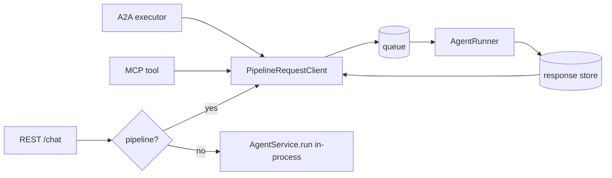

# #780: Route A2A and MCP requests through the queue pipeline

When Agent Kernel runs with the queue pipeline (IO pods in front, runner pods behind), A2A and MCP
requests skip the queue: they run the agent on the IO pod. This change makes them enqueue the
request and wait for the reply, the same way REST `/api/v1/chat` already does. After it, A2A and MCP
only run through the pipeline; they have no direct (in-process) mode.

## In one minute

- **Today:** `REST /chat` → queue → runner. But `A2A` and `MCP` → `AgentService.run()` right on the IO pod.
- **After:** A2A and MCP always go to the queue. REST keeps both modes (unchanged).
- **How:** move the "enqueue, then wait for the reply" code out of the REST handler into a small
  class that any surface can call. A2A and MCP call that class instead of `AgentService`.
- **Local dev is unaffected:** plain `RESTAPI.run()` already starts the single-process pipeline
  (`in_memory` queue, runner in the same process), so A2A/MCP keep working with no config change.

## Terms used below

- **Pipeline / queue mode**: `IOHandler.run()` starts an IO tier (HTTP) and an `AgentRunner` tier joined by a
  queue transport (`in_memory`, SQS, Kafka, NATS). The IO tier enqueues a `QueueMessage`; the runner runs
  the agent and writes the reply to a **response store**.
- **Direct mode**: `RESTAPI.run([...])` with explicit handlers; the request runs the agent in the same process.
  After this change, REST only.
- **Surface**: an inbound protocol endpoint: REST chat, A2A, MCP.

## Motivation

- A2A and MCP always run the agent on the process that received the HTTP request:
  - A2A: `AgentService().run(...)` in `ak-py/src/agentkernel/api/a2a/a2a.py:61-63`
  - MCP: `AgentService().run_multi(...)` in `ak-py/src/agentkernel/api/mcp/akmcp.py:62-65`; a reply with a
    `media_type` becomes a structured `ToolResult` (`akmcp.py:66-72`), others become text.
- Both are still mounted on the IO tier in pipeline mode: `RESTAPI.build_app()` adds the A2A routers and
  the `/mcp` mount whenever `a2a.enabled` / `mcp.enabled` is set (`ak-py/src/agentkernel/api/http.py:150-161`),
  and `IOHandler` serves that same app.
- Consequences in a split deployment:
  - A2A/MCP calls get none of the runner tier's scaling, retries, isolation or `ResponseHandler` handling.
  - IO pods need the agent framework, model credentials and tools, which the split is meant to avoid.
- The enqueue-and-wait logic already exists, but is locked inside the REST handler:
  - `RestHandler._enqueue_request`, `_await_response_record`, `_response_retry_config`, `get_transport`,
    `get_response_store` (`ak-py/src/agentkernel/pipeline/request_handler.py:39-97`).
  - Its error path raises FastAPI `HTTPException` (`request_handler.py:144-169`), which A2A and MCP cannot use.

## Requirements

### 1. Shared enqueue-and-wait component

- New class `PipelineRequestClient` in `pipeline/` that owns "send a run request to the queue and wait for its reply".
  - Takes a `BaseRunRequest`, returns the stored response record.
  - Holds the existing pieces, moved without behaviour change: transport lookup (`QueueTransportFactory`),
    response store lookup (`ResponseStoreFactory`), `RequestProducer` enqueue, retry budget
    (`execution.response_store.{retry_count,delay}`, default 60 × 1s), record polling.
  - Raises protocol-neutral exceptions, not `HTTPException`:
    - `PipelineTimeoutError`: no record within the retry budget.
    - `PipelineRunError`: record has `status_code >= 400` (carries status and body).
  - Transport and store stay injectable (today's `get_transport()` / `get_response_store()` override seams).
- `RestHandler` / `RequestHandler` delegate enqueueing and record polling to `PipelineRequestClient` and keep
  their own HTTP mapping (504 on timeout, stored status on error).
  - They keep the `_enqueue_request` / `get_transport()` / `get_response_store()` seams, because
    `ThreadRequestHandler` overrides `_enqueue_request` to stamp its `thread` attribute
    (`integration/thread/thread_chat.py:258-267`). So REST uses the client's enqueue and poll primitives,
    not its exception-raising `send_and_wait`. *(Amended while writing spec.md.)*
  - Public behaviour of the REST routes does not change; existing pipeline REST tests pass unmodified
    except for moved patch targets.

### 2. A2A and MCP are pipeline-only

- New class `PipelineAgentInvoker` in `pipeline/`: run `(agent_name, session_id, prompt)` and return the
  reply as an `AgentReply`, the type `AgentService.run_multi` returns today.
  - Builds a `BaseRunRequest`, calls `PipelineRequestClient`, and rebuilds the reply from the record body
    (`ChatService` writes `{"result", "media_type"?}`, `core/chat_service.py:364-372`):
    - `media_type` present → `AgentReplyAny(content=body["result"], media_type=...)`.
    - otherwise → `AgentReplyText(body["result"])`.
    - A record body with no `result` is treated as a runner error (`PipelineRunError`).
  - Each surface keeps its own mapping from `AgentReply` to its wire shape, so text and structured replies
    look the same as today.
  - Exception: an image reply. The record carries only its `str()` text (`core/model.py:139-140`), so it
    arrives as that text. Today it arrives as `"Non-text reply given"` (`core/service.py:157-158`, `akmcp.py:77`).
    *(Amended while writing spec.md.)*
  - No `AgentInvoker` ABC / direct variant: there is only one path.
- Where A2A/MCP can be served:
  - `IOHandler.run()` (directly, or through plain `RESTAPI.run()` on the `in_memory` transport,
    `api/http.py:98-106`): A2A/MCP mounted, pipeline-backed.
  - `RESTAPI.run([...])` with explicit handlers and `a2a.enabled` or `mcp.enabled`: refuses to start with
    `AKConfigError`, telling the user to serve them with `IOHandler.run(handlers=[...])`. Same rule and place
    as today's `requires_pipeline` handlers (`RESTAPI._reject_pipeline_only_handlers`, `http.py:117-132`), for
    the same reason: there is no runner to drain what they enqueue.
    - "Same place" means every `RESTAPI.run` that does not delegate to `IOHandler`. That also covers a plain
      `RESTAPI.run()` on a broker transport, and the subclasses `AWSRestAPI` / `AWSWebsocketAPI`, which
      `ECSIOHandler` runs (`deployment/aws/containerized/ecs_io_handler.py:61,72`). See Open questions.
      *(Amended while writing spec.md.)*
  - No `pipeline` flag on `build_app()`; nothing to choose.
- Execution modes:
  - `rest_sync` / unset and `rest_async`: supported. The runner writes one whole record to the response store
    (`ResponseHandler._store_response`), which the invoker waits for.
  - `stream`, `async`, `realtime`: A2A/MCP cannot work, because no whole record ever reaches the store
    (`response_handler.py:71-84`). `stream` stores chunks only, `async` only pushes over WebSocket, `realtime`
    replies go through the integration adapter.
  - So `IOHandler.run()` refuses to start with `AKConfigError` when `a2a.enabled` or `mcp.enabled` is set in
    one of those modes, naming the mode and the supported ones. Checked at startup next to the existing
    `_validate_topology` checks, not per request, so a misconfiguration never shows up as 60 s timeouts.
- No new configuration. Reuses `execution.queues` / transport resolution, `execution.response_store`,
  `execution.mode`, `a2a.*`, `mcp.*`.

### 3. A2A executor

- `A2A.Executor.execute` calls `PipelineAgentInvoker` instead of `AgentService`.
  - Session: A2A `context_id` → AK `session_id` (unchanged from today).
  - Agent: the executor's `agent_name` → `BaseRunRequest.agent`.
  - Reply: the `AgentReply` turned into text the way `AgentService.run` does today, posted as an A2A text message.
- Errors come back as A2A protocol errors:
  - Timeout or runner error → `InternalError`, with a fixed message (no internal detail).
  - `cancel` → `UnsupportedOperationError` (unchanged).

### 4. MCP tool

- The per-agent MCP tool calls `PipelineAgentInvoker` instead of `AgentService`.
  - Session: the tool's existing required `session_id` argument → AK `session_id` (unchanged). No fallback to
    the MCP transport session id (`Mcp-Session-Id`): it does not exist when `mcp.stateless_http` is true, and
    the choice is independent of the pipeline. Possible follow-up.
  - Reply: today's mapping in `Executor.execute`, unchanged: a reply with a `media_type` → structured
    `ToolResult` (array payloads wrapped under `result`), text → string.
- Timeout or runner error → MCP tool error (the tool raises; FastMCP reports `isError`), fixed message.
- `ctx.info` / `ctx.debug` logging stays.
- User-registered MCP tools (`@MCP.get().tool`) are not agents; they still run on the IO pod.

### 5. Tests

- `PipelineRequestClient`: success, timeout, error status, using the `in_memory` transport and the worker-thread
  pattern of `tests/test_pipeline_request_handler.py` (`pipeline/testing.py` holds only `QueueTransportContract`).
- A2A tests import `agentkernel.api.a2a`, which fails against the a2a-sdk 1.x that `ak-py/uv.lock` pins (#762).
  They skip on that import until #762 lands. The `examples/api/a2a/multi` test (0.3.6 lock) covers the
  A2A path meanwhile. *(Amended while writing spec.md.)*
- A2A: `message:send` through `IOHandler` with `in_memory` runs on the runner, not `AgentService` on the IO side.
  Same for an MCP tool call.
- Plain `RESTAPI.run()` with A2A/MCP enabled starts the pipeline and serves them.
- `RESTAPI.run([...])` with `a2a.enabled` or `mcp.enabled` → `AKConfigError`.
- Same A2A `context_id` / MCP `session_id` twice → same AK session.
- MCP reply with a `media_type` (object and array payloads) → same `ToolResult` as today's direct path.
- Timeout and runner error → A2A `InternalError` / MCP tool error.
- `IOHandler.run()` with `a2a.enabled` or `mcp.enabled` in `stream` / `async` / `realtime` → `AKConfigError`;
  `rest_sync` and `rest_async` start.
- Add an A2A and an MCP case to the existing pipeline integration tests.

### 6. Docs and skills

- `ak-dev-architecture` pipeline section: A2A/MCP are pipeline-only; name `PipelineRequestClient` /
  `PipelineAgentInvoker`.
- A2A and MCP docs, deployment READMEs: IO pods no longer *run* agents for A2A/MCP, so model calls, tool
  execution and session writes move to the runner.
  - They still *load* the agents: the A2A cards and MCP tool descriptions come from the registered agents
    (`a2a.py:65-79`, `akmcp.py:89-108`). So IO pods keep the framework packages, plus any credential a
    framework needs at construction (Pydantic AI resolves its provider then). *(Amended while writing spec.md.)*
- Breaking change note: `RESTAPI.run([...])` with A2A/MCP enabled now fails at startup; move to
  `IOHandler.run(handlers=[...])`. The A2A/MCP examples use plain `RESTAPI.run()` and need no change.

## Non-goals

- Streaming over A2A (`message:stream`) or MCP progress notifications through the pipeline. Card keeps `streaming=False`.
- A2A task polling backed by the response store for long-running tasks.
- Attachments / multimodal over A2A or MCP.
- A2A and MCP on AWS. Serverless (`Lambda`) never mounts them, and that stays. Containerized
  (`AWSRestAPI` / `AWSWebsocketAPI` under `ECSIOHandler`) mounts them in-process today, and refuses them
  after this change (§2, Open questions). *(Corrected while writing spec.md: this read "serverless
  (`AWSRestAPI`)", but `AWSRestAPI` is the ECS class.)*
- Direct (in-process) mode for A2A or MCP.

## Open questions

Resolved in review: A2A/MCP pipeline-only, `RESTAPI.run([...])` refuses them (§2), reply rebuilt as an
`AgentReply` (§2), `stream` / `async` / `realtime` refused at startup (§2), explicit MCP `session_id` kept (§4).

Raised while writing spec.md:

- **ECS containerized with A2A/MCP enabled.** Today `ECSIOHandler` → `AWSRestAPI.run(handlers=[...])` mounts
  A2A/MCP and runs them in-process on the IO container. Under §2's rule that call refuses to start.
  - Default in spec.md: refuse, with an error naming the class. This is the literal §2 rule and fails loudly.
    No example or test runs ECS queue mode with A2A/MCP. `examples/aws-containerized/mcp/multi` uses plain
    `RESTAPI.run()`, so it gets the `in_memory` pipeline.
  - Alternative: allow it in ECS queue mode. There the invoker would enqueue to SQS, and `ECSAgentRunner` /
    `ECSOutputConsumer` already write status-bearing records. It would still need a refusal in ECS direct
    mode, and it widens this change into `deployment/`.
