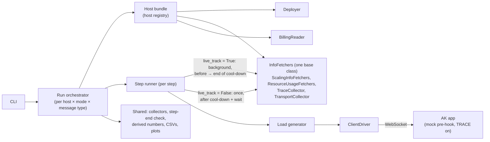
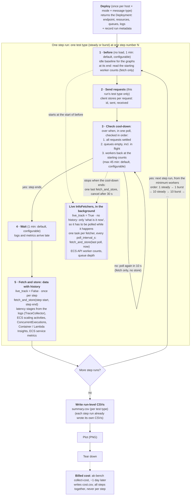

# #786: Benchmark system for throughput, latency, scaling, resource usage and cost

A benchmark runner that deploys Agent Kernel in queue mode on each host, drives it with many concurrent clients under
open load, and records **throughput, latency (with per-stage traces), scaling, worker CPU / memory and cost** to CSVs
and graphs. Phase 1 only records and reports; phase 2 adds SLA thresholds and an after-run pass/fail check. The runner
is pluggable in two directions: one **client driver** per execution mode and message type, and per platform a **host**
composed from small reusable implementations (deployer, fetchers, collectors, billing reader). The only change to AK
itself is a `TRACE` log level with per-stage trace points on the request path.

## Terminology

- **Load:** what the benchmark controls: the number of concurrent clients. Each client is its own user, with its own
  user identity and session. Throughput, latency, scaling, resource usage and cost are the outputs.
- **Load step N:** N clients (N users) start at the same moment. Steps are set in config before a run; default
  `1, 10, 100, 1000`. N is never requests per second.
- **Open load:** a client never waits for a response before sending its next request.
- **Test type:**
  - **burst:** each client sends one request (N requests at once).
  - **steady:** each client sends with a random interval between requests (uniform between a configured min and
    max, default 1 s and 5 s) for a configured time (default 5 min), without waiting for responses.
- **Step timeline:** `before` (no load) → `load` → `cool-down` (no load, ends by the step-end rule), then the
  after-step wait and fetch of the data with history.
- **Time window:** the sampling interval (e.g. 1 s). One row per window in the per-time-window CSV.
- **Tx / Rx:** requests sent / responses received per second, both counted on the client.
- **Client timeout:** how long the client waits for a response before recording the request as `timeout` (default
  5 min). Separate from the steady load time.
- **Tier:** one separately deployed and scaled part of a deployment (an ECS service, a Lambda function).
- **Scale up / scale down:** adding / removing workers (horizontal only). Worker size is fixed per run.
- **Host:** a named bundle of per-platform implementations (`ecs`, `lambda`). Each host names its
  platform (`aws`).
- **Percentiles:** p0 / p25 / p50 / p75 / p99 / p100 only, linear interpolation (numpy `method='linear'`).
- **Billed cost:** the cloud bill for a run, for the whole run only.

## Motivation

- AK has no performance numbers for its queue pipeline. Nothing in the repo measures throughput, latency, scaling,
  resource usage or cost, so there is no baseline to set SLAs from (phase 2, #468).
- Stage timings inside AK are only visible as ad-hoc INFO lines, worded differently per path and placed inconsistently:
  - `[REQUEST START]`, `[ENQUEUED]`, `[WAITING]`, `[RESPONSE FOUND]`, `[STREAM REQUEST]`
    (`ak-py/src/agentkernel/pipeline/request_handler.py:244,250,255,269,440`); `[ENQUEUED]` also in
    `pipeline/ws/handler.py:246` and `integration/adapter/producer.py:90`.
  - `[AGENT START]` / `[AGENT DONE]` (`pipeline/agent_runner.py:74,85`) and their stream twins (`:330,348`).
  - ECS logs `[AGENT START]` at dequeue and `[AGENT DONE]` after the output send
    (`deployment/aws/containerized/akagentrunner.py:135,154`).
  - `[OUTPUT DONE]` sometimes carries only `user_id` (`pipeline/response_handler.py:290`) or the SQS message id
    (`deployment/aws/containerized/akoutputconsumer.py:69`).
  - The Lambda handlers (`deployment/aws/serverless/`) have no stage lines at all.
  - All share the `ak` logger level, and the formatter prints local time with no zone
    (`core/logger.py:42`), so lines from different hosts can't be compared on one clock.
- `logging.ak.level` rejects anything below `DEBUG`: `_LogLevelConfig.level` pattern is
  `^(INFO|DEBUG|ERROR|WARNING|CRITICAL)$` (`core/config.py:656-661`).
- An LLM call takes 1-10 s and varies a lot, which would hide what AK itself does. A mock agent with a controlled delay is needed.
  - An agent pre-hook that returns a reply halts the run before the framework runner (`core/runtime.py:242-246`,
    `:401-405`), so the mock needs no AK code change.
- Hosts scale and bill in very different ways (ECS target tracking, Lambda + SQS event source mapping),
  so worker counts, resource usage and cost need per-platform code. GCP and Azure come later. See
  `research/platform-scaling-and-cost.md` and `research/resource-usage.md`.
- The benchmarked deployments need non-default settings:
  - ECS agent-runner autoscaling is off by default with `min_count = 0`
    (`ak-deployment/ak-aws/containerized/variables.tf:404-420`); the REST/IO service (`rest_service`) runs a fixed
    `desired_count = 1` (`:158`).
  - The Lambda agent runner gets SQS batches of 10 (`ak-aws/serverless/variables.tf:503`), handles the records one
    after another (`deployment/aws/serverless/core/sqs_consumer.py:42`), under a 45 s timeout (`variables.tf:391`).

## Requirements

### Principle: record and report only

- The benchmark **records** results (CSVs) and **reports** them (graphs). People read the graphs and decide.
- Phase 1 doesn't flag or judge results: no warnings like "Rx below Tx", no thresholds, alerts or pass/fail.
- It doesn't act on results: no early stop, no load, deployment or scaling changes mid-run.
- The only actions are the planned steps of a run: deploy → run → plot → tear down, then `collect-cost` for the bill a day later.
- The run flow may read recorded data to know where it is (e.g. the [step-end rule](#step-timeline)). That's flow
  control, not judging.
- Errors and timeouts are a `status` on the request row. A timeout never fails the run.
- **Only exception (phase 1):** at the end of each step, if any request got no response within the client timeout,
  the run log gets a `WARNING`: "responses for `<count>` requests were not received within the timeout of
  `<client timeout>`". Log only; the run carries on.
- A collector or fetcher that fails (API error, missing permission, source switched off) leaves its columns empty and
  writes a run-log entry. The run carries on.
- Phase 2 adds an after-run SLA pass/fail check (see [Phase 2](#phase-2-sla-numbers-and-tuning)).

### Scope (phase 1)

- Queue execution pipeline only (`Request Handler → Input Queue → Agent Runner → Output Queue → Response Handler`).
  Non-queue execution is out of scope.
- Delivery: **WebSocket complete** only: `execution.mode: async` with `execution.message_type: complete` (the default
  when unset). AK's config splits invocation `mode` from reply `message_type` since #641; the old `stream` mode is gone.
  - `rest_sync` is never benchmarked, with either message type (SSE is `rest_sync` + `delta`): its blocking call
    breaks open load.
- Hosts:

  | Host | Platform | Deploy source | Transport | Log backend |
  |---|---|---|---|---|
  | `ecs` | `aws` | Terraform `ak-aws/containerized` | SQS | CloudWatch Logs |
  | `lambda` | `aws` | Terraform `ak-aws/serverless` | SQS | CloudWatch Logs |

- Kubernetes, GCP, Azure and NATS are out of scope, but the interfaces must allow them.
- Build order: AWS with WebSocket complete comes first.
  1. `lambda`, WebSocket complete.
  2. `ecs`, WebSocket complete.
  3. Right after the AWS hosts: Kubernetes (EKS, then bare metal), designed when it's built.

### Step timeline

- **Every step of both test types has four parts:** `before` → `load` → `cool-down` → `wait + fetch`. The first three
  are recorded (a step's graphs span the start of `before` to the end of `cool-down`); the fourth collects the data
  with history for the step. The next step starts only after it, so it starts from the minimum workers.

  ```text
  One step (not to scale; ┄ = a wait):
  |==== before ====|=========== load ===========|============= cool-down =============|┄ wait ┄|= fetch =|
  ^ step start     ^ first send (t_load_up)     ^ end of load (t_load_down)  step end ^        next step ^
  |<----------------- live tracking (background, every poll stored) ----------------->|
  ```

  1. **before** (config, default 1 min): no requests. Live tracking starts here: the live-tracked fetchers and queue
     depth record idle worker counts. At the end of
     `before` the runner reads the starting worker counts with a plain `fetch()` on the primary scaling fetcher
     (stores nothing, works on any host); the cool-down waits for these counts.
  2. **load:** burst: send N → last response or timeout (≤ client timeout, default 5 min). Steady: first send →
     configured time is up (default 5 min; a random 1-5 s gap between a client's sends, never waiting). The client records sent /
     received per request → Tx, Rx, end-to-end latency, errors, timeouts; request ids are stored as they're sent. AK
     writes trace lines, read after the step. Live tracking keeps polling; workers scale up.
  3. **cool-down:** no new requests; late replies are still recorded; workers scale down. Every poll runs the step-end
     check (below). When it passes (or the maximum is reached) the step ends and live tracking stops.
  4. **wait + fetch:** wait for log ingestion (config, default 1 min), then fetch the step's data with history for
     (step start, step end): trace lines → stage durations, the other scaling and CPU / memory fetchers.
- **What the runner does in one step:**
  1. Splits the step's `InfoFetcher`s into two groups by their `live_track` parameter.
  2. Starts one background task per live-tracked fetcher at the start of `before`. Each calls `fetch_and_store` every
     `poll_interval_s` with (last poll, now), so every poll is stored straight away and nothing is stored twice.
  3. Runs `before`, then `load`.
  4. During the cool-down, runs the step-end check every poll (see below).
  5. When the step ends, stops live tracking: a stop flag, then one last `fetch_and_store` per task so the end of the
     cool-down is recorded; a task that hasn't finished within a fixed stop timeout (30 s, internal) is cancelled. Tracking always stops before
     the next step.
  6. Waits the configured time for log ingestion.
  7. Calls `fetch_and_store` once on each fetcher of the other group, for (step start, step end).
  8. Moves on to the next step.
- **The step ends when all three hold in the same cool-down poll,** checked in this order (decided 2026-11-03, PR #877 review), and a later check only runs once the earlier ones hold:
  - every request of the step has a response or timed out (client);
  - input and output queues hold nothing, counting in-flight messages (`TransportCollector.fetch()`): 0 waiting and
    0 in flight in every poll of the last `empty_confirm_window_s`, a constructor parameter of the transport
    collector, so the shared check has no transport-specific code (decided 2026-11-05; 0 = one poll is enough):
    - SQS sets 60 s: `ApproximateNumberOfMessages` and `ApproximateNumberOfMessagesNotVisible` are both approximate,
      so one poll reading 0 isn't enough (decided 2026-11-03);
  - every tier's running count, from the host's **primary** scaling fetcher's `fetch()`, is back at its count at the
    end of `before`.
  - A condition with no source on the host counts as met (for the workers check: the host lists no scaling fetcher;
    a primary without `running` is refused at start-up, see [Scaling](#scaling)).
  - A read that fails or returns no value counts as not met for that poll (and writes a run-log entry); the next poll
    checks again. If it never succeeds, the maximum cool-down ends the step. Such a poll also breaks the run of zeros,
    so the `empty_confirm_window_s` starts again (decided 2026-11-04, PR #893 review).
  - **Maximum cool-down** (config, default 45 min from the end of `load`, settable per host): the step ends anyway and
    records `cooldown_max_reached = true`. 45 min is more than enough for every host to scale in, so the next step
    assumes the system is settled: no steps are skipped and the next step isn't marked (decided 2026-11-05, PR #893 review).
  - The check calls `fetch()` whichever group the fetcher is in, so a fetcher that isn't live-tracked (Lambda's
    metric) still works for it; the recorded counts come from its after-step `fetch_and_store()`.
- **What is captured when:**
  1. **Live, from the start of `before` until the cool-down ends** (background tasks, every poll stored):
     - client: scheduled send, sent, first chunk, complete and status per request → end-to-end latency, Tx / Rx,
       errors, timeouts;
     - live-tracked scaling fetchers, each polled at its own `poll_interval_s` → worker counts: `aws.ecs_api`
       (`ecs`); none on `lambda`;
     - live-tracked resource usage fetchers → CPU / memory: none on `ecs` or `lambda`, since every AWS CPU / memory
       source has history and is fetched after the cool-down;
     - `TransportCollector` (`live_track = True`) → input and output queue depth.
  2. **Cool-down only:** the step-end check reads the client, the `TransportCollector` and the primary scaling
     fetcher through `fetch()`; it only decides when the step ends.
  3. **After each step's cool-down,** after the wait, for (step start, step end):
     - `TraceCollector` → stage timestamps per request, joined to the client rows by `request_id` → stage durations;
     - the other scaling fetchers (`aws.ecs_scaling_activities`, `aws.cloudwatch_metric.ConcurrentExecutions`);
     - the other resource usage fetchers (`aws.ecs_service_metrics`, `aws.ecs_container_insights`,
       `aws.lambda_insights`, `aws.lambda_report_memory`).
  4. **Later, by separate commands:** billed cost (`collect-cost`, ~1 day after); `collect-scaling` /
     `collect-resources` re-run the after-step fetchers.
- **Run timeline (one host × mode × message type):**

  ```text
  |= 1 set up =|======== 2 run test types ========|= 3 report =|┄ 4 ~1 day ┄|= 5 collect-cost =|
  ```

  1. **Set up** (minutes): deploy with every resource tagged `ak-bench-run-id=<run-id>-<host>-<mode>-<message-type>`,
     record the run metadata.
  2. **Run test types:** step numbers 1 → 10 → 100 → 1000; for each, a steady step run, then a burst step run. Every
     step run is the four-part step above, with its own live tracking and its own after-step fetch.
  3. **Report, tear down:** write the run-level CSVs (`summary.csv` per test type),
     draw the graphs, tear the deployment down. Each step run already wrote its own CSVs.
  4. **Wait** (~1 day): Cost Explorer catches up.
  5. **`collect-cost`:** billed cost for each host × mode × message type's tag value; writes its `cost.csv` and draws
     the billed cost graph.

### Throughput and latency

- Throughput: per window, Tx, Rx, errors and timeouts, counted on the client. Needs nothing from the backend.
- Latency: per request, end-to-end (`complete − sent`) and status. Per window: percentiles of the requests completed in
  it.
- **Latency traces:** per request, the AK stage timestamps from the trace logs, joined to the client times by
  `request_id`.
  - A `TraceCollector` per log backend (not per host) fetches the step's trace lines after its cool-down and returns
    a `TraceInfo` (`{request_id: {stage: ts}}`). Parsing is shared and lives in AK. It extends
    `InfoFetcher[TraceInfo]` with `live_track = False` (see [Hosts](#hosts)).
  - Per request, one duration per request-path `TraceStage` value (previous stage → this stage), plus `CLIENT_RECEIVED`
    (`RESPONSE_DELIVERED` → client received). Empty when either point is missing.
  - Percentiles are computed over requests, never per worker first.

### Scaling

- Horizontal scaling only, recorded for every step of both test types, per tier.
- `ScalingInfoFetcher` ABC: one class per **way** of reading worker counts on one platform (not one per cloud, not one
  per deployment type).
  - `name` (registry name, used in CSV columns), plus constructor parameters `live_track: bool = False` and
    `poll_interval_s` (live-tracked only; default from `ak-bench.yaml`, settable per fetcher).
  - Extends `InfoFetcher[ScalingInfo]` (see [Hosts](#hosts)): `fetch(run, deployment, start, end) -> ScalingInfo` is
    the only method a subclass writes (reads, stores nothing). `store()` is written once in `ScalingInfoFetcher`;
    `fetch_and_store()` (calls `fetch()`, then `store()`) once in `InfoFetcher`.
  - `live_track` only sorts the fetcher into a group; the runner reads it, nothing inside a fetcher does.
    `True`: a background task calls `fetch_and_store` every `poll_interval_s` with (last poll, now), from the start of
    `before` until the cool-down ends. `False`: `fetch_and_store` once per step for (step start, step end), after the
    cool-down and the configured wait, and again by `collect-scaling`.
  - The host bundle always sets `live_track` for each fetcher (`True` for a source with no history); the default is
    never relied on.
  - `ScalingInfo` = count samples `(ts, tier, count_type, value)` + optional worker spans
    `(tier, worker, started, stopped, extra)`.
  - Loops over the deployer's `Deployment.resources` (tier → resource ids), so adding a tier changes only the
    deployer.
  - Generic fetchers take constructor parameters (e.g. one CloudWatch metric fetcher given namespace, metric,
    dimension).
- A host lists one or more fetchers in the host registry; the first is the **primary** (step-end rule). Every bound
  fetcher runs; there is no config switch for fetchers. All are recorded side by side, never reconciled. The harness
  never branches on host kind.
- **The primary must give a `running` count** (decided 2026-11-05). Each fetcher declares the count types it gives
  (`count_types`); at start-up the runner refuses a host whose primary doesn't list `running`, naming the host and the
  fetcher. Otherwise a `desired`-only primary (e.g. `aws.ecs_scaling_activities`) would leave the workers check with
  nothing to compare, and every step would run to the maximum cool-down.
- A fetcher can be written but not bound (`aws.lambda_log_streams`): the class exists, no step run uses it. Binding it
  is a manual edit of the host registry.
- Phase 1 fetchers:

  | Fetcher | `live_track` | Gives | Bound to |
  |---|---|---|---|
  | `aws.ecs_api` (`DescribeServices` + `DescribeTasks`) | yes | desired, running, spans | `ecs` (primary) |
  | `aws.ecs_scaling_activities` | no | desired (exact decision times) | `ecs` |
  | `aws.cloudwatch_metric.ConcurrentExecutions` (`Maximum`, 60 s) | no | running | `lambda` (primary) |
  | `aws.lambda_log_streams` (environments with a `REPORT` line per period, counts only) | no | running | written, not bound; bound by hand if needed |

- **`aws.cloudwatch_metric.ConcurrentExecutions`: missing minutes** (decided 2026-11-04, PR #893 review). Lambda sends
  no datapoint in a minute with no invocations (verified, see `research/platform-scaling-and-cost.md`), so the fetcher
  reads a minute with no datapoint as 0 once it's older than its `metric_delay_s` constructor parameter (default set
  from the first Lambda runs, R2). Newer minutes without a datapoint aren't returned yet (their data may still be on
  its way). A read of the latest minutes (step-end check, starting counts) looks back far enough to get the latest
  known minute, so the harness needs no Lambda-specific window. A lookback with no datapoints at all (an idle tier)
  gives 0 for every minute older than `metric_delay_s`; the fetcher returns no value (poll not met) only when the read
  fails (API error, missing permission) or no minute is old enough yet. A CloudWatch delivery gap can't be told
  apart from an idle minute, so it's read as 0 too: accepted, since the worker check runs only after every request
  has a response or timed out and the queues are empty, and the recorded counts come from the after-step fetch
  (decided 2026-11-05, PR #893 review). Only this AWS fetcher has the parameter; it isn't in `ak-bench.yaml`.
- **`aws.lambda_log_streams`: counts only** (decided 2026-11-05). One Logs Insights query per function over the
  `REPORT` lines (`stats count(*) by @logStream, bin(<period_s>)`); the fetcher counts the rows of each period and
  returns one `running` count per tier per period (`ts` = the period's end), no worker spans. It counts environments
  that finished an invocation in the period, so `period_s` stays at 1 min or more (invocations last up to the 60 s
  agent runner timeout). Same missing-period rule as above, with its own `log_delay_s` (log ingestion delay).

- Queue depth per window (input and output separately) from the host's `TransportCollector`, chosen by transport
  (`sqs`). It extends `InfoFetcher[QueueInfo]` with `live_track = True` (SQS only gives the
  current depth); `QueueInfo` = samples `(ts, queue, waiting, in_flight)`. Its constructor parameter
  `empty_confirm_window_s` (SQS: 60 s) tells the step-end check how long the queues must read empty.
- Derived per step, per tier and per fetcher (summary CSV), from `t_load_up` (first send) and `t_load_down` (end of
  load):
  - scale up: decision delay, first new worker, scale-up done, backlog drained;
  - scale down: scale-down start, scale-down done;
  - counts: `workers_before_up`, `workers_peak`, `workers_before_down`, `workers_after_down`;
  - rate in workers / min: workers added ÷ (scale-up done − `t_load_up`), workers removed ÷ (scale-down done −
    `t_load_down`); never divides by 0, empty for a step that didn't scale (decided 2026-11-03);
  - a 1-minute value (Lambda's metric) is already stored at the end of its minute (see `InfoFetcher` under Hosts):
    "10:01 → 61" = reached by 10:02:00;
  - a count with no source stays empty; a step that didn't scale records e.g. 1 → 1.

### Resource usage (CPU and memory)

- CPU and memory of every tier's workers over the whole step timeline, every step of both test types. Per worker where
  the platform gives it, otherwise per tier.
- `ResourceUsageFetcher` ABC, separate from `ScalingInfoFetcher` (different sources and delays; scaling must work with
  no resource usage fetcher).
  - Extends `InfoFetcher[ResourceUsage]`, so the same methods and parameters as `ScalingInfoFetcher`: `name`,
    `live_track`, `poll_interval_s`, `fetch(run, deployment, start, end) -> ResourceUsage` (the only one a subclass
    writes), `store()` (once in `ResourceUsageFetcher`), `fetch_and_store()`.
  - **`ResourceSample`: one reading** of one metric for one worker (or whole tier) at one time:
    - `ts`: when the reading was taken.
    - `tier`: which tier it belongs to (a key of `Deployment.resources`, e.g. `runner`).
    - `worker`: task id or Lambda log stream; `None` when the source only gives a whole-tier value.
    - `metric`: what was read: `cpu_pct`, `mem_pct` or `mem_mb`.
    - `stat`: `value` for a single raw reading; `min` / `avg` / `max` when the source already aggregated it (ECS
      service metrics across tasks; Lambda readings reduced per log stream × window in the query).
    - `value`: the number.
    - Examples: `(10:04:00, runner, task-1a2b, cpu_pct, value, 37.5)` from Container Insights;
      `(10:04:00, runner, None, cpu_pct, max, 81.0)` from the ECS service metrics.
  - **`ResourceUsage`: everything one `fetch()` call returns**: a list of `ResourceSample`s across every tier, worker,
    metric and time in `[start, end]`. A wrapper rather than a bare list so per-fetch details (e.g. what the source
    was missing) can be added later without changing the signature, same as `ScalingInfo`.
  - The shared resource collector turns the samples into the per-window percentile columns, the summary columns and
    `resource-usage.csv`. Fetchers never compute percentiles; the only reduction inside a fetcher is the Lambda
    query's per log stream × window step, to stay under the Logs Insights row limit.
  - Units: CPU as % of one worker's allocation; memory in MiB and as %.
  - **No CPU on Lambda:** AWS gives no Lambda CPU utilization (Lambda Insights only has CPU time), so Lambda records
    memory only and its CPU columns stay empty.
  - Shares the CloudWatch metric / Logs Insights helpers with the scaling fetchers and TraceCollector.
- Phase 1 fetchers:

  | Fetcher | `live_track` | Gives | Bound to |
  |---|---|---|---|
  | `aws.ecs_service_metrics` (`AWS/ECS` CPU / memory, per service) | no | min / avg / max per tier | `ecs` |
  | `aws.ecs_container_insights` (performance log events, `Type = "Task"`) | no | per task | `ecs` |
  | `aws.lambda_report_memory` (`REPORT` `Max Memory Used`) | no | memory per environment | `lambda` |
  | `aws.lambda_insights` (Lambda Insights extension) | no | memory per environment | `lambda`, on by default |

- Lambda Insights: the deployer adds the layer when on (the `layers` variable exists on every function,
  `ak-aws/serverless/variables.tf:309,328,349`, ...); a per-run config value switches it off.
- Lambda Logs Insights queries reduce in the query (per log stream × window), not by fetching raw invocations.

### Cost

- One number per run:
  - **billed:** AWS Cost Explorer `GetCostAndUsage` filtered by the run tag (one value per host × mode × message type),
    grouped by service. Whole run only, filled later by `collect-cost`. Empty where a platform has no bill.
    - Metric: **`UnblendedCost`**, the usage at the rate AWS charged, **without discounts and credits** (those are
      separate line items; `NetUnblendedCost` is the after-discount view, not used). Recorded with the billed cost.
    - The tag is set **at deploy time**: the deployer puts `ak-bench-run-id=<run-id>-<host>-<mode>-<message-type>` on
      every resource it creates (Terraform `default_tags`). The value is unique per host × mode × message type (decided
      2026-11-04, PR #893 review; message type added 2026-11-05), so each host × mode × message type's `cost.csv` holds
      only its own deployment's bill. A new run gets new values.
    - **All the steps together, never per step:** one deployment, tagged once, serves every step of both test types,
      so the bill can't tell the steps apart. It's read once, after all the steps have run.
    - Cost Explorer records every charge with the tags of the resource it came from, and the query returns **only
      charges from resources carrying this host × mode × message type's tag value**. Nothing from other hosts, modes,
      message types, runs or other workloads on the account is included.
    - Daily granularity is enough: the run's billed cost is the sum of the daily rows for that tag value over the
      run's days (two days if it crosses midnight). Hourly granularity is not used.
    - Account prerequisite: `ak-bench-run-id` is activated once as a cost allocation tag (management account);
      otherwise the tag filter returns nothing. Costs only show for periods when the tag was on the resource.
    - AWS's own billing rules (e.g. Fargate's 1-minute minimum, SQS billing per API request) are already in the
      bill, so the benchmark doesn't model them.
    - Covers set-up, every step, the waits after the steps and the time until tear-down. LLM token cost excluded
      (mock agent).
    - CloudWatch Logs Insights query charges from the benchmark's own fetchers are excluded: they're the cost of
      measuring, not of running AK (decided 2026-11-05, PR #893 review).
- Per-platform part: `BillingReader` ABC, one per cloud (AWS: Cost Explorer). Returns `None` where there is no bill.

### Benchmark project

- A standalone project in a new top-level `benchmarks/` directory with its own `pyproject.toml` (uv), like `e2e/`.
  Not part of the `agentkernel` package.
  - Depends on `agentkernel` for `TraceStage` and the trace-line parser, and for the benchmarked app.
  - Cloud SDKs (`boto3`), data and plotting libraries are dependencies of this project only.
- Components are classes with one responsibility each.
- **Its own config file**, `ak-bench.yaml`, not `AKConfig`. Departure from the "reuse existing configuration" house
  pattern, because these are benchmark settings, not AK runtime config. Holds: hosts, modes, message types, test types,
  load steps, min / max send interval, steady load time, before window (default 1 min), maximum cool-down, wait before
  the after-step fetch (default 1 min), client timeout, time window size, min / max agent delay, poll interval per
  live-tracked fetcher, Lambda Insights on-off.
- Registries follow AK's factory shape: built-in short names, dotted-path bring-your-own, unknown name → error naming
  the built-ins.



### Selecting what to run (CLI)

- One CLI, `ak-bench`. `ak-bench run` with:
  - `--host <name>`, `--mode <name>` and `--message-type <name>` (each repeatable; default: all). Covers all × all,
    one host, one mode on one host, one mode on all hosts, one message type of a mode.
  - `--mode` and `--message-type` take AK's config values (e.g. `--mode async --message-type complete`), the same
    names used in the results folders.
  - `--steps` to override the load steps; test types from config (default both).
  - Skip deploy / teardown to reuse an existing deployment.
- `plot --run-id <id>`: re-plot from existing CSVs, no re-run. Graphs are written back into the same `graphs/`
  folders.
- `collect-scaling --run-id <id>` / `collect-resources --run-id <id>`: re-run the after-step fetchers, refill the CSVs,
  re-plot. No duplicate rows: a row with the same timestamp and key replaces the old one (see [Hosts](#hosts)).
- `collect-cost --run-id <id>`: fetch the billed cost later (~1 day after), fill the cost CSV, re-plot.
- Each run writes to its own folder, `results/<run-id>/`, so runs never overwrite each other.

### Run flow

- For each selected host × mode × message type: **deploy → record run metadata → run test types → write
  run-level CSVs → plot → tear down**.
  - **Run test types:** every step stores its own data: live tracking from the start of `before` to the end of the
    cool-down, then the data with history after the cool-down and the configured wait (see
    [Step timeline](#step-timeline)).
  - Every resource the deployer creates carries the tag `ak-bench-run-id=<run-id>-<host>-<mode>-<message-type>` (one
    value per host × mode × message type).

**The whole flow** (one host × mode × message type):



- **Live group (`live_track = True`):** sources with no history (ECS API counts, queue depth) only say "what it is
  now", so they're polled in the background from the start of `before`. They stop when the cool-down ends, because
  that's the step's end: the system is back where it started and the next step's samples must not mix in.
- **After-step group (`live_track = False`):** sources with history (logs, CloudWatch metrics, ECS scaling
  activities) can be asked later for any window, so they're read once per step, after the wait for ingestion.
- **The cool-down check** calls `fetch()` only: it needs the current values to decide, and storing is the other
  two groups' job.
- **Cost:** the billed cost covers all the steps together and is read about a day later (`collect-cost`).

- **Run metadata** (`run-metadata.json`), recorded before the first step. Recorded only, never compared:
  - run: run id, start time, host, platform, execution mode and message type, region, AK version and git commit;
  - per tier: worker size, min / max workers, autoscaling settings (target, cooldowns, Lambda event source
    mapping mode / max concurrency);
  - transport type and settings (batch size); session store type and capacity;
  - resource usage sources: which fetchers ran, Container Insights (standard / enhanced), Lambda Insights on / off;
  - front door (API Gateway WebSocket);
  - benchmark settings: min / max agent delay, load steps, test types, min / max send interval, steady load time, before window, maximum
    cool-down, wait before the after-step fetch, poll intervals, client timeout, time window size, percentile method.
  - Host-side values come from the deployer; a value a host doesn't have stays empty.

### Load generation

- One shared, mode-independent **load generator** (Python asyncio). It:
  - starts N clients at the same moment, each with its own user identity and session. Clients never share a user:
    AK pushes a WebSocket reply to every connection of the reply's `user_id` (`pipeline/response_handler.py:279-287`);
  - sends on a schedule (burst: once; steady: a random gap between sends) and **never waits for a response before
    sending**;
    receiving runs separately and matches responses to requests by `request_id`;
  - sets the `request_id` itself (the WS handler accepts a client id, `pipeline/ws/handler.py:228`; the Lambda WS
    path requires one, `deployment/aws/serverless/core/router/ws_lambda.py:386-387`);
  - records scheduled send, sent, first chunk and complete times per request from the client clock;
  - stops waiting for a request after the client timeout and records `status = timeout`.
- Burst steps also record the **time to answer all N** (first send → last response or timeout).
- The load generator's own health (CPU, event-loop lag) is not recorded (decided).

### Client drivers (pluggable execution modes)

- `ClientDriver` ABC: connect → send → receive response events → close.
- Every driver reports the same timing events (sent, first chunk, complete), so every mode has the same columns. For a
  mode with no chunks, first chunk = complete.
- Driver factory: built-in short name for WebSocket complete (phase 1), dotted-path bring-your-own. The mode and the
  message type are config values (`async` + `complete` in phase 1).
- Later drivers (WebSocket delta with time to first chunk, `rest_async`) are new classes plus a factory branch, with
  no harness change.

### Test types and load steps

- `burst` and `steady` both run the configured steps (1 → 10 → 100 → 1000). Which types run is config (default
  both).
- **Order (decided 2026-11-01):** step number by step number, each test type as its own step run: steady N, then
  burst N, then the next N (1 steady → 1 burst → 10 steady → 10 burst → …).
  - Never both loads in one step run: one would start on workers the other already scaled up, and the step's scaling,
    resource usage and queue depth couldn't be split between them.
  - Both test types of a step number run close together in time, and a run stopped early still has both for every
    finished step number.
- Each step run starts only after the previous one has ended and its after-step fetch is done, so it starts from the
  minimum workers.
- Steady: each gap between two sends of a client is random, uniform between a min and max send interval (defaults
  1 s and 5 s, 3 s on average). Each client draws its own gaps. The next send is the previous **scheduled** send time
  plus the gap, so the load stays open. Min / max interval and load time (default 5 min) are config values and
  recorded with the results; min = max gives a fixed interval.

### Hosts

- A `Host` is a bundle: platform name, deployer, scaling fetchers (ordered), resource usage fetchers, trace collector,
  transport collector (or none), billing reader (or none).
- A host registry maps names to bundles; a new host or platform is a registration, not a harness change.
- Code is grouped in folders by cloud (`platforms/aws/`, later `platforms/gcp/`, ...), one file per implementation. No
  per-cloud "benchmarker" classes (`AWSBenchmarker`, `GCPBenchmarker`), because cloud, compute type and
  transport vary independently:
  - `lambda` and `ecs` are both AWS but read worker counts from different places; one AWS class would fill up with
    `if variant == ...` branches.
  - A later Kubernetes host on EKS would read worker counts from Kubernetes but its bill from AWS, so it would belong
    in both classes.
  - Queue depth depends on the transport (SQS today), not the cloud.
  - Example: each host picks its parts; `lambda` and `ecs` share the AWS ones (trace collector, SQS, Cost Explorer):

    ```python
    HOSTS = {
        "lambda": Host(
            platform="aws",
            deployer=TerraformDeployer("ak-aws/serverless"),
            scaling_fetchers=[CloudWatchMetricScalingInfoFetcher("AWS/Lambda", "ConcurrentExecutions", "FunctionName",
                                                                 live_track=False)],
            resource_fetchers=[LambdaInsightsResourceFetcher(live_track=False),
                               LambdaReportMemoryResourceFetcher(live_track=False)],
            trace=CloudWatchLogsTraceCollector(live_track=False),
            transport=SqsTransportCollector(live_track=True, empty_confirm_window_s=60),  # by transport, not cloud
            billing=CostExplorerBillingReader(),     # shared AWS part
        ),
        "ecs": Host(
            platform="aws",
            deployer=TerraformDeployer("ak-aws/containerized"),
            scaling_fetchers=[EcsApiScalingInfoFetcher(live_track=True),
                              EcsScalingActivitiesScalingInfoFetcher(live_track=False)],
            resource_fetchers=[EcsContainerInsightsResourceFetcher(live_track=False),
                               CloudWatchMetricResourceFetcher("AWS/ECS", ..., live_track=False)],
            trace=CloudWatchLogsTraceCollector(live_track=False),   # same class as lambda
            transport=SqsTransportCollector(live_track=True, empty_confirm_window_s=60),  # same class as lambda
            billing=CostExplorerBillingReader(),                    # same class as lambda
        ),
    }
    ```

- No per-host classes either (`LambdaBenchmarker`, `EcsBenchmarker`): a host is a registry entry that picks existing
  implementations, not a class with its own code. A class per host would copy the shared parts into every host:
  - `lambda` and `ecs` would each carry their own SQS queue depth and Cost Explorer code.
  - A new host would be a new class; as a bundle it's one registry entry built from existing parts.
- The harness (load generator, timing, CSVs, derived numbers, plots) never calls a cloud API; it only sees the ABCs
  and their common return types.
- `Deployer`: `deploy() -> Deployment`, `teardown()`, `deployed_settings() -> dict` (for the run metadata).
  `Deployment` has four fields, all filled from the Terraform outputs (Q9, decided 2026-11-01):
  - `endpoint(url, auth)`: where the load generator sends.
  - `resources: {tier: resource ids}`: what each tier runs on (scaling and resource usage fetchers).
  - `queues: {"input": ids, "output": ids}`: the two pipeline queues for the `TransportCollector` (e.g. an SQS queue
    URL).
  - `logs: {component: log source}`: where each component logs, for the `TraceCollector` and log-based fetchers. Read
    from the deployment, not built from tier names (ECS log groups come from the task definitions).
  - Saved with the run, so the `collect-*` commands rebuild it without deploying.
- **`InfoFetcher[T]`: one generic base for everything read from the platform during a step.** `ScalingInfoFetcher`,
  `ResourceUsageFetcher`, `TraceCollector` and `TransportCollector` all extend it:
  - constructor parameters `live_track: bool = False` (only sorts it into the live or the after-step group; the host
    bundle always sets it) and `poll_interval_s`;
  - `fetch(run, deployment, start, end) -> T`: abstract, the only method a platform subclass writes. `run` and
    `deployment` are parameters, not instance variables: the fetchers are created in the host registry before anything
    is deployed, one bundle serves a separate deployment per execution mode and message type, and the re-collect
    commands deploy nothing. So a fetcher stays stateless and works for any deployment;
  - a value the source gives per period (CloudWatch metrics, Logs Insights `bin()` rows) gets `ts` = the **end** of
    that period, set in `fetch()` (CloudWatch's 10:01 datapoint is stored as 10:02:00: it's the maximum over that
    minute, known only once the minute is over). Window fill and derived times then both use `ts` as stored
    (decided 2026-11-05, PR #893 review);
  - `store(result: T, step)`: abstract, written once in each family base for its type;
  - **No duplicate rows** (decided 2026-11-03, PR #877 review): before writing a row, `store()` checks whether a row
    with the same timestamp and key is already stored (resource usage: `ts, tier, worker, metric, stat, fetcher`;
    worker counts: `ts, tier, count type, fetcher`; spans: `tier, worker, fetcher`). If so, the new row replaces it
    instead of being added again. So re-running `collect-scaling` / `collect-resources` adds no duplicates, and late
    data (e.g. a Logs Insights window that got more events) updates that window's value.;
  - `fetch_and_store(...)`: written once in `InfoFetcher`; calls `fetch()`, then `store()`, and raises a clear error
    if `fetch()` returned another type.
  - Each family base fixes `T` (a dataclass): `ScalingInfo`, `ResourceUsage`, `TraceInfo`, `QueueInfo`. A type
    checker flags a subclass whose `fetch()` returns anything else.
  - So the step runner calls them all the same way. The billing reader and the `Deployer` don't extend it: they run once
    per run or after all steps, not inside a step.
- Built-in bundles:

  | Host | Scaling fetchers (primary first) | Resource fetchers | Trace collector | Transport | Billing |
  |---|---|---|---|---|---|
  | `ecs` | `aws.ecs_api`, `aws.ecs_scaling_activities` | `aws.ecs_container_insights`, `aws.ecs_service_metrics` | CloudWatch Logs | `sqs` | Cost Explorer |
  | `lambda` | `aws.cloudwatch_metric.ConcurrentExecutions` | `aws.lambda_insights`, `aws.lambda_report_memory` | CloudWatch Logs | `sqs` | Cost Explorer |

- Benchmark deployment settings, applied by the deployers and recorded in the metadata:
  - `ecs`: `scaling_config.enabled = true`, `min_count >= 1`.
  - `lambda`: zip packaging (Lambda Insights layer); agent runner timeout **60 s** (AK default 45 s, but 10 messages ×
    the 5 s max agent delay = 50 s); `batch_size × max agent delay` stays under the agent runner timeout (decided
    2026-11-04, PR #893 review). Queue settings (decided 2026-11-05, PR #893 review):
    - input queue visibility timeout **360 s** (6 × the 60 s agent runner timeout, as AWS recommends for SQS event
      sources; AK default 60 s);
    - output queue visibility timeout **300 s** (≥ 6 × the 45 s response handler timeout = 270 s, and ≥ retention; AK
      default 60 s); response handler timeout stays at AK's 45 s;
    - message retention **5 min** (300 s, AK's serverless default, set explicitly) on both queues;
    - batch size 10 and batching window 0 s on both event source mappings (AK defaults), so the 6 × rule needs no
      extra time for the window.
    - On both queues the visibility timeout is ≥ retention, so a message that was picked up and not deleted expires
      before it would become visible again. That's not an exactly-once guarantee (SQS can still deliver a message
      twice). On the input queue, a message still waiting after 5 min is dropped (the client has timed out on it by
      then); the output queue's 5 min starts when the response is sent to it.
  - every host: queue mode, WebSocket delivery, `logging.ak.level: TRACE`, the mock agent.

### Mock agent

- A benchmark pre-hook in the benchmarked app, the **first** pre-hook on the agent (agent pre-hooks run before the
  system ones, `core/runtime.py:242`). No AK code change.
  - Waits a random delay per request, `await asyncio.sleep(random.uniform(min_delay, max_delay))` (min / max are
    config, recorded; defaults 1 s and 5 s; min = max gives a fixed delay).
  - Returns `AgentReplyAny(content={"echo": <prompt>})`. The prompt carries the client's `request_id`.
  - Keeps no per-request state on `self`; does no timing (stage times come from the trace logs).
- Everything around the LLM call runs as normal: request handler, queues, agent runner, ChatService, session load,
  response handler, WebSocket push.
- Verified consequences of the pre-hook approach:
  - The halted turn is **not stored**: `Runtime.run` returns at `core/runtime.py:405`, before
    `self.sessions().store(session)` at `:427`. So session history doesn't grow during steady traffic, and the
    session-store write isn't in the measured latency or cost.
  - System pre-hooks (guardrails, multimodal, sandbox) are skipped.
- The same app is used on every host. A real-LLM run is an optional final realism check.

### AK change: `TRACE` log level and trace points (`ak-py`)

- **A normal Python log level, no separate logger library:** `TRACE = 5` registered with `logging.addLevelName` in
  `core/logger.py`, written through AK's existing loggers.
  - `TRACE` is the lowest level, so selecting it writes **every** level: `TRACE`, `DEBUG`, `INFO`, `WARNING`,
    `ERROR` and `CRITICAL`. At `DEBUG` and above, trace lines are dropped by the level check before formatting.
  - `"TRACE"` added to the `_LogLevelConfig.level` pattern (`core/config.py:659`). `AKLogger.resolve_level` reads
    `logging.getLevelNamesMapping()` (`core/logger.py:23`), so it resolves with no other change.
  - Benchmark runs set `logging.ak.level: TRACE`. **No other new configuration.**
  - Departure noted: Python's logging HOWTO advises against custom levels in libraries; taken on purpose so the normal
    level hierarchy works.
- **`TraceStage`**, a `str` enum in `core/logger.py`: `REQUEST_RECEIVED`, `INPUT_ENQUEUED`, `AGENT_RECEIVED`,
  `AGENT_START`, `AGENT_FIRST_CHUNK` (delta only), `AGENT_DONE`, `OUTPUT_ENQUEUED`, `OUTPUT_RECEIVED`,
  `RESPONSE_DELIVERED`; `rest_sync` only: `RESPONSE_POLL_START`, `RESPONSE_FOUND` (traced like the rest, but `rest_sync`
  isn't benchmarked, so they get no duration column and no point in the stage graphs).
- **One call per trace point:** `log.log(TRACE, "[%s] request_id=%s", stage, request_id)`, with an optional
  quoted `message` last. `%`-style args so nothing is formatted when off.
- **Line format**, same on every host:
  `2026-10-21T08:15:12.345Z - ak.pipeline.agent_runner - TRACE - [AGENT_DONE] request_id=<id> message="..."`.
  - Timestamp = the log record's creation time, **UTC, millisecond precision**, ISO 8601 with `Z`.
  - Stage in square brackets first. **Only trace lines carry the stage in `[...]`.**
  - The formatter change (`core/logger.py:42`) applies to **every** AK log line, not only `TRACE`.
  - **Clocks:** a duration between two points logged on different machines (e.g. `INPUT_ENQUEUED` →
    `AGENT_RECEIVED`, client sent → `REQUEST_RECEIVED`, and `CLIENT_RECEIVED`) includes the clock offset between
    them. It isn't corrected; the load-generator machine must have clock sync (NTP) on. Durations inside one component
    and end-to-end latency use one clock and aren't affected (PR #893 review).
- **Parser** in `core/logger.py` next to `TraceStage`, so format and parser change together. The benchmark imports it.
- **Trace points on every code path a phase-1 host runs:** shared `pipeline/` (request handler, WS handler, agent
  runner, response handler), ECS containerized handlers, and the Lambda serverless handlers.
  - Each stage is logged exactly where named (e.g. `AGENT_DONE` before the output send, `AGENT_RECEIVED` at
    dequeue).
- **Trace lines are added next to the existing stage-style INFO lines, not in place of them:**
  - The INFO lines on the request path stay at `INFO` with their text but **drop their `[...]` tag** (e.g.
    `[AGENT DONE] request_id=...` → `Agent done: request_id=...`), so normal logs still show them.
  - The trace call for the matching stage goes where the stage is (which may differ from where the INFO line sits).
  - At `TRACE` both show. Nothing in the repo matches on the old tags (no docs, metric filters or dashboards).
  - Per-chunk debug lines, `[OUTPUT STORE]` and off-path lines without a `request_id` are left as they are.
- Trace lines carry no worker id. Worker counts come only from the fetchers.

### Results

- Folder layout `results/<run-id>/<platform>/<host>/<mode>/<message type>/<test type>/step-<N>/`.
  - `<mode>` is the execution-mode config value (e.g. `async`), `<message type>` the message-type config value
    (e.g. `complete`). WebSocket complete and delta share `async`, so they need their own level.
  - `step-<N>` zero-padded to the digits of the largest step.
  - Only what ran gets a folder.
- Per run: `run.log` (incl. the missing-responses warnings).
- Per host × mode × message type: `run-metadata.json`, `cost.csv` (whole-run billed cost by service, written by
  `collect-cost`).
- Per test type: `summary.csv` (one row per step), `graphs/`.
- Per step:
  - `per-request.csv`: request id, session id, client id, scheduled send, sent, first chunk, complete, latency, status,
    raw stage timestamps, and one `<STAGE>_s` duration column per request-path `TraceStage` value (not the
    `rest_sync`-only ones) plus `CLIENT_RECEIVED_s`.
  - `per-time-window.csv`: step part, Tx, Rx, errors, timeouts, latency percentiles, each queue's depth, worker counts
    per tier × count type × fetcher (e.g. `runner.running.aws.ecs_api`), CPU / memory per tier × metric × stat ×
    fetcher.
  - `resource-usage.csv`: raw per-worker samples in long form (`ts, tier, worker, metric, stat, value, fetcher`).
  - `graphs/`.
- **How samples fill the time windows** (decided 2026-11-05, PR #893 review): windows start at the step start. Each window takes the
  fetcher's last sample at or before the window's end, so a fetcher polled every 60 s with 1 s windows fills 60 rows
  with the same value until its next sample. A sample is carried forward for at most its fetcher's poll interval (or
  the source's sample period, e.g. a Lambda Logs Insights bin); after that the window stays empty (e.g. a Lambda
  window with no invocations). Derived scaling times (summary) use the raw sample times, not the windows.
- Summary per step: percentiles of end-to-end latency and each stage duration (with the row count used), min / avg /
  max of per-window Tx / Rx, error and timeout counts, time to answer all N (burst), `cooldown_max_reached`, scaling
  numbers and CPU / memory per tier per fetcher (fetcher named).
- How each measurement is summarized:
  - per-request times, per-worker CPU / memory: p0 / p25 / p50 / p75 / p99 / p100. No avg column.
  - ECS service metrics: min / avg / max (all AWS gives).
  - Tx / Rx: min / avg / max of per-window values.
  - counts, times, costs: the value itself.

### Graphs (PNG)

- Comparing the steps of one host × mode × message type × test type (`<test type>/graphs/`):
  1. `01-latency-per-step.png`: end-to-end latency percentiles per step, timeouts counted under each step.
  2. `02-stage-times-per-step.png`: the per-step stage-times graph for every step, one panel per step, same y scale.
  3. `03-resource-usage-per-step.png`: CPU % and memory percentiles per step, one row of panels per tier
     (Lambda: memory only).
- One step (`step-<N>/graphs/`):
  1. `01-stage-times.png`: one box per stage (p25-p75, line at p50, whiskers p0 / p100, marker at p99).
  2. `02-stage-breakdown.png`: stacked stage times for the fastest, average and slowest real request (completed
     requests only).
  3. `03-timeline.png`: before → load → cool-down on one time axis, one panel each. Steady: Tx / Rx, latency
     percentiles per window, input queue, output queue, workers per tier. Burst: responses received so far, workers per
     tier.
  4. `04-every-request.png` (steady only): every request's latency vs send time, per-window percentiles, timeouts on
     the timeout line.
  5. `05-resource-usage.png`: CPU % and memory percentiles per window, one row of panels per tier (Lambda:
     memory only).
- Rules:
  - every aggregate of a per-request measurement shows all six percentiles; box with whiskers to p0 / p100
    (`whis=(0, 100)`) and a p99 marker on category axes, bands (p0-p100 light, p25-p75 dark), a p50 line and a dashed
    p99 line otherwise;
  - each tier, pipeline stage and queue shown separately, never summed; whole-system values (Tx, Rx, end-to-end
    latency, totals) not split;
  - separate panels, never two y-axes; no threshold or pass/fail lines;
  - billed cost per run by service, drawn by `collect-cost`.
- No cross-host or cross-mode comparison graphs.

### Phase 2: SLA numbers and tuning

- Computed from the phase-1 CSVs without re-running.
- SLA thresholds chosen from phase-1 values: latency percentiles per step, minimum Tx / Rx, maximum error / timeout
  rate, maximum scale-up / scale-down time.
- After-run SLA check: compares measured values to thresholds and records pass/fail per SLA number. Nothing changes
  during a run.
- A performance test report per host. Tuning AK to meet the SLAs is tracked under #468.

## Non-goals

- Flagging (Rx below Tx, saturation), alerts, early stops, or load / deployment changes based on results.
- Preventing or working around bottlenecks outside AK's workers (load generator, API Gateway quotas, ALB).
- Recording the load generator's own health.
- Comparing hosts with each other (no cross-host graphs).
- Non-queue execution; `rest_sync` in any round.
- WebSocket delta and `rest_async` drivers in phase 1 (designed for, added later).
- WebSocket connect part and front-door scaling (later).
- Repeated runs with spread across runs (later).
- Kubernetes hosts (EKS, then bare metal) with Kafka: right after the AWS hosts; designed when they're built.
- GCP, Azure and NATS hosts (interfaces allow them; nothing built).
- Vertical scaling.
- LLM latency and token cost.
- Running the benchmark in CI.

## Open questions

Q1-Q8 were resolved on 2026-10-30 and Q9 on 2026-11-01. None are open.

- **Q9 (resolved).** Where the `TransportCollector` finds the queue ids and the `TraceCollector` the log sources:
  two more `Deployment` fields, `queues` and `logs`, filled by the deployer (see [Hosts](#hosts)).

## Decided later

Parked on purpose; decided when that part is built.

- **L2.** WebSocket delta: trace every chunk or only the first (`AGENT_FIRST_CHUNK`) and last (`AGENT_DONE`).

## Check on the first runs

Answered by looking at real data, not by a decision. Each has a fallback already in the design.

- **R1.** Scaling fetchers: ECS keeps `aws.ecs_api` alone or adds `aws.ecs_scaling_activities` (and whether its
  "Setting desired count to N" wording is stable enough to parse); Lambda stays on `ConcurrentExecutions` or binds
  `aws.lambda_log_streams`.
- **R2.** Lambda step end: the metric delay to allow for (`ConcurrentExecutions` has no datapoint in idle minutes,
  verified 2026-11-04), and `aws.lambda_log_streams`' `log_delay_s` if it gets bound.
- **R3.** Whether the 1-min default wait before the after-step fetch is enough for each log backend (ingestion delay).
- **R4.** Lambda Insights: whether its events carry `function_name`, and whether its log stream is one per execution
  environment (fallback: per-tier values).
- **R5.** ECS: Container Insights `Type = "Task"` events exist for Fargate tasks (only non-AWS examples so far).
- **R6.** ECS: whether target tracking on a custom metric still uses the 3 / 15 one-minute datapoint rule after AWS's
  June 2026 faster-scaling change (check the CloudWatch alarms the policy creates).
- **R7.** Cost: the run tag reaches every billed resource; anything untagged or shared is listed as a fixed
  allocation.
- **R8.** Sessions: one client can have several requests in flight, handled by different workers, and AK's session
  locks are per process. The pre-hook doesn't save the turn (`core/runtime.py:405` before `:427`), but confirm on the
  first steady-traffic runs that concurrent work on one session has no side effect.
