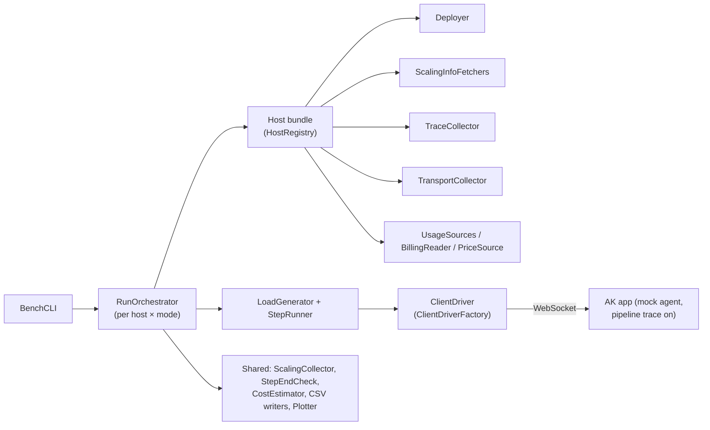

# #786: Benchmark system for throughput, latency, scaling and cost

A benchmark runner that deploys Agent Kernel in queue mode on each host, drives it with many concurrent clients, and
records **throughput, latency (with per-stage traces), scaling and cost** to CSVs and graphs. Phase 1 records and
reports only. Phase 2 adds percentiles, SLA thresholds and an after-run pass/fail check. The runner is a separate
project under `benchmarks/`. It is pluggable in two directions: one **client driver** per execution mode, and per
platform a **host** composed from small, reusable implementations (deployer, scaling info fetchers, trace collector,
transport collector, cost parts). The only change to AK itself is an opt-in **pipeline trace logger** that replaces
today's stage-style INFO lines.

## Terminology

- **Load:** what the benchmark controls: the number of concurrent clients. Each client has its own session and its
  own user identity.
- **Load step N:** N clients start at the same moment. N is never requests per second.
- **Test type:**
  - **burst:** each client sends one request (N requests at once).
  - **steady:** each client loops send → wait for response → send for a configured time (about N in flight).
- **Step timeline:** `before` (no load) → `load` → `cool-down` (no load, ends by the [step-end rule](#step-timeline)).
- **Time window:** the sampling interval (e.g. 1 s). One row per window in the per-window CSV.
- **Tx / Rx:** requests sent / responses received per second, both counted on the client.
- **Tier:** one independently scaled part of a deployment (ECS agent runner, a Lambda function, a K8s Deployment).
- **Scale up / scale down:** adding / removing workers (horizontal only). Worker size is fixed per run.
- **Host:** a named bundle of per-platform implementations (e.g. `ecs`, `lambda`, `eks`, `baremetal`, `local`).
- **Billed cost:** the cloud bill for a run. **Estimated cost:** usage × list prices, splittable per step.

## Motivation

- AK has no performance numbers for its queue pipeline. Nothing in the repo measures throughput, latency, scaling or
  cost, so there is no baseline to set SLAs from (phase 2, #468).
- Stage timings inside AK are only visible as ad-hoc INFO lines with different wording per path:
  - `[REQUEST START]`, `[ENQUEUED]`, `[WAITING]`, `[RESPONSE FOUND]`, `[STREAM REQUEST]`
    (`ak-py/src/agentkernel/pipeline/request_handler.py:136,141,146,160,318`).
  - `[AGENT START]`/`[AGENT DONE]` (`pipeline/agent_runner.py:49,57`), where `[AGENT DONE]` is logged after the output
    send; ECS logs `[AGENT START]` at dequeue (`deployment/aws/containerized/akagentrunner.py:135`).
  - `[OUTPUT START]`/`[OUTPUT DONE]` exist only on some paths (`containerized/akoutputconsumer.py:63,74,83`,
    `pipeline/response_handler.py:231,262`, `pipeline/integration_delivery.py:104`), and some carry no `request_id`.
  - The ECS WebSocket enqueue (`containerized/core/api/websocket_api.py:335-351`), the Lambda WebSocket enqueue
    (`serverless/core/router/ws_lambda.py:367-410`) and the Lambda agent runner and response handler have no stage
    line.
  - They share the `ak` logger level, so they can't be switched on for a benchmark alone.
- An LLM call takes 1-10 s and varies a lot, which would hide what AK itself does. A fixed-delay mock agent is needed.
  - A pre-hook that returns a reply stops the run before the framework runner (`core/runtime.py:242-246`, `:401-405`),
    so the mock needs no AK code change.
- Hosts scale and bill in very different ways (ECS target tracking, KEDA/HPA, Lambda + SQS), so worker counts and
  cost need per-platform code. GCP and Azure come later. See `research/platform-scaling-and-cost.md`.
- The benchmarked deployments need non-default settings:
  - ECS autoscaling is off by default with `min_count = 0` (`ak-deployment/ak-aws/containerized/variables.tf:394-412`).
  - KEDA is off by default in the chart (`ak-deployment/ak-k8s/chart/values.yaml:347-349`).
  - The Lambda agent runner handles a batch of 10 one after another under a 45 s timeout
    (`ak-aws/serverless/variables.tf:376-381,493`, `deployment/aws/serverless/core/sqs_consumer.py:42`).

## Requirements

### Principle: record and report only

- The benchmark **records** results (CSVs) and **reports** them (graphs). People read the graphs and decide.
- It doesn't flag or judge results: no warnings, thresholds, alerts or pass/fail in phase 1.
- It doesn't act on results: no early stop, no load or deployment changes mid-run.
- The run flow may read recorded data to know where it is (e.g. the [step-end rule](#step-timeline)). That's flow
  control, not judging.
- Errors and timeouts are a `status` on the request row. A timeout (the client stops waiting) never fails the run.
- A collector that fails (API error, missing permission) leaves its columns empty and writes an entry to the run log.
  The run carries on.
- Phase 2's only exception: an after-run SLA check (see [Phase 2](#phase-2-sla-numbers)).

### Scope (phase 1)

- Queue execution mode only (`Request Handler → Input Queue → Agent Runner → Output Queue → Response Handler`).
- Delivery: **WebSocket complete** only (today's `execution.mode: async`, #641's `async` + `complete`).
- Hosts:

  | Host | Platform | Transport | Log backend |
  |---|---|---|---|
  | `local` | one local AK process (`IOHandler`, `in_memory`) | `in_memory` | the process's own log file |
  | `ecs` | AWS ECS Fargate (`ak-aws/containerized`) | SQS | CloudWatch Logs |
  | `lambda` | AWS Lambda (`ak-aws/serverless`) | SQS | CloudWatch Logs |
  | `eks` | EKS (`ak-k8s` chart) | Kafka | CloudWatch Logs (Container Insights) or pod logs |
  | `baremetal` | bare-metal K8s (`ak-k8s` chart) | Kafka | pod logs |

- Build order: `local` baseline → `ecs` → scaling on `ecs` → `lambda` → `eks` → `baremetal` → cost.

### Benchmark project

- Lives in a new top-level `benchmarks/` directory with its own `pyproject.toml` (uv), like `e2e/`. It is not part of
  the `agentkernel` package.
  - It depends on `agentkernel` from the repo path, for `TraceStage`/`PipelineTraceParser` and for the benchmarked app.
  - Cloud SDKs (`boto3`, `kubernetes`) and plotting/data libraries are dependencies of this project only.
- Components are classes with one responsibility each. Entry point: a `BenchCLI` class with a `run` method.
- **Its own config file**, not `AKConfig` (departure from house pattern 2, because this is not AK runtime config): a
  Pydantic `BenchConfig` loaded from `bench.yaml` with CLI overrides.

### Selecting what to run (CLI)

- `ak-bench run` with:
  - `--host <name>` (repeatable; default: every host in the config) and `--mode <name>` (repeatable; default: every
    mode in the config). This covers all × all, one host, one mode on one host, one mode on all hosts.
  - `--test-type burst|steady|scaling` (repeatable; default from config: `burst` and `steady`).
  - `--steps 1,10,100,1000` to override the load steps.
  - `--skip-deploy` / `--skip-teardown` to reuse an existing deployment.
- `ak-bench plot --run-id <id>`: re-plot from existing CSVs, no re-run.
- `ak-bench collect-scaling --run-id <id>`: re-run the after-run scaling fetchers, refill the CSVs, re-plot.
- `ak-bench collect-cost --run-id <id>`: fetch the billed cost later, fill the cost CSV, re-plot.
- Each run writes to its own folder: `results/<run-id>/<host>/<mode>/`. Cross-host and cross-mode comparison graphs go
  to `results/<run-id>/comparison/`.

### Run flow

- For each selected host × mode: **deploy → fetch prices → run tests → collect → write CSVs → plot → tear down**.
  - Teardown runs even when an earlier stage raised, unless `--skip-teardown` is given.
  - Every resource the deployer creates carries the tag/label `ak-bench-run-id=<run-id>`.
- The run metadata (`metadata.json`) records the resolved `BenchConfig`, the deployer's
  `deployed_settings()` (autoscaling settings, worker size, batch size, timeouts, partitions), the agent delay, the
  AK version and git commit, and the start/end of every step part.

### Load generation

- One shared, mode-independent **load generator** (Python asyncio, one process). It:
  - starts N clients at the same moment for a step, each with its own session id and user identity;
  - records `sent`, `first_chunk` and `complete` timestamps per request from the client clock (UTC, microseconds);
  - sets the `request_id` itself for every request (WebSocket allows it: `pipeline/ws/handler.py:228`; the Lambda WS
    path requires it: `ws_lambda.py:386-387`);
  - applies a per-request timeout (config). A timed-out request is recorded with `status = timeout` and stops being
    waited for.
- **Unique user per client.** WebSocket replies are pushed to every connection of the reply's `user_id`
  (`pipeline/response_handler.py:251-262`, `serverless/akresponsehandler.py:99-124`), so clients must not share one.
  The benchmarked app's auth validator accepts benchmark tokens that carry a per-client `userId`.
- Burst steps also record the time to answer all N (first send → last response or timeout).

### Client drivers (pluggable execution modes)

- `ClientDriver` ABC, one instance per client: `connect(endpoint, identity)`, `send(request)`, an async iterator of
  response events (`first_chunk`, `complete`, `error`, each with a client timestamp), `close()`.
- Every driver emits the same events. For a mode with no chunks, `first_chunk = complete`.
- `ClientDriverFactory`: built-in short name `ws_complete` (phase 1), dotted-path bring-your-own via `resolve_dotted`,
  unknown name → error naming the built-ins.
- Later drivers (`ws_delta`, `rest_sync`, `rest_async`) are new classes plus a factory branch, with no harness change.

### Test types and load steps

- `burst` and `steady` run the configured steps (default `1, 10, 100, 1000`) one after another, in that order.
- `steady`: configured load duration per step (default open, see [Open questions](#open-questions)); each client sends
  its next request only after the previous one completed or timed out.
- `scaling` (three phases, low → high → low, e.g. 10 → 1000 → 10, with configured hold times): optional, see
  [Open questions](#open-questions). Load levels and holds are recorded with the results.

### Step timeline

- Every step of every test type is recorded in three parts:
  1. **before:** no load for a configured time (e.g. 2 min). Records the starting worker counts and idle cost.
  2. **load:** burst: first send → last response or timeout. steady: first send → configured time is up.
  3. **cool-down:** no load. Ends when **all three** hold in the same poll:
     - every request of the step completed or timed out (client);
     - input and output queues hold nothing, counting in-flight messages (SQS: waiting and not-visible both 0, only
       polls ≥ 60 s after the step's last send; Kafka: consumer-group lag 0 on both topics);
     - every tier's running count, read from the host's primary fetcher, is back at its count at the end of `before`.
  - A condition with no source on the host counts as met (`local`: only the first applies).
  - **Maximum cool-down** (config, default 45 min from the end of `load`, overridable per host): the step ends anyway
    and records `cooldown_max_reached = true`.
- The next step starts only after the previous one ended.
- The primary fetcher is also polled during the cool-down when it is not `live` (Lambda's metric). Those polled
  values decide the step end only; the recorded counts come from the after-run fetch.

### Throughput and latency

- Per window: Tx, Rx, errors, timeouts, and the average latency of requests completed in the window. Client side only.
- Per request: end-to-end latency (`complete − sent`) and status.
- **Latency traces:** per request, the AK stage timestamps from the trace logs, joined to the client times by
  `request_id`.
  - The host's `TraceCollector` fetches the trace lines after the run (log backends lag) and returns
    `{request_id: {stage: timestamp}}`.
  - Parsing uses AK's `PipelineTraceParser`. Only fetching is per log backend.
  - Derived per request: request handler time, input-queue wait, runner pickup, agent run, output-queue wait, response
    handler time, push → client receive.

### Scaling

- Worker counts per tier, per count type (`desired` / `running` / `pending`) and per fetcher, sampled into windows.
- `ScalingInfoFetcher` ABC: one class per *way* of reading worker counts on one platform, not one per cloud and not one
  per deployment type.
  - `name` (registry name, used in CSV columns, e.g. `aws.ecs_api`), `live` flag, one `fetch(run, deployment, start,
    end) -> ScalingInfo` method.
  - `live = True`: polled every few seconds during the run. `live = False`: called once after the run after a
    configured wait, and again by `collect-scaling`.
  - `ScalingInfo` = count samples `(ts, tier, count_type, value)` + optional worker spans `(tier, worker, started,
    stopped, extra)`.
  - A fetcher loops over the deployer's `Deployment.resources` (tier → resource ids), so adding a tier changes only
    the deployer.
  - Generic fetchers take constructor parameters (e.g. one CloudWatch metric fetcher given a namespace, metric and
    dimension).
- A host lists one or more fetchers; the first is the **primary** (used for the step-end rule and the comparison
  graphs). The config can reorder or disable fetchers per run. All enabled fetchers are recorded side by side, never
  reconciled.
- Fetchers in phase 1:

  | Fetcher | `live` | Bound to |
  |---|---|---|
  | `aws.ecs_api` | yes | `ecs` (primary) |
  | `aws.ecs_scaling_activities` | no | `ecs` |
  | `aws.cloudwatch_metric.ConcurrentExecutions` | no | `lambda` (primary) |
  | `aws.lambda_log_streams` | no | written, not bound; bound by hand in the host registry if the metric falls short |
  | `k8s.api` | yes | `eks`, `baremetal` (primary) |

- Derived numbers per step, per tier and per fetcher (summary CSV), from `t_load_up` (first send) and `t_load_down`
  (end of load):
  - scale up: decision delay, first new worker, scale-up done, backlog drained, latency recovered;
  - scale down: scale-down start, scale-down done;
  - counts: `workers_before_up`, `workers_peak`, `workers_before_down`, `workers_after_down`, and the rate (workers
    per minute) over each scaling window;
  - a count with no source stays empty; a step that didn't scale records from → to as the same number.
  - "latency recovered" uses a fixed measurement rule recorded with the results (proposal: ≤ 1.2× the before-part
    average for 3 consecutive windows). It is not a pass/fail threshold.
- Queue depth per window from the host's `TransportCollector`, chosen by transport (`sqs`, `kafka`; `in_memory` has
  none).

### Cost

- Two numbers per run:
  - **billed:** the cloud bill filtered by the run tag. Whole run only, filled later by `collect-cost`. Empty where
    there is no bill (bare metal).
  - **estimated:** usage × price table. Available at the end of the run and split per step.
- Per step (first send → end of cool-down): estimated cost by component, requests by status, cost per 1M successful
  requests, cost per hour of the load part (steady), and the idle cost of the before part kept separate.
- Cost model per host: `idle_cost_per_hour` and `cost_per_1m_messages` by component, for the agent delay used.
- Per-platform parts, all ABCs:
  - `UsageSource`: one per billed thing (Fargate, Lambda, SQS, API Gateway WebSocket, ALB, K8s nodes, ...).
    `usage(run, deployment, start, end) -> list[UsageItem]` with time ranges.
  - `BillingReader`: one per cloud (AWS: Cost Explorer). Returns `None` where there's no bill.
  - `PriceSource`: one per cloud (AWS: Price List Query API; bare metal: `$/node-hour` from the config).
- Prices are fetched at the start of each run and saved as `price_table.json` (region, fetch date, overrides). Usage is
  saved separately, so a run can be re-priced.
- LLM token cost is out of scope (the mock agent makes no LLM call).

### Hosts

- A `Host` is a dataclass bundle: deployer, scaling fetchers (ordered), trace collector, transport collector (or
  none), usage sources, billing reader (or none), price source (or none).
- `HostRegistry` maps a name to a factory that builds the bundle from the `BenchConfig`. Built-in names: `local`,
  `ecs`, `lambda`, `eks`, `baremetal`. A dotted path to a bring-your-own host factory is accepted.
- The harness never calls a cloud API and never branches on platform or host kind. It only sees the ABCs and their
  return types.
- Built-in bundles:

  | Host | Deployer | Fetchers (primary first) | Trace collector | Transport | Usage / billing / prices |
  |---|---|---|---|---|---|
  | `local` | none (AK already running) | none | local log file | none | none |
  | `ecs` | Terraform `ak-aws/containerized` | `aws.ecs_api`, `aws.ecs_scaling_activities` | CloudWatch Logs | `sqs` | Fargate, SQS, ALB / Cost Explorer / AWS Price List |
  | `lambda` | Terraform `ak-aws/serverless` | `aws.cloudwatch_metric.ConcurrentExecutions` | CloudWatch Logs | `sqs` | Lambda, SQS, API Gateway WS / Cost Explorer / AWS Price List |
  | `eks` | Helm `ak-k8s` | `k8s.api` | open (CloudWatch Logs or pod logs) | `kafka` | K8s nodes, EKS control plane / Cost Explorer / AWS Price List |
  | `baremetal` | Helm `ak-k8s` | `k8s.api` | pod logs | `kafka` | K8s nodes / none / config `$/node-hour` |

- Benchmark deployment settings (set by the deployers, recorded in the metadata):
  - `ecs`: `scaling_config.enabled = true`, `min_count >= 1`.
  - `eks`, `baremetal`: `keda.enabled: true`.
  - `lambda`: `batch_size × agent delay` must stay under the agent runner timeout; the deployer refuses to start
    otherwise (a config error, not a result judgement).
  - every host: `execution.mode: async`, `logging.pipeline_trace.enabled: true`, the mock agent.

### Mock agent

- A `MockAgentPreHook(PreHook)` in the benchmarked app (`benchmarks/app/`), the first pre-hook on the agent.
  - Waits a fixed delay with `await asyncio.sleep(delay)` (config, recorded: start with 0 ms and 500 ms).
  - Returns `AgentReplyAny(content={"echo": <prompt>})`. The prompt carries the client's `request_id`, so the reply is
    matched to its request even when the push carries no id.
  - Keeps no per-request state on `self`.
- Consequences of the pre-hook approach (verified, accepted for phase 1 unless [Q1](#open-questions) decides
  otherwise):
  - The session is loaded but **not stored**: a halted `Runtime.run` returns before `sessions().store()`
    (`core/runtime.py:401-405` vs `:427`). The session-store write is not part of the measured latency or cost.
  - Agent pre-hooks run before the system pre-hooks (`core/runtime.py:242`), so guardrails, multimodal and sandbox
    hooks are skipped.
  - In stream mode a halt yields an error chunk (`core/runtime.py:462-467`), so the pre-hook can't serve the later
    `ws_delta` driver.
- The same app image is used on every host. A real-LLM run is an optional final check, not part of phase 1.

### AK change: pipeline trace logging (`ak-py`)

- New module `agentkernel/core/pipeline_trace.py` with:
  - `TraceStage`, a `str` enum: `REQUEST_RECEIVED`, `INPUT_ENQUEUED`, `AGENT_RECEIVED`, `AGENT_START`,
    `AGENT_FIRST_CHUNK`, `AGENT_DONE`, `OUTPUT_ENQUEUED`, `OUTPUT_RECEIVED`, `RESPONSE_DELIVERED`,
    `RESPONSE_POLL_START`, `RESPONSE_FOUND`.
  - `PipelineTrace.log(stage, request_id, message=None)`: the one call an AK developer writes per trace point.
  - The line formatter and `PipelineTraceParser` side by side, so the format and parser change together.
- Line format, one fixed format on every host:
  `2026-10-21T08:15:12.345678Z AK_TRACE stage=AGENT_START request_id=<id> message="<text>"`.
  - The timestamp is the log record's creation time, UTC, microseconds. `message` comes last, quoted, omitted when
    empty.
- **Off by default.** `PipelineTrace.log` returns at once when off, so nothing is formatted.
  - On: a dedicated logger `ak.pipeline_trace` with its own stream handler and formatter, `propagate = False`, its
    own level (INFO), independent of `logging.ak.level`. Turning it on changes no other log output.
  - Not a custom TRACE level on the main logger, and not named `ak.trace` (used by the tracing providers).
- **Configuration:** one new field, `logging.pipeline_trace.enabled` (default `false`,
  `AK_LOGGING__PIPELINE_TRACE__ENABLED`), in the existing `logging` block (`core/config.py:663-665`).
  - Why an explicit flag: tracing writes extra log lines on every request (a real cost the user must opt into), and no
    existing config can stand in for "this is a benchmark run".
  - Read once by `AKLogger.configure_from_config` (`core/logger.py:85-98`), which already runs on the first
    `AKConfig.get()` (`core/config.py:1089-1095`).
  - Existing YAML and `AK_*` env vars are unaffected.
- **Trace points:** every stage on every code path a phase-1 host runs for WebSocket complete and delta: shared
  `pipeline/` (request handler, WS handler, agent runner, response handler), ECS (WS enqueue, agent runner, output
  consumer), Lambda (WS queue-mode handler, agent runner, response handler).
- **The existing stage-style INFO lines on the request path are replaced** by trace calls (moved where the stage sits
  elsewhere, e.g. `AGENT_DONE` before the output send). Per-chunk debug lines, `[OUTPUT STORE]` and lines without a
  `request_id` off the request path stay as normal logs.
  - No test, doc, dev skill, example or deployment file references the replaced lines (checked by grep on
    2026-10-25).
- Trace lines carry no worker information. Worker counts come only from the fetchers.

### Results

- **requests.csv:** one row per request: run id, host, mode, test type, step, client id, session id, request id,
  sent, first chunk, complete, latency, status, and one column per trace stage.
- **windows.csv:** one row per window: test type, step, step part, Tx, Rx, errors, timeouts, avg latency, queue depth
  per queue (waiting / in flight), and one column per tier × count type × fetcher (e.g.
  `runner.running.aws.ecs_api`).
- **summary.csv:** one row per test type × step: avg latency, avg Tx/Rx, error and timeout rates, time to answer all
  N (burst), `cooldown_max_reached`, and the scaling numbers per tier × fetcher (with the fetcher named).
- **cost.csv:** per-step estimated cost by component, run totals (estimated, billed), cost model numbers, price
  table version.
- Plus `metadata.json`, `price_table.json`, `usage.json`, `run.log`, `plots/`.

### Graphs (PNG)

- Per host × mode:
  - raw: latency per request vs send time (scatter); Tx/Rx per second over the whole run;
  - aggregate: avg latency per step; avg Tx/Rx per step;
  - latency trace breakdown: average time per stage per step (stacked);
  - per step, on one time axis: Tx/Rx, worker counts (one line per fetcher), queue depth; burst steps add responses
    received so far (0 → N);
  - scaling: worker counts and avg latency over time with the load changes marked;
  - cost per step by component.
- Comparison: avg latency per step per host (same mode); scale-up/down times per host labelled from → to; cost per 1M
  messages per host (stacked by component); idle cost per host; monthly cost vs message volume per host; estimated vs
  billed per run.

### Phase 2: SLA numbers

- Computed from the phase-1 CSVs without re-running: p50/p95/p99 latency per step (and time to first chunk once
  `ws_delta` exists).
- SLA thresholds in a separate `sla.yaml` (latency percentiles per step, min throughput, max error/timeout rate, max
  scale-up/down time, max cost per 1M messages), chosen from phase-1 results.
- `ak-bench sla-check --run-id <id>`: after the run only, writes `sla.csv` (one row per SLA number: measured value,
  threshold, pass/fail) and a per-host performance report. Nothing changes during a run.
- Tuning AK to meet the SLAs is follow-up work tracked under #468, not part of this design.

## Non-goals

- Automatic flagging (Rx below Tx, saturation), alerts, early stops, or load/deployment changes based on results.
- Non-queue (direct) execution.
- `ws_delta`, `rest_sync` and `rest_async` drivers in phase 1 (the design supports them; they are added later).
- GCP, Azure and NATS hosts (the interfaces must allow them; nothing is built).
- Vertical scaling (worker size changes during a run).
- LLM latency and token cost.
- Preventing or working around bottlenecks outside AK (load generator, ALB, API Gateway quotas, Kafka partitions).
  See `research/reading-the-results.md`.
- Running the benchmark in CI. It is run by hand against real cloud accounts.
- Tuning AK (phase 2 follow-up under #468).

## Open questions

- **Q1. Mock agent: pre-hook or mock `Runner`?** The pre-hook skips the session-store write (`core/runtime.py:405`
  vs `:427`) and can't serve `ws_delta` (stream halt = error chunk, `:466`). A bring-your-own `Module`/`Runner` pair
  that sleeps and echoes would exercise the session write and real stream chunks, at the cost of a little more code
  in `benchmarks/app/`. Recommendation: a mock `Runner`. This design keeps the agreed pre-hook until decided.
- **Q2.** Is the separate three-phase `scaling` test still needed now that every load step records scaling?
- **Q3.** Defaults for the steady load duration (e.g. 10 min) and the `before` window (e.g. 2 min).
- **Q4.** The "latency recovered" rule (proposal: ≤ 1.2× before-part average for 3 consecutive windows).
- **Q5.** ECS: keep `aws.ecs_api` alone, or also `aws.ecs_scaling_activities`? Lambda: stay on
  `ConcurrentExecutions` or bind `aws.lambda_log_streams`? Both decided after the first runs.
- **Q6.** Lambda step end: whether `ConcurrentExecutions` has no datapoint (rather than 0) in idle minutes, and the
  metric delay after which a missing minute counts as 0 (to be measured).
- **Q7.** How long the after-run step waits before querying metrics and logs, per log backend.
- **Q8.** EKS: pre-existing cluster or a Terraform step before the Helm deploy; and its trace log backend
  (CloudWatch Container Insights vs pod logs).
- **Q9.** Whether to enable hourly Cost Explorer granularity on the benchmark account, and the bare-metal `$/node-hour`.
- **Q10.** Whether the existing Terraform `tags` variables (`ak-aws/containerized/variables.tf:71`,
  `ak-aws/serverless/variables.tf:70`) reach every billed resource, and how the chart applies a run label to every
  resource. Untagged resources become fixed allocations in the cost file.
- **Q11.** `ws_delta` (later): trace every chunk or only the first (`AGENT_FIRST_CHUNK`) and the last (`AGENT_DONE`).
- **Q12.** Final names: `pipeline_trace` module, `PipelineTrace`, logger `ak.pipeline_trace`, config
  `logging.pipeline_trace.enabled`, CLI `ak-bench`.
