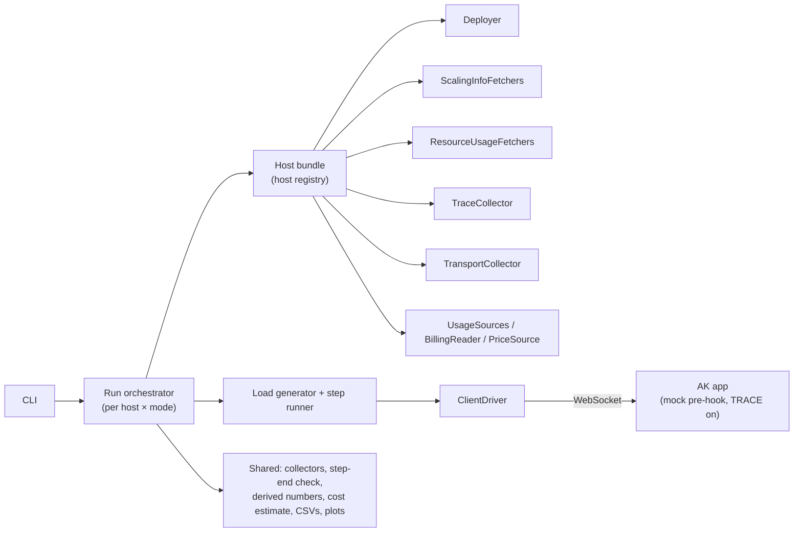

# #786: Benchmark system for throughput, latency, scaling, resource usage and cost

A benchmark runner that deploys Agent Kernel in queue mode on each host, drives it with many concurrent clients under
open load, and records **throughput, latency (with per-stage traces), scaling, worker CPU / memory and cost** to CSVs
and graphs. Phase 1 only records and reports; phase 2 adds SLA thresholds and an after-run pass/fail check. The runner
is pluggable in two directions: one **client driver** per execution mode, and per platform a **host** composed from
small reusable implementations (deployer, fetchers, collectors, cost parts). The only change to AK itself is a `TRACE`
log level with per-stage trace points on the request path.

## Terminology

- **Load:** what the benchmark controls: the number of concurrent clients. Each client is its own user, with its own
  user identity and session. Throughput, latency, scaling, resource usage and cost are the outputs.
- **Load step N:** N clients (N users) start at the same moment. Steps are set in config before a run; default
  `1, 10, 100, 1000`. N is never requests per second.
- **Open load:** a client never waits for a response before sending its next request.
- **Test type:**
  - **burst:** each client sends one request (N requests at once).
  - **steady:** each client sends at a fixed per-client rate (default 1 request every 5 s) for a configured time
    (default 5 min), without waiting for responses.
- **Step timeline:** `before` (no load) → `load` → `cool-down` (no load, ends by the step-end rule).
- **Time window:** the sampling interval (e.g. 1 s). One row per window in the per-time-window CSV.
- **Tx / Rx:** requests sent / responses received per second, both counted on the client.
- **Client timeout:** how long the client waits for a response before recording the request as `timeout` (default
  5 min). Separate from the steady load time.
- **Tier:** one separately deployed and scaled part of a deployment (an ECS service, a Lambda function, a K8s
  Deployment).
- **Scale up / scale down:** adding / removing workers (horizontal only). Worker size is fixed per run.
- **Host:** a named bundle of per-platform implementations (`local`, `ecs`, `lambda`, `eks`, `baremetal`). Each host
  names its platform (`aws`, `k8s`, none for `local`).
- **Percentiles:** p0 / p25 / p50 / p75 / p100 only, linear interpolation (numpy `method='linear'`).
- **Billed cost:** the cloud bill for a run. **Estimated cost:** usage × list prices, splittable per step.

## Motivation

- AK has no performance numbers for its queue pipeline. Nothing in the repo measures throughput, latency, scaling,
  resource usage or cost, so there is no baseline to set SLAs from (phase 2, #468).
- Stage timings inside AK are only visible as ad-hoc INFO lines, worded differently per path and placed inconsistently:
  - `[REQUEST START]`, `[ENQUEUED]`, `[WAITING]`, `[RESPONSE FOUND]`, `[STREAM REQUEST]`
    (`ak-py/src/agentkernel/pipeline/request_handler.py:136,141,146,160,330`); `[ENQUEUED]` also in
    `pipeline/ws/handler.py:246` and `integration/adapter/producer.py:90`.
  - `[AGENT START]` / `[AGENT DONE]` (`pipeline/agent_runner.py:63,74`) and their stream twins (`:315,333`).
  - ECS logs `[AGENT START]` at dequeue and `[AGENT DONE]` after the output send
    (`deployment/aws/containerized/akagentrunner.py:135,154`).
  - `[OUTPUT DONE]` sometimes carries only `user_id` (`pipeline/response_handler.py:280`) or the SQS message id
    (`deployment/aws/containerized/akoutputconsumer.py:74`).
  - The Lambda handlers (`deployment/aws/serverless/`) have no stage lines at all.
  - All share the `ak` logger level, and the formatter prints local time with no zone
    (`core/logger.py:42`), so lines from different hosts can't be compared on one clock.
- `logging.ak.level` rejects anything below `DEBUG`: `_LogLevelConfig.level` pattern is
  `^(INFO|DEBUG|ERROR|WARNING|CRITICAL)$` (`core/config.py:655-659`).
- An LLM call takes 1-10 s and varies a lot, which would hide what AK itself does. A fixed-delay mock agent is needed.
  - An agent pre-hook that returns a reply halts the run before the framework runner (`core/runtime.py:242-246`,
    `:401-405`), so the mock needs no AK code change.
- Hosts scale and bill in very different ways (ECS target tracking, KEDA / HPA, Lambda + SQS event source mapping),
  so worker counts, resource usage and cost need per-platform code. GCP and Azure come later. See
  `research/platform-scaling-and-cost.md` and `research/resource-usage.md`.
- The benchmarked deployments need non-default settings:
  - ECS agent-runner autoscaling is off by default with `min_count = 0`
    (`ak-deployment/ak-aws/containerized/variables.tf:394-410`); the IO service runs a fixed `desired_count = 1`
    (`:373`).
  - KEDA is off by default in the chart (`ak-deployment/ak-k8s/chart/values.yaml:347-349`), and the EKS and
    bare-metal values files default to `transport.type: nats` (`values-eks.yaml:19-20`,
    `values-baremetal.yaml:15-16`).
  - The Lambda agent runner gets SQS batches of 10 (`ak-aws/serverless/variables.tf:493`), handles the records one
    after another (`deployment/aws/serverless/core/sqs_consumer.py:42`), under a 45 s timeout (`variables.tf:381`).

## Requirements

### Principle: record and report only

- The benchmark **records** results (CSVs) and **reports** them (graphs). People read the graphs and decide.
- Phase 1 doesn't flag or judge results: no warnings like "Rx below Tx", no thresholds, alerts or pass/fail.
- It doesn't act on results: no early stop, no load, deployment or scaling changes mid-run.
- The only actions are the planned steps of a run: deploy → run → collect → plot → tear down.
- The run flow may read recorded data to know where it is (e.g. the [step-end rule](#step-timeline)). That's flow
  control, not judging.
- Errors and timeouts are a `status` on the request row. A timeout never fails the run.
- **Only exception (phase 1):** at the end of each step, if any request got no response within the client timeout,
  the run log gets a `WARNING`: "responses for `<count>` requests were not received within the timeout of
  `<client timeout>`". Log only; the run carries on.
- A collector or fetcher that fails (API error, missing permission, source switched off) leaves its columns empty and
  writes a run-log entry. The run carries on.
- Phase 2 adds an after-run SLA pass/fail check (see [Phase 2](#phase-2-sla-numbers-and-tuning)).

### Scope (phase 1)

- Queue execution pipeline only (`Request Handler → Input Queue → Agent Runner → Output Queue → Response Handler`).
  Non-queue execution is out of scope.
- Delivery: **WebSocket complete** only (today's `execution.mode: async`; after #641, `async` + `complete`).
  - Config naming follows whichever naming is live when built.
  - `rest_sync` is never benchmarked: its blocking call breaks open load.
- Hosts:

  | Host | Platform | Deploy source | Transport | Log backend |
  |---|---|---|---|---|
  | `local` | none | AK already running (`in_memory`) | `in_memory` | local process logs |
  | `ecs` | `aws` | Terraform `ak-aws/containerized` | SQS | CloudWatch Logs |
  | `lambda` | `aws` | Terraform `ak-aws/serverless` | SQS | CloudWatch Logs |
  | `eks` | `k8s` | Helm `ak-k8s` | Kafka | decided later (L1) |
  | `baremetal` | `k8s` | Helm `ak-k8s` | Kafka | pod logs / Loki |

- GCP, Azure and NATS are out of scope, but the interfaces must allow them.
- Build order: AWS with WebSocket complete comes first, before anything else.
  1. `lambda`, WebSocket complete.
  2. `ecs`, WebSocket complete.
  3. Only then the rest: `eks` right after the AWS hosts, then `baremetal` and `local`.

### Benchmark project

- A standalone project in a new top-level `benchmarks/` directory with its own `pyproject.toml` (uv), like `e2e/`.
  Not part of the `agentkernel` package.
  - Depends on `agentkernel` for `TraceStage` and the trace-line parser, and for the benchmarked app.
  - Cloud SDKs (`boto3`, `kubernetes`), `psutil`, data and plotting libraries are dependencies of this project only.
- Components are classes with one responsibility each.
- **Its own config file**, `ak-bench.yaml`, not `AKConfig`. Departure from the "reuse existing configuration" house
  pattern, because these are benchmark settings, not AK runtime config. Holds: hosts, modes, test types, load steps,
  per-client rate, steady load time, before window, maximum cool-down, client timeout, time window size, agent delay,
  fetcher order / on-off, Lambda Insights on-off, bare-metal `$/node-hour`, price overrides.
- Registries follow AK's factory shape: built-in short names, dotted-path bring-your-own, unknown name → error naming
  the built-ins.



### Selecting what to run (CLI)

- One CLI, `ak-bench`. `ak-bench run` with:
  - `--host <name>` and `--mode <name>` (each repeatable; default: all). Covers all × all, one host, one mode on one
    host, one mode on all hosts.
  - `--mode` takes AK's execution-mode config value (e.g. `--mode async`), the same name used in the results folders.
  - `--steps` to override the load steps; test types from config (default both).
  - Skip deploy / teardown to reuse an existing deployment.
- `plot --run-id <id>`: re-plot from existing CSVs, no re-run. Graphs are written back into the same `graphs/`
  folders.
- `collect-scaling --run-id <id>` / `collect-resources --run-id <id>`: re-run the after-run fetchers, refill the CSVs,
  re-plot.
- `collect-cost --run-id <id>`: fetch the billed cost later (~1 day after), fill the cost CSV, re-plot.
- Each run writes to its own folder, `results/<run-id>/`, so runs never overwrite each other.

### Run flow

- For each selected host × mode: **deploy → fetch prices → record run metadata → run test types → collect → write
  CSVs → plot → tear down**.
  - Every resource the deployer creates carries the tag / label `ak-bench-run-id=<run-id>`.
- **Run metadata** (`run-metadata.json`), recorded before the first step. Recorded only, never compared:
  - run: run id, start time, host, platform, execution mode, region, AK version and git commit;
  - per tier: worker size, min / max workers, autoscaling settings (target, cooldowns, HPA `behavior`, KEDA polling
    interval, Lambda event source mapping mode / max concurrency);
  - transport type and settings (batch size, Kafka partitions); session store type and capacity;
  - resource usage sources: which fetchers ran, Container Insights (standard / enhanced), Lambda Insights on / off,
    metrics-server resolution;
  - front door (API Gateway WebSocket, ALB, Envoy Gateway, none);
  - benchmark settings: agent delay, load steps, test types, per-client rate, steady load time, before window, maximum
    cool-down, client timeout, time window size, percentile method.
  - Host-side values come from the deployer; a value a host doesn't have stays empty.

### Load generation

- One shared, mode-independent **load generator** (Python asyncio). It:
  - starts N clients at the same moment, each with its own user identity and session. Clients never share a user:
    AK pushes a WebSocket reply to every connection of the reply's `user_id` (`pipeline/response_handler.py:269-277`);
  - sends on a schedule (burst: once; steady: the per-client rate) and **never waits for a response before sending**;
    receiving runs separately and matches responses to requests by `request_id`;
  - sets the `request_id` itself (the WS handler accepts a client id, `pipeline/ws/handler.py:228`; the Lambda WS
    path requires one, `deployment/aws/serverless/core/router/ws_lambda.py:386-387`);
  - records scheduled send, sent, first chunk and complete times per request from the client clock;
  - stops waiting for a request after the client timeout and records `status = timeout`.
- Burst steps also record the **time to answer all N** (first send → last response or timeout).
- The load generator's own health (CPU, event-loop lag) is not recorded (decided).

### Client drivers (pluggable execution modes)

- `ClientDriver` ABC: connect → send → receive response events → close.
- Every driver reports the same timing events (sent, first chunk, complete), so every mode has the same columns. For a
  mode with no chunks, first chunk = complete.
- Driver factory: built-in short name for WebSocket complete (phase 1), dotted-path bring-your-own. The mode (and,
  after #641, the message type) is a config value.
- Later drivers (WebSocket delta with time to first chunk, `rest_async`) are new classes plus a factory branch, with
  no harness change.

### Test types and load steps

- `burst` and `steady` both run the configured steps one after another (1 → 10 → 100 → 1000). Which types run is
  config (default both).
- Each step starts only after the previous one has ended, so it starts from the minimum workers.
- Steady: per-client rate (default 1 request every 5 s) and load time (default 5 min) are config values and recorded
  with the results.

### Step timeline

- Every step of both test types has three parts:
  1. **before:** no load for a configured time (default 2 min). Records the starting worker counts and idle cost.
  2. **load:** burst: send N → last response or timeout. Steady: first send → configured time is up.
  3. **cool-down:** no load. Ends when **all three** hold in the same poll:
     - every request of the step has a response or timed out (client);
     - input and output queues hold nothing, counting in-flight messages (TransportCollector):
       - SQS: `ApproximateNumberOfMessages` and `ApproximateNumberOfMessagesNotVisible` both 0, counting only polls
         ≥ 60 s after the step's last send;
       - Kafka: consumer-group lag 0 on both topics (AK commits after processing, `pipeline/transport/kafka.py:104`);
     - every tier's running count, from the host's **primary** scaling fetcher, is back at its count at the end of
       `before`.
  - A condition with no source on the host counts as met (`local`: only the first applies).
  - **Maximum cool-down** (config, default 45 min from the end of `load`, settable per host): the step ends anyway and
    records `cooldown_max_reached = true`.
  - A non-live primary fetcher (Lambda's metric) is still polled during the cool-down for this check only; the
    recorded counts come from the after-run fetch.
- A step's graphs span the start of `before` to the end of `cool-down`.

### Throughput and latency

- Throughput: per window, Tx, Rx, errors and timeouts, counted on the client. Needs nothing from the backend.
- Latency: per request, end-to-end (`complete − sent`) and status. Per window: percentiles of the requests completed in
  it.
- **Latency traces:** per request, the AK stage timestamps from the trace logs, joined to the client times by
  `request_id`.
  - A `TraceCollector` per log backend (not per host) fetches the trace lines after the run and returns
    `{request_id: {stage: ts}}`. Parsing is shared and lives in AK.
  - Per request, one duration per request-path `TraceStage` value (previous stage → this stage), plus `CLIENT_RECEIVED`
    (`RESPONSE_DELIVERED` → client received). Empty when either point is missing.
  - Percentiles are computed over requests, never per worker first.

### Scaling

- Horizontal scaling only, recorded for every step of both test types, per tier.
- `ScalingInfoFetcher` ABC: one class per **way** of reading worker counts on one platform (not one per cloud, not one
  per deployment type).
  - `name` (registry name, used in CSV columns), `live` flag, one `fetch(run, deployment, start, end) -> ScalingInfo`.
  - `live = True`: polled every few seconds during the run. `live = False`: called once after the run after a
    configured wait (R3), and again by `collect-scaling`.
  - `ScalingInfo` = count samples `(ts, tier, desired|running|pending, value)` + optional worker spans
    `(tier, worker, started, stopped, extra)`.
  - Loops over the deployer's `Deployment.resources` (tier → resource ids), so adding a tier changes only the
    deployer.
  - Generic fetchers take constructor parameters (e.g. one CloudWatch metric fetcher given namespace, metric,
    dimension).
- A host lists one or more fetchers; the first is the **primary** (step-end rule). Config can reorder or disable them.
  All enabled fetchers are recorded side by side, never reconciled. The harness never branches on host kind.
- Phase 1 fetchers:

  | Fetcher | `live` | Gives | Bound to |
  |---|---|---|---|
  | `aws.ecs_api` (`DescribeServices` + `DescribeTasks`) | yes | desired, running, spans | `ecs` (primary) |
  | `aws.ecs_scaling_activities` | no | desired (exact decision times) | `ecs` |
  | `aws.cloudwatch_metric.ConcurrentExecutions` (`Maximum`, 60 s) | no | running | `lambda` (primary) |
  | `aws.lambda_log_streams` (one span per log stream) | no | running, spans | written, not bound; bound by hand if needed |
  | `k8s.api` | yes | desired, running, pending, spans | `eks`, `baremetal` (primary) |

- Queue depth per window (input and output separately) from the host's `TransportCollector`, chosen by transport
  (`sqs`, `kafka`; none for `in_memory`).
- Derived per step, per tier and per fetcher (summary CSV), from `t_load_up` (first send) and `t_load_down` (end of
  load):
  - scale up: decision delay, first new worker, scale-up done, backlog drained;
  - scale down: scale-down start, scale-down done;
  - counts: `workers_before_up`, `workers_peak`, `workers_before_down`, `workers_after_down`;
  - rate in workers / min over each scaling window;
  - a count with no source stays empty; a step that didn't scale records e.g. 1 → 1.

### Resource usage (CPU and memory)

- CPU and memory of every tier's workers over the whole step timeline, every step of both test types. Per worker where
  the platform gives it, otherwise per tier.
- `ResourceUsageFetcher` ABC, separate from `ScalingInfoFetcher` (different sources and delays; scaling must work with
  no usage source).
  - Same shape: `name`, `live`, `fetch(run, deployment, start, end) -> ResourceUsage`.
  - **`ResourceSample`: one reading** of one metric for one worker (or whole tier) at one time:
    - `ts`: when the reading was taken.
    - `tier`: which tier it belongs to (a key of `Deployment.resources`, e.g. `runner`).
    - `worker`: task id, pod name or Lambda log stream; `None` when the source only gives a whole-tier value.
    - `metric`: what was read: `cpu_pct`, `mem_pct`, `mem_mb` or `cpu_time_ms`.
    - `stat`: `value` for a single raw reading; `min` / `avg` / `max` when the source already aggregated it (ECS
      service metrics across tasks; Lambda readings reduced per log stream × window in the query).
    - `value`: the number.
    - Examples: `(10:04:00, runner, task-1a2b, cpu_pct, value, 37.5)` from Container Insights;
      `(10:04:00, runner, None, cpu_pct, max, 81.0)` from the ECS service metrics.
  - **`ResourceUsage`: everything one `fetch()` call returns**: a list of `ResourceSample`s across every tier, worker,
    metric and time in `[start, end]`. A wrapper rather than a bare list so per-fetch details (e.g. what the source
    was missing) can be added later without changing the signature, same as `ScalingInfo`.
  - The shared resource collector turns the samples into the per-window percentile columns, the summary columns and
    `resource-usage.csv`. Fetchers never compute percentiles; the only reduction inside a fetcher is the Lambda
    query's per log stream × window step, to stay under the Logs Insights row limit.
  - Units: CPU as % of one worker's allocation; memory in MiB and as %.
  - Shares the CloudWatch metric / Logs Insights helpers with the scaling fetchers and TraceCollector.
- Phase 1 fetchers:

  | Fetcher | `live` | Gives | Bound to |
  |---|---|---|---|
  | `aws.ecs_service_metrics` (`AWS/ECS` CPU / memory, per service) | no | min / avg / max per tier | `ecs` |
  | `aws.ecs_container_insights` (performance log events, `Type = "Task"`) | no | per task | `ecs` |
  | `aws.lambda_report_memory` (`REPORT` `Max Memory Used`) | no | memory per environment | `lambda` |
  | `aws.lambda_insights` (Lambda Insights extension) | no | CPU time and memory per environment | `lambda`, on by default |
  | `k8s.metrics_api` (`metrics.k8s.io` PodMetrics) | yes | per pod | `eks`, `baremetal` |
  | `local.process` (`psutil`) | yes | per AK process | `local` |

- Lambda Insights: the deployer adds the layer when on (the `layers` variable exists on every function,
  `ak-aws/serverless/variables.tf:309,328,349`, ...); a per-run config value switches it off.
- Lambda Logs Insights queries reduce in the query (per log stream × window), not by fetching raw invocations.

### Cost

- Two numbers per run:
  - **billed:** AWS Cost Explorer `GetCostAndUsage` filtered by the run tag, grouped by service. Whole run only,
    filled later by `collect-cost`. Empty where there is no bill (bare metal).
    - The tag is set **at deploy time**: the deployer puts `ak-bench-run-id=<run-id>` on every resource it creates
      (Terraform `default_tags`, Helm labels). Each run gets a new value.
    - Cost Explorer records every charge with the tags of the resource it came from, and the query returns **only
      charges from resources carrying this run's tag value**. Nothing from other runs or other workloads on the
      account is included.
    - Daily granularity is enough: the run's billed cost is the sum of the daily rows for that tag value over the
      run's days (two days if it crosses midnight). Hourly granularity is not used.
    - Account prerequisite: `ak-bench-run-id` is activated once as a cost allocation tag (management account);
      otherwise the tag filter returns nothing. Costs only show for periods when the tag was on the resource.
  - **estimated:** usage × price table. Available at the end of the run and split per step. Per-step costs, cost per
    1M and the cost model use it; the billed number checks it.
    - Each `UsageSource` returns billed quantities with time ranges; the shared estimate multiplies them by the
      run's `price_table.json` and keeps the part that falls inside the step.
    - Every billed thing works the same way: **AWS charges a price per unit, we measure how many units were used,
      cost = units × price**. Only the unit differs per service. Example (all prices and amounts are fake):

      | Service | How AWS bills it | What we measured (source) | Calculation | Cost |
      |---|---|---|---|---|
      | SQS | $0.50 per 1M requests | 2M requests (`SqsUsageSource`) | 2 × $0.50 | $1.00 |
      | Lambda requests | $0.20 per 1M invocations | 3M invocations (`REPORT` lines) | 3 × $0.20 | $0.60 |
      | Lambda compute | $0.00002 per GB-second | 500,000 GB-s = memory (GB) × billed seconds, summed over the `REPORT` lines | 500,000 × $0.00002 | $10.00 |
      | API Gateway WebSocket messages | $1.00 per 1M messages | 4M messages | 4 × $1.00 | $4.00 |
      | Fargate vCPU | $0.04 per vCPU-hour | 10 vCPU-hours = 10 tasks × 0.5 vCPU × 2 h (`aws.ecs_api` task start / stop) | 10 × $0.04 | $0.40 |
      | Fargate memory | $0.004 per GB-hour | 20 GB-hours = 10 tasks × 1 GB × 2 h | 20 × $0.004 | $0.08 |

      - The real prices per unit come from AWS's Price List API and are saved in the run's `price_table.json`.
      - **Per step:** the same calculation, counting only the units used inside the step's time range (first send →
        end of cool-down). The step's cost is the sum of its rows.
      - **Cost per 1M successful requests:** step cost ÷ (`ok` requests in millions). E.g. $16.08 for 2M `ok`
        requests = $8.04 per 1M.
- Per step (first send → end of cool-down): total by component, requests by status, cost per 1M successful requests,
  cost per hour of the load part (steady), idle cost of `before` kept separate.
- Cost model per host: `idle_cost_per_hour` and `cost_per_1m_messages` by component, for the agent delay used. LLM
  token cost excluded.
- Per-platform parts, all ABCs:
  - `UsageSource`: one per billed thing (Fargate, Lambda, SQS, API Gateway WebSocket, ALB, K8s nodes, ...), returns
    quantities with time ranges.
  - `BillingReader`: one per cloud (AWS: Cost Explorer). Returns `None` where there is no bill.
  - `PriceSource`: one per cloud (AWS: Price List Query API `GetProducts`; bare metal: `$/node-hour` from config).
- Prices are fetched at the start of each run and saved as `price_table.json` (region, fetch date, overrides). Nobody
  edits prices by hand. Usage is stored separately, so a run can be re-priced.

### Hosts

- A `Host` is a bundle: platform name, deployer, scaling fetchers (ordered), resource usage fetchers, trace collector,
  transport collector (or none), usage sources, billing reader (or none), price source (or none).
- A host registry maps names to bundles; a new host or platform is a registration, not a harness change.
- Code is grouped in folders by cloud (`platforms/aws/`, `platforms/k8s/`, ...), one file per implementation. No
  per-cloud "benchmarker" classes (`AWSBenchmarker`, `KubernetesBenchmarker`), because cloud, compute type and
  transport vary independently:
  - `lambda` and `ecs` are both AWS but read worker counts from different places; one AWS class would fill up with
    `if variant == ...` branches.
  - `eks` reads worker counts from Kubernetes but its bill from AWS, so it would belong in both classes.
  - Queue depth depends on the transport (SQS, Kafka), not the cloud.
  - Example: each host picks its parts; the AWS ones are shared, so `eks` adds no new AWS code:

    ```python
    HOSTS = {
        "lambda": Host(
            platform="aws",
            deployer=TerraformDeployer("ak-aws/serverless"),
            scaling_fetchers=[CloudWatchMetricScalingInfoFetcher("AWS/Lambda", "ConcurrentExecutions", "FunctionName")],
            usage_sources=[LambdaUsageSource(), SqsUsageSource(), ApiGatewayWsUsageSource()],
            billing=CostExplorerBillingReader(),     # shared AWS part
            prices=AwsPriceListPriceSource(),        # shared AWS part
            transport=SqsTransportCollector(),       # chosen by transport, not cloud
        ),
        "eks": Host(
            platform="k8s",
            deployer=HelmDeployer(),
            scaling_fetchers=[K8sApiScalingInfoFetcher()],   # worker counts from Kubernetes
            usage_sources=[K8sNodeUsageSource()],
            billing=CostExplorerBillingReader(),     # bill from AWS: same class as lambda
            prices=AwsPriceListPriceSource(),
            transport=KafkaTransportCollector(),
        ),
    }
    ```

- No per-host classes either (`LambdaBenchmarker`, `EcsBenchmarker`): a host is a registry entry that picks existing
  implementations, not a class with its own code. A class per host would copy the shared parts into every host:
  - `lambda` and `ecs` would each carry their own SQS queue depth, SQS usage, Cost Explorer and price list code.
  - `eks` and `baremetal` would each carry the same Helm deployer, `k8s.api` and `k8s.metrics_api` fetchers.
  - A new host would be a new class; as a bundle it's one registry entry built from existing parts.
- The harness (load generator, timing, CSVs, derived numbers, plots) never calls a cloud API; it only sees the ABCs
  and their common return types.
- `Deployer`: `deploy() -> Deployment(endpoint(url, auth), resources: {tier: resource ids})`, `teardown()`,
  `deployed_settings() -> dict` (for the run metadata).
- Built-in bundles:

  | Host | Scaling fetchers (primary first) | Resource fetchers | Transport | Usage / billing / prices |
  |---|---|---|---|---|
  | `local` | none | `local.process` | none | none |
  | `ecs` | `aws.ecs_api`, `aws.ecs_scaling_activities` | `aws.ecs_container_insights`, `aws.ecs_service_metrics` | `sqs` | Fargate, SQS, ALB / Cost Explorer / AWS Price List |
  | `lambda` | `aws.cloudwatch_metric.ConcurrentExecutions` | `aws.lambda_insights`, `aws.lambda_report_memory` | `sqs` | Lambda, SQS, API Gateway WS / Cost Explorer / AWS Price List |
  | `eks` | `k8s.api` | `k8s.metrics_api` | `kafka` | K8s nodes, EKS control plane / Cost Explorer / AWS Price List |
  | `baremetal` | `k8s.api` | `k8s.metrics_api` | `kafka` | K8s nodes / none / config `$/node-hour` |

- Benchmark deployment settings, applied by the deployers and recorded in the metadata:
  - `ecs`: `scaling_config.enabled = true`, `min_count >= 1`.
  - `eks`, `baremetal`: `keda.enabled: true`, `transport.type: kafka`.
  - `lambda`: zip packaging (Lambda Insights layer); `batch_size × agent delay` stays under the agent runner timeout.
  - every host: queue mode, WebSocket delivery, `logging.ak.level: TRACE`, the mock agent.

### Mock agent

- A benchmark pre-hook in the benchmarked app, the **first** pre-hook on the agent (agent pre-hooks run before the
  system ones, `core/runtime.py:242`). No AK code change.
  - Waits a fixed delay with `await asyncio.sleep(delay)` (config, recorded; planned 0 ms then 500 ms).
  - Returns `AgentReplyAny(content={"echo": <prompt>})`. The prompt carries the client's `request_id`.
  - Keeps no per-request state on `self`; does no timing (stage times come from the trace logs).
- Everything around the LLM call runs as normal: request handler, queues, agent runner, ChatService, session load,
  response handler, WebSocket push.
- Verified consequences of the pre-hook approach:
  - The halted turn is **not stored**: `Runtime.run` returns at `core/runtime.py:405`, before
    `self.sessions().store(session)` at `:427`. So session history doesn't grow during steady traffic, and the
    session-store write isn't in the measured latency or cost.
  - System pre-hooks (guardrails, multimodal, sandbox) are skipped.
- The same app is used on every host. A real-LLM run is an optional final realism check.

### AK change: `TRACE` log level and trace points (`ak-py`)

- **A normal Python log level, no separate logger library:** `TRACE = 5` registered with `logging.addLevelName` in
  `core/logger.py`, written through AK's existing loggers.
  - `TRACE` is the lowest level, so selecting it writes **every** level: `TRACE`, `DEBUG`, `INFO`, `WARNING`,
    `ERROR` and `CRITICAL`. At `DEBUG` and above, trace lines are dropped by the level check before formatting.
  - `"TRACE"` added to the `_LogLevelConfig.level` pattern (`core/config.py:658`). `AKLogger.resolve_level` reads
    `logging.getLevelNamesMapping()` (`core/logger.py:23`), so it resolves with no other change.
  - Benchmark runs set `logging.ak.level: TRACE`. **No other new configuration.**
  - Departure noted: Python's logging HOWTO advises against custom levels in libraries; taken on purpose so the normal
    level hierarchy works.
- **`TraceStage`**, a `str` enum in `core/logger.py`: `REQUEST_RECEIVED`, `INPUT_ENQUEUED`, `AGENT_RECEIVED`,
  `AGENT_START`, `AGENT_FIRST_CHUNK` (delta only), `AGENT_DONE`, `OUTPUT_ENQUEUED`, `OUTPUT_RECEIVED`,
  `RESPONSE_DELIVERED`; `rest_sync` only: `RESPONSE_POLL_START`, `RESPONSE_FOUND` (traced like the rest, but `rest_sync`
  isn't benchmarked, so they get no duration column and no point in the stage graphs).
- **One call per trace point:** `log.log(TRACE, "[%s] request_id=%s", stage, request_id)`, with an optional
  quoted `message` last. `%`-style args so nothing is formatted when off.
- **Line format**, same on every host:
  `2026-10-21T08:15:12.345Z - ak.pipeline.agent_runner - TRACE - [AGENT_DONE] request_id=<id> message="..."`.
  - Timestamp = the log record's creation time, **UTC, millisecond precision**, ISO 8601 with `Z`.
  - Stage in square brackets first. **Only trace lines carry the stage in `[...]`.**
  - The formatter change (`core/logger.py:42`) applies to **every** AK log line, not only `TRACE`.
- **Parser** in `core/logger.py` next to `TraceStage`, so format and parser change together. The benchmark imports it.
- **Trace points on every code path a phase-1 host runs:** shared `pipeline/` (request handler, WS handler, agent
  runner, response handler), ECS containerized handlers, and the Lambda serverless handlers.
  - Each stage is logged exactly where named (e.g. `AGENT_DONE` before the output send, `AGENT_RECEIVED` at
    dequeue).
- **Trace lines are added next to the existing stage-style INFO lines, not in place of them:**
  - The INFO lines on the request path stay at `INFO` with their text but **drop their `[...]` tag** (e.g.
    `[AGENT DONE] request_id=...` → `Agent done: request_id=...`), so normal logs still show them.
  - The trace call for the matching stage goes where the stage is (which may differ from where the INFO line sits).
  - At `TRACE` both show. Nothing in the repo matches on the old tags (no docs, metric filters or dashboards).
  - Per-chunk debug lines, `[OUTPUT STORE]` and off-path lines without a `request_id` are left as they are.
- Trace lines carry no worker id. Worker counts come only from the fetchers.

### Results

- Folder layout `results/<run-id>/<platform>/<host>/<mode>/<test type>/step-<N>/` (`local` has no platform level).
  - `<mode>` is the execution-mode config value (e.g. `async`).
  - `step-<N>` zero-padded to the digits of the largest step.
  - Only what ran gets a folder.
- Per run: `run.log` (incl. the missing-responses warnings).
- Per host × mode: `run-metadata.json`, `price_table.json`, `cost.csv` (whole-run estimated and billed, cost model).
- Per test type: `summary.csv` (one row per step), `cost-per-step.csv`, `graphs/`.
- Per step:
  - `per-request.csv`: request id, session id, client id, scheduled send, sent, first chunk, complete, latency, status,
    raw stage timestamps, and one `<STAGE>_s` duration column per request-path `TraceStage` value (not the
    `rest_sync`-only ones) plus `CLIENT_RECEIVED_s`.
  - `per-time-window.csv`: step part, Tx, Rx, errors, timeouts, latency percentiles, each queue's depth, worker counts
    per tier × count type × fetcher (e.g. `runner.running.aws.ecs_api`), CPU / memory per tier × metric × stat ×
    fetcher.
  - `resource-usage.csv`: raw per-worker samples in long form (`ts, tier, worker, metric, value, fetcher`).
  - `graphs/`.
- Summary per step: percentiles of end-to-end latency and each stage duration (with the row count used), min / avg /
  max of per-window Tx / Rx, error and timeout counts, time to answer all N (burst), `cooldown_max_reached`, scaling
  numbers and CPU / memory per tier per fetcher (fetcher named).
- How each measurement is summarized:
  - per-request times, per-worker CPU / memory: p0 / p25 / p50 / p75 / p100. No avg column.
  - ECS service metrics: min / avg / max (all AWS gives).
  - Tx / Rx: min / avg / max of per-window values.
  - counts, times, costs: the value itself.

### Graphs (PNG)

- Comparing the steps of one host × mode × test type (`<test type>/graphs/`):
  1. `01-latency-per-step.png`: end-to-end latency percentiles per step, timeouts counted under each step.
  2. `02-stage-times-per-step.png`: the per-step stage-times graph for every step, one panel per step, same y scale.
  3. `03-resource-usage-per-step.png`: CPU % and memory percentiles per step, one row of panels per tier.
- One step (`step-<N>/graphs/`):
  1. `01-stage-times.png`: one box per stage (p25-p75, line at p50, whiskers p0 / p100).
  2. `02-stage-breakdown.png`: stacked stage times for the fastest, average and slowest real request (completed
     requests only).
  3. `03-timeline.png`: before → load → cool-down on one time axis, one panel each. Steady: Tx / Rx, latency
     percentiles per window, input queue, output queue, workers per tier. Burst: responses received so far, workers per
     tier.
  4. `04-every-request.png` (steady only): every request's latency vs send time, per-window percentiles, timeouts on
     the timeout line.
  5. `05-resource-usage.png`: CPU % and memory percentiles per window, one row of panels per tier.
- Rules:
  - every aggregate of a per-request measurement shows all five percentiles; box with whiskers to p0 / p100
    (`whis=(0, 100)`) on category axes, bands (p0-p100 light, p25-p75 dark) and a p50 line otherwise;
  - each tier, pipeline stage and queue shown separately, never summed; whole-system values (Tx, Rx, end-to-end
    latency, totals) not split;
  - separate panels, never two y-axes; no threshold or pass/fail lines;
  - estimated vs billed cost per run, drawn by `collect-cost`.
- No cross-host or cross-mode comparison graphs.

### Phase 2: SLA numbers and tuning

- Computed from the phase-1 CSVs without re-running.
- SLA thresholds chosen from phase-1 values: latency percentiles per step, minimum Tx / Rx, maximum error / timeout
  rate, maximum scale-up / scale-down time, maximum cost per 1M messages.
- After-run SLA check: compares measured values to thresholds and records pass/fail per SLA number. Nothing changes
  during a run.
- A performance test report per host. Tuning AK to meet the SLAs is tracked under #468.

## Non-goals

- Flagging (Rx below Tx, saturation), alerts, early stops, or load / deployment changes based on results.
- Preventing or working around bottlenecks outside AK's workers (load generator, API Gateway quotas, ALB, Kafka
  partitions, node capacity).
- Recording the load generator's own health.
- Comparing hosts with each other (no cross-host graphs).
- Non-queue execution; `rest_sync` in any round.
- WebSocket delta and `rest_async` drivers in phase 1 (designed for, added later).
- WebSocket connect part and front-door scaling (later).
- Repeated runs with spread across runs (later).
- GCP, Azure and NATS hosts (interfaces allow them; nothing built).
- Vertical scaling.
- LLM latency and token cost.
- Running the benchmark in CI.

## Open questions

None. Q1-Q8 were resolved on 2026-10-30; `spec.md` can start.

## Decided later

Parked on purpose; decided when that part is built.

- **L1.** EKS (right after the AWS hosts): pre-existing cluster or a Terraform step before Helm; its log backend for
  the TraceCollector.
- **L2.** WebSocket delta: whether the results folders get a message-type level under the mode.
- **L3.** WebSocket delta: trace every chunk or only the first (`AGENT_FIRST_CHUNK`) and last (`AGENT_DONE`).
- **L4.** Bare metal: the `$/node-hour` figure for the cost estimate.

## Check on the first runs

Answered by looking at real data, not by a decision. Each has a fallback already in the design.

- **R1.** Scaling fetchers: ECS keeps `aws.ecs_api` alone or adds `aws.ecs_scaling_activities` (and whether its
  "Setting desired count to N" wording is stable enough to parse); Lambda stays on `ConcurrentExecutions` or binds
  `aws.lambda_log_streams`.
- **R2.** Lambda step end: whether `ConcurrentExecutions` has no datapoint (rather than 0) in idle minutes, and the
  metric delay to allow for.
- **R3.** How long the after-run fetchers wait per log backend (ingestion delay).
- **R4.** Lambda Insights: whether its events carry `duration` / `function_name`, and whether its log stream is one
  per execution environment (fallbacks: `cpu_time_ms` only, per-tier values).
- **R5.** ECS: Container Insights `Type = "Task"` events exist for Fargate tasks (only non-AWS examples so far).
- **R6.** ECS: whether target tracking on a custom metric still uses the 3 / 15 one-minute datapoint rule after AWS's
  June 2026 faster-scaling change (check the CloudWatch alarms the policy creates).
- **R7.** Cost: the run tag / label reaches every billed resource; anything untagged or shared is listed as a fixed
  allocation.
- **R8.** Sessions: one client can have several requests in flight, handled by different workers, and AK's session
  locks are per process. The pre-hook doesn't save the turn (`core/runtime.py:405` before `:427`), but confirm on the
  first steady-traffic runs that concurrent work on one session has no side effect.
