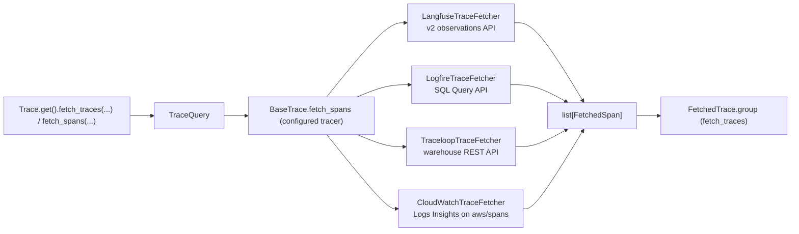

# #803: Agent evaluation on production traffic

Evaluates an agent on its real production traffic in three phases: **fetch spans → group them into traces
and evaluate each trace → store the results**. Phase 1 is an Agent Kernel core capability: the configured
tracer reads its spans back from the provider's cloud (Langfuse, Logfire, Traceloop, AWS CloudWatch) through
one provider-neutral call, `Trace.get().fetch_traces(...)` (or `fetch_spans(...)` for single spans). Phases 2 and 3 are **not** AK core: they are user code,
shown in one AWS example. The agent runs on an AK serverless deployment in queue mode; its request-handler
Lambda serves `/chat` and two custom routes: `POST /eval` grades every trace of a session with an Opik-based
`AKEvaluator` subclass and writes the results to the example's own DynamoDB table, and `GET /check` reports
whether every request of that session has been graded. The weekly integration test drives the whole loop over HTTP.

| Phase | What | Where it lives |
|---|---|---|
| 1. Fetch | `Trace.get().fetch_spans(...)` / `fetch_traces(...)`, `TraceQuery`, `FetchedSpan`, `FetchedTrace`, one fetcher per tracer | `ak-py/src/agentkernel/trace/` |
| 2. Evaluate | `TraceCase` built from a `FetchedTrace`; `OpikTraceEvaluator(AKEvaluator)` | example `evaluator/` |
| 3. Store | `EvaluationStore` over one DynamoDB table | example `evaluator/` |
| 2–3 runtime | AK serverless queue-mode deployment: request handler (`/chat`, `/eval`, `/check`, internal `/grade`), agent runner, response handler; the DynamoDB table and its IAM policy | example `lambda_request_handler.py`, `lambda_agent_runner.py`, `lambda_response_handler.py`, `deploy/main.tf` |

The example is `examples/aws-serverless/openai-langfuse-trace-evaluation/`. Implementation detail is in
[spec.md](spec.md); decisions taken in review are in [research/decisions.md](research/decisions.md).

## Terminology

- **Span:** one unit of work with a start and an end time (an LLM call, a tool call, a whole agent run).
  It can have a parent span, so the spans of a run form a tree. Langfuse calls spans "observations".
- **Trace:** every span that shares one `trace_id`, i.e. the whole tree for one AK request. No provider
  stores a trace as its own record.
- **Root span:** the trace's span with no parent. On Langfuse, Logfire and CloudWatch it is the AK wrapper
  span `Agent Kernel <Framework>`; Traceloop runners add none, so it is the framework's own.
- **Session:** the traces that share one AK `session_id`. Every provider stores it on spans.
- **Finished run:** the root span has ended with an output. Says nothing about the other spans.
- **Complete trace:** every span of the trace is readable from the provider. A finished run's trace can
  still be incomplete for a while, because providers ingest spans asynchronously.

## Motivation

### Phase 1

- The trace subsystem is write-only:
  - `BaseTrace` declares only `init()` and one runner method per framework (`trace/base.py:7-55`).
  - The `Trace` facade forwards those methods and nothing else (`trace/trace.py:66-119`).
- All four built-in providers have a usable read API (`research/provider-read-apis.md`):
  - Langfuse: v2 observations API, through the client AK already holds (`trace/langfuse/langfuse.py:42`).
  - Logfire: SQL Query API, with a separate **read** token.
  - Traceloop: the warehouse spans REST API; the SDK has no read client.
  - CloudWatch: Logs Insights over the `aws/spans` log group that Transaction Search fills (§6).
- The providers share no vocabulary: Langfuse returns its own observation types; the others return
  near-raw OTel spans in about 5 attribute conventions, mixed within one trace (`research/span-formats.md` §2, §4).
- Each provider records AK's session id differently:
  - Langfuse: on every span, through `propagate_attributes` (`trace/langfuse/openai.py:36` and 5 siblings).
  - Traceloop: an association property on every span (`trace/openllmetry/openai.py:28`).
  - Logfire: only on the AK wrapper span (`trace/logfire/openai.py:30` and 5 siblings).
  - CloudWatch: on every span of the run, through `SessionSpanProcessor` (`trace/cloudwatch/cloudwatch.py:36-45`, `:94`).
- **Logfire erased the session id:** before Phase 1, `logfire.configure(...)` in `trace/logfire/logfire.py`
  passed no scrubbing options, so the default scrubber redacted any attribute matching "session"
  (`research/span-formats.md` §5.1). Phase 1 passes scrubbing options (`trace/logfire/logfire.py:31-35`).
- Langfuse removes its v1 read endpoints from Langfuse Cloud on 16 Nov 2026, so only v2 is used
  (`research/provider-read-apis.md` §1).

### Phases 2 and 3

- Evaluation and storage are user-specific (metrics, thresholds, database), so AK shows them in an
  example instead of shipping a fixed pipeline.
- Every built-in `AKEvaluator` needs an expected answer and raises `AKMissingInput` without one
  (`test/core/evaluator/deepeval.py:44,55`, `opik.py:48,61`, `jev.py:62`); production traffic has none.
  The `AKEvaluator` ABC (`test/core/evaluator/base.py:49-66`) fits a reference-free subclass.
- The AK serverless module can host the evaluator next to the agent, within these limits:
  - One request-handler Lambda serves the chat endpoint and any `gateway_endpoints`
    (`ak-deployment/ak-aws/serverless/state.tf:75-79`); custom routes are registered with `Lambda.register`
    (`examples/aws-serverless/schedule-openai/lambda_request_handler.py:43-129`).
  - It takes no extra IAM policies but outputs the handler's role name and function name
    (`ak-deployment/ak-aws/serverless/outputs.tf:1-20`), so the example attaches its own.
  - API Gateway's 29 s default timeout applies; grading a session can exceed it.
  - `Lambda.handler` sends every event to the REST router, which raises on an event with no path
    (`deployment/aws/serverless/aklambda.py:70-82`, `core/router/rest_lambda.py:391,411`).
  - The handler defaults to 45 s and 128 MB (`ak-deployment/ak-aws/serverless/variables.tf:344-345`).
- `agentkernel[langfuse,opik]` plus `boto3` measured 283 MB unpacked for Lambda's platform, over the
  250 MB zip limit, so the request handler (Opik judges) and the agent runner (OpenAI Agents SDK) ship as
  container images; the response handler stays a zip.
- Before Phase 1, the AK Langfuse runners never flushed, unlike the CloudWatch tracer on Lambda
  (`trace/cloudwatch/cloudwatch.py:59-60,98-99`). A frozen Lambda sandbox holds or loses the spans, so the
  evaluator would see none. Phase 1 fixes this in core: the six runners call `LangFuse.flush_on_lambda` in a
  `finally` (`trace/langfuse/openai.py:35-43` and 5 siblings).

## Phase 1: Fetch spans (Agent Kernel core)

### Public API

- `Trace.fetch_spans(query: TraceQuery | None = None, **filters) -> list[FetchedSpan]` on the `Trace` facade.
  - Keyword filters build a `TraceQuery`; an explicit `query` is passed through unchanged.
  - Both together raise `ValueError`.
  - Tracing disabled → `AKConfigError` naming `trace.enabled`.
  - Delegates to the configured tracer's `fetch_spans(query)`.
- `Trace.fetch_traces(query: TraceQuery | None = None, **filters) -> list[FetchedTrace]`: the same spans,
  grouped by trace id.
  - Implemented once on top of `fetch_spans`, so bring-your-own tracers get it without extra work.
  - Takes the same filters except `kinds` and `name`, which select single spans, not traces: passing
    either raises `ValueError`. Users filter `trace.spans` instead.
  - Traces are ordered by their first span.
- `agentkernel.trace` exports `TraceQuery`, `FetchedSpan`, `FetchedTrace`, `SpanUsage`, `SpanKind`,
  `SpanStatus` and `OTelSpanClassifier` (public so bring-your-own fetchers classify spans the same way).
- Synchronous only.

### Query model: `TraceQuery`

- Filters: `start`, `end`, `last` (default 1 hour, used when `start` is unset), `kinds` (`None` = all),
  `session_id`, `trace_ids`, `name` (exact), `limit` (default 1000, `> 0`).
  - An unknown field (a misspelled filter) or an empty `kinds` / `session_id` / `trace_ids` / `name` raises
    a validation error, so a filter never silently widens the query.
- Window: naive datetimes are UTC; `end` defaults to now; `start >= end` raises `ValueError`; bounds apply
  to span **start** time, `start` inclusive, `end` exclusive.
- Result, for every tracer: oldest first; when more than `limit` match, the most recent `limit` are kept.
- `matches(span)`: one strict local check of every filter. A span that reports no value for an active
  filter (start time, session id, name) is rejected.
- Detail: spec.md §`trace/fetch.py`.

### Result model: `FetchedSpan`

- Fields: `provider`, `trace_id`, `span_id`, `parent_span_id`, `name`, `kind`, `status`, `start_time`,
  `end_time`, `session_id`, `input`, `output`, `usage`, `attributes`, `raw`.
- `provider` is the tracer's `trace.type` short name (`langfuse`, `logfire`, `openllmetry`, `cloudwatch`),
  so it round-trips with config.
- `usage: SpanUsage | None`: input, output and total tokens and cost (USD), each optional.
  - The span's own model call only, never a roll-up, so summing over a trace gives the trace's total.
  - `None` when the span records no model call.
  - Cost is whatever the provider or instrumentation reports; AK never computes it.
- `status: SpanStatus` (`UNSET`, `OK`, `ERROR`), following the OpenTelemetry span status. Each fetcher maps its
  provider's own field onto it:
  - Langfuse: `level == "ERROR"` → `ERROR`, else `UNSET` (`level` is in the `basic` field group the fetcher
    already requests).
  - CloudWatch: `status.code` of the stored OTel record (`OK` / `UNSET` / `ERROR`; confirmed on a live
    `aws/spans` log group).
  - Logfire: the `otel_status_code` column. Traceloop: `status_code` or `status` on the warehouse row, whose
    field name is undocumented. Neither is verified against a live account.
- `input`/`output` are returned as the provider stores them, never parsed.
- `raw` holds the provider's full record.
- Each `span_id` appears at most once.

### Result model: `FetchedTrace`

- Built from the spans of one trace id: `trace_id`, `session_id` (the first one found on its spans) and
  `spans`, oldest first.
- Properties:
  - `root`: the single span with no parent; `None` when there is none or more than one.
  - `user_input` / `output` / `started_at` / `ended_at`: the root's input, output, start and end time
    (`None` without a root).
  - `tool_spans`: the spans with `kind == TOOL`. `agent_names`: the agent spans' names, de-duplicated, in order.
  - `usage`: a `SpanUsage` summed over the spans; a field stays `None` when no span reports it.
- **Partial traces are expected.** `fetch_traces` is one pass over the window's spans (the window filters on
  span start time), so a trace at the window's edge can be partial, as a provider's own UI shows a trace
  whose spans are still arriving. A second pass that fetches each found trace whole was rejected: it costs a
  second call, and on Langfuse one request per trace id.
- **A trace with no root is returned with `root=None`**, not dropped: dropping hides data silently, and other
  uses (summing cost over a window) still want its spans.
- **AK doesn't decide when a trace is complete.** It returns what the tracer has stored; waiting for late
  spans is the caller's logic (Phase 2).
- **Traceloop:** AK's Traceloop runners add no `Agent Kernel <Framework>` wrapper span, so the root is the
  framework's own span (e.g. `Agent Workflow` for the OpenAI Agents SDK), which carries no input or output:
  `user_input` and `output` are empty there. Documented; no wrapper is added.

### Span kinds

- `SpanKind`: `agent`, `llm`, `tool`, and `other` (everything else).
- `OTelSpanClassifier` classifies each OTel span by its own attributes, never once per provider, in this
  precedence: `openinference.span.kind`, `traceloop.span.kind`, `gen_ai.operation.name`, the Logfire
  message template or `LLM` tag, else `other`.
  - Must label every span in the captured dumps as `research/span-formats.md` §3–§4 does.
  - Also extracts `input`/`output`, the session id and per-call `usage`, ignoring roll-ups.
- Langfuse maps its own types: `GENERATION` → llm, `TOOL` → tool, `AGENT` → agent, else other.
- **Fetchers map each provider's fields onto the neutral ones but don't patch over a provider's own mistakes.**
  A span Langfuse labels as a plain `SPAN` stays `other`; user code trusts `span.kind` and `span.status`.
  Re-classifying in the Langfuse fetcher was rejected: a `kinds=[TOOL]` query could no longer filter server
  side by `type=TOOL`, and would have to page through every span in the window.
- Detail: spec.md §`trace/fetch.py`.

### Tracer interface (`BaseTrace`)

- Add `fetch_spans(self, query: TraceQuery) -> list[FetchedSpan]`.
  - **Not abstract**: the default raises `NotImplementedError`. A deliberate departure from the
    all-abstract `BaseTrace` (`trace/base.py:7-55`), so existing bring-your-own tracers still instantiate.
- No new factory or config selector: the tracer that sends (`trace.type`) is the one that fetches.
  Bring-your-own tracers (dotted `trace.type`, `trace/trace.py:64`) opt in by overriding `fetch_spans`.
- Each built-in tracer delegates to one fetcher class in `trace/<provider>/fetch.py`, imported lazily;
  fetcher modules import no provider SDK at module scope.
- **`TraceFetcher`** (in `trace/fetch.py`, not exported): the base of the four built-in fetchers, holding
  the logic they share (house pattern 3, shared logic is lifted, not copied):
  - pinning the window once, the merge by (trace id, span id), the newest-`limit` accounting, and a
    logged warning when the result reaches `limit` (older matching spans may be missing, and their traces
    may come back without a root);
  - the cursor loop (Langfuse, Traceloop) and the backward time paging past a row cap (Logfire,
    CloudWatch).
- **Every fetcher applies `TraceQuery.matches` to every span**, whatever its server-side filters did, so
  no provider's boundary rule (e.g. whether Logfire's `max_timestamp` is inclusive) leaks into the result.
- **`TraceFetchContract`** (`agentkernel.trace.testing`): the conformance suite every fetch
  implementation subclasses, as `SecretProviderContract` is for secret providers (`secret/testing.py:15`).
  - Checks the result contract: order, unique ids, window bounds, `limit`, and each filter, including
    that a span missing the filtered value is excluded.
  - Run against an in-memory bring-your-own tracer (also the docs example) and the Langfuse and
    Traceloop fetchers over fakes. Not against Logfire or CloudWatch: a faithful fake would re-implement
    SQL and Logs Insights.
- Detail: spec.md §Rules, §`trace/fetch.py`, §`trace/testing.py`.

### Langfuse fetcher

- Reuses the tracer's authenticated client; no new credentials.
- v2 `observations.get_many` only, following the cursor; window, session, name, type and trace id are
  sent as filters.
  - The v2 parameters take one value each, so each requested kind and each trace id is its own paged
    request; a query whose `kinds` include `other` is sent with no type filter and filtered locally.
- Requests the full OTel attributes (`expand_metadata=attributes`): Langfuse otherwise cuts metadata
  values to 200 characters.
- `usage` from Langfuse's own usage and cost fields; Langfuse prices model calls server side.
- Detail: spec.md §`LangFuse.fetch`.

### Logfire fetcher

- Credential: `LOGFIRE_READ_TOKEN` (§Configuration). The region comes from the token.
- SQL over the `records` table through Logfire's `LogfireQueryClient` (`logfire.query_client`, or
  `logfire.experimental.query_client` before logfire 5); window, kinds, name, trace ids and session become
  conditions.
  - `session_id` selects every span of the traces whose wrapper span carries it (Logfire sets it only
    there).
- Pages past the 10,000-row cap.
- **Scrubbing fix:** `Logfire.init()` keeps exactly the `session_id` attribute from the scrubber; every
  other match is still redacted.
  - Privacy: AK doesn't make session ids opaque (`core/model.py:403`; the session guide suggests
    building them from a user id, `docs/docs/core-concepts/session.md:109`). The other three tracers
    already export them as given, so this adds no new exposure and is not opt-in.
  - The docs tell users to keep personal data out of session ids.
- Detail: spec.md §`Logfire.fetch`, §Scrubbing fix.

### Traceloop fetcher

- Credentials: `TRACELOOP_API_KEY` (§Configuration) and `TRACELOOP_BASE_URL`, as the SDK reads them.
- `GET /v2/warehouse/spans`, newest first (`sort_order=DESC`), following the cursor; the window, `span_name`,
  and session and trace ids (in `filters`) are sent server side.
- **No server-side kind filter**: kinds are applied locally.
  - A span's kind can come from `gen_ai.operation.name` or `traceloop.span.kind`, and the SDK's own
    `@tool`/`@agent` decorators set only the latter. The `filters` API has no OR across ids, so a filter
    on either one alone would drop spans.
- **Best effort, documented**: 24-hour free-plan retention, filter ids untested against the live API, and
  the ServiceNow acquisition (`research/provider-read-apis.md` §3).
- Detail: spec.md §`OpenLLMetry.fetch`.

### CloudWatch fetcher

- Credentials and region from the standard AWS chain, as on the send side. The region lookup
  (`trace/cloudwatch/cloudwatch.py:129`) moves into a shared `CloudWatch.region()`.
  - Needs `logs:StartQuery`, `logs:GetQueryResults` and `logs:StopQuery` on `aws/spans`, which the
    send-side `AWSXrayWriteOnlyAccess` doesn't grant.
- Logs Insights over `aws/spans`; each `@message` is the span's OTel JSON and becomes `raw`.
  - Session filters on `attributes.session.id` (set on every span by `SessionSpanProcessor`).
  - The server-side kind filter covers only the OpenInference and GenAI conventions CloudWatch runners
    emit; a `kinds` fetch skips spans typed only by Traceloop or Logfire conventions (custom
    instrumentation only).
  - `@timestamp` is not documented as the span start, so the query range runs 15 minutes past the
    window end and the window is applied to `startTimeUnixNano` locally.
- Pages past the 10,000-row cap; a query that runs past its timeout (default 120 s) is stopped.
- `aws/spans` is the only source: it needs Transaction Search on and the spans reaching X-Ray, which the
  docs state.
- Detail: spec.md §`CloudWatch.fetch`.

### Langfuse flush on AWS Lambda (send side)

- Every Langfuse runner flushes the client after each `run()`, including failed ones, when
  `AWS_LAMBDA_FUNCTION_NAME` is set, as the CloudWatch tracer does.
  - A failed flush is logged, never raised.
  - Cost: one export round trip per agent run on Lambda.
- Streamed runs (`stream()`) are out of scope: no tracer wraps `stream()` today, CloudWatch included.
- Required by Phases 2–3, and fixes every Langfuse-on-Lambda user.
- Detail: spec.md §Langfuse flush on AWS Lambda.

### Error handling

- Missing Logfire read token or Traceloop API key → `AKConfigError` naming the variable.
- No AWS region → `AKConfigError` naming `AWS_REGION`; no `aws/spans` log group → `AKConfigError` saying
  to enable Transaction Search.
- A failed or timed-out CloudWatch query → `RuntimeError` / `TimeoutError`.
- Provider, HTTP and secret-provider errors propagate unchanged. No retries.
- A tracer without `fetch_spans` → `NotImplementedError`.
- `fetch_traces` with `kinds` or `name` → `ValueError`.
- Detail: spec.md §Phase 1 error handling.

### Configuration

- **No new `AKConfig` fields.** Fetching reuses `trace.enabled` and `trace.type` (`core/config.py:468-473`).
- The two credentials AK reads itself, `LOGFIRE_READ_TOKEN` (new) and `TRACELOOP_API_KEY`, are resolved
  through `SecretManager.current().get(...)` (`agentkernel.secret`).
  - It reads the environment first, so `env` deployments behave as a plain environment read, and
    `aws_ssm` deployments read the keys from SSM without exporting them.
  - `LOGFIRE_READ_TOKEN` can't be derived from `LOGFIRE_TOKEN`: write tokens can't read.
- Credentials the provider SDKs read themselves (`LANGFUSE_*`, `LOGFIRE_TOKEN`) stay environment
  variables, as on the send side.
- Extras: `httpx` added to `openllmetry` and `logfire` (`ak-py/pyproject.toml:31-38`). CloudWatch needs
  none: the `cloudwatch` extra already ships `botocore`.

### Testing

- `tests/test_trace_fetch.py`, no provider SDK needed: the query model, the classifier, the facade,
  `TraceFetcher`, `SpanStatus` mapping and `FetchedTrace` grouping (root, no root, two roots, usage sum,
  ordering), and each fetcher over a fake client or transport.
- `tests/test_trace_fetch_contract.py`: `TraceFetchContract` (including a `fetch_traces` grouping case)
  against the in-memory tracer, Langfuse and Traceloop.
- `tests/test_trace_langfuse_flush.py`: every one of the six runners flushes on Lambda after a successful
  and a failed run.
- `tests/test_trace_logfire.py`: the scrubbing callback keeps `session_id` and redacts the rest.
- Live checks against real accounts before merge.
- Detail: spec.md §Phase 1 testing.

### Docs

- `docs/docs/advanced/traceability.md`:
  - A "Fetching Spans Back" section: the filters, `usage` and which providers report cost, credentials per
    provider (including CloudWatch's IAM read permissions), that session ids reach every provider as
    given, provider limits, and bring-your-own `fetch_spans`, `fetch_traces` and `FetchedTrace`, `status`, the Traceloop root note and
    partial traces at window edges.
  - In the Langfuse section, a "Running on AWS Lambda" note for the flush, like the CloudWatch one
    (`:566`): it is a send-side change.
- `docs/src/pages/features.tsx`: a fetch highlight on the Observability card (`:900`).
- `docs/docs/intro.md`: a What's New entry (`:10`).

## Phase 2: Evaluate (example)

### Trace case: `TraceCase`

- **Why:** a trace's facts a judge needs are spread across its spans (the wrapper span holds the question
  and answer, tool spans the calls, generation spans the tokens). `TraceCase` gathers one `FetchedTrace` into
  one object. Grouping spans, finding the root and summing usage live in AK (`fetch_traces`), not here.
- The unit of evaluation is one **trace**: one AK request is one trace, since the Langfuse, Logfire and
  CloudWatch runners wrap the run in one AK span (`framework/openai/openai.py:248`;
  `research/span-formats.md` §3).
- A request is counted by its trace's **parentless root span**, never by span name.
- `TraceCase.from_trace(trace)`, for a `FetchedTrace` that has a root (the job skips the others):
  - `user_input` / `output` / `session_id`: from the trace (its root span).
  - `tool_calls`: every `trace.tool_spans`, oldest first, with name, input, output and whether it failed
    (`span.status == ERROR`).
    - The example trusts `span.kind`. Whether Langfuse types OpenInference tool spans as `TOOL` is
      unverified (`research/provider-read-apis.md` §5); if it doesn't, that call is missing from the
      transcript. Check with one live run.
  - `agents`: `trace.agent_names`.
  - `usage`: `trace.usage`; `latency_ms`: the root's duration.
  - Also `provider`, `root_name`, `span_count`, and the `spans` themselves (stored gzipped on the row).
  - `is_finished`: the root has ended with an output.
  - `has_settled(now, settle)`: the root ended at least `settle` ago.
  - `is_ready_to_grade(now, settle)`: finished and settled.
- `build_transcript()`: the request, each tool call and the final answer, for the agent judges.
- `to_evaluation_case(threshold)`: the `TraceEvaluationCase` the judges read, with the tool results as
  context.
- Detail: spec.md §`evaluator/case.py`.

### Evaluator: `OpikTraceEvaluator(AKEvaluator)`

- Subclasses `AKEvaluator`; one instance scores one metric. `for_all_metrics(config)` returns one per metric;
  `applies_to(case)` says whether the metric runs for a case.
- Reads a `TraceEvaluationCase` (an `AKEvaluationCase` with `transcript` and `tool_call_count`);
  `expected` stays empty.
- LLM judges only: `evaluate_by_llm` scores; `evaluate_by_score` raises `AKMetricNotSupported`.
- Judge model from `AKTestConfig.llm` (`<provider>/<model>`); nothing is sent to Opik's cloud
  (`OPIK_TRACK_DISABLE`, `track=False`).
- Each judge call is tried twice; a second failure is stored as an unscored result. One bad metric never
  fails the trace or the run.
- Detail: spec.md §`evaluator/opik_evaluator.py`.

### Metrics

| Metric | Opik metric | Runs when | Passes when (threshold 0.5) |
|---|---|---|---|
| `task_completion` | `AgentTaskCompletionJudge` | always | score ≥ 0.5 |
| `tool_correctness` | `AgentToolCorrectnessJudge` | the trace has ≥ 1 tool call | score ≥ 0.5 |
| `answer_relevance` | `AnswerRelevance(require_context=False)` | always | score ≥ 0.5 |
| `hallucination` | `Hallucination` (tool results as context) | always | score **<** 0.5 |

- Each result carries `higher_is_better` (and the attempt count), so readers don't misread `hallucination`.
- Stored with the trace, not judged: tool-call count, failed tool calls, latency, tokens and cost.

## Phase 3: Store (example)

### Table

- One DynamoDB table, `<prefix>-trace-evaluations`, on-demand, created by the example's `main.tf`.
- Key `trace_id`; one row per trace `/eval` has found, holding its `progress`, the trace summary, and on
  `graded` rows one column per metric, `passed`, `metric_errors`, `evaluated_at` and the gzipped spans
  (`spans_gz`).

| `progress` | Meaning | Changes to |
|---|---|---|
| `pending` | not ready yet: still running, or its root ended less than `SETTLE_TIME` ago | `grading` or `unfinished`, on a later `/eval` |
| `grading` | ready and claimed by one `/eval`; the judges are running | `graded` or `failed`; re-claimed by a later `/eval` once its 15-minute lease expires |
| `graded` | every metric judged and stored | never changes |
| `failed` | grading raised; the row's `error` says why | re-evaluated on a later `/eval` |
| `unfinished` | the root ended at least `SETTLE_TIME` ago with no output | never changes; never graded |

- A row never exceeds DynamoDB's 400 KB item limit (budget 380 KB): the whole serialised item is sized.
  Text fields are cut to 4,096 characters and at most 25 tool calls are stored; then tool calls are dropped
  from the end and input/output halved until it fits. `spans_gz` is stored only when it still fits, else
  `spans_truncated` is set. Metric columns are never dropped.
- `session_id-index` (partition `session_id`) projects only `progress`, `error` and `updated_at`, enough
  for `/check`, so it holds no second copy of the spans.
- 90-day TTL.
- Detail: spec.md §`evaluator/store.py`.

### Writes: `EvaluationStore`

- `write_progress(case, progress, now, lease_expired_before) -> bool`: one conditional `PutItem` of the row
  with the summary. Overwrites only a new, `pending` or `failed` row, or a `grading` row whose lease has
  expired, so `graded` and `unfinished` rows stay final and only one `/eval` claims a trace; returns
  `False` when the condition fails.
- `save_results(case, results, now)`: one `PutItem` of the whole `graded` row, after every metric is judged.
- `read_progress(trace_ids)`: each trace's current `progress` and `updated_at`, from a strongly consistent
  `BatchGetItem` (unprocessed keys retried).
- `mark_failed(trace_ids, error, now)`: marks rows that are still `grading` as `failed`.
- `count_session_progress(session_id)`: the session's rows counted by `progress`, plus the failed rows'
  errors, from the eventually consistent index; only `/check` uses it.

## Phases 2–3: the Lambda, deployment and tests (example)

### Example layout

- An AK serverless deployment in queue mode (`execution.mode: rest_sync`, SQS queues, Redis session and
  response stores), with `trace.enabled: true` and `trace.type: langfuse` in `config.yaml`:
  - `lambda_request_handler.py`: `Lambda.handler`, plus `/eval`, `/check` and `/grade` registered with
    `Lambda.register`, and `evaluator/`.
  - `lambda_agent_runner.py`: the agent, run by `ServerlessAgentRunner.handle`.
  - `lambda_response_handler.py`: `ResponseHandler.handle`.
- Routes:
  - `POST /api/v1/chat`: the agent under evaluation (enqueued for the agent runner).
  - `POST /api/v1/eval`: finds one session's traces and starts grading the ready ones.
  - `GET /api/v1/check`: counts that session's traces by `progress`.
  - `POST .../grade` (internal): the grading invocation; not in `gateway_endpoints`, so not reachable from
    outside.
- `simulate_traffic.py` produces traffic; nothing runs on a schedule.
- Classes, not scripts: `EvaluationAPI`, `TraceEvaluationJob`, `TraceCase`, `OpikTraceEvaluator`,
  `EvaluationStore`, `TrafficSimulator`. The `lambda_*.py` files only wire them.

### Lambda entry point

- No custom entry point: the handler is `Lambda.handler`. The asynchronous self-invoke from `/eval` sends a
  REST-shaped `POST /grade` event (it has a path), so `Lambda.handler` routes it to
  `EvaluationAPI.grade_traces` like any other request.
- The job (and so `Trace.get()` and the Opik judges) is built on first use, so `/chat` cold starts skip it.

### Routes

- `POST /eval`, body `{"session_id"}` (`EvaluationAPI.start_evaluation`):
  - Runs `prepare_traces` inside the request (one fetch and a few writes, within API Gateway's 29 s), so
    every found trace has its row before the response.
  - When this call claimed any trace for `grading`, invokes the same function asynchronously
    (`InvocationType=Event`) with a `POST /grade` event carrying the session and those trace ids; the
    judges run there, bound by the Lambda timeout.
  - Returns `202` with the prepare summary (`spans_fetched`, `found`, `no_root`, `already_graded`,
    `grading`, `pending`, `unfinished`, `grading_ids`).
- `GET /check?session_id=...&expected=N` (`EvaluationAPI.check_progress`):
  - Returns the counts per `progress`, up to 10 errors, and `complete` (`graded >= expected`).
  - `expected` comes from the caller: only it knows how many requests it sent.
- Bad input (invalid JSON, no `session_id`, `expected` not a positive integer) → `400`.
- Detail: spec.md §`evaluator/api.py`.

### Evaluation run: `TraceEvaluationJob`

- Both steps fetch with `fetch_traces(last=24h)`: `prepare_traces` by `session_id`, `grade_traces` by the
  payload's `trace_ids` (so a long session's oldest traces aren't lost to the fetch limit). A trace with no
  root (`root is None`) gets no row and is counted as `no_root`; the next `/eval` fetches it again. The fetch
  keeps at most the newest 1000 spans, which a demo session never reaches, so there is no truncation check.
- `prepare_traces(session_id)` sets each found trace's `progress`:

  | Current row | Trace | New `progress` |
  |---|---|---|
  | `graded` or `unfinished` | any | unchanged |
  | `grading`, lease (`GRADING_LEASE`, 15 min) not expired | any | unchanged |
  | none, `pending`, `failed`, or `grading` past its lease | `has_settled(now, SETTLE_TIME)`, no output | `unfinished` |
  | same | not `is_ready_to_grade(now, SETTLE_TIME)` | `pending` |
  | same | `is_ready_to_grade(now, SETTLE_TIME)` | `grading` (claimed) |

  - Each write is conditional (`EvaluationStore.write_progress`), so two concurrent `/eval` calls never
    claim the same trace; the loser reports what the winner wrote. The lease is above the grading
    invocation's 10-minute timeout, so a running grading is never judged twice.
- **Readiness:** `SETTLE_TIME` is 2 minutes.
  - No provider exposes a "trace complete" signal; a finished root span means every span was sent, and
    Langfuse makes data readable within about 1–2 minutes (Langfuse FAQ).
  - The example requires `langfuse>=4.7.0`: older SDKs use a slower ingestion path (up to 15 minutes),
    and AK's extra allows `>=4.2.0` (`ak-py/pyproject.toml:28`).
  - A span that lands later than `SETTLE_TIME` is not detected.
- `grade_traces(session_id, trace_ids)`: keeps the payload's traces that are still `grading`, re-fetches
  them by id, judges them oldest first (only the metrics that `applies_to` the case), and saves each.
  - A judge error stays on its metric; any other per-trace error marks that row `failed`; a trace missing
    from the fetch is marked `failed`; a fetch error marks all of them `failed`. Nothing is re-raised.
  - A killed invocation leaves rows `grading`; AWS's automatic retry is off, so the next `/eval` after the
    lease expires is the only retry.
- Detail: spec.md §`evaluator/job.py`.

### Simulated traffic: `TrafficSimulator`

- `TrafficSimulator(chat_url, session_id=None).send_questions()` sends 3 questions under one session (a
  generated one when omitted); it knows nothing about `/eval` or `/check`.
  - Retries only failures that never reached the agent (connect errors, `429`/`502`/`503`), so a request
    is never run twice.
  - `warm_up()` sends one question under a throwaway session, so cold starts don't hit the graded requests.
- The questions cover a hand-off with a tool call, a tool result of "not found", and an off-topic
  request the agent should decline.
- `simulate_traffic.py` and the weekly test both use it. The chat URL comes from `AK_TEST_ENDPOINT`; the
  script also takes `--endpoint` or falls back to the `agent_invoke_url` Terraform output.

### Agent under evaluation

- An OpenAI Agents SDK triage agent handing off to one specialist (`support`) with one deterministic tool
  (`get_order_status`), run by the agent runner in queue mode, like `aws-serverless/scalable-openai`. It
  needs no tracing code (Phase 1 flush).

### Deployment (`deploy/main.tf`)

- The AK serverless module with `queue_mode = true` and `execution_mode = "rest_sync"`, `/eval` and
  `/check` in `gateway_endpoints`, and the base deployment's Redis for sessions and responses:
  - Request handler: container image, 10-minute timeout, 1 GB memory.
  - Agent runner: container image, 1 GB memory. Response handler: zip, 256 MB.
- Environment: the request handler gets the Langfuse keys, `OPENAI_API_KEY` (the judges), the judge model
  (`AK_TEST__LLM__*`), `OPIK_TRACK_DISABLE` and `RESULTS_TABLE`; the agent runner gets `OPENAI_API_KEY`
  and the Langfuse keys. Trace config stays in `config.yaml`.
- The results table, and a role policy for `PutItem`, `UpdateItem`, `BatchGetItem` and `Query` on it and
  its index.
- `aws_lambda_function_event_invoke_config` with `maximum_retry_attempts = 0` (no automatic retry of the
  grading invocation).
- The self-invoke needs no extra permission: the module already attaches `AWSLambdaRole`
  (`ak-deployment/ak-aws/serverless/modules/request-handler/main.tf:17-20`).
- Outputs `agent_invoke_url` (the weekly pipeline needs this name) and `results_table_name`.
- Detail: spec.md §Deployment.

### Testing

- **Unit tests** (`tests/test_evaluator.py`): not built; the example ships no unit tests.
- **Weekly integration test** (`lambda_test.py`, HTTP only): warm up (one throwaway request, then 120 s),
  send the 3 questions, wait 150 s (past `SETTLE_TIME`), then up to 3 rounds of `/eval` and polling
  `/check`. Passes only when every request is graded; judge outcomes are not asserted.
- Weekly pipeline: Deploy, Test and Destroy get the three `TF_VAR_langfuse_*` values from repository
  secrets `LANGFUSE_PUBLIC_KEY`, `LANGFUSE_SECRET_KEY` and variable `LANGFUSE_BASE_URL`; Deploy and Destroy
  also pass the base deployment's agent-runner and response-handler security groups, as for the other
  queue-mode examples.
- Detail: spec.md §Phases 2–3 testing.

### Docs

- The example's `README.md`: architecture, routes, the evaluation run, the table, how to swap metrics or
  the store, deploy, traffic and test.
- `docs/docs/examples/overview.md`: list the example.
- `docs/docs/advanced/traceability.md` §Fetching Spans Back: link the example.
- `docs/src/pages/features.tsx` "Pluggable Evaluators" card: no change; it covers the test framework's
  evaluators.

## Non-goals

- Phases 2 and 3 in AK core: no pipeline, results store, scheduler or Terraform module. The example is
  the deliverable, and `FetchedSpan` is its input contract.
- Making the built-in evaluators reference-free.
- Per-span or per-session metrics, dashboards and alerting.
- Scheduled or continuous evaluation of live traffic.
- Normalising spans beyond grouping them into traces (parsing `input`/`output`, deduplicating Traceloop +
  Pydantic AI LLM spans, rebuilding trees).
- Working around a provider's own mistakes (e.g. Langfuse labelling a tool span `SPAN`), and deciding when a
  trace is complete: the fetchers return what the provider stored.
- Async fetching, caching, retries or rate-limit handling.
- Whole-trace fetch through Traceloop's undocumented endpoints.
- Other tracing gaps: the Traceloop runners' missing wrapper span (so `trace.user_input` / `trace.output` are
  empty on Traceloop), missing inner spans for some
  provider × framework pairs (`research/span-formats.md` §5.2, §5.4), and tracing streamed runs.

## Open questions

- **One request = one trace beyond this example:**
  - Langfuse, Logfire and CloudWatch: every runner wraps the run in one AK span (e.g.
    `trace/langfuse/adk.py:36`, and all 15 runners). Verified from code; captured live only for OpenAI
    Agents (`research/span-formats.md` §3).
  - Thread hops: Smolagents uses `asyncio.to_thread` (`framework/smolagents/smolagents.py:170`), which
    copies the context; whether CrewAI's internal threads do (`framework/crewai/crewai.py:384`) is
    unverified.
  - Traceloop: no AK root span, so each framework's instrumentation sets the trace boundary. Unverified.

To do before the weekly test can pass (owners: the maintainers):
- **CI Langfuse project:** create one, then add repository secrets `LANGFUSE_PUBLIC_KEY`,
  `LANGFUSE_SECRET_KEY` and variable `LANGFUSE_BASE_URL`.
