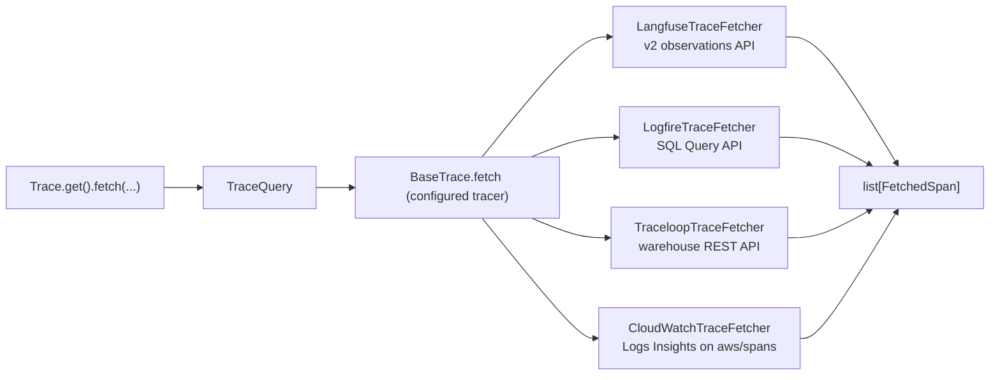

# #803: Agent evaluation on production traffic

Evaluates an agent on its real production traffic in three phases: **fetch spans → group them into traces
and evaluate each trace → store the results**. Phase 1 is an Agent Kernel core capability: the configured
tracer reads its spans back from the provider's cloud (Langfuse, Logfire, Traceloop, AWS CloudWatch) through
one provider-neutral call, `Trace.get().fetch(...)`. Phases 2 and 3 are **not** AK core: they are user code,
shown in one AWS example. One AK serverless Lambda serves the agent (`/chat`) and two custom routes:
`POST /eval` grades every trace of a session with an Opik-based `AKEvaluator` subclass and writes the results
to the example's own DynamoDB table, and `GET /check` reports whether every request of that session has been
graded. The weekly integration test drives the whole loop over HTTP.

| Phase | What | Where it lives |
|---|---|---|
| 1. Fetch | `Trace.get().fetch(...)`, `TraceQuery`, `FetchedSpan`, one fetcher per tracer | `ak-py/src/agentkernel/trace/` |
| 2. Evaluate | `TraceCase` built from a trace's spans; `OpikTraceEvaluator(AKEvaluator)` | example `evaluator/` |
| 3. Store | `EvaluationStore` over one DynamoDB table | example `evaluator/` |
| 2–3 runtime | one AK serverless Lambda (`/chat`, `/eval`, `/check`), the DynamoDB table, its IAM policy | example `lambda.py`, `deploy/main.tf` |

The example is `examples/aws-serverless/langfuse-trace-evaluation/`.

## Terminology

- **Span:** one unit of work with a start and an end time (an LLM call, a tool call, a whole agent run).
  It can have a parent span, so the spans of a run form a tree. Langfuse calls spans "observations".
- **Trace:** every span that shares one `trace_id`, i.e. the whole tree for one AK request (one message
  in, one reply out). No provider stores a trace as its own record: it is always a group of spans.
- **Root span:** the trace's top span, the one with no parent. On Langfuse, Logfire and CloudWatch it is
  the AK wrapper span `Agent Kernel <Framework>`; Traceloop runners add none, so it is the framework's own.
- **Session:** the traces that share one AK `session_id` (a conversation). Every provider stores the
  session id on spans, not on a trace record.
- **Finished run:** the root span has ended with an output. Says nothing about the other spans.
- **Complete trace:** every span of the trace is readable from the provider. A finished run's trace can
  still be incomplete for a while, because providers ingest spans asynchronously (§Open questions).

## Motivation

### Phase 1

- #803's evaluation pipeline runs over traces that already exist in the user's tracing provider, so it
  needs a way to read them back. Today the trace subsystem is write-only:
  - `BaseTrace` declares only `init()` and one runner method per framework (`trace/base.py:6-54`).
  - The `Trace` facade forwards those methods and nothing else (`trace/trace.py:65-118`).
- All four built-in providers have a usable read API (`research/provider-read-apis.md`):
  - Langfuse: v2 observations API, already reachable through the client AK holds (`trace/langfuse/langfuse.py:24`).
  - Logfire: SQL Query API, which needs a separate **read** token.
  - Traceloop: the warehouse spans REST API; the SDK has no read client.
  - CloudWatch: Transaction Search stores every span sent to X-Ray as OTel JSON in the `aws/spans` log
    group, which CloudWatch Logs Insights can query (`research/provider-read-apis.md` §6).
- The providers don't share a vocabulary, so callers need one neutral span shape and one span kind:
  - Langfuse returns its own observation model with its own types (GENERATION, TOOL, AGENT, ...).
  - Logfire, Traceloop and CloudWatch return near-raw OTel spans in about 5 attribute conventions. One trace can mix
    several conventions (`research/span-formats.md` §2, §4).
- Each provider records AK's session id differently:
  - Langfuse sets `session_id` on every span through `propagate_attributes` (`trace/langfuse/openai.py:34` and 5 siblings).
  - Traceloop sets it as an association property on every span (`trace/openllmetry/openai.py:28`).
  - Logfire sets it only on the AK wrapper span (`trace/logfire/openai.py:30` and 5 siblings).
  - CloudWatch sets `session.id` on the run span and, through `SessionSpanProcessor`, on every span started
    during the run (`trace/cloudwatch/cloudwatch.py:35-44`, `:93`).
- **Logfire currently erases the session id.** `logfire.configure(...)` passes no scrubbing options
  (`trace/logfire/logfire.py:30`), so the default scrubber replaces the value of any attribute matching
  "session" (`research/span-formats.md` §5.1). Filtering Logfire traces by session is impossible until
  this is fixed.
- Langfuse removes its v1 trace/observation read endpoints from Langfuse Cloud on 16 Nov 2026, so only
  the v2 API can be relied on (`research/provider-read-apis.md` §1).

### Phases 2 and 3

- Evaluation and storage logic is user-specific (which metrics, which thresholds, which database), so AK
  shows it in an example instead of shipping a fixed pipeline. A user copies the example and changes the
  metrics and the store.
- AK's evaluators can't score production traces as they are: every built-in `AKEvaluator` needs an
  expected answer and raises `AKMissingInput` without one (`test/core/evaluator/deepeval.py:44,55`,
  `opik.py:48,61`, `jev.py:62`). Production traffic has no expected answer. The `AKEvaluator` ABC itself
  (`test/core/evaluator/base.py:49-66`) is generic, so a reference-free subclass fits it.
- The AK serverless module can host the evaluator next to the agent, with limits the example works around:
  - It creates one request-handler Lambda and always routes the chat endpoint to it, followed by any
    `gateway_endpoints` (`ak-deployment/ak-aws/serverless/state.tf:75-79`). Custom routes are matched
    exactly in Python through `Lambda.register`, as `examples/aws-serverless/schedule-openai/lambda_request_handler.py:43-129` does.
  - It takes no extra IAM policies, but outputs the request handler's role name and function ARN
    (`ak-deployment/ak-aws/serverless/outputs.tf:5,18`), so the example attaches its own policy.
  - Its API Gateway sets no integration timeout, so AWS's 29-second default applies. Grading a session
    (a Langfuse fetch plus up to four LLM judges per trace) can exceed that.
  - `Lambda.handler` hands every event to the REST router (`deployment/aws/serverless/aklambda.py:70-82`),
    which reads `event["path"]` and raises when no route matches (`core/router/rest_lambda.py:391,411`).
    A non-HTTP event (an asynchronous self-invoke) therefore fails unless the entry point handles it first.
  - The request handler defaults to a 45 s timeout and 128 MB (`ak-deployment/ak-aws/serverless/variables.tf:344-345`).
- The evaluator's dependencies don't fit a zip Lambda. Installing `agentkernel[langfuse,opik]` plus
  `boto3` for Lambda's Linux/Python 3.12 platform measured 283 MB unpacked (86 MB zipped); `litellm`,
  which `opik` depends on, is 117 MB of it. Lambda's zip limit is 250 MB unpacked, so the Lambda ships
  as a container image (10 GB limit), as the sibling `aws-serverless` examples already do.
- At `develop` HEAD the AK Langfuse runners never flush the Langfuse client (`trace/langfuse/openai.py:34-40` and 5 siblings),
  unlike the CloudWatch tracer, which flushes after each run on Lambda because "a frozen Lambda sandbox
  never runs the batch processor's background export" (`trace/cloudwatch/cloudwatch.py:59-60,98-99`).
  Without a flush, an agent on Lambda can hold its spans until its next invocation or lose them when the
  sandbox is recycled, so the evaluator would see no traces. Phase 1 fixes this in core.

## Phase 1: Fetch spans (Agent Kernel core)

### Public API

- `Trace.fetch(query: TraceQuery | None = None, **filters) -> list[FetchedSpan]` on the `Trace` facade.
  - Keyword filters build a `TraceQuery`; an explicit `query` is passed through unchanged.
  - Passing both `query` and keyword filters raises `ValueError`, so filters are never silently ignored.
  - When tracing is disabled (`Trace._instance is None`), raise `AKConfigError` naming `trace.enabled`.
  - Delegates to the configured tracer's `fetch(query)`.
- `agentkernel.trace` exports `TraceQuery`, `FetchedSpan`, `SpanUsage`, `SpanKind` and
  `OTelSpanClassifier`. The classifier is public so that bring-your-own fetchers and consumers (the
  Phase 2 example) can classify OTel attributes the way the built-in fetchers do.
- Synchronous only.

### Query model: `TraceQuery` (Pydantic)

- Fields and defaults:
  - `start: datetime | None = None`, `end: datetime | None = None`
  - `last: timedelta = 1 hour` (used only when `start` is not given)
  - `kinds: list[SpanKind] | None = None` (`None` = every kind)
  - `session_id: str | None`, `trace_ids: list[str] | None`, `name: str | None` (exact span name)
  - `limit: int = 1000`, must be `> 0`
- `window()` resolves the time window:
  - Naive datetimes are treated as UTC.
  - `end` defaults to now; `start` defaults to `end - last`.
  - `start >= end` raises `ValueError`.
  - Bounds apply to span **start** time: `start` inclusive, `end` exclusive.
- Result ordering and limit, the same for every tracer:
  - Spans are returned oldest first.
  - When more than `limit` spans match, the most recent `limit` are kept.

### Result model: `FetchedSpan` (Pydantic)

- Fields:
  - `provider`, `trace_id`, `span_id`, `parent_span_id`
  - `name`, `kind`, `start_time`, `end_time`, `session_id`
  - `input`, `output`, `usage`, `attributes`, `raw`
- `usage: SpanUsage | None` (Pydantic): `input_tokens`, `output_tokens`, `total_tokens`, `cost` (USD), each optional.
  - Covers only the span's own model call, never a roll-up of its children, so summing `usage` over a
    trace's spans gives the trace's total, including LLM calls made inside tools and sub-agents.
  - `None` when the span records no model call (tool, agent and wrapper spans usually).
  - `total_tokens` falls back to `input_tokens + output_tokens` when the span reports no total.
  - Cost is never computed by AK: it is whatever the provider or instrumentation reports.
- `input`/`output` are returned exactly as the provider stores them (often JSON strings). They are not
  parsed or normalised.
- `raw` holds the provider's full record, so later phases can re-normalise without fetching again.
- Each `span_id` appears at most once in a result.

### Span kinds

- `SpanKind` (str enum): `agent`, `llm`, `tool`, and `span` (everything else: AK wrapper, turn, chain, workflow).
- `OTelSpanClassifier` (class) classifies each raw OTel span by itself, never once per provider:
  - Precedence:
    1. `openinference.span.kind`
    2. `traceloop.span.kind`
    3. `gen_ai.operation.name`
    4. Logfire message template (`Function:` → tool, `Agent run:` → agent) or the `LLM` tag
    5. otherwise `span`
  - Must classify every span in the captured dumps the way `research/span-formats.md` §3–§4 labels it
    (AGENT / LLM / TOOL, everything else `span`).
  - Also extracts `input`/`output`, the session id and `usage` from the known attribute keys of each convention.
  - `usage` reads only per-call keys (`gen_ai.usage.*`, `llm.token_count.*`, Pydantic AI's `operation.cost`).
    It deliberately ignores roll-ups: Pydantic AI's `gen_ai.aggregated_usage.*` on the agent-run span, and
    the OpenAI Agents `usage` JSON that Logfire puts on turn and workflow spans
    (`research/span-formats.md` §3–§4).
- Langfuse maps its own observation types: `GENERATION` → llm, `TOOL` → tool, `AGENT` → agent, every
  other type → span.

### Tracer interface (`BaseTrace`)

- Add `fetch(self, query: TraceQuery) -> list[FetchedSpan]`.
  - **Not abstract.** The default raises `NotImplementedError` naming the tracer class. This is a
    deliberate departure from the all-abstract `BaseTrace` (`trace/base.py:7-54`): an abstract method
    would make every existing bring-your-own tracer impossible to instantiate.
- No new factory or config selector: the tracer that sends (`trace.type`, `Trace._build`,
  `trace/trace.py:38-63`) is the one that fetches. Bring-your-own tracers opt in by overriding `fetch`.
  - Bring-your-own tracers already exist: a dotted `trace.type` resolves to any `BaseTrace` subclass
    (`trace/trace.py:64`), so fetching comes to them through the same override.
- **`TraceFetchContract`** (pytest class, `agentkernel.trace.testing`), the conformance suite every fetch
  implementation subclasses, built-in or bring-your-own, as `SecretProviderContract` is for secret
  providers (`secret/testing.py:15`).
  - The subclass supplies a `tracer` fixture and `seed(tracer, spans)`, which makes those spans exist in
    its backend.
  - It checks the shared result contract: oldest first, unique span ids, the window on span start
    (start inclusive, end exclusive), `limit` keeps the most recent, and the kind, session, trace-id and
    name filters, including that a span missing the filtered value is excluded.
  - Run against: a bring-your-own in-memory tracer (also the documentation example), and the Langfuse and
    Traceloop fetchers over fakes of their APIs.
  - Not run against Logfire or CloudWatch: a faithful fake would re-implement their query languages (SQL,
    Logs Insights). Their query translation stays covered by their own tests.
- `TraceQuery.matches(span)`: one local check of every filter (window, kinds, session, trace ids, name),
  for fetchers whose server-side filters are approximate. Langfuse and Traceloop apply it to every span,
  so their results honour the contract whatever the API's own boundary rules are.
  - Strict: for each active filter, the span must report a value that satisfies it. A span with no
    start time, or with no session id (or name) when that filter is set, is rejected.
  - Langfuse requests the `basic` field group, which carries `sessionId`, and Traceloop puts the session
    on every span, so strict matching drops nothing they return correctly.
- Each built-in tracer delegates to one fetcher class in `trace/<provider>/fetch.py`, imported lazily
  inside `fetch`:
  - `LangfuseTraceFetcher`, `LogfireTraceFetcher`, `TraceloopTraceFetcher`, `CloudWatchTraceFetcher`.
- Fetcher modules import no provider SDK at module scope, so they can be unit-tested without the extras.

### Langfuse fetcher

- Reuses the authenticated client the tracer already holds. No new credentials.
- Calls `api.observations.get_many` (v2) only, following the cursor until it is exhausted.
  - Fields `core,basic,time,io,metadata,model,usage,metrics`; page size 100 (Langfuse caps a response at 5 MB).
  - Window → `from_start_time` / `to_start_time`; `session_id` and `name` are forwarded.
  - `expand_metadata=attributes`: Langfuse cuts metadata values to 200 characters unless their key is
    listed (SDK `api/observations/client.py`, `expand_metadata` docstring), and the span's OTel attributes
    live under `metadata.attributes`.
  - Every observation is re-checked with `TraceQuery.matches`.
- Sends one paginated request per requested Langfuse type × requested trace id, because each direct
  parameter takes a single value.
  - If `kinds` includes `span`, no type filter is sent and the kinds are filtered locally.
- `attributes` = `metadata.attributes` when present, else `metadata`.
- `usage` from Langfuse's own `usageDetails` (`input`/`output`/`total`) and `totalCost` (else
  `costDetails.total`). Langfuse prices model calls server side, so cost is filled for every priced model.

### Logfire fetcher

- Reads the read token from `LOGFIRE_READ_TOKEN`. The region comes from the token, as the SDK's
  `LogfireQueryClient` does.
- Queries the `records` table with SQL (`kind = 'span'`) through `LogfireQueryClient.query_json_rows`.
  - Window → `min_timestamp` / `max_timestamp`.
  - `kinds` → SQL equivalents of the classifier. `span` → the negation of the other three, made
    NULL-safe with `COALESCE`.
  - `name` matches `span_name` or `message`; `trace_ids` → `trace_id IN (...)`.
  - `session_id` → every span of the traces whose wrapper span carries that session id (a `trace_id`
    subquery). Each returned span gets `session_id` set to the queried value.
  - All string values are SQL-escaped by doubling single quotes.
- Pages past the 10,000-row limit by walking backwards on `start_timestamp`, deduplicating by span id.
- Spans are classified after merging `span_name` (the message template) and the `tags` column into the
  attributes.
- **Scrubbing fix:** `Logfire.init()` passes `logfire.ScrubbingOptions(callback=...)`, and the callback
  keeps exactly `("attributes", "session_id")`. Every other match is still redacted.
  - Privacy: AK does not make session ids opaque. `session_id` is any client string
    (`core/model.py:403`), and the session guide suggests building it from a user id
    (`docs/docs/core-concepts/session.md:109`). This change only brings Logfire in line with the other
    three tracers, which already export the session id unscrubbed (§Motivation). It adds no new exposure
    class, so it is not opt-in.
  - The fetch docs say this, and tell users who need privacy to use non-identifying session ids
    (e.g. a hash or a random id).

### Traceloop fetcher

- Reuses the SDK's own variables: `TRACELOOP_API_KEY`, and `TRACELOOP_BASE_URL` (default
  `https://api.traceloop.com`).
- Calls `GET /v2/warehouse/spans` over `httpx`, sorted newest first, following `next_cursor`.
  - Window → `from_timestamp_sec` / `to_timestamp_sec` in whole seconds (`floor(start)`, `ceil(end)`), with
    the exact window applied locally by `TraceQuery.matches`; `name` → `span_name`.
  - `filters`:
    - `gen_ai.operation.name in [...]` for the requested kinds
    - `traceloop.association.properties.session_id equals` the session id
    - `trace_id in [...]` for the trace ids
- Server-side filters are best effort (they have not been tested against the live API), so every span is
  re-checked locally with `TraceQuery.matches`.
- **Documented as best effort**: the 24-hour free-plan retention, the untested filter ids, and the
  ServiceNow acquisition (`research/provider-read-apis.md` §3).
- Accepts ISO timestamps or epoch values in s, ms, µs or ns; `end_time = start_time + duration_ms`.

### CloudWatch fetcher

- Credentials and region come from the standard AWS chain, as on the send side. No new credentials.
  - Region: `AWS_REGION`, then the botocore chain. The tracer's existing lookup
    (`trace/cloudwatch/cloudwatch.py:137`) moves into a shared `CloudWatch.region()` static method that both
    the exporter and the fetcher call.
  - The identity needs `logs:StartQuery`, `logs:GetQueryResults` and `logs:StopQuery` on `aws/spans`. The
    send-side `AWSXrayWriteOnlyAccess` policy does not grant them.
  - The constructor also accepts a ready botocore `logs` client, a region and a log group (default
    `aws/spans`), for callers that manage their own AWS sessions.
- Runs Logs Insights queries over `aws/spans` (`StartQuery`, then polls `GetQueryResults`) selecting
  `@timestamp` and `@message`, sorted by `@timestamp` newest first.
  - Each `@message` is the span's OTel JSON (`traceId`, `spanId`, `parentSpanId`, `name`,
    `startTimeUnixNano`, `endTimeUnixNano`, `attributes`). It becomes `raw`, and its attributes are
    classified with `OTelSpanClassifier`.
  - Attributes are flattened to dotted keys, so the classifier works whether the record stores them flat
    (`"session.id"`) or nested.
  - `kinds` → Logs Insights equivalents of the classifier for the conventions the CloudWatch runners emit
    (OpenInference, OTel GenAI). If `kinds` includes `span`, no kind filter is sent and kinds are filtered
    locally.
  - `name` → `name = ...`; `trace_ids` → `traceId in [...]`; `session_id` → `attributes.session.id = ...`.
  - String values are written as JSON string literals.
- The window is applied to the span start time locally. AWS does not document whether `@timestamp` is a
  span's start or end, so the query's time range runs 15 minutes past `end` (never past now) and spans
  that started outside the window are dropped.
- Pages past the 10,000-row limit by walking backwards on `@timestamp` (whole seconds), deduplicating by
  span id. If one second holds a full page, it logs a warning and stops.
- A query that does not complete within `timeout` (default 120 s) is stopped with `StopQuery`.
- `aws/spans` is the only source. It exists only when Transaction Search is on and the spans reach X-Ray
  (the default export does; a collector must forward to X-Ray), which the docs state as a requirement.
  - A missing log group (`ResourceNotFoundException` from `StartQuery`) raises `AKConfigError` saying to
    enable Transaction Search; every other AWS error propagates unchanged.

### Langfuse flush on AWS Lambda (send side)

- Every Langfuse runner flushes the Langfuse client after each run, including failed ones, when
  `AWS_LAMBDA_FUNCTION_NAME` is set, as the CloudWatch tracer already does
  (`trace/cloudwatch/cloudwatch.py:59-60,98-99`).
  - One shared `LangFuse.flush_on_lambda(client)` static method, called from a `finally` in all six
    runners.
  - A failed flush is logged, never raised: tracing must not fail the agent's reply.
  - Cost: one export round trip per agent run on Lambda, the same trade the CloudWatch tracer makes.
- Required by Phases 2–3 (the evaluated agent runs on Lambda), but it fixes every Langfuse-on-Lambda user.

### Error handling

- Missing Logfire read token or Traceloop API key → `AKConfigError` naming the env var.
- No AWS region for CloudWatch → `AKConfigError` naming `AWS_REGION`.
- No `aws/spans` log group → `AKConfigError` saying to enable Transaction Search.
- A CloudWatch Logs Insights query that ends `Failed`, `Cancelled`, `Timeout` or `Unknown` → `RuntimeError`
  naming the status; one still running at `timeout` → `TimeoutError`, after `StopQuery`.
- Provider SDK or HTTP errors propagate unchanged. No retries or rate-limit backoff.
- A tracer without `fetch` → `NotImplementedError`.

### Configuration

- **No new `AKConfig` fields.** Fetching reuses `trace.enabled` and `trace.type` (`core/config.py:468-473`).
- Credentials are read from environment variables, exactly as on the send side: the provider SDKs read
  `LANGFUSE_*`, `TRACELOOP_API_KEY` and `LOGFIRE_TOKEN` from the environment themselves, and no tracer
  goes through `SecretManager`. The fetchers' two new reads (`LOGFIRE_READ_TOKEN`, `TRACELOOP_API_KEY`)
  use `os.getenv` the same way.
- One new environment variable, `LOGFIRE_READ_TOKEN`. It can't be derived from the existing
  `LOGFIRE_TOKEN`, because Logfire write tokens cannot read.
- Optional extras: add `httpx>=0.27.0` to `openllmetry` and `logfire` (`ak-py/pyproject.toml:31-36`).
  Traceloop's fetcher and Logfire's query client import it, and neither SDK guarantees it.
- CloudWatch needs no new variable or extra: the `cloudwatch` extra already ships `botocore`
  (`ak-py/pyproject.toml:37-42`), which provides the CloudWatch Logs client.

### Testing

- New `ak-py/tests/test_trace_fetch.py`, which needs no provider SDK:
  - Langfuse uses a fake client; Logfire a fake `logfire.experimental.query_client` module; Traceloop an
    `httpx.MockTransport`; CloudWatch a fake botocore `logs` client.
- Covers:
  - query window resolution
  - the classifier on the captured attribute shapes
  - the facade (disabled tracing, kwargs, `NotImplementedError`)
  - per fetcher: request translation, pagination, local filtering, limit semantics
  - Logfire SQL escaping
  - Traceloop timestamp formats
  - `usage` on the captured attribute shapes, including the roll-ups it must ignore, plus the Langfuse
    usage mapping
  - CloudWatch: dropping spans that started outside the window, failed and timed-out queries
    (`StopQuery`), and Logs Insights literal escaping
- `ak-py/tests/test_trace_logfire.py`: the fake `logfire` module gains `ScrubbingOptions`, plus a test
  that the callback keeps `session_id` and redacts everything else.
- New `ak-py/tests/test_trace_fetch_contract.py`: `TraceFetchContract` against the in-memory
  bring-your-own tracer, Langfuse (fake `observations.get_many`) and Traceloop (fake warehouse over
  `httpx.MockTransport`). The fakes treat both window bounds as inclusive, so the exclusive end has to
  come from the fetcher.
- New `ak-py/tests/test_trace_langfuse_flush.py`, parametrized over all six Langfuse runners (each has its
  own `finally`): every runner flushes on Lambda after a successful and a failed run. Plus, once:
  `flush_on_lambda` doesn't flush off Lambda and logs a failing flush.

### Docs

- A "Fetching Spans Back" section in `docs/docs/advanced/traceability.md` covering:
  - the filters
  - `usage`, how to total it over a trace, and which providers report cost
  - credentials per provider
  - session ids reach every provider unscrubbed, so they shouldn't contain personal data
  - provider limits (ingestion delay, Logfire row cap, Traceloop free-plan retention, CloudWatch's
    Transaction Search requirement, row cap and scan cost)
  - the extra IAM read permissions CloudWatch needs

## Phase 2: Evaluate (example)

### Trace case: `TraceCase` (Pydantic)

- **Why it exists:** `fetch` returns a flat list of spans, and the facts a judge needs are spread across
  them. For one question to the example agent, Langfuse holds about nine spans
  (`research/span-formats.md` §3): the AK wrapper span has the question and the final answer, the
  `get_order_status` tool span has the tool's arguments and result, the agent spans name the triage and
  support agents, and the two generation spans carry the token counts. `TraceCase` gathers them into
  one object per run, so the evaluator reads `case.user_input`, `case.tool_calls` and `case.output`
  instead of searching spans.
- Example: the spans of one run become
  `TraceCase(user_input="Where is order A-1001?", tool_calls=[ToolCall(name="get_order_status", input='{"order_id": "A-1001"}', output="Shipped, arriving Friday")], agents=["triage", "support"], output="Your order A-1001 has shipped and arrives Friday.", usage=SpanUsage(total_tokens=812), latency_ms=2350)`.
- The unit of evaluation is one **trace**: every span that shares one `trace_id`.
  - One AK request is one trace. `OpenAIRunner.run` makes one `Runner.run` call per request
    (`framework/openai/openai.py:247`), and the Langfuse, Logfire and CloudWatch runners wrap it in one AK
    span that every other span nests under. The captured Langfuse, Logfire and Traceloop runs each produced
    one trace (`research/span-formats.md` §3).
  - A request is counted by its trace's **parentless root span**, never by span name, so a stray trace
    with no root is never counted as a request. On Traceloop the root is the framework's `Agent Workflow`,
    since its runners add no AK span (`research/span-formats.md` §5.2).
  - A trace says nothing about completeness: the provider can hold only part of a trace at any moment,
    and no provider exposes a "trace complete" signal. The job grades a trace only when it is ready
    (§Evaluation run).
- `TraceCase.from_spans(trace_id, spans)` builds the case from that trace's `FetchedSpan`s:
  - `root`: the span with no parent (the AK wrapper `Agent Kernel <Framework>`, which holds the run's
    input and output). No root → no case.
  - `user_input` / `output`: the root's `input` / `output`, as strings.
  - `session_id`: the root's.
  - `tool_calls`: every `tool` span, oldest first: name, input, output, and whether it failed (Langfuse
    observation `level == "ERROR"`, read from `raw`). A span Langfuse typed as a plain span still counts
    when its OpenInference attributes say `TOOL` (`OTelSpanClassifier.classify`), since whether Langfuse
    maps OpenInference kinds to its own types is still unverified (`research/provider-read-apis.md` §5).
  - `agents`: the names of the `agent` spans (the triage agent and any sub-agent it handed off to).
  - `usage`: the sum of every span's `usage` (input, output, total tokens; cost when Langfuse priced it).
  - `latency_ms`: root end − root start.
  - `finished`: the root span has an `end_time` and an output, so the run itself finished. This does not
    prove every span of the trace is readable yet. Unfinished cases are never graded; their row says so
    (§Table).
  - `missing_parents`: the number of spans whose `parent_span_id` is not a span of the trace, i.e. a span
    in the middle of the tree is not readable yet.
  - `ready(now, settle)`: `finished`, the root span ended at least `settle` before `now`, and
    `missing_parents == 0`.
- `transcript()`: one text block with the request, each tool call (name, arguments, result) and the final
  answer. The agent judges read it.

### Evaluator: `OpikTraceEvaluator(AKEvaluator)`

- Subclasses AK's `AKEvaluator` (`test/core/evaluator/base.py:49-66`). One instance scores **one** metric,
  so each `evaluate_by_llm(case)` returns one `AKEvaluationResult`, as the ABC's contract expects.
  - `OpikTraceEvaluator.all(config)` returns one instance per metric below.
  - `evaluate_by_score` raises `AKMetricNotSupported`: all four metrics are LLM judges.
- Takes a `TraceEvaluationCase`, an `AKEvaluationCase` subclass that adds `transcript` and
  `tool_call_count`. `user_input` and `actual` come from the trace, `context` holds the tool results (the
  field the ABC carries but no built-in reads), and `expected` stays empty.
- Judge model: `AKTestConfig.llm` (`provider/model`), set to `openai/gpt-4.1-mini` by
  `AK_TEST__LLM__MODEL=gpt-4.1-mini` on the Lambda. `OPIK_TRACK_DISABLE` and `track=False`, as
  AK's own Opik evaluator does, so nothing is sent to Opik's cloud.
- Each judge call is tried twice; a second failure (exception, or Opik `scoring_failed`) becomes a result
  with `score=None`, `passed=None` and the error in `reason`. One bad metric never fails the trace or the
  run.

### Metrics

| Metric | Opik metric | Input | Runs when | Pass rule (threshold 0.5) |
|---|---|---|---|---|
| `task_completion` | `AgentTaskCompletionJudge` | transcript | always | score ≥ 0.5 |
| `tool_correctness` | `AgentToolCorrectnessJudge` | transcript | the trace has ≥ 1 tool call | score ≥ 0.5 |
| `answer_relevance` | `AnswerRelevance(require_context=False)` | input, output | always | score ≥ 0.5 |
| `hallucination` | `Hallucination` | input, output, tool results as context | always | score **<** 0.5 (1 means hallucinated) |

- Each result carries `higher_is_better` in `metadata`, so readers don't misread `hallucination`.
- Not judged, but computed from the spans and stored with the trace: tool-call count, failed tool calls,
  latency, tokens and cost.

## Phase 3: Store (example)

### Table

- One DynamoDB table, `<prefix>-trace-evaluations`, on-demand billing, created by the example's `main.tf`.
- Key: partition key `trace_id` (S), no sort key.
- One row per trace that `/eval` has found, holding everything about it:
  - `progress`: where the trace is in grading (table below), with `updated_at` (ISO 8601 UTC) for when
    it was set, and `error` on `failed` rows.
  - The trace summary: `session_id`, `started_at`, `latency_ms`, `input`, `output`, `tool_calls`,
    `agents`, `span_count`, token and cost totals, `tool_error_count`, `provider`.
  - Only on `graded` rows:
    - One column per metric (`task_completion`, `tool_correctness`, `answer_relevance`,
      `hallucination`), each a map of that metric's `AKEvaluationResult` fields (`score`, `threshold`,
      `passed`, `reason`, `evaluator`, `higher_is_better`). `tool_correctness` is absent when the trace
      has no tool call.
    - `passed` (every scored metric passed), `evaluated_at`, and the gzipped spans (`spans_gz`).

| `progress` | Meaning | Changes to |
|---|---|---|
| `pending` | found and finished, but not ready yet (§Evaluation run) | `grading`, on a later `/eval` |
| `grading` | ready and queued; the judges are running | `graded`, or `failed` |
| `graded` | every metric judged and stored | never changes |
| `failed` | grading raised an error; the row's `error` column says which | `grading`, on a later `/eval` |
| `unfinished` | the root span has no output (the agent run failed) | never changes; never graded |

- The session's progress is read from its rows: `/check` counts them by `progress` (§Routes). Grading is
  over for a session when `graded` equals the number of requests sent; a `/eval` round is over when no
  row is `grading`.
- Size: an item is limited to 400 KB, and the limit is enforced on the whole serialised item, not
  field by field.
  - `input`, `output`, each tool call's input/output and each metric's `reason` are cut to 4,096
    characters each. At most 25 tool calls are stored (`tool_calls_truncated` marks a cut); the counts
    still cover every call.
  - The item is then measured as a whole. If it's still over a 380 KB budget, it drops tool calls and
    shortens `input`/`output` until it fits. Metric columns are never dropped.
  - On `graded` rows, the trace's full spans (`FetchedSpan` dumps, including `raw`) are stored
    gzip-compressed in `spans_gz` only when they fit in the remaining budget. Otherwise they're left out and
    `spans_truncated` is set.
  - So no trace can make `PutItem` fail on size and fail the run.
- Indexes:
  - `session_id-index` (partition `session_id`): every row of a session.
- Numbers are written as `Decimal` (boto3 rejects `float`).
- TTL attribute `expires_at`, set 90 days after `updated_at`.

### Writes: `EvaluationStore`

- `mark(case, progress)`: one `PutItem` of the trace's row with the summary and the given `progress`
  (`pending`, `grading` or `unfinished`). It never overwrites a `graded` row (a condition on the write).
- `save(case, results)`: one `PutItem` of the whole row with `progress = graded`, after all its metrics are
  judged.
  - A single `PutItem` is atomic: the row turns `graded` with every metric column at once, or stays as it
    was. An error mid-trace leaves the row for `fail` to mark (§`grade`).
  - The key is the trace id, so re-grading overwrites instead of duplicating.
- `progress(trace_ids) -> dict[str, TraceProgress]`: each trace's current `progress` and `updated_at`
  (`BatchGetItem` with a strongly consistent read, 100 keys per call), so it always sees the latest write.
- `fail(trace_ids, error)`: sets `progress = failed`, the `error` text and `updated_at` on each row
  (`UpdateItem`, only where `progress` is still `grading`).
- `session(session_id) -> SessionProgress`: one `Query` on `session_id-index` giving the session's rows
  counted by `progress` and the `error` of each `failed` row. Only `/check` uses it: the index is updated
  asynchronously (usually within a second), which a poller doesn't mind.

## Phases 2–3: the Lambda, deployment and tests (example)

### Example layout

- `examples/aws-serverless/langfuse-trace-evaluation/`, with one deployable in `deploy/main.tf` and one
  script, `simulate_traffic.py` (§Simulated traffic):
  - **One AK serverless Lambda** (`lambda.py`, `config.yaml`, `evaluator/`), with `trace.enabled: true`
    and `trace.type: langfuse`. It serves three routes:
    - `POST /api/v1/chat`: the agent under evaluation, which produces the traces.
    - `POST /api/v1/eval`: finds one session's traces and starts grading the ready ones (§Routes).
    - `GET /api/v1/check`: counts that session's traces by `progress` (§Routes).
  - It imports AK for the agent, `Trace.fetch`, `Lambda` and the `AKEvaluator` ABC.
- No scheduled evaluation: grading runs only when `/eval` is called.
- Example code follows the house rule "classes, not scripts": `EvaluationAPI`, `TraceEvaluationJob`,
  `TraceCase`, `OpikTraceEvaluator`, `EvaluationStore`, `TrafficSimulator`.
  - The routes and the entry point are `EvaluationAPI` methods. `lambda.py` registers the bound methods
    with `Lambda.register`, whose router stores any callable
    (`deployment/aws/serverless/core/router/rest_lambda.py:368-377`), and sets `handler = api.handler`.

### Lambda entry point

- `EvaluationAPI.handler(event, context)`, exposed as `lambda.handler`:
  - `event["action"] == "grade"` (the asynchronous self-invoke from `/eval`) →
    `TraceEvaluationJob.grade(event["session_id"], event["trace_ids"])`.
  - Every other event → `Lambda.handler(event, context)`, which serves `/chat`, `/eval` and `/check`.
  - Needed because `Lambda.handler` sends every event to the REST router, which fails on an event with
    no path (§Motivation).

### Routes

- Both paths are declared in `gateway_endpoints` (`deploy/main.tf`) and registered with
  `Lambda.register` in `lambda.py`. The router matches paths exactly, so the session id travels in the
  body or the query string, never in the path.
- `POST /eval`, body `{"session_id": "..."}`:
  - Missing `session_id` → `400`.
  - Runs `TraceEvaluationJob.prepare(session_id)` (§Evaluation run) inside the request: one Langfuse fetch
    and a few DynamoDB writes, well within API Gateway's 29 s. `prepare` never builds the judges (Opik
    and litellm are slow to load); they are built on the first `grade`, so a cold first `/eval` stays
    fast. Every found trace has its row and
    `progress` before the response, so a `/check` right after `/eval` already sees the `grading` rows.
  - When any trace is `grading`, invokes the same function asynchronously (`lambda.invoke`,
    `InvocationType="Event"`, `FunctionName=context.function_name`, payload
    `{"action": "grade", "session_id": ..., "trace_ids": [...]}`, the traces just marked `grading`).
    The judges run in that second invocation, bound by the Lambda timeout instead of API Gateway's 29 s.
  - The trace ids travel in the payload because the grading can't find them through the session index:
    the index may not show rows written a moment ago.
  - Returns `202` with the prepare counts (`found`, `grading`, `pending`, `unfinished`,
    `already_graded`).
  - Any error in `prepare` (wrong Langfuse keys, a fetch or DynamoDB error, a full fetch result)
    propagates, and `Lambda.handler` returns it as `500 {"error": "Custom handler error: <message>"}`
    (`deployment/aws/serverless/aklambda.py:84-90`), so the caller sees the cause directly.
- `GET /check?session_id=...&expected=N`:
  - Missing or non-integer parameters → `400`.
  - Returns `{"expected", "graded", "grading", "pending", "failed", "unfinished", "errors", "complete"}`:
    - the five counts: `EvaluationStore.session(session_id)`, `0` for a missing `progress`;
    - `errors`: up to 10 `{"trace_id", "error"}` from the `failed` rows;
    - `complete`: `graded >= expected`. More traces than requests can happen: the traffic simulator
      retries a request that got a 5xx, and the agent may already have run (and traced) the first try.
  - `expected` comes from the caller because only the caller knows how many requests it sent. Without
    it, a session where only 2 of 3 traces were found would look complete.

### Evaluation run: `TraceEvaluationJob`

- Two steps: `prepare(session_id)` in the `/eval` request decides each trace's `progress`, and
  `grade(session_id)` in the asynchronous invocation judges the `grading` ones.
- Both fetch the session the same way: `Trace.get().fetch(session_id=session_id, last=timedelta(hours=24),
  limit=5000)`.
  - Langfuse sets the session id on every span (§Motivation), so one call returns the whole session.
  - A full result (5,000 spans) is an error: one session in this example never comes close, and
    silently grading a truncated session would be worse.
  - Spans are grouped by `trace_id`. Each trace with exactly one parentless root span is one request
    (§Trace case). A trace with no root span, or several, is logged and gets no row.

#### `prepare(session_id)`

- Reads the found traces' current rows (`EvaluationStore.progress`), then for each trace:

  | Current row | Trace | New `progress` |
  |---|---|---|
  | `graded` | any | unchanged (counted as already graded) |
  | none, `pending`, `failed` or `grading` | root span has no output | `unfinished` |
  | none, `pending`, `failed` or `grading` | finished, not `ready(now, SETTLE)` | `pending` |
  | none, `pending`, `failed` or `grading` | `ready(now, SETTLE)` | `grading` |
  | `unfinished` | any | unchanged |

- `failed` rows are retried: the next `/eval` marks them `grading` again, so a passing error (a rate
  limit, a DynamoDB throttle) doesn't lose the trace.
- `grading` rows are queued again too. `/eval` can't see whether such a row is being graded right now or
  was left behind by an invocation that was killed before it could mark it `failed` (§`grade`), so it
  treats both the same and starts a new grading.
  - Cost: calling `/eval` while a grading is still running judges those traces twice. Both write the
    same row, so the data stays right; only judge calls are wasted. In the weekly test this happens only
    when grading takes longer than a round's 3-minute poll (§Testing).
- **Readiness:** `SETTLE` is 2 minutes.
  - Why a settle time: OTel exports a span only once it ends and the root span ends last, so a finished
    root span means every span has been sent. What remains is the provider's asynchronous ingestion.
    No provider exposes a "trace complete" signal, and each one's own online evaluation waits a fixed
    time instead (Langfuse's trace evaluators 10 s after the first event, AWS AgentCore 15 minutes of
    inactivity).
  - Why 2 minutes: Langfuse makes data readable within seconds usually, and up to about 1–2 minutes in
    normal operation (Langfuse FAQ "How long until traces appear", support handbook). The Langfuse flush
    on Lambda (§Langfuse flush) removes the export delay on the agent's side.
    - Python SDKs before 4.7.0 use a slower ingestion path (up to 15 minutes), and AK's `langfuse` extra
      allows `>=4.2.0` (`ak-py/pyproject.toml:28`), so the example requires `langfuse>=4.7.0`. Whether
      the OpenInference spans also take the fast path is checked in live verification.
  - The parent check catches a missing span in the middle of the tree whatever its delay. A missing
    leaf span (an LLM or tool call with no children) that arrives more than `SETTLE` late is not
    detected; no provider offers a way to, and it affects only that trace's scores.
- A trace not readable at all yet has no row; a later `/eval` finds it.

#### `grade(session_id)`

- Takes the trace ids from the payload, keeps those still `grading` (`EvaluationStore.progress`), fetches
  the session again, and grades each of those traces, oldest first: every metric, then `save` (§Writes).
  Re-fetching picks up any span that arrived since `prepare`. A `grading` trace missing from the fetch is
  marked `failed`.
- Logs a summary (graded, failed, metric errors).
- Failure handling:
  - A judge error is stored on its metric (§Evaluator) and doesn't stop the trace or the run.
  - Any other error while grading one trace (a DynamoDB error, an unexpected exception) is caught: that
    trace's row becomes `failed` with the error, and grading moves on to the next trace.
  - An error before any trace is graded (the fetch fails) marks every `grading` row of the session
    `failed` with that error.
  - Nothing is re-raised; the next `/eval` retries the `failed` rows.
  - What can't be caught: the Lambda killed at its timeout or out of memory, or the `failed` write itself
    failing. Those rows stay `grading`, and the next `/eval` queues them again.
  - AWS's automatic retry of failed asynchronous invocations is turned off (§Deployment), so recovery has
    one rule: the next `/eval`. A retry would also overlap with that `/eval` and pay for the judges twice.
    A user who calls `/eval` by hand sees a killed grading as `grading` in `/check` until they call
    `/eval` again; the README says so.

### Simulated traffic: `TrafficSimulator`

- The example ships its own traffic, so a user can produce traces without real users.
- `TrafficSimulator(chat_url, session_id=None)` only sends traffic. It knows nothing about `/eval` or
  `/check`. `simulate_traffic.py` and the weekly integration test both use it, each in its own process.
  - `chat_url`: the agent's `/chat` URL.
  - `session_id`: the session every request uses. When omitted, a new `uuid4` is generated once in the
    constructor. Exposed as `simulator.session_id`, so the caller can grade and check the same session.
  - `send()`: sends **3 questions** to `chat_url`, one request each, all under `session_id`.
- The 3 questions cover what the metrics look at:
  1. an order-status question the `support` agent answers with `get_order_status` (hand-off + tool call);
  2. an order-status question for an order the tool doesn't know (the tool returns "not found");
  3. an off-topic request the agent should decline (no tool).
- `simulate_traffic.py`: builds a `TrafficSimulator`, calls `send()` and prints the session id. Grading
  is left to the caller: the README shows the `curl` calls to `/eval` and `/check` for that session id.
- The chat URL comes from the `AK_TEST_ENDPOINT` environment variable in both callers, the variable the
  weekly pipeline already sets (§Testing). `simulate_traffic.py` falls back to
  `terraform output agent_invoke_url` in `deploy/` when the variable is unset, for runs outside CI.

### Agent under evaluation

- An OpenAI Agents SDK triage agent that hands off to one specialist sub-agent with one deterministic tool,
  so traces contain an agent hand-off, a tool call and LLM calls.
- Deployed with the AK serverless module like `aws-serverless/openai-auth` (one request-handler Lambda,
  container image, `rest_sync`).
- Its runner needs no handler changes for tracing: the Langfuse runners now flush on Lambda themselves
  (Phase 1 §Langfuse flush on AWS Lambda).

### Deployment (`deploy/main.tf`)

- `module "serverless_agents"`: the AK serverless module (`yaalalabs/ak-serverless/aws`, the version the
  sibling examples pin).
  - `execution_mode = "rest_sync"`.
  - `gateway_endpoints = [{ path = "eval", method = "POST" }, { path = "check", method = "GET" }]`.
  - `request_handler`: `package_type = "Image"`, `timeout = 600` (10 minutes), `memory_size = 1024`
    (the defaults, 45 s and 128 MB, are too small for the judges).
  - Environment: `AK_TRACE__ENABLED=true`, `AK_TRACE__TYPE=langfuse`, the three `LANGFUSE_*` variables,
    `OPENAI_API_KEY`, `AK_TEST__LLM__PROVIDER=openai`, `AK_TEST__LLM__MODEL=gpt-4.1-mini`,
    `OPIK_TRACK_DISABLE=true`, `RESULTS_TABLE`. Plain environment variables, as the sibling examples use.
- `aws_dynamodb_table`: the results table (§Table), created by the example, not by the AK module.
- `aws_iam_role_policy` on `module.serverless_agents.request_handler_lambda_role_name`, granting
  `dynamodb:PutItem`, `UpdateItem`, `BatchGetItem` and `Query` on the table and `<table arn>/index/*`.
- `aws_lambda_function_event_invoke_config` on the request handler with `maximum_retry_attempts = 0`:
  no automatic retry of the grading invocation (§`grade`).
- The self-invoke needs no extra permission: the module already attaches the AWS-managed `AWSLambdaRole`
  policy (`lambda:InvokeFunction` on `*`) to the request handler's role
  (`ak-deployment/ak-aws/serverless/modules/request-handler/main.tf:17-20`).
- Variables: `region`, `prefix`, `openai_api_key`, `langfuse_public_key`, `langfuse_secret_key`,
  `langfuse_base_url` (default `https://cloud.langfuse.com`), plus the base-VPC variables the weekly
  pipeline injects (`vpc_id`, `private_subnet_ids`, `request_handler_security_group_id`).
- Outputs: `agent_invoke_url` (the weekly pipeline needs this name), `results_table_name`.
- `deploy/deploy.sh [local]` builds the image (from PyPI, or from `../../../ak-py/dist` with `local`) and
  runs `terraform apply`, like the siblings.

### Dependencies (`pyproject.toml`)

- Runtime: `agentkernel[aws,openai,langfuse,opik]` and `boto3` for DynamoDB and the self-invoke. `boto3`
  is pinned rather than relying on the Lambda runtime's copy, which container images don't include anyway.
- `dev` group: `agentkernel[test]`, `moto[dynamodb]` for the unit tests, `httpx` for `TrafficSimulator`.

### Testing

- **Unit tests** (`tests/test_evaluator.py`, no cloud access):
  - `TraceCase.from_spans` on hand-built `FetchedSpan`s: root, tool calls, failed tools, usage totals,
    unfinished traces, no root span, `missing_parents`, `ready` on each side of the settle time.
  - `OpikTraceEvaluator` with the Opik metrics monkeypatched: case mapping, the tool-correctness skip,
    the hallucination pass rule, retry then error result.
  - `EvaluationStore` on `moto`: the row shape per `progress` and the metric columns, `mark` never
    overwriting a `graded` row, `progress()`, `session()`, gzip, the whole-item size budget (many long
    multi-byte tool calls), `Decimal`s.
  - `TraceEvaluationJob` with fetch, evaluator and store faked: every row of the `prepare` table (including
    a leftover `grading` row), no row for a trace with no root span, `grade` grading only the payload's
    traces that are still `grading`, an error on a full fetch result, and `grade` marking rows `failed` on
    errors.
  - `TrafficSimulator` over `httpx.MockTransport`: every request carries the given session id, or one
    generated id when none is given.
  - Routes and entry point, with a fake Lambda client: `/eval` runs `prepare`, invokes with
    `InvocationType="Event"` only when a trace is `grading`, and returns `202` with the counts; `500` with
    the error when `prepare` raises; `400`s on bad input; `/check` counts for a session with no rows and
    a mixed one, and `complete` only at `graded >= expected`; `handler` sends the `grade` action to the
    job and every other event to `Lambda.handler`.
- **Weekly integration test** (`lambda_test.py`), added to the weekly tier of
  `.github/integration-test-config.yaml`. Only HTTP calls; it needs no AWS credentials at test time.
  - Session-scoped fixtures read the chat URL from `os.getenv("AK_TEST_ENDPOINT")`, as
    `examples/aws-serverless/openai-auth/lambda_test.py:82-84` does, and build:
    - a `TrafficSimulator(chat_url, session_id=str(uuid4()))`;
    - an `EvaluationClient(chat_url)`, a test helper class in `lambda_test.py` (like `APITestClient` in
      `openai-auth/lambda_test.py:15`). It derives the `/eval` and `/check` URLs by replacing the trailing
      `/chat`, and has `evaluate(session_id)` (`POST /eval`; returns the status code and body) and
      `wait(session_id, expected, timeout=180)` (polls `GET /check` every 10 s until `complete` is true
      or no row is `grading`, or the timeout passes; returns the last response).
  1. `simulator.send()`: the 3 questions to the chat URL, all under `simulator.session_id`.
  2. Wait 150 s: the job's 2-minute `SETTLE` plus 30 s (§Evaluation run).
  3. Up to 3 grading rounds:
     1. `client.evaluate(simulator.session_id)`. Anything but `202` → fail with the response's `error`.
     2. `client.wait(simulator.session_id, expected=3)`, polling for up to 3 minutes. Grading 3 traces
        (12 judge calls) takes well under that; a `grading` row still there after 3 minutes is treated
        as stuck, even though the Lambda timeout (10 minutes) would let it go on.
     3. `complete` → stop. Otherwise wait 30 s and start the next round, whose `/eval` queues every
        trace that isn't `graded` yet: one that reached Langfuse late, was `pending` or `failed`, or was
        left `grading` by a killed invocation. `graded` ones are left alone.
  4. Pass only when `complete` is `true`. Otherwise, after the last round, fail with
     "G of 3 requests graded (P pending, F failed, R still grading, U unfinished)", plus the `errors`.
  - The round count, the waits and the poll timeout are named constants at the top of `lambda_test.py`
    (`INITIAL_WAIT`, `ROUNDS`, `ROUND_INTERVAL`, `POLL_INTERVAL`, `POLL_TIMEOUT`).
  - `AK_TEST_ENDPOINT` is set by `.github/scripts/run_single_test.py:350-370` from the
    `agent_invoke_url` Terraform output.
- Weekly pipeline wiring: `integration-test-weekly.yaml` passes `TF_VAR_langfuse_public_key`,
  `TF_VAR_langfuse_secret_key` and `TF_VAR_langfuse_base_url` (from new repository secrets) to the
  deploy, test and destroy steps of `run-tests`. Nothing else in the pipeline changes.

### Docs

- The example's `README.md`: architecture, the routes and the evaluation run, the table schema, how to
  change metrics or the store, deploy, run `simulate_traffic.py`, and test.
- `docs/docs/examples/overview.md`: list the example.
- `docs/docs/advanced/traceability.md` §Fetching Spans Back: link to the example as the end-to-end use.

## Non-goals

- Phases 2 and 3 in AK core: no evaluation pipeline, results store, scheduler or Terraform module for
  them in AK. The example is the deliverable, and `FetchedSpan` (including `raw`) is its input contract.
- Making the built-in evaluators reference-free. The example subclasses `AKEvaluator` instead.
- Evaluating per span (each LLM or tool call) rather than per trace, conversation-level (session)
  metrics, dashboards over the results, and alerting.
- Scheduled or continuous evaluation of live traffic (time windows, progress tracking, catch-up after
  downtime). The example grades one session when asked; a user who needs a schedule adds one around
  `TraceEvaluationJob`.
- Normalising spans into an AK trace model:
  - JSON-parsing `input`/`output`
  - deduplicating Traceloop + Pydantic AI LLM spans (both carry `usage`, so a plain sum double-counts;
    documented, not corrected)
  - rebuilding trace trees
- Async fetching, local caching of fetched spans, retries or rate-limit handling.
- Whole-trace fetch through Traceloop's undocumented endpoints.
- Other tracing gaps: the Traceloop runners' missing wrapper span, and missing inner spans for some
  provider × framework pairs (`research/span-formats.md` §5.2, §5.4).

## Open questions

### Phase 1

Resolved (kept here so reviewers see the decisions):
- **Credential resolution:** environment variables, the same as the send side (§Configuration).
- **Contract test suite:** shipped now (§Tracer interface), because bring-your-own tracers can fetch.
- **Traceloop support level:** documented as best effort.
- **Fetch-only processes:** keep `Trace.get()` running the send-side `init()`; it validates credentials
  early.
- **Limit semantics:** when more spans match than `limit`, the **newest** `limit` are kept. "Oldest
  first" is only the order of the returned list.
- **CloudWatch span classification:** left as is; the run span stays `span`.
- **Langfuse metadata truncation:** fixed with `expand_metadata=attributes`.
- **Live verification:** run by the change's author against real accounts before merge.
- **CloudWatch spans outside `aws/spans`:** `aws/spans` stays the only source; the requirement is
  documented, and a missing log group raises an `AKConfigError` saying to enable Transaction Search
  (§CloudWatch fetcher).

### Phases 2 and 3

Resolved:
- **Langfuse flush in AK core:** yes, done in Phase 1.
- **Results retention:** 90-day TTL.
- **Where grading runs:** in the agent's own AK serverless Lambda, behind `/eval` and `/check`, with no
  scheduled job.
- **`TraceCase` vs `AKEvaluationCase`:** kept separate. `TraceCase` groups a trace's spans and holds the
  stored, unjudged facts; `TraceEvaluationCase` is what the judges read.
- **CI role permissions:** none new. Terraform, running as the weekly job's role, creates only resource
  types the weekly run already creates through the AK module: a DynamoDB table with TTL
  (`ak-deployment/ak-aws/serverless/state.tf:335`, used by `slack-openai` and `schedule-openai`) and an
  inline role policy (`state.tf:434`, used by `schedule-openai`). The test step makes only HTTP calls,
  so it needs no AWS permissions.
- **When is a trace complete (every span readable)?** No provider says. The job grades a trace only when
  its root span finished at least 2 minutes ago and every span's parent is present; otherwise it is
  `pending` and a later `/eval` grades it (§Evaluation run). Remaining risk: a leaf span arriving more
  than 2 minutes late, which affects only that trace's scores.

Open:
- **One request = one trace beyond this example:**
  - Langfuse, Logfire and CloudWatch: every framework runner wraps the whole run in one AK span (e.g.
    `trace/langfuse/adk.py:36`, and the same in all 15 runners), so every inner span nests under one
    root span. Verified from the code; captured live only for OpenAI Agents (`research/span-formats.md` §3).
  - Thread hops: Smolagents runs through `asyncio.to_thread` (`framework/smolagents/smolagents.py:170`),
    which copies the trace context. CrewAI runs through `crew.kickoff_async`
    (`framework/crewai/crewai.py:384`); whether CrewAI's own internal threads keep the context is
    unverified.
  - Traceloop: no runner adds an AK root span, so each framework's own instrumentation sets the trace
    boundary. Unverified for every framework.

To do before the weekly test can pass (owners: the maintainers):
- **CI Langfuse project:** create a Langfuse Cloud project for CI, then add repository secrets
  `LANGFUSE_PUBLIC_KEY`, `LANGFUSE_SECRET_KEY` and variable `LANGFUSE_BASE_URL`.
