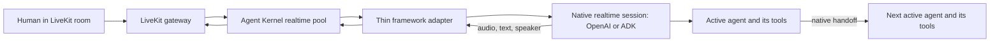

# #810: Native realtime agents and handoffs

Use each framework's own realtime runner for live conversations. OpenAI Agents SDK or Google ADK owns agent turns, handoffs, tools, and model connections. Agent Kernel keeps only the audio, queue, session identity, and LiveKit boundary those SDKs do not provide.

## Motivation

- The current `RealtimeRunner` contract makes Agent Kernel receive a `tool_call`, run the tool, and send its result back (`ak-py/src/agentkernel/core/realtime/runner.py:83`, `:125`). The pool implements that loop (`ak-py/src/agentkernel/pipeline/realtime_pool.py:228`).
- The OpenAI adapter opens a raw Realtime API socket and builds its own tool and handoff flow (`ak-py/src/agentkernel/framework/openai/openai.py:627`, `:690`). The ADK adapter opens a raw Gemini Live socket and builds its own transfer flow (`ak-py/src/agentkernel/framework/adk/adk.py:918`, `:1159`).
- The native frameworks already offer these jobs: [OpenAI Agents SDK realtime](https://openai.github.io/openai-agents-python/realtime/guide/) uses `RealtimeAgent`, `RealtimeRunner`, and `RealtimeSession`; [ADK live workflows](https://adk.dev/live/workflows/) use `Runner.run_live()` and one `LiveRequestQueue` for the conversation.
- The current LiveKit gateway already shows multiple agent participants and blocks its own agents' audio and chat from returning as user input (`ak-py/src/agentkernel/integration/livekit/adapter.py:235`, `:252`, `:463`).

## Requirements

### One conversation, several agents

- A human and several agent participants can share one LiveKit room. Agents known from the declared graph appear when the call starts; a dynamic handoff target appears when first identified. One framework conversation controls the agent turn; an agent explicitly hands off to another agent through the framework's native handoff feature.
  - Example: the coordinator speaks, invites the billing agent, and billing uses its lookup tool before answering. Billing can hand the turn back.
- Only the active agent receives the live caller input and speaks for that turn. A handoff carries conversation context through the native SDK; it does not replay one agent participant's room audio into another model.
  - In ADK this is one `run_live()` call and one input queue for the LiveKit call, even though ADK opens a fresh Gemini Live API session for the agent receiving a handoff ([ADK live workflows](https://adk.dev/live/workflows/)).
- Each active agent can use the tools declared on that native agent, subject to the SDK and model's actual support. The SDK runs tools and sends their results. Its native handoff changes the active agent. Agent Kernel does not implement a second tool or handoff engine.

### Framework adapters

- `OpenAIRealtimeRunner` wraps the Python Agents SDK's `RealtimeRunner` and `RealtimeSession`, with native `RealtimeAgent` definitions and handoffs. It maps SDK audio, text, interruption, handoff, error, and completion events into the existing framework-neutral realtime events.
- `GoogleADKRealtimeRunner` wraps ADK's `Runner.run_live()` with one `LiveRequestQueue` per AK realtime connection. It sends caller audio and text into that queue, reads ADK events, and uses the event author to report the speaker. ADK manages transfers, tool execution, and its Live API connections.
- ADK live workflow agents that speak declare `mode='chat'` or `mode='task'`. ADK's graph `Workflow` is a native container, not a speaking `BaseAgent`; the AK wrapper must accept that root. Do not run ADK `ParallelAgent` or `LoopAgent` on the live path; ADK does not support them there ([ADK live workflows](https://adk.dev/live/workflows/)).
- Both adapters use public SDK APIs and preserve the application's native agent relationships. AK does not clone or rebuild the graph. Remove raw socket loops, hand-built tool responses, transfer instructions, transcript replay, manual connection switching, and SDK-level retry logic.
- Reject a known unsupported native agent declaration before opening the SDK connection. If an SDK rejects a setting only after connection starts, close the partially opened session and report the error. OpenAI realtime examples move to native `RealtimeAgent`; ordinary OpenAI `Agent` is rejected in realtime mode.
- Use native SDK guardrails, resumption, and voice settings where the live path supports them. AK hooks and AK guardrails do not automatically run through a native realtime session; document that behavior clearly. The current LiveKit edge has no approval decision path, so a tool that requires human approval cannot run through this integration: reject it before the call when detectable, or reject the request and end the call if it arises later. Never silently approve or skip a declared guardrail.

### Agent Kernel boundary

- Keep `RealtimeRunner` as the framework-neutral input/output and lifecycle contract, selected through the existing `realtime_runner_cls` class seam (`ak-py/src/agentkernel/core/base.py:523`, `:560`). Remove `execute_tool`, `send_tool_result`, and the `tool_call` callback. A custom runner that still emits `tool_call` gets an explicit failure.
- Keep `RealtimeConnection` and `RealtimeConnectionPool` for AK session identity, input batching and sample-rate conversion, ordered audio delivery, pacing, queue routing, barge-in delivery, close, and eviction. Remove the pool's tool execution and reply path.
- Keep `AgentChanged` in the ordered output stream. The first event names the first speaking agent (which may differ from a non-speaking ADK workflow root); each native handoff names the next speaker before that agent's output. The LiveKit gateway uses this event to select the speaking participant.
- Let the SDK handle model interruption and conversation truncation. Do not tell OpenAI's playback tracker that audio was played merely because AK sent it to an output queue: downstream buffering means the listener may not have heard it. Use the tracker only if the LiveKit edge can provide a reliable playout signal; until then, document the SDK's default playback estimate and test barge-in behavior. Do not build another truncation algorithm in AK.
- Keep the LiveKit rule that audio and chat from AK's own agent participants never become caller input. The declared team remains visible, with only the active agent unmuted. A newly discovered agent joins when it first becomes active if it was absent from the starting roster.
- Realtime runs native agent features only: native tools, SDK handoffs and SDK guardrails. When `execution.mode` is `realtime`, the OpenAI and ADK wrappers skip automatic AK system tools and their prompt guidance. Other modes still attach them as configured. AK hooks and AK guardrails are not part of the native live path. Core does not import framework SDKs.
- Close the native session or ADK queue on AK connection shutdown and failed startup. Framework failures reach the existing error and eviction path; the next connection does not reuse a broken native session.

### Configuration and compatibility

- Reuse `execution.realtime` for pacing and input batching, the existing queue and LiveKit settings, and `Module.run_options` for supported native run settings (`ak-py/src/agentkernel/core/config.py:668`, `ak-py/src/agentkernel/core/module.py:101`). Add no parallel AK flags for SDK tools, handoffs, or reconnects.
- Raise the `google-adk` optional dependency floor from `>=1.24.0` (`ak-py/pyproject.toml:123`) to `>=2.7.0` for the verified live fix that finds a transfer even when its tool result is not first in a batch ([ADK 2.7.0 source](https://github.com/google/adk-python/blob/v2.7.0/src/google/adk/flows/llm_flows/base_llm_flow.py), [release notes](https://github.com/google/adk-python/releases/tag/v2.7.0)). Test refused or invalid transfers at the minimum version and document what actually happens; the release notes do not guarantee that the current connection survives one.
- Preserve the bring-your-own realtime runner class path, but document the breaking contract change. A runner that emits `tool_call` cannot use the removed pool tool path.
- Show native configuration and limits in the examples and docs: move ADK per-agent voice from today's `generate_content_config.speech_config` to `Gemini(speech_config=...)`, or use `RunConfig.speech_config` for one session voice ([ADK configuration](https://adk.dev/live/configuration/)); [OpenAI cannot change a session's voice after audio starts](https://developers.openai.com/api/docs/guides/realtime-conversations). ADK resumption, where enabled, covers its link to Gemini, not the LiveKit client link ([ADK sessions](https://adk.dev/live/sessions/)).
- Document a separate support list for each SDK adapter: native tools, handoffs, approvals, SDK guardrails, AK hooks/guardrails, MCP tools, and reconnect behavior. State which features AK carries through, which need an edge decision path, and which are rejected. Do not claim that SDK support alone makes a feature available in LiveKit.
- ADK 2.9.0 also has an experimental native `LiveKitRunner` for one ADK agent participant ([ADK LiveKit runner](https://adk.dev/integrations/livekit/)). It could remove more transport code for an ADK-only deployment. The documented interface does not establish AK's queue routing or a separate LiveKit participant per speaking agent; verify those contracts before replacing the existing shared AK edge. Do not add a second LiveKit path to this change without that proof.

### Verification

- For OpenAI and ADK, verify a live text or audio turn can move from agent A to B and back, with each agent's own declared tool called by the native SDK and the correct `AgentChanged` order.
- Verify audio, text, interruptions, and errors still reach the LiveKit participant for the active agent in order; agent participants' own audio and chat never feed the native session.
- Verify SDK approval or unsupported native-agent settings produce an explicit decision or error, rather than silently running a tool or dropping the setting.
- Verify a custom runner's `tool_call` fails explicitly; measure and document ADK behavior for a refused or invalid transfer on the minimum supported version.
- Verify native tools on both agents still run through the SDK after a handoff.
- Verify two AK sessions keep separate native sessions and closing one does not stop the other.

## Non-goals

- Several voice models listening or speaking at the same time, or an automatic group discussion without explicit handoffs.
- Feeding agent-generated LiveKit audio back into another model as if a human spoke it.
- A separate voice for each OpenAI agent within one Realtime API session.
- Removing AK's queue, LiveKit gateway, audio conversion, or playback coordination; the native SDK does not own those boundaries.
- Promising identical native SDK features across OpenAI and ADK, or durable recovery of LiveKit calls after an AK process restart.
- Rebuilding native SDK handoff, tool, guardrail, approval, or reconnection engines inside Agent Kernel.
- Unchanged behavior for custom realtime runners using the old tool callback.

## Open questions

- Can the LiveKit edge report actual playout to OpenAI's native playback tracker? A successful AK queue send is not proof that the listener heard the audio.
