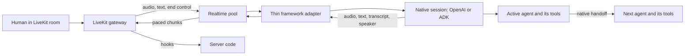

# #810: Native realtime agents and handoffs

Use each framework's own realtime runner for live conversations. The OpenAI Agents SDK or Google ADK owns agent turns, handoffs, tools, and the model connection. Agent Kernel keeps the audio, queue, session identity, and LiveKit boundary those SDKs do not provide, plus six small edge additions (C1 to C6) that a realtime multi-agent meeting needs.

Line references: "base" is `develop`; "now" is this branch.

## Motivation

- The base `RealtimeRunner` contract makes Agent Kernel run tools: a `tool_call` event, `execute_tool` and `send_tool_result` (base `core/realtime/runner.py:92`, `:119`, `:124`). The base pool runs them (base `pipeline/realtime_pool.py:131`, `:229`).
- The base OpenAI adapter opens a raw Realtime socket and builds its own tool and handoff flow (base `framework/openai/openai.py:627` class, `:775` `_activate`, `:805` `_offered_handoffs`, `:908` `_switch_to`).
- The base ADK adapter opens a raw Gemini Live socket and builds its own transfer flow (base `framework/adk/adk.py:918` class, `:1178` `_open_socket`, `:1236` `_handle_message`, `:1356` `_transfer`).
- The native frameworks already do these jobs (external; not re-verified in this rewrite): [OpenAI Agents SDK realtime](https://openai.github.io/openai-agents-python/realtime/guide/) (`RealtimeAgent`, `RealtimeRunner`, `RealtimeSession`) and [ADK live workflows](https://adk.dev/live/workflows/) (`Runner.run_live()`, one `LiveRequestQueue`).
- The base LiveKit gateway already shows one participant per agent and keeps its own agents' audio and chat out of the caller input (`integration/livekit/adapter.py`, `_own_identities`, now `:165`).
- A realtime meeting also needs things the edge lacks: the caller's words as text, captions, observation hooks, a gateway that starts and stops while the app runs, an immediate end of the session, a custom opening line, and a back-off after a failed native session.

## Requirements

### One conversation, several agents

- A human and several agent participants share one LiveKit room.
  - Agents known from the declared graph appear when the call starts; a dynamic handoff target appears when first named.
  - One native conversation controls the turn; an agent hands off through the framework's own handoff.
- Only the active agent receives live caller input and speaks.
  - A handoff carries context through the native SDK; room audio of one agent is never replayed into another model.
  - ADK: one `run_live()` call and one input queue per call.
- Each agent uses the tools declared on its native agent. The SDK runs them. Agent Kernel has no second tool or handoff engine.

### Framework adapters

- `OpenAIRealtimeRunner` (now `openai.py:629`) wraps `RealtimeSession` over native `RealtimeAgent` definitions.
  - An ordinary OpenAI `Agent` is rejected (now `:683`, `:706`).
  - A `FunctionTool` with `needs_approval` is rejected before opening (`_check_agents`, now `:748`).
- `GoogleADKRealtimeRunner` (now `adk.py:922`) wraps `Runner.run_live()`.
  - The root is an ADK `LlmAgent` or a `Workflow`; a `Workflow` root does not speak, so `initial_speaker` returns `None` (now `:981`) and the adapter reports the first speaker with the roster.
  - `ParallelAgent`, `LoopAgent`, and workflow nodes left in `single_turn` mode are rejected before opening (`_check_graph`, now `:1011`, `:1029`).
  - Audio at a rate other than the pool's resample rate fails the connection (`_check_output_rate`, now `:1154`).
- Both adapters:
  - Use public SDK APIs and do not clone or rebuild the agent graph.
  - Take per-run settings from `Module.run_options` (base `core/module.py:101`), rejecting keys the realtime session cannot take.
  - Report a tool that needs a human decision as a connection error (OpenAI `_refuse_approval`, now `:848`; ADK `_refuse_confirmation`, now `:1176`). ADK learns of it only at run time, not before opening.
  - Remove raw socket loops, hand-built tool responses, transfer instructions, transcript replay, manual connection switching, and SDK-level retry logic.

### Native path boundary

- AK pre-hooks, post-hooks, and guardrails do not run on the native path; the SDK's own do. Documented.
- AK system tools and their prompt text are not attached when `execution.mode` is `realtime` (now `openai.py:905`, `adk.py:1243`); other modes attach them as configured.
- Tool context on the native path differs by adapter:
  - ADK builds an AK `ToolContext` per connection and finds it from ADK session state (now `adk.py:1058`).
  - OpenAI sets none; a tool calling `ToolContext.get()` raises `RuntimeError` there.
  - Neither sets `Session.current()` or `Agent.current()` (the base pool did, around each tool call).
  - See Open questions.
- Session `framework_context`: OpenAI loads it as the SDK `context` (now `openai.py:716`; the normal run paths at `:246`, `:410`, `:462`, `:518` also store it back) and does not write it back; ADK does not use it. See Open questions.
- Neither adapter stores the session at the end of a conversation (as in base).

### Runner contract (`RealtimeRunner`)

- Removed: `execute_tool`, `send_tool_result`, and the `tool_call` callback event.
  - A runner that still emits `tool_call`, or any other event outside the closed list, fails the connection.
- Added: `initial_speaker(agent)` (now `core/realtime/runner.py:70`); `None` means only the native session can say who speaks first.
- `team(agent)` (now `:56`) lists speaking agents from the public graph, without building a new graph; it must not raise.
- Callback events (closed list): `audio_delta`, `transcript_delta`, `input_transcript`, `agent_changed`, `interrupt`, `speech_started`, `done`, `error`.
  - `agent_changed` carries `agent`, `previous_agent` (may be `None`), and optional `agents` (the roster when a change names an agent the roster lacked).
- `connect` rejects an unsupported agent or option with `TypeError` or `ValueError` naming the agent, before opening anything. A failed or cancelled connect closes what it opened.
- Selection stays through the `realtime_runner_cls` seam (base `core/base.py:556`).

### Pool (`RealtimeConnection`, `RealtimeConnectionPool`)

- The pool keeps audio pacing, input batching and resampling, barge-in delivery, queue routing, close, and eviction. It runs no tool.
- Output order: `input_transcript` rides the paced queue and is kept on barge-in; it neither ends a turn nor resets the pacing window (now `pipeline/realtime_pool.py:155`, `:184`, `:229`).
- A failed connection is closed in a separate task whose reference the pool holds until it finishes (`close_in_background`, now `:325`).
- A connect that fails or times out is cancelled, closed, and counted as a failure (`_discard_failed`).
- `RealtimeConnection.produced_output` is set by the first audio, transcript, or turn end.

### Caller transcript (C1)

- New stream event `InputTranscript` (`message_id`, `content`; now `core/event.py:170`), one finished non-empty caller utterance, in spoken order with agent output.
- Mapped from the SDK: ADK a finished `input_transcription` on a `user` event; OpenAI `input_audio_transcription_completed`.
- No new setting. It appears when the SDK's own input transcription is on (ADK: default on, external, not re-verified; OpenAI: `input_audio_transcription` in model settings through `Module.run_options`).
- An edge that does not use it ignores it.

### Live captions and edge hooks (C2)

- LiveKit gateway captions:
  - Agent text deltas go on a text stream from the speaking agent's participant, paced with the audio; the caller's line goes out attributed to the caller.
  - Standard LiveKit transcription conventions: topic `lk.transcription` and the `lk.transcribed_track_id`, `lk.segment_id`, `lk.transcription_final` attributes.
  - One caption task per gateway performs queued operations in order (`_CaptionSegment` now `:26`, `_run_captions` now `:634`); delivery only enqueues. A failed segment logs once and is skipped.
  - The turn-end chat message is kept for existing clients.
- Three overridable hooks on `StatefulEdgeAdapter`, no-ops by default (`TranscriptLine` now `integration/adapter/base.py:260`):
  - `on_transcript(line)` for each finished agent line (split per speaker at handoffs) and each caller line; a typed room message is a caller line with `typed=True`; an interrupted line is marked `interrupted`.
  - `on_agent_changed(agent, previous)` in order with the lines.
  - `on_error(message)` besides the text shown to the room.
- Hooks never block audio: one worker thread per edge, in call order (`_EdgeHookWorker`, now `:281`); a hook that raises is logged and ignored.
- Shutdown waits for queued hooks at most `HOOKS_CLOSE_TIMEOUT_SECONDS` (5 s) and for queued captions at most `CAPTION_DRAIN_SECONDS` (1 s).

### Gateway started and stopped while the app runs (C3)

- `GatewayRunner` gains `start_background(ready_timeout)`, `stop(timeout)`, and `running` (now `integration/adapter/gateway.py:67`); no new sibling class.
  - It runs one gateway on its own thread, returns when the edge calls `_mark_ready`, and re-raises a start failure to the caller. `READY_TIMEOUT_SECONDS` is 30.
  - Not ready in time: it stops the gateway and raises `TimeoutError`.
  - A background gateway failure never ends the process; boot-time gateways behave as before.
- Works for any `StatefulEdgeAdapter`, not only LiveKit.

### End a session at once (C4)

- An edge that stops sends an end-of-session control on the input queue for its session id (`LiveKitEdgeGateway._send_session_end`, now `:307`): an empty request with message attribute `ATTR_REALTIME_END`.
  - `IntegrationProducer.enqueue` takes optional extra `attributes`; a key that collides with a producer attribute raises `ValueError` (now `:61`).
  - The control goes behind frames already staged, waiting at most `SESSION_END_TIMEOUT_SECONDS` (2 s) for them.
- The pool closes that session's native connection at once (`end_session`, now `:589`) and drops input for it for `_ENDED_SESSION_TTL_SECONDS` (60 s).
- `StatefulEdgeRegistry.unregister(session_id, adapter=None)` removes only that adapter when given one, and records the session as ended for `ENDED_TTL_SECONDS` (60 s; `recently_ended` now `registry.py:58`).
- The Response Handler acks and drops chunks for an edge that just ended, instead of retrying them into a permanent failure (`_edge_recently_ended`, now `pipeline/response_handler.py:186`).
- Works across processes because it uses the existing queue.

### Opening prompt (C5)

- The fixed greeting becomes an overridable gateway method, `opening_prompt(participant_identity)` (now `livekit/adapter.py:361`); `None` sends nothing. Default is the previous text.
- The conversation now opens when a participant joins the room, not when a microphone appears.

### Back-off after a failed native session (C6)

- After a native session fails, input for that session is dropped for `1 * 2 ** (failures - 1)` seconds, at most 30 (`_note_failure`, now `realtime_pool.py:562`).
- A connection that produced output before it failed restarts the count at 1; ending the session clears it.
- A connection that fails again within the window is not opened early.

### Configuration and compatibility

- No new `AKConfig` field. Reused: `execution.realtime` (now `core/config.py:667`), the existing queue and LiveKit settings, and `Module.run_options`.
- The new numbers are class or module constants, not config: `READY_TIMEOUT_SECONDS`, `SESSION_END_TIMEOUT_SECONDS`, `HOOKS_CLOSE_TIMEOUT_SECONDS`, `CAPTION_DRAIN_SECONDS`, `ENDED_TTL_SECONDS`, `_ENDED_SESSION_TTL_SECONDS`, `_RECONNECT_BASE_SECONDS`, `_RECONNECT_MAX_SECONDS`.
- `google-adk` floor rises from `>=1.24.0` (base `pyproject.toml:132`) to `>=2.7.0` (now `:132`).
  - Reason: a live fix that finds a transfer even when its tool result is not first in a batch (external; not re-verified).
  - It applies to every ADK user, not only realtime.
- Breaking for bring-your-own realtime runners: a runner using the old tool callback fails with an explicit error. Documented.
- A bring-your-own edge receives a new `InputTranscript` chunk type in `deliver_chunk`; it should ignore types it does not know.

### Documentation

- Document a support list per adapter: native tools, handoffs, approvals, SDK guardrails, AK hooks and guardrails, MCP tools, reconnect behavior. Do not claim SDK support alone makes a feature available in LiveKit.
- Examples move to native `RealtimeAgent` and ADK definitions; ADK per-agent voice moves to `Gemini(speech_config=...)` or `RunConfig.speech_config` (external; not re-verified).

### Verification

- OpenAI and ADK: a live turn moves from agent A to B and back, each agent's own tool runs through the SDK, and `AgentChanged` arrives in order.
- Audio, text, interruptions, and errors reach the active agent's participant in order; agent participants' own audio and chat never feed the native session.
- An approval-needing tool, an unsupported agent, or an unsupported option gives an explicit error.
- A custom runner's `tool_call` fails explicitly.
- Two AK sessions keep separate native sessions; closing one does not stop the other.
- C1: one utterance gives exactly one `InputTranscript`, before the reply that answers it.
- C2: lines and speaker changes arrive in order with the right speaker; a hook that raises does not stop audio.
- C3: two gateways started after boot, one stopped, the other keeps working.
- C4: after the control, `disconnect` has run; later audio is dropped; a chunk for the ended edge is not retried.
- C5: `None` sends no opening request; a custom prompt is sent once.
- C6: repeated immediate failures drop input with delays 1, 2, 4 s; output before a failure restarts the count; ending the session clears it.

## Non-goals

- Several voice models speaking at once, or automatic group discussion without explicit handoffs.
- Feeding agent-generated room audio back into another model as if a human spoke it.
- A separate voice per OpenAI agent inside one Realtime session.
- Removing AK's queue, LiveKit gateway, audio conversion, or playback coordination.
- Identical native features across OpenAI and ADK, or durable recovery of calls after an AK restart.
- Rebuilding native handoff, tool, guardrail, approval, or reconnection engines in Agent Kernel.
- Unchanged behavior for custom realtime runners using the old tool callback.
- A second LiveKit path (ADK's experimental `LiveKitRunner`) in this change.

## Open questions

- Should the native path give tools the AK context the normal run path gives?
  - OpenAI sets no `ToolContext`; ADK does. Neither sets `Session.current()` or `Agent.current()`.
  - Options: make both adapters match ADK; keep it unsupported and document it; or reject tools that need it.
- Should `framework_context` flow in and out on the native path?
  - OpenAI injects it and never writes back; ADK ignores it; the normal run path does both.
- Can the LiveKit edge report real playout to OpenAI's native playback tracker? A successful queue send does not prove the listener heard the audio.
- Should C1 to C6 ship in this PR or in their own? They came from one use case. Only C1 is implemented inside the native adapters; C2 to C6 live in the pool, gateway, registry, and LiveKit edge.
- Should ADK reject an approval-needing tool before opening, as OpenAI does, if ADK can detect it from the declaration?
