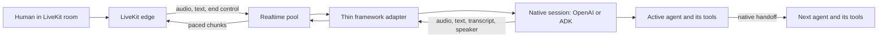

# #810: Native realtime agents and handoffs

Use each framework's own realtime runner for live conversations. The OpenAI Agents SDK or Google ADK owns agent turns, handoffs, tools, and the model connection. Agent Kernel keeps the audio, queue, session identity, tool context, and LiveKit boundary those SDKs do not provide, plus a few framework-neutral additions to the realtime path and the LiveKit edge.

"Base" is `develop`; base line references are to `develop`. Current code is cited as file::symbol.

## Motivation

- The base `RealtimeRunner` contract makes Agent Kernel run tools: a `tool_call` event, `execute_tool` and `send_tool_result` (base `core/realtime/runner.py:92`, `:119`, `:124`). The base pool runs them, inside the session lock, the agent's activation and a `ToolContext` (base `pipeline/realtime_pool.py:131`, `:229`).
- The base OpenAI adapter opens a raw Realtime socket and builds its own tool and handoff flow (base `framework/openai/openai.py:627` class, `:775` `_activate`, `:805` `_offered_handoffs`, `:908` `_switch_to`).
- The base ADK adapter opens a raw Gemini Live socket and builds its own transfer flow (base `framework/adk/adk.py:918` class, `:1178` `_open_socket`, `:1236` `_handle_message`, `:1356` `_transfer`).
- The native frameworks already do these jobs (external; not re-verified in this rewrite): [OpenAI Agents SDK realtime](https://openai.github.io/openai-agents-python/realtime/guide/) (`RealtimeAgent`, `RealtimeRunner`, `RealtimeSession`) and [ADK live workflows](https://adk.dev/live/workflows/) (`Runner.run_live()`, one `LiveRequestQueue`).
- The base LiveKit edge already shows one participant per agent and keeps its own agents' audio and chat out of the caller input (`integration/livekit/adapter.py`, `_own_identities`).
- The base realtime path has gaps a live call meets in practice:
  - The caller's own words never reach the edge as text.
  - A session lives until the 300 s idle timeout after its room is gone (base `pipeline/realtime_pool.py:34`).
  - A native session that fails at once is replaced by the very next audio frame, with no back-off (base `get_connection` evicts and the next message reconnects).
  - The conversation opens only when a caller's microphone appears, so a caller who joins muted is never greeted (base `integration/livekit/adapter.py:246`).

## Requirements

### One conversation, several agents

- A human and several agent participants share one LiveKit room.
  - Agents known from the declared graph appear when the call starts; a dynamic handoff target appears when first named, as a participant of its own. The first participant speaks only for the agent the call starts with.
  - One native conversation controls the turn; an agent hands off through the framework's own handoff.
- Only the active agent receives live caller input and speaks.
  - A handoff carries context through the native SDK; room audio of one agent is never replayed into another model.
  - ADK: one `run_live()` call and one input queue per call.
- Each agent uses the tools declared on its native agent. The SDK runs them. Agent Kernel has no second tool or handoff engine.

### Framework adapters

- `OpenAIRealtimeRunner` wraps `RealtimeSession` over native `RealtimeAgent` definitions.
  - An ordinary OpenAI `Agent` is rejected at connect.
  - A `FunctionTool` with `needs_approval` is rejected before opening (`OpenAIRealtimeRunner._check_agents`).
- `GoogleADKRealtimeRunner` wraps `Runner.run_live()`.
  - The root is an ADK `LlmAgent` or a `Workflow`. `initial_speaker` returns the agent's name for an `LlmAgent` root and `None` for a `Workflow`, a container that does not speak: the pool announces no first speaker, and ADK's first event names the first speaking node, which `_speaker_changed` reports with the roster (`team()` lists the speaking nodes from the workflow graph).
  - No graph check runs before opening. A workflow node left without `mode='chat'` or `mode='task'` runs outside the live connection and ADK raises nothing; the example and docs say to set it. `ParallelAgent` and `LoopAgent` are not checked: ADK raises `NotImplementedError` for them itself.
  - A tool that requires confirmation is not checked before opening: the private `FunctionTool._require_confirmation` is not read. ADK's live flow refuses the call, and the runtime backstop below fails the connection.
  - `run_options` takes the `Runner` constructor options (`GoogleADKRunner.RUNNER_CONSTRUCTOR_OPTIONS`, `plugins` among them) and `run_config` for `run_live()`; any other key is rejected by name. The `App` and `Runner` are built by one helper, `GoogleADKRunner._native_runner`, shared with the unary path.
- Both adapters:
  - Use public SDK APIs and do not clone or rebuild the agent graph.
  - Take per-run settings from `Module.run_options` (`core/module.py::Module.run_options`), rejecting keys the realtime session cannot take.
  - Report a tool that asks for a human decision during the call as a connection error (OpenAI `_refuse_approval`; ADK `_refuse_confirmation`); this is the only handling of a confirmation, as there is no check before opening.
  - Remove raw socket loops, hand-built tool responses, transfer instructions, transcript replay, manual connection switching, and SDK-level retry logic.

### Tools on the native path

- The pool sets `ToolContext`, `Session.current()` and `Agent.current()` once in `RealtimeConnection.connect()`, before the native session starts, and resets them after.
  - The SDK's own tasks are created while connecting and inherit them: OpenAI's websocket listener task and ADK's listener task. A tool therefore sees them as it does on the unary path.
  - Both frameworks, one place; no adapter code is needed. ADK additionally keeps that `ToolContext` by id in its session state for its tool wrapper; under the pool it is the pool's context, not a second one.
  - The session lock is not taken: a call is one long-lived session, and holding the lock for it would block every other run of that session. The base pool took the lock per tool call.
- AK system tools and their prompt text are attached as in every other mode.
  - An ADK `Workflow` root holds no tools or instructions, so they are attached to the speaking nodes inside it (`GoogleADKAgent._attach_workflow_system_tools`), each looked up by its own name for the `agents` allow-lists. ADK keeps its own copy of each node in the workflow graph, so the tools go on the graph's copy. An inner agent the application also registers with the module gets them a second time.
- AK pre-hooks, post-hooks, and guardrails do not run on the native path; the SDK's own do. Base did not run them either. Documented.
- Session `framework_context`: a realtime session neither injects nor stores it, in either adapter (stated in the `RealtimeRunner` docstring). The OpenAI adapter does not load it as the SDK `context`, and `context` is a reserved run option; ADK never used it.
- Neither adapter stores the session at the end of a conversation (as in base).

### Runner contract (`RealtimeRunner`)

- Removed: `execute_tool`, `send_tool_result`, and the `tool_call` callback event.
  - A runner that still emits `tool_call`, or any other event outside the closed list, fails the connection.
- Added: `initial_speaker(agent)`; `None` means only the native session can say who speaks first.
- `team(agent)` lists speaking agents from the public graph, without building a new graph; it must not raise.
- Callback events (closed list): `audio_delta`, `transcript_delta`, `input_transcript`, `agent_changed`, `interrupt`, `speech_started`, `done`, `error`.
  - `agent_changed` carries `agent`, `previous_agent` (may be `None`), and optional `agents` (the roster when a change names an agent the roster lacked).
- `connect` rejects an unsupported agent or option with `TypeError` or `ValueError` naming the agent, before opening anything. A failed or cancelled connect closes what it opened.
- Selection stays through the `realtime_runner_cls` seam (base `core/base.py:556`).

### Pool (`RealtimeConnection`, `RealtimeConnectionPool`)

- The pool keeps audio pacing, input batching and resampling, barge-in delivery, queue routing, close, and eviction. It runs no tool.
- Output order: `input_transcript` rides the paced queue and is kept on barge-in; it neither ends a turn nor resets the pacing window (`pipeline/realtime_pool.py`, `handle_framework_event` and the pacing loop).
- A failed connection is closed in a separate task whose reference the pool holds until it finishes (`close_in_background`).
- A connect that fails or times out is cancelled, closed, and counted as a failure (`_discard_failed`).
- `RealtimeConnection.produced_output` is set by the first audio, transcript, or turn end.

The sections below keep the labels C1 and C4 to C7 used in the code and the architecture skill. Live captions (C2) are not part of Agent Kernel: captions belong to the application. C3 (an API for application code to start a gateway in the background and wait until it is ready) is not part of Agent Kernel. C7 is a different thing: gateways started and ended by the platform's own signed lifecycle webhooks, hosted by AK the way it hosts a messaging webhook. The application still decides which rooms get one (`should_start`).

### Caller transcript (C1)

- New stream event `InputTranscript` (`message_id`, `content`; `core/event.py`), one finished non-empty caller utterance, reported when the framework completes it (which may follow the agent output).
- Mapped from the SDK: ADK a finished `input_transcription` on a `user` event; OpenAI `input_audio_transcription_completed`.
- No new setting. It appears when the SDK's own input transcription is on (ADK: default on, external, not re-verified; OpenAI: `input_audio_transcription` in model settings through `Module.run_options`).
- An edge that does not use it ignores it. The LiveKit edge ignores it; a subclass can show it in `deliver_chunk`.

### End a session at once (C4)

- An edge that stops sends an end-of-session control on the input queue for its session id: an empty request (`StatefulEdgeAdapter._enqueue()` with no message) with message attribute `ATTR_REALTIME_END` (`LiveKitEdgeAdapter._send_session_end`, called from `_release`).
  - `InboundRequest.end_session: bool = False`; `IntegrationProducer.enqueue` stamps it as `ATTR_REALTIME_END`, as it stamps `reply_context`, so no edge names a queue attribute and the producer's signature is unchanged.
  - The control goes behind frames already staged, waiting at most `SESSION_END_TIMEOUT_SECONDS` (2 s) for them. If staged input is still unsent after that, the control is not sent: it would pass that input, and the pool would drop it as late. The session then ends by idle eviction.
  - The broker call is bounded by the same time, so a stopping gateway never waits on a broker that does not answer.
- The pool closes that session's native connection at once (`RealtimeConnectionPool.end_session`) and clears its back-off count; later input for the session id opens a new connection.
- `StatefulEdgeRegistry.unregister(session_id, adapter=None)` removes only that adapter when given one, so a stopped edge cannot remove a newer one registered under the same id (`_EdgeRunner.start()` passes its own adapter).
- Works across processes because it uses the existing queue.

### Opening prompt and join (C5)

- The fixed greeting becomes an overridable gateway method, `opening_prompt(participant_identity)`; `None` sends nothing. Default is the previous text, without the word "microphone".
- The conversation opens when a participant joins the room (`_on_participant_connected`), not when a microphone appears, so a caller who joins muted is greeted.
- LiveKit raises `participant_connected` only for later joins, so a caller already in the room when the gateway joins is greeted from `start()`, read straight after the listener's join so no caller is greeted twice.

### Back-off after a failed native session (C6)

- After a native session fails, input for that session is dropped for `1 * 2 ** (failures - 1)` seconds, at most 30 (`_note_failure`).
- A connection that produced output before it failed restarts the count at 1; ending the session clears it.
- A connection that fails again within the window is not opened early.
- A connect that fails sends the edge one terminal error chunk naming the failure. The back-off drops the redelivered input, so that input never reaches its permanent-failure path; without the chunk a room whose session cannot open (a bad key, an agent or option the adapter rejects) would hear nothing.

### One room per call (C7)

- Today a gateway serves one room named at start-up, so every caller shares one session. Other AK integrations give each conversation its own session; LiveKit should too.
- Split like a messaging integration: the platform translates, a generic host runs it.
  - `EdgeLifecycleAdapter` (`integration/adapter/base.py`), translation only: `parse(raw) -> EdgeLifecycleEvent | None` (`session_id` + `start: bool`; it also verifies, raising `HTTPException` to reject), `create_edge(session_id)`, and the hook `should_start(session_id)` (default every session). The per-process counterpart of `StatefulEdgeAdapter`, which serves one connection; two classes per platform, as messaging has `InboundAdapter` and `OutboundAdapter`.
  - `EdgeLifecycleRESTRequestHandler` (`integration/adapter/lifecycle.py`), the generic host and sibling of `WebhookRESTRequestHandler`: a `RESTRequestHandler` (`requires_pipeline`) mounted with `IOHandler.run(handlers=[EdgeLifecycleRESTRequestHandler(adapter)])`, so its gateways run in the process that hosts the Response Handler. A start runs one `_EdgeRunner` per session on a thread of its own (a repeated start is ignored); an end stops it. `_EdgeRunner`, its per-edge half, lives in the same module.
  - Process shutdown: no new edge starts. Each live edge already sees `ThreadRunner.shutdown_event` and stops; the process does not wait for it, so a session whose end control was not sent closes by idle eviction. No hook on `RESTRequestHandler`, no change to `IOHandler`.
  - `LiveKitLifecycleAdapter` (`integration/livekit/adapter.py`): LiveKit's signed `room_started`/`room_finished` webhooks, verified with the SDK's `WebhookReceiver` over the existing `livekit.api_key`/`api_secret`. No new config. The room name is the session id.
- `_EdgeRunner.stop()` (generic, `integration/adapter/lifecycle.py`): ends one edge from any thread; the loop watches it beside `ThreadRunner.shutdown_event`. A gateway stopped before it starts never starts its adapter (a room that opens and closes at once).
- `LiveKitEdgeAdapter`: on LiveKit's `participant_disconnected`, when no caller is left, the gateway stops and so sends the end-of-session control (C4). Unconditional: with several IOHandler replicas `room_finished` may reach a process that never hosted the room, so the gateway must end its own call.
- `EdgeLifecycleRESTRequestHandler` is the only host. `IOHandler.run(gateways=...)`, `gateway.py` and the public `GatewayRunner` export are removed (nothing is released): a fixed room named at start-up was the one integration where the app built the per-conversation object itself, which no other integration does. The per-edge runner stays as the private `_EdgeRunner` in `lifecycle.py`, one module per host like `webhook.py` and `poller.py`. Local runs need a webhook tunnel, as Slack does.
- Limits kept: one IOHandler process and one Agent Runner replica; a room no caller joins keeps its agent until LiveKit closes the room. A shared room (meeting) remains one conversation: the native models take one audio stream with no speaker labels, so AK adds none.

### Configuration and compatibility

- No new `AKConfig` field. Reused: `execution.realtime`, the existing queue and LiveKit settings, and `Module.run_options`.
- The new numbers are class or module constants, not config: `LiveKitEdgeAdapter.SESSION_END_TIMEOUT_SECONDS`, `_RECONNECT_BASE_SECONDS`, `_RECONNECT_MAX_SECONDS`.
- `google-adk` floor rises from `>=1.24.0` (base `pyproject.toml:132`) to `>=2.7.0`.
  - Reason: a live fix that finds a transfer even when its tool result is not first in a batch (external; not re-verified).
  - It applies to every ADK user, not only realtime, and `adk.py` imports `google.adk.workflow.Workflow` at module level, which ADK 1.x lacks: a breaking change to call out in the release notes.
- Breaking for bring-your-own realtime runners: a runner using the old tool callback fails with an explicit error. Documented.
- Breaking for OpenAI realtime users: the entry agent is a `RealtimeAgent`, and the model and voice come from `run_options(model_config=...)`. An OpenAI tool needing approval now fails the connection instead of being left out. Documented.
- A bring-your-own edge receives a new `InputTranscript` chunk type in `deliver_chunk`; it should ignore types it does not know.

### Documentation

- Document a support list per adapter: native tools, handoffs, approvals, SDK guardrails, AK hooks and guardrails, MCP tools, reconnect behavior. Do not claim SDK support alone makes a feature available in LiveKit.
- Examples move to native `RealtimeAgent` and ADK definitions; ADK per-agent voice moves to `Gemini(speech_config=...)` or `RunConfig.speech_config` (external; not re-verified).

### Verification

- OpenAI and ADK: a live turn moves from agent A to B and back, each agent's own tool runs through the SDK, and `AgentChanged` arrives in order.
- A tool run by the native session sees `ToolContext.get()`, `Session.current()` and `Agent.current()`, for OpenAI (real SDK session) and ADK.
- AK system tools are attached to a realtime agent, and to the speaking nodes of an ADK `Workflow`; a `Workflow` root has no initial speaker.
- A realtime session neither injects nor stores `framework_context`.
- Audio, text, interruptions, and errors reach the active agent's participant in order; agent participants' own audio and chat never feed the native session.
- An unsupported option gives an explicit error before opening. An approval-needing tool (OpenAI) or a confirmation-requiring tool (ADK) fails the connection when the SDK requests it.
- A custom runner's `tool_call` fails explicitly.
- Two AK sessions keep separate native sessions; closing one does not stop the other.
- C1: one utterance gives exactly one `InputTranscript`, in the order the framework reports it; a transcription that finishes after the reply arrives after it.
- C4: after the control, `disconnect` has run and a later input for the session id opens a new connection; the control is not sent past unsent staged input, and a broker that does not answer cannot hold up the stop; a stopped edge does not unregister a newer one.
- C5: `None` sends no opening request; a custom prompt is sent once; a caller who joins muted is greeted, and so is one already in the room.
- C6: repeated immediate failures drop input with delays 1, 2, 4 s; output before a failure restarts the count; ending the session clears it; a failed connect sends one error chunk.
- C7: a signed `room_started` starts one edge (a resent webhook starts no second), `room_finished` stops it, a bad signature is a 401; the last caller leaving ends the session; an edge stopped before it starts never joins; at shutdown no new edge starts and each live edge is signalled to stop, without the process waiting for it (idle eviction closes a session whose end control was not sent).
- A handoff to an agent the starting roster lacked does not bind it to the first participant.

## Non-goals

- Several voice models speaking at once, or automatic group discussion without explicit handoffs.
- Feeding agent-generated room audio back into another model as if a human spoke it.
- A separate voice per OpenAI agent inside one Realtime session.
- Removing AK's queue, LiveKit edge, audio conversion, or playback coordination.
- Identical native features across OpenAI and ADK, or durable recovery of calls after an AK restart.
- Rebuilding native handoff, tool, guardrail, approval, or reconnection engines in Agent Kernel.
- Unchanged behavior for custom realtime runners using the old tool callback.
- A second LiveKit path (ADK's experimental `LiveKitRunner`) in this change.
- Observing a realtime call from server code (transcript lines, agent changes, errors) and sending text into a call from server code: these belong with bringing realtime onto Runtime pre- and post-hooks, which is a separate ticket. Until then an application can subclass the gateway and override `deliver_chunk`.
- Gaps the base realtime path already had, left for a separate ticket: AK pre-hooks, post-hooks, and guardrails; storing the session at the end of a call; injecting or writing back `framework_context`.

## Open questions

- Can the LiveKit edge report real playout to OpenAI's native playback tracker? A successful queue send does not prove the listener heard the audio.
- Should a tool call hold the session lock, as the base pool did? It does not now (see Tools on the native path); holding it needs every native tool wrapped.
