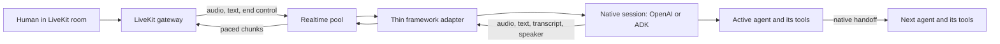

# #810: Native realtime agents and handoffs

Use each framework's own realtime runner for live conversations. The OpenAI Agents SDK or Google ADK owns agent turns, handoffs, tools, and the model connection. Agent Kernel keeps the audio, queue, session identity, tool context, and LiveKit boundary those SDKs do not provide, plus a few framework-neutral additions to the realtime path and the LiveKit edge.

Line references: "base" is `develop`; "now" is this branch.

## Motivation

- The base `RealtimeRunner` contract makes Agent Kernel run tools: a `tool_call` event, `execute_tool` and `send_tool_result` (base `core/realtime/runner.py:92`, `:119`, `:124`). The base pool runs them, inside the session lock, the agent's activation and a `ToolContext` (base `pipeline/realtime_pool.py:131`, `:229`).
- The base OpenAI adapter opens a raw Realtime socket and builds its own tool and handoff flow (base `framework/openai/openai.py:627` class, `:775` `_activate`, `:805` `_offered_handoffs`, `:908` `_switch_to`).
- The base ADK adapter opens a raw Gemini Live socket and builds its own transfer flow (base `framework/adk/adk.py:918` class, `:1178` `_open_socket`, `:1236` `_handle_message`, `:1356` `_transfer`).
- The native frameworks already do these jobs (external; not re-verified in this rewrite): [OpenAI Agents SDK realtime](https://openai.github.io/openai-agents-python/realtime/guide/) (`RealtimeAgent`, `RealtimeRunner`, `RealtimeSession`) and [ADK live workflows](https://adk.dev/live/workflows/) (`Runner.run_live()`, one `LiveRequestQueue`).
- The base LiveKit gateway already shows one participant per agent and keeps its own agents' audio and chat out of the caller input (`integration/livekit/adapter.py`, `_own_identities`, now `:162`).
- The base realtime path has gaps a live call meets in practice:
  - The caller's own words never reach the edge as text.
  - A gateway starts only at boot, and a session lives until the 300 s idle timeout after its room is gone (base `pipeline/realtime_pool.py:34`).
  - A native session that fails at once is replaced by the very next audio frame, with no back-off (base `get_connection` evicts and the next message reconnects).
  - The conversation opens only when a caller's microphone appears, so a caller who joins muted is never greeted (base `integration/livekit/adapter.py:246`).

## Requirements

### One conversation, several agents

- A human and several agent participants share one LiveKit room.
  - Agents known from the declared graph appear when the call starts; a dynamic handoff target appears when first named, as a participant of its own. The first participant speaks only for the agent the call starts with.
  - One native conversation controls the turn; an agent hands off through the framework's own handoff.
- Only the active agent receives live caller input and speaks.
  - A handoff carries context through the native SDK; room audio of one agent is never replayed into another model.
  - ADK: one `run_live()` call and one input queue per call.
- Each agent uses the tools declared on its native agent. The SDK runs them. Agent Kernel has no second tool or handoff engine.

### Framework adapters

- `OpenAIRealtimeRunner` (now `openai.py:628`) wraps `RealtimeSession` over native `RealtimeAgent` definitions.
  - An ordinary OpenAI `Agent` is rejected (now `:682`, `:705`).
  - A `FunctionTool` with `needs_approval` is rejected before opening (`_check_agents`, now `:747`).
- `GoogleADKRealtimeRunner` (now `adk.py:921`) wraps `Runner.run_live()`.
  - The root is an ADK `LlmAgent` or a `Workflow`; a `Workflow` root does not speak, so `initial_speaker` returns `None` (now `:980`) and the adapter reports the first speaker with the roster.
  - `ParallelAgent`, `LoopAgent`, and workflow nodes left in `single_turn` mode are rejected before opening (`_check_graph`, now `:1010`).
  - A `FunctionTool` that requires confirmation is rejected before opening (`_check_confirmations`, now `:1046`); `require_confirmation` is read from the private `FunctionTool._require_confirmation`, and a callable counts as requiring it.
  - Of the ADK `App` options, only `plugins` is passed through `run_options`; any other is rejected by name.
  - Audio at a rate other than the pool's resample rate fails the connection (`_check_output_rate`, now `:1175`).
- Both adapters:
  - Use public SDK APIs and do not clone or rebuild the agent graph.
  - Take per-run settings from `Module.run_options` (base `core/module.py:101`), rejecting keys the realtime session cannot take.
  - Report a tool that asks for a human decision during the call as a connection error (OpenAI `_refuse_approval`, now `:847`; ADK `_refuse_confirmation`, now `:1197`), as a backstop to the checks before opening.
  - Remove raw socket loops, hand-built tool responses, transfer instructions, transcript replay, manual connection switching, and SDK-level retry logic.

### Tools on the native path

- The pool sets `ToolContext`, `Session.current()` and `Agent.current()` once in `RealtimeConnection.connect()`, before the native session starts (now `realtime_pool.py:123`), and resets them after.
  - The SDK's own tasks are created while connecting and inherit them: OpenAI's websocket listener task and ADK's listener task. A tool therefore sees them as it does on the unary path.
  - Both frameworks, one place; no adapter code is needed. ADK additionally keeps that `ToolContext` by id in its session state for its tool wrapper (now `adk.py:1077`); under the pool it is the pool's context, not a second one.
  - The session lock is not taken: a call is one long-lived session, and holding the lock for it would block every other run of that session. The base pool took the lock per tool call.
- AK system tools and their prompt text are attached as in every other mode (now `openai.py:904`, `adk.py:1266`).
  - An ADK `Workflow` root holds no tools or instructions, so nothing is attached to it; the agents inside it carry theirs when the application registers them with the module.
- AK pre-hooks, post-hooks, and guardrails do not run on the native path; the SDK's own do. Base did not run them either. Documented.
- Session `framework_context`: unchanged from base. OpenAI loads it as the SDK `context` (now `openai.py:715`; the normal run paths also store it back); ADK does not use it.
- Neither adapter stores the session at the end of a conversation (as in base).

### Runner contract (`RealtimeRunner`)

- Removed: `execute_tool`, `send_tool_result`, and the `tool_call` callback event.
  - A runner that still emits `tool_call`, or any other event outside the closed list, fails the connection.
- Added: `initial_speaker(agent)` (now `core/realtime/runner.py:70`); `None` means only the native session can say who speaks first.
- `team(agent)` (now `:56`) lists speaking agents from the public graph, without building a new graph; it must not raise.
- Callback events (closed list): `audio_delta`, `transcript_delta`, `input_transcript`, `agent_changed`, `interrupt`, `speech_started`, `done`, `error`.
  - `agent_changed` carries `agent`, `previous_agent` (may be `None`), and optional `agents` (the roster when a change names an agent the roster lacked).
- `connect` rejects an unsupported agent or option with `TypeError` or `ValueError` naming the agent, before opening anything. A failed or cancelled connect closes what it opened.
- Selection stays through the `realtime_runner_cls` seam (base `core/base.py:556`).

### Pool (`RealtimeConnection`, `RealtimeConnectionPool`)

- The pool keeps audio pacing, input batching and resampling, barge-in delivery, queue routing, close, and eviction. It runs no tool.
- Output order: `input_transcript` rides the paced queue and is kept on barge-in; it neither ends a turn nor resets the pacing window (now `pipeline/realtime_pool.py`, `handle_framework_event` and the pacing loop).
- A failed connection is closed in a separate task whose reference the pool holds until it finishes (`close_in_background`, now `:352`).
- A connect that fails or times out is cancelled, closed, and counted as a failure (`_discard_failed`).
- `RealtimeConnection.produced_output` is set by the first audio, transcript, or turn end.

### Caller transcript (C1)

- New stream event `InputTranscript` (`message_id`, `content`; now `core/event.py:170`), one finished non-empty caller utterance, in spoken order with agent output.
- Mapped from the SDK: ADK a finished `input_transcription` on a `user` event; OpenAI `input_audio_transcription_completed`.
- No new setting. It appears when the SDK's own input transcription is on (ADK: default on, external, not re-verified; OpenAI: `input_audio_transcription` in model settings through `Module.run_options`).
- An edge that does not use it ignores it. The LiveKit gateway shows it as a caption.

### Live captions (C2)

- LiveKit gateway captions:
  - Agent text deltas go on a text stream from the speaking agent's participant, paced with the audio; the caller's line goes out attributed to the caller, with the identity the line was heard from.
  - Standard LiveKit transcription conventions: topic `lk.transcription` and the `lk.transcribed_track_id`, `lk.segment_id`, `lk.transcription_final` attributes.
  - One caption task per gateway performs queued operations in order (`_CaptionSegment` now `:25`, `_run_captions` now `:581`); delivery only enqueues. A failed segment logs once and is skipped.
  - One write waits at most `CAPTION_WRITE_TIMEOUT_SECONDS` (5 s); a write that stalls is skipped, with the rest of its segment, so later captions still go out.
  - The turn-end chat message is kept for existing clients.
- Shutdown waits for queued captions at most `CAPTION_DRAIN_SECONDS` (1 s).

### Gateway started and stopped while the app runs (C3)

- `GatewayRunner` gains `start_background(ready_timeout)`, `stop(timeout)`, and `running` (now `integration/adapter/gateway.py:67`); no new sibling class.
  - It runs one gateway on its own thread, returns when the edge calls `_mark_ready`, and re-raises a start failure to the caller. `READY_TIMEOUT_SECONDS` is 30.
  - Not ready in time: it stops the gateway and raises `TimeoutError`.
  - A background gateway failure never ends the process; boot-time gateways behave as before.
- Works for any `StatefulEdgeAdapter`, not only LiveKit.

### End a session at once (C4)

- An edge that stops sends an end-of-session control on the input queue for its session id (`LiveKitEdgeGateway._send_session_end`, now `:303`): an empty request with message attribute `ATTR_REALTIME_END`.
  - `IntegrationProducer.enqueue` takes optional extra `attributes`; a key that collides with a producer attribute raises `ValueError` (now `:61`).
  - The control goes behind frames already staged, waiting at most `SESSION_END_TIMEOUT_SECONDS` (2 s) for them. If staged input is still unsent after that, the control is not sent: it would pass that input, and the pool would drop it as late. The session then ends by idle eviction.
  - The broker call is bounded by the same time, so a stopping gateway never waits on a broker that does not answer.
- The pool closes that session's native connection at once (`end_session`, now `:627`) and drops input for it for `_ENDED_SESSION_TTL_SECONDS` (60 s).
- `StatefulEdgeRegistry.unregister(session_id, adapter=None)` removes only that adapter when given one, and records the session as ended for `ENDED_TTL_SECONDS` (60 s; `recently_ended` now `registry.py:58`).
- The Response Handler acks and drops chunks for an edge that just ended, instead of retrying them into a permanent failure (`_edge_recently_ended`, now `pipeline/response_handler.py:186`).
- Each edge instance sends its own id (`edge_id`, in the reply context) with its input and the control. Input from another instance of an edge for the same session id is a new call: an app that starts a new gateway for the same room within the 60 s is not dropped.
- Works across processes because it uses the existing queue.

### Opening prompt and join (C5)

- The fixed greeting becomes an overridable gateway method, `opening_prompt(participant_identity)` (now `livekit/adapter.py:374`); `None` sends nothing. Default is the previous text, without the word "microphone".
- The conversation opens when a participant joins the room (`_on_participant_connected`, now `:338`), not when a microphone appears, so a caller who joins muted is greeted.
- LiveKit raises `participant_connected` only for later joins, so a caller already in the room when the gateway joins is greeted from `start()`, read straight after the listener's join so no caller is greeted twice.

### Back-off after a failed native session (C6)

- After a native session fails, input for that session is dropped for `1 * 2 ** (failures - 1)` seconds, at most 30 (`_note_failure`, now `realtime_pool.py:591`).
- A connection that produced output before it failed restarts the count at 1; ending the session clears it.
- A connection that fails again within the window is not opened early.
- A connect that fails sends the edge one terminal error chunk naming the failure. The back-off drops the redelivered input, so that input never reaches its permanent-failure path; without the chunk a room whose session cannot open (a bad key, an agent or option the adapter rejects) would hear nothing.

### Configuration and compatibility

- No new `AKConfig` field. Reused: `execution.realtime` (now `core/config.py:667`), the existing queue and LiveKit settings, and `Module.run_options`.
- The new numbers are class or module constants, not config: `READY_TIMEOUT_SECONDS`, `SESSION_END_TIMEOUT_SECONDS`, `CAPTION_DRAIN_SECONDS`, `CAPTION_WRITE_TIMEOUT_SECONDS`, `ENDED_TTL_SECONDS`, `_ENDED_SESSION_TTL_SECONDS`, `_RECONNECT_BASE_SECONDS`, `_RECONNECT_MAX_SECONDS`.
- `google-adk` floor rises from `>=1.24.0` (base `pyproject.toml:132`) to `>=2.7.0` (now `:132`).
  - Reason: a live fix that finds a transfer even when its tool result is not first in a batch (external; not re-verified).
  - It applies to every ADK user, not only realtime.
- Breaking for bring-your-own realtime runners: a runner using the old tool callback fails with an explicit error. Documented.
- Breaking for OpenAI realtime users: the entry agent is a `RealtimeAgent`, and the model and voice come from `run_options(model_config=...)`. An OpenAI tool needing approval now fails the connection instead of being left out. Documented.
- A bring-your-own edge receives a new `InputTranscript` chunk type in `deliver_chunk`; it should ignore types it does not know.

### Documentation

- Document a support list per adapter: native tools, handoffs, approvals, SDK guardrails, AK hooks and guardrails, MCP tools, reconnect behavior. Do not claim SDK support alone makes a feature available in LiveKit.
- Examples move to native `RealtimeAgent` and ADK definitions; ADK per-agent voice moves to `Gemini(speech_config=...)` or `RunConfig.speech_config` (external; not re-verified).

### Verification

- OpenAI and ADK: a live turn moves from agent A to B and back, each agent's own tool runs through the SDK, and `AgentChanged` arrives in order.
- A tool run by the native session sees `ToolContext.get()`, `Session.current()` and `Agent.current()`, for OpenAI (real SDK session) and ADK.
- AK system tools are attached to a realtime agent.
- Audio, text, interruptions, and errors reach the active agent's participant in order; agent participants' own audio and chat never feed the native session.
- An approval-needing tool (OpenAI) or a confirmation-requiring tool (ADK), an unsupported agent, or an unsupported option gives an explicit error before opening.
- A custom runner's `tool_call` fails explicitly.
- Two AK sessions keep separate native sessions; closing one does not stop the other.
- C1: one utterance gives exactly one `InputTranscript`, before the reply that answers it.
- C2: a stalled caption write is skipped and later captions go out; a caller caption keeps the identity it was heard from.
- C3: two gateways started after boot, one stopped, the other keeps working.
- C4: after the control, `disconnect` has run; later audio from that edge is dropped, input from a new edge for the same session id is not; a chunk for the ended edge is not retried; the control is not sent past unsent staged input, and a broker that does not answer cannot hold up the stop.
- C5: `None` sends no opening request; a custom prompt is sent once; a caller who joins muted is greeted, and so is one already in the room.
- C6: repeated immediate failures drop input with delays 1, 2, 4 s; output before a failure restarts the count; ending the session clears it; a failed connect sends one error chunk.
- A handoff to an agent the starting roster lacked does not bind it to the first participant.

## Non-goals

- Several voice models speaking at once, or automatic group discussion without explicit handoffs.
- Feeding agent-generated room audio back into another model as if a human spoke it.
- A separate voice per OpenAI agent inside one Realtime session.
- Removing AK's queue, LiveKit gateway, audio conversion, or playback coordination.
- Identical native features across OpenAI and ADK, or durable recovery of calls after an AK restart.
- Rebuilding native handoff, tool, guardrail, approval, or reconnection engines in Agent Kernel.
- Unchanged behavior for custom realtime runners using the old tool callback.
- A second LiveKit path (ADK's experimental `LiveKitRunner`) in this change.
- Observing a realtime call from server code (transcript lines, agent changes, errors) and sending text into a call from server code: these belong with bringing realtime onto Runtime pre- and post-hooks, which is a separate ticket. Until then an application can subclass the gateway and override `deliver_chunk`.
- Gaps the base realtime path already had, left for a separate ticket: AK pre-hooks, post-hooks, and guardrails; storing the session at the end of a call; writing `framework_context` back.

## Open questions

- Can the LiveKit edge report real playout to OpenAI's native playback tracker? A successful queue send does not prove the listener heard the audio.
- Should a tool call hold the session lock, as the base pool did? It does not now (see Tools on the native path); holding it needs every native tool wrapped.
