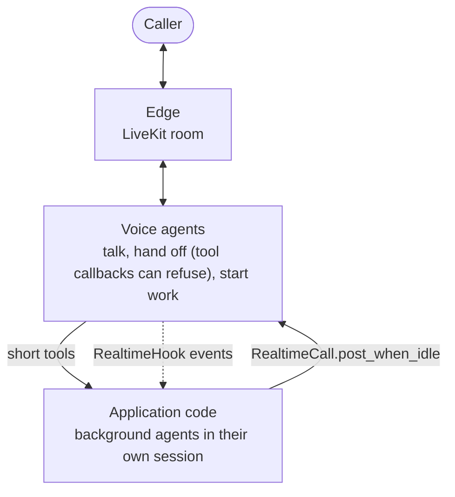

# #810: Realtime multi-agent collaboration with background work

Realtime support for applications in which voice agents and background agents work together: voice agents talk to
the caller, hand off to each other and start work through short tools; background agents do the long work in their
own sessions and report back into the call. The design idea: voice is the meeting room, not the engine. The pool
gains the turn state and an outbox that let application code speak into a call at a quiet moment, and hooks that let
it watch one; the Gemini adapter gains ADK's tool callbacks, authored history, the call's `RunConfig` and connection
recovery. The changes were driven by a full application kept outside this repository.

Contract background: [`../809-realtime-multi-agent-handoffs/design.md`](../809-realtime-multi-agent-handoffs/design.md),
[`../405-livekit-realtime-voice/design.md`](../405-livekit-realtime-voice/design.md).

## Motivation

- Nothing can refuse a Gemini transfer, so agents with no caller input can hand off to each other forever
  - Realtime ADK calls `tool.run_async` directly (`ak-py/src/agentkernel/framework/adk/adk.py:1435`): the agent's `before_tool_callback`, `after_tool_callback` and `on_tool_error_callback` never run, though ADK's own flow runs them around every tool call (`google.adk.flows.llm_flows.functions`)
  - The built-in `transfer_to_agent` replaces any tool with the same name (`adk.py:1121`), so an application cannot wrap it
  - OpenAI is already covered: a handoff that raises leaves the agent as it is (`openai.py:978`), and the pool returns the error to the model (`realtime_pool.py:247-249`)
- Code outside the pool cannot tell whether the model is speaking or when the caller last spoke
  - `RealtimeConnection.last_activity_at` moves on every caller audio frame (`realtime_pool.py:270`) and every adapter event (`:119`)
  - Text sent into a call always starts a response (`openai.py:932`); one sent while a response runs is only logged by the server (`openai.py:905-906`)
  - The ADK adapter reports no `speech_started`; it reads the caller's transcription only for barge-in (`adk.py:1250`)
- After a Gemini transfer, the new agent cannot tell a teammate's words from its own
  - The adapter replays every agent's turn as the model's own (`role="model"`, no author); ADK presents other agents' turns as user-side context naming the author (`google.adk.flows.llm_flows.contents._present_other_agent_message`)
- An application learns what was said in a call only from log lines (`AI response: ...`)
- An application serving its users a LiveKit page has to read `AKConfig` to sign their tokens
- A call cannot set how Gemini detects the caller's turns or which language it transcribes
  - Turn detection is left to the Live API's defaults (`adk.py:1056-1059`), and both transcriptions are a bare `AudioTranscriptionConfig()` (`adk.py:1090-1091`)
  - ADK's `RunConfig` holds these settings, and `Module.run_options(agent, run_config=...)` already carries one
- A lost Gemini socket ends the conversation
  - A socket error is reported as `error` (`adk.py:1219-1234`), the pool fails the connection (`realtime_pool.py:159-171`), and the next input starts over at the entry agent (`realtime_pool.py:95-98`) with no earlier turns (`docs/docs/integrations/livekit.md:288`)
  - The Live API ends a connection after about 10 minutes and an audio session after 15 minutes without compression; it offers session resumption ([Session management with Live API](https://ai.google.dev/gemini-api/docs/live-session))
  - What the caller says while no socket is open is dropped (`adk.py:1298-1308`), during a transfer too (`adk.py:1360-1361`)
- Background agents cannot share the call's session: the pool runs tools inside the AK session lock (`realtime_pool.py:244`), which `Runtime.run` holds for a whole run (`runtime.py:393`); they run in sessions of their own, with no core change

## Requirements

### ADK tool callbacks in realtime (`GoogleADKRealtimeRunner.execute_tool`)

- Run the calling agent's `before_tool_callback`, `on_tool_error_callback` and `after_tool_callback` around every tool call, `transfer_to_agent` included, in the order and with the short-circuits of ADK's own flow; sync and async callbacks
- `tool_context.actions.transfer_to_agent` is read after the callbacks, so a before-callback that answers blocks a transfer, and one that sets the action requests one
- ADK plugins do not run (realtime has no ADK `Runner`); documented
- An agent with no callbacks behaves as today

### Turn state and caller events (`RealtimeConnection`, both adapters)

- The connection keeps, readable from any thread: whether the model is responding (a response open until its `done`, output still queued, or a tool running), when model output last left and was generated, when the agent last changed, when a tool result was last sent, when the caller was last heard, when edge text last arrived, whether the caller is speaking, and whether the connection is ready
- Internal to the pool: `RealtimeConnection` is not exported; applications use `RealtimeCall`
- New adapter events, none reaching the edge
  - `speech_heard` (ADK: each later transcription of the caller's words); `speech_stopped` (OpenAI server VAD, declared by `RealtimeRunner.reports_speech_stopped`)
  - The ADK adapter reports `speech_started` once per caller turn, while the model is silent
- No change to stream events, queue messages or edges

### Authored history on a transfer (`GoogleADKRealtimeRunner`)

- Each history entry records its author; a transfer's socket is seeded as ADK seeds one: the caller's words as they are, every agent's turn through ADK's `_present_other_agent_message`
- The caller's words are logged per turn (`Caller said: ...`)

### Talking into a live call (`RealtimeCall`, `RealtimeOutbox`)

- A post waits until the call is ready, nobody is talking, the model owes no reply (to the caller, edge text, a tool result, a replayed reconnect or the last post, each bounded), and the call has been quiet for a moment
- One outbox per session, so posts outlive a reconnect; keyed posts replace, `withdraw(key)` drops, posts expire, the queue is bounded
- `RealtimeCall(session_id)` in `agentkernel.pipeline`: `post_when_idle`, `withdraw`, `connected`, `quiet_for()`, `agent_has_spoken`, `close()`
- No configuration: thresholds are constants

### Realtime hooks (`RealtimeHook`)

- `RealtimeHook.on_event(session, agent, event)` in `core/hooks.py`, attached with `Module.realtime_hook(agent, hooks)` to the agent a call starts with; handoffs report to the same hooks
- `RealtimeEvent.type`: `connected`, `caller_said`, `edge_text`, `agent_said`, `agent_changed`, `reconnected`, `disconnected`
- In order, off the audio path; a failing hook is logged and the next runs
- Optional adapter event `caller_transcript`: Gemini reports it; OpenAI does not enable input transcription and reports none

### LiveKit tokens and alias

- `agentkernel.livekit`, the public alias; `LiveKitEdgeGateway.participant_token(identity, name=None, **grants)`, signed with the gateway's key for its own room, refusing agent identities, room grants and a gateway without a key
- The LiveKit examples import the public aliases and sign tokens through the gateway

### Live settings from `RunConfig` (`GoogleADKRealtimeRunner`)

- The starting agent's `run_config` run option applies to every socket of the call: `realtime_input_config`, `input_audio_transcription`, `output_audio_transcription` (transcription stays on)
- A run-options factory is not called for realtime calls; documented

### Connection recovery (`GoogleADKRealtimeRunner`)

- A socket that drops, is closed by the server (its ~10 minute limit included) or stalls is replaced without leaving the agent that had the call
- The new socket is seeded with the conversation and a one-time note that the line dropped, as a transfer's socket is seeded
- Bounded attempts; repeated quick drops give up as an `error`, which fails the connection as today
- What the caller says while no socket is open is held and sent to the next socket; a tool result that arrives after its socket was lost is kept in the history
- A stall is no model progress for a while after the model was given something to answer, or mid-response; a voice turn the model never answers is not detected (documented)
- While recovering, the connection is not ready for posts; a failed connection is released by the pool even if no more input comes
- OpenAI realtime is unchanged

### Diagnostics

- The pool warns when its loop is blocked for more than a second; the ADK adapter logs how long the caller waited for an agent to start speaking

### Configuration

- **No new configuration fields.** Reason each candidate was rejected:
  - Turn detection, languages: ADK's `RunConfig` already holds them, carried by `Module.run_options`
  - Post timing, reconnect and stall thresholds: values settled in live runs, kept as constants rather than knobs nobody has asked to tune
- No new extra; existing YAML and `AK_*` env vars stay valid

### Example (`examples/api/livekit-voice/google/handoffs/`)

- The existing handoffs example gains: a `before_tool_callback` that refuses a handoff to a specialist until the caller's account is verified, a technician booking that a background job confirms through `post_when_idle`, and a `RealtimeHook` that logs the call
- Offline tests; the example runs them in the CI e2e matrix

### Tests

- Offline, against scripted sockets: `ak-py/tests/test_realtime_pool.py`, `test_module.py`, `test_livekit_gateway.py`, `test_ecs_akagentrunner_realtime.py`; the example's `server_test.py`
- Live runs on `gemini-3.1-flash-live-preview`, done by the maintainer: handoffs, a background post, a forced drop, a call past 10 minutes

### Documentation and skills

- `docs/docs/integrations/livekit.md`, `hooks.md`; `docs/docs/architecture/realtime-internals.md`
- `.agents/skills/ak-dev-architecture/SKILL.md` (a realtime section), `.agents/skills/ak-dev-testing-conventions/SKILL.md`
- `docs/versioned_docs/` is never edited

## Non-goals

- `RealtimeCall` across processes: it reaches a call only in the process running the realtime pool
- ADK plugins in realtime; recovery for the OpenAI realtime adapter
- Detecting a voice turn the model never answers; bounding the replayed history
- Gemini's native session resumption: a follow-up. A handoff needs a new socket for the new agent anyway, and the replay already recovers a drop and the ~10 minute limit; resumption would also need context window compression (an audio session ends at 15 minutes without it) and is unproven on the preview Live model
- A browser voice edge (a web page carrying a call with no media server); an application can build one on the public edge seam (`StatefulEdgeAdapter`, `StatefulEdgeRegistry`)
- The application that drove these changes
- Parallel tool calls on a non-realtime ADK run ("Token ... was created in a different Context"): a separate bug fix on its own branch, `bugfix/adk-parallel-tool-context`. A realtime tool call cannot hit it: each gets its own `ToolContext`, and a call's tool calls run one at a time under the session lock

## Open questions

- Resolved: one PR (#818) for all of it; the parts depend on each other (posts on recovery, the example on posts and hooks)
- Resolved: no browser voice edge in this change. AG-UI cannot carry a voice call (no audio events; one HTTP request per turn; the stream path, not the realtime pool), and a browser edge is a new integration that needs its own design: hosting next to `GatewayRunner`, authentication, and the integration checklist. A separate issue if the team wants one
- Resolved: no native session resumption in this change (Non-goals); recovery replays the conversation with a one-time note
- Resolved: a late tool result is kept in the history, not sent to the recovered socket (unverified on Gemini 3.x Live)
- Resolved: tool calls Gemini writes into its words (`transfer_to_agent{...}`) are not stripped in the adapter; edges filter what they show
