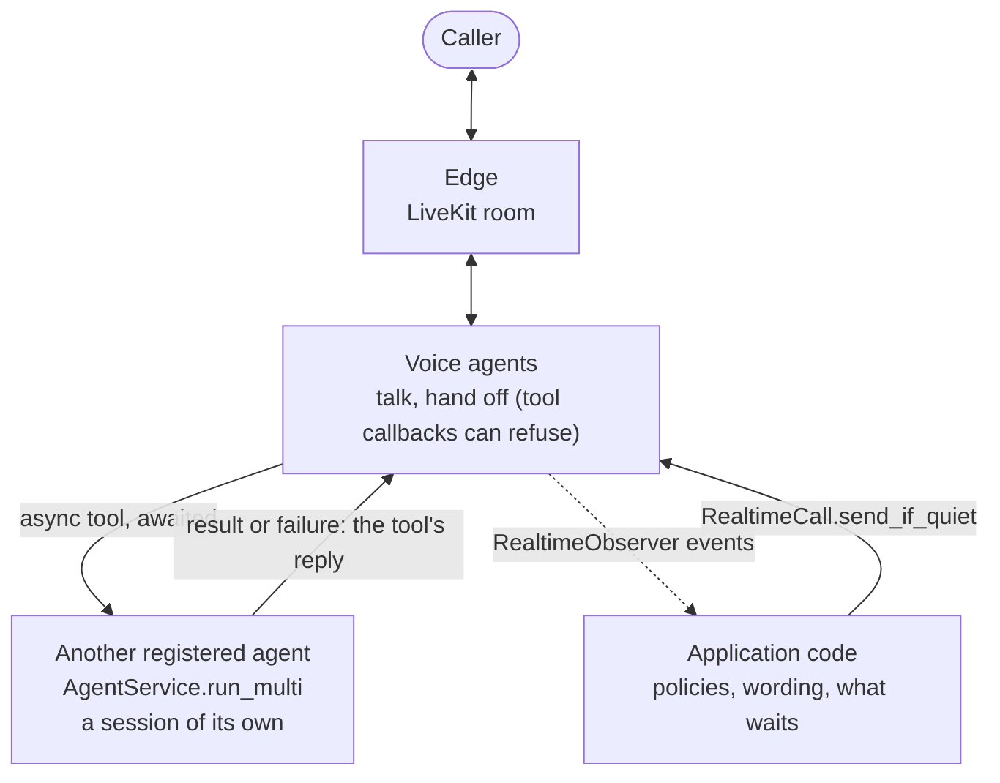

# #810: Realtime multi-agent collaboration

Realtime support for applications in which voice agents and other agents work together: voice agents talk to the
caller and hand off to each other; a voice agent's tool can ask another registered agent and wait for its answer,
which returns through the tool call. The design idea: voice is the meeting room, not the engine. The pool gains the
turn state and a guarded send that let application code speak into a call at a quiet moment, observers that let it watch one,
and ownership of its tool calls, so a call that ends cancels a tool still waiting; the Gemini adapter runs each call on
ADK's own live engine, so ADK's tool callbacks, plugins, transfers, history and session resumption apply in a call as on
any ADK run, and AK adds only what ADK lacks: the tool scope, event reporting and restarting a run that failed. On top of these, the building blocks
such an application otherwise builds itself: facts about a call, and gateways opened and closed per
session. AK provides the mechanism; the application keeps the policy and the words. The changes were driven by a full
application kept outside this repository.

Revised: an earlier version of this design added background jobs (`RealtimeCall.run_in_background`, a job loop hosted
beside the pool) so a voice agent could keep talking while long work ran, its result posted later. The application's
product decision is that the caller may wait for research and review, so their result comes back through the original
tool call, and the job runner is removed (Open questions).

Revised: an earlier version of this design had the Gemini adapter drive Gemini Live itself and re-implement ADK's tool
callbacks, transfers, history and recovery around it. The adapter now runs each call on ADK's `Runner.run_live`, and
that manual orchestration is removed (Open questions).

Contract background: [`../809-realtime-multi-agent-handoffs/design.md`](../809-realtime-multi-agent-handoffs/design.md),
[`../405-livekit-realtime-voice/design.md`](../405-livekit-realtime-voice/design.md).

## Motivation

- Nothing can refuse a Gemini transfer, so agents with no caller input can hand off to each other forever
  - Realtime ADK calls `tool.run_async` directly (`ak-py/src/agentkernel/framework/adk/adk.py:1435`): the agent's `before_tool_callback`, `after_tool_callback` and `on_tool_error_callback` never run, though ADK's own flow runs them around every tool call (`google.adk.flows.llm_flows.functions`)
  - The built-in `transfer_to_agent` replaces any tool with the same name (`adk.py:1121`), so an application cannot wrap it
  - OpenAI is already covered: a handoff that raises leaves the agent as it is (`openai.py:978`), and the pool returns the error to the model (`realtime_pool.py:247-249`)
- Code outside the pool cannot tell whether the model is speaking or when the caller last spoke
  - `RealtimeConnection.last_activity_at` moves on every caller audio frame (`realtime_pool.py:270`) and every adapter event (`:119`)
  - Text sent into a call always starts a response (`openai.py:932`); one sent while a response runs is only logged by the server (`openai.py:905-906`)
  - The ADK adapter reports no `speech_started`; it reads the caller's transcription only for barge-in (`adk.py:1250`)
- After a Gemini transfer, the new agent cannot tell a teammate's words from its own
  - The adapter replays every agent's turn as the model's own (`role="model"`, no author); ADK presents other agents' turns as user-side context naming the author (`google.adk.flows.llm_flows.contents._present_other_agent_message`)
- An application learns what was said in a call only from log lines (`AI response: ...`)
- An application serving its users a LiveKit page has to read `AKConfig` to sign their tokens
- A call cannot set how Gemini detects the caller's turns or which language it transcribes
  - Turn detection is left to the Live API's defaults (`adk.py:1056-1059`), and both transcriptions are a bare `AudioTranscriptionConfig()` (`adk.py:1090-1091`)
  - ADK's `RunConfig` holds these settings, and `Module.run_options(agent, run_config=...)` already carries one
- A lost Gemini socket ends the conversation
  - A socket error is reported as `error` (`adk.py:1219-1234`), the pool fails the connection (`realtime_pool.py:159-171`), and the next input starts over at the entry agent (`realtime_pool.py:95-98`) with no earlier turns (`docs/docs/integrations/livekit.md:288`)
  - The Live API ends a connection after about 10 minutes and an audio session after 15 minutes without compression; it offers session resumption ([Session management with Live API](https://ai.google.dev/gemini-api/docs/live-session))
  - What the caller says while no socket is open is dropped (`adk.py:1298-1308`), during a transfer too (`adk.py:1360-1361`)
- An agent a voice tool asks cannot share the call's session: the pool runs tools inside the AK session lock (`realtime_pool.py:438`), which `Runtime.run` holds for a whole run (`runtime.py:393`); it runs in a session of its own
- A tool still waiting when its call ends outlives the call
  - The pool starts each tool call as a bare task (`realtime_pool.py:131`, `loop.create_task`) that closing the connection does not cancel: the tool keeps its session lock and its nested run, and its result is then sent to a disconnected adapter
  - Tools were quick when this was written; a tool that awaits another agent's run (tens of seconds) makes it matter
- A known gap this change does not close: a run that fails reads like an answer
  - Every adapter turns a framework error into an ordinary `AgentReplyText` (`user_facing_error_message`): 10 sites in 6 adapters (`adk.py:534,722`, `openai.py:263,425`, `langgraph.py:624,775`, `pydanticai.py:219,454`, `crewai.py:404`, `smolagents.py:188`); `Runtime.run` cannot tell either (`runtime.py:418-422`)
  - A tool that asks another agent detects failure through its framework's own signal, during the run (the OpenAI Agents SDK calls `RunHooks.on_agent_end` only for a run that finished); see Non-goals
- An application that nudges a stalled team runs a watcher thread per call, and tracks facts the pool already keeps
  - The connection keeps when the caller last spoke, when edge text arrived, when the agent changed and when a tool result was sent (`realtime_pool.py:174-211`); `RealtimeCall` exposes only `connected`, `quiet_for()` and `agent_has_spoken` (`realtime_pool.py:1138-1155`)
- A gateway cannot be stopped on its own, so an application cannot give each session its own room
  - `GatewayRunner` stops only on the process-wide shutdown event (`gateway.py:63`)
  - `LiveKitEdgeGateway.stop()` before its `start()` has made its stop event does nothing, and `start()` then waits forever (`livekit/adapter.py:207,224,249`)

## Requirements

### Google ADK calls on ADK's own live engine (`GoogleADKRealtimeRunner`)

- Each call runs on `Runner.run_live`, with a `LiveRequestQueue` and an ADK session of the connection's own; the caller's audio and text go to the queue, and ADK's events are reported through the pool's callback
- ADK runs the tools, their plugins and the agent's `before_tool_callback` / `on_tool_error_callback` / `after_tool_callback`, so a callback can refuse `transfer_to_agent`; ADK performs the transfer and gives the new socket the conversation from its session
- Framework-independent adapter contract: `RealtimeRunner.runs_tools` (no `tool_call` reported, so the pool never runs a tool twice) and `use_tool_scope(open_scope)`; the pool's `open_tool_scope()` gives the framework's task running a tool the call's session lock, `Session.current()`, `Agent.current()` and a `ToolContext`, until that task ends. An AK plugin, first among the call's plugins, opens it
- The starting agent's `run_config` and ADK `Runner` options (`plugins`, services) reach the call; a run-options factory is not called
- Each agent's voice comes from its model, `Gemini(model=..., speech_config=...)`; ADK's live run does not read `generate_content_config.speech_config`
- Requires `google-adk>=2.7.0`: earlier 2.x releases end a live run on a refused `transfer_to_agent`

### Turn state and caller events (`RealtimeConnection`, both adapters)

- The connection keeps, readable from any thread: whether the model is responding (a response open until its `done`, output still queued, or a tool running), when model output last left and was generated, when the agent last changed, when a tool result was last sent, when the caller was last heard, when edge text last arrived, whether the caller is speaking, and whether the connection is ready
- Internal to the pool: `RealtimeConnection` is not exported; applications use `RealtimeCall`
- New adapter events, none reaching the edge
  - `speech_heard` (ADK: each later transcription of the caller's words); `speech_stopped` (OpenAI server VAD, declared by `RealtimeRunner.reports_speech_stopped`)
  - The ADK adapter reports `speech_started` once per caller turn, while the model is silent
- No change to stream events, queue messages or edges

### Talking into a live call (`RealtimeCall.send_if_quiet`)

- AK keeps the delivery mechanics, the application the scheduling. `await RealtimeCall(session_id).send_if_quiet(text, quiet_since=None) -> bool` sends only into a quiet call: ready, no tool running, no output still to play, the caller not speaking, no reply taken to be owed (to the caller, edge text, a tool result, a seeded reconnect or earlier application text), and quiet for a moment; with `quiet_since`, only while the call is still in that quiet stretch
- The check and the send run as one step on the pool's loop, from whichever loop awaits it; never blocking that loop. Sent is not heard: later caller speech and barge-in still apply. A failing send raises
- Declined, nothing is kept: AK holds no queue of application text. What waits, what replaces, expires or is withdrawn, and what a moved-on call makes obsolete are the application's, which keeps them per call so they outlive a renewed connection
- A reply owed is inferred, not observed (the model is silent before its first output): each input counts for at most 15 s, after which the pool stops waiting; it never takes the reply for given
- `RealtimeCall(session_id)` in `agentkernel.pipeline`: `send_if_quiet`, `connected`, `quiet_since()`, `quiet_for()`, `agent_has_spoken`, `close()`, `observe` / `unobserve`
- No configuration: thresholds are constants

### Realtime observers (`RealtimeObserver`)

- `RealtimeObserver.on_event(session, agent, event)` in `core/realtime/observer.py`, registered process-wide with `RealtimeCall.observe(observer)` (`unobserve` to stop); each new connection takes the observers registered by then, and handoffs report to them too
- An observer, not a hook: AK hooks (`PreHook`, `PostHook`) wrap a run and can change or halt it; a call has no run to wrap, and an observer cannot change what is said. Not attached to `Agent`: what is observed is the call, and an attachment on the entry agent alone would be silently ignored on any other
- `RealtimeEvent.type`: `connected`, `caller_said`, `edge_text`, `agent_said`, `agent_changed`, `reconnected`, `disconnected`
- In order, off the audio path; a failing observer is logged and the next runs
- Optional adapter event `caller_transcript`: Gemini reports it; OpenAI does not enable input transcription and reports none

### LiveKit tokens and alias

- `agentkernel.livekit`, the public alias; `LiveKitEdgeGateway.participant_token(identity, name=None, **grants)`, signed with the gateway's key for its own room, refusing agent identities, room grants and a gateway without a key
- The LiveKit examples import the public aliases and sign tokens through the gateway

### Connection recovery (`GoogleADKRealtimeRunner`)

- ADK resumes a dropped socket itself when it holds a session resumption handle (Gemini 3.x Live sends them unasked); nothing is replayed and AK reports nothing
- A live run that ends or fails anyway, or stalls (no model progress for a while after it was given something to answer, never while a tool runs), is started again on the same ADK session: ADK resumes the agent that had the call with the conversation, and a one-time note that the line dropped is queued for it
- `reconnected` is reported only once the restarted run sends its first event; a restart that fails before is not reported
- Repeated quick drops give up as an `error`, which fails the connection as today
- While recovering, `send_if_quiet` declines; a failed connection is released by the pool even if no more input comes
- OpenAI realtime is unchanged

### Tool calls that wait (`RealtimeConnection`)

- A realtime tool may be an `async` function that awaits long work, such as another registered agent's run through `AgentService.run_multi` in a session of its own, and returns its result as the tool call's answer; nothing in AK is specific to it
  - It runs on the pool's loop, through the existing tool path (the framework's tool builder, the adapter's `execute_tool`, the call's session and `Agent._activate()`); an SDK's async client yields the loop while it waits, so other calls' audio keeps its pace; blocking work belongs in `asyncio.to_thread`
  - The nested run uses its own session: the waiting tool holds the call's session lock
- The connection owns its tool calls: each is a task of the connection, and the connection knows which are still running
- While a tool call runs, the call is busy (`is_responding`): no post is said and `quiet_for()` is `None`; on Gemini the stall wait starts again only when the result is sent, so a slow tool is not taken for a stalled socket
- Closing the connection (`RealtimeCall.close()`, an idle or failed-socket eviction, pool shutdown) cancels its running tool calls and waits briefly (`_TOOL_CANCEL_SECONDS`, 2 s) for them to unwind before the adapter disconnects; the cancellation unwinds a nested run and releases its session
- No result is sent once the connection is closed or its socket failed, whether the tool was cancelled, ignored its cancellation, or finished just then: a late result never reaches a dead socket or the session's next connection
- A socket the Gemini adapter recovers keeps its existing rule: tools still running are waited for briefly (`LOST_TOOL_WAIT_SECONDS`), a later result is kept in the history, sent to no socket, and the tool is never rerun by AK
- No time limit, retries or wording in AK: an application bounds its own wait (`asyncio.timeout`)

### Facts about a live call (`RealtimeCall`)

- `RealtimeCall` reads, `None` without a connection: `last_caller_input_at` (the caller last spoke, or edge text arrived), `last_agent_change_at`, `last_tool_result_at`
- A handover ends a quiet stretch, as caller input and model output do
- `quiet_since()` names the current quiet stretch; text meant only for it passes it to `send_if_quiet`, which declines once anything happened (a new connection included)
- No quiet-call event: an application that acts on a quiet call reads `quiet_for()` from a task of its own on the realtime loop (started by an observer on `connected`, cancelled on `disconnected`), so it needs no thread; `send_if_quiet(..., quiet_since=...)` guards against a stretch that ended meanwhile
- AK decides nothing: whether to act on a quiet call, and what to say, is the application's

### Gateways per session (`GatewayRunner.stop`)

- `GatewayRunner.stop()`: callable from any thread, before or after `start()`; the runner stops its adapter on its own loop, as at shutdown; a runner stopped before `start()` never starts the adapter
- One gateway per session is the application's to compose: it keeps a `GatewayRunner` per session and hosts each on a thread of its own; AK has no pool class
  - A gateway leaving unregisters only its own entry, never the one a later join registered for the same session

### Diagnostics

- The pool warns when its loop is blocked for more than a second; the ADK adapter logs the caller's words, each tool call and its result, and each transfer

### Configuration

- **No new configuration fields.** Reason each candidate was rejected:
  - Turn detection, languages: ADK's `RunConfig` already holds them, carried by `Module.run_options`
  - The quiet delay, the reply wait, restart and stall thresholds: values settled in live runs, kept as constants rather than knobs nobody has asked to tune
  - The tool-cancel wait: a constant, at the scale of the observer drain (2 s); a tool's own time limit is the application's
- No new extra; existing YAML and `AK_*` env vars stay valid; the `adk` extra requires `google-adk>=2.7.0`

### Example (`examples/api/livekit-voice/google/handoffs/`)

- The existing handoffs example gains: a `before_tool_callback` that refuses a handoff to a specialist until the caller's account is verified, a technician booking whose tool waits for the dispatch system's confirmation, and a `RealtimeObserver` that logs the call
- `book_technician` is an `async` tool that awaits the confirmation and returns it, instead of starting a thread; a second booking for the same account is refused while one is under way
- Offline tests; the example runs them in the CI e2e matrix

### Tests

- Offline, against scripted sockets: `ak-py/tests/test_realtime_pool.py`, `test_adk_realtime.py` (ADK's real `run_live` through the pool, against a scripted Gemini Live socket), `test_livekit_gateway.py`, `test_ecs_akagentrunner_realtime.py`; the example's `server_test.py`
- New: `test_integration_gateway_runner.py` cases for `stop()`; `TestRealtimeAwaitedTools` in `test_realtime_pool.py`: busy while a tool waits (no post, `quiet_for()` is `None`), the result sent once, the call's session and agent back after a nested run, cancellation on close (directly and through `RealtimeCall.close()`) with locks released and nothing sent, nothing sent after a failed socket or by a tool that ignored its cancellation; a Gemini tool slower than the stall wait not taken for a stall
- The application drives the awaited path end to end (its voice tools through `GoogleADKToolBuilder`, the Gemini adapter and the connection, its background agents through `AgentService` and the OpenAI Agents SDK against a local stand-in for the Responses API)
- Live runs on `gemini-3.1-flash-live-preview`, done by the maintainer: handoffs, a forced drop, a call past 10 minutes, and how long callers wait for research and review

### Documentation and skills

- `docs/docs/integrations/livekit.md`, `hooks.md`; `docs/docs/architecture/realtime-internals.md`
- Tools that wait, the call facts and a room per meeting in `livekit.md` and `realtime-internals.md`
- `.agents/skills/ak-dev-architecture/SKILL.md` (a realtime section), `.agents/skills/ak-dev-testing-conventions/SKILL.md`
- `docs/versioned_docs/` is never edited

## OpenAI native realtime extension

The earlier “OpenAI unchanged” scope is superseded by the native-engine migration.
OpenAI voice agents now use `agents.realtime.RealtimeAgent` and its `RealtimeRunner`;
regular text `Agent` objects are not silently converted. Both built-in adapters set
`runs_tools=True`. The shared pool retains its generic tool path for custom adapters
and adds only a vendor-neutral paced-audio notification for playback tracking.
The existing task-lifetime tool-scope contract is retained; decoupling that lifetime
is separate work. See [research and verified limits](research/openai-native-realtime.md)
for compatibility, public callback integration, actual guardrail support and tests.

## Non-goals

- `RealtimeCall` across processes: it reaches a call only in the process running the realtime pool
- Recovery for the OpenAI realtime adapter
- Detecting a voice turn the model never answers; bounding the history a new socket is given; `quiet_for()` reports a quiet call, it does not decide that the team is stuck
- An AK gate for tools and handoffs: ADK's tool callbacks and the OpenAI SDK's tool guardrails and `on_handoff` already refuse them, on both paths; a realtime-only AK gate would make the same agent follow different rules in a call and over REST
- Policies in AK: no handoff limits, retry counts, nudge wording, time limits or refusal rules; an application writes them in its own classes
- Background work in AK: no job runner, queue or loop of its own; long work is an awaited tool, and work that must outlive its tool call is the application's
- A sub-agent framework or an agent-as-tool in AK: a tool selecting an agent and running it through `AgentService` is ordinary application code
- Reporting a failed run as failed (a failed-reply type across the 10 adapter error sites), and a generic agent tool built on it: the application that drove this change detects failure natively and needs its own steps around each run (citations watched during the run, a check after it), so neither would have a user here; both can come with the application that needs them
- Approval (`needs_approval`) and tool guardrails (input or output) in OpenAI realtime: approval needs a realtime pause, which AK does not have, and this runner calls a tool directly, so it does not offer a guarded tool (unchanged)
- Gemini's tool call cancellation (`toolCallCancellation`): neither adapter acts on it; a result is still sent for a call the server cancelled
- Context window compression: an application sets it in its `RunConfig` if it needs a call past the audio session limit (15 minutes); AK sets nothing
- Words said in the same turn as a transfer, and the caller's audio in ADK's transfer delay: ADK's to change; AK does not rebuild ADK's history or hold input around a transfer
- A browser voice edge (a web page carrying a call with no media server); an application can build one on the public edge seam (`StatefulEdgeAdapter`, `StatefulEdgeRegistry`)
- The application that drove these changes
- Parallel tool calls on a non-realtime ADK run ("Token ... was created in a different Context"): a separate bug fix on its own branch, `bugfix/adk-parallel-tool-context`. A realtime tool call cannot hit it: each gets its own `ToolContext`, and a call's tool calls run one at a time under the session lock

## Open questions

- Resolved: one PR (#818) for all of it; the parts depend on each other (sending on recovery, the example on observers)
- Resolved: no browser voice edge in this change. AG-UI cannot carry a voice call (no audio events; one HTTP request per turn; the stream path, not the realtime pool), and a browser edge is a new integration that needs its own design: hosting next to `GatewayRunner`, authentication, and the integration checklist. A separate issue if the team wants one
- Resolved (revised): ADK's native session resumption is used whenever ADK holds a handle; AK restarts the run only when ADK's own recovery ends
- Resolved (revised): a tool's result outlives a lost socket: ADK notices the loss only once its tools have returned, so the result is in the conversation the restarted run is given
- Resolved (revised): the Gemini adapter runs on ADK's `Runner.run_live`. Driving Gemini Live directly duplicated ADK's tool callbacks, transfers, history and recovery; with the native engine those are ADK's, and AK keeps the tool scope, event reporting and the restart. Measured trade-offs (documented): the caller's words in ADK's transfer delay go to the agent handing over, words said with a transfer reach the next agent only if their transcription is marked finished, and ADK reads nothing from the socket while its tools run
- Resolved: tool calls Gemini writes into its words (`transfer_to_agent{...}`) are not stripped in the adapter; edges filter what they show
- Resolved: the building blocks an application needs (call facts, per-session gateways, tool calls the connection owns) ship in this PR, proved by migrating the application that drove them
- Resolved (revised): no background jobs. The application's product decision is that the caller may wait while research or review runs, so their result returns through the original tool call. Awaited tools need nothing new from AK beyond the connection owning its tool calls; the job runner, its hosting in both realtime runners, the pool's readiness wait, `BackgroundJobHost` and the job API are removed from this PR. Nothing of it was released
- Resolved (revised): OpenAI realtime tool input guardrails are out of this PR, to keep it to what the application depends on; a tool with any tool guardrail stays unoffered, as before
- Resolved: no failed-reply type and no agent tool in this PR (Non-goals): a check on the reply alone cannot tell an error from an answer, so failure is detected during the run, natively, by the application's own code
- Resolved (revised): no idle event. It made the observer a per-hook timer in AK (thresholds, per-stretch counts, stale-event drops) for one application's nudge; `RealtimeCall.quiet_for()` and `send_if_quiet(..., quiet_since=...)` already give an application all it needs, polled from a task on the realtime loop
- Resolved (revised): `RealtimeObserver`, registered with `RealtimeCall.observe`, replaces `RealtimeHook` / `Module.realtime_hook` / `Agent.realtime_hooks`: it is read-only, so not one of AK's hooks, and it observes the call, not an agent
- Resolved (revised): the pool stays in `pipeline/realtime_pool.py`, the path released in agentkernel 0.9.5, so its imports, singleton and patch targets are unchanged; no `pipeline/realtime/` package. `core/realtime/` and `integration/adapter/` are unchanged
- Resolved (revised): no outbox in AK. `RealtimeOutbox`, `post_when_idle` and `withdraw` (never released) scheduled one application's messages inside AK: keys, expiry, a bounded queue, which posts a moved-on call makes obsolete. AK now keeps only the delivery mechanics, `send_if_quiet` with the final check on the pool's loop, so the check and the send cannot be separated by a change in the call; the application keeps what waits, per call, and when to try again. The quiet rule and the inferred owed reply stay in AK, since only the pool sees what is still playing and what the model was last given
