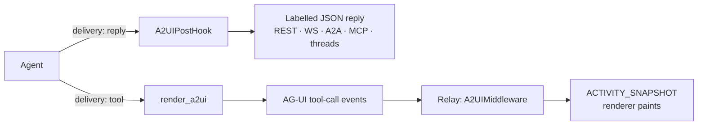

# #835: Progressive A2UI over AG-UI via a `render_a2ui` system tool

Agent Kernel's A2UI capability today has one delivery route: a post-hook labels a whole JSON reply
after the run (`a2ui/hook.py:58`). This change adds a second — a `render_a2ui` system tool the agent
calls mid-run, whose streamed arguments and result an AG-UI client turns into a surface that paints
before the run ends and grows as repeated data streams in.
One new field, `a2ui.delivery`, chooses between them per deployment; the hook and the tool are
mutually exclusive, so exactly one of them owns the payload.

## Motivation

- **A2UI never reaches a streamed run, and AG-UI is always streamed.**
  - The capability is a `PostHook.on_run` (`a2ui/hook.py:58`), and `Runtime.stream` calls only
    `on_stream_event` — never `on_run`. The factory logs a warning rather than leaving it silent
    (`a2ui/hook.py:149`).
  - AG-UI has no `message_type` switch: *"AG-UI delivers every run as a stream by definition"*
    (`docs/docs/integrations/agui.md:123`). So the `a2ui` block does nothing on that surface, at any
    `execution.message_type`.
- **What an AG-UI client gets today is one of two whole-payload shapes**, both arriving at the end.
  - Default: the agent's A2UI JSON streams as ordinary text — `TextMessageStart` → `TextMessageContent`
    deltas → `TextMessageEnd`, unlabelled. The client has to sniff it.
  - With an application-written `on_stream_event` hook: a `DataMessage` beside the closing event,
    mapped to `CustomEvent(name=<media type>, value=<payload>)`
    (`integration/agui/mapping.py:66`). The docs state the cost plainly — such a hook *"holds every
    delta back, and such an agent streams nothing incrementally"* (`docs/docs/integrations/agui.md:215-221`).
- **AG-UI's own ecosystem paints progressively through a tool**, and it can already find ours.
  - `@ag-ui/a2ui-middleware` watches for a `render_a2ui` tool call, parses its streamed args as
    partial JSON, and emits `ACTIVITY_SNAPSHOT` events — see `research/ag-ui-a2ui-middleware.md`.
  - Its `a2uiToolNames` option means AK never has to accept a client-declared tool, which is what
    keeps `injectA2UITool` out of scope (AK ignores client-declared tools —
    `docs/docs/integrations/agui.md:210`).
- **Two of the adapters already stream tool arguments in fragments** — Claude
  (`framework/claude/claude.py:257`) and Pydantic AI (`framework/pydanticai/pydanticai.py:710`) — so
  progressive painting is reachable today on real adapters, not hypothetically. See
  `research/adapter-tool-arg-fidelity.md`.
- **The system-tool seam this needs already exists.** `SystemToolFactory.get_all`
  (`core/tool.py:200`) attaches per-capability tools filtered by an `agents` allow-list
  (`_agent_allowed`, `core/tool.py:188`); `agui.state` and `agui.client_context` are the closest
  precedents (`core/tool.py:238-250`), built by `AGUIState.state_tools()`
  (`integration/agui/state.py:198`).

## Requirements

### Framing: a delivery mode, not an AG-UI feature

- The tool is **"deliver A2UI progressively, as tool calls"**. What is AG-UI-specific is only the
  client middleware that converts the tool result into `ACTIVITY_SNAPSHOT`.
- The code therefore lives in `a2ui/` (a new `a2ui/tool.py`, singular, beside `a2ui/hook.py`), not
  `integration/agui/`.
  - `a2ui/` is already *"the only place in `src/` that names A2UI"* (per `ak-dev-architecture`), and
    it is a capability, not an integration — it adds no surface of its own.
- Any surface that streams tool-call events can consume the tool. AG-UI is the one with a renderer
  today; the design must not assume it is the only one.



Only the top route exists today. The relay is a Node process in the example, not Agent Kernel code:
AK's half of the bottom route ends at the tool.

### Configuration

- **One new field on the existing `a2ui` block** (`_A2UIConfig`, `core/config.py:1081`); no new
  block, and `enabled` / `agents` keep their current meaning and scope both routes.

  ```yaml
  a2ui:
    enabled: true
    delivery: reply      # reply (default) | tool
    agents: [expenses]
  ```

  - `reply` — today's behaviour, byte for byte: `A2UIPostHook` labels a parsed JSON reply, no tool
    is attached.
  - `tool` — `render_a2ui` is attached to the agents `a2ui.agents` covers, and the post-hook stands
    down (`A2UIPostHookFactory.get` returns `NoOpA2UIPostHook`).
- **Why the field cannot be derived** (house pattern 2 requires this stated):
  - The two routes are incompatible output contracts over the same payload. Without a selector both
    could fire on one reply, which is exactly the collision `A2UIPostHook`'s docstring already rules
    out for the `output_type` route — *"one or the other owns the labelling, never both"*
    (`a2ui/hook.py:15-18`).
  - `execution.message_type` cannot stand in: AG-UI streams whatever it says
    (`docs/docs/integrations/agui.md:123`), and a streaming app may still want the whole-reply route.
  - `agui.*` presence cannot stand in: handlers are mounted in application code, not declared in
    config, so `AKConfig` cannot see whether AG-UI is in use.
- The field is a `str` enum-style literal with default `reply`, carrying a real `description`
  (it surfaces in generated docs). Existing YAML and `AK_A2UI__*` env vars keep working unchanged.
- **Rejected: nesting the tool under `agui`** (the `agui.state` shape). System tools attach at agent
  construction (`Agent._attach_system_tools`, `core/base.py:698`), not per request, so an
  `agui`-scoped block could not keep the tool off other surfaces anyway — and the mechanism is not
  AG-UI-only.

### The `render_a2ui` system tool (`a2ui/tool.py`)

- A class owning the tool — `A2UIToolFactory`, with a `get_tools()` classmethod returning
  `list[SystemTool]`, matching `OKFToolFactory` and `AGUIState.state_tools()`.
- **Signature pinned to the middleware's contract** (`research/ag-ui-a2ui-middleware.md`):
  - `render_a2ui(surfaceId: str, components: list, data: dict | None = None, catalogId: str | None = None) -> str`
  - `surfaceId` and `components` required; `data` and `catalogId` optional.
  - **`SystemTool.name` must equal `func.__name__`, both `render_a2ui`.** Every `ToolBuilder.bind()`
    derives the bound name from `func.__name__`, so a mismatch binds the tool under a name the model
    was never told about — the `AnalyzeAttachmentsTool` bug (#657).
  - **The parameter names are camelCase, against AK's convention, and this is forced rather than
    chosen.** The middleware parses the *model's emitted argument JSON* as it streams, before AK's
    tool function ever runs, and it looks for `surfaceId`
    (`research/ag-ui-a2ui-middleware.md`). Tool schemas are derived from the Python signature, so a
    `surface_id` parameter would put `surface_id` on the wire and the middleware would reject the
    call. Nothing enforces the convention mechanically — `[tool.ruff.lint] select` is pyupgrade
    rules only (`ak-py/pyproject.toml:270`) — so the departure must be stated in the docstring and
    the docs, not left to be rediscovered.
  - **`catalogId` names the component catalog the surface draws from** — which widget set the
    renderer must already implement. It is not a grouping key; surfaces are identified by
    `surfaceId`. It is optional because the relay or frontend can supply the catalog instead: the
    middleware resolves `defaultCatalogId`, then the frontend's catalog id, then this value, then
    A2UI's basic catalog.
- **Returns a JSON string** carrying the three operations one surface needs — the same shape the
  middleware emits on its own streaming path (`index.ts:882-911`, at
  `ag-ui-protocol/ag-ui@8f6c8a4`):

  ```json
  {"a2ui_operations": [
    {"version": "v0.9", "createSurface": {"surfaceId": "...", "catalogId": "..."}},
    {"version": "v0.9", "updateComponents": {"surfaceId": "...", "components": []}},
    {"version": "v0.9", "updateDataModel": {"surfaceId": "...", "path": "/", "value": {}}}
  ]}
  ```

  - `updateDataModel` is present **only when `data` was given**; the other two always.
  - **`createSurface` alone would be a bug, not a smaller feature.** It carries the id and the
    catalog, never the components, so a surface created without them makes the renderer resolve a
    root that is not there and throw — *"We deliberately do NOT emit createSurface on its own"*
    (`index.ts:870`). This is about what drawing *one* surface needs; amending a surface already on
    screen is still out of scope (see Decided below).
  - `{"error": ...}` on failure — never raising into the framework. This is the sandbox/schedule
    tool convention (`schedule/tools.py:149`, `sandbox/tools.py:391`).
- **AK assembles the operation envelope and nothing else.** It does not validate components, resolve
  a catalog, check that the root component has id `"root"`, or read the data model. The renderer owns
  all four — the same division the labelling route already makes (*"It does not validate"*,
  `docs/docs/advanced/a2ui.md`).
  - **The known cost: our result can override the middleware's own rejection.** The middleware
    validates the *streamed* components and refuses to paint invalid ones (`index.ts:811`, status
    `"retrying"`), but when nothing was painted it then parses our tool result and emits those
    operations without validating them (`index.ts:1036-1075`). A success envelope therefore
    reinstates components the client just rejected.
  - **Accepted deliberately.** Validating would mean holding a component catalog, which this
    capability ships none of on purpose. Closing the gap instead — returning something the
    middleware cannot parse — would disable the only fallback for adapters that send tool arguments
    whole (LangGraph, ADK, OpenAI), whose behaviour through the streaming parser is still
    unconfirmed. A worse error message in an uncommon case is the cheaper risk than losing three
    adapters, and the return value is a string the tool builds, so the choice is reversible without
    touching config or the API.
  - **What this costs the agent, stated:** it is told the render succeeded when it may not have, and
    gets no validation errors to correct. The recovery loop that would consume that feedback lives
    in the A2UI toolkit, which AK is not implementing.
- **The tool's `description` carries the envelope only** — what the tool does and what its arguments
  mean. It reaches every agent's system prompt via `get_system_prompt_suffix` (`core/tool.py:278`),
  and a component catalog there would be exactly what the capability refuses to ship. The catalog
  stays in the application's agent instructions, as on the labelling route.
- **Version pin, stated rather than hidden**: the operations carry `version: "v0.9"` because the
  middleware accepts only that. Unlike the labelling route, which reads nothing inside the payload
  and so never pinned a version, this route moves when the middleware moves. A2UI v1.0 and AK's own
  extension-URI bump are issue #931, deliberately separate.
- **What "progressive" means mechanically, so the word is not over-read.** The middleware's strategy
  is *"components atomic, data incremental"* (`index.ts:480-494`):
  - `updateComponents` is computed **once**, only after the components array closes and validates.
    A payload with a static component tree and no repeated data therefore paints in exactly **one**
    snapshot.
  - `updateDataModel` is the only part emitted incrementally — one snapshot per item as each entry
    of a repeated data array closes, reusing the already-emitted template component.
  - So there are two distinct wins and they are not the same. The surface arrives **earlier** than
    the post-hook route in every case, because it no longer waits for the run to end. It **grows**
    only when the payload carries a repeated data array. The tool is correct either way; the
    example has to carry the second kind to demonstrate it (see Example).

### Wiring

- A new branch in `SystemToolFactory.get_all` (`core/tool.py:200`), after the `agui` branches,
  attaching the tool when **all** hold: `a2ui.enabled`, `a2ui.delivery == "tool"`, and
  `_agent_allowed(a2ui_config, agent_name)`.
- The import is lazy inside the branch, like every sibling.
- `A2UIPostHookFactory.get` (`a2ui/hook.py:135`) returns `NoOpA2UIPostHook` when
  `delivery == "tool"`, so the two routes cannot both act on one reply.
- **The delta warning moves behind the mode check** (`a2ui/hook.py:149`): under `delivery: tool` it
  is wrong, because the tool route is exactly what a streamed run should use.
- No inverse warning is added. A warning for "`delivery: tool` but the app is not streaming" cannot
  be written correctly from config: AG-UI streams regardless of `execution.message_type`, so the
  check would misfire on the very deployment the feature targets. Choosing `delivery: tool` is the
  application stating it has a client for it.

### Departures from the house patterns, stated

- **No ABC, factory or dotted-path backend selection** (house pattern 1). There is no external
  system, backend or provider here and nothing to select between — this is a system tool, the same
  shape as `AGUIState.state_tools()` and the sandbox and schedule tool sets, none of which is
  pluggable either. The pluggable seam that *does* exist for this capability is the post-hook: an
  application wanting a different delivery writes its own, as `docs/docs/advanced/a2ui.md` already
  documents under "Another format".

### Example

- A new example under `examples/api/` showing a Node relay (`@ag-ui/client` + `A2UIMiddleware`,
  configured with `a2uiToolNames`) in front of an AK AG-UI handler, plus a renderer.
- The middleware imports `node:crypto`, so the relay is a Node process, not browser code.
- No Node/JS ships inside `ak-py`; the existing `examples/api/a2ui-openai/frontend` is the precedent
  for example-side TypeScript.
- The example's agent should run on an adapter that streams tool args (Claude or Pydantic AI), so
  the example demonstrates the progressive path rather than the degraded one.
- **The demo payload must carry a repeated data array, not only a component tree.** A streaming
  adapter alone does not produce a growing surface: components emit atomically in one snapshot, and
  only the data model emits item by item (`index.ts:480-494`, and the Requirements bullet above).
  The example's agent therefore emits its components first and then streams a repeated array — a
  list of expenses, search results or rows — so the surface visibly fills.
  - The adapter and the payload are both required, and neither is sufficient alone: a streaming
    adapter with a static tree paints once, and a repeated array on a whole-args adapter arrives
    complete.
  - What to assert: more than one `ACTIVITY_SNAPSHOT` for the same surface, with the data array
    longer in each, **before** the tool call ends.
- **The example is render-only.** See Non-goals: a click on the rendered surface does not reach the
  agent, and the example must not imply otherwise.

### Documentation

- `docs/docs/advanced/a2ui.md`: the two delivery modes, when each applies, and that `delivery: tool`
  requires a client that understands the tool.
- `docs/docs/integrations/agui.md`: replace the "hold every delta back" note
  (`:215-221`) with the tool route as the recommended path, keeping the `CustomEvent` route
  documented for applications that want it.
- A per-adapter fidelity table from `research/adapter-tool-arg-fidelity.md`, carrying its honest
  gaps: Claude, Pydantic AI and MAF stream argument fragments (MAF confirmed against
  `agent-framework-core` 1.20.0); LangGraph, ADK and OpenAI send them whole; CrewAI and smolagents
  unsupported.

### Testing

- `ak-py/tests/test_a2ui_tools.py` (new): the operation envelope the tool builds, the `{"error": ...}`
  path, and `SystemTool.name == func.__name__`.
  - The envelope carries **all three** operations, in order, each at `version: "v0.9"`.
  - `updateDataModel` is omitted when `data` is not given, and present at `path: "/"` when it is.
  - `catalogId` is carried on `createSurface` when given and the key is absent when not, so the
    relay's own resolution order is not pre-empted by a null.
- Gating, in whichever file the spec picks: tool attached only under `delivery: tool`; only for
  agents `a2ui.agents` covers; not attached under the default.
- `ak-py/tests/test_a2ui_hook.py` (305 lines, existing): the post-hook stands down under
  `delivery: tool`; every current case still passes under the default; the delta warning fires only
  under `delivery: reply`.

## Non-goals

- The middleware's `injectA2UITool` — AK ignores client-declared tools
  (`docs/docs/integrations/agui.md:210`), and `a2uiToolNames` makes it unnecessary.
- AK emitting `ACTIVITY_SNAPSHOT` natively. The middleware is the client's half, and it runs in the
  relay.
- Making OpenAI, LangGraph or ADK stream tool arguments. They send them whole by design; those
  surfaces paint in one snapshot.
- Validating A2UI, shipping a component catalog, or resolving catalogs.
- **Receiving user actions from a rendered surface — this route is render-only.** A click or form
  submission does not reach the agent, and the example must not suggest it does. Follow-up #940.
  - The middleware turns an action into an appended synthetic assistant message (a `log_a2ui_event`
    tool call) plus a tool result (`index.ts:329-383`), but `AGUIRunInput.parse` keeps only the last
    `role == "user"` message and discards the rest (`integration/agui/run_input.py:72,80`).
  - A click with no typed text carries no user message at all, so the run is refused with a 400 —
    *"carries no user message; there is no turn to run"* (`integration/agui/run_input.py:74`).
  - `forwardedProps` does survive and is reachable through the opt-in `get_forwarded_props()` tool,
    but that route is pull-based and the model may never call it, so it is not a delivery guarantee.
- A2UI v1.0 — issue #931. This route stays on v0.9 while the middleware does.
- Shipping any Node/JS code inside `ak-py`.

## Open questions

None outstanding. The two that could have forced a design change are settled by reading the
sources (see Decided below); what remains is confirmation, and it happens inside the example.

## Decided during review

Recorded so the next reader does not re-open them:

- **camelCase parameters** — forced by the middleware's arg parser, not a style preference. See the
  tool's Requirements above.
- **`catalogId` is included**, as an optional parameter naming the component catalog. It is not a
  grouping key.
- **No inverse misconfiguration warning.** `delivery: tool` on a deployment with no AG-UI client is
  the application's choice; config cannot see whether a handler is mounted, so a warning would
  misfire on the deployment the feature targets.
- **The confirmation runs as the example, not as a throwaway spike.** Acceptance criterion 1 asks
  for a spike; the example in Scope is the same stack (relay, middleware, renderer), so building it
  proves the integration and leaves an artefact where a spike would be deleted.
  - *The cost, stated:* the example cannot exist before the tool does, so the integration is not
    confirmed until implementation is under way. **`plan.md` must therefore put the tool and the
    example in the first two iterations**, ahead of the config field, the gating, the docs and the
    tests — otherwise a middleware surprise lands after all of that is written.
  - Two things are left to observe, and neither changes this design: whether the middleware's
    incremental argument parser tolerates `ToolCallStart` / `ToolCallArgs` / `ToolCallEnd` arriving
    back to back in one batch, as LangGraph, ADK and OpenAI emit them
    (`framework/langgraph/langgraph.py:984-988`, `framework/adk/adk.py:884-888`,
    `framework/openai/openai.py:601-605`); and whether lifecycle snapshots visibly arrive while the
    model is still writing on Claude, Pydantic AI or MAF. A failure on the first is a docs change
    (those three lose the route), not a code change.
- **Result correlation and MAF fidelity are settled by source review**, not left to the run: the
  middleware keys entirely on `toolCallId` and builds its own snapshot `messageId`, so
  `AGUIMapper`'s fresh `uuid4().hex` is harmless (`integration/agui/mapping.py:52`); and MAF streams
  argument fragments, confirmed in `agent-framework-core` 1.20.0. Both in `research/`.
- **One new surface per call; *amending* a surface already on screen is follow-up #940.** The line
  is between the operations and what they are used for, not between the operations themselves:
  - **In scope** — all three operations as the initial envelope for one surface. `createSurface`
    alone does not define a root or any data, so a client receiving it cannot render anything; the
    three together are simply what drawing one surface takes (see the tool's Requirements).
  - **Out of scope** — issuing `updateComponents` or `updateDataModel` *against a surface the user
    is already looking at*. The middleware's own injected tool is render-only, and re-creating a
    live `surfaceId` is an error, so amendment semantics are a second unknown that would ride on
    this one's confirmation. #940 decides whether it is a second tool, a mode on this one, or
    repeated calls the middleware diffs.
