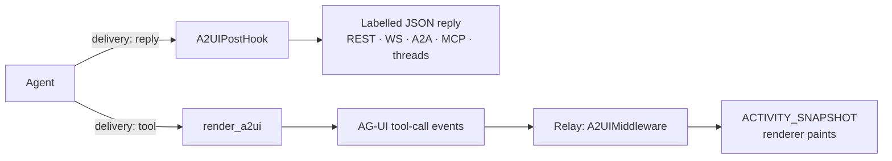

# #835: Progressive A2UI over AG-UI via a `render_a2ui` system tool

Agent Kernel's A2UI capability today has one delivery route: a post-hook labels a whole JSON reply
after the run (`a2ui/hook.py:58`). This change adds a second — a `render_a2ui` system tool the agent
calls mid-run, whose streamed arguments an AG-UI client turns into a surface that paints before the
run ends and grows as repeated data streams in.
One new field, `a2ui.delivery`, chooses between them per deployment; the hook and the tool are
mutually exclusive, so exactly one of them owns the payload.

> **Reading the citations.** `path:line` refers to this repository, except `index.ts` and
> `tools.ts`, which are `middlewares/a2ui-middleware/src/` in
> [`ag-ui-protocol/ag-ui`](https://github.com/ag-ui-protocol/ag-ui) at commit `8f6c8a4` — pinned,
> because `main` moves. Neither file ships in Agent Kernel.

## Motivation

- **A2UI never reaches a streamed run, and AG-UI is always streamed.**
  - The capability is a `PostHook.on_run` (`a2ui/hook.py:58`), and `Runtime.stream` calls only
    `on_stream_event` — never `on_run`. The factory logs a warning rather than leaving it silent
    (`a2ui/hook.py:149`).
  - AG-UI has no `message_type` switch: *"AG-UI delivers every run as a stream by definition"*
    (`docs/docs/integrations/agui.md:123`). So the `a2ui` block does nothing on that surface, at any
    `execution.message_type`.
- **What an AG-UI client gets today is one of two whole-payload shapes**, both arriving at the end.
  - Default: the agent's A2UI JSON streams as ordinary text — `TextMessageStart` → `TextMessageContent`
    deltas → `TextMessageEnd`, unlabelled. The client has to sniff it.
  - With an application-written `on_stream_event` hook: a `DataMessage` beside the closing event,
    mapped to `CustomEvent(name=<media type>, value=<payload>)`
    (`integration/agui/mapping.py:66`). The docs state the cost plainly — such a hook *"holds every
    delta back, and such an agent streams nothing incrementally"* (`docs/docs/integrations/agui.md:215-221`).
- **AG-UI's own ecosystem paints progressively through a tool**, and it can already find ours.
  - `@ag-ui/a2ui-middleware` watches for a `render_a2ui` tool call, parses its streamed args as
    partial JSON, and emits `ACTIVITY_SNAPSHOT` events — see `research/ag-ui-a2ui-middleware.md`.
  - It finds the tool by name through its own `a2uiToolNames` watch list, so AK never has to accept
    a tool the client declares — which it could not do anyway (`docs/docs/integrations/agui.md:210`).
- **Two of the adapters already stream tool arguments in fragments** — Claude
  (`framework/claude/claude.py:257`) and Pydantic AI (`framework/pydanticai/pydanticai.py:710`) — so
  progressive painting is reachable today on real adapters, not hypothetically. See
  `research/adapter-tool-arg-fidelity.md`.
- **The system-tool seam this needs already exists.** `SystemToolFactory.get_all`
  (`core/tool.py:200`) attaches per-capability tools filtered by an `agents` allow-list
  (`_agent_allowed`, `core/tool.py:188`); `agui.state` and `agui.client_context` are the closest
  precedents (`core/tool.py:238-250`), built by `AGUIState.state_tools()`
  (`integration/agui/state.py:198`).

## Requirements

### Framing: a delivery mode, not an AG-UI feature

- The tool is **"deliver A2UI progressively, as tool calls"**. What is AG-UI-specific is only the
  client middleware that converts the tool result into `ACTIVITY_SNAPSHOT`.
- The code therefore lives in `a2ui/` (a new `a2ui/tool.py`, singular, beside `a2ui/hook.py`), not
  `integration/agui/`.
  - `a2ui/` is already *"the only place in `src/` that names A2UI"* (per `ak-dev-architecture`), and
    it is a capability, not an integration — it adds no surface of its own.
- Any surface that streams tool-call events can consume the tool. AG-UI is the one with a renderer
  today; the design must not assume it is the only one.



Only the top route exists today. The relay is a Node process in the example, not Agent Kernel code:
AK's half of the bottom route ends at the tool.

### Configuration

- **One new field on the existing `a2ui` block** (`_A2UIConfig`, `core/config.py:1081`); no new
  block, and `enabled` / `agents` keep their current meaning and scope both routes.

  ```yaml
  a2ui:
    enabled: true
    delivery: reply      # reply (default) | tool
    agents: [expenses]
  ```

  - `reply` — today's behaviour, byte for byte: `A2UIPostHook` labels a parsed JSON reply, no tool
    is attached.
  - `tool` — `render_a2ui` is attached to the agents `a2ui.agents` covers, and the post-hook stands
    down (`A2UIPostHookFactory.get` returns `NoOpA2UIPostHook`).
- **Why the field cannot be derived** (house pattern 2 requires this stated):
  - The two routes are incompatible output contracts over the same payload. Without a selector both
    could fire on one reply, which is exactly the collision `A2UIPostHook`'s docstring already rules
    out for the `output_type` route — *"one or the other owns the labelling, never both"*
    (`a2ui/hook.py:15-18`).
  - `execution.message_type` cannot stand in: AG-UI streams whatever it says
    (`docs/docs/integrations/agui.md:123`), and a streaming app may still want the whole-reply route.
  - `agui.*` presence cannot stand in: handlers are mounted in application code, not declared in
    config, so `AKConfig` cannot see whether AG-UI is in use.
- The field is a `str` enum-style literal with default `reply`, carrying a real `description`
  (it surfaces in generated docs). Existing YAML and `AK_A2UI__*` env vars keep working unchanged.
- **`delivery` is per deployment, and that costs the non-streaming surfaces. State it in the docs.**
  - Under `delivery: tool` the post-hook stands down for **every** surface, so REST, A2A, MCP and
    threads stop getting labelled A2UI replies — not just AG-UI.
  - The tool attaches at agent construction (`core/base.py:698`), so those surfaces also carry a
    tool nothing there can paint.
  - **`a2ui.agents` is the lever**, and no new field is needed: scope `delivery: tool` to the agents
    served over AG-UI and leave the others on the default. An agent that must serve both routes at
    once is not supported, and should be two agents.

### The `render_a2ui` system tool (`a2ui/tool.py`)

AK attaches a tool and acknowledges the call. The middleware does the rest — paint, validate,
catalog, retry.

#### The function

```python
def render_a2ui(surfaceId: str, components: list, data: dict | None = None,
                catalogId: str | None = None) -> str:
```

- `A2UIToolFactory.get_tools() -> list[SystemTool]`, matching `OKFToolFactory`.
- `surfaceId` and `components` required, `data` optional — upstream's own schema
  (`tools.ts:26-45`). `catalogId` is ours, and optional; see below.
- The name is fixed, not configurable: `SystemTool.name` must match `func.__name__`, because
  `ToolBuilder.bind()` derives the bound name from the function (#657).
- **The parameter names must equal the strings the middleware looks up.** It reads the model's raw
  argument JSON and matches literals — `"surfaceId"`, `"components"`, `"data"` (`index.ts:748`,
  `:795`, `:944`). There is no case conversion and no convention detection.

  ```python
  surfaceId    # → {"surfaceId": "expenses"}    matched
  surface_id   # → {"surface_id": "expenses"}   ignored
  ```

- In practice that constrains **one** of the three: `components` and `data` are single words and
  read the same in either convention. `surfaceId` is the departure from AK's snake_case, and the
  docstring says why, since nothing enforces the convention mechanically
  (`ak-py/pyproject.toml:270` is pyupgrade only).
- The rule, not the instance, is what a later parameter has to obey — `catalogId` is the second
  case of it.

#### The client decides what is a UI tool, not AK

- `a2uiToolNames` is the client's watch list (`index.ts:645`).
- Its default is `["render_a2ui"]`, so matching it means zero setup at either end.
- An unwatched `render_a2ui` is an ordinary tool call. Nothing breaks.

#### The catalog: host first, `catalogId` as the escape hatch

- The middleware resolves in this order (`index.ts:763,772-786`): relay `defaultCatalogId` → the
  frontend's schema context entry (`index.ts:110-122`) → **this parameter** → the basic catalog.
- **The recommended setup is host-side**, and the docs say so: set `defaultCatalogId`, or ship the
  schema context entry. With neither, a custom renderer throws *"Catalog not found"*
  (`index.ts:764-766`).
- **`catalogId` is offered anyway**, for a client that deliberately sets neither and wants to choose
  per call — the only granularity finer than per-run that the middleware has. AK does not decide for
  them. Upstream's own tool omits it and tells the model not to send one (`tools.ts:16,63`); we are
  not making that choice on the client's behalf.
- **Two caveats the docs must carry**, because both are silent failures:
  - **Host config wins.** Set `defaultCatalogId` and the parameter is inert. It is not a per-call
    override of a configured catalog; it only fills a gap.
  - **It can arrive too late.** Resolution fires the moment the components array closes, and
    `catalogId` is last in the schema. A later snapshot recomputes it (`index.ts:886`), so a payload
    whose data streams after its components tends to self-correct — but that is incidental, not a
    guarantee. A client relying on this should instruct its agent to emit `catalogId` early.

#### What it returns

```python
return json.dumps({"status": "sent"})     # handed to the client
return json.dumps({"error": "..."})       # never raises into the framework
```

- `"sent"`, not `"rendered"`: AK cannot know a browser painted (`index.ts:1151-1154`).
- **No UI in the result.** When a tool result carries a UI payload, the middleware re-emits it
  **unvalidated** (`index.ts:1036-1075`) — undoing a rejection it had just made (`index.ts:811`).
  A status cannot be mistaken for one.
- Nothing is lost by omitting it. Whole-args adapters still paint, because the parser only
  accumulates (`index.ts:703`), and a painted surface is never failed at the end
  (`index.ts:608-628`).
- `{"error": ...}` follows the sandbox/schedule convention (`schedule/tools.py:149`,
  `sandbox/tools.py:391`).

#### What AK never does

- Validate components, resolve a catalog, check for a `"root"` id, or read the data model — the
  renderer owns all four (*"It does not validate"*, `docs/docs/advanced/a2ui.md`).
- Carry an A2UI version. Components are v0.9 because the middleware says so; AK writes no version
  string and needs no change when A2UI moves (#931).
- Put a catalog in the tool `description`. It reaches every agent's system prompt
  (`core/tool.py:278`); the catalog stays in the application's agent instructions.

#### What "progressive" actually buys

- *"Components atomic, data incremental"* (`index.ts:480-494`).
- Components paint once, when the array closes. Data paints per item as a repeated array fills.
- So the surface arrives **earlier** in every case, and **grows** only with a repeated data array —
  which the example must carry.

### Wiring

- A new branch in `SystemToolFactory.get_all` (`core/tool.py:200`), after the `agui` branches,
  attaching the tool when **all** hold: `a2ui.enabled`, `a2ui.delivery == "tool"`, and
  `_agent_allowed(a2ui_config, agent_name)`.
- The import is lazy inside the branch, like every sibling.
- `A2UIPostHookFactory.get` (`a2ui/hook.py:135`) returns `NoOpA2UIPostHook` when
  `delivery == "tool"`, so the two routes cannot both act on one reply.
- **The delta warning moves behind the mode check** (`a2ui/hook.py:149`): under `delivery: tool` it
  is wrong, because the tool route is exactly what a streamed run should use.
- No second warning is added for the inverse case — see Decided.

### Departures from the house patterns, stated

- **No ABC, factory or dotted-path backend selection** (house pattern 1). There is no external
  system, backend or provider here and nothing to select between — this is a system tool, the same
  shape as `AGUIState.state_tools()` and the sandbox and schedule tool sets, none of which is
  pluggable either. The pluggable seam that *does* exist for this capability is the post-hook: an
  application wanting a different delivery writes its own, as `docs/docs/advanced/a2ui.md` already
  documents under "Another format".

### Example

- A new example under `examples/api/` showing a Node relay (`@ag-ui/client` + `A2UIMiddleware`,
  configured with `a2uiToolNames`) in front of an AK AG-UI handler, plus a renderer.
- The middleware imports `node:crypto`, so the relay is a Node process, not browser code.
- **The relay sets `defaultCatalogId`.** It is the one setting that makes the catalog deterministic,
  and the example exists partly to show where it goes.
- No Node/JS ships inside `ak-py`; the existing `examples/api/a2ui-openai/frontend` is the precedent
  for example-side TypeScript.
- The example's agent should run on an adapter that streams tool args (Claude or Pydantic AI), so
  the example demonstrates the progressive path rather than the degraded one.
- **The demo payload must carry a repeated data array, not only a component tree.** A streaming
  adapter alone does not produce a growing surface: components emit atomically in one snapshot, and
  only the data model emits item by item (`index.ts:480-494`, and the Requirements bullet above).
  The example's agent therefore emits its components first and then streams a repeated array — a
  list of expenses, search results or rows — so the surface visibly fills.
  - The adapter and the payload are both required, and neither is sufficient alone: a streaming
    adapter with a static tree paints once, and a repeated array on a whole-args adapter arrives
    complete.
  - What to assert: **at least two `ACTIVITY_SNAPSHOT`s for the same surface, before the end, whose
    data array grows.** Not a strict increase across every snapshot — once the whole `data` object
    closes the middleware emits it again in full (*"Final authoritative data emit"*,
    `index.ts:936-966`), so the last snapshot legitimately repeats the previous length.
- **The example is render-only.** See Non-goals: a click on the rendered surface does not reach the
  agent, and the example must not imply otherwise.

### Documentation

- `docs/docs/advanced/a2ui.md`: the two delivery modes, when each applies, and that `delivery: tool`
  requires a client that understands the tool.
  - Plus the catalog: configuring it host-side (relay `defaultCatalogId`, or a frontend that ships
    the A2UI schema context entry) is the recommended route, because AK ships no catalog of its own.
    Document `catalogId` as the fallback for clients that set neither, with both caveats — host
    config wins, and a late-arriving id can miss the first snapshot.
- `docs/docs/integrations/agui.md`: replace the "hold every delta back" note
  (`:215-221`) with the tool route as the recommended path, keeping the `CustomEvent` route
  documented for applications that want it.
- A per-adapter fidelity table from `research/adapter-tool-arg-fidelity.md`, carrying its honest
  gaps: Claude, Pydantic AI and MAF stream argument fragments (MAF confirmed against
  `agent-framework-core` 1.20.0); LangGraph, ADK and OpenAI send them whole; CrewAI and smolagents
  unsupported.

### Testing

- `ak-py/tests/test_a2ui_tools.py` (new): the result the tool returns, and
  `SystemTool.name == func.__name__`.
  - A successful call returns `{"status": "sent"}` and **nothing else** — no UI payload, no version
    string, nothing read out of `components` or `data`. Asserting the result's exact keys is what
    stops a UI payload creeping back in later.
  - A failure returns `{"error": ...}` rather than raising.
- Gating, in whichever file the spec picks: tool attached only under `delivery: tool`; only for
  agents `a2ui.agents` covers; not attached under the default.
- `ak-py/tests/test_a2ui_hook.py` (305 lines, existing): the post-hook stands down under
  `delivery: tool`; every current case still passes under the default; the delta warning fires only
  under `delivery: reply`.

## Non-goals

- The middleware's `injectA2UITool` — AK ignores client-declared tools
  (`docs/docs/integrations/agui.md:210`), and `a2uiToolNames` makes it unnecessary.
- AK emitting `ACTIVITY_SNAPSHOT` natively. The middleware is the client's half, and it runs in the
  relay.
- Making OpenAI, LangGraph or ADK stream tool arguments. They send them whole by design; those
  surfaces paint in one snapshot.
- Validating A2UI, shipping a component catalog, or resolving catalogs.
- A2UI's other three operations — `updateComponents`, `updateDataModel` and `deleteSurface`
  (`types.ts:162-177`). This ticket draws new surfaces only; follow-up #940.
- **Receiving user actions from a rendered surface — this route is render-only.** A click or form
  submission does not reach the agent, and the example must not suggest it does. Follow-up #940.
  - The middleware turns an action into an appended synthetic assistant message (a `log_a2ui_event`
    tool call) plus a tool result (`index.ts:329-383`), but `AGUIRunInput.parse` keeps only the last
    `role == "user"` message and discards the rest (`integration/agui/run_input.py:72,80`).
  - A click with no typed text carries no user message at all, so the run is refused with a 400 —
    *"carries no user message; there is no turn to run"* (`integration/agui/run_input.py:74`).
  - `forwardedProps` does survive and is reachable through the opt-in `get_forwarded_props()` tool,
    but that route is pull-based and the model may never call it, so it is not a delivery guarantee.
- A2UI v1.0 — issue #931. The *components* on this route are v0.9 because the middleware validates
  them as v0.9, but AK writes no version string either way, so nothing here moves when A2UI does.
- Requiring a client to render the tool. An unwatched `render_a2ui` is an ordinary tool call that
  passes through harmlessly; what counts as a UI tool is the client's decision, not AK's.
- Shipping any Node/JS code inside `ak-py`.

## Open questions

None outstanding. The two that could have forced a design change are settled by reading the
sources (see Decided below); what remains is confirmation, and it happens inside the example.

## Decided during review

Recorded so the next reader does not re-open them:

- **`surfaceId` keeps its camelCase spelling** — forced by the middleware matching that literal
  string, not a style preference. It is the only one of the three parameters affected. See the
  tool's Requirements above.
- **`catalogId` is optional, and the host route is what the docs recommend.** The full history,
  since the doc changed its mind twice: it was added from the middleware's streamed-argument parser,
  withdrawn once upstream's tool schema and model guidelines turned out to say the opposite
  (`tools.ts:26-45,63`), then restored — because upstream declining to offer it is not a reason for
  AK to deny it to a client who wants it. What the second pass established stands and is written
  into the Requirements: host config wins, the parameter only fills a gap, and it can arrive too
  late to affect the first snapshot.
- **Rejected: nesting the tool under `agui`**, the `agui.state` shape. System tools attach at agent
  construction (`core/base.py:698`), not per request, so an `agui`-scoped block could not keep the
  tool off other surfaces anyway — and the mechanism is not AG-UI-only.
- **No inverse misconfiguration warning.** `delivery: tool` on a deployment with no AG-UI client is
  the application's choice; config cannot see whether a handler is mounted, so a warning would
  misfire on the deployment the feature targets.
- **The confirmation runs as the example, not as a throwaway spike.** Acceptance criterion 1 asks
  for a spike; the example in Scope is the same stack (relay, middleware, renderer), so building it
  proves the integration and leaves an artefact where a spike would be deleted.
  - *The cost, stated:* the example cannot exist before the tool does, so the integration is not
    confirmed until implementation is under way. **`plan.md` must therefore put the tool and the
    example in the first two iterations**, ahead of the config field, the gating, the docs and the
    tests — otherwise a middleware surprise lands after all of that is written.
  - One thing is left to observe, and it changes nothing here: whether lifecycle snapshots visibly
    arrive while the model is still writing, on Claude, Pydantic AI or MAF. **The whole-args
    question is settled by source review** — the parser only accumulates (`streaming.args += delta`,
    `index.ts:703`) behind a gate any complete JSON passes (`index.ts:741-747`), so LangGraph, ADK
    and OpenAI paint from a single delta. They get one snapshot, not none.
- **Result correlation and MAF fidelity are settled by source review**, not left to the run: the
  middleware keys entirely on `toolCallId` and builds its own snapshot `messageId`, so
  `AGUIMapper`'s fresh `uuid4().hex` is harmless (`integration/agui/mapping.py:52`); and MAF streams
  argument fragments, confirmed in `agent-framework-core` 1.20.0. Both in `research/`.
- **The tool returns a status; having it return the UI itself was tried and withdrawn.** Also
  recorded as a reversal. Returning the UI was meant to keep the middleware's result fallback
  available for the adapters that send tool arguments whole. That premise was wrong: the middleware
  simply accumulates deltas (`index.ts:703`), so one complete delta parses like many and those
  adapters paint through the streaming path regardless. With the premise gone, it only bought a way
  to override the middleware's own validation (`index.ts:1036-1075`) — so it went, along with AK's
  A2UI version pin.
- **Several surfaces in one run are fine; one call draws one surface.** The middleware tracks calls
  by `toolCallId` and surfaces by `surfaceId`, each with its own activity, so an agent may call the
  tool more than once per turn and paint more than one surface. Nothing in AK limits it either.
- **One *new* surface per call; *amending* a surface already on screen is follow-up #940.** Out of
  scope: issuing `updateComponents`, `updateDataModel` or `deleteSurface` against a surface the user
  is already looking at — A2UI has four operations (`types.ts:162-177`) and this ticket uses one.
  The middleware's own injected tool is render-only, and re-creating a live `surfaceId` is an error,
  so amendment semantics are a second unknown. #940 decides whether it is a second tool, a mode on
  this one, or repeated calls the middleware diffs.
