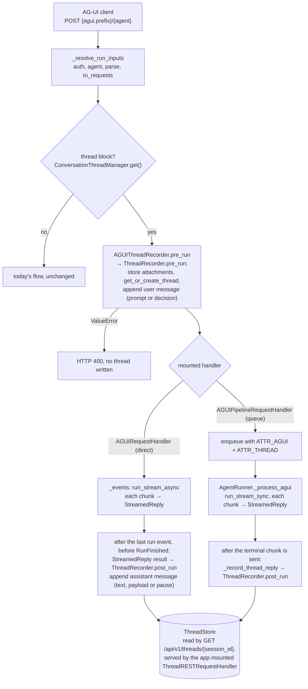

# #836: Record AG-UI runs as conversation threads

AG-UI runs are recorded into the existing conversation-thread store, keyed by `threadId` (already AK's
`session_id`), on both AG-UI execution topologies. The design reuses `ThreadRecorder` as-is: the
user turn is recorded at the edge before the run, the accumulated assistant reply after it, with the
same skip rules the threaded SSE path already applies.

**Depends on #827** (human-in-the-loop thread history, spec `docs/specs/607-hitl-thread-history/`), which
merges first. This design is written against `develop` *with #827 applied*: its pause and resume
recording rules are the ones AG-UI follows, and line references to `recorder.py`, `thread_chat.py`
and `agent_runner.py` below are to the pre-#827 base unless marked "#827".

## Motivation

- AG-UI never touches the thread capability.
  - Direct path: `AGUIRequestHandler._run` prepares a handler and streams (`integration/agui/handler.py:220-236`); no `ThreadRecorder` anywhere in the package.
  - Queue path: `AGUIPipelineRequestHandler._run` offloads attachments and enqueues with only `ATTR_AGUI` (`integration/agui/queue_handler.py:132-147`); the runner says so outright — "Thread recording is likewise absent: `ATTR_AGUI` is not `ATTR_THREAD`" (`pipeline/agent_runner.py:96`).
- The key already exists: `threadId` is `session_id` (`docs/docs/integrations/agui.md:208`).
- Every piece of recording machinery already exists and is surface-neutral.
  - `ThreadRecorder.pre_run` / `post_run` (`integration/thread/recorder.py:32-73`) take a `BaseChatRequest` plus requests or a result — nothing REST-specific.
  - The streamed-reply rule (accumulate `delta`s; record nothing on an error chunk or an empty stream) is implemented twice already: `AgentThreadRequestHandler._stream_with_recording` (`integration/thread/thread_chat.py:167-178`) and `StreamAgentRunner._process_run` (`pipeline/agent_runner.py:333-346`).
  - The queue split (edge records the user turn, runner records the reply, `ATTR_THREAD` carries the intent) is implemented by `ThreadRequestHandler` + `AgentRunner._record_thread_reply` (`thread_chat.py:258-309`, `agent_runner.py:214-257`).
- #827 settles how a pause and a decision are recorded, on every surface AG-UI could be compared with.
  - A decision is the user message: `ThreadRecorder._as_user_message` (#827) records `{"resume": ...}` (plus `prompt` when present) labelled `HITL_MEDIA_TYPE`, read from `req.resume`.
  - A pause is the assistant message, recorded alone: the streamed paths (#827, `thread_chat.py` and `StreamAgentRunner`) build an `AgentPausedReplyAny` from the `RunPaused` event and drop the text streamed before it; an errored stream records nothing, the pause included.
- AG-UI carries decisions as a request, not on a chat envelope: `AGUIRunInput.to_resume` builds an `AgentResumeRequestAny` (`integration/agui/run_input.py:121-134`), so nothing today puts them on a `BaseChatRequest.resume` for the recorder to read. `ResumeSpec` and `AgentResumeRequestAny` share their fields through `_ResumeDecisions` (`core/model.py:184-203`).
- Recording alone does not let a client reload: the AG-UI router serves only `{agui.prefix}/agents`, `/{agent_name}` and the default-agent route (`handler.py:129-176`), so the thread read routes exist only where an app mounts a thread handler (`ThreadRESTRequestHandler`, `thread_chat.py:312-384`).
- AG-UI always has a user: both handlers refuse to construct without an `Authoriser`/`AuthValidator` (`handler.py:41-47`), so `pre_run`'s `user_id` requirement (`recorder.py:47-48`) is always met.
- **The issue's "queue pipeline path (#710)" non-goal is stale.** #710 shipped (`2985c544`, #755), and the AG-UI example mounts the queue handler (`examples/api/agui/app.py:119`). Recording only the direct path would leave the shipped example unrecorded, so both paths are in scope.

## Flow

Where the thread methods are called on each AG-UI path. Both paths share the edge half; they differ only
in which process records the reply.

- `StreamedReply` yields nothing to record on an error, a halt, or an empty run, so `post_run` is skipped there.

## Requirements

### Enablement and configuration

- No new configuration. Reuse the `thread` block and its store backends unchanged.
- Recording is on exactly when `ConversationThreadManager.get()` is not `None` (a `thread` block is present) — the house rule that existing configuration implicitly enables a feature.
  - No `thread` block: both AG-UI handlers behave byte-for-byte as today; no thread code is imported.
  - No `enabled` flag, no constructor switch on the AG-UI handlers.
- Departure from the thread capability's own rule ("mounting a thread handler enables it"), stated explicitly: AG-UI already *is* the mounted surface, and asking for a second mount to opt in would add a knob for a decision the `thread` block already expresses.

### Components

- `AGUIThreadRecorder` (new, `integration/agui/recorder.py`): the one class both AG-UI paths call. Single responsibility: translate an AG-UI run into `ThreadRecorder` calls.
  - Wraps `ThreadRecorder`; adds no recording logic of its own.
  - Builds the `BaseChatRequest` the recorder needs from the run: `session_id = threadId`, `user_id` = resolved caller, `agent` = route agent, `prompt` = the user message's text parts joined.
  - On a resume turn, `resume` is set to a `ResumeSpec` carrying the run's decisions (copied from the `AgentResumeRequestAny` that `to_resume` built; `run_id` stays `None`, as the protocol has none), so #827's `_as_user_message` records the decision.
  - `group_id` and `thread_name` are `None` (AG-UI has no field for them); the thread is named by the existing `ThreadNamingStrategy`.
- `StreamedReply` (new, beside `ThreadRecorder` in `integration/thread/recorder.py`): accumulates one streamed run's reply from its `StreamChunk`s.
  - Holds the text deltas, whether an error chunk was seen, the last `DataMessage` (content + `media_type`), and the `RunPaused` event if one arrived.
  - Exposes the result to record, or `None` when nothing must be recorded. A pause is exposed as an `AgentPausedReplyAny` built exactly as #827's `_stream_with_recording` builds it, so every surface stores the same bytes for the same pause.
  - Lives in `integration/thread/` because it encodes the thread capability's recording rule, not an AG-UI rule.

### Direct path (`AGUIRequestHandler`)

- The user turn is recorded in `_run`, **after every check that can still reject the request** (auth, agent resolution, body parse, `to_requests`, session selection) and **before** the response starts.
  - A `ValueError` from `pre_run` (e.g. attachments with multimodal disabled) becomes HTTP 400, with no thread written.
  - Attachments go through `pre_run`'s `store_attachments`, so they are stored once and appear on the user message as `ThreadAttachment`s.
- The assistant turn is recorded in `_events` after the stream completes, via `StreamedReply`.
- Recording failures after the stream has started never change what the client receives: a failing `post_run` is logged, not turned into a `RunErrorEvent`.

### Queue path (`AGUIPipelineRequestHandler` + `AgentRunner._process_agui`)

- Edge: `pre_run` replaces the handler's own `AttachmentStorageManager.offload` call when threads are on, so attachment bytes are offloaded once, not twice.
  - Runs before enqueue; a `ValueError` becomes HTTP 400 with nothing enqueued.
  - The message carries `ATTR_THREAD` beside `ATTR_AGUI`.
- Runner: `_process_agui` accumulates the run through `StreamedReply` and calls the existing `_record_thread_reply` after the terminal chunk is sent.
  - Same ordering and failure rule as today's `_record_thread_reply`: after the send, never raising.
  - A pause is recorded under status 202, as #827's `StreamAgentRunner` does — a paused run has not completed.
  - A runner with no `thread` block keeps today's warning-and-drop behaviour (`agent_runner.py:247-254`).

### What is recorded

- User message: the prompt text plus any attachment references, exactly as `pre_run` records a REST turn.
  - A resume turn carries no prompt (`run_input.py:68-74`); its user message is the decision object labelled `HITL_MEDIA_TYPE`, recorded by #827's `pre_run` from the `resume` the AG-UI recorder sets.
- Assistant message: the concatenated text deltas.
  - When the run emitted a `DataMessage`, the payload is recorded as the object with its `media_type` (#763 shape) instead of the text.
  - Tool calls, reasoning, steps and state snapshots are not recorded (the REST SSE path records none of them either).
- Nothing is recorded for the assistant turn when the run errored (error chunk, exception, or `RunErrorEvent` path), halted, or produced no text, no `DataMessage` and no pause — the existing threaded SSE rule.
- A run that pauses (`RunPaused`) records the pause alone as the assistant message (`AgentPausedReplyAny`, labelled `HITL_MEDIA_TYPE`), not the text streamed before it — #827's rule. An errored run records nothing, the pause included.
- Messages read back through `GET /api/v1/threads/{session_id}` are indistinguishable in shape from REST-recorded ones.

### Thread ownership

- An AG-UI run on a `threadId` whose thread belongs to another user is refused with 403, before anything is written or enqueued — the read routes' ownership rule (`ConversationThreadManager.get_thread(..., user_id=...)`), applied on write because AG-UI always knows the caller. Added after PR review.
  - Refusing the run also keeps the caller out of that session's agent memory when threads are on.
  - REST's chat handlers keep the gap (see Non-goals).

### Read routes

- The AG-UI handlers do not serve the thread read routes. An app that wants clients to reload mounts `ThreadRESTRequestHandler` itself, beside the AG-UI handler (`IOHandler.run(handlers=[...])` or `RESTAPI.run(handlers=[...])`).
- Departure from the thread chat handlers, which compose the read routes into their own router (`thread_chat.py:68-75`), stated explicitly: those handlers are mounted *to* enable threads, while AG-UI records from the `thread` block alone. Composing routes on the block's presence would mount routes from configuration, which nothing in Agent Kernel does (scheduling's routes are app-mounted for the same reason).
- The AG-UI and threads docs show the two-handler mount.

### Example (`examples/api/agui`)

- `config.yaml`: a `thread` block, `type: in_memory` — the single-process default.
- `config.broker.yaml`: a `thread` block, `type: valkey`, on the Valkey the file already uses for sessions — the user turn is recorded in the API process and the reply in the runner, so the store must be shared.
- `app.py`: mounts `ThreadRESTRequestHandler(authoriser=DemoAuthoriser())` beside `AGUIPipelineRequestHandler`.
- `app_test.py`: one test — a run, then `GET /api/v1/threads/{threadId}` returns the user and assistant messages.
- `README.md`: a short "Conversation history" section — what is recorded, how to read it back.
- `frontend/`: a **Conversations** column, left of the shared-state sidebar, from `GET /api/v1/threads`; opening one loads its messages and continues that `threadId`. Shared state is not refetched — it stays on the server and reappears on the next snapshot. Added after review so the demo shows the feature.
- `examples/api/hitl` is unchanged: showing a pause and a decision in AG-UI history is a possible follow-up, not needed for this issue.

### Testing

- Direct path, alongside `tests/test_agui_handler.py`: recorded user + assistant turns; thread keyed by `threadId`; nothing recorded on error, halt, empty run; no thread code touched without a `thread` block; `pre_run` rejection is a 400 with no thread; another user's thread is a 403 with nothing recorded.
- Queue path, alongside `tests/test_agui_queue_handler.py` and `tests/test_thread_pipeline_recording.py`: `ATTR_THREAD` stamped only when threads are on; single offload; runner records the reply; runner without a `thread` block drops it with the warning.
- `StreamedReply` unit tests: text, error, empty, `DataMessage` precedence, pause over text, error over pause.
- Human in the loop over AG-UI, on both paths: a pausing run records the pause; the resume run records the decision as the user message and the reply as the assistant message — matching what #827's REST tests assert for the same exchange.
- Round trip, alongside `tests/test_thread_integration.py`: an AG-UI run read back through the thread routes matches a REST-recorded run's shape.

### Docs

- `docs/docs/integrations/agui.md`: AG-UI runs are recorded when a `thread` block is present; how a client reloads, including mounting `ThreadRESTRequestHandler` beside the AG-UI handler.
- `docs/docs/advanced/threads.md`: AG-UI listed as a recording surface; the enablement difference from the chat handlers.
- Release note: an app that already has a `thread` block and mounts AG-UI starts recording AG-UI runs after upgrading.

## Non-goals

- Reading the client-sent `messages` transcript — history stays server-side.
- New thread read routes — the existing `GET /api/v1/threads/...` serve AG-UI threads once the app mounts `ThreadRESTRequestHandler`.
- Folding the two existing inline accumulators (`thread_chat.py:167-178`, `agent_runner.py:333-346`, both extended with pause handling by #827) onto `StreamedReply`. Possible follow-up; kept out so this change touches no REST behaviour.
- Setting `group_id` / `thread_name` from AG-UI (`forwardedProps` could carry them; not designed here).
- `MESSAGES_SNAPSHOT` on reload (optional in the issue). Every AG-UI `POST` is a run — the protocol has no "open thread" call, so the trigger for emitting a snapshot needs its own design. Clients reload via the thread read routes.
- Thread ownership on REST writes. `get_or_create_thread` does not check that an existing thread belongs to the caller (`integration/thread/manager.py:109-115`), so on the REST chat handlers an authorised user who knows a `session_id` can append to another user's thread; the session behind it has the same exposure. It gets its own issue. AG-UI checks ownership (see Thread ownership).

## Open questions

- None. Resolved in review: queue path in scope; snapshot and ownership deferred as above; enablement by `thread` block presence accepted with a release note; pause and resume recording follow #827, which merges first; read routes are app-mounted, and `examples/api/agui` demonstrates it.
