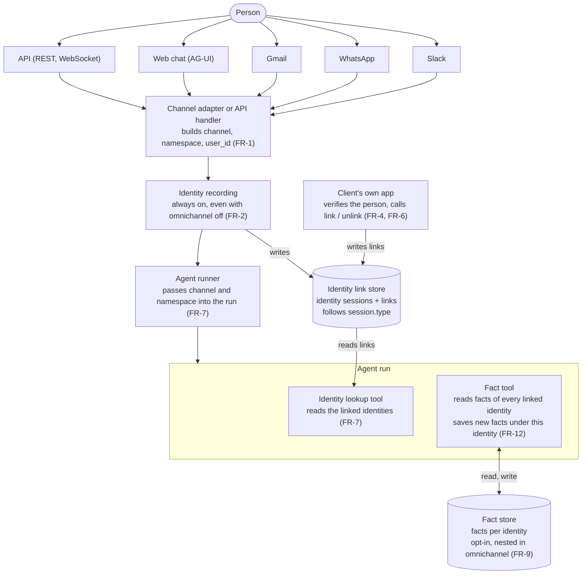

# #863: Omnichannel v1: identities, links and facts

AK records which sessions each identity uses, links identities into a profile when the client says
so, keeps facts per identity, and hands the profile to tools before every run. Sessions are never
moved or merged. Requirements: [Omnichannel — Functional Requirements](https://claude.ai/artifact/UeizCUGpgfLjCXuT8sxMNy)
(FR-n below). Background: [Principals Across Channels](https://claude.ai/artifact/B85dAY9fNeBjGVezsqjCMV).

## Request flow (from the requirements)



## Motivation

- #603 already carries the identity on every surface; omnichannel builds on it and adds nothing to the `Principal`.
  - `Principal` has `provider`, `namespace`, `subject` (`core/model.py:395`); edges build it (`integration/adapter/producer.py:99`).
  - `Runtime._publish` publishes it for the run (`core/runtime.py:342`, `core/base.py:269`); tools read `ToolContext.principal` (`core/tool.py:111`).
- One code path sits before every chat run: `AgentHandler.run_*` (`core/chat_service.py:230`), used by REST, threads, the pipeline `AgentRunner` and AG-UI (`integration/agui/handler.py:274`).
- `SessionStore.get_connection_store()` (`core/session/base.py:108`) is the precedent for a store that follows `session.type`.

## Data model

```python
class IdentityKey(BaseModel):  # core/model.py
    channel: str    # "messaging:slack"; every direct provider maps to "ak"
    namespace: str  # "T0123", "https://auth.example.com/"
    user_id: str    # "U0456", the principal's subject

class Profile(BaseModel):  # core/model.py; holds no data of its own
    profile_id: str
    identities: list[IdentityKey]

class IdentitySession(BaseModel):  # identity link store, always on
    identity: IdentityKey
    session_id: str
    first_seen: datetime
    expires_at: datetime

class IdentityLink(BaseModel):  # identity link store, written by link()
    identity: IdentityKey
    profile_id: str
    verified_by: str  # the client's own label
    linked_at: datetime

class Fact(BaseModel):  # fact store, opt-in
    identity: IdentityKey  # the identity that wrote it
    fact_key: str
    value: str
    source_session: str
    updated_at: datetime
```

- Shapes are indicative; a backend needing one key (DynamoDB) builds it from the identity internally.

## Requirements

### Identity (FR-1)

- `IdentityKey.from_principal(principal)`: `messaging:*` / `realtime:*` keep the provider; every other provider maps to `ak`. Anonymous principals have no key.
- `IdentityKey` and `Profile` live in `core/model.py`, since core never imports a capability.

### Identity link store (FR-2, FR-3, FR-5)

- `IdentityLinkStore` ABC beside `WSConnectionStore`; `SessionStore.get_identity_link_store()` returns it or `None`.
  - Built-ins: `in_memory`, `redis`/`valkey` (one RedisLike body), `dynamodb`. `cosmosdb`, `firestore` and a BYO store without the method return `None`.
  - `None`, or a DynamoDB table that does not exist: AK starts normally and skips recording.
- Operations: `record_session`, `sessions`, `profile_of`, `link`, `unlink`, `identities`.
- `link` joins two profiles by rewriting link rows; it never touches sessions or facts.
- Session records expire after `session.identity_link_store.ttl`.
- Contract suite `IdentityLinkStoreContract`, subclassed per backend.

### Recording and profile hand-off (FR-2, FR-7)

- `AgentHandler` records `(IdentityKey, session_id)` before every run: one conditional write, with or without the `omnichannel` block.
- With the block, it reads the profile and passes it to `Runtime.run(..., profile=)` beside the principal.
- `Runtime._publish` stores the profile under a reserved `ak.` key; `_unpublish_run` clears it.
- Readers: `Session.get_profile()` for hooks, `ToolContext.profile` for tools. Nothing is added to the prompt.

### Link and unlink operations (FR-4, FR-6, FR-8)

- `OmnichannelManager` (`get()` singleton, `None` without the block): `link(a, b, verified_by)`, `unlink(identity, drop_facts)`.
- `OmnichannelRESTRequestHandler` exposes them; the application mounts it, as with `ScheduleRESTRequestHandler`.
  - Who may call the routes is decided by #603's authorization (grants); the routes ship once it lands.
  - The Python API needs no guard: it is an in-process call.
- AK verifies nothing; `verified_by` is the client's label, stored as given.

### Facts (FR-9 to FR-12)

- `FactStore` ABC + `FactStoreFactory` (`in_memory`, `redis`, `valkey`, `dynamodb`, dotted path), enabled by `omnichannel.facts`.
  - Small interface (`put`, `get_for`, `delete_for`) so it can move onto the knowledge base later.
  - Facts are stored per identity, with `source_session` and `updated_at`; AK never merges them.
- Built-in fact tools: save (replaces its own earlier value for the same key) and read (facts of every linked identity).
  - Read returns every value of a key, newest first, each with its channel and `updated_at`; AK never picks one (FR-10).
- Gmail facts are written only when `authentication_results` in the principal's claims shows `dmarc=pass`. A failure returns an error naming the reason; `facts.require_dmarc: false` turns the check off.
- In shared conversations, facts are read only on channels listed in `facts.shared_conversations`.
  - Each messaging adapter sets `claims["conversation"]` to `direct` or `group` from the platform's own field (Slack `channel_type`, Teams `conversationType`, Telegram `chat.type`); the producer already copies claims onto the principal.
  - A messaging principal without the claim counts as shared, so an adapter that omits it cannot leak facts into a group. Web surfaces are always direct.
- Contract suite `FactStoreContract`.

### Tools (FR-7, FR-12)

- Attached by `SystemToolFactory`, scoped by `omnichannel.agents` (`core/tool.py:207`): identity lookup, fact save, fact read.
- All read the published profile; none links or unlinks.
- Replies still leave on the channel they arrived on (FR-13, unchanged).

### Configuration

```yaml
session:
  identity_link_store:          # beside session.connection_store; read by every backend
    ttl: 7776000                # identity-session expiry, seconds (90 days)
    table_name: ak-identity-links  # dynamodb only: an existing table
omnichannel:                    # presence enables link/unlink, the profile hand-off and the tools
  agents: [support]             # tool scope; omitted = every agent
  facts:                        # presence enables the fact store
    type: redis                 # in_memory | redis | valkey | dynamodb | dotted path
    redis: {url: redis://localhost:6379}   # _RedisConfig subclass, defaults only
    require_dmarc: true
    shared_conversations: []    # channels whose group threads may read facts
```

- Recording needs no new switch: it follows `session.type`.
- Fact backends reuse the `_RedisConfig` / `_DynamoDBConfig` models by defaults-only subclassing.

### Coupling

- `core/` holds the keys, the link store ABC and backends, recording and the hand-off.
- `omnichannel/` imports `core`; only its route handler imports FastAPI, and it is exported lazily (the `schedule/handler.py` pattern).

## Non-goals

- Sending to a linked channel, the outbound send-unprompted capability and its error (FR-14, FR-15): moved to #864 with conversation initiation.
- Built-in verification or one-time codes (#865), scheduled delivery (#866), Long-term Memory (#868), LiveKit (#867).
- MCP and A2A surfaces, framework state merge, conversation continuity, cross-channel history, erasure.

## Dependencies

- #603 authorization: decides who may call the link and unlink routes.
- #603 namespace defaults: Slack `enterprise_id`, WhatsApp business-scoped user ids, Telegram bot vs global ids. v1 uses whatever namespace #603 sets; until then a person may need one link per workspace or number.
