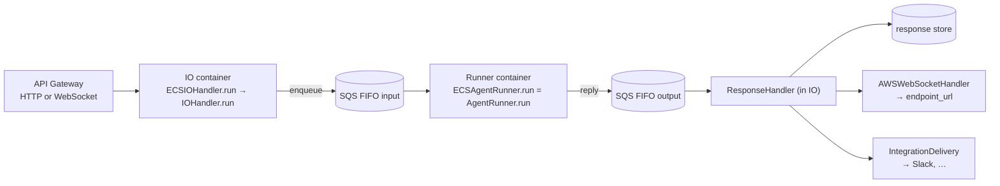

# #870: Move ECS onto the shared queue pipeline

ECS queue mode stops running its own copies of the agent runner, output consumer and IO entry point, and runs the
shared pipeline classes instead: `AgentRunner`, `ResponseHandler`, `IOHandler`. The idea in one line: keep ECS's
entry names and its API Gateway WebSocket, and plug the AWS push client into the `ws_handler` seam that
`ResponseHandler` already has. No new classes, config or Terraform.

_Evidence at `develop` @ `e85bbcb6`. Paths are relative to `ak-py/src/agentkernel/` unless they start with a
top-level folder._

## Motivation

- ECS refuses every handler that only works on the queue pipeline.
  - `ECSIOHandler` serves through `AWSRestAPI.run` (`deployment/aws/containerized/ecs_io_handler.py:76`), and
    `RESTAPI.run` rejects any handler marked `requires_pipeline` (`api/http.py:113`, `:122-136`).
  - Rejected today: `ThreadRequestHandler` (a `RequestHandler`, `integration/thread/thread_chat.py:258`),
    `AGUIPipelineRequestHandler` (`integration/agui/queue_handler.py:52`), `WebhookRESTRequestHandler`
    (`integration/adapter/webhook.py:27`).
  - A2A and MCP are refused up front by `RESTAPI.reject_unqueued_protocols()` (`ecs_io_handler.py:47`). #780
    has merged, so `IOHandler` now serves them on a broker transport (`pipeline/io_handler.py:250-261`).
- ECS never delivers messaging replies.
  - `ECSAgentRunner` keeps only fixed attributes (`deployment/aws/containerized/akagentrunner.py:99-107`) and
    sends only those (`:110-129`), so `integration` / `reply_*` are dropped.
  - `ECSOutputConsumer.process_message` only pushes over WebSocket or writes the response store
    (`deployment/aws/containerized/akoutputconsumer.py:65-77`).
  - The shared classes already do it: `AgentRunner` forwards the routing attributes
    (`pipeline/agent_runner.py:27-39`), and `ResponseHandler` hands them to `IntegrationDelivery`
    (`pipeline/response_handler.py:64-72`).
- The shared SQS reader drops the dedup ID, and on ECS that breaks every reply, not only dedup.
  - `SQSTransportConsumer._to_envelope` never sets `dedup_id` (`pipeline/transport/sqs.py:222-232`).
  - `AgentRunner._send_to_output` copies `source.dedup_id` to the reply (`pipeline/agent_runner.py:332-334`).
  - The ECS output queue is FIFO with `content_based_deduplication = false`
    (`ak-deployment/ak-aws/containerized/modules/queues/main.tf:45-46`). SQS rejects a FIFO send that has no
    `MessageDeduplicationId`, so the shared runner's replies would all fail.
  - ECS's own runner reads the ID from the raw record (`akagentrunner.py:102`). The Service Bus transport
    maps it on receive (`pipeline/transport/servicebus.py:192`).
- Of the two decisions the #495 plan left open (`docs/specs/495-onprem-kubernetes/plan.md:318-323`), only one is still open.
  - Error bodies returned with status 200: **already fixed.** The ECS runner forwards `status_code`
    (`akagentrunner.py:111-113`), and the output consumer stores it (`akoutputconsumer.py:158`), as
    `ResponseHandler._store_response` does (`pipeline/response_handler.py:240`).
  - WebSocket delivery is still open. ECS pushes through the API Gateway Management API to the message's
    `endpoint_url` (`akoutputconsumer.py:171-190`). The pipeline pushes to its own gateway pods
    (`pipeline/response_handler.py:55-60`).
    - The ABC already covers both: `broadcast(endpoint_url=...)` is optional and pod push ignores it
      (`pipeline/ws/base.py:201-206`, `pipeline/ws/push.py:141-142`).
    - `ResponseHandler` already takes a `ws_handler` (`pipeline/response_handler.py:36-44`), but it never
      passes `endpoint_url` on (`:286`, `:297`).
- Part of ECS is already shared.
  - `ECSQueueRequestHandler` is the pipeline's `RestHandler` with a different logger name
    (`deployment/aws/containerized/core/api/rest_api.py:6-15`).
  - `ECSSQSConsumer` runs on `ConsumerLoop` (`deployment/aws/containerized/core/sqs_consumer.py:165-177`).
  - The AWS response store factory is a shim over the pipeline one
    (`deployment/aws/core/response_store/factory.py:1-5`).
  - The SQS message format is the same byte for byte by construction (`pipeline/transport/sqs.py:1-7`), and
    every ECS example already declares `execution.queues.type: sqs`
    (e.g. `examples/aws-containerized/openai-dynamodb-scalable/config.yaml:16`).
- This is blocker B2 for removing direct mode (`docs/specs/remove-direct-mode/research/blockers.md:10`).

## Requirements

### Fix first: the SQS reader keeps the dedup ID

- `SQSTransportConsumer._to_envelope` sets `QueueMessage.dedup_id` from the record's `MessageDeduplicationId`
  system attribute.
- Replies then carry it: `<id>` for a single reply, `<id>-<suffix>` for each chunk (`agent_runner.py:332-334`).
  This matches what ECS sends today (`akagentrunner.py:123-124`, `:222-223`).
- Regression test in `ak-py/tests/test_pipeline_sqs_transport.py`: a fetched record carries `dedup_id`, and a
  reply sent from it carries `MessageDeduplicationId`.

### Agent runner

- `ECSAgentRunner`, `ECSStreamAgentRunner` and `ECSRealtimeAgentRunner` become plain aliases of `AgentRunner`,
  `StreamAgentRunner` and `RealtimeAgentRunner`.
  - Aliases, not subclasses: `AgentRunner.run` only routes to the stream or realtime runner when
    `cls is AgentRunner` (`pipeline/agent_runner.py:199-204`), so a subclass would skip that routing.
  - `handler = ECSAgentRunner.run` in user scripts and the Terraform container command keep working unchanged.
- Kept as today:
  - The `request_id` / `user_id` fallback to the message body, used by schedules (`agent_runner.py:298-325`).
  - Forwarding `status_code`, and the 500 reply on permanent failure.
  - Chunk dedup suffixes `<receive_count>-<n>`.
- Gained from the shared runner:
  - `integration` / `reply_*` forwarding.
  - Thread reply recording, AG-UI and A2A/MCP (`protocol`) messages.
  - `requests=` passed to `ChatService` (`agent_runner.py:79`).
  - SIGTERM drain (`agent_runner.py:205-207`).
- Changed, intentionally:
  - Polling moves to `SQSTransportConsumer`'s 20 s long poll (`pipeline/transport/sqs.py:197-214`). Before,
    `ECSSQSConsumer.poll` set no `WaitTimeSeconds` (`core/sqs_consumer.py:96-101`).
  - Async + delta now requires `user_id` instead of `endpoint_url` (`agent_runner.py:367-368` vs
    `akagentrunner.py:208-211`). ECS WebSocket frames carry both
    (`core/api/websocket_api.py:353-361`), so nothing is lost.

### Response delivery

- `ResponseHandler._broadcast` and `_broadcast_error` pass
  `endpoint_url=message.attributes.get(ATTR_ENDPOINT_URL)` to `broadcast`. Pod push ignores the value.
- ECS WebSocket mode delivers through `ResponseHandler(ws_handler=AWSWebSocketHandler(...))`.
  - It is built over `websocket_api.connection_table`, the code `ECSOutputConsumer._get_websocket_handler`
    runs today (`akoutputconsumer.py:43-53`), moved into `ECSIOHandler`.
  - A missing `endpoint_url` or `user_id` fails the delivery. `ConsumerLoop` retries it, then hands it to
    permanent failure, as today (`akoutputconsumer.py:175-178`).
- REST modes need nothing new: `ResponseHandler._store_response` writes the record shape ECS writes today
  (`session_id`, `request_id`, `status_code`, `body`).
- `ECSOutputConsumer` goes away (see Open questions for the exported name).

### IO entry point

- `IOHandler.run` gains one parameter: `ws_handler: WebSocketHandlerABC | None = None`.
  - It is passed to `ResponseHandler(ws_handler=...)`.
  - When it is set, the two pod-push checks are skipped: `push_auth_token` (`io_handler.py:222-231`) and the
    shared session connection store (`io_handler.py:86-94`). Both only guard the pod-push path.
  - A parameter, not config, because `pipeline` must not import `deployment/aws` (`io_handler.py:17`). It
    follows the same injection style as `request_handler`.
- `ECSIOHandler.run(handlers=None, request_handler=None)` becomes a thin wrapper over `IOHandler.run`.
  - REST modes: `IOHandler.run(handlers=handlers, request_handler=request_handler)`. The shared
    `RequestHandler` serves the same chat and poll routes `ECSQueueRequestHandler` serves.
  - WebSocket mode: keeps the `identity` check (`ecs_io_handler.py:62-65`), then calls
    `IOHandler.run(handlers=[*AWSWebsocketAPI.get_default_handlers(), *(handlers or [])], request_handler=..., ws_handler=<AWS handler>)`.
    The `/ws/*` routes API Gateway calls stay as they are.
  - Drops the `reject_unqueued_protocols()` call. `IOHandler` checks A2A/MCP itself.
  - `request_handler` is passed through because threads mount there (`io_handler.py:66-70`).
- Gained from `IOHandler`: its own `uvicorn.Server` with main-thread SIGTERM handling (`io_handler.py:111-117`).

### Rolling deploy compatibility (#495 spec §5)

- No change to SQS messages: same attributes (`request_id`, `user_id`, `endpoint_url`, `status_code`), group
  ID and dedup ID.
  - Old runner → new IO and new runner → old IO both deliver.
  - Messages enqueued by `ECSWebSocketRequestHandler` are unchanged.
- No change to response store records or the DynamoDB connection table.
- Test: an output record shaped like the old `ECSAgentRunner`'s, consumed by
  `ResponseHandler(ws_handler=AWSWebSocketHandler)`, reaches its `endpoint_url`. The same record in REST mode
  is stored with its `status_code`.

### Acceptance coverage

- Mount: `ECSIOHandler.run(handlers=[WebhookRESTRequestHandler(...), AGUIPipelineRequestHandler(...)],
  request_handler=ThreadRequestHandler(...))` starts with no error.
- Slack: an input message carrying `integration=slack` and `reply_*` goes through the runner (attributes
  forwarded) and the `ResponseHandler` (`IntegrationDelivery.deliver` called). The public route is added
  through the existing `gateway_endpoints` variable (`ak-deployment/ak-aws/containerized/variables.tf:46`).
- Dedup: covered by the regression test above.
- Modes: REST sync, REST async, WebSocket complete and WebSocket delta each get one end-to-end test through
  the aliases.
- Removal: the ECS runner and consumer bodies are deleted, and only aliases and the `ECSIOHandler` wrapper remain.

### New surface

- Reuses: `AgentRunner` / `StreamAgentRunner` / `RealtimeAgentRunner`, `ResponseHandler`, `IOHandler`,
  `AWSWebSocketHandler`, `WebSocketConnectionStore`, `AWSWebsocketAPI.get_default_handlers`, `IntegrationDelivery`.
- New classes: none.
- New config: none.
- New parameters: `IOHandler.run(ws_handler=)`, `ECSIOHandler.run(request_handler=)`.
- New extras or dependencies: none. Terraform: none, because container commands and env vars are unchanged.
- New files: none, apart from tests.
- Deleted: the bodies of `akagentrunner.py` (332 lines) and `akoutputconsumer.py` (190 lines).

### Tests, docs and skills

- Rework the ECS tests that patch the deleted classmethods:
  - `test_ecs_agent_runner_schedule.py`
  - `test_ecs_akagentrunner_realtime.py`
  - `test_ecs_akagentrunner_stream.py`
  - `test_ecs_akoutputconsumer.py`
  - `test_ecs_output_consumer_status.py`
  - `test_ecs_io_handler.py`
  - `test_deployment_identity.py`
- `test_ecs_sqs_consumer_parallel.py` stays, because `ECSSQSConsumer` stays.
- Update the ECS class tables and topology text:
  - `docs/docs/deployment/aws-containerized.md`
  - `docs/docs/advanced/queue-mode-guide.md`
  - `docs/docs/deployment/aws-queue-mode-scalability.md`
  - `.agents/skills/ak-dev-architecture/SKILL.md`
  - the bundled `ak-cloud-deploy` / `ak-add-capabilities` skills
- Update `docs/specs/remove-direct-mode/research/blockers.md`: close B2, and adjust B5 per the SSE question below.

## Non-goals

- Lambda's own copies (`ServerlessAgentRunner`, the serverless `ResponseHandler`): same duplication, separate
  issue.
- Moving ECS WebSocket delivery to the pipeline's gateway pods. That would replace API Gateway WebSocket and
  its Terraform.
- HTTP routes in WebSocket mode. `api_gateway.tf:44` creates none, so threads, webhooks and A2A on ECS need a
  REST mode.
- File uploads (multipart) on SQS (B4) and resume-only HITL requests on SQS (#862), as the issue says.
- Moving `ECSWebSocketRequestHandler`'s enqueue onto `RequestProducer`, or touching its direct-mode paths.
- Removing `ECSSQSConsumer`, `RawQueueConsumer` or `SQSHandler`. They are public bases, and Lambda still uses
  `SQSHandler`.
- Passing `pollers` / `gateways` through `ECSIOHandler`. On SQS, pollers run as their own containers, and
  realtime gateways on ECS are not in scope.

## Open questions

- **SSE (`rest_sync` + `delta`) on ECS.** B5 says ECS gets SSE through this work (`blockers.md:13`). But ECS
  REST traffic goes through an API Gateway HTTP API (`ak-deployment/ak-aws/containerized/api_gateway.tf:1-4`),
  which, as far as I know, buffers responses rather than streaming them (not checked against AWS docs).
  - **Recommend:** keep `ECSIOHandler`'s SSE refusal (`ecs_io_handler.py:50-55`) and correct B5. Revisit if
    ECS ever serves through an ALB directly.
- **Exported names** (`_LAZY_EXPORTS` in `deployment/aws/__init__.py:13-29`).
  - **Recommend:** keep `ECSAgentRunner` / `ECSOutputConsumer` as aliases of the shared classes, and add
    `ECSStreamAgentRunner` / `ECSRealtimeAgentRunner` as aliases too. Delete the aliases in the
    direct-mode-removal release.
  - The classmethod surface (`process_message(record)`, `_get_record_attributes`, `ECSOutputConsumer.run()`)
    goes away. That breaks anyone who subclassed these, which is accepted.
- **Dedup in the transport contract.** `QueueTransportContract.test_roundtrip_preserves_envelope`
  (`pipeline/testing.py:86-94`) never checks `dedup_id`.
  - **Recommend:** add the SQS-only test now. Lift the check into the contract in a follow-up, once Kafka and
    NATS receive-side mapping is checked.
