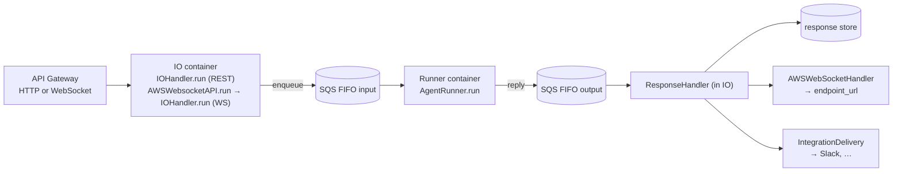

# #870: Move ECS onto the shared queue pipeline

ECS queue mode stops running its own copies of the agent runner, output consumer and IO entry point, and runs the
shared pipeline classes instead: `AgentRunner`, `ResponseHandler`, `IOHandler`. The idea in one line: delete every
ECS-only queue class, keep the API Gateway WebSocket by plugging the AWS push client into the `ws_handler` seam
`ResponseHandler` already has, and let `AWSWebsocketAPI.run` hand off to `IOHandler` the way `RESTAPI.run` already
does. No new classes or config. One Terraform validation.

_Evidence at `develop` @ `e85bbcb6`. Paths are relative to `ak-py/src/agentkernel/` unless they start with a
top-level folder._

## Motivation

- ECS refuses every handler that only works on the queue pipeline.
  - `ECSIOHandler` serves through `AWSRestAPI.run` (`deployment/aws/containerized/ecs_io_handler.py:76`), and
    `RESTAPI.run` rejects any handler marked `requires_pipeline` (`api/http.py:113`, `:122-136`).
  - Rejected today: `ThreadRequestHandler` (a `RequestHandler`, `integration/thread/thread_chat.py:258`),
    `AGUIPipelineRequestHandler` (`integration/agui/queue_handler.py:52`), `WebhookRESTRequestHandler`
    (`integration/adapter/webhook.py:27`).
  - A2A and MCP are refused up front by `RESTAPI.reject_unqueued_protocols()` (`ecs_io_handler.py:47`). #780
    has merged, so `IOHandler` now serves them on a broker transport (`pipeline/io_handler.py:250-261`).
- ECS never delivers messaging replies.
  - `ECSAgentRunner` keeps only fixed attributes (`deployment/aws/containerized/akagentrunner.py:99-107`) and
    sends only those (`:110-129`), so `integration` / `reply_*` are dropped.
  - `ECSOutputConsumer.process_message` only pushes over WebSocket or writes the response store
    (`deployment/aws/containerized/akoutputconsumer.py:65-77`).
  - The shared classes already do it: `AgentRunner` forwards the routing attributes
    (`pipeline/agent_runner.py:27-39`), and `ResponseHandler` hands them to `IntegrationDelivery`
    (`pipeline/response_handler.py:64-72`).
- The shared SQS reader drops the dedup ID, and on ECS that breaks every reply, not only dedup.
  - `SQSTransportConsumer._to_envelope` never sets `dedup_id` (`pipeline/transport/sqs.py:222-232`).
  - `AgentRunner._send_to_output` copies `source.dedup_id` to the reply (`pipeline/agent_runner.py:332-334`).
  - The ECS output queue is FIFO with `content_based_deduplication = false`
    (`ak-deployment/ak-aws/containerized/modules/queues/main.tf:45-46`). SQS rejects a FIFO send that has no
    `MessageDeduplicationId`, so the shared runner's replies would all fail.
  - ECS's own runner reads the ID from the raw record (`akagentrunner.py:102`). The Service Bus transport
    maps it on receive (`pipeline/transport/servicebus.py:192`).
- Of the two decisions the #495 plan left open (`docs/specs/495-onprem-kubernetes/plan.md:318-323`), only one is
  still open.
  - Error bodies returned with status 200: **already fixed.** The ECS runner forwards `status_code`
    (`akagentrunner.py:111-113`), and the output consumer stores it (`akoutputconsumer.py:158`), as
    `ResponseHandler._store_response` does (`pipeline/response_handler.py:240`).
  - WebSocket delivery is still open. ECS pushes through the API Gateway Management API to the message's
    `endpoint_url` (`akoutputconsumer.py:171-190`). The pipeline pushes to its own gateway pods
    (`pipeline/response_handler.py:55-60`).
    - The ABC already covers both: `broadcast(endpoint_url=...)` is optional and pod push ignores it
      (`pipeline/ws/base.py:201-206`, `pipeline/ws/push.py:141-142`).
    - `ResponseHandler` already takes a `ws_handler` (`pipeline/response_handler.py:36-44`), but it never
      passes `endpoint_url` on (`:286`, `:297`).
- After the switch, `ECSIOHandler` would hold almost nothing of its own.
  - In REST modes it only adds the SSE refusal (`ecs_io_handler.py:50-55`) on top of what `IOHandler.run` does.
  - Its WebSocket identity check (`:62-65`) repeats the check `ECSWebSocketSystemRequestHandler` already
    makes (`core/api/websocket_api.py:126-127`).
  - `AWSRestAPI` / `ECSQueueRequestHandler` (`core/api/rest_api.py:6-23`) have no caller besides
    `ECSIOHandler` (`ecs_io_handler.py:71-76`).
- Part of ECS is already shared.
  - `ECSQueueRequestHandler` is the pipeline's `RestHandler` with a different logger name
    (`core/api/rest_api.py:6-15`).
  - `ECSSQSConsumer` runs on `ConsumerLoop` (`deployment/aws/containerized/core/sqs_consumer.py:165-177`).
  - The AWS response store factory is a shim over the pipeline one
    (`deployment/aws/core/response_store/factory.py:1-5`).
  - The SQS message format is the same byte for byte by construction (`pipeline/transport/sqs.py:1-7`), and
    every ECS example already declares `execution.queues.type: sqs`
    (e.g. `examples/aws-containerized/openai-dynamodb-scalable/config.yaml:16`).
- This is blocker B2 for removing direct mode (`docs/specs/remove-direct-mode/research/blockers.md:10`).

## Requirements

### Fix first: the SQS reader keeps the dedup ID

- `SQSTransportConsumer._to_envelope` sets `QueueMessage.dedup_id` from the record's `MessageDeduplicationId`
  system attribute.
- Replies then carry it: `<id>` for a single reply, `<id>-<suffix>` for each chunk (`agent_runner.py:332-334`).
  This matches what ECS sends today (`akagentrunner.py:123-124`, `:222-223`).
- `build_send_message_kwargs` (`pipeline/transport/sqs.py:125-151`) replaces any dedup ID SQS would reject with
  its SHA-256 hex digest (64 characters). SQS rejects an ID over 128 characters, or one with characters outside
  printable ASCII.
  - It is shared by `SQSTransport.send` and `SQSHandler`, so one fix covers ECS, Lambda and the pipeline.
  - Why: on ECS WebSocket frames, `request_id` is set by the client and has no length limit
    (`core/model.py:764`, `deployment/aws/containerized/core/api/websocket_api.py:434`). A 125-character ID is
    accepted at enqueue, but its chunk IDs (`<id>-1-0`) go over 128. SQS then rejects every chunk and the error
    chunk, and the client hangs. `ECSStreamAgentRunner` has the same bug today.
  - The digest is deterministic, so a resent whole reply still deduplicates. Streamed chunk IDs include the
    input's receive count, so a redelivered input's chunks get new IDs and are not deduplicated against the
    first attempt's. IDs SQS already accepts, including single-reply IDs, are unchanged.
- Regression tests in `ak-py/tests/test_pipeline_sqs_transport.py`:
  - A fetched record carries `dedup_id`, and a reply sent from it carries `MessageDeduplicationId`.
  - A 128-character ID is sent unchanged. Its chunk IDs are sent as 64-character digests, a different one for
    each chunk.
- The test is SQS-only, as decided in review. The shared `QueueTransportContract` round-trip test
  (`pipeline/testing.py:86-94`) still does not check `dedup_id` (see Non-goals).

### Agent runner

- Delete `ECSAgentRunner`, `ECSStreamAgentRunner` and `ECSRealtimeAgentRunner`, with no aliases. ECS runner
  scripts call `AgentRunner.run` directly, as the Helm and Azure runners already do.
  - `AgentRunner.run` picks the stream or realtime runner itself (`pipeline/agent_runner.py:199-204`).
  - `from agentkernel.pipeline import AgentRunner` already works in the released `agentkernel` 0.10.0
    (`pipeline/__init__.py:16`), so the examples can switch before this ships.
- Kept as today:
  - The `request_id` / `user_id` fallback to the message body, used by schedules (`agent_runner.py:298-325`).
  - Forwarding `status_code`, and the 500 reply on permanent failure.
  - Chunk dedup suffixes `<receive_count>-<n>`.
- Gained from the shared runner:
  - `integration` / `reply_*` forwarding.
  - Thread reply recording, AG-UI and A2A/MCP (`protocol`) messages.
  - `requests=` passed to `ChatService` (`agent_runner.py:79`).
  - SIGTERM drain (`agent_runner.py:205-207`).
- Changed, intentionally:
  - Polling moves to `SQSTransportConsumer`'s 20 s long poll (`pipeline/transport/sqs.py:197-214`). Before,
    `ECSSQSConsumer.poll` set no `WaitTimeSeconds` (`core/sqs_consumer.py:96-101`).
  - Async + delta now requires `user_id` instead of `endpoint_url` (`agent_runner.py:367-368` vs
    `akagentrunner.py:208-211`). ECS WebSocket frames carry both
    (`core/api/websocket_api.py:353-361`), so nothing is lost.

### Response delivery

- `ResponseHandler._broadcast` and `_broadcast_error` pass
  `endpoint_url=message.attributes.get(ATTR_ENDPOINT_URL)` to `broadcast`. Pod push ignores the value.
- ECS WebSocket mode delivers through `ResponseHandler(ws_handler=AWSWebSocketHandler(...))`.
  - It is built over `websocket_api.connection_table`, the code `ECSOutputConsumer._get_websocket_handler`
    runs today (`akoutputconsumer.py:43-53`), moved into `AWSWebsocketAPI`.
  - A missing `endpoint_url` or `user_id` fails the delivery. `ConsumerLoop` retries it, then hands it to
    permanent failure, as today (`akoutputconsumer.py:175-178`).
- REST modes need nothing new: `ResponseHandler._store_response` writes the record shape ECS writes today
  (`session_id`, `request_id`, `status_code`, `body`).
- Delete `ECSOutputConsumer`, with no alias. `IOHandler` starts `ResponseHandler` in its place.

### IO entry point

- `IOHandler.run` gains one parameter: `ws_handler: WebSocketHandlerABC | None = None`.
  - It is passed to `ResponseHandler(ws_handler=...)`.
  - When it is set, the two pod-push checks are skipped: `push_auth_token` (`io_handler.py:222-231`) and the
    shared session connection store (`io_handler.py:86-94`). Both only guard the pod-push path.
  - A parameter, not config, because `pipeline` must not import `deployment/aws` (`io_handler.py:17`). It
    follows the same injection style as `request_handler`.
- REST modes (`rest_sync`, `rest_async`): ECS entry scripts call `IOHandler.run(handlers=..., request_handler=...)`
  directly, as Helm and Azure do.
  - The shared `RequestHandler` serves the same chat and poll routes `ECSQueueRequestHandler` serves.
  - `request_handler` is where threads mount (`io_handler.py:66-70`).
- WebSocket mode (`async`): ECS entry scripts keep calling `AWSWebsocketAPI.run(handlers=...)`.
  - When a queue transport is configured (`QueueTransportFactory.resolve_type() != "in_memory"`), it calls
    `IOHandler.run(handlers=[*cls.get_default_handlers(), *(handlers or [])], ws_handler=<AWS handler>)`.
    The `/ws/*` routes API Gateway calls stay as they are.
  - With no queue configured (direct mode), it keeps today's `RESTAPI.run` path, so
    `examples/aws-containerized/openai-stream/app.py:50` is unaffected.
  - This is the same hand-off `RESTAPI.run` makes to `IOHandler` (`api/http.py:103-110`).
  - The identity check stays where it already is, in `ECSWebSocketSystemRequestHandler`
    (`core/api/websocket_api.py:126-127`).
- Delete `ECSIOHandler`, `AWSRestAPI` and `ECSQueueRequestHandler`. Their only remaining jobs move as described
  above, except the SSE refusal, which moves to Terraform (next section).
- Gained from `IOHandler`:
  - A2A/MCP checks (no more blanket `reject_unqueued_protocols()`).
  - Its own `uvicorn.Server` with main-thread SIGTERM handling (`io_handler.py:111-117`).

### SSE refusal moves to Terraform

- ECS streams over WebSocket only (`async` + `delta`), as decided in review.
  - Why: ECS REST traffic goes through an API Gateway HTTP API
    (`ak-deployment/ak-aws/containerized/api_gateway.tf:1-4`). AWS documents response streaming for REST APIs
    only, so an HTTP API would buffer the chunks and the client would get the whole reply at once.
- Add one `validation` to `ak-deployment/ak-aws/containerized/variables.tf` that rejects
  `queue_mode && execution_mode == "rest_sync" && message_type == "delta"` at `terraform plan`.
  - Same pattern as the existing cross-variable check on `execution_mode` (`variables.tf:270-273`).
  - The limit comes from the gateway, which Terraform builds, so Terraform is where it belongs.
- Known gap: `message_type: delta` set only in `config.yaml` skips that check.
  - With a DynamoDB response store, `IOHandler` still refuses SSE (`io_handler.py:244-249`).
  - With Redis or Valkey, it starts, and the stream reaches the client buffered.
  - shortcut: documented, not enforced in Python; revisit if ECS adds a REST API gateway.
  - Why no runtime check:
    - After this change, nothing in the ECS REST path is ECS-specific. `IOHandler.run` is shared with Helm,
      Azure and GCP, whose gateways do stream.
    - So the process cannot tell it sits behind an HTTP API without a new ECS-only setting.
    - The case it would catch still delivers the full, correct reply, only all at once.

### Rolling deploy compatibility (#495 spec §5)

- No change to SQS messages: same attributes (`request_id`, `user_id`, `endpoint_url`, `status_code`), group
  ID and dedup ID.
  - Old runner → new IO and new runner → old IO both deliver.
  - Messages enqueued by `ECSWebSocketRequestHandler` are unchanged.
- No change to response store records, the DynamoDB connection table, or container commands
  (`python app_rest_service.py`, `python app_agent_runner.py`).
- Test, both directions, in WebSocket delta mode (the shape that changes most):
  - Old IO → new runner: an input record shaped like `ECSWebSocketRequestHandler`'s goes through
    `StreamAgentRunner`, and each chunk it sends carries `endpoint_url` and `MessageDeduplicationId`.
  - Old runner → new IO: an output record shaped like the old `ECSAgentRunner`'s, consumed by
    `ResponseHandler(ws_handler=AWSWebSocketHandler)`, reaches its `endpoint_url`. The same record in REST
    mode is stored with its `status_code`.

### Breaking change

- Removed public names in `agentkernel.aws`: `ECSIOHandler`, `ECSAgentRunner`, `ECSOutputConsumer`,
  `AWSRestAPI`.
  - They come out of `_LAZY_EXPORTS` and its `TYPE_CHECKING` mirror (`deployment/aws/__init__.py:13-29`) and
    out of `deployment/aws/containerized/__init__.py`.
- Ship as `feat!:` with a migration table in the release notes:
  - `ECSAgentRunner.run` → `AgentRunner.run`
  - `ECSIOHandler.run` → `IOHandler.run` (REST modes) or `AWSWebsocketAPI.run` (WebSocket mode)

### Acceptance coverage

- Mount: `IOHandler.run(handlers=[WebhookRESTRequestHandler(...), AGUIPipelineRequestHandler(...)],
  request_handler=ThreadRequestHandler(...))` starts with no error on the ECS SQS config.
- Slack: no ECS-specific test. Once ECS runs the shared classes, attribute forwarding and
  `IntegrationDelivery` are covered by the existing pipeline tests (`test_pipeline_agent_runner.py`,
  `test_pipeline_response_handler.py`). The public route is added through the existing `gateway_endpoints`
  variable (`ak-deployment/ak-aws/containerized/variables.tf:46`). REST modes only: WebSocket mode creates no
  HTTP API (`api_gateway.tf:2`), so a webhook cannot reach the IO container there.
- Dedup: covered by the regression test above and the rolling-deploy test.
- Modes: no per-mode end-to-end tests. The pipeline suites already cover each mode's delivery. The ECS-specific
  parts are tested where they change: the `ws_handler` seam, the `endpoint_url` guard, the
  `AWSWebsocketAPI.run` hand-off and the rolling-deploy test.
- Removal: `akagentrunner.py`, `akoutputconsumer.py`, `ecs_io_handler.py` and `core/api/rest_api.py` are deleted.

### New surface

- Reuses:
  - `AgentRunner` / `StreamAgentRunner` / `RealtimeAgentRunner`, `ResponseHandler`, `IOHandler`
  - `AWSWebsocketAPI`, `AWSWebSocketHandler`, `WebSocketConnectionStore`, `IntegrationDelivery`
- New classes: none.
- New config: none.
- New parameters: `IOHandler.run(ws_handler=)`.
- New helper: `_sqs_dedup_id` in `pipeline/transport/sqs.py`, next to the other SQS wire helpers.
- New extras or dependencies: none.
- Terraform: one `validation` block. Container commands and env vars are unchanged.
- New files: none, apart from tests.
- Deleted: `akagentrunner.py` (332 lines), `akoutputconsumer.py` (190), `ecs_io_handler.py` (90) and
  `core/api/rest_api.py` (23).

### Tests, docs and skills

- Rework or delete the ECS tests that patch the deleted classes:
  - `test_ecs_agent_runner_schedule.py`
  - `test_ecs_akagentrunner_realtime.py`
  - `test_ecs_akagentrunner_stream.py`
  - `test_ecs_akoutputconsumer.py`
  - `test_ecs_output_consumer_status.py`
  - `test_ecs_io_handler.py` (the hand-off tests go in `test_ecs_websocket_routes.py`)
  - `test_deployment_identity.py`
- `test_ecs_sqs_consumer_parallel.py` stays, because `ECSSQSConsumer` stays.
- Examples:
  - Six runner scripts switch to `AgentRunner.run`:
    - `examples/aws-containerized/{openai-dynamodb-scalable,openai-schedule,openai-stream-queue-mode,openai-websocket-scalable}/app_agent_runner.py`
    - `examples/api/livekit-voice/{openai,google}/sqs/app_agent_runner.py`
  - Four `app_rest_service.py` scripts switch: `openai-dynamodb-scalable` and `openai-schedule` to
    `IOHandler.run`, and `openai-websocket-scalable` and `openai-stream-queue-mode` to `AWSWebsocketAPI.run`.
  - Their READMEs, `examples/api/livekit-voice/openai/sqs/README.md` and
    `ak-deployment/ak-aws/containerized/README.md`.
- Update the ECS class tables and topology text:
  - `docs/docs/deployment/aws-containerized.md`
  - `docs/docs/advanced/queue-mode-guide.md`
  - `docs/docs/deployment/aws-queue-mode-scalability.md`
  - `docs/docs/api/a2a-server.md:55`
  - `docs/docs/api/mcp-server.md:47`
  - `.agents/skills/ak-dev-architecture/SKILL.md`
  - the bundled `ak-cloud-deploy` / `ak-add-capabilities` skills
- Update `docs/specs/remove-direct-mode/research/blockers.md`:
  - Close B2.
  - Correct B5 from "ECS gets SSE through B2" to "ECS streams over WebSocket only".

## Non-goals

- Lambda's own copies (`ServerlessAgentRunner`, the serverless `ResponseHandler`): same duplication, separate
  issue.
- Moving ECS WebSocket delivery to the pipeline's gateway pods. That would replace API Gateway WebSocket and
  its Terraform.
- HTTP routes in WebSocket mode. `api_gateway.tf:44` creates none, so threads, webhooks and A2A on ECS need a
  REST mode. `AWSWebsocketAPI.run` therefore takes no `request_handler`.
- File uploads (multipart) on SQS (B4) and resume-only HITL requests on SQS (#862), as the issue says.
- Moving `ECSWebSocketRequestHandler`'s enqueue onto `RequestProducer`, or touching its direct-mode paths.
- Removing `ECSSQSConsumer`, `RawQueueConsumer` or `SQSHandler`. They are public bases, and Lambda still uses
  `SQSHandler`.
- Adding `dedup_id` to the shared `QueueTransportContract`. That is a follow-up, once Kafka and NATS
  receive-side mapping is checked.
- SSE on ECS. It would need a streaming-enabled API Gateway REST API in place of the HTTP API.
  - **Done in #978**, exactly that way: the HTTP API is replaced by a REST API with
    `responseTransferMode: STREAM`, and the Terraform refusal below is lifted. The reasoning recorded
    here is the state as of #870 and is kept as the record.
  - Not checked on a live stack: the HTTP API buffering claim rests on AWS documenting streaming for REST APIs
    only. The ECS docs say SSE works in direct mode (`docs/docs/deployment/aws-containerized.md:18`), but that
    line goes away with direct mode.
  - Keeping the refusal is the status quo either way, since queue-mode ECS refuses SSE today. Whoever wants
    SSE on ECS runs a `curl -N` test first and lifts the Terraform check.

## Open questions

- None. All were settled in review.
