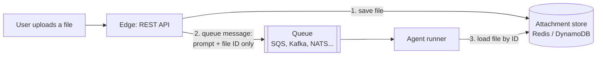

# #871: File uploads on real queues: save the file first, send only its ID through the queue

Today a user can only attach files to a chat message when Agent Kernel runs on the built-in `in_memory` queue. On real queue services (SQS, Kafka, NATS, Pub/Sub, Service Bus) the upload route is switched off, because the file itself would have to travel inside the queue message, and those messages are small.

The idea: when a request with files arrives, save each file to the attachment store and put only the file's ID in the queue message. The agent runner looks the file up by ID. Agent Kernel already does exactly this for Slack, Teams, Gmail and the other chat apps, and for AG-UI. This change uses that same code for the REST chat routes.

Code references are at `develop` @ `d0453388`.

## Words used in this document

- **Edge**: the process that receives the HTTP request and puts it on the queue.
- **Runner**: the process that takes the request off the queue and runs the agent.
- **Broker transport**: any real queue service: `sqs`, `kafka`, `nats`, `pubsub`, `servicebus`. The opposite is `in_memory`, where edge and runner share one process.
- **Attachment store**: where Agent Kernel already keeps uploaded files (`multimodal.storage_type`: `in_memory`, `redis`, `dynamodb`, `session_cache`, or your own class).
- **Offload**: save the file to the attachment store and replace it with its ID. The helper is `AttachmentStorageManager.offload` (`core/multimodal/storage/storage_manager.py:154`).

## Motivation

- **The upload route is switched off on every broker transport.**
  - `POST /api/v1/chat-multipart` is added only when the transport is `in_memory` (`pipeline/request_handler.py:378-382`).
  - The route reads each file and turns it into base64 text inside the message (`pipeline/request_handler.py:546-550`).
  - A file may be up to 10 MB (`api.max_file_size`, `core/config.py:120`). Broker messages are much smaller by default (roughly 256 KB to 1 MB, depending on the service).
- **The JSON chat route has the same problem, with no guard at all.**
  - `POST /api/v1/chat` accepts files and images as base64 text and enqueues them as they are (`pipeline/request_handler.py:384-398`).
  - Nothing checks their size on this path (`core/chat_service.py:106-126`). A large file fails later, as a send error from the queue service.
- **This blocks removing direct (no-queue) mode.**
  - AWS ECS serves uploads today only in direct mode (`ak-deployment/ak-aws/containerized/state.tf:45-49`).
  - GCP drops the route in queue mode too (`ak-gcp/containerized/state.tf:100-107`, `ak-gcp/serverless/state.tf:98-104`).
  - Azure always exposes it (`ak-azure/containerized/apim.tf:136-138`), so in queue mode it returns 404 today.
- **Everything needed already exists. Only the REST routes don't use it.**
  - `offload()` saves file bytes and replaces them with an ID. Seven chat-app adapters (Slack, Teams, Telegram, WhatsApp, Messenger, Instagram, Gmail) and AG-UI already call it before enqueueing (for example `integration/agui/queue_handler.py:128-134`).
  - The queue message already has a field for a prebuilt request list that can hold those IDs (`BaseRunRequest.requests`, `core/model.py:706-729`). The runner already uses it (`pipeline/agent_runner.py:79`).
  - On the runner, `MultimodalPreHook` already turns an ID back into the file and describes it to the agent (`core/multimodal/hooks.py:170-174`).
  - A startup check already refuses a store the runner can't read, such as `in_memory` on a broker transport (`integration/adapter/producer.py:35-58`, `integration/agui/queue_handler.py:101-107`).

## Requirements

### Edge: save files, send IDs

- On a broker transport, when a REST chat request carries file or image bytes, the edge offloads them before enqueueing.
  - This covers both `POST /api/v1/chat` (base64 in JSON) and `POST /api/v1/chat-multipart` (form upload). The multipart route already ends in `run_chat`, so it is one change in one place.
  - The offload runs in `run_chat`, right after `_reject_unroutable` and before the streaming (SSE) branch (`pipeline/request_handler.py:394-398`). Both reply paths then get the offloaded request: `_run_chat_stream` and `enqueue_and_wait` each enqueue the body they are given (`pipeline/request_handler.py:472`, `pipeline/request_handler.py:261`).
  - Saving a file is blocking I/O, so the offload runs off the event loop (`asyncio.to_thread`), like the enqueue already does.
  - The edge builds the request list with the existing `RequestBuilder` (the code that turns a chat request into agent inputs), so its checks still run: a missing `mime_type` is still rejected, and extra fields still reach the agent.
  - It sends that list in the existing `requests` field, and sends no `files` or `images`.
  - Files given as a link (`http://`, `https://`, `s3://`) have no bytes to save. They travel as they do today.
  - A file given as a plain-text `data:` URI (no `;base64` marker, e.g. `data:text/plain,hello%20world`) carries its contents inline, and the store can't save it as is (`core/multimodal/source.py:30-31`). On a broker transport it is rejected with HTTP 400: "send the file as base64 or as a link". (Decision 5.)
- The queue message never contains file bytes on a broker transport.
- The `in_memory` transport is unchanged. Edge and runner share one process there, so nothing needs to be offloaded.
- `POST /api/v1/chat-multipart` is served on every transport.

### Runner

- No runner change. It already reads `requests` and resolves IDs through `MultimodalPreHook`.
- The agent sees the same thing it sees today with multimodal on: a short description and the attachment ID, which it can pass to the `analyze_attachments` tool.

### When files can't be stored

- **Multimodal off, broker transport, request has file bytes**: rejected with HTTP 400 and a clear message: "enable `multimodal` with a shared store (redis or dynamodb)". Requests without files are unaffected. (Decision 1.)
- **A store the runner can't read** (`in_memory`, `session_cache`) on a broker transport, with multimodal on:
  - The service still starts. The REST pipeline has no such check today, so text-only chats on these deployments work and must keep working.
  - Startup logs a warning that names the store and says uploads need `redis` or `dynamodb`.
  - A request that carries file bytes gets HTTP 400 with the existing message from the chat-app check (`integration/adapter/producer.py:52-58`). Requests without files are unaffected. (Decision 6.)
- **File too big for the store**: DynamoDB items are capped at 400 KB, so files over about 300 KB can't be saved (base64 adds a third). The edge returns HTTP 400 that names the limit and suggests `redis`, instead of a 500 from AWS. (Decision 2.)
- **File over `api.max_file_size`**: rejected as today (`pipeline/request_handler.py:548-549`). The JSON route gets the same check.

### Cleanup

- Stored files expire through the store's existing time limit: 7 days by default on Redis and DynamoDB (`core/config.py:411`, `core/config.py:417`).
- Files are not deleted right after the run. Agent Kernel keeps them so the agent can look at them again in later turns, and the chat apps already rely on this. (Decision 3.)

### Configuration

- No new configuration. Existing settings switch the feature on:
  - `multimodal.enabled: true` plus `multimodal.storage_type: redis` or `dynamodb` turns on file uploads for broker transports.
  - `api.max_file_size` stays the size limit.
- The edge and the runner must point at the same store, with identical connection settings in the reused block: `multimodal.redis` (`_MultimodalStorageRedisConfig`, a `_RedisConfig`) or `multimodal.dynamodb` (`_MultimodalStorageDynamoDBConfig`, a `_DynamoDBConfig`) (`core/config.py:410-417`).
  - Why: the shared-store check looks only at the store type (`core/multimodal/storage/storage_manager.py:112`). If the two processes use different Redis URLs or DynamoDB tables, the runner can't find the file. The pre-hook then drops it with only a warning (`core/multimodal/hooks.py:224-226`).

### Deployments

- AWS ECS: expose `POST <agent>-multipart` in queue mode too. It stays hidden in WebSocket mode.
- GCP (containerized and serverless): the same change.
- Azure: already exposed. It starts working once the code change lands.
- Each deployment README says that uploads in queue mode need `multimodal` with a Redis (or DynamoDB) store, and states the gateway's request body limit (decision 4).
- Each deployment gives the edge and the runner the same `multimodal` store settings (see Configuration). ECS can already create Redis (`create_redis_cluster`, `ak-aws/containerized/state.tf:80-83`).

### Tests

- A test transport that refuses messages over a small limit (for example 64 KB), and an upload bigger than that limit:
  - the request succeeds;
  - the queued message holds only attachment IDs, and is under the limit;
  - the runner gets the file back from the store.
- Both routes are covered (JSON and multipart), each with streaming (SSE) on and off.
- The error cases above each have a test: multimodal off, an unreadable store, a file too big for DynamoDB, and a plain-text `data:` URI.
- With an unreadable store, the service still starts, logs the warning, and serves a text-only chat.
- The `in_memory` transport path keeps its current behavior (the existing tests stay green).

## Non-goals

- Streaming large files to the agent in chunks.
- A new S3 attachment store (a follow-up issue; see decision 2).
- Deleting files right after the run.
- Changing what the agent sees for an attachment.
- Raising the 10 MB `api.max_file_size` default.

## Decisions

1. **Multimodal off on a broker transport: files are rejected with a clear 400.**
   - Why: it matches chat apps and AG-UI, and it never depends on which queue is behind it.
   - Accepted cost: a client sending small base64 images over SQS today, without multimodal, starts getting a 400.
2. **Big files on DynamoDB: a clear 400 now; an S3 store comes in a follow-up issue.**
   - Why: Redis already holds 10 MB files, and ECS can create one.
   - The existing `S3Driver` (`core/util/driver/s3.py:14`) will make the S3 store small to add later.
3. **Cleanup: files expire through the store's time limit (7 days by default); nothing is deleted after the run.**
   - Why: deleting after the run breaks `analyze_attachments` in later turns, and chat apps and AG-UI already work this way.
4. **Gateway size limits: documented, not enforced.** `api.max_file_size` stays at 10 MB.
   - Cloud gateways may refuse a request body near 10 MB before Agent Kernel sees it (AWS HTTP API caps payloads at 10 MB; Azure APIM and GCP limits are checked against the provider docs during `spec.md`).
   - Each deployment README states its gateway's body limit.
   - Why: lowering the default would also change it for direct-mode and local users.
5. **Plain-text `data:` URIs on a broker transport: rejected with a clear 400.**
   - Why: their contents would ride the queue, which breaks the "no file bytes in the message" rule. The format is rare, and rejecting it needs no new decoding code.
6. **A store the runner can't read: only file-bearing requests are rejected; startup still succeeds with a warning.**
   - Why: failing startup would break deployments that serve text-only chats today.
   - This differs from chat apps and AG-UI, which fail at startup. They never served traffic with such a store, so they have nothing to break.
