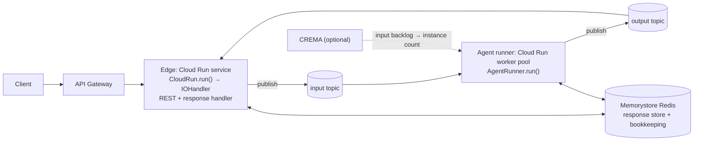

# #886: Queue mode on GCP: a Pub/Sub transport, with the edge and the agent runner split on Cloud Run

This splits a GCP deployment into two tiers:

- **Edge:** a Cloud Run service that enqueues requests and serves replies.
- **Agent runner:** a Cloud Run worker pool that runs the agents.

The tiers are connected by a new built-in `pubsub` queue transport and a Memorystore Redis response store. This is the same IO / runner split that AWS (#374) and the Helm chart (#495) already have. The design idea is to reuse everything the pipeline already provides and add only what GCP lacks:

- **Reused:** `IOHandler`, `AgentRunner`, `ConsumerLoop`, the Redis response store, and Kafka's delivery bookkeeping.
- **New:** a Pub/Sub transport, a `CloudRun.run()` that always starts the pipeline, and the Terraform for the second tier.

External facts are in `research/pubsub-cloud-run.md`.

## Motivation

Code references are at `develop` @ `25cce1e4`.

- **Every GCP deployment is one Cloud Run service, and its queue lives inside each instance.**
  - Both modules deploy one `google_cloud_run_v2_service`: `ak-deployment/ak-gcp/serverless/cloud_function.tf:91` and `ak-gcp/containerized/cloud_run.tf:85`.
  - `CloudRun.run()` takes no arguments and calls a bare `RESTAPI.run()` (`ak-py/src/agentkernel/deployment/gcp/akcloudrun.py:58-77`).
  - On the default `in_memory` transport, `RESTAPI.run()` boots `IOHandler.run()` (`api/http.py:98-106`). That runs the agent runner as a thread in every instance (`pipeline/io_handler.py:144-156`).
  - Instances share neither queues nor replies:
    - Containerized allows up to 10 instances (`containerized/variables.tf:99-103`), so a `rest_async` poll that lands on another instance gets a 404.
    - Serverless scales to zero (`serverless/variables.tf:99-103`), which drops queued work.
- **The pipeline has no GCP transport.** The built-ins are `in_memory`, `sqs`, `kafka` and `nats` (`pipeline/transport/base.py:103`).
- **The two-process pieces already exist; Cloud Run just can't reach them.**
  - On a broker transport, `IOHandler.run()` starts only the REST API and the response handler (`pipeline/io_handler.py:126-142`).
  - `AgentRunner.run()` is the runner container's entry point, and it serves no HTTP (`pipeline/agent_runner.py:193-208`).
  - `CloudRun.run()` reaches neither of them. With explicit handlers on a broker transport, `RESTAPI.run()` serves the direct handler (`api/http.py:108-114`).
  - The GCP examples bypass `CloudRun` entirely (`examples/gcp-containerized/openai/app.py:56`, `examples/gcp-serverless/openai/app.py:47`).
- **Consumer threads starve between requests.**
  - Neither Cloud Run service sets `cpu_idle` (`cloud_run.tf:122-127`, `cloud_function.tf:122-127`), so CPU is allocated only while a request is in flight (research §10).
  - That covers the response-handler thread on the edge, too.
- **Pub/Sub provides less than the pipeline contract needs** (research §1–§3):
  - its delivery count is approximate;
  - it does not deduplicate on publish;
  - one pull can return several messages for the same ordering key.
- **Kafka's delivery bookkeeping would be process-local on GCP.**
  - It is durable only when `session.type` is `redis` or `valkey` (`pipeline/transport/bookkeeping.py:130-158`).
  - GCP Terraform sets `AK_SESSION__TYPE=firestore` (`cloud_run.tf:160-164`).
- **The Redis response store works today.** `redis` is a built-in store (`pipeline/response_store/factory.py:11`), and the Memorystore module already exists (`ak-gcp/common/modules/memorystore`).
- **Nothing tests queue mode on GCP.** The weekly GCP entries all run a single instance (`.github/integration-test-config.yaml:110-127`).
- **Corrections to the issue:**
  - G7 lists `stream` mode, which was removed in #641. The WebSocket mode is `async`.
  - G4's `auth_validator` is not needed: REST auth already reaches `IOHandler`'s app through `GCPAuthorizer` → `RESTAPI.add_auth_handlers` (`deployment/gcp/akauthorizer.py:20-29`, `api/http.py:203-208`).

## Requirements

### Pub/Sub transport (`pipeline/transport/pubsub.py`)

- `PubSubTransport(QueueTransport)` and `PubSubTransportConsumer(TransportConsumer)`.
  - Pull only, through the client's unary pull: one consumer per consumer thread, driven by the existing `ConsumerLoop`.
  - The SDK is `google-cloud-pubsub`, behind a new `pubsub` extra and wrapped in `require_extra`.
- It meets the `QueueTransportContract` (`pipeline/testing.py`) without opting out of anything:
  - **Per-session FIFO, one message in flight per session:**
    - `group_id` becomes the Pub/Sub ordering key, and the subscriptions have message ordering enabled.
    - When a pull returns several messages for one key, the consumer serves them one at a time and holds the rest until the one being served is acked.
    - A message with no `group_id` is published without a key.
  - **Exact `receive_count`:**
    - Counted by the bookkeeping store, keyed by subscription + Pub/Sub message ID, as the Kafka transport does.
    - `delivery_attempt` is not used, because it is approximate and can reset (research §2).
  - **Deduplication on `dedup_id`:**
    - A consume-side claim in the bookkeeping store, with the message ID as the owner (Kafka parity).
    - A redelivery of the same message still passes; another message with the same `dedup_id` is acked and dropped.
  - **Cascade redeliveries:**
    - Pub/Sub redelivers every later message for a key when an earlier one is redelivered, even acked ones (research §1).
    - So an acknowledged message is remembered for the dedup window, and a redelivered copy is acked without being run again.
  - **Attributes:**
    - `QueueMessage.attributes` round-trip byte-for-byte, including values over Pub/Sub's 1024-byte limit and more than 100 attributes (research §8).
    - This matters because the `reply_` context alone may be 8192 bytes (`integration/adapter/producer.py:22`). The spec picks the encoding.
  - **`nack`:** sets the ack deadline to 0, so the subscription's retry policy controls the redelivery delay.
  - **`dead_letter`:** publishes the message to the queue's dead-letter topic, then acks it (Kafka parity), so it can be inspected.
  - **Leases:**
    - Every fetched message that is not yet acked or nacked has its ack deadline extended, up to `ack_wait`. Held messages are included.
    - A turn that runs longer than `ack_wait` is redelivered, as on NATS.
    - `close()` stops the extension and releases the client.
- Provisioning follows the NATS rule:
  - With `auto_provision: false` (the default), a missing topic or subscription fails startup with `AKConfigError` naming it.
  - `auto_provision: true` creates them, and is for the emulator and dev only.
- `check_consumer_capacity` keeps the base no-op: Pub/Sub has no partition ceiling.

### Delivery bookkeeping (`pipeline/transport/bookkeeping.py`)

- `BookkeepingStoreFactory.create()` resolves the store in this order:
  1. `session.type` `redis` or `valkey` (unchanged);
  2. then `execution.response_store.type` `redis` or `valkey` (new);
  3. then the process-local fallback, with its existing warning.
- Why: queue mode on GCP always has a Redis response store, while sessions are usually on Firestore. This is reuse of existing config, not a new knob.
- The order applies to every transport that uses the store (Kafka and Pub/Sub today), not only `pubsub`.
- The new acknowledged-message memory lives in the same store and uses the same TTL as the dedup window.
- **Behaviour change:** a Kafka deployment that has a Redis or Valkey response store but sessions elsewhere now gets durable bookkeeping instead of process-local bookkeeping.

### Configuration (`core/config.py`)

- Reused whole, unchanged:
  - `_QueuesConfig`: `input`/`output` `max_receive_count`, `no_of_consumers`, and `batch_size`;
  - `_ResponseStoreConfig` with its `redis` block;
  - `session`.
- New `_PubSubQueueConfig` at `execution.queues.pubsub`, plus `pubsub` in the `type` description. Fields:

  | Field | Default | Why it can't be derived |
  |---|---|---|
  | `project_id` | `None` (from Application Default Credentials) | Topics may live in another project |
  | `input_topic`, `input_subscription`, `output_topic`, `output_subscription` | `agent-input`, `agent-input`, `agent-output`, `agent-output` | Terraform names the objects |
  | `dlq_suffix` | `-dlq` | Names the dead-letter topics (Kafka parity) |
  | `ack_wait` | `300.0` | Lease ceiling (NATS and in_memory parity) |
  | `request_timeout` | `10.0` | Publish and admin call timeout (NATS parity) |
  | `auto_provision` | `false` | Dev and emulator only (NATS parity) |

  - The emulator is selected by the client library's own `PUBSUB_EMULATOR_HOST` environment variable, so it needs no field.
- **Who declares what:**
  - The application's `config.yaml` declares `execution.queues.type: pubsub`.
  - Terraform injects only coordinates and never sets `type`, as on AWS.
  - An injected `AK_EXECUTION__QUEUES__*` variable with no declared `type` fails at config load.
- `QueueTransportFactory`:
  - adds a `pubsub` branch and `pubsub` in `_BUILTIN_TYPES`;
  - raises `AKConfigError` when the `pubsub` block is missing;
  - works unchanged for the sandbox broker's `queues_config` path.

### Cloud Run entry points (`deployment/gcp/akcloudrun.py`)

- `CloudRun.run(handlers: list[RESTRequestHandler] | None = None)`:
  - adds the routes registered with `register()`, then always calls `IOHandler.run(handlers=handlers)`;
  - on `in_memory` with no arguments, behaves exactly like today (the same single-process pipeline);
  - on a broker transport, starts the edge: the REST API plus the response handler;
  - has no `auth_validator`: REST auth stays on `GCPAuthorizer`, and WebSocket is a non-goal.
- The agent runner's entry point is the existing `agentkernel.pipeline.AgentRunner.run()`. No GCP subclass, because a worker pool needs no port.

### Terraform (`ak-deployment/ak-gcp/{serverless,containerized}`)

- **Switch.** A `queue_mode` boolean, default `false`, named as on AWS (`ak-aws/containerized/variables.tf:256`). With `false`, today's single-service plan is unchanged.
- **Shared modules.** The queue-mode resources live in shared modules under `ak-gcp/common/modules/`, as AWS splits `modules/queues` and `modules/agent-runner`:
  - `pubsub`:
    - input and output topics, each with a dead-letter topic;
    - subscriptions with ordering enabled;
    - a dead-letter policy with `max_delivery_attempts = clamp(max_receive_count + 1, 5, 100)`. This is the server backstop one delivery past the loop's limit, as on NATS (`pipeline/transport/base.py:187-192`);
    - a retry policy.
  - `agent-runner`:
    - a `google_cloud_run_v2_worker_pool` (provider ≥ 6.37.0) running `AgentRunner.run()`;
    - the same image as the edge with its own command, or its own image;
    - its own service account;
    - VPC access to Memorystore (connector or Direct VPC egress: the spec confirms which one worker pools support, research §13).
- **Variables.** An `agent_runner` object (`cpu`, `memory`, instance counts, `image_uri` / `package_path`, `command`, `environment_variables`), plus `queue_config`, `execution_mode` and `message_type`, all mirroring AWS.
- **Edge in queue mode.** The same service, plus:
  - `cpu_idle = false`, so the response-handler thread is never starved;
  - publish rights on the input topic and subscribe rights on the output subscription.
- **Scaling.** The runner supports both:
  - a fixed instance count, the default;
  - CREMA backlog scaling, opt-in: the `gcp-pubsub` scaler on the input subscription, with min, max and a target backlog per instance (research §11).
  - Why opt-in: CREMA has no stated launch stage, its metrics arrive 2+ minutes late, and it is another always-on service. AWS ECS also defaults backlog scaling to off (`ak-aws/containerized/variables.tf:407`).
- **IAM**, least privilege on the named resources:
  - the edge publishes to the input topic and subscribes to the output subscription;
  - the runner subscribes to the input subscription and publishes to the output topic;
  - both publish to the dead-letter topics;
  - the Pub/Sub service agent gets the dead-letter permissions.
- **Environment** injected into both tiers:
  - `AK_EXECUTION__QUEUES__PUBSUB__*`;
  - `AK_EXECUTION__QUEUES__{INPUT,OUTPUT}__MAX_RECEIVE_COUNT`;
  - `AK_EXECUTION__RESPONSE_STORE__REDIS__URL`;
  - `AK_EXECUTION__MODE` and `AK_EXECUTION__MESSAGE_TYPE`;
  - the existing session and thread variables.
- **`check` blocks** that fail at `terraform plan`:
  - `queue_mode` needs `create_redis_cluster`;
  - `queue_mode` rejects `execution_mode` `async` and `realtime`.
- **Supported modes:** `rest_sync` (`complete`, and `delta` over SSE, since the Redis store streams chunks) and `rest_async`.

### Tests

- **`tests/test_pipeline_pubsub_transport.py`**, against a fake broker placed behind the real client's interface. It covers:
  - several messages for one key in one pull, served one at a time;
  - a cascade redelivery of an acked message, acked without running;
  - attributes over 1024 bytes and more than 100 attributes;
  - an exact `receive_count` across a consumer restart (durable bookkeeping);
  - `dead_letter` publishing to the dead-letter topic;
  - lease extension of held messages;
  - provisioning (create vs verify) and the missing-block and missing-extra errors.
- **A `QueueTransportContract` subclass** against the fake, with no capability opt-outs.
- **A live contract** run against the Pub/Sub emulator:
  - env-gated (`AK_TEST_PUBSUB_EMULATOR_HOST`) in `tests/test_transport_contract_live.py`;
  - the emulator added as a compose service in the `transport-integration-tests` job.
- **Bookkeeping:** the factory's three-step resolution order.
- **`CloudRun.run`:** it delegates to `IOHandler` with handlers and the registered routes, and its no-argument `in_memory` path is unchanged.

### Examples, CI and docs

- **`examples/transport/pubsub/`:** a two-process app (`IOHandler.run()` / `AgentRunner.run()`), an emulator compose stack with a healthcheck, `app_test.py`, and a `.github/test-config.yaml` entry (the `ak-dev-new-queue-transport` checklist).
- **`examples/gcp-serverless/openai-queue-mode/`:**
  - `CloudRun.run()` for the edge and `AgentRunner.run()` for the runner;
  - a deploy using `queue_mode = true`;
  - a weekly entry in `.github/integration-test-config.yaml`.
  - Why serverless: it scales to zero, so the weekly run proves queued work survives the case that loses it today. Its checks must allow for cold starts.
- **Docs:**
  - `docs/docs/deployment/gcp-{serverless,containerized}.md` (a queue mode section);
  - `docs/docs/advanced/queue-mode-guide.md` (the transport matrix and "Running queue mode on Pub/Sub");
  - the transport roll call in `docs/src/pages/features.tsx` and in the landing `data.tsx` inventories.
- **Skills:**
  - the bundled `skills/ak-cloud-deploy/SKILL.md` (GCP queue mode, and its line 81, which says both GCP flavors use `CloudRun`);
  - the pipeline section of `ak-dev-architecture`;
  - the reference list in `ak-dev-new-queue-transport`.

## Non-goals

- **WebSocket (`async`) and `realtime` modes on GCP queue mode** (G7).
  - Replies are pushed to a gateway pod by its IP (`pipeline/ws/push.py:52-63`), and Firestore has no connection store (`core/session/firestore.py:114-123`).
  - Terraform rejects these modes at plan, and `IOHandler` already refuses them at startup (`pipeline/io_handler.py:88-96`).
- **A GCP Secret Manager provider** (G9). Cloud Run secret environment variables work in the meantime.
- **A Firestore response store.** It cannot stream chunks, so SSE would not work.
- **Push subscriptions.**
  - The push request timeout equals the ack deadline (≤ 600 s), exactly-once is unsupported, and push backoff can't be disabled (research §6).
  - Push would also need a second consumer host next to `ConsumerLoop`.
- **Exactly-once delivery subscriptions.** They don't remove publish-side duplicates, and they add latency (research §3).
- **The gaps every broker transport shares** (G10): no multipart route off `in_memory` (`pipeline/request_handler.py:366-369`), and resume-only requests (#862).
- **Removing direct mode.** This change is a prerequisite for it, not the removal itself.
- **Scheduled tasks in GCP queue mode (G8, a Cloud Scheduler provider).** Moved to #921, and dropped from #886's acceptance criteria.
  - Today `ScheduleManager` refuses a `schedule` block on `pubsub` with either built-in provider (`schedule/manager.py:318-370`), so nothing fails silently.
  - Cloud Scheduler has no one-time jobs (`at` would need Cloud Tasks).
  - A Pub/Sub target is static `data` + `attributes`, so it can neither substitute the per-occurrence tokens (`schedule/manager.py:485-488`) nor set the session's ordering key (research §14).
  - Meeting the trigger contract therefore needs an extra hop, for example Cloud Scheduler and Cloud Tasks calling an edge trigger route that enqueues through `RequestProducer`. That deserves its own design.
- **A Helm chart `transport.pubsub` block (with KEDA's `gcp-pubsub` scaler) for GKE.** A follow-up, #922: GKE users already have in-cluster NATS.

## Open questions

- None.
