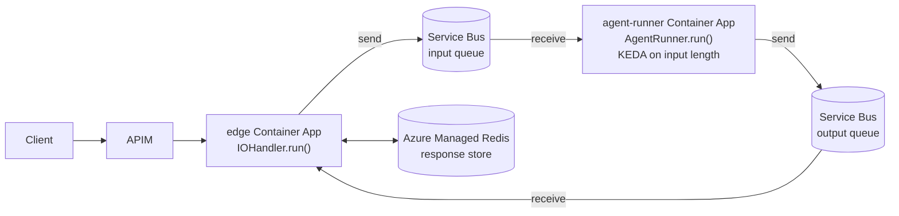

# #887: Queue mode on Azure — Service Bus transport and a Container Apps edge / runner split

Azure gets the same two-tier queue topology AWS and the Helm chart already have: an edge Container App that
enqueues and returns replies, and an agent-runner Container App that runs the agents, joined by two Service Bus
queues and a shared Redis response store. The new code is one built-in transport (`servicebus`) behind the
existing `QueueTransport` seam plus Terraform; the edge and runner entry points, the response store and the
Redis module are reused as they are.

_Evidence at `develop` @ `57a9c10b`. Paths are relative to `ak-py/src/agentkernel/` unless they start with a
top-level folder._

## Motivation

- Azure Functions runs the agent inline; it has no queue path.
  - `AzureFunctions.handler` calls `ChatService.process_chat_request` (`deployment/azure/akfunction.py:74`).
- The Container App target is one compute unit per replica.
  - One `azurerm_container_app` (`ak-deployment/ak-azure/containerized/container_app.tf:42`); the example
    calls a bare `RESTAPI.run` (`examples/azure-containerized/openai-cosmos/app.py:29`), which boots the
    single-process `in_memory` pipeline inside each replica.
  - `container_max_replicas` defaults to 10 (`ak-azure/containerized/variables.tf:184-187`): a `rest_async`
    poll that lands on another replica finds no reply, and scale-in drops queued work.
- No Azure queue transport exists.
  - Built-ins are `in_memory`, `sqs`, `kafka`, `nats` (`pipeline/transport/base.py:103`).
- Everything else the split needs already exists.
  - Entry points: `IOHandler.run()` hosts the routes and the output consumer (`pipeline/io_handler.py:131`);
    `AgentRunner.run()` is the runner and refuses `in_memory` (`pipeline/agent_runner.py:194-197`). Helm
    starts the same two scripts (`ak-deployment/ak-k8s/chart/values.yaml:149,172`;
    `examples/k8s/openai-queue-mode/`).
  - Response store: `type: redis` works on Azure Managed Redis today; the module is `NoCluster` and emits a
    TLS URL with the key (`ak-azure/common/modules/redis/main.tf:56`, `outputs.tf:14-15`). Broker transports refuse the
    `in_memory` store (`pipeline/response_store/factory.py:60`).
  - Conformance: `QueueTransportContract` (`pipeline/testing.py:20`), already run against a fake SQS client
    (`ak-py/tests/test_pipeline_sqs_transport.py:289-313`) and live NATS/Kafka
    (`ak-py/tests/test_transport_contract_live.py:38,72`).
- Prior decision to honour: direct-mode removal recommends dropping the Functions target rather than giving
  it a queue path (`docs/specs/remove-direct-mode/research/blockers.md:15`, B7).

## Requirements

### Transport: built-in `servicebus`

- `ServiceBusTransport(QueueTransport)` and `ServiceBusTransportConsumer(TransportConsumer)` in
  `pipeline/transport/servicebus.py`.
  - Factory: one more branch in `QueueTransportFactory.create`, `"servicebus"` added to `_BUILTIN_TYPES`,
    imported under `require_extra("azure", "execution.queues.type: servicebus")`. The dotted-path BYO branch
    is unchanged.
  - Sync SDK client, like `SQSTransport`'s boto3: `ConsumerLoop` is thread-based. `send` is safe from any
    thread (the `QueueTransport` contract, `base.py:10`).
- Envelope mapping (both queues are session-enabled):

  | `QueueMessage` | Service Bus |
  |---|---|
  | `group_id` | `session_id`; a missing one gets a fresh id (its own session, no ordering) |
  | `dedup_id` | `message_id`, deduplicated by the queue's duplicate detection; missing → random |
  | `attributes` | `application_properties` (str → str) |
  | `receive_count` | `delivery_count` |
  | `message_id` | `sequence_number` (unique per enqueued message) |

- Delivery semantics map onto native features; no bookkeeping store:
  - One in flight per group: a fetch accepts up to `batch_size` next-available sessions, takes one message
    from each, and holds each session lock until that message is acked, nacked or dead-lettered.
  - `ack` → complete, then release the session.
  - `nack` → abandon: immediate redelivery, `delivery_count` + 1.
  - `dead_letter` → the native dead-letter sub-queue, so failed requests stay inspectable (the Kafka/NATS
    override, not the SQS drop).
  - Lock renewal: message and session locks are renewed until `ack_wait`, then allowed to lapse so a stuck
    worker's message redelivers (`timeout_redelivery = True`). Required because Service Bus caps a lock at
    5 minutes, shorter than a long agent turn.
  - Server ceiling one delivery above `max_receive_count` (queue `max_delivery_count`), the NATS rule
    (`base.py:187-192`), so the loop's permanent-failure hook runs before the broker dead-letters.
  - `check_consumer_capacity`: default no-op; sessions have no partition ceiling.
- Passes `QueueTransportContract` with no opt-outs, against a fake client and live.

### Configuration

- Reuse `_QueuesConfig` whole (`core/config.py:771`).
  - `input.url` / `output.url` carry the queue entity URLs (`https://<namespace>.servicebus.windows.net/<queue>`);
    their descriptions widen from "sqs transport only" (`config.py:665,681`). Terraform injects them through
    the same `AK_EXECUTION__QUEUES__INPUT__URL` / `OUTPUT__URL` env AWS uses.
  - `max_receive_count`, `no_of_consumers`, `batch_size` reused unchanged.
- New optional `execution.queues.servicebus` block (`_ServiceBusQueueConfig`); defaults apply when absent.
  - `ack_wait: float = 300.0` — lock-renewal ceiling. Reader: factory → transport. Same name and meaning
    as `in_memory.ack_wait` and `nats.ack_wait`.
  - `connection_string: str | None = None` — for the local emulator and dev. Unset means managed identity
    (`DefaultAzureCredential`). Reader: factory.
- No new `type` or `enabled` field: `execution.queues.type: servicebus` selects the transport.
- Response store: no new config; `execution.response_store.type: redis` with its existing `redis.url`.
- Back-compat: no existing field changes type or default; old YAML and `AK_*` env load unchanged.

### Dependencies

- Add `azure-servicebus` and `azure-identity` to the existing `azure` extra (`ak-py/pyproject.toml:83`), the
  way SQS rides on `aws`. No new extra; no core dependency.

### Entry points

- No new Python classes. The edge runs `IOHandler.run()`; the runner runs `AgentRunner.run()`, from the same
  image with a different command (the Helm pattern).

### Terraform: `ak-deployment/ak-azure/containerized`

- `queue_mode` (bool, default `false`), named and scoped like `ak-aws/containerized/variables.tf:256`.
  `false` leaves today's plan byte-for-byte unchanged.
- `queue_mode = true` adds, in a new `queue_mode.tf` (AWS file layout):
  - A Service Bus namespace (Standard) and two queues, `input` and `output`: sessions on, duplicate
    detection on (5-minute window, SQS parity), `max_delivery_count` = default `max_receive_count` + 1,
    dead-lettering on expiry.
  - An `agent_runner` Container App: same image, `command = var.agent_runner_command` (default
    `["python", "app_agent_runner.py"]`), no ingress, a KEDA `azure-servicebus` scale rule on input queue
    length, the existing `container_min_replicas` / `container_max_replicas`, and a termination grace period
    long enough for `ThreadRunner` to drain.
  - The existing `app` becomes the edge: keeps APIM, ingress and the HTTP scale rule; gains queue URLs and
    the response-store Redis URL from a Container Apps secret (coordinates only; the app's `config.yaml`
    declares the transport and response-store types, as on AWS).
  - Least-privilege roles on the system identities: edge = Data Sender (input) + Data Receiver (output);
    runner = Data Owner (input, which the KEDA scaler needs to read queue length) + Data Sender (output).
  - A validation: `queue_mode = true` requires `create_redis_cluster = true` (the response store).
- New variables: `queue_mode`, `agent_runner_command`. New outputs: namespace and queue names.
- `ak-azure/serverless` is unchanged.

### Azure Functions (G4)

- Decision: option (b). Functions gets no queue path; it stays direct-only and is retired with direct mode
  (B7). Recorded in `docs/docs/deployment/azure-serverless.md` and the bundled `ak-cloud-deploy` skill.

### Coverage matrix

| Cell | Decision |
|---|---|
| `rest_sync` complete / delta (SSE) | Supported; SSE needs the Redis store, which queue mode always provisions |
| `rest_async` | Supported across replicas (shared store) |
| `async` (WebSocket) | Non-goal (G6) |
| `realtime` | Not tested or tuned on Service Bus; docs note it |
| Other edge surfaces (AG-UI, A2A/MCP, webhooks) | Whatever `IOHandler` mounts rides along; only REST is in CI |
| Session store | Any shared backend (Cosmos, Redis); docs warn `in_memory` breaks with >1 runner |
| Helm / AKS | Transport usable by config; chart wiring is a non-goal |
| Lambda, ECS, GCP, Azure Functions | Unchanged |

### Tests, example, docs, skills

- `ak-py/tests/test_pipeline_servicebus_transport.py`: factory branch and errors, wire mapping, and a
  `QueueTransportContract` subclass over a fake Service Bus client (the `FakeSQSClient` precedent).
- `examples/azure-containerized/openai-queue-mode/`: `app_io_handler.py`, `app_agent_runner.py`,
  `config.yaml`, `deploy/` with `queue_mode = true`, `app_test.py` covering `rest_sync` and `rest_async`, and
  `servicebus_contract_test.py` (the live contract, skipped unless `AK_TEST_SERVICEBUS_NAMESPACE` is set).
  Registered as a weekly entry in `.github/integration-test-config.yaml` (next to `:106`); Azure examples
  have no `.github/test-config.yaml` entry.
- Docs: `docs/docs/advanced/queue-mode-guide.md`, `docs/docs/deployment/azure-containerized.md` (queue mode),
  `azure-serverless.md` (direct-only), `core-concepts/configuration.md`, `advanced/scheduling.md` (transport
  list), the docs-site transport inventories, `ak-azure/containerized/README.md`.
- Skills: `.agents/skills/ak-dev-architecture`, `ak-dev-new-queue-transport` (built-in list), bundled
  `ak-cloud-deploy` and `ak-add-capabilities`.

### New surface

- Reuses: `QueueTransport` / `TransportConsumer`, `QueueTransportFactory`, `_QueuesConfig` (incl. the
  `input.url` / `output.url` fields), `QueueTransportContract`, `RedisResponseStore`, `IOHandler.run`,
  `AgentRunner.run`, the `ak-common` Redis module, the `azure` extra.
- New classes:
  - `ServiceBusTransport(QueueTransport)`: send side; the ABC already fits, this is one more backend.
  - `ServiceBusTransportConsumer(TransportConsumer)`: session-locked receive, ack, nack, dead-letter.
  - `_ServiceBusQueueConfig`: the two settings above; no existing model carries them.
- New config: `execution.queues.servicebus.ack_wait`, `execution.queues.servicebus.connection_string`.
- New dependencies: `azure-servicebus`, `azure-identity` in the existing `azure` extra.
- New files: `pipeline/transport/servicebus.py`, `ak-py/tests/test_pipeline_servicebus_transport.py`,
  `ak-azure/containerized/queue_mode.tf`, the example directory.
- New Terraform variables: `queue_mode`, `agent_runner_command`.

## Non-goals

- WebSocket delivery across replicas, Web PubSub, a Cosmos connection store (G6).
- Azure Key Vault secret provider (G8; Container Apps secrets work meanwhile).
- A queue path, webhook host or Python adapters for Azure Functions (G4 option a, G9).
- Scheduled tasks in Azure queue mode (G7; #952).
- Multipart upload and resume-only HITL on broker transports (G10; #871, #862).
- A Cosmos DB response store (no chunk streaming, so no SSE).
- Kafka on the Event Hubs Kafka endpoint as a documented or tested path.
- A retry backoff on `nack` (abandon redelivers at once; add a `retry_backoff` only if real failures need it).
- Separate replica bounds per tier (both reuse `container_min/max_replicas`; they scale on different signals).
- Helm chart values for `servicebus`; realtime tuning on Service Bus.
- Service Bus Premium and a private endpoint (decision 4).
- Runner idempotency on redelivery (#440).

## Decisions

1. **Transport: Service Bus** (resolved 2026-11-14). Sessions, duplicate detection, delivery count and the
   DLQ map one-to-one onto the contract. Kafka on Event Hubs was rejected: it costs no Python but brings
   partition head-of-line blocking across sessions, needs a Redis/Valkey session store for durable attempt
   counts (`pipeline/transport/bookkeeping.py:118-150`), and its DLQ and commit behaviour is untested.

2. **Scheduling (G7): out of scope, tracked in #952** (resolved 2026-11-14). The acceptance criterion
   "scheduled tasks fire in Azure queue mode" moves there. Until it lands, `local` refuses a broker transport
   (`schedule/manager.py:391`) and `eventbridge` is SQS-only (`schedule/provider/eventbridge.py:56`), so a
   `schedule` block fails at startup in Azure queue mode; docs say so.

3. **Auth: managed identity** (resolved 2026-11-14). Terraform wires each tier's system identity with the
   per-tier roles above; no Service Bus secret reaches the apps. `connection_string` exists only for the
   emulator and local dev. The KEDA scale rule also uses the runner's identity: azurerm `5.11.0` has
   `identity_id` on `custom_scale_rule` (verified while writing `spec.md`).

4. **Network: Standard tier, public endpoint** (resolved 2026-11-14). Access is gated by managed identity;
   key-based local auth is off. Premium with a private endpoint (the Redis module's pattern) is a follow-up,
   not part of #887.

5. **Live contract run: weekly, real namespace** (resolved 2026-11-14). The fake-client contract runs on every
   PR; the live one runs in the weekly integration harness.
   - Auth through the CI's Azure login (`DefaultAzureCredential`), not a key, since local auth is off
     (decision 4).
   - Dedicated contract-test queues with sessions and duplicate detection, never the example's queues, whose
     runner would consume the test messages. Provisioning them is a `spec.md` detail.
   - The live class lives in the example, because the weekly harness runs only the example's pytest.
   - The Service Bus emulator is not used.

## Open questions

- None. All five resolved on 2026-11-14.

## Risks

- Delta replies fan out one output message per chunk (`pipeline/agent_runner.py:346-347`); accepting and releasing
  a session per message would add latency per chunk. `spec.md` §1 rule 4 keeps a settled session open
  briefly and reuses it for the next message.
- A turn longer than the runner's termination grace period is redelivered after scale-in and runs twice
  (#440); docs size the grace period.
