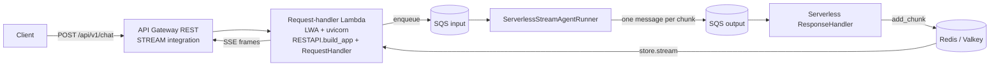

# #894: SSE (`rest_sync` + `delta`) on AWS Lambda

> [!TIP]
> **TL;DR**
> - **Problem:** Lambda refuses SSE (`rest_sync` + `delta`) at cold start. Python on Lambda cannot stream by itself.
> - **Idea:** run the **same app ECS runs** (`RESTAPI.build_app` + the pipeline `RequestHandler`) inside the
>   request-handler Lambda, through the AWS **Lambda Web Adapter** (LWA). The SSE logic is the shared one.
> - **New code:** the hosting (one small class and its guard), two small fixes on the queue workers, and Terraform.
> - **Scope:** queue mode only. No new config flag and no new Terraform variable. Every other mode plans no change.
> - **Decided:** one function; auth inside the app, as on ECS; the existing checks reused; ECS's chat-path
>   rule; the app's packaging owns the adapter version. See [Decisions](#decisions).

Evidence is cited against `develop` at `93885bf1b`. The AWS facts are in
[`research/aws-response-streaming.md`](research/aws-response-streaming.md).

## At a glance

| Part | Today | After #894 |
|---|---|---|
| SSE logic (`RequestHandler`: `run_chat` → `_run_chat_stream` → `_sse_stream`) | ✅ Shared, used by ECS | ✅ **Reused as is** |
| Request-handler Lambda | ❌ Refuses SSE; returns one finished body | 🆕 LWA + uvicorn serving the shared app |
| `ServerlessStreamAgentRunner` | ❌ Needs a WebSocket `endpoint_url` | 🟡 Needs it only in WebSocket mode |
| Serverless `ResponseHandler` | ❌ Stores whole replies only | 🟡 Writes SSE chunks and an error chunk |
| API Gateway integration | ❌ Buffered | 🆕 `STREAM` + streaming invoke URI |
| Terraform checks | ❌ Allows the pair, fails at cold start | 🆕 Refuses no queue, a DynamoDB store or an authorizer at `plan` |

✅ reused · 🟡 small fix · 🆕 new · ❌ gap today

## Motivation

- **Lambda refuses SSE at cold start.** In this mode the whole function fails, not just the chat route.
- **The Lambda handler can only return one finished body.**
- **Python cannot stream on Lambda by itself.** Native response streaming is Node.js only. Python needs
  LWA or a custom runtime.
- **The SSE logic already exists and is generic.** ECS serves it today.
- **Two Lambda queue workers cannot carry SSE yet**, and no open PR fixes either.
- **The infrastructure buffers**, and Terraform does not catch the unsupported pair.
- **The docs and skills say SSE is impossible on Lambda.**

📎 Code evidence (click to expand)

- Refusal: `DefaultEndpointsHandler.get_routes` raises `AKConfigError` when `execution.is_sse`
  (`deployment/aws/serverless/core/router/rest_lambda.py:48-52`). The router builds every route of the
  request Lambda, so all of them fail.
- One body: `Lambda._wrap_response` returns `{"statusCode", "body"}` (`deployment/aws/serverless/aklambda.py:75-84`).
- Python: see `research/aws-response-streaming.md`, section "Lambda".
- Shared SSE logic in the pipeline `RequestHandler`:
  - branch on `is_sse` (`pipeline/request_handler.py:507-508`)
  - refuse a store that cannot stream chunks (`:640-648`, `_store_can_serve_sse` at `:650`)
  - enqueue and stream chunks as SSE frames (`:664-669`, `_sse_stream`)
  - ECS serves it through `IOHandler` and uvicorn (`pipeline/io_handler.py:103-115`).
- Stream runner: `ServerlessStreamAgentRunner._get_record_attributes` raises without an `endpoint_url`
  (`deployment/aws/serverless/akagentrunner.py:275-276`).
- Response handler: outside WebSocket mode it stores whole replies only
  (`deployment/aws/serverless/akresponsehandler.py:155-161`), and its permanent-failure path stores a
  whole record (`:235-238`). The shared handler writes chunks for SSE (`pipeline/response_handler.py:88-91`,
  `_store_chunk` at `:257-267`).
- Infrastructure:
  - plain `python3.12` runtime (`ak-aws/serverless/modules/request-handler/main.tf:344`)
  - normal invoke ARN, no transfer mode (`ak-aws/serverless/modules/api-gateway/main.tf:113-116`)
  - `message_type` accepts `delta` with any mode (`ak-aws/serverless/variables.tf:70-76`).
- Docs and skills: `docs/docs/deployment/aws-serverless.md:23-24`,
  `ak-py/src/agentkernel/skills/ak-cloud-deploy/SKILL.md:849`.

## Requirements

### 1. Serving: the ECS way, on one function

- In `rest_sync` + `delta` with `queue_mode`, the **existing request-handler Lambda** serves
  `RESTAPI.build_app(handlers=[RequestHandler(), *app_handlers])` over uvicorn, like the IO container on ECS.
  No second function.
  - The SSE path is the shared `RequestHandler` code, unchanged.
  - No response-handler thread and no agent runner in this process: on Lambda those are their own functions.
  - Every route of the function is served by that app, the ECS way: the chat route, A2A and MCP mounts,
    messaging webhooks (`WebhookRESTRequestHandler`) and application `RESTRequestHandler`s.
- 🆕 New class `LambdaStreamServer` (`deployment/aws/serverless/`). One responsibility: start that app
  for LWA.
  - `run(handlers=None)`: runs `LambdaStreamGuard` (section 2), then serves on `api.port`.
  - It reuses `RESTAPI.build_app` and the pipeline `RequestHandler`. It copies no SSE, queue or
    response-store logic.
  - Exported lazily from `agentkernel.aws`, so `from agentkernel.aws import Lambda` stays FastAPI-free.
- The app's start script is a few lines, like the ECS `app_rest_service.py`: `LambdaStreamServer.run()`.

### 2. Cold-start checks

- 🆕 `LambdaStreamGuard`, the sibling of `LambdaWebhookGuard` (`core/webhook_host.py:91`), with one
  `check()`. Lambda-only checks, each an `AKConfigError`:
  - the mode is not `rest_sync` + `delta` (`execution.is_sse` is false)
  - the transport is not `sqs`, with the `LambdaWebhookGuard._check_transport` wording
  - `API_BASE_PATH`, `API_VERSION` or `AGENT_ENDPOINT` is missing (`LambdaWebhookGuard.BASE_PATH_ENV`).
- The topology checks are **not copied**. The guard calls `IOHandler.check_deployment`, the public
  wrapper #989 (#932) adds over `_validate_topology` and `_warn_if_no_agents`. That already refuses:
  - a broker transport with an in-memory or missing response store (`pipeline/io_handler.py:226-235`)
  - SSE on a store that cannot stream chunks (`:238-243`)
  - A2A or agent MCP without a shared store (`:244-255`).
  - If #894 merges before #989, it adds `check_deployment` with the same name and signature, and
    whichever merges second rebases onto it.
- The refusal in `rest_lambda.py:48-52` stays for an app still on `Lambda.handler`. Its message names
  `LambdaStreamServer` instead of telling the user to switch to WebSocket.

### 3. Paths: the ECS rule

- The configured chat path (`/<API_BASE_PATH>/<API_VERSION>/<AGENT_ENDPOINT>`) reaches
  `RequestHandler.CHAT_PATH` (`/api/v1/chat`, `api/handler.py:112`). Every other path reaches the app
  unchanged.
  - This is ECS's rule: its gateway rewrites only the chat route (`overwrite_path = "/api/v1/chat"`,
    `ak-aws/containerized/state.tf:30-34`) and forwards the other endpoints with their full path.
  - A REST API Lambda proxy integration has no path rewrite, so `LambdaStreamServer` applies it in front
    of the app.
  - Stripping `/<API_BASE_PATH>/<API_VERSION>` from every path, as `RESTLambdaRouter` does for
    `Lambda.register` routes, would break the app's own routes under `/api/v1` (`AGENTS_PATH`,
    `api/handler.py:111`).
- The chat path is read from the environment variables the module already sets, through the logic
  `BaseLambdaRouter._get_base_paths_from_env` holds (`core/router/common.py:48-61`), moved to one shared
  class rather than copied.
- A non-default `agent_endpoint` therefore works, as it does on ECS.

### 4. Queue workers (Lambda-only fixes)

- 🟡 `ServerlessStreamAgentRunner` requires `endpoint_url` only when `execution.is_websocket`.
  - SSE output messages carry no `endpoint_url`.
  - WebSocket behaviour is unchanged: a missing `endpoint_url` still raises there.
- 🟡 The serverless `ResponseHandler`, when `execution.is_sse`:
  - writes each chunk with `store.add_chunk(request_id, chunk)`, the shared handler's rule
  - raises `AKConfigError` when the store cannot stream chunks, with the shared handler's message
  - on permanent failure writes one error chunk `{"error", "done": true, "session_id"}`, so the caller's
    stream ends instead of waiting until it times out.
- The integration and protocol branches that run before the mode branch stay first and unchanged.

### 5. Auth: inside the app, as on ECS

- The app authenticates every request through the `identity` block (`RequestAuthenticator.dependency()`,
  installed by `RESTAPI.build_app`), as the IO container does on ECS.
- In SSE mode the request-handler integrations use `authorization = "NONE"`: there is no API Gateway
  authorizer on this function.
  - ECS has no API Gateway authorizer at all (`ak-aws/containerized/api_gateway.tf`).
  - #932 (PR #989) chose `NONE` for the A2A and MCP routes for the same parity.
  - It also avoids validating every token twice.
- Terraform refuses `authorizer` together with SSE mode at `plan`, naming the `identity` block as the
  replacement.
- Without an `identity` block every caller is anonymous, as on ECS. The docs and the example say so.

### 6. Terraform (`ak-deployment/ak-aws/serverless`)

- **No new variable.** The existing pair `execution_mode = "rest_sync"` + `message_type = "delta"`
  turns streaming on. It requires:
  - `queue_mode = true`
  - no DynamoDB response store (`create_dynamodb_response_store`): it cannot stream chunks. The Redis or
    Valkey store is checked at cold start (section 2), since the app may name its own.
  - no `authorizer` (section 5).
  - Each is a variable `validation`, which fails `terraform plan`. A `check` block would only warn.
- In that mode the module sets the adapter's environment on the request-handler Lambda:
  - `AWS_LWA_INVOKE_MODE=response_stream`
  - `AWS_LWA_PORT` = `AK_API__PORT` (the app's `api.port`, default 8000)
  - `AWS_LWA_READINESS_CHECK_PATH=/health` (`api/http.py:63`)
  - `AWS_LAMBDA_EXEC_WRAPPER=/opt/bootstrap` for zip packages only.
- **The adapter binary comes from the app's packaging, like every other runtime dependency.**
  - Zip (the examples' request handlers are `S3Zip`): the user passes the layer ARN through the existing
    `request_handler.layers` (`variables.tf:359`, default `[]`), with the version in the ARN.
  - Image: the Dockerfile copies the extension from a pinned
    `public.ecr.aws/awsguru/aws-lambda-adapter:<version>` tag, as the examples pin
    `public.ecr.aws/lambda/python:3.12` today.
  - The module hardcodes no layer ARN; no Lambda layer is referenced anywhere in the repo today.
- In that mode every API Gateway integration that targets the request handler uses
  `response_transfer_mode = "STREAM"` and the `/response-streaming-invocations` URI.
- The Redis/Valkey response-store URL already reaches the request handler
  (`modules/request-handler/main.tf:407-412`). No change is needed.
- Every other mode plans no change.

### 7. Limits (documented, not enforced in code)

> [!WARNING]
> - A stream can run for up to **15 minutes**. It closes after **5 minutes with no data** on a Regional
>   endpoint, and after **30 seconds** on an edge-optimized one.
> - The **Lambda timeout** bounds the stream. The default request-handler timeout is **45 s**
>   (`variables.tf:354`), so the docs tell users to raise it.
> - A client that disconnects does **not** stop the function or the agent run, and the function is
>   still billed.

### 8. Example, docs, skills, tests

- **Example:** `examples/aws-serverless/sse-openai`: a zip request handler with the pinned adapter layer,
  queue mode, Redis, an `identity` block, and a `curl -N` call in the README.
- **CI:** a weekly integration test entry for the example.
- **Docs:**
  - replace the "No SSE on Lambda" box (`aws-serverless.md:23-24`)
  - add the `rest_sync` + `delta` row to that page's mode table
  - document the limits in section 7, auth in section 5, and the zip `layers` option.
- **Skills:** `ak-cloud-deploy` (`SKILL.md:849`) and `ak-dev-architecture` (its streaming flow says the
  Lambda router refuses `rest_sync` + `delta`).
- **Unit tests:**
  - `LambdaStreamGuard` checks, and `LambdaStreamServer` app wiring
  - the path mapping: chat path, prefixed paths, a non-default `agent_endpoint`
  - the stream runner with and without `endpoint_url` in each mode
  - the response handler's SSE chunk and error-chunk paths.
- **Changelog:** `changelog.d/894.added.md`.

## Decisions

| # | Question | Decision | Why |
|---|---|---|---|
| 1 | One function or two? | **One:** the request-handler Lambda serves the app | The ECS shape. Nothing working is lost: the router already refuses every route in this mode |
| 2 | Auth | **Inside the app** (`identity` block); no API Gateway authorizer in SSE mode | ECS has no authorizer; #932 chose `NONE` for parity; no double validation |
| 3 | Startup checks | **`LambdaStreamGuard`** for Lambda-only checks + **`IOHandler.check_deployment`** for topology | Same split as `LambdaWebhookGuard` and #989's protocol guard; no third copy |
| 4 | Non-default chat path | **Supported**: the chat path maps to `/api/v1/chat`, other paths pass unchanged | ECS's `overwrite_path` rule; stripping every prefix would break `/api/v1/agents` |
| 5 | Adapter version | **Pinned by the app's packaging** (the `layers` ARN, or a Dockerfile tag) | The module never hardcodes layers or base images today |

## Non-goals

- Direct (no-queue) mode. #959 removes it.
- Changing the stream format, or Streamable HTTP. That is #895. Lambda streams whatever `RequestHandler`
  writes, so #895 needs no Lambda change.
- `rest_async` + `delta`: still refused by config (`core/config.py:959`).
- WebSocket (`async`) mode, which already streams.
- Streamed A2A or MCP replies (`message:stream`).
- Function URLs. They do not stream inside a VPC.
- `Lambda.register` routes in this mode. They were never served here, because the router refuses every
  route. Custom routes are `RESTRequestHandler`s, as on ECS.
- An API Gateway authorizer in SSE mode (section 5).
- Moving `complete`-mode Lambda deployments onto LWA.

## Coordination

| Item | Owner | Overlap |
|---|---|---|
| PR #989 / #932 | pulindu-yl | Adds `IOHandler.check_deployment`, which the guard reuses. Merge order decides who adds it. |
| PR #1005 / #978 | malithaYL | The same API Gateway `STREAM` feature on ECS. Share the spike result. |
| #985 | malithaYL | Changes the same `is_websocket` / `else` branch in `akresponsehandler.py:155`. |
| PR #1002 | lakindu-yl | Adds trace log lines inside both queue-worker files. Only the merge order matters. |
