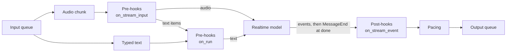

# #927: Pre-hooks and post-hooks on realtime calls

Realtime mode runs no AK hooks today. This change runs the existing hooks on a realtime call by treating the call
as what `execution` config already calls it: delta (streaming) mode. Caller text goes through `PreHook.on_run`, model
output goes through `PostHook.on_stream_event`, and one new optional method, `PreHook.on_stream_input`, covers caller
audio, which has no equivalent in text modes. AK provides only the hook points and their contract. What a hook does
is the user's code, and this design neither ships, assumes nor limits any particular use.

## Scope: part 1 of #885

- This change is the hooks part of #885. It replaces the first attempt, kept on `backup/885-old-attempt`, which built speech processing into AK.
- Later sub-issues, not here: system tools and prompt guidance, session store and per-turn lock, tracing.

## Motivation

- Realtime runs no hooks, and says nothing about it.
  - The pool only calls `runtime._publish` (`pipeline/realtime_pool.py:101`) and sets `ToolContext`, `Session` and `Agent` context once (`:127-129`). No hook is called anywhere in `pipeline/realtime_pool.py`.
  - A user who enables a guardrail or adds agent hooks gets no effect and no warning. The only note is in docs (`docs/docs/frameworks/openai.md:186`, `docs/docs/frameworks/google-adk.md:216`, `.agents/skills/ak-dev-architecture/SKILL.md:637`).
- Every other mode already has a hook seam, and it follows the message shape.
  - Pre-hooks: `PreHook.on_run` once per turn on the whole request, for every mode (`core/runtime.py:242`, via `_prepare_requests` `:226`; same call in `run()` and `stream()`).
  - Post-hooks on a whole reply: `PostHook.on_run` (`core/hooks.py:72`, called in `run()` at `core/runtime.py:453`).
  - Post-hooks on a streamed reply: `PostHook.on_stream_event`, called for every event, and `on_run` is **not** called in `stream()` (`core/hooks.py:94`, `core/runtime.py:515-545`).
- Realtime is already a delta mode in config.
  - `execution.message_type` resolves to `DELTA` for realtime and `realtime` + `complete` is rejected (`core/config.py:754`, `:762`).
- Realtime output already uses AK stream events: `TextDelta`, `AudioDelta`, `InputTranscript`, `Interrupt`, `AgentChanged` (built in `_pacing_loop`, `pipeline/realtime_pool.py:220`). The edge reads them (`integration/livekit/adapter.py:424`).
- Realtime input already uses AK request types: `AgentRequestVoice` and `AgentRequestText` (`core/model.py:75`, `:207`), split in `dispatch` (`pipeline/realtime_pool.py:596`, `:598`).
- Output guardrails are not a streaming hook today, in any mode.
  - `OutputGuardrail` implements only `on_run` (`guardrail/guardrail.py:22-23`), so in SSE and WebSocket delta modes it never runs. Realtime matches delta mode; it is not a realtime-only gap.
- The pre-hook type check does not allow a voice request in a hook's returned list (`core/runtime.py:253` lists text, file, image, any, attachment ref, resume; `AgentRequestVoice` is in the union at `core/model.py:207` but not in that tuple).
- The first attempt (69 files, +18.7k lines) built speech processing into AK. That is user code: AK's part is the hook points, as in every other mode.

## Requirements

### Principle

- A realtime call uses the existing hook seams wherever the message shape matches a text mode.
  - Caller text is a whole request: existing `PreHook.on_run`.
  - Model output is a delta stream: existing `PostHook.on_stream_event`.
  - Caller audio arrives in chunks and has no text-mode equivalent: one new optional method.
- No new registration API: hooks attach with `Module.pre_hook` / `Module.post_hook` as today.
- Hooks run where they run in every other mode: in the agent-runner process, after the input queue and before the output queue.
- Hooks work the same on every realtime runner (OpenAI, ADK, bring-your-own), because they run in the shared pool, not in an adapter.

### Hook contract

- Caller text (`AgentRequestText`, one per typed message).
  - The pool runs the agent's pre-hooks, then the **whole** list of system pre-hooks (input guardrail, multimodal, sandbox), through the same loop `run()` and `stream()` use, before `send_text`. One owner of hook order; the sandbox hook's task-completion ingestion therefore also runs on a call's typed text.
  - A hook returning requests: the (possibly modified) text is sent to the model.
  - A hook returning an `AgentReply`: nothing is sent to the model; the edge gets `StreamChunk(error=<reply text>, done=True)`, the same chunk `Runtime.stream` yields on a pre-hook halt. The call continues.
  - A hook that raises: the edge gets one generic error chunk (the exception is logged, not sent) and the call continues.
- Caller audio (`AgentRequestVoice`, one per chunk).
  - New optional `PreHook.on_stream_input`, default returns the request unchanged. Existing hooks are not affected and still need only `on_run`.
  - Returns the request (same type) to pass it on, a modified one, a list to emit several, or `None` to drop it. Same rules as `on_stream_event` (`core/hooks.py:94`).
  - Runs before the pool converts the chunk to the model's rate, so a hook always sees edge-rate audio (24 kHz, `EDGE_SAMPLE_RATE`, `core/realtime/pcm.py:12`) and never needs a sample-rate API.
  - Agent hooks run first, then system hooks, matching `_prepare_requests`.
  - A text item (`AgentRequestText`) in a hook's returned list is handled like typed text: it leaves the audio chain (later audio hooks do not see it) and goes through the caller-text path above.
  - A dropped chunk never reaches the model.
  - A hook that raises, or returns a wrong type, drops the chunk and the call continues. The first failure of a call is logged at `ERROR` and later ones at `DEBUG`: one error chunk per audio chunk would flood the edge.
  - `on_stream_input` has its own return validation; the type check on `on_run` results (`core/runtime.py:253`) does not list `AgentRequestVoice` and is unchanged.
- Model output (every event the pool builds, after resampling to the edge rate, before it is emitted).
  - The pool passes each event through each post-hook's `on_stream_event`, system hooks first then agent hooks (`core/runtime.py:515`), with the same return rules: event, same-`type` rewrite, `None` to drop, list to replace.
  - A hook returning a different `type` for a single event raises `TypeError`, as in `Runtime.stream` (`core/runtime.py:531-535`).
  - Events include `AudioDelta`, `TextDelta`, `InputTranscript`, `Interrupt`, `AgentChanged`.
  - Turn end: at the model's `done`, the pool passes a `MessageEnd` (`core/event.py:58`) through the post-hooks, then sends the `done` chunk. This is the closing event delta-mode runners already send, so the hold-and-release pattern `on_stream_event` documents (hold pieces, release them at the boundary, `core/hooks.py:94`) works on a call.
    - `MessageEnd.message_id` is the last output event's id, or a fresh one when the turn had no output. It is not one id per turn on every framework (ADK gives each event its own). A call sends no `MessageStart`.
    - `MessageEnd` is sent on to the edge. LiveKit ignores event types it does not handle (`integration/livekit/adapter.py:424`).
  - An `Interrupt` reaches the hooks in order, so a hook holding events drops them on a barge-in. Audio a hook holds does not count as playing audio for detecting a barge-in (`_queued_audio` counts audio queued before the hooks); the model's own `interrupt` still reaches the hooks.
  - Pacing is applied to every audio event that is emitted, whichever event released it, one event at a time. Audio a hook holds and releases on `MessageEnd` therefore leaves at playback speed, not in a burst; audio a hook drops is not paced.
  - `StreamHalt` ends the call with the existing `_fail` (`pipeline/realtime_pool.py:192`): one error chunk to the edge, connection closed, next input reconnects.
- The `requests` argument of `on_stream_event` is the last text turn sent to the model (after pre-hooks), as delta mode passes the turn's requests; an empty list when no text turn was sent yet (audio-only call).
- Hook context.
  - `Session.current()` and `Agent.current()` are set around every hook call. The pacing task starts after the connect-time context is reset (`pipeline/realtime_pool.py:132`, `:140`), so it has none.
  - One hook instance serves every concurrent call, as in text modes. A hook keeps state in the session's volatile cache, not on `self` (rule already in `core/hooks.py:94`).
  - The volatile cache is cleared when the call closes, as `Runtime` clears it when a run ends (`core/runtime.py:464`), also when the native session fails to close. It is not cleared per turn (session part of #885).
- Order of system hooks is owned by `Runtime`, in one place, for every mode.
  - `Runtime` gets a public method for the pre-hook loop and one for the per-event post-hook loop, both extracted from existing code, so the pool calls them instead of copying them.
  - `run()` and `stream()` behave exactly as before.
- Existing realtime apps: hooks registered on a realtime agent start running. This is intended (#885 asks for it) and is not opt-in. A call with no hooks differs only by the `MessageEnd` event at each turn end.

### Honest limits (stated in docs and enforced by a startup warning)

- Facts of the native call, stated so hook authors know what they get (not limits AK adds):
  - Audio hooks see audio. The model hears audio that passes the pre-hooks; `InputTranscript` is the model's own transcript and arrives after it heard the audio.
  - `TextDelta` and `AudioDelta` are separate events. Rewriting one does not change the other.
  - Audio already played cannot be taken back. A hook that drops or holds audio stops it before it is sent, not after.
- A hook runs only when an item arrives; it returns its output then and cannot push output later (same as text hooks).
- Hooks run on the playback path. A slow hook delays the audio and every event behind it; AK adds no time limit (text hooks have none either).
- AK's own system hooks keep their existing behaviour: the input guardrail checks text items only, and the output guardrail does not run on any streamed reply (see Motivation).
- Startup warning, once per realtime agent, when `guardrail.input.enabled` is on: it checks text items only, and audio is not checked. This is the only realtime-specific gap; the others are shared with SSE and WebSocket delta modes (Non-goals).
- Native behaviour is otherwise unchanged: with no hooks registered and no guardrail on, a call runs exactly as it does today, except that the edge also receives `MessageEnd` at each turn end.

### Component structure

- No new class. The hook calls only make sense next to one connection, so they are methods on `RealtimeConnection` (house pattern 3), called from `_pacing_loop` (output) and from `append_audio` / `send_text` (input).
- The loops themselves stay in `Runtime` (above); the connection methods only set the context, route text and audio, and call them.
- The startup warning is a method on `RealtimeConnectionPool`, called from `RealtimeConnectionPool.initialize()`.
- `PreHook.on_stream_input` is a method on the existing `PreHook`, not a new hook class.

### Configuration

- No new `AKConfig` fields. The feature is enabled by registering a hook; `guardrail.*` and `execution.realtime.*` are read as they are today.
- No new extra, no provider, no factory.
- Existing YAML and `AK_*` env vars work unchanged.

### Documentation

- A "hooks per execution mode" table in `docs/docs/integrations/hooks.md`: which method runs in which mode, and what a streamed reply skips.
- Correct the three statements that hooks do not run on realtime (paths in Motivation) and the realtime pages (`docs/docs/integrations/livekit.md`, `docs/docs/architecture/realtime-internals.md`).

## Non-goals

- Any processing inside a hook (speech or otherwise). What a hook does is user code; AK ships none, and the design does not assume any.
- Output-guardrail support for streamed replies in any mode. That is a separate change to `OutputGuardrail`, and would apply to SSE and WebSocket too.
- Warnings for hooks that do not run on a streamed reply (`guardrail.output.enabled`, a post-hook with only `on_run`). The gap is the same in SSE, WebSocket delta and realtime, so it is a separate issue for all delta modes.
- An emit-later handle for hooks (output produced after the hook call returns). Text hooks have none either.
- Ending only the current model turn on `StreamHalt`, cancelling the model's response, or taking back played audio.
- Session lock per turn, storing the session after a turn, clearing the volatile cache per turn (session part of #885).
- System tools and prompt guidance, tracing (later sub-issues).
- Changes to the OpenAI or ADK adapters.
