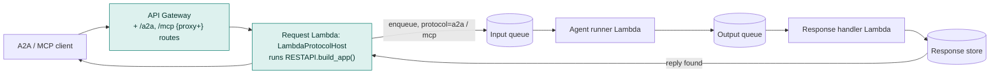

# #932: A2A and MCP on AWS Lambda through the queue pipeline

- Serve A2A `message:send` and agent-exposing MCP from the serverless (Lambda) deployment
- The request Lambda runs the existing `RESTAPI.build_app()` through AK's own Lambda event translator
- Covers the REST modes (`rest_sync`, `rest_async`) only; `async` (WebSocket) deployments are #985
- Queue mode only: direct mode is not touched, it is being removed (#959)
- Today an A2A or MCP call on Lambda never reaches the queue: there is no `/a2a` or `/mcp` route (G7) and the router knows only the chat path (G1)

## Flow

- Design flow below: the new parts are green; the queue and the workers are unchanged

## Motivation

- Lambda serves no A2A or MCP routes; `a2a.enabled` and `mcp.enabled` are silently ignored
  - `Lambda.handler` hands every event to the router (`deployment/aws/serverless/aklambda.py:97-98`)
  - `RESTLambdaRouter` looks up an exact path (`core/router/rest_lambda.py:428`); A2A and MCP exist only in the FastAPI app
    `RESTAPI.build_app` builds (`api/http.py:176`, `:204`)
- A2A and MCP already work through any queue: the executors call `RestHandler.request`, which tags the message with
  `protocol` and waits on the response store (`pipeline/request_handler.py:165-193`)
- In REST modes the Lambda workers already deliver what A2A and MCP need, so they need no change:
  - the response handler stores every reply and every permanent failure (`serverless/akresponsehandler.py:158-161`)
  - the stream runner is never reached: `rest_sync` + `delta` is refused at router init (`core/router/rest_lambda.py:49`)
    and `rest_async` + `delta` is refused by config
  - the Lambda copies ignore the `protocol` tag; that matters only in `async`, so the fixes belong to #985
- API Gateway routes have at most three path levels and no catch-all (`ak-deployment/ak-aws/serverless/modules/api-gateway/main.tf:13`);
  A2A needs `/a2a/{agent}/tasks/{id}` and similar
- The SQS wire format is already shared: `SQSHandler` builds messages with the pipeline's SQS module (`deployment/aws/core/sqs_handler.py:10`)

Paths are under `ak-py/src/agentkernel/` unless they say otherwise.

## Requirements

### Serve the routes

- A new class, `LambdaProtocolHost`, serves `/a2a/*` and `/mcp/*` events in the request Lambda
  - the application registers its routes with `Lambda.register`, like `LambdaWebhookHost`; the router resolves the `{proxy+}`
    resource template with the change cherry-picked from #935's first commit (see Dependencies)
  - a standalone class beside `LambdaWebhookHost` (`core/webhook_host.py`), following its pattern, and exported lazily from
    `agentkernel.aws`
  - builds `RESTAPI.build_app()` once per cold start
  - runs the app's lifespan once per cold start and keeps it open across calls on a long-lived event loop; FastMCP refuses
    requests until its lifespan runs
    - new work: `webhook_host.py` keeps only the loop (`run_until_complete` per call), never a lifespan; the spike proves this first
  - passes each event through `LambdaEventTranslator` (`deployment/aws/serverless/core/event_translator.py:27`),
    extended from one endpoint to a whole ASGI app; no new dependency
  - returns one whole response: MCP answers a tool call as `text/event-stream` by default (`api/mcp/akmcp.py:134`) and the
    translator refuses streams today, so the adapter buffers the body (or MCP runs with `json_response=True`)
  - `GET /mcp` (server push) answers 405; FastMCP already does this in stateless mode, so no code is needed
  - an A2A `message:send` with `return_immediately` still waits for the reply, because the executor sends one message, not a
    task; a test pins this
  - strips `/<API_BASE_PATH>/<API_VERSION>` (env vars Terraform already sets, `webhook_host.py:145`), so app routes stay
    `/a2a/...` and `/mcp`
  - the adapter sits behind this one class, so #894 can swap it for a streaming one
- Reuses the A2A and MCP code unchanged; no route handling is copied into the Lambda router
- The chat route, `RESTLambdaRouter` and `WSLambdaRouter` are unchanged

### Execution modes

- In scope: `rest_sync` and `rest_async`. The deployment already has a REST API and a response store
- A2A and MCP behave the same in both: `RestHandler.request` always waits for one stored reply (`pipeline/request_handler.py:168`)
- Out of scope: `async` (WebSocket), tracked in #985
  - an `async` deployment has no REST API (`ak-deployment/ak-aws/serverless/state.tf:41`, `:236`) and no response store
    (`state.tf:49-51`, `variables.tf:134-161`)
  - #962 makes the same choice for ECS: A2A and MCP need a REST mode
- `realtime` does not exist on Lambda (`variables.tf:61`)

### Authentication

- ECS parity: ECS has no API Gateway authorizer, the app authenticates the bearer token through the `identity` block
  - protocol routes use `authorization = "NONE"`; no new auth code in front of the app
  - no token runs as the anonymous principal (`identity/provider/request.py`), a bad token is a 401; MCP's FastMCP refuses a missing token itself
  - the request handler's `config.yaml` must carry the `identity` block, or every caller is anonymous
  - authenticated-only A2A access is a generic feature for ECS and Lambda alike, a follow-up

### Guards at cold start

- `AKConfigError` when A2A or agent MCP is on and:
  - the queue transport is not `sqs` (no `execution.queues` block resolves to `in_memory`, and every call would time out)
  - `execution.mode` is `async`: there is no REST API to reach the routes (#985)
  - no shared response store is configured (the ECS check, `IOHandler.check_deployment`)
  - `execution.response_store.retry_count × delay` is longer than the API Gateway limit (29 s) or the Lambda timeout
    (the first read is immediate, so the real wait is `(retry_count - 1) × delay`; cold start also counts against the 29 s)
  - `mcp.stateless_http` is false and MCP is on (any call may reach another instance; ECS keeps one replica's session)
  - not checked (ECS does not either, shared follow-up): a `localhost` `a2a.url` / `mcp.url` (the card advertises `a2a.url/<agent>`)
- Limit to document: an agent run plus queue time over about 29 s fails in v1; `tasks/{id}` is out of scope
- Timeouts and runner failures reach the caller as A2A or MCP errors (already true in the executors; tested on Lambda)
- A missing input queue is #959's cold-start check, not repeated here

### Terraform (`ak-deployment/ak-aws/serverless`)

- Optional `{proxy+}` routes for `/a2a` and `/mcp`, off by default; existing deployments plan no changes
- The routes reach the request Lambda, like every other route today (`modules/api-gateway/main.tf:116`)
- With the default in-memory agent registry, the request Lambda imports the agents, so it needs more memory than the 128 MB
  default (`modules/request-handler/variables.tf:89`). A2A cards and MCP tools come from the registry (#983); a shared registry
  would let the request Lambda skip the agents, with a cold-start ordering limit (spec: Deviation 12)
- No change to the `async` (WebSocket) Terraform

### Example, CI, docs

- A queue-mode `rest_sync` example under `examples/aws-serverless/` with A2A and MCP on, plus a weekly integration-test entry
  - the test sends one A2A `message:send` and one MCP agent tool call, twice each on one session
- Docs: Lambda rows in `docs/docs/api/a2a-server.md:56` and `docs/docs/api/mcp-server.md:48`, and the serverless deployment page
- Skills: `ak-dev-architecture` and the bundled `ak-cloud-deploy`

### Configuration

- No new `AKConfig` fields. Reused as is:
  - `a2a.enabled`, `mcp.enabled`, `mcp.expose_agents` turn the routes on
  - `a2a.url`, `mcp.url` must be the public URL, stage included
  - `execution.response_store.retry_count` / `delay` set the wait (defaults 5 × 5 s, `core/config.py:657-658`)

## Non-goals

- Streaming: A2A `message:stream`, streamed MCP replies (#894, #895)
- `tasks/{id}` across instances. `RedisTaskStore` is an empty placeholder (`api/a2a/a2a.py:189`); `message:send` replies are
  plain messages and need no task store
- `async` (WebSocket) deployments: #985
- Changes to the Lambda queue workers (`ServerlessAgentRunner`, `ServerlessStreamAgentRunner`, the Lambda `ResponseHandler`);
  the `protocol` fixes they need for `async` move to #985
- Changes to WebSocket chat
- Direct mode: not touched (#959 removes it)

## Dependencies

- #935 will be closed, not merged; its `LambdaHost` base is being refactored, so #932 does not use it
  - only its first commit (`4a8af37e3`, the router's resource-template lookup) is needed; #932 cherry-picks that change,
    agreed with its author
- #959 (open): removes direct mode and adds the missing-queue cold-start check

## Research

Supporting findings are in `research/findings.md`.

## Proposed decisions (for review)

- **Scope: REST modes only; `async` in #985**
  - matches #962 for ECS; #894 brings streaming over REST, which removes the main reason to need `async`
- **Adapter: extend AK's own `LambdaEventTranslator`**
  - it already builds the ASGI request; it needs a whole-app call and the lifespan
  - #760 chose it over a dependency for the same job; Mangum is not in `pyproject.toml` and cannot stream
  - AWS Lambda Web Adapter (can stream) changes how the Lambda starts; that choice belongs to #894
- **Which Lambda: the existing request Lambda**
  - the webhook host already runs there; API Gateway sends every route to it today
  - cost: the agents' dependencies and more memory; a separate protocol Lambda can follow if size becomes a problem
- **Workers: no change in #932**
  - in REST modes they already store whole replies; the `protocol` fixes only matter in `async`, so they go to #985
- **Auth: as on ECS.** No API Gateway authorizer on the protocol routes; the app authenticates (see Authentication)
- **Routing: `Lambda.register`, like Slack and threads**
  - no new hook in `Lambda.handler`; `aklambda.py` is not changed
- **Terraform flags: `enable_a2a_server`, `enable_mcp_server`**, matching ECS's `enable_mcp_server`
  (`ak-deployment/ak-aws/containerized/variables.tf:244`)

